# 配方 4-2. 从 DataFrame 中选择列

### 问题

你想从一个 DataFrame 中选择一个或多个列。

### 解决方案

我们将使用配方 4-1 中创建的`swimmerDf2` DataFrame。表 4-3 显示了这个 DataFrame。

表 4-3 该 DataFrame

| id | 性别 | 职业 | 游泳时间(秒) | 游泳速度 |
| --- | --- | --- | --- | --- |
| id1 | 男 | 程序员 | 16.73 | 1.195 |
| id2 | 女 | 经理 | 15.56 | 1.285 |
| id3 | 男 | 经理 | 15.15 | 1.32 |
| id4 | 男 | 风险分析师 | 15.27 | 1.31 |
| id5 | 男 | 程序员 | 15.65 | 1.278 |
| id6 | 男 | 风险分析师 | 15.74 | 1.271 |
| id7 | 女 | 程序员 | 16.8 | 1.19 |
| id8 | 男 | 经理 | 17.11 | 1.169 |
| id9 | 女 | 程序员 | 16.83 | 1.188 |
| id10 | 女 | 风险分析师 | 16.34 | 1.224 |
| id11 | 男 | 程序员 | 15.96 | 1.253 |
| id12 | 女 | 风险分析师 | 15.9 | 1.258 |

我们必须执行以下操作：

*   选择`游泳时间(秒)`列。
*   选择`id`和`游泳速度`列。

哪个 DataFrame API 可以帮助我们？这里，`select()`函数将为我们发挥作用。这个`select()`函数类似于 SQL 中的`SELECT`子句。

`select()`函数定义在 DataFrame 类中。`select()`函数的参数是列，即我们可能想要选择的列。


### 工作原理

#### 步骤 4-2-1. 选择 `swimTimeInSecond` 列

`select()` 函数可以接受可变数量的参数。其可变参数即为我们想要选择的不同列。现在，我们选择 `swimTimeInSecond` 列。

```
In [1]: swimmerDf3 = swimmerDf2.select("swimTimeInSecond")
In [2]: swimmerDf3.show(6)
```

以下是输出结果：

```
+----------------+
|swimTimeInSecond|
+----------------+
|           16.73|
|           15.56|
|           15.15|
|           15.27|
|           15.65|
|           15.74|
+----------------+
only showing top 6 rows
```

输出结果显示在 `swimmerDf3` 数据框中。

#### 步骤 4-2-2. 选择 `id` 和 `swimmerSpeed` 列

现在，是时候选择 `id` 和 `swimmerSpeed` 列了。以下代码将实现该操作。

```
In [3]: swimmerDf4 = swimmerDf2.select("id","swimmerSpeed")
In [4]: swimmerDf4.show(6)
```

以下是输出结果：

```
+---+------------+
| id|swimmerSpeed|
+---+------------+
|id1|       1.195|
|id2|       1.285|
|id3|        1.32|
|id4|        1.31|
|id5|       1.278|
|id6|       1.271|
+---+------------+
only showing top 6 rows
```

`swimmerDf4` 数据框展示出了我们所需的结果。

`select()` 函数接收一个针对列的表达式。在编程语境下，什么是表达式？表达式是会产生一个数学值或逻辑值的语句。在以下代码行中，我们将选择列，使得在新数据框 `swimmerDf5` 中，第一列为 `id`，第二列为 `swimmerSpeed` 乘以 2 的结果。

```
In [5]: swimmerDf5 = swimmerDf2.select("id",swimmerDf2.swimmerSpeed*2)
```

在上述代码行中，`swimmerDf2.swimmerSpeed*2` 就是一个表达式。

```
In [6]: swimmerDf5.show(6)
```

以下是输出结果：

```
+---+------------------+
| id|(swimmerSpeed * 2)|
+---+------------------+
|id1|              2.39|
|id2|              2.57|
|id3|              2.64|
|id4|              2.62|
|id5|             2.556|
|id6|             2.542|
+---+------------------+
only showing top 6 rows
```

最终输出结果如上所示。

## 食谱 4-3. 从数据框中过滤行

### 问题

您希望对数据框进行过滤操作。

### 解决方案

过滤过程用于从数据集中移除不需要的数据。它是基于某些条件从数据集中获取所需数据子集的过程。数据集通常包含不想要的记录，因此过滤是不可避免的。

我们将使用 `swimmerDf2` 数据框来解决以下问题：

*   选择 `Gender` 列值为 `Male` 的记录。

*   选择 `Gender` 为 `Male` 且 `Occupation` 为 `Programmer` 的记录。

*   选择 `Occupation` 为 `Programmer` 且 `swimmerSpeed > 1.17` 的记录。

我们将使用 `filter()` 函数。该函数通过给定的条件来过滤记录。我们以参数形式将过滤条件传递给 `filter()` 函数。它会返回一个新的数据框。`where()` 函数是 `filter()` 函数的别名。如果两个函数互为别名，则可以互换使用，传入相同的参数并获得相同的结果。

### 工作原理

#### 步骤 4-3-1. 选择 Gender 列为 Male 的记录

`filter` 函数的参数是一个用于表示相等关系的条件。我们可以使用 `swimmerDf2.Gender == 'Male'` 来表示相等关系。

```
In [1]: swimmerDf3 = swimmerDf2.filter(swimmerDf2.Gender == 'Male')
In [2]: swimmerDf3.show()
```

以下是输出结果：

```
+----+------+-----------+----------------+------------+
|  id|Gender| Occupation|swimTimeInSecond|swimmerSpeed|
+----+------+-----------+----------------+------------+
| id1|  Male| Programmer|           16.73|       1.195|
| id3|  Male|    Manager|           15.15|       1.320|
| id4|  Male|RiskAnalyst|           15.27|       1.310|
| id5|  Male| Programmer|           15.65|       1.278|
| id6|  Male|RiskAnalyst|           15.74|       1.271|
| id8|  Male|    Manager|           17.11|       1.169|
|id11|  Male| Programmer|           15.96|       1.253|
+----+------+-----------+----------------+------------+
```

#### 步骤 4-3-2. 选择 Gender 为 Male 且 Occupation 为 Programmer 的记录

我们可以在 `filter()` 函数中提供复合逻辑表达式。但核心 Python 的 `and` 和 `or` 运算符将无法正常工作。我们必须使用 `&` 运算符表示逻辑“与”，使用 `|` 运算符表示逻辑“或”。

```
In [3]: swimmerDf4 = swimmerDf2.filter((swimmerDf2.Gender == 'Male') & (swimmerDf2.Occupation == 'Programmer')).show()
In [4]: swimmerDf4.show()
```

以下是输出结果：

```
+----+------+-----------+----------------+------------+
|  id|Gender| Occupation|swimTimeInSecond|swimmerSpeed|
+----+------+-----------+----------------+------------+
| id1|  Male| Programmer|           16.73|       1.195|
| id5|  Male| Programmer|           15.65|       1.278|
|id11|  Male| Programmer|           15.96|       1.253|
+----+------+-----------+----------------+------------+
```

`swimmerDf4` 数据框包含了所有属于男性游泳者的记录。

#### 步骤 4-3-3. 选择 Occupation 为 Programmer 且 `swimmerSpeed > 1.17` 的记录

在本食谱的最后一个任务中，我们需要找出那些 `swimmerSpeed` 值大于 1.17 米/秒的程序员记录。

```
In [5]: swimmerDf2.filter((swimmerDf2.Occupation == 'Programmer') & (swimmerDf2.swimmerSpeed > 1.17) ).show()
In [6]: swimmerDf5.show()
```

以下是输出结果：

```
+----+------+----------+----------------+------------+
|  id|Gender|Occupation|swimTimeInSecond|swimmerSpeed|
+----+------+----------+----------------+------------+
| id1|  Male|Programmer|           16.73|       1.195|
| id5|  Male|Programmer|           15.65|       1.278|
| id7|Female|Programmer|            16.8|        1.19|
| id9|Female|Programmer|           16.83|       1.188|
|id11|  Male|Programmer|           15.96|       1.253|
+----+------+----------+----------------+------------+
```

## 食谱 4-4. 从现有数据框中删除列

### 问题

您想要从数据框中删除某些列。

### 解决方案

数据科学家可能会遇到结构化数据集中存在一些冗余列的情况，这些列必须在分析之前移除。

在本食谱中，您需要完成以下任务：

*   从 `swimmerDf2` 数据框中删除 `id` 列。

*   从 `swimmerDf2` 数据框中删除 `id` 和 `Occupation` 列。

可以使用 `drop()` 函数来删除数据框中的一个或多个列。该函数接受要删除的列作为参数，并返回一个新的数据框。新的数据框将不包含被删除的列。


### 工作原理

#### 步骤 4-4-1. 从 `swimmerDf2` DataFrame 中删除 `id` 列

我们首先删除 `id` 列：

```
In [1]: swimmerDf3 = swimmerDf2.drop(swimmerDf2.id)
In [2]: swimmerDf3.show(6)
```

输出如下：

```
+------+-----------+----------------+------------+
|Gender| Occupation|swimTimeInSecond|swimmerSpeed|
+------+-----------+----------------+------------+
|  Male| Programmer|           16.73|       1.195|
|Female|    Manager|           15.56|       1.285|
|  Male|    Manager|           15.15|        1.32|
|  Male|RiskAnalyst|           15.27|        1.31|
|  Male| Programmer|           15.65|       1.278|
|  Male|RiskAnalyst|           15.74|       1.271|
+------+-----------+----------------+------------+
only showing top 6 rows
```

通过将 `id` 作为参数传递，我们也可以获得相同的结果。

```
In [3]: swimmerDf4 = swimmerDf2.drop("id")
In [4]: swimmerDf4.show(6)
```

输出如下：

```
+------+-----------+----------------+------------+
|Gender| Occupation|swimTimeInSecond|swimmerSpeed|
+------+-----------+----------------+------------+
|  Male| Programmer|           16.73|       1.195|
|Female|    Manager|           15.56|       1.285|
|  Male|    Manager|           15.15|        1.32|
|  Male|RiskAnalyst|           15.27|        1.31|
|  Male| Programmer|           15.65|       1.278|
|  Male|RiskAnalyst|           15.74|       1.271|
+------+-----------+----------------+------------+
only showing top 6 rows
```

#### 步骤 4-4-2. 从 `swimmerDf2` 中删除 `id` 和 `Occupation` 列

删除或丢弃多个列非常容易。我们需要将所有列作为字符串提供，并将参数数量作为变量传递给 `drop()` 函数：

```
In [5]: swimmerDf5 = swimmerDf2.drop("id", "Occupation")
In [6]: swimmerDf5.show(6)
```

输出如下：

```
+------+----------------+------------+
|Gender|swimTimeInSecond|swimmerSpeed|
+------+----------------+------------+
|  Male|           16.73|       1.195|
|Female|           15.56|       1.285|
|  Male|           15.15|       1.320|
|  Male|           15.27|       1.310|
|  Male|           15.65|       1.278|
|  Male|           15.74|       1.271|
+------+----------------+------------+
only showing top 6 rows
```

我们最终在 `swimmerDf5` DataFrame 中得到了结果。

### 配方 4-5. 创建并使用 PySpark SQL UDF

### 问题

你想创建一个用户自定义函数（UDF）并将其应用于 DataFrame 的某一列。

### 解决方案

你可能会想，任何懂 Python 的人都能轻松创建一个用户自定义函数，这有什么特别的呢？但在 PySpark SQL 中，UDF 作用于列。UDF 作用于列的每一个元素，并生成一个新的列。

图 4-1 显示了七天内以摄氏度收集的平均温度，以及如何添加一个将温度转换为华氏度的列。

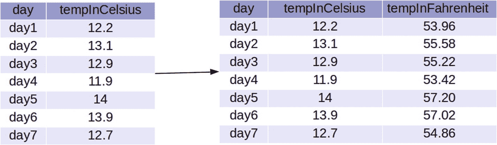

图 4-1

添加华氏度列

如图 4-1 所示，左侧表格的第一列为 `day`，第二列为以摄氏度表示的温度。对我们来说，这个表格就是一个 DataFrame。我们必须创建一个新的 DataFrame，如图 4-1 右侧所示。这个新 DataFrame 有第三列，列出了以华氏度表示的温度。对于第二列中的每个值，我们将其转换为第三列中的华氏度值。

这看起来是一个非常简单的任务。我们首先创建一个 Python 函数，该函数接收一个摄氏度温度值，并返回相应的华氏度温度值。你可能会想，是否存在一个已有的函数来执行此任务？我们如何将创建的函数应用到列中的每个值？我们是否要使用某种循环？不，我们只需将这个函数变成一个 UDF，其余的工作将由 PySpark SQL API 的 `withColumn()` 函数处理。

将一个简单的 Python 函数转换为 UDF 非常简单。我们将使用 `udf()` 函数，如下所示：

```
udf(f= None, returnType =StringType)
```

`udf()` 函数定义在 PySpark 子模块 `pyspark.sql.functions` 中。它接受两个参数。第一个参数是一个 Python 函数，第二个参数是该函数的返回数据类型。返回数据类型将来自 PySpark 子模块 `pyspark.sql.types`。`returnType` 参数的默认值是 `StringType`。

我们将逐步解决所给出的问题。


### 工作原理

#### 步骤 4-5-1. 创建 DataFrame

我们已从 Parquet 文件中获取数据。数据目录名为 `temperatureData`。我们需要使用 `DoubleType` 类和 `udf` 函数，因此首先导入所需的函数和类。

```
In [1]: from pyspark.sql.types import DoubleType
from pyspark.sql.functions import udf
```

自 Spark 2.0.0 起，从不同数据源读取数据变得非常容易，我们在前几章已详细讨论过。要从 Parquet 文件中读取数据，需使用 `spark.read.parquet()` 函数，其中 `spark` 是 `SparkSession` 类的对象，由控制台提供。

```
In [2]: tempDf = spark.read.parquet('temperatureData')
In [3]: tempDf.show(6)
```

输出结果如下：

```
+----+-------------+
| day|tempInCelsius|
+----+-------------+
|day1|         12.2|
|day2|         13.1|
|day3|         12.9|
|day4|         11.9|
|day5|         14.0|
|day6|         13.9|
+----+-------------+
only showing top 6 rows
```

#### 步骤 4-5-2. 创建 UDF

创建 PySpark SQL UDF 通常分为两步：首先创建一个 Python 函数，然后使用 `udf()` 函数将创建的 Python 函数转换为 UDF。

为了将摄氏温度转换为华氏温度，我们创建一个名为 `celsiustoFahrenheit` 的 Python 函数。该函数有一个参数 `temp`，表示摄氏温度。

```
In [4]: def celsiustoFahrenheit(temp):
...:     return ((temp*9.0/5.0)+32)
...:
```

测试一下 Python 函数的功能：

```
In [5]: celsiustoFahrenheit(12.2)
Out[5]: 53.96
```

测试结果表明 `celsiustoFahrenheit` 函数按预期工作。现在将 Python 函数转换为 UDF。

```
In [6]: celsiustoFahrenheitUdf = udf("celsiustoFahrenheit", DoubleType())
```

我们可以观察到 `udf()` 函数的第一个参数是字符串格式的函数名，第二个参数是 UDF 的返回类型。我们的 UDF 的返回类型是 `DoubleType`。这里 `celsiustoFahrenheitUdf` 就是我们需要的 UDF，它将应用于 `tempInCelsius` 列的每个值，并返回华氏温度。

#### 步骤 4-5-3. 使用 UDF 创建新列

所需的 UDF 已创建完毕。现在使用该 UDF 将温度从摄氏转换为华氏，并将结果添加为新列。我们将使用 `withColumn()` 函数，其第二个参数为 UDF，并以 `tempInCelsius` 作为 UDF 的输入。

```
In [7]: tempDfFahrenheit = tempDf.withColumn('tempInFahrenheit', celsiustoFahrenheitUdf(tempDf.tempInCelsius))
In [7]: tempDfFahrenheit.show(6)
```

输出结果如下：

```
+----+-------------+----------------+
| day|tempInCelsius|tempInFahrenheit|
+----+-------------+----------------+
|day1|         12.2|           53.96|
|day2|         13.1|           55.58|
|day3|         12.9|           55.22|
|day4|         11.9|           53.42|
|day5|         14.0|           57.20|
|day6|         13.9|           57.02|
+----+-------------+----------------+
only showing top 6 rows
```

`tempDfFahrenheit` 的输出表明我们已成功完成任务。

#### 步骤 4-5-4. 将结果 DataFrame 保存为 CSV 文件

保存结果以便后续使用是个好主意。

```
In [8]: tempDfFahrenheit.write.csv(path='tempInCelsAndFahren',header=True,sep=',')
$ cd tempInCelsAndFahren
$ ls
```

输出结果如下：

```
part-00000-1320146a-7998-4f3b-9bdd-939227c793c9-c000.csv  _SUCCESS
```

结果保存在 `part-00000-1320146a-7998-4f3b-9bdd-939227c793c9-c000.csv` 文件中。

## 配方 4-6. 数据标注

### 问题

你想对 DataFrame 列中的数据点进行标注。

### 解决方案

我们在配方 4-5 中处理过温度数据。见图 4-2。

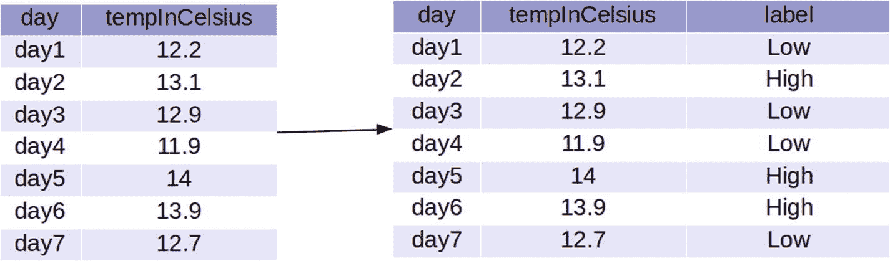

图 4-2

数据标注

图 4-2 展示了本配方的任务。我们需要对 `tempInCelsius` 列中的数据进行标注，并创建一个名为 `label` 的新列。如果对应的 `tempInCelsius` 值大于 12.9，则此标签显示 `High`，否则显示 `Low`。

### 工作原理

#### 步骤 4-6-1. 创建用于生成标签的 UDF

由于我们需要一个能够创建标签的 UDF，因此需要使用 `udf()` 函数。

```
In [1]: from pyspark.sql.functions import udf
```

我们将创建一个名为 `labelTemprature` 的 Python 函数。该函数将摄氏温度作为输入，并根据条件返回 `High` 或 `Low`。

```
In [2]: def labelTemprature(temp) :
...:     if temp > 12.9 :
...:         return "High"
...:     else :
...:         return "Low"
In [3]: labelTemprature(11.99)
Out[3]: 'Low'
In [4]: labelTemprature(13.2)
Out[4]: 'High'
```

使用 `labelTemprature` 创建一个 PySpark SQL UDF。

```
In [5]: labelTempratureUdf = udf(labelTemprature)
```

#### 步骤 4-6-2. 创建包含新标签列的新 DataFrame

使用 `withColumn()` 函数创建一个名为 `tempDf2` 的新 DataFrame，其中包含新列 label：

```
In [6]: tempDf2 = tempDf.withColumn("label", labelTempratureUdf(tempDf.tempInCelsius))
In [7]: tempDf2.show()
```

输出结果如下：

```
+----+-------------+-----+
| day|tempInCelsius|label|
+----+-------------+-----+
|day1|         12.2|  Low|
|day2|         13.1| High|
|day3|         12.9|  Low|
|day4|         11.9|  Low|
|day5|         14.0| High|
|day6|         13.9| High|
|day7|         12.7|  Low|
+----+-------------+-----+
```

我们已完成了数据标注。

## 配方 4-7. 对 DataFrame 的列执行描述性统计

### 问题

你想计算 DataFrame 中各列的描述性统计指标。


### 解决方案

描述性统计能为你提供关于数据的重要信息。关键的描述性统计指标包括：计数、总和、均值、样本方差和样本标准差。让我们逐一进行讨论。

假设变量 `x` 的数据点为 `x1`, `x2`, . . ,`xn`。图 4-3 展示了如何计算样本均值的数学公式。样本均值是衡量数据集集中趋势的一种指标。

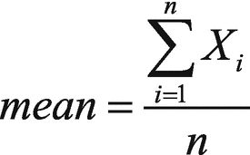

图 4-3

计算均值

方差是衡量数据集离散程度的一种指标。图 4-4 展示了计算总体方差的数学公式。

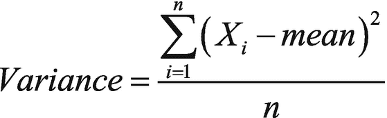

图 4-4

计算总体方差

图 4-5 展示了计算样本方差的数学公式。

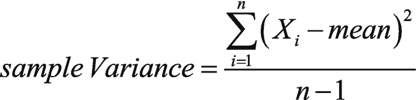

图 4-5

样本方差

我们已获得一个名为 `corrData.json` 的 JSON 数据文件。文件内容如下所示。

```
{"iv1":5.5,"iv2":8.5,"iv3":9.5}
{"iv1":6.13,"iv2":9.13,"iv3":10.13}
{"iv1":5.92,"iv2":8.92,"iv3":9.92}
{"iv1":6.89,"iv2":9.89,"iv3":10.89}
{"iv1":6.12,"iv2":9.12,"iv3":10.12}
```

可以想象这些数据以表格形式呈现。我们看到数据有三列——`iv1`, `iv2` 和 `iv3`。每列都包含小数或浮点数值。

所有数据的描述性度量——如均值、求和和其他函数——都可以在 `pyspark.sql.functions` 子模块中找到。

*   `avg()`: 计算某一列的均值。我们也可以使用 `mean()` 函数来代替 `avg()`。
*   `max()`: 查找给定列的最大值。
*   `min()`: 查找给定列的最小值。
*   `sum()`: 对一列的值进行求和。
*   `count()`: 计算一列中元素的数量。
*   `var_samp()`: 计算样本方差。我们可以使用 `variance()` 函数来代替 `var_samp()` 函数。
*   `var_pop()`: 如果你想计算总体方差，将使用 `var_pop()` 函数。
*   `stddev_samp()`: 可以使用 `stddev()` 或 `stddev_samp()` 函数来计算样本标准差。
*   `stddev_pop()`: 计算总体标准差。

`pyspark.sql.functions` 子模块中还可以找到更多函数。

我们将执行以下操作：

*   计算每列的均值。
*   计算每列的方差。
*   计算每列的数据点总数。
*   计算第一列的总和、均值和标准差。
*   计算第一列的方差、第二列的均值以及第三列的标准差。

为了对 DataFrame 的列应用聚合，我们将使用 `agg()` 函数。该函数定义在 DataFrame 上并返回一个 DataFrame。`agg()` 的输入将是一个表达式。输入格式为字典，其中每个元素的键是列名，值是我们希望对该列执行的聚合操作。我们将在后续内容中对此进行更详细的讨论。

### 工作原理

#### 步骤 4-7-1\. 读取数据并创建 DataFrame

数据存储在一个 JSON 文件中。我们将使用 `spark.read.json()` 函数来读取它。

```
In [1]: corrData = spark.read.json(path='corrData.json')
In [2]: corrData.show(6)
```

以下是输出结果：

```
+----+----+-----+
| iv1| iv2|  iv3|
+----+----+-----+
| 5.5| 8.5|  9.5|
|6.13|9.13|10.13|
|5.92|8.92| 9.92|
|6.89|9.89|10.89|
|6.12|9.12|10.12|
|6.32|9.32|10.32|
+----+----+-----+
only showing top 6 rows
```

我们已成功创建了 DataFrame。每当我们没有显式提供 DataFrame 的 schema 时，最好检查新创建 DataFrame 的 schema，以确保一切符合预期。

```
In [3]: corrData.printSchema()
```

以下是输出结果：

```
root
|-- iv1: double (nullable = true)
|-- iv2: double (nullable = true)
|-- iv3: double (nullable = true)
```

一切符合预期。

#### 步骤 4-7-2\. 计算每列的均值

如前所述，我们将使用 `agg()` 函数对 DataFrame 的列执行聚合。该 `agg()` 函数将以字典作为输入。键是列名，值是我们想要执行的聚合。这两者都将以 `String` 形式提供。我们需要计算每列的平均值。因此，`agg()` 函数所需的输入将是 `{"iv1":"avg","iv2":"avg","iv3":"avg"}`，这是一个 Python 字典。字典的每个键是 DataFrame 中的列名，每个值是与作为键的列名相关联的、我们想要计算的聚合函数。

```
In [3]: meanVal = corrData.agg({"iv1":"avg","iv2":"avg","iv3":"avg"})
In [4]: meanVal.show()
```

以下是输出结果：

```
+-----------------+-----------------+------------------+
|         avg(iv2)|         avg(iv1)|          avg(iv3)|
+-----------------+-----------------+------------------+
|9.044666666666666|6.044666666666666|10.044666666666668|
+-----------------+-----------------+------------------+
```

我们已经计算出了每列的均值。

#### 步骤 4-7-3\. 计算每列的方差

现在我们需要计算每列的方差。我们知道方差有两种类型：样本方差和总体方差。我们将分别计算这两种方差，你可以根据需要使用它们。我们先从样本方差开始。

```
In [5]: varSampleVal = corrData.agg({"iv1":"var_samp","iv2":"var_samp","iv3":"var_samp"})
In [6]: varSampleVal.show()
```

以下是输出结果：

```
+-------------------+-------------------+-------------------+
|      var_samp(iv2)|      var_samp(iv1)|      var_samp(iv3)|
+-------------------+-------------------+-------------------+
|0.24509809523809528|0.24509809523809528|0.24509809523809528|
+-------------------+-------------------+-------------------+
```

现在我们来计算总体方差：

```
In [7]: varPopulation = corrData.agg({"iv1":"var_pop","iv2":"var_pop","iv3":"var_pop"})
In [8]: varPopulation.show()
```

以下是输出结果：

```
+---------------+---------------+---------------+
|   var_pop(iv2)|   var_pop(iv1)|   var_pop(iv3)|
+---------------+---------------+---------------+
|0.2287582222222|0.2287582222222|0.2287582222222|
+---------------+---------------+---------------+
```

#### 步骤 4-7-4\. 计算每列的数据点数量

现在我们已经知道如何对不同列应用聚合。但为了更熟悉这个过程，我们再应用一个聚合操作：计算每列中元素的数量。

```
In [10]: countVal = corrData.agg({"iv1":"count","iv2":"count","iv3":"count"})
In [11]: countVal.show()
```

以下是输出结果：

```
+----------+----------+----------+
|count(iv2)|count(iv1)|count(iv3)|
+----------+----------+----------+
|        15|        15|        15|
+----------+----------+----------+
```


#### 步骤 4-7-5. 计算第一列的总和、平均值和标准差

有时你需要对同一列应用多个聚合函数。让我们以对 `iv1` 列应用求和、平均和样本标准差为例。

```
In [12]: moreAggOnOneCol = corrData.agg({"iv1":"sum","iv1":"avg","iv1":"stddev_samp"})
In [13]: moreAggOnOneCol.show()
```

输出如下：

```
+-------------------+
|   stddev_samp(iv1)|
+-------------------+
|0.49507382806819356|
+-------------------+
```

这里的输出并不符合预期。导致这个问题的原因是什么？是由于 Python 字典的特性。字典的键必须是唯一的，否则后面的值会覆盖前面的值。

解决方案是什么？我们可以将聚合函数作为多个参数逐个提供。为了直接以函数的形式应用聚合函数，我们必须首先导入所有函数。回顾一下，所有的聚合函数都在 `pyspark.sql.functions` 子模块中。

```
In [14]: from pyspark.sql.functions import *
In [15]: moreAggOnOneCol = corrData.agg(sum("iv1"), avg("iv1"), stddev_samp("iv1"))
In [16]: moreAggOnOneCol.show()
```

输出如下：

```
+-------------+-------------+----------------+
|     sum(iv1)|     avg(iv1)|stddev_samp(iv1)|
+-------------+-------------+----------------+
|90.6699999999|6.04466666666| 0.4950738280681|
+-------------+-------------+----------------+
```

现在我们就得到了预期的结果。

#### 步骤 4-7-6. 计算第一列的方差、第二列的平均值和第三列的标准差

我们能否一次性对不同列应用不同的聚合函数？当然可以。下面的代码展示了如何实现。

```
In [24]: colWiseDiffAggregation = corrData.agg({"iv1":"var_samp","iv2":"avg","iv3":"stddev_samp"})
In [25]: colWiseDiffAggregation.show()
```

输出如下：

```
+-------------+---------------+----------------+
|     avg(iv2)|  var_samp(iv1)|stddev_samp(iv3)|
+-------------+---------------+----------------+
|9.04466666666|0.2450980952380| 0.4950738280681|
+-------------+---------------+----------------+
```

## 方法 4-8. 计算协方差

### 问题

你想计算 `DataFrame` 中两列之间的协方差。

### 解决方案

协方差显示两个变量之间的关系。它表示一个变量基于另一个变量的线性变化。

假设我们有来自变量 `x` 的数据点 `x[1]`, `x[2]`, ..., `x[n]` 和来自变量 `y` 的数据点 `y[1]`, `y[2]`, ..., `y[n]`。`μ[x]` 和 `μ[y]` 分别是 `x` 和 `y` 变量的均值。图 4-6 是代表如何计算样本协方差的数学公式。

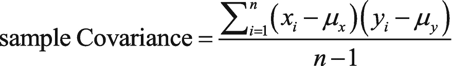

图 4-6

样本协方差

在 PySpark SQL 中，我们可以使用 `cov(col1, col2)` API 计算样本协方差。该函数一次接收 `DataFrame` 的两列。`DataFrame` 类和 `DataFrameStatFunctions` 类下的 `cov()` 函数互为别名。

我们需要计算以下内容：

- 变量 `iv1` 和 `iv2` 之间的协方差。
- 变量 `iv3` 和 `iv1` 之间的协方差。
- 变量 `iv2` 和 `iv3` 之间的协方差。

### 实现原理

我们将使用在方法 4-7 中创建的 `corrData` DataFrame。

#### 步骤 4-8-1. 计算变量 `iv1` 和 `iv2` 之间的协方差

我们将计算列 `iv1` 和列 `iv2` 之间的协方差。

```
In [48]: corrData.cov('iv1','iv2')
```

输出如下：

```
Out[48]: 0.24509809523809525
```

#### 步骤 4-8-2. 计算变量 `iv3` 和 `iv1` 之间的协方差

现在来计算列 `iv1` 和列 `iv3` 之间的协方差。

```
In [49]: corrData.cov('iv1','iv3')
```

输出如下：

```
Out[49]: 0.24509809523809525
```

#### 步骤 4-8-3. 计算变量 `iv2` 和 `iv3` 之间的协方差

最后，我们计算列 `iv2` 和 `iv3` 之间的协方差。

```
In [50]: corrData.cov('iv2','iv3')
```

输出如下：

```
Out[50]: 0.2450980952380953
```

## 方法 4-9. 计算相关性

### 问题

你想计算 `DataFrame` 中两列之间的相关性。

### 解决方案

相关性显示两个变量之间的关系。它显示一个变量的变化如何影响另一个变量。它是归一化的协方差。协方差的值可以是任何正值，因此，我们通过归一化相关性来正确解释两个变量的关系。相关性的值介于 -1 到 1 之间（包含两端）。

假设我们有来自变量 `x` 的数据点 `x[1]`, `x[2]`, ..., `x[n]` 和来自变量 `y` 的数据点 `y[1]`, `y[2]`, ..., `y[n]`。`μx` 和 `μy` 分别是 `x` 和 `y` 变量的均值。图 4-7 中的数学公式展示了如何使用这些数据计算相关性。

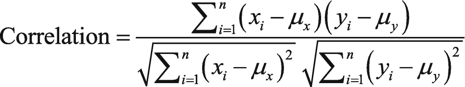

图 4-7

相关性

在 PySpark SQL 中，我们可以使用 `corr(col1, col2)` 计算相关性。该函数一次接收 `DataFrame` 的两列。`DataFrame` 类和 `DataFrameStatFunctions` 类下的 `corr()` 函数互为别名。

我们需要计算以下内容：

- `iv1` 和 `iv2` 之间的相关性。
- `iv3` 和 `iv1` 之间的相关性。
- `iv2` 和 `iv3` 之间的相关性。

### 实现原理

我们将使用在方法 4-7 中创建的 `corrData` DataFrame。

#### 步骤 4-9-1. 计算变量 `iv1` 和 `iv2` 之间的相关性

以下是计算列 `iv1` 和 `iv2` 之间相关性的方法。

```
In [10]: corrData.corr('iv1','iv2')
Out[10]: 0.9999999999999998
```

类似地，其他列之间的相关性可以通过以下步骤计算。

#### 步骤 4-9-2. 计算变量 `iv3` 和 `iv1` 之间的相关性

```
In [11]: corrData.corr('iv1','iv3')
Out[11]: 0.9999999999999998
```

#### 步骤 4-9-3. 计算变量 `iv2` 和 `iv3` 之间的相关性

```
In [12]: corrData.corr('iv2','iv3')
Out[12]: 1.0
```

## 方法 4-10. 描述一个 DataFrame

### 问题

你想计算 `DataFrame` 中所有列的汇总统计量。


### 解决方案

在配方 4-7 中，我们学习了如何使用 DataFrame 内置的聚合函数计算不同的汇总统计量。

PySpark SQL 提供了两个更加强大且易于使用的函数，它们可以为每个列计算一组汇总统计量。这两个函数分别是`describe()`和`summary()`。

`describe()`函数定义在 DataFrame 上，它为每个列计算最小值、最大值、计数、均值和标准差。对于包含分类值的列，`describe()`函数为每个分类列返回计数、最小值和最大值。该函数用于探索性数据分析。我们可以对单个列或多个列应用`describe()`函数。如果未提供输入，该函数将对每个列应用汇总统计量，并将结果作为新的 DataFrame 返回。

`summary()`函数计算最小值、最大值、计数、均值和标准差等汇总统计量，这与`describe()`函数类似。除此之外，`summary()`函数还计算中位数以及第 25 和第 50 百分位数。

`describe()`函数将列作为其输入。它计算每个输入的指定汇总统计量。另一方面，`summary()`函数将汇总统计量名称作为 Python 字符串接收，并返回我们作为参数提供的每个列上的汇总统计量。

我们将使用在配方 4-7 中创建的`corrData` DataFrame。我们想要执行以下操作：

- 对每个列应用`describe()`函数。
- 对列`iv1`和`iv2`应用`describe()`函数。
- 向`corrData` DataFrame 添加一个分类变量列，并对该分类列应用`describe()`函数。
- 对每个列应用`summary()`函数。
- 对列`iv2`和`iv3`应用`summary()`函数。

### 工作原理

#### 步骤 4-10-1. 对每个列应用`describe()`函数

我们将对 DataFrame 的每个列应用`describe()`函数。如果没有向`describe`函数提供输入，它将应用于每个列。

```
In [1]: dataDescription = corrData.describe()
In [2]: dataDescription.show()
```

以下是输出：

```
+-------+--------+---------+--------+
|summary|     iv1|      iv2|     iv3|
+-------+--------+---------+--------+
|  count|      15|       15|      15|
|   mean| 6.04466|  9.04466| 10.0446|
| stddev|0.495073|0.4950738|0.495073|
|    min|    5.17|     8.17|    9.17|
|    max|    6.89|     9.89|   10.89|
+-------+--------+---------+--------+
```

`describe()`函数返回汇总统计量。在结果的第一列中，我们可以看到所有汇总统计量名称。第二列名为`iv1`，提供了汇总统计量值。`iv1`列中的第一个值`15`是`iv1`列中的元素数量。类似地，`iv1`列中的第二个值`6.044666`是该列数据的平均值。PySpark SQL 会返回保留许多小数位的平均值。此处的部分平均值结果已被截断，以便于阅读。

#### 步骤 4-10-2. 对列`iv1`和`iv2`应用`describe()`函数

我们可以通过列选择来应用`describe()`函数。这里，我们将对列`iv1`和`iv2`应用`describe()`函数。

```
In [3]: dataDescriptioniv1iv2 = corrData.describe(['iv1', 'iv2'])
In [4]: dataDescriptioniv1iv2.show()
```

以下是输出：

```
+-------+--------+---------+
|summary|     iv1|      iv2|
+-------+--------+---------+
|  count|      15|       15|
|   mean| 6.04466|  9.04466|
| stddev|0.495073|0.4950738|
|    min|    5.17|     8.17|
|    max|    6.89|     9.89|
+-------+--------+---------+
```

我们可以对列应用选择性汇总统计量（如均值和方差）吗？不能使用`describe()`函数。为了提供选择性汇总统计量，我们必须使用`summary()`函数。

#### 步骤 4-10-3. 对每个列应用`summary()`函数

正如我们讨论过的，`summary()`函数与`describe()`函数类似。`summary()`函数提供第 25、50 和 75 分位数。为了将`summary()`函数应用于我们的汇总统计量，我们不提供任何输入。

```
In [5]: summaryData = corrData.summary()
In [6]: summaryData.show()
```

以下是输出：

```
+-------+--------+---------+--------+
|summary|     iv1|      iv2|     iv3|
+-------+--------+---------+--------+
|  count|      15|       15|      15|
|   mean| 6.04466|  9.04466| 10.0446|
| stddev|0.495073|0.4950738|0.495073|
|    min|    5.17|     8.17|    9.17|
|    25%|    5.64|     8.64|    9.64|
|    50%|     6.1|      9.1|    10.1|
|    75%|    6.32|     9.32|   10.32|
|    max|    6.89|     9.89|   10.89|
+-------+--------+---------+--------+
```

使用`summary()`函数，我们可以应用选择性的汇总统计量。以下代码行使用`summary()`函数确定均值和最大值。

```
In [7]: summaryMeanMax = corrData.summary(['mean','max'])
In [8]: summaryMeanMax.show()
```

以下是输出：

```
+-------+-------+-------+-------+
|summary|    iv1|    iv2|    iv3|
+-------+-------+-------+-------+
|   mean|6.04466|9.04466|10.0446|
|    max|   6.89|   9.89|  10.89|
+-------+-------+-------+-------+
```

#### 步骤 4-10-4. 对列`iv2`和`iv3`应用`summary()`函数

为了在选择性列上应用`summary()`函数，我们必须首先使用`select()`函数选择所需的列。然后，在选定的列上，我们可以应用`summary()`函数。

```
In [9]: summaryiv1iv2 = corrData.select('iv1','iv2').summary('min','max')
```

我们使用`select()`函数选择列`iv1`和`iv2`，然后应用`summary()`函数计算选定列的最小值和最大值。

```
In [10]: summaryiv1iv2.show()
```

以下是输出：

```
+-------+----+----+
|summary| iv1| iv2|
+-------+----+----+
|    min|5.17|8.17|
|    max|6.89|9.89|
+-------+----+----+
```


好的，作为一名高级文档工程师和翻译员，我将严格按照您提供的注意事项和示例格式，将给定的英文文本翻译成中文。


#### 步骤 4-10-5：添加分类变量列

我们可以向 `corrData` 数据框中添加一列分类变量，然后对该分类列应用 `describe()` 函数。

你已经知道如何对数值数据应用 `describe()` 函数。但你可能想知道 `describe()` 函数在分类变量上的表现。分类值是字符串。我们可以找到分类数据的最小值和最大值。除了最小值和最大值，我们还可以确定元素的数量。

现在，我们将创建一个名为 `labelIt()` 的 UDF。`labelIt` 函数的输入将是 `iv3` 列中的值。如果输入大于 10.0，该 UDF 将返回 `High`。否则，它将返回 `Low`。

```
In [11]: from pyspark.sql.functions import udf
In [12]: def labelIt(x):
...:          if x > 10.0 :
...:                   return 'High'
...:                else:
...:                   return 'Low'
In [13]: labelIt = udf(labelIt)
```

我们现在已经创建了 `labelIt()` UDF。该 UDF 的输出将构成新创建的数据框 `corrData1` 中 `iv4` 列的元素。

```
In [14]: corrData1 = corrData.withColumn('iv4', labelIt('iv3'))
In [15]: corrData1.show(5)
```

以下是输出：

```
+----+----+-----+----+
| iv1| iv2|  iv3| iv4|
+----+----+-----+----+
| 5.5| 8.5|  9.5| Low|
|6.13|9.13|10.13|High|
|5.92|8.92| 9.92| Low|
|6.89|9.89|10.89|High|
|6.12|9.12|10.12|High|
+----+----+-----+----+
only showing top 5 rows
```

`corrData1` 数据框在末尾多了一列，名为 `iv4`。此列包含分类值 `Low` 和 `High`。我们将对该数据框的每一列应用摘要。

```
In [16]: meanMaxSummary = corrData1.summary('mean','max')
In [17]: meanMaxSummary.show()
```

以下是输出：

```
+-------+---------+---------+--------+----+
|summary|      iv1|      iv2|     iv3| iv4|
+-------+---------+---------+--------+----+
|   mean|6.0446666|9.0446666|10.04466|null|
|    max|     6.89|     9.89|   10.89| Low|
+-------+---------+---------+--------+----+
```

现在是其他的：

```
In [18]:  countMinMaxSummary  = corrData1.summary('count','min','max')
In [19]:  countMinMaxSummary.show()
+-------+----+----+-----+----+
|summary| iv1| iv2|  iv3| iv4|
+-------+----+----+-----+----+
|  count|  15|  15|   15|  15|
|    min|5.17|8.17| 9.17|High|
|    max|6.89|9.89|10.89| Low|
+-------+----+----+-----+----+
```

## 方案 4-11：对数据框中的数据进行排序

### 问题

你想要对数据框中的记录进行排序。

### 解决方案

你需要时不时地执行排序操作，无论是为你自己，还是当某些数学或统计算法要求输入数据为排序状态时。排序可以相对于某个键或列按升序或降序进行。

PySpark SQL API `orderBy(*cols, **kwargs)` 可用于对记录进行排序。它会返回一个按指定列排序的新数据框。我们将列作为函数的 `*cols` 参数提供。`*cols` 中的 `*` 表示可变数量的参数，我们将提供不同的列作为字符串。第二个参数 `**kwargs` 是一个键/值对。我们将提供 `ascending` 作为键，其关联值是一个布尔值或一个布尔值列表。如果我们提供一个布尔值列表作为 `ascending` 键的值，则列表的数量必须等于我们在 `cols` 参数中提供的列数。

我们将对在方案 4-1 中创建的数据框 `swimmerDf` 执行排序操作。让我们回顾一下 `swimmerDf` 的行数据。

```
In [1]: swimmerDf.show(4)
+---+------+-----------+----------------+
| id|Gender| Occupation|swimTimeInSecond|
+---+------+-----------+----------------+
|id1|  Male| Programmer|           16.73|
|id2|Female|    Manager|           15.56|
|id3|  Male|    Manager|           15.15|
|id4|  Male|RiskAnalyst|           15.27|
+---+------+-----------+----------------+
only showing top 4 rows
```

我们需要执行以下操作：

-   按 `swimTimeInSecond` 列对 `swimmerDf` 数据框进行升序排序。
-   按 `swimTimeInSecond` 列对 `swimmerDf` 数据框进行降序排序。
-   分别按 `Occupation` 列降序和 `swimTimeInSecond` 列升序对 `swimmerDf` 数据框进行排序。

### 注意

我们也可以使用 `sort()` 函数代替 `orderBy()` 函数。

### 工作原理

#### 步骤 4-11-1：对数据框进行升序排序

我们将按 `swimTimeInSecond` 列对 `swimmerDf` 数据框进行升序排序。`ascending` 参数的默认值是 `True`。因此，以下代码行将实现我们的需求。

```
In [2]: swimmerDfSorted1 = swimmerDf.orderBy("swimTimeInSecond")
In [3]: swimmerDfSorted1.show(6)
```

以下是输出：

```
+----+------+-----------+----------------+
|  id|Gender| Occupation|swimTimeInSecond|
+----+------+-----------+----------------+
| id3|  Male|    Manager|           15.15|
| id4|  Male|RiskAnalyst|           15.27|
| id2|Female|    Manager|           15.56|
| id5|  Male| Programmer|           15.65|
| id6|  Male|RiskAnalyst|           15.74|
|id12|Female|RiskAnalyst|            15.9|
+----+------+-----------+----------------+
only showing top 6 rows
```

我们知道 `ascending` 的默认值是 `True`，但我们打印一下这个值，会得到相同的结果。

```
In [4]: swimmerDf.orderBy("swimTimeInSecond", ascending=True).show(6)
```

以下是输出：

```
+----+------+-----------+----------------+
|  id|Gender| Occupation|swimTimeInSecond|
+----+------+-----------+----------------+
| id3|  Male|    Manager|           15.15|
| id4|  Male|RiskAnalyst|           15.27|
| id2|Female|    Manager|           15.56|
| id5|  Male| Programmer|           15.65|
| id6|  Male|RiskAnalyst|           15.74|
|id12|Female|RiskAnalyst|            15.9|
+----+------+-----------+----------------+
only showing top 6 rows
```

#### 步骤 4-11-2：对数据框进行降序排序

在这里，我们将按 `swimTimeInSecond` 列对 `swimmerDf` 数据框进行降序排序。对于降序，我们必须将 `ascending` 键设置为 `False`。

```
In [5]: swimmerDfSorted2 =swimmerDf.orderBy("swimTimeInSecond", ascending=False)
In [6]: swimmerDfSorted2.show(6)
```

以下是输出：

```
+----+------+-----------+----------------+
|  id|Gender| Occupation|swimTimeInSecond|
+----+------+-----------+----------------+
| id8|  Male|    Manager|           17.11|
| id9|Female| Programmer|           16.83|
| id7|Female| Programmer|            16.8|
| id1|  Male| Programmer|           16.73|
|id10|Female|RiskAnalyst|           16.34|
|id11|  Male| Programmer|           15.96|
+----+------+-----------+----------------+
only showing top 6 rows
```

#### 步骤 4-11-3：按不同顺序对两个列进行排序

在这里，我们分别按 `Occupation` 列降序和 `swimTimeInSecond` 列升序对 `swimmerDf` 数据框进行排序。在这种情况下，`ascending` 键的值是一个列表，即 `[False,True]`。

```
In [7]: swimmerDfSorted3 = swimmerDf.orderBy("Occupation","swimTimeInSecond",  ascending=[False,True])
In [8]: swimmerDfSorted3.show(6)
```

以下是输出：

```
+----+------+-----------+----------------+
|  id|Gender| Occupation|swimTimeInSecond|
+----+------+-----------+----------------+
| id4|  Male|RiskAnalyst|           15.27|
| id6|  Male|RiskAnalyst|           15.74|
|id12|Female|RiskAnalyst|            15.9|
|id10|Female|RiskAnalyst|           16.34|
| id5|  Male| Programmer|           15.65|
|id11|  Male| Programmer|           15.96|
+----+------+-----------+----------------+
only showing top 6 rows
```

## 方案 4-12：按分区对数据进行排序

### 问题

你想要按分区对数据框进行排序。


好的，作为一名高级文档工程师和翻译员，我将严格遵循您提供的注意事项，将给定的英文文本翻译成中文。

---


### 解决方案

我们知道 DataFrame 分布在多个节点上。现在我们要按分区对 DataFrame 进行排序。我们将使用之前食谱中用到的 `swimmerDf` DataFrame。

在 PySpark SQL 中，按列指定的分区排序是通过 `sortWithinPartitions(*cols, **kwargs)` 函数执行的。`sortWithinPartitions()` 函数返回一个新的 DataFrame。其参数与 `orderBy()` 函数的参数类似。

我们需要执行以下操作：

-   对 `swimmerDf` DataFrame 按分区进行排序。我们分别在 `Occupation` 和 `swimTimeInSecond` 列上按降序和升序进行排序。

### 工作原理

#### 步骤 4-12-1. 执行分区排序（单分区情况）

在此步骤中，我们对 `swimmerDf` DataFrame 的 `Occupation` 和 `swimTimeInSecond` 列分别按降序和升序进行排序。首先，我们应用 `sortWithinPartitions()` 函数：

```
In [1]: sortedPartitons = swimmerDf.sortWithinPartitions("Occupation","swimTimeInSecond", ascending=[False,True])
In [2]: swimmerDf1.show(6)
```

输出如下：

```
+----+------+-----------+----------------+
|  id|Gender| Occupation|swimTimeInSecond|
+----+------+-----------+----------------+
| id4|  Male|RiskAnalyst|           15.27|
| id6|  Male|RiskAnalyst|           15.74|
|id12|Female|RiskAnalyst|            15.9|
|id10|Female|RiskAnalyst|           16.34|
| id5|  Male| Programmer|           15.65|
|id11|  Male| Programmer|           15.96|
+----+------+-----------+----------------+
only showing top 6 rows
```

看起来我们得到了结果。但为什么这个结果与我们在食谱 4-11 的步骤 4-11-3 中得到的结果相似呢？让我们检查一下这个 DataFrame 的分区数。下面的代码行显示它是一个单分区 DataFrame。

```
In [3]: swimmerDf.rdd.getNumPartitions()
```

输出如下：

```
Out[3]: 1
```

#### 步骤 4-12-2. 执行分区排序（双分区情况）

在这里，我们再次对 `swimmerDf` DataFrame 的 `Occupation` 和 `swimTimeInSecond` 列分别按降序和升序进行排序。

现在，让我们将这个 DataFrame 重新分区为两个分区。可以使用 `repartition()` 函数重新分区 DataFrame，该函数的形式为 `repartition(numPartitions, *cols)`。第一个参数是分区数，第二个参数是分区表达式。`repartition()` 函数会打乱数据。它使用哈希分区器在集群间打乱数据。重新分区和打乱数据的过程如图 4-8 所示。

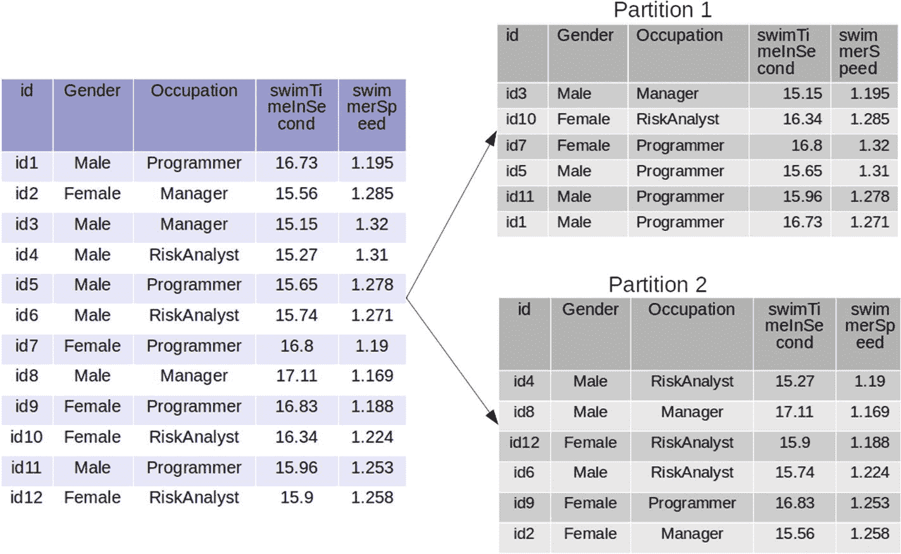

图 4-8

重新分区与数据打乱

图 4-8 显示，左侧的 DataFrame 被分成了两部分——分区 1 和分区 2。仔细观察分区 1 和分区 2 可以发现，DataFrame 并非简单分区。相反，数据已经被打乱了。让我们使用 PySpark SQL API 来研究重新分区。

```
In [4]: swimmerDf1 = swimmerDf.repartition(2)
In [5]: swimmerDf1.rdd.glom().collect()
```

输出如下：

```
Out[6]:
[
[Row(id=u'id3', Gender=u'Male', Occupation=u'Manager', swimTimeInSecond=15.15),
Row(id=u'id10', Gender=u'Female', Occupation=u'RiskAnalyst', swimTimeInSecond=16.34),
Row(id=u'id7', Gender=u'Female', Occupation=u'Programmer', swimTimeInSecond=16.8),
Row(id=u'id5', Gender=u'Male', Occupation=u'Programmer', swimTimeInSecond=15.65),
Row(id=u'id11', Gender=u'Male', Occupation=u'Programmer', swimTimeInSecond=15.96),
Row(id=u'id1', Gender=u'Male', Occupation=u'Programmer', swimTimeInSecond=16.73)],
[Row(id=u'id4', Gender=u'Male', Occupation=u'RiskAnalyst', swimTimeInSecond=15.27),
Row(id=u'id8', Gender=u'Male', Occupation=u'Manager', swimTimeInSecond=17.11),
Row(id=u'id12', Gender=u'Female', Occupation=u'RiskAnalyst', swimTimeInSecond=15.9),
Row(id=u'id6', Gender=u'Male', Occupation=u'RiskAnalyst', swimTimeInSecond=15.74),
Row(id=u'id9', Gender=u'Female', Occupation=u'Programmer', swimTimeInSecond=16.83),
Row(id=u'id2', Gender=u'Female', Occupation=u'Manager', swimTimeInSecond=15.56)]
]
```

结果显示 DataFrame 已被重新分区为两部分。现在是执行分区排序的时候了。但在编写分区排序代码之前，让我们先看看对重新分区后的数据执行排序的过程。

图 4-9 展示了分区排序。请集中看左侧和右侧分区 1 的 DataFrame 分区。在排序过程中，没有发生数据打乱。排序时，每个分区都被视为一个独立的、完整的 DataFrame。

```
In [7]: sortedPartitons = swimmerDf1.sortWithinPartitions("Occupation","swimTimeInSecond", ascending=[False,True])
In [8]: sortedPartitons.show()
```

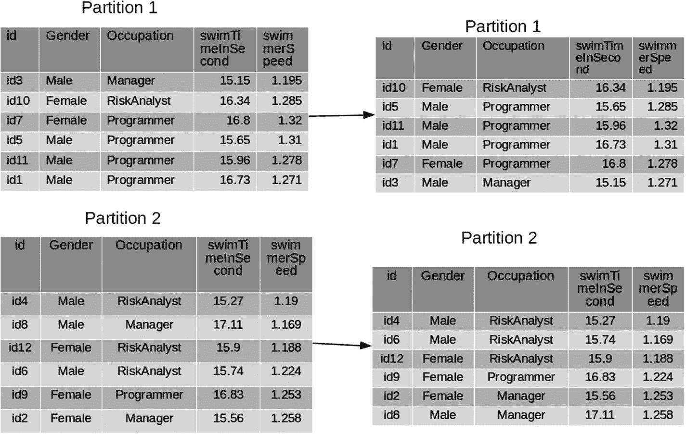

图 4-9

分区与排序

输出如下：

```
+----+------+-----------+----------------+
|  id|Gender| Occupation|swimTimeInSecond|
+----+------+-----------+----------------+
|id10|Female|RiskAnalyst|           16.34|
| id5|  Male| Programmer|           15.65|
|id11|  Male| Programmer|           15.96|
| id1|  Male| Programmer|           16.73|
| id7|Female| Programmer|            16.8|
| id3|  Male|    Manager|           15.15|
| id4|  Male|RiskAnalyst|           15.27|
| id6|  Male|RiskAnalyst|           15.74|
|id12|Female|RiskAnalyst|            15.9|
| id9|Female| Programmer|           16.83|
| id2|Female|    Manager|           15.56|
| id8|  Male|    Manager|           17.11|
+----+------+-----------+----------------+
In [8]: sortedPartitons.rdd.glom().collect()
```

输出如下：

```
Out[19]:
[[Row(id=u'id10', Gender=u'Female', Occupation=u'RiskAnalyst', swimTimeInSecond=16.34),
Row(id=u'id5', Gender=u'Male', Occupation=u'Programmer', swimTimeInSecond=15.65),
Row(id=u'id11', Gender=u'Male', Occupation=u'Programmer', swimTimeInSecond=15.96),
Row(id=u'id1', Gender=u'Male', Occupation=u'Programmer', swimTimeInSecond=16.73),
Row(id=u'id7', Gender=u'Female', Occupation=u'Programmer', swimTimeInSecond=16.8),
Row(id=u'id3', Gender=u'Male', Occupation=u'Manager', swimTimeInSecond=15.15)],
[Row(id=u'id4', Gender=u'Male', Occupation=u'RiskAnalyst', swimTimeInSecond=15.27),
Row(id=u'id6', Gender=u'Male', Occupation=u'RiskAnalyst', swimTimeInSecond=15.74),
Row(id=u'id12', Gender=u'Female', Occupation=u'RiskAnalyst', swimTimeInSecond=15.9),
Row(id=u'id9', Gender=u'Female', Occupation=u'Programmer', swimTimeInSecond=16.83),
Row(id=u'id2', Gender=u'Female', Occupation=u'Manager', swimTimeInSecond=15.56),
Row(id=u'id8', Gender=u'Male', Occupation=u'Manager', swimTimeInSecond=17.11)]]
```

这个输出应该能让概念非常清晰。`id` 列值为 `id10`、`id5`、`id11`、`id1`、`id7` 和 `id3` 的记录位于第一个分区，其余记录位于第二个分区。

## 食谱 4-13. 从 DataFrame 中移除重复记录

### 问题

你想从 DataFrame 中移除重复的记录。


### Solution

为了去除重复数据，我们将使用`drop_duplicates()`函数。该函数可以根据指定列去除重复数据。如果未指定列，则检查所有列中的所有记录。

图 4-10 显示存在重复记录。如果我们根据`iv1`和`iv2`列进行去重，可以看到许多记录是重复的。我们需要执行以下操作：

- 去除所有重复记录。
- 根据`iv1`列去除所有重复记录。
- 根据`iv1`和`iv2`列去除所有重复记录。

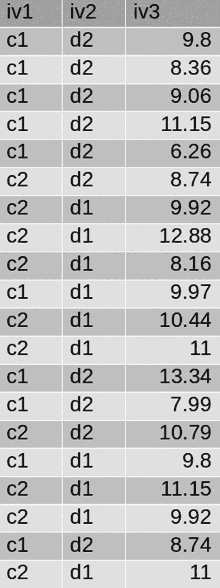

图 4-10 示例数据

### 工作原理

#### 步骤 4-13-1：去除重复记录

我们将从 ORC 文件`duplicateData`中读取数据。

```python
In [1]: duplicateDataDf = spark.read.orc(path='duplicateData')
In [2]: duplicateDataDf.show(6)
```

输出如下：

```
+---+---+-----+
|iv1|iv2|  iv3|
+---+---+-----+
| c1| d2|  9.8|
| c1| d2| 8.36|
| c1| d2| 9.06|
| c1| d2|11.15|
| c1| d2| 6.26|
| c2| d2| 8.74|
+---+---+-----+
only showing top 6 rows
```

成功创建了 DataFrame。接下来，我们将删除所有重复记录。可以看到该 DataFrame 中共有 20 条记录。我们可以使用`count`函数验证记录数量，如下所示：

```python
In [3]: duplicateDataDf.count()
```

输出如下：

```
Out[3]: 20
```

现在删除所有重复记录。

```python
In [4]: noDuplicateDf1 = duplicateDataDf.drop_duplicates()
In [5]: noDuplicateDf1.show()
```

输出如下：

```
+---+---+-----+
|iv1|iv2|  iv3|
+---+---+-----+
| c1| d2|  9.8|
| c1| d2|11.15|
| c2| d1| 8.16|
| c2| d1|12.88|
| c2| d2|10.79|
| c2| d2| 8.74|
| c1| d2|13.34|
| c1| d1|  9.8|
| c2| d1|11.15|
| c1| d2| 9.06|
| c1| d2| 7.99|
| c2| d1|10.44|
| c2| d1| 11.0|
| c1| d1| 9.97|
| c2| d1| 9.92|
| c1| d2| 8.74|
| c1| d2| 6.26|
| c1| d2| 8.36|
+---+---+-----+
In [6]: noDuplicateDf1.count()
```

输出如下：

```
Out[6]: 18
```

很明显，去重后的记录总数为 18 条，重复数据已被移除。

#### 步骤 4-13-2：根据`iv1`列去除重复记录

从`duplicateDataDf`DataFrame 可以看出，`iv1`列有两个取值——`c1`和`c2`。因此，去重后的最终 DataFrame 将仅包含两条记录：第一条记录为`c1`，第二条记录为`c2`。

```python
In [7]: noDuplicateDf2 = duplicateDataDf.drop_duplicates(['iv1'])
In [8]: noDuplicateDf2.show()
```

输出如下：

```
+---+---+----+
|iv1|iv2| iv3|
+---+---+----+
| c1| d2| 9.8|
| c2| d2|8.74|
+---+---+----+
```

`noDuplicateDf2`DataFrame 显示仅有两条记录。第一条记录的`iv1`列值为`c1`，第二条记录的`iv1`列值为`c2`。

#### 步骤 4-13-3：根据`iv1`和`iv2`列去除重复记录

`iv1`列有两个不同的值——`c1`和`c2`。同样，`iv2`列也有两个不同的值——`d1`和`d2`。这产生了四种不同的组合，即`(c1, d1)`、`(c1, d2)`、`(c3, d3)`和`(c4, d4)`。因此，如果根据`iv1`和`iv2`列去除重复，最终结果将显示四条记录。

```python
In [9]: noDuplicateDf3 = duplicateDataDf.drop_duplicates(['iv1','iv2'])
In [10]: noDuplicateDf3.show()
```

输出如下：

```
+---+---+----+
|iv1|iv2| iv3|
+---+---+----+
| c2| d1|9.92|
| c1| d2| 9.8|
| c2| d2|8.74|
| c1| d1|9.97|
+---+---+----+
```

最终输出中有四条记录，符合预期。

## 配方 4-14：采样记录

### 问题

我们希望从给定的 DataFrame 中采样一些记录。

### 解决方案

即使对于像 PySpark 这样的框架，处理海量数据也相当耗时和耗费计算资源。有时数据科学家会从实际数据集中获取样本，并对样本数据应用数据科学操作。

PySpark SQL 提供了从给定数据集中收集样本的工具。有两个 DataFrame 函数可用于从 DataFrame 中获取样本。第一个函数——`sample(withReplacement, fraction, seed=None)`——从 DataFrame 中返回一个样本。该函数返回一个新的 DataFrame。它的第一个参数`withReplacement`指定是否允许在采样数据中包含重复记录；第二个参数`fraction`是采样比例。由于样本是通过某种随机数机制随机抽取的，`seed`参数在内部用于随机数生成。

第二个函数——`sampleBy(col, fractions, seed=None)`——将根据 DataFrame 的某一指定列（作为`col`参数提供）执行分层采样。`fractions`参数用于提供每个分层的采样比例，其值以字典形式提供。`seed`参数的含义与之前相同。参见图 4-11。

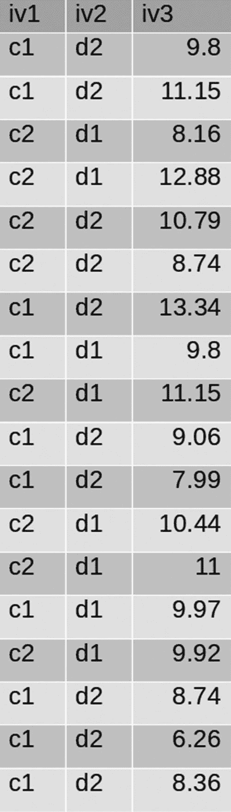

图 4-11 示例数据

我们将使用在配方 4-13 中创建的`noDuplicateDf1`DataFrame。我们需要执行以下操作：

- 从`noDuplicateDf1`DataFrame 中进行无放回采样。
- 从`noDuplicateDf1`DataFrame 中进行有放回采样。
- 根据第一列（名为`iv1`）对`noDuplicateDf1`DataFrame 进行条件采样。


### 工作原理

#### 步骤 4-14-1：从 `noDuplicateDf1` DataFrame 中进行无放回抽样

我们先打印 `noDuplicateDf1` DataFrame 中的一些记录，这有助于我们回想起该 DataFrame 的结构。

```
In [1]: noDuplicateDf1.show(6)
```

输出如下：

```
+---+---+-----+
|iv1|iv2|  iv3|
+---+---+-----+
| c1| d2|  9.8|
| c1| d2|11.15|
| c2| d1| 8.16|
| c2| d1|12.88|
| c2| d2|10.79|
| c2| d2| 8.74|
+---+---+-----+
only showing top 6 rows
```

从前面的步骤我们可知，该 DataFrame 共有 18 条记录。

```
In [2]: noDuplicateDf1.count()
```

输出如下：

```
Out[2]: 18
```

接下来，我们将进行无放回抽样，抽取 50% 的记录。

```
In [3]: sampleWithoutKeyConsideration = noDuplicateDf1.sample(withReplacement=False, fraction=0.5, seed=200)
In [4]: sampleWithoutKeyConsideration.show()
```

输出如下：

```
+---+---+-----+
|iv1|iv2|  iv3|
+---+---+-----+
| c1| d2|  9.8|
| c1| d2|11.15|
| c2| d1|12.88|
| c2| d2|10.79|
| c2| d2| 8.74|
| c2| d1| 11.0|
| c1| d1| 9.97|
| c1| d2| 6.26|
+---+---+-----+
```

现在我们来计数：

```
In [5]: sampleWithoutKeyConsideration.count()
```

输出如下：

```
Out[5]: 8
```

我们在样本 DataFrame `sampleWithoutKeyConsideration` 中获取了 8 条记录。原始 DataFrame `noDuplicateDf1` 的总记录数为 18。我们请求抽取 50%，即 9 条记录，但实际只得到了 8 条。请注意，`sample()` 函数的输出并不会严格遵守精确的分数值。

#### 步骤 4-14-2：从 `noDuplicateDf1` DataFrame 中进行有放回抽样

在下面的代码中，我们将 `sample` 函数的 `withReplacement` 参数设置为 `True`。因此，输出中会出现重复记录。

```
In [6]: sampleWithoutKeyConsideration1 = noDuplicateDf1.sample(withReplacement=True, fraction=0.5, seed=200)
In [7]: sampleWithoutKeyConsideration1.count()
```

输出如下：

```
Out[7]: 6
In [8]: sampleWithoutKeyConsideration1.show()
```

输出如下：

```
+---+---+-----+
|iv1|iv2|  iv3|
+---+---+-----+
| c1| d2|13.34|
| c1| d2|13.34|
| c1| d2|13.34|
| c2| d1|10.44|
| c2| d1| 11.0|
| c1| d2| 8.74|
+---+---+-----+
```

正如所料，在 `sampleWithoutKeyConsideration1` DataFrame 的输出中，前三条记录是完全相同的（彼此互为副本）。

#### 步骤 4-14-3：基于 `iv1` 列条件从 `noDuplicateDf1` DataFrame 中抽样

`iv1` 列包含两个值：`c1` 和 `c2`。要执行分层抽样，我们必须使用 `sampleBy()` 函数。现在，我们将基于 `iv1` 列进行条件抽样，并把该列作为 `col` 参数的值传递给 `sampleBy()` 函数。我们希望输出 DataFrame 中来自 `c1` 和 `c2` 两个层级的样本数相等。因此，我们设置了 `{'c1':0.5, 'c2':0.5}` 作为 fractions 参数的值。

```
In [9]: sampleWithKeyConsideration = noDuplicateDf1.sampleBy(col='iv1', fractions={'c1':0.5, 'c2':0.5},seed=200)
In [10]: sampleWithKeyConsideration.show()
+---+---+-----+
|iv1|iv2|  iv3|
+---+---+-----+
| c1| d2|  9.8|
| c1| d2|11.15|
| c2| d1|12.88|
| c2| d2|10.79|
| c2| d2| 8.74|
| c2| d1| 11.0|
| c1| d1| 9.97|
| c1| d2| 6.26|
+---+---+-----+
```

可以观察到，来自 `c1` 和 `c2` 两个层级的样本数相等。

## 方法 4-15：查找频繁项

### 问题

你想确定 DataFrame 各列中出现频率最高的项。

### 解决方案

为了查看频繁项，我们将使用 `freqItems()` 函数。

### 工作原理

首先，我们计算列 `iv1` 中的频繁项。

```
In [1]: duplicateDataDf.freqItems(cols=['iv1']).show()
```

输出如下：

```
+-------------+
|iv1_freqItems|
+-------------+
|     [c1, c2]|
+-------------+
```

现在，我们来查找 `iv1` 和 `iv2` 两列中的频繁项。

```
In [2]: duplicateDataDf.freqItems(cols=['iv1','iv2']).show()
+-------------+-------------+
|iv1_freqItems|iv2_freqItems|
+-------------+-------------+
|     [c1, c2]|     [d2, d1]|
+-------------+-------------+
```

