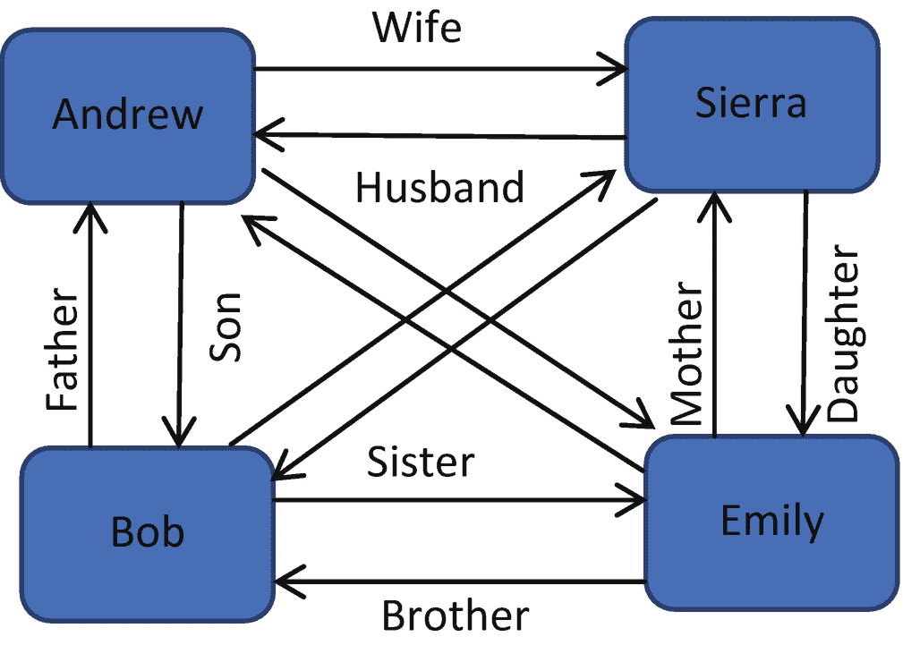
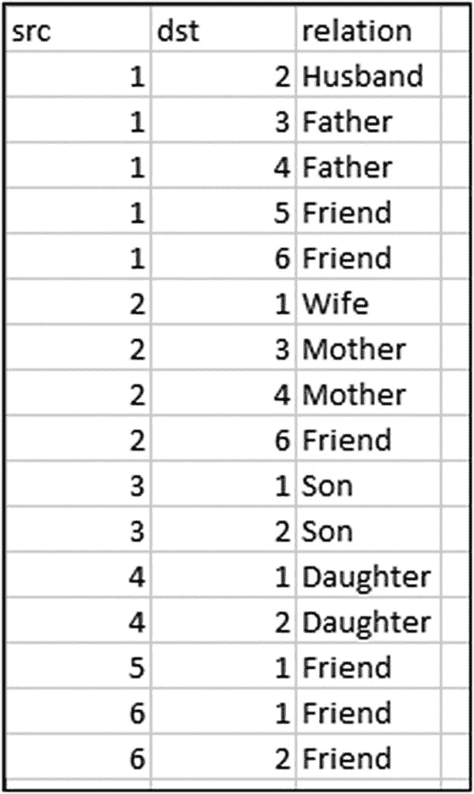
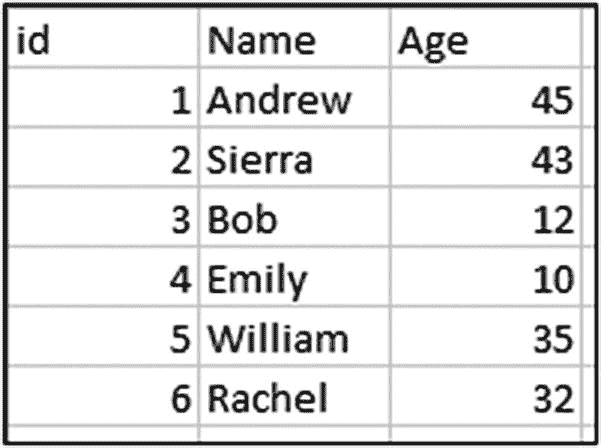

# 9. GraphFrames

## GraphFrames 与图分析

`GraphFrames`是`DataFrame`的抽象，用于执行图分析。图分析源于数学中的图论。图论是一种非常重要的理论，用于表示实体之间的关系，我们可以利用它来执行各种分析。当您使用 Google 时，每天都在应用图论。Google 引入了基于图论的`PageRank`算法，该算法试图识别与您的搜索最匹配的最具影响力的网站。

虽然图论被广泛应用于各个科学领域，计算机科学也倾向于用图论解决大量问题。图论的一些应用包括社交媒体问题、旅行、芯片设计以及许多其他领域。事实上，每次运行 Spark 任务时，您都在使用图论。Spark 使用有向无环图（DAG）来表示`RDD`，并以此来找到执行查询的最优计划。

图是由通过边相互连接的顶点组成的。顶点可以被看作是节点或实体，而边则代表这些实体之间的关系。图 9-1 可视化了一个家庭图。



**图 9-1** 图是顶点的组合

图 9-1 中的图表展示了一个由四名成员组成的小家庭——丈夫（Andrew）、妻子（Sierra）、儿子（Bob）和女儿（Emily）。人物被表示为节点，这被称为*顶点*。每个人都与其他人相连。您可以观察到，仅仅在一个四口之家中，就有 12 种关系。这些关系通过连接它们的边来表示。现在想象一个像 LinkedIn 这样的社交媒体应用，它需要连接数百万用户，那么边的数量将是巨大的。为了能够对此类数据进行分析，传统的数据库是不够的。使用传统数据库，您需要多次执行自连接，而自连接会严重拖垮您的数据库。

图论解决了诸如此类的复杂问题。Spark 提供了`GraphFrames`来表示这种图数据。在本章中，我们将学习如何创建`GraphFrames`，并应用一些最常用的算法来解决复杂问题。

在本章中，我们将讨论以下内容：

*   方案 9-1：创建`GraphFrames`

*   方案 9-2：在`GraphFrame`中应用三角计数

*   方案 9-3：应用`PageRank`算法

*   方案 9-4：应用广度优先算法

## 方案 9-1：创建 GraphFrames

### 问题

您需要从一个给定的数据集创建一个`GraphFrame`。

### 解决方案

此解决方案使用家庭关系数据。我们将使用两个数据集。图 9-2 和 9-3 展示了这些数据集。



**图 9-3** `relationship.csv`



**图 9-2** `persons.csv`

这是一个便于所有人使用和理解的典型数据集。让我们加载这个数据集。

### 工作原理

在开始使用`GraphFrames`之前，您需要在机器上安装`GraphFrames`。

如果您尚未安装`GraphFrames`并尝试使用它，您将收到以下错误信息。

```
>>> from graphframes import *
```

输出如下：

```
Traceback (most recent call last):
File "", line 1, in
ModuleNotFoundError: No module named 'graphframes'
```

您需要首先使用以下`pyspark`命令安装`GraphFrames`。

```
pyspark --packages graphframes:graphframes:0.6.0-spark2.3-s_2.11
```

在命令提示符中运行此命令。`PySpark`将自动下载`GraphFrame`包并进行安装。安装完成后，您可以通过导入`GraphFrame`包来检查，如下所示。

```
>>> from graphframes import *
```

如果不再看到错误信息，说明您可以成功使用`GraphFrame`了。

现在，让我们将`persons.csv`和`relationship.csv`数据作为`DataFrame`加载。

```
>>> personsDf = spark.read.csv('persons.csv',header=True, inferSchema=True)
>>> personsDf.createOrReplaceTempView("persons")
```

此命令将数据加载到`personsDf` `DataFrame`中，并为其创建一个临时视图。让我们查看该视图的内容。

```
>>> spark.sql("select * from persons").show()
```

输出如下：

```
+--+-------+---+
|id|   Name|Age|
+--+-------+---+
| 1| Andrew| 45|
| 2| Sierra| 43|
| 3|    Bob| 12|
| 4|  Emily| 10|
| 5|William| 35|
| 6| Rachel| 32|
+--+-------+---+
```

现在我们同样加载关系数据。以下是代码和输出：

```
>>> relationshipDf = spark.read.csv('relationship.csv',header=True, inferSchema=True)
>>> relationshipDf.createOrReplaceTempView("relationship")
>>> spark.sql("select * from relationship").show()
+---+---+--------+
|src|dst|relation|
+---+---+--------+
|  1|  2| Husband|
|  1|  3|  Father|
|  1|  4|  Father|
|  1|  5|  Friend|
|  1|  6|  Friend|
|  2|  1|    Wife|
|  2|  3|  Mother|
|  2|  4|  Mother|
|  2|  6|  Friend|
|  3|  1|     Son|
|  3|  2|     Son|
|  4|  1|Daughter|
|  4|  2|Daughter|
|  5|  1|  Friend|
|  6|  1|  Friend|
|  6|  2|  Friend|
+---+---+--------+
```

现在两个数据集都已准备就绪，我们将导入`GraphFrames`。

```
>>> from graphframes import *
```

以下命令创建您的第一个`GraphFrame`。`GraphFrame`接受两个`DataFrame`作为输入：顶点和边。`GraphFrames`在列名上有一些需要遵循的命名约定。这些规则定义如下：

*   表示顶点的`DataFrame`应包含一个名为`id`的列。这里，`personsDf`包含一个名为`id`的列。

*   表示边的`DataFrame`应包含名为`src`和`dst`的列。这里，`relationshipDf`包含`src`和`dst`列。

```
>>> graph = GraphFrame(personsDf, relationshipDf)
```

让我们查看一下`graph`变量的类型。如下所示：

```
>>> graph
GraphFrame(v:[id: int, Name: string ... 1 more field], e:[src: int, dst: int ... 1 more field])
```

所以它是一个包含`v`和`e`的`GraphFrame`。`v`代表顶点，`e`代表边。

现在您已成功创建了一个`GraphFrame`，理解度（Degrees）的概念非常重要。*度*表示连接到某个顶点的边的数量。`GraphFrame`支持`inDegrees`和`outDegrees`。`inDegrees`给出指向一个顶点的入链接数量，`outDegrees`给出从一个节点出发的出边数量。理解这一点非常重要。让我们尝试查看给定示例的输出。

下面，您将找出所有连接到 Andrew 的边。

以下代码获取所有链接，并根据`id`等于`1`进行过滤：

```
>>> graph.degrees.filter("id = 1").show()
```

输出如下。请注意，在关系数据集中，Andrew（`id=1`）有 10 条记录。

## 配方 9-2. 在 GraphFrame 中应用三角形计数

### 问题

你需要为每个顶点计算三角形计数值。

### 解决方案

`GraphFrames` 提供了一个易于使用的 `triangleCount` API。当在给定的 `GraphFrame` 上调用该 API 时，会输出一个 `DataFrame`，其中为每个顶点行添加了一个 `count` 列。这个 `count` 列标识了该顶点参与了多个三角形关系。接下来，我们将演示如何获取每个顶点的三角形计数。这对于寻路问题非常有帮助，并且在 PageRank 算法中扮演着重要角色。

### 工作原理

以下代码用于计算每个顶点的三角形计数。

```
>>> graph.triangleCount().show()
```

输出如下：

```
+-----+---+-------+---+
|count| id|   Name|Age|
+-----+---+-------+---+
|    3|  1| Andrew| 45|
|    1|  6| Rachel| 32|
|    1|  3|    Bob| 12|
|    0|  5|William| 35|
|    1|  4|  Emily| 10|
|    3|  2| Sierra| 43|
+-----+---+-------+---+
```

输出中新增了一个名为 `count` 的列，表示三角形计数。结果显示，`Andrew` 和 `Sierra` 拥有最大的三角形计数，因为他们参与了三种关系：`Andrew` 作为父亲、朋友和丈夫，`Sierra` 作为母亲、朋友和妻子。至此，你已经成功创建了一个 `GraphFrame` 并对其进行了分析。

你也可以将 `triangleCount` 输出的 `DataFrame` 注册为表，并轻松地对其应用查询。我们使用 PySparkSQL 来找出所有拥有最大三角形计数的人。通过以下代码，你可以找到家庭中拥有最高三角形计数的人。之后，你可以将其与 `Persons` `DataFrame` 进行连接，以便查看该人的详细信息。

以下代码正是实现了这一功能。虽然你可以通过编程方式用一行代码实现相同的结果，但下面使用的是简单的 SQL 命令。

```
>>> personsTriangleCountDf.createOrReplaceTempView("personsTriangleCount")
>>> maxCountDf = spark.sql("select max(count) as max_count from personsTriangleCount")
>>> maxCountDf.createOrReplaceTempView("personsMaxTriangleCount")
>>> spark.sql("select * from personsTriangleCount P JOIN (select * from personsMaxTriangleCount) M ON (M.max_count = P.count) ").show()
```

输出如下：

```
+-----+---+------+---+---------+
|count| id|  Name|Age|max_count|
+-----+---+------+---+---------+
|    3|  1|Andrew| 45|        3|
|    3|  2|Sierra| 43|        3|
+-----+---+------+---+---------+
```

## 配方 9-3. 应用 PageRank 算法

### 问题

你需要应用 PageRank 算法来找出这个家庭中最具影响力的人。

### 解决方案

PageRank 算法是谷歌早期的基石。它最初由谷歌的创始人提出，用于识别互联网上最重要的页面。该算法的核心思想是：最重要的页面会被其他页面最频繁地链接。同时，它也利用了另一个思想：一个页面从高排名页面获得的链接越多，该页面就越重要。因此，谷歌利用以图形式表示的链接网页来为我们识别重要页面。

PageRank 算法衡量图中每个顶点的重要性。假设有这样的场景：一个 Twitter 用户有 10 个重要的关注者，而每个关注者又有自己的众多关注者。那么，这个 Twitter 用户将比一个拥有 50 个“普通”关注者的用户获得更高的排名。也就是说，PageRank 算法会将每个重要的关注者视为对该 Twitter 用户的有效认可，从而给予该用户更高的排名。

### 工作原理

让我们看看 PageRank 算法是如何运行的。Apache Spark 使得调用 PageRank 算法变得非常简单。

```
>>> pageRank = graph.pageRank(resetProbability=0.20, maxIter=10)
```

这里，我们使用 `pageRank` 方法调用 PageRank 算法。它有两个参数：

*   `resetProbability`：这是一个随机重置概率值（alpha）。
*   `maxIter`：这是 `pageRank` 运行的迭代次数。

让我们查看 `pageRank`。它是一个包含顶点和边属性的 `GraphFrame`。

```
>>> pageRank
GraphFrame(v:[id: int, Name: string ... 2 more fields], e:[src: int, dst: int ... 2 more fields])
```

让我们查看 `vertices` 属性：

```
>>> pageRank.vertices.printSchema()
root
|-- id: integer (nullable = true)
|-- Name: string (nullable = true)
|-- Age: integer (nullable = true)
|-- pagerank: double (nullable = true)
```

你可以从原始的 `persons` 模式中看到，新增了一个名为 `pagerank` 的列。这个列由 Spark 添加，表示顶点的 PageRank 分数。

类似地，让我们查看一下该 `GraphFrame` 中包含的 `edges`。

```
>>> pageRank.edges.printSchema()
root
|-- src: integer (nullable = true)
|-- dst: integer (nullable = true)
|-- relation: string (nullable = true)
|-- weight: double (nullable = true)
```

如模式所示，原始关系模式中新增了一个名为 `weight` 的列。这个 `weight` 列表示对 PageRank 分数有贡献的边的权重。

让我们查看每个顶点的 PageRank 分数和每条边的权重。我们将按 PageRank 降序排列，以便能够根据与其他家庭成员的联系，看到家庭中联系最紧密的人。

以下代码以降序列出了所有顶点。

```
>>> pageRank.vertices.orderBy("pagerank",ascending=False).show()
```

让我们查看输出：

从输出中可以看出，Andrew 是联系最紧密的人。

让我们查看每条边贡献的权重。这里我们按权重降序列出所有边，以便最大权重的边排在最前面。

```
+--+-------+----+------------------+
|id|   Name| Age|          pagerank|
+--+-------+----+------------------+
| 1| Andrew| 45 | 1.787923121897472|
| 2| Sierra| 43 | 1.406016795082752|
| 6| Rachel| 32 |0.7723665979473922|
| 4|  Emily| 10 |0.7723665979473922|
| 3|    Bob| 12 |0.7723665979473922|
| 5|William| 35 |0.4889602891776001|
+--+-------+----+------------------+
```

现在你已经理解了 PageRank 算法，并将它应用到了 GraphFrames 中，接下来让我们转向广度优先算法。

```
>>> `pageRank`.`edges`.`orderBy`("weight",ascending=False).show()
```

以下是输出。从输出中可以看出，边 5, 1, Friend 获得了最大的权重。由于这种关系是唯一的，因此 William 与 Andrew 的关系获得了最大的权重。除了 Andrew，没有其他人是 William 的朋友。

```text
+---+---+--------+------+
|src|dst|relation|weight|
+---+---+--------+------+
|  5|  1|  Friend|   1.0|
|  3|  1|     Son|   0.5|
|  4|  1|Daughter|   0.5|
|  4|  2|Daughter|   0.5|
|  6|  1|  Friend|   0.5|
|  3|  2|     Son|   0.5|
|  6|  2|  Friend|   0.5|
|  2|  3|  Mother|  0.25|
|  2|  4|  Mother|  0.25|
|  2|  1|    Wife|  0.25|
|  2|  6|  Friend|  0.25|
|  1|  2| Husband|   0.2|
|  1|  6|  Friend|   0.2|
|  1|  3|  Father|   0.2|
|  1|  4|  Father|   0.2|
|  1|  5|  Friend|   0.2|
+---+---+--------+------+
```

让我们查看每条边贡献的权重。这里我们按权重降序列出所有边，以便最大权重的边排在最前面。

# 食谱 9-4. 应用广度优先算法

## 问题

你需要应用广度优先算法来找到连接到某个人的最短路径。

## 解决方案

你可能经常注意到 LinkedIn 会告诉你，你与任何新用户之间相隔多少层关系。例如，你会发现你想联系的用户是二度人脉或三度人脉。这表示你与目标顶点之间相隔两个顶点。这是一种识别一个顶点与另一个顶点之间距离的方法。

同样，在航空公司需要确定城市间最短路径的场景中，它们需要找到机场之间顶点数量最少的路径。当然，可能还有附加条件，比如时间、航程中是否需要经停等。每个行业都存在着与此非常相似的问题。例如，芯片设计公司需要确定最短电路路径；电信公司需要找到路由器之间的最短路径，等等。

广度优先搜索是最短路径查找算法之一，它能帮助我们确定两个顶点之间的最短路径。

我们将把这个算法应用到`persons`数据集中，以找到 Bob 连接到 William 的最短路径。你可以看到，只有 Andrew 与 William 相连。那么，Bob 要如何才能连接到 William？最短路径是什么？这就是我们将通过以下代码来确定的内容。

## 工作原理

`GraphFrames` 提供了一个名为 `bfs` 的 API，它至少需要两个参数，分别是：

*   `fromExpr`：用于识别起始顶点的表达式。

*   `toExpr`：用于识别目标顶点的表达式。

没错，它可以是表达式，这意味着你可以针对多个顶点进行操作。首先，我们来看看针对单个顶点的情况。之后，我们会将其应用于多个顶点。

```python
graph.bfs(
  fromExpr = "name = 'Bob'",
  toExpr = "name = 'William'",
).show()
```

从这段代码中可以看到，我们调用 `bfs` 方法时传入了两个输入——`fromExpr` 和 `toExpr`——并使用名为 `"name = 'Bob'"` 和 `"name = 'William'"` 的过滤器。这表示我们正在寻找 Bob 和 William 之间的最短路径。

以下是输出结果：

```text
+------------+-----------+---------------+--------------+----------------+
|        from|         e0|             v1|            e1|              to|
+------------+-----------+---------------+--------------+----------------+
|[3, Bob, 12]|[3, 1, Son]|[1, Andrew, 45]|[1, 5, Friend]|[5, William, 35]|
+------------+-----------+---------------+--------------+----------------+
```

从上面的输出可以推断出，Bob 要连接到 William，他需要通过 Andrew。

让我们尝试将这个算法应用于多个顶点。我们将尝试找出所有年龄小于 20 岁的人，以便他们能够连接到 Rachel。

```python
graph.bfs(
  fromExpr = "age < 20",
  toExpr = "name = 'Rachel'",
).show()
```

在上面的代码片段中，我们修改了表达式，以便查找所有年龄小于 20 岁的人，找到他们连接到 Rachel 的方法。

以下是输出结果：

```
+--------------+----------------+---------------+--------------+---------------+
|          from|              e0|             v1|            e1|             to|
+--------------+----------------+---------------+--------------+---------------+
|  [3, Bob, 12]|     [3, 1, Son]|[1, Andrew, 45]|[1, 6, Friend]|[6, Rachel, 32]|
|  [3, Bob, 12]|     [3, 2, Son]|[2, Sierra, 43]|[2, 6, Friend]|[6, Rachel, 32]|
|[4, Emily, 10]|[4, 1, Daughter]|[1, Andrew, 45]|[1, 6, Friend]|[6, Rachel, 32]|
|[4, Emily, 10]|[4, 2, Daughter]|[2, Sierra, 43]|[2, 6, Friend]|[6, Rachel, 32]|
+--------------+----------------+---------------+--------------+---------------+
```

请注意，Bob 和 Emily 都出现在输出中。由于 Rachel 是 Andrew 和 Sierra 的共同朋友，因此他们是连接 Bob 和 Emily 的顶点。Bob 和 Emily 需要通过 Andrew 或 Sierra 才能连接到 Rachel。

如果您想限制某些路径——比如，您希望孩子们只通过父母传递——那么您可以使用 `edgeFilter` 来确定 Bob 和 Emily 可以通过哪些关系连接到 Rachel。

以下代码展示了 `edgeFilter` 属性的用法。我们将规定结果中只允许出现女儿关系。

以下是使用 `edgeFilter` 属性在识别最短路径时过滤边的代码：

```python
graph.bfs(
  fromExpr = "age < 20",
  toExpr = "name = 'Rachel'",
  edgeFilter = "relation != 'Son'"
).show()
```

以下是显示 Emily 如何连接到 Rachel 的输出：

```
+--------------+----------------+---------------+--------------+---------------+
|          from|              e0|             v1|            e1|             to|
+--------------+----------------+---------------+--------------+---------------+
|[4, Emily, 10]|[4, 1, Daughter]|[1, Andrew, 45]|[1, 6, Friend]|[6, Rachel, 32]|
|[4, Emily, 10]|[4, 2, Daughter]|[2, Sierra, 43]|[2, 6, Friend]|[6, Rachel, 32]|
+--------------+----------------+---------------+--------------+---------------+
```

至此，您已经成功学习了广度优先搜索算法并将其用于分析。

# 索引

## A

- `adduser` 命令
- `allBigData`
- Apache Hadoop
- Apache Hive
  - 代码执行流程
  - HiveQL 命令
- RDBMS
- SQL
- Apache Kafka
  - 代理（`broker`）
  - 消费者（`consumer`）
  - 开发
  - 消息流
  - 生产者（`producer`）
- Apache Mesos 集群管理器
- Apache Pig
- Apache Spark
  - 描述
  - GraphFrames
  - MLlib
  - 弹性分布式数据集（`Resilient Distributed Datasets`）
- Apache Storm
- Apache Tez
- 原子性、一致性、隔离性和持久性（ACID）原则

## B

- 大数据
  - Apache Hadoop
  - Apache Storm
  - Apache Tez
  - 多样性
  - 速度
  - 准确性
  - 体量
- 大数据框架
- 广度优先算法
  - API
  - 寻路算法

## C

- Cassandra
  - Cassandra 安装
- Catalyst 优化器
- `Cluster By` 子句
- 集群管理器
  - Apache Mesos
  - 分布式系统
  - 独立模式（`standalone`）
  - YARN
- 逗号分隔值（CSV）文件
  - DataFrame
  - `header` 参数
  - `inferSchema` 参数
  - 读取
  - `spark.read.csv()` 函数
  - `swimmerData.csv`
- 控制台接收器（`Console sink`）
- 列联表（Contingency table）
  - 创建
  - MongoDB 命令
  - 餐厅调查
- 相关性（Correlation）
- 协方差（Covariance）
- 交叉制表（Cross tabulations）
  - CSV 文件，DataFrame 创建
  - JSON 格式
  - parquet 格式
  - 示例数据

## D, E

- 数据聚合
  - 多键
    - 部门列
    - 性别列
  - 多列
  - 单键
- 平均频率
- 来自 MySQL 的数据
  - 函数
    - 按性别
    - 平均值
- DataFrames
  - 分类变量
  - 相关性
  - 协方差
  - CSV 文件
  - `describe()` 函数
  - 频繁项
  - 水平堆叠
  - 内连接
    - 新建
      - PostgreSQL
  - 连接
    - 参数
      - Cassandra 表
    - 全外连接
    - 内连接
    - 左外连接
    - 右外连接
    - 学生表
    - 科目表
  - 连接类型
  - JSON 文件
  - MongoDB
  - MySQL
  - ORC 文件
  - Parquet 文件
  - PostgreSQL
  - 移除重复记录
  - 示例记录（*参见* 采样数据）
  - 简单 SQL 创建
    - 创建别名
    - 区分大小写的过滤
    - 使用别名列
    - 使用列名
  - where 子句过滤
  - `summary()` 函数
  - 游泳比赛（*参见* 游泳比赛，数据框）
  - 临时视图创建
  - 垂直堆叠
    - 新建
      - PostgreSQL
  - SQL 命令
  - DataFrame 流式处理
    - 创建
    - 连接静态数据
    - 输出模式
    - PySparkSQL 查询
    - 设置
    - 接收器类型
    - SQL 过滤器
    - 静态数据

### 温度数据

### 数据标注

#### 度数

#### 描述性统计

- `agg()` 函数
- `corrData.json`
- 计数、元素数量
- 总体方差
- `pyspark.sql.functions` 子模块
- 样本均值
- 样本方差
- `spark.read.json` 函数
- 求和、均值和标准差
- 方差、均值和标准差

### 有向无环图

### `Distribute By` 子句

### 分布式系统

- `drop()` 函数
- `dropna()` 函数
- F
- 文件接收器
- 文件源
- `fillna()` 函数
- G
- 谷歌文件系统 (GFS)
- GraphFrames
  - 创建
  - DataFrames
  - 度数
  - 错误消息
  - 安装
  - `persons.csv`
  - `personsDf` DataFrame
  - `relationship.csv`
  - 三角形计数值
  - 顶点
- `groupby()` 函数

## H, I

### Hadoop

- 组件
  - 谷歌文件系统
  - MapReduce
  - Hadoop 分布式文件系统 (HDFS)
  - Hadoop 生态系统框架
- Hadoop 安装，单机
  - 更新 `.bashrc` 文件
  - 创建 CentOS 用户
  - 目录安装
  - 下载
  - 环境文件
  - HDFS
  - Java 安装
  - 检查 `jps` 命令
  - 运行 `namenode` 格式化
  - 创建免密码登录
  - 属性文件
  - `start-dfs.sh` 脚本
  - `start-yarn.sh` 脚本
  - `stop-dfs.sh` shell 脚本
  - YARN
- Hive 安装，单机
  - `.bashrc` 文件
  - 创建 `datawarehouse` 目录
  - 目录
  - 下载
  - 解压
  - `hive-site.xml`
  - `metastore` 数据库
- Hive 元存储配置，PostgreSQL
  - 下载 JDBC 连接器
  - 外部 RDBMS
  - `grant` 命令
  - 修改 `hive-site.xml`
  - `lib` 目录
  - `pg_hba.conf` 文件
  - `pymetastore` 数据库
  - 测试
  - 创建用户和数据库

### 水平扩展

## J

### JavaScript 对象表示法 (JSON) 文件

- `corrData.json`
- `DoubleType()`
- `spark.read.json()` 函数

### Jobtracker

### `join()` 函数

## K, L

### Kafka 接收器

### Kafka 源

## M, N

### MapReduce

- Hadoop 流式处理模块
- HDFS
- 迭代算法
- Jobtracker 和 Tasktracker
- MapReduce 框架
- `maxIter`

### 缺失值插补

- 参数
- 删除行
- MongoDB
- 用零替换
- `thresh` 参数

### MongoDB

### MySQL

- MySQL 服务器安装

## O

### 优化行列式 (ORC) 文件

## P

### PageRank 算法

- Apache Spark
- 属性

### Parquet 文件

### 分区内排序

- `Occupation` 和 `swimTimeInSecond` 列
- 过程
- 重新分区和洗牌
- 单一
- `sortWithinPartitions()` 函数

### `passwd` 命令

### PostgreSQL

### `printSchema()` 函数

### 过程化语言/PostgreSQL (PL/pgSQL)

### PySpark shell

### PySpark SQL

- 聚合
  - `Group By` 子句
    - 每门课程的学生人数
    - 每个学生的课程数量
  - 缓存数据
  - Catalyst 优化器
  - `Cluster By` 子句
  - DataFrames
  - `Distribute By` 和 `Sort By` 子句
  - 领域特定语言
  - 文件格式系统
  - SparkSession
  - 结构化流处理
  - 窗口函数
    - 分区
    - 排名函数
    - 原地排名

### PySpark 连接 Hive

### 创建 PySpark UDF

- `genderCodeToValue`
- Python 函数

## Q

### 查询优化器

## R

- `rank()` 函数
- 速率源
- 关系数据库管理系统 (RDBMS)
- 重置概率
- 弹性分布式数据集 (RDD)
- `restaurantSurvey`

## S

### 采样数据

- `noDuplicateDf1` DataFrame
- 列 `iv1`
- 无放回
- 有放回
- `sampleBy(col, fractions, seed=None)`
- `sample(withReplacement, fraction, seed=None)`
- 时间密集型和计算密集型

### Spark 中的洗牌

### Socket 源

### `Sort By` 子句

### 排序

- 升序
- 降序
- `Occupation` 和 `swimTimeInSecond` 列
- PySpark SQL API `orderBy(*cols, **kwargs)`
- 分区内 ( *参见* 分区内排序)

# T

## Spark 安装，单机

- `swimmerDf`
- `.bashrc` 文件
- `directory/allBigData`
- 下载
- 更改环境文件
- `pyspark` 脚本
- 解压 `.tgz` 文件

## SparkSession

## Spark SQLs

- 连接多个 DataFrame
  - 应用查询
  - 数据集
- 连接两个 DataFrame
  - 样板代码
  - 数据集
  - 连接查询细节
  - 观察结果
  - 运行查询
  - 使用全外连接
  - 使用左连接
  - 使用右外连接
- UDF 方法

## 日期函数

- `dateofbirth` 列

## Spark 术语

## 独立集群管理器

## 流式计算

## 结构化流处理

## 游泳比赛，DataFrame

- 列删除
  - `swimmerDf2`
- 结构化数据集
  - 列选择
    - `id` 和 `swimmerSpeed` 列
    - `select()` 函数
    - `swimmerDf2` DataFrame
    - `swimTimeInSecond` 列
  - 数据标注
  - 过滤过程
    - `gender` 列
    - `occupation` 和 `swimmerSpeed > 1.17`
    - `where()` 函数
  - 排序数据 ( *参见* 排序)
  - 转换操作
    - CSV 文件
    - `printSchema()` 函数
    - `round()` 函数
    - 样本数据
    - 游泳速度
    - `withColumn()` 函数
- UDF ( *参见* 用户定义函数 (UDF))

# Tasktracker

# 温度数据集

# 三角形计数值

# U

## `union()` 函数

## 用户定义聚合函数 (UDAF)

## 用户定义函数 (UDF)

- 平均温度
- `celsiustoFahrenheit`
- CSV 文件
- 华氏度列
- `pyspark.sql.functions`
- `spark.read.parquet()` 函数
- `tempDfFahrenheit`
- `temperatureData`
- 温度值，摄氏度和华氏度
- `tempInCelsius`

# V

## 垂直扩展

## 垂直堆叠

# W, X

## `writeStream` 方法

# Y, Z

## 另一种资源协调器 (YARN) 集群管理器