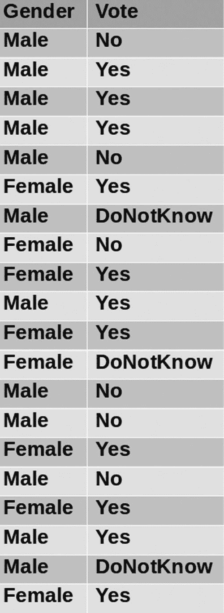
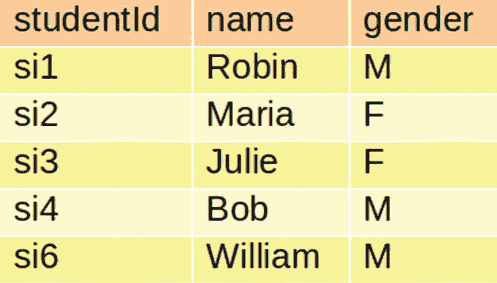
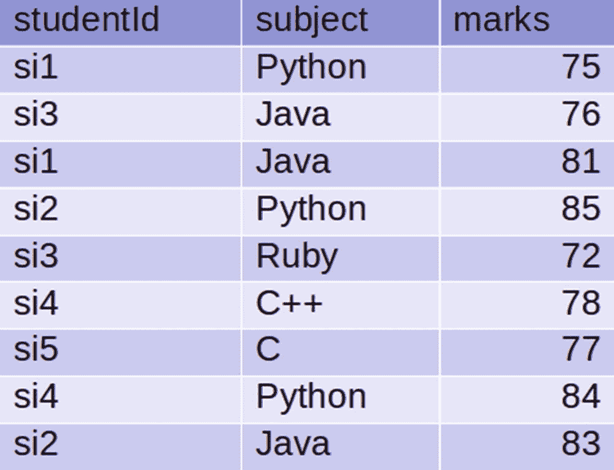
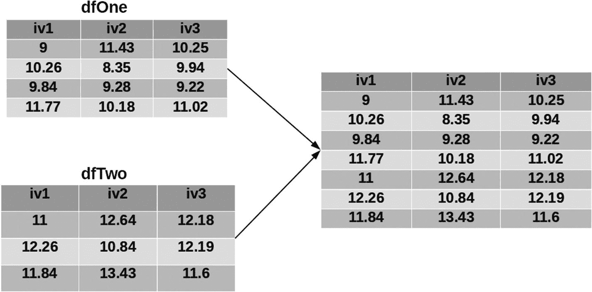
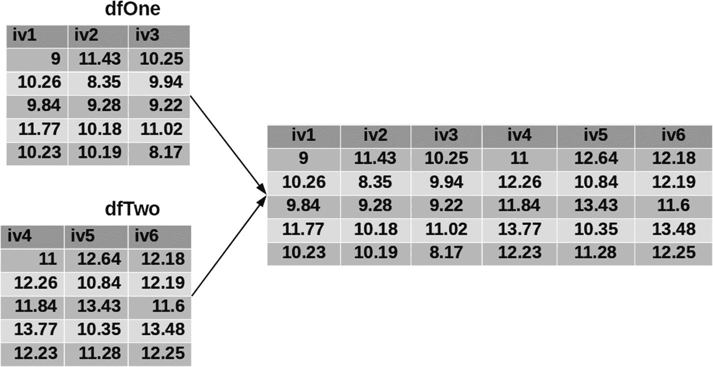
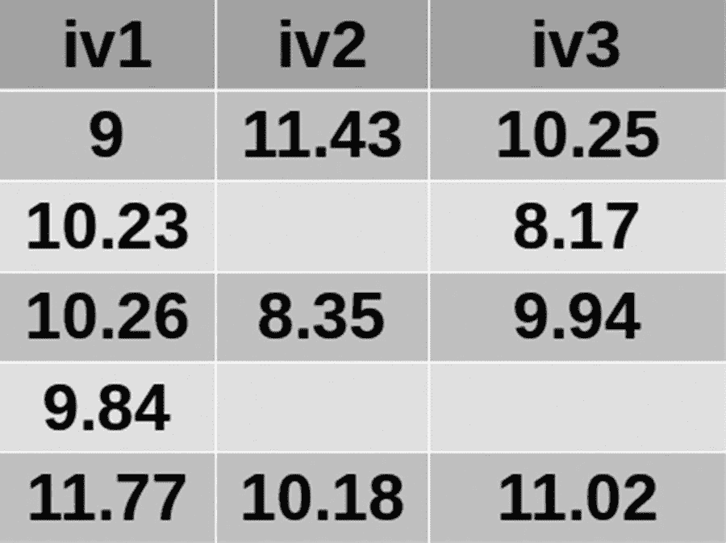

# 秘诀 5-3. 创建列联表

### 问题

你想要创建一个列联表。

### 解决方案

列联表也称为交叉表。它们显示给定列的成对频率。

一家餐厅的老板想了解所提供的服务。她调查了一些顾客，得到了如图 5-1 所示的结果。该数据存储在一个名为 `restaurantSurvey` 的 MongoDB 集合中。我们可以使用以下 MongoDB 命令来观察它。



图 5-1 餐厅调查列联表

```
> db.restaurantSurvey.find().pretty().limit(5)
```

以下是输出：

```
{
"_id" : ObjectId("5ba7e6a259acc01fedb4d78a"),
"Gender" : "Male",
"Vote" : "Yes"
}
{
"_id" : ObjectId("5ba7e6a259acc01fedb4d78b"),
"Gender" : "Male",
"Vote" : "Yes"
}
{
"_id" : ObjectId("5ba7e6a259acc01fedb4d78c"),
"Gender" : "Male",
"Vote" : "No"
}
{
"_id" : ObjectId("5ba7e6a259acc01fedb4d78d"),
"Gender" : "Male",
"Vote" : "DoNotKnow"
}
{
"_id" : ObjectId("5ba7e6a259acc01fedb4d78e"),
"Gender" : "Male",
"Vote" : "Yes"
}
```

我们必须使用图 5-1 中的数据制作一个列联表。


### 工作原理

#### 步骤 5-3-1. 从 MongoDB 读取餐厅调查数据

餐厅调查数据存储在 MongoDB 中 `pysparksqlbook` 数据库的 `restaurantSurvey` 集合里。以下代码将从 MongoDB 读取我们的数据。

```
In [1]: surveyDf = spark.read.format("com.mongodb.spark.sql.DefaultSource").option("uri","mongodb://127.0.0.1/pysparksqlbook.restaurantSurvey").load()
In [2]: surveyDf.show(5)
```

输出如下：

```
+------+---------+--------------------+
|Gender|     Vote|                 _id|
+------+---------+--------------------+
|  Male|      Yes|[5ba7e6a259acc01f...|
|  Male|      Yes|[5ba7e6a259acc01f...|
|  Male|       No|[5ba7e6a259acc01f...|
|  Male|DoNotKnow|[5ba7e6a259acc01f...|
|  Male|      Yes|[5ba7e6a259acc01f...|
+------+---------+--------------------+
only showing top 5 rows
```

我们已经读取了数据。由于 `_id` 列不是必需的，我们将其删除。

```
In [3]: surveyDf = surveyDf.drop("_id")
In [4]: surveyDf.show(5)
```

输出如下：

```
+------+---------+
|Gender|     Vote|
+------+---------+
|  Male|      Yes|
|  Male|      Yes|
|  Male|       No|
|  Male|DoNotKnow|
|  Male|      Yes|
+------+---------+
only showing top 5 rows
```

#### 步骤 5-3-2. 创建列联表

为了创建列联表，我们必须使用 `crosstab()` 函数。该函数接受两个列作为参数。

```
In [5]: surveyDf.crosstab("Gender","Vote").show()
```

输出如下：

```
+-----------+---------+--+---+
|Gender_Vote|DoNotKnow|No|Yes|
+-----------+---------+--+---+
|       Male|        2| 5|  5|
|     Female|        1| 1|  6|
+-----------+---------+--+---+
```

我们已经得到了列联表。

## 配方 5-4. 在两个 DataFrame 上执行连接操作

### 问题

你想在两个 DataFrame 上执行连接操作。

### 解决方案

数据科学家经常需要使用连接操作来合并两个 DataFrame 的内容。对于使用 SQL 的人来说，DataFrame 连接与表连接相同。它就像对 DataFrame 执行的任何其他操作一样简单。我们在 DataFrame 上执行以下四种类型的连接。

*   内连接
*   左外连接
*   右外连接
*   全外连接

在 Cassandra 数据库中，我们有两个表。第一个表的数据如图 5-2 所示。第一个表名为 `students`。



图 5-2 students 表

第二个表如图 5-3 所示。其名称为 `subjects`。



图 5-3 subjects 表

我们需要执行以下操作。

*   从 Cassandra 数据库中读取 `students` 和 `subjects` 表。
*   在 DataFrame 上执行内连接。
*   在 DataFrame 上执行左外连接。
*   在 DataFrame 上执行右外连接。
*   在 DataFrame 上执行全外连接。

为了连接这两个 DataFrame，PySparkSQL 提供了一个 `join()` 函数，该函数作用于 DataFrame。

`join()` 函数接受三个参数。第一个参数称为 `other`，是另一个 DataFrame。第二个参数称为 `on`，定义了我们要在其上执行连接操作的关键列。第三个参数称为 `how`，定义了要执行的连接类型。

### 工作原理

让我们逐步探索这个配方。

#### 步骤 5-4-1. 从 Cassandra 数据库读取学生和科目数据表

我们需要从 `students` 表的 `pysparksqlbook` 键空间中读取 `students` 数据。同样，我们需要从同一个键空间读取 `subjects` 数据，但来自名为 `subjects` 的 Cassandra 表。

以下代码将从 Cassandra 数据库读取数据表。

```
In [1]: studentsDf = spark.read.format("org.apache.spark.sql.cassandra").options( keyspace="pysparksqlbook", table="students").load()
In [2]: subjectsDf = spark.read.format( "org.apache.spark.sql.cassandra").options( keyspace="pysparksqlbook", table="subjects").load()
```

从 Cassandra 读取数据后，让我们打印它并验证我们已创建了一个 DataFrame。

```
In [3]: studentsDf.show()
```

输出如下：

```
+---------+------+-------+
|studentid|gender|   name|
+---------+------+-------+
|      si3|     F|  Julie|
|      si2|     F|  Maria|
|      si1|     M|  Robin|
|      si6|     M|William|
|      si4|     M|    Bob|
+---------+------+-------+
In [4]: subjectsDf.show()
```

输出如下：

```
+--+-----+---------+--------+
|id|marks|studentid|subjects|
+--+-----+---------+--------+
| 6|   78|      si4|     C++|
| 9|   83|      si2|    Java|
| 5|   72|      si3|    Ruby|
| 4|   85|      si2|  Python|
| 7|   77|      si5|       C|
| 1|   75|      si1|  Python|
| 8|   84|      si4|  Python|
| 2|   76|      si3|    Java|
| 3|   81|      si1|    Java|
+--+-----+---------+--------+
```

我们已经创建了 DataFrame。`subjectsDf` DataFrame 包含一个名为 `id` 的列，该列不是必需的。我们可以删除它。要删除不需要的列，请使用 `drop()` 函数。

```
In [5]: subjectsDf = subjectsDf.drop("id")
In [6]: subjectsDf.show()
```

输出如下：

```
+-----+---------+--------+
|marks|studentid|subjects|
+-----+---------+--------+
|   78|      si4|     C++|
|   83|      si2|    Java|
|   72|      si3|    Ruby|
|   85|      si2|  Python|
|   77|      si5|       C|
|   75|      si1|  Python|
|   84|      si4|  Python|
|   76|      si3|    Java|
|   81|      si1|    Java|
+-----+---------+--------+
```

我们已经删除了不需要的列。

#### 步骤 5-4-2. 在 DataFrame 上执行内连接

目前，我们有两个名为 `studentsDf` 和 `subjectsDf` 的 DataFrame。我们需要在这些 DataFrame 上执行内连接。两个 DataFrame 中都有一个共同的 `studentid` 列。我们将对该 `studentid` 列执行内连接。

当键值匹配时，内连接返回记录。如果我们查看两个 DataFrame 中 `studentid` 列的值，我们会发现值 `si1`、`si2`、`si3` 和 `si4` 是两个 DataFrame 共有的。因此，内连接将仅返回这些值的记录。

```
In [7]: innerDf = studentsDf.join(subjectsDf, studentsDf.studentid == subjectsDf.studentid, how= "inner")
```

让我们探讨 `join()` 函数的参数。第一个参数是 `subjectsDf`，这是要与 `studentsDf` DataFrame 连接的 DataFrame。第二个参数是 `studentsDf.studentid == subjectsDf.studentid`，它指示了连接的条件。最后一个参数告诉我们必须执行内连接。

让我们打印结果。

```
In [8]: innerDf.show()
```

输出如下：

```
+---------+------+-----+-----+---------+--------+
|studentid|gender| name|marks|studentid|subjects|
+---------+------+-----+-----+---------+--------+
|      si2|     F|Maria|   83|      si2|    Java|
|      si2|     F|Maria|   85|      si2|  Python|
|      si4|     M|  Bob|   78|      si4|     C++|
|      si4|     M|  Bob|   84|      si4|  Python|
|      si3|     F|Julie|   72|      si3|    Ruby|
|      si3|     F|Julie|   76|      si3|    Java|
|      si1|     M|Robin|   75|      si1|  Python|
|      si1|     M|Robin|   81|      si1|    Java|
+---------+------+-----+-----+---------+--------+
```

在输出 DataFrame `innerDf` 中，我们可以观察到在 `studentid` 列中，我们只看到了 `si1`、`si2`、`si3` 和 `si4`。


#### 步骤 5-4-3. 对 DataFrame 执行左外连接

在本步骤中，我们将对 DataFrame 执行 `left` 左外连接。在 `left` 左外连接中，结果将包含第一个 DataFrame 中的每个键以及第二个 DataFrame 中匹配的键。

在我们的案例中，连接时将 `studentsDf` 作为第一个 DataFrame，`subjectsDf` 作为第二个 DataFrame。因此，`studentsDf` 中 `studentid` 列的每个值都会出现在输出中。在 `studentid` 列中，我们会看到 `si1`、`si2`、`si3`、`si4` 和 `si6`。

```
In [9]: leftOuterDf = studentsDf.join(subjectsDf, studentsDf.studentid == subjectsDf.studentid, how= "left")
```

可以观察到，左外连接的第三个参数值为 `left`。

```
In [10]: leftOuterDf.show()
```

以下是输出：

```
+---------+------+-------+-----+---------+--------+
|studentid|gender|   name|marks|studentid|subjects|
+---------+------+-------+-----+---------+--------+
|      si2|     F|  Maria|   83|      si2|    Java|
|      si2|     F|  Maria|   85|      si2|  Python|
|      si4|     M|    Bob|   78|      si4|     C++|
|      si4|     M|    Bob|   84|      si4|  Python|
|      si3|     F|  Julie|   72|      si3|    Ruby|
|      si3|     F|  Julie|   76|      si3|    Java|
|      si6|     M|William| null|     null|    null|
|      si1|     M|  Robin|   75|      si1|  Python|
|      si1|     M|  Robin|   81|      si1|    Java|
+---------+------+-------+-----+---------+--------+
```

结果 DataFrame 中的 `studentid` 列显示了 `si1`、`si2`、`si3`、`si4` 和 `si6`。

#### 步骤 5-4-4. 对 DataFrame 执行右外连接

以下代码行将执行右外连接。为了执行右连接，`how` 参数的值将为 `right`。

```
In [11]: rightOuterDf = studentsDf.join(subjectsDf, studentsDf.studentid == subjectsDf.studentid, how= "right")
In [12]: rightOuterDf.show()
```

以下是输出：

```
+---------+------+-----+-----+---------+--------+
|studentid|gender| name|marks|studentid|subjects|
+---------+------+-----+-----+---------+--------+
|     null|  null| null|   77|      si5|       C|
|      si2|     F|Maria|   83|      si2|    Java|
|      si2|     F|Maria|   85|      si2|  Python|
|      si4|     M|  Bob|   78|      si4|     C++|
|      si4|     M|  Bob|   84|      si4|  Python|
|      si3|     F|Julie|   72|      si3|    Ruby|
|      si3|     F|Julie|   76|      si3|    Java|
|      si1|     M|Robin|   75|      si1|  Python|
|      si1|     M|Robin|   81|      si1|    Java|
+---------+------+-----+-----+---------+--------+
```

右外连接的结果是 `rightOuterDf`。

#### 步骤 5-4-5. 对 DataFrame 执行全外连接

在全外连接中，结果将包含两个 DataFrame 中 `studentid` 列的所有值。

```
In [13]: outerDf = studentsDf.join(subjectsDf, studentsDf.studentid == subjectsDf.studentid, how= "outer")
In [14]: outerDf.show()
```

以下是输出：

```
+---------+------+-------+-----+---------+--------+
|studentid|gender|   name|marks|studentid|subjects|
+---------+------+-------+-----+---------+--------+
|     null|  null|   null|   77|      si5|       C|
|      si2|     F|  Maria|   83|      si2|    Java|
|      si2|     F|  Maria|   85|      si2|  Python|
|      si4|     M|    Bob|   78|      si4|     C++|
|      si4|     M|    Bob|   84|      si4|  Python|
|      si3|     F|  Julie|   72|      si3|    Ruby|
|      si3|     F|  Julie|   76|      si3|    Java|
|      si6|     M|William| null|     null|    null|
|      si1|     M|  Robin|   75|      si1|  Python|
|      si1|     M|  Robin|   81|      si1|    Java|
+---------+------+-------+-----+---------+--------+
```

## 食谱 5-5. 垂直堆叠两个 DataFrame

### 问题

你想要对两个 DataFrame 执行垂直堆叠。

### 解决方案

可以将两个或多个 DataFrame 一个叠一个地堆叠起来。这个过程称为 DataFrame 的垂直堆叠，如图 5-4 所示。



图 5-4

垂直堆叠 DataFrame

图 5-4 描绘了两个 DataFrame 的垂直堆叠。左侧，我们可以看到两个名为 `dfOne` 和 `dfTwo` 的 DataFrame。DataFrame `dfOne` 由三列四行组成。类似地，DataFrame `dfTwo` 也有三行三列。图 5-4 的右侧显示了通过垂直堆叠 `dfOne` 和 `dfTwo` DataFrame 创建的 DataFrame。

`firstverticaltable` 和 `secondverticaltable` 表位于 PostgreSQL 数据库中。我们可以使用以下 SQL 命令获取这些表。

```
pysparksqldb=#  select * from firstverticaltable;
```

以下是输出：

```
iv1|  iv2|  iv3
-----+-----+-----
9|11.43|10.25
10.26| 8.35| 9.94
9.84| 9.28| 9.22
11.77|10.18|11.02
(4 rows)
pysparksqldb=# select * from secondverticaltable ;
```

以下是输出：

```
iv1|  iv2|  iv3
-----+-----+-----
11|12.64|12.18
12.26|10.84|12.19
11.84|13.43| 11.6
(3 rows)
```

我们需要执行以下操作：

*   从 PostgreSQL 数据库中读取两个表——`firstverticaltable` 和 `secondverticaltable`——并创建 DataFrame。
*   对新创建的 DataFrame 进行垂直堆叠。

我们可以使用 `union()` 函数执行垂直堆叠。`union()` 函数只接受一个输入，即另一个 DataFrame。此函数等同于 SQL 中的 `UNION ALL`。`union()` 函数的结果 DataFrame 可能包含重复记录。因此建议对 `union()` 函数的结果使用 `distinct()` 函数。

### 工作原理

第一步是从 PostgreSQL 读取数据表并创建 DataFrame。

#### 步骤 5-5-1. 从 PostgreSQL 读取表


### 注意

为了连接 PostgreSQL 数据库，我们需要使用以下选项启动 PySpark shell：

`$pyspark --driver-class-path ~/.ivy2/jars/org.postgresql_postgresql-42.2.4.jar --packages org.postgresql:postgresql:42.2.4`

现在来读取我们的数据表。表位于 PostgreSQL 数据库的 `pysparksqldb` 中。以下代码行将从 PostgreSQL 读取数据。

```
In [1]: dbURL = "jdbc:postgresql://localhost/pysparksqldb?user=postgres&password=""
In [1]: verticalDfOne = spark.read.format("jdbc").options(url = dbURL, database ='pysparksqldb', dbtable ='firstverticaltable').load();
In [2]: verticalDfOne.show()
```

输出如下：

```
+-----+-----+-----+
|  iv1|  iv2|  iv3|
+-----+-----+-----+
|  9.0|11.43|10.25|
|10.26| 8.35| 9.94|
| 9.84| 9.28| 9.22|
|11.77|10.18|11.02|
+-----+-----+-----+
```

我们已经读取了 `firstverticaltable` 表。现在读取另一个表。

```
In [3]: verticalDfTwo = spark.read.format("jdbc").options(url = dbURL, database ='pysparksqldb', dbtable ='secondverticaltable').load();
In [4]: verticalDfTwo.show()
```

输出如下：

```
+-----+-----+-----+
|  iv1|  iv2|  iv3|
+-----+-----+-----+
| 11.0|12.64|12.18|
|12.26|10.84|12.19|
|11.84|13.43| 11.6|
+-----+-----+-----+
```

#### 步骤 5-5-2. 对新创建的 DataFrame 执行垂直堆叠

我们已经创建了两个 DataFrame，分别命名为 `verticalDfOne` 和 `verticalDfTwo`。接下来，我们将使用 `union()` 函数对这些 DataFrame 执行垂直堆叠。

```
In [5]: vstackedDf = verticalDfOne.union(verticalDfTwo)
In [6]: vstackedDf.show()
```

输出如下：

```
+-----+-----+-----+
|  iv1|  iv2|  iv3|
+-----+-----+-----+
|  9.0|11.43|10.25|
|10.26| 8.35| 9.94|
| 9.84| 9.28| 9.22|
|11.77|10.18|11.02|
| 11.0|12.64|12.18|
|12.26|10.84|12.19|
|11.84|13.43| 11.6|
+-----+-----+-----+
```

最终，我们得到了一个垂直堆叠的 DataFrame，名为 `vstackedDf`。

## 配方 5-6. 水平堆叠两个 DataFrame

### 问题

你想要水平堆叠两个 DataFrame。

### 解决方案

水平堆叠在日常工作中不太常见，但这并不降低其重要性。图 5-5 展示了名为 `dfOne` 和 `dfTwo` 的表进行水平堆叠的情况。



图 5-5

水平堆叠 DataFrame

从图 5-5 中我们可以观察到，水平堆叠意味着将 DataFrame 并排放置。这在 PySparkSQL 中并不容易实现，因为没有专门的 API 来完成此任务。

由于没有专门用于水平堆叠的 API，我们必须使用其他 API 来完成任务。如何执行水平堆叠？一种方法是在每个 DataFrame 中新增一个行号列。添加这个新的行号列后，我们可以执行内连接来获得所需的垂直堆叠 DataFrame。

我们需要执行以下步骤：

-   从 PostgreSQL 数据库中读取两个表，分别名为 `firsthorizontable` 和 `secondhorizontable`，并创建 DataFrame。
-   对这些新创建的 DataFrame 执行水平堆叠。

我们可以使用以下命令在 PostgreSQL 中查看我们的表。

```
pysparksqldb=# select * from firsthorizontable ;
```

输出如下：

```
iv1|  iv2|  iv3
-----+-----+-----
9|11.43|10.25
10.26| 8.35| 9.94
9.84| 9.28| 9.22
11.77|10.18|11.02
10.23|10.19| 8.17
(5 rows)
pysparksqldb=# select * from secondhorizontable;
```

输出如下：

```
iv4|  iv5|  iv6
-----+-----+-----
11|12.64|12.18
12.26|10.84|12.19
11.84|13.43| 11.6
13.77|10.35|13.48
12.23|11.28|12.25
(5 rows)
```

### 工作原理

### 注意

为了连接 PostgreSQL 数据库，我们需要使用以下选项启动 PySpark shell：

`$pyspark --driver-class-path  ~/.ivy2/jars/org.postgresql_postgresql-42.2.4.jar  --packages org.postgresql:postgresql:42.2.4`

#### 步骤 5-6-1. 从 PostgreSQL 读取表并创建 DataFrame

我们需要从 PostgreSQL 数据库中读取两个表。让我们逐个读取它们。

```
In [1]: dbURL = "jdbc:postgresql://localhost/pysparksqldb?user=postgres&password=""
In [2]: horizontalDfOne = spark.read.format("jdbc").options(url = dbURL, database ='pysparksqldb', dbtable ='firsthorizontable').load();
In [3]: horizontalDfOne.show()
```

输出如下：

```
+-----+-----+-----+
|  iv1|  iv2|  iv3|
+-----+-----+-----+
|  9.0|11.43|10.25|
|10.26| 8.35| 9.94|
| 9.84| 9.28| 9.22|
|11.77|10.18|11.02|
|10.23|10.19| 8.17|
+-----+-----+-----+
In [4]: horizontalDfTwo = spark.read.format("jdbc").options(url = dbURL, database ='pysparksqldb', dbtable ='secondhorizontable').load();
In [5]: horizontalDfTwo.show()
```

输出如下：

```
+-----+-----+-----+
|  iv4|  iv5|  iv6|
+-----+-----+-----+
| 11.0|12.64|12.18|
|12.26|10.84|12.19|
|11.84|13.43| 11.6|
|13.77|10.35|13.48|
|12.23|11.28|12.25|
+-----+-----+-----+
```

#### 步骤 5-6-2. 对新创建的 DataFrame 执行水平堆叠

创建 DataFrame 后，我们需要为两者都添加一个新列。两个 DataFrame 都需要一个显示整数序列的新列。我们可以使用 `monotonically_increasing_id()` 函数创建这个新列。我们可以从 `pyspark.sql.functions` 子模块中获取此函数。让我们导入它。

```
In [5]: from pyspark.sql.functions import monotonically_increasing_id
```

在以下代码行中，我们将添加一个新列，其中包含从零开始的整数序列。

```
In [6]: horizontalDfOne = horizontalDfOne.withColumn("id", monotonically_increasing_id() )
In [7]: horizontalDfOne.show()
```

输出如下：

```
+-----+-----+-----+--+
|  iv1|  iv2|  iv3|id|
+-----+-----+-----+--+
| 9.0 |11.43|10.25| 0|
|10.26| 8.35| 9.94| 1|
| 9.84| 9.28| 9.22| 2|
|11.77|10.18|11.02| 3|
|10.23|10.19| 8.17| 4|
+-----+-----+-----+--+
```

我们已成功向 `horizontalDfOne` DataFrame 添加了新的整数序列列。以下代码行将向 `horizontalDfTwo` DataFrame 添加相同的列。

```
In [8]: horizontalDfTwo = horizontalDfTwo.withColumn( "id",  monotonically_increasing_id() )
In [9]: horizontalDfTwo.show()
```

输出如下：

```
+-----+-----+-----+--+
|  iv4|  iv5|  iv6|id|
+-----+-----+-----+--+
| 11.0|12.64|12.18| 0|
|12.26|10.84|12.19| 1|
|11.84|13.43| 11.6| 2|
|13.77|10.35|13.48| 3|
|12.23|11.28|12.25| 4|
+-----+-----+-----+--+
```

现在，我们将对 `horizontalDfOne` 和 `horizontalDfTwo` 执行内连接。内连接是在 `id` 列上进行的。

```
In [10]: hStackedDf = horizontalDfOne.join(horizontalDfTwo, horizontalDfOne.id == horizontalDfTwo.id, how="inner")
In [11]: hStackedDf.show()
```

输出如下：

```
+-----+-----+-----+--+-----+-----+-----+--+
|  iv1|  iv2|  iv3|id|  iv4|  iv5|  iv6|id|
+-----+-----+-----+--+-----+-----+-----+--+
|  9.0|11.43|10.25| 0| 11.0|12.64|12.18| 0|
|10.26| 8.35| 9.94| 1|12.26|10.84|12.19| 1|
|11.77|10.18|11.02| 3|13.77|10.35|13.48| 3|
| 9.84| 9.28| 9.22| 2|11.84|13.43| 11.6| 2|
|10.23|10.19| 8.17| 4|12.23|11.28|12.25| 4|
+-----+-----+-----+--+-----+-----+-----+--+
```

内连接之后，我们的两个 DataFrame 已水平堆叠，结果存储在 `hStackedDf` 中。我们不再需要 `id` 列。因此，我们可以将其删除。

```
In [12]: hStackedDf = hStackedDf.drop("id")
In [13]: hStackedDf.show()
```

输出如下：

```
+-----+-----+-----+-----+-----+-----+
|  iv1|  iv2|  iv3|  iv4|  iv5|  iv6|
+-----+-----+-----+-----+-----+-----+
|  9.0|11.43|10.25| 11.0|12.64|12.18|
|10.26| 8.35| 9.94|12.26|10.84|12.19|
|11.77|10.18|11.02|13.77|10.35|13.48|
| 9.84| 9.28| 9.22|11.84|13.43| 11.6|
|10.23|10.19| 8.17|12.23|11.28|12.25|
+-----+-----+-----+-----+-----+-----+
```

最终，我们得到了所需的结果。

## 配方 5-7. 执行缺失值插补


好的，作为高级文档工程师和翻译员，我将根据您提供的注意事项和示例，将给定的英文文本翻译成中文。


### 问题

你希望在 `DataFrame` 中进行缺失值插补。

### 解决方案

对于数据科学家来说，缺失值是不可避免的。PySparkSQL 提供了工具来处理 `DataFrame` 中的缺失数据。处理缺失值或空值的两个重要函数是 `dropna()` 和 `fillna()`。

如图 5-6 所示，展示了 `DataFrame` 的内容。我们可以观察到，第四行有两个缺失值，第二行有一个缺失值。



图 5-6

包含缺失值的 `DataFrame`

`dropna()` 函数可以移除包含空数据的行。它接受三个参数。第一个参数是 `how`，它可以取两个值——`any` 或 `all`。如果 `how` 的值是 `all`，那么仅当一行的所有值都为 `null` 时，该行才会被删除。如果 `how` 的值是 `any`，那么只要该行的任何一个值为 null，该行就会被删除。

`dropna()` 函数的第二个参数叫做 `thresh`。`thresh` 的默认值是 `None`。它接受一个整数值。`thresh` 参数会覆盖第一个参数 `how`。如果 `thresh` 被设置为整数 `n`，那么所有非空值数量少于 `n` 的行都将被删除。

`dropna()` 函数的最后一个参数是 `subset`。这是一个可选的列名，用于指定要考虑的列。

处理空值的第二个重要函数是 `fillna()`。它的第一个参数是一个 `value`。`fillna()` 函数会用 `value` 参数替换任何空值。

### 工作原理

#### 步骤 5-7-1\. 从 MongoDB 读取数据

我们在 MongoDB 的 `pysparksqlbook` 数据库中有一个名为 `missingData` 的表。我们必须使用 MongoDB 驱动程序启动 PySpark shell。以下代码行从 MongoDB 读取数据。

```
In [1]: missingDf = spark.read.format(   "com.mongodb.spark.sql.DefaultSource"  ).option("uri" , "mongodb://127.0.0.1/pysparksqlbook.missingData" ).load()
In [2]: missingDf.show()
```

输出如下：

```
+--------------------+-----+-----+-----+
|                 _id|  iv1|  iv2|  iv3|
+--------------------+-----+-----+-----+
|[5ba7e6c059acc01f...|  9.0|11.43|10.25|
|[5ba7e6c059acc01f...|10.23|     | 8.17|
|[5ba7e6c059acc01f...|10.26| 8.35| 9.94|
|[5ba7e6c059acc01f...| 9.84|     |     |
|[5ba7e6c059acc01f...|11.77|10.18|11.02|
+--------------------+-----+-----+-----+
```

我们不需要 `_id` 列，因此可以删除它。

```
In [3]: missingDf = missingDf.drop("_id")
In [4]: missingDf.show()
```

输出如下：

```
+-----+-----+-----+
|  iv1|  iv2|  iv3|
+-----+-----+-----+
|  9.0|11.43|10.25|
|10.23|     | 8.17|
|10.26| 8.35| 9.94|
| 9.84|     |     |
|11.77|10.18|11.02|
+-----+-----+-----+
```

我们已经删除了 `_id` 列。但是，在 `missingDf` DataFrame 中，我们可以观察到缺失值并没有显示为 null，而是显示为空字符串。我们可以使用 `printSchema()` 函数来验证这一点。

```
In [5]: missingDf.printSchema()
```

输出如下：

```
root
|-- iv1: double (nullable = true)
|-- iv2: string (nullable = true)
|-- iv3: string (nullable = true)
```

我们可以看到，PySparkSQL 已将 `iv2` 和 `iv3` 列解释为字符串数据类型。让我们将这些列的数据类型转换为 `DoubleType()`。我们知道所有数据类型都在 `pyspark.sql.types` 子模块中定义。让我们从 `pyspark.sql.types` 子模块导入 `DoubleType`。

```
In [6]: from pyspark.sql.types import DoubleType
```

我们可以使用在 `withColumn()` 函数内部的 `cast()` 函数来转换数据类型，如下所示。

```
In [7]: missingDf =  missingDf.withColumn("iv2", missingDf.iv2.cast(DoubleType())).withColumn("iv3", missingDf.iv3.cast(DoubleType()))
In [8]: missingDf.show()
```

输出如下：

```
+-----+-----+-----+
|  iv1|  iv2|  iv3|
+-----+-----+-----+
|  9.0|11.43|10.25|
|10.23| null| 8.17|
|10.26| 8.35| 9.94|
| 9.84| null| null|
|11.77|10.18|11.02|
+-----+-----+-----+
```

转换数据类型后，我们可以在 `DataFrame` 中观察到 null。我们还可以验证 `DataFrame` 的模式。

```
In [9]: missingDf.printSchema()
```

输出如下：

```
root
|-- iv1: double (nullable = true)
|-- iv2: double (nullable = true)
|-- iv3: double (nullable = true)
```

#### 步骤 5-7-2\. 删除包含空值的行

我们将删除包含空值的行。我们可以使用 `dropna()` 函数删除这些行。我们将 `how` 参数的值设置为 `any`。这样，第二行和第四行的数据将被删除。

```
In [10]: missingDf.dropna(how ='any').show()
```

输出如下：

```
+-----+-----+-----+
|  iv1|  iv2|  iv3|
+-----+-----+-----+
|  9.0|11.43|10.25|
|10.26| 8.35| 9.94|
|11.77|10.18|11.02|
+-----+-----+-----+
```

由于并非所有值都是 null，因此 `how` 参数的 `all` 值不会影响该 `DataFrame`。

```
In [11]: missingDf.dropna(how ='all').show()
```

输出如下：

```
+-----+-----+-----+
|  iv1|  iv2|  iv3|
+-----+-----+-----+
|  9.0|11.43|10.25|
|10.23| null| 8.17|
|10.26| 8.35| 9.94|
| 9.84| null| null|
|11.77|10.18|11.02|
+-----+-----+-----+
```

#### 步骤 5-7-3\. 使用 thresh 参数删除包含空值的行

如果 `thresh` 值设置为 `2`，则任何包含少于两个非空值的行都将被删除。只有第四列的非空值少于两个（它只有一个），因此它将是被删除的唯一一行。

```
In [12]: missingDf.dropna(how ='all',thresh=2).show()
```

输出如下：

```
+-----+-----+-----+
|  iv1|  iv2|  iv3|
+-----+-----+-----+
|  9.0|11.43|10.25|
|10.23| null| 8.17|
|10.26| 8.35| 9.94|
|11.77|10.18|11.02|
+-----+-----+-----+
```

我们可以观察到，在输出中，只有第四行被删除了。现在让我们将 `thresh` 的值从 `2` 改为 `3`。在这种情况下，第二行和第四行都被删除。

```
In [13]: missingDf.dropna(how ='all',thresh=3).show()
```

输出如下：

```
+-----+-----+-----+
|  iv1|  iv2|  iv3|
+-----+-----+-----+
|  9.0|11.43|10.25|
|10.26| 8.35| 9.94|
|11.77|10.18|11.02|
+-----+-----+-----+
```

#### 步骤 5-7-4\. 用某个值填充缺失值

在此步骤中，我们将使用 `fillna()` 函数将空值替换为零。

```
In [14]: missingDf.fillna(value=0).show()
```

输出如下：

```
+-----+-----+-----+
|  iv1|  iv2|  iv3|
+-----+-----+-----+
|  9.0|11.43|10.25|
|10.23|  0.0| 8.17|
|10.26| 8.35| 9.94|
| 9.84|  0.0|  0.0|
|11.77|10.18|11.02|
+-----+-----+-----+
```


