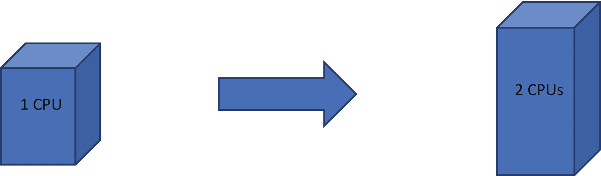
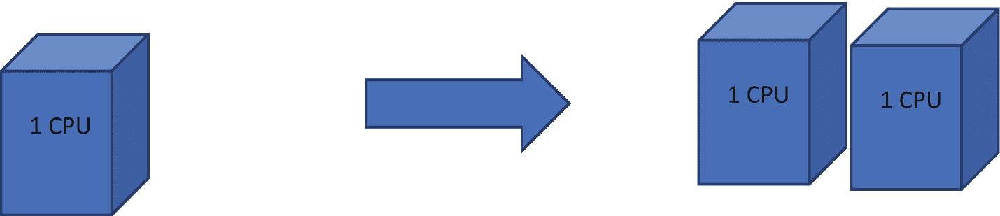
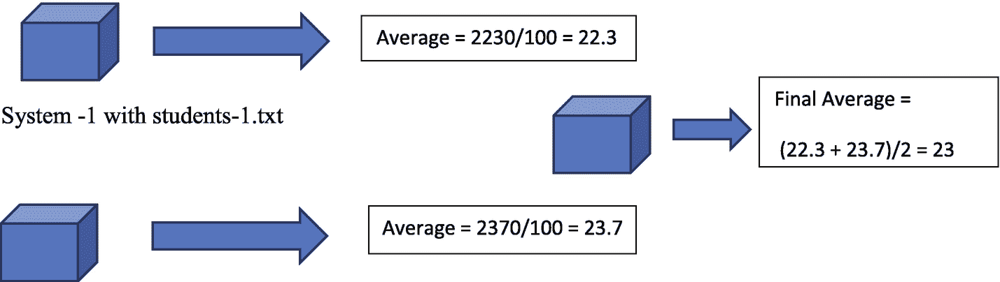
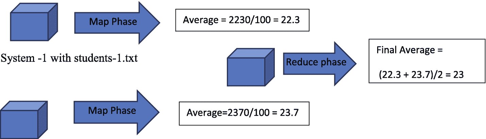
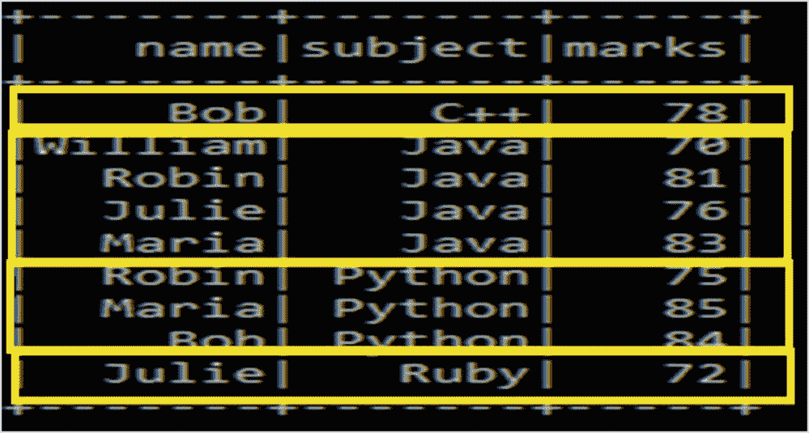
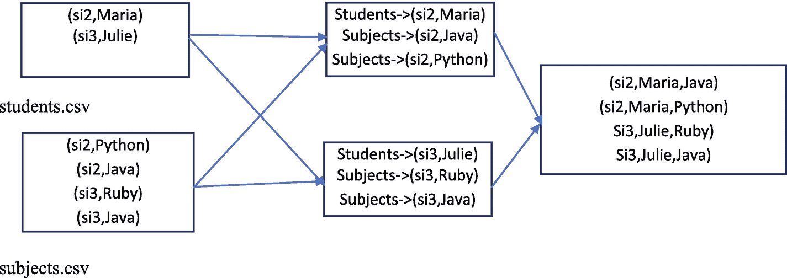
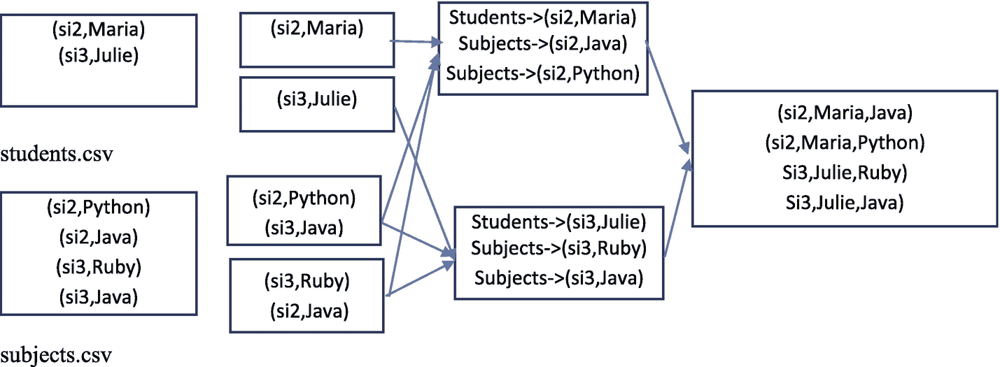
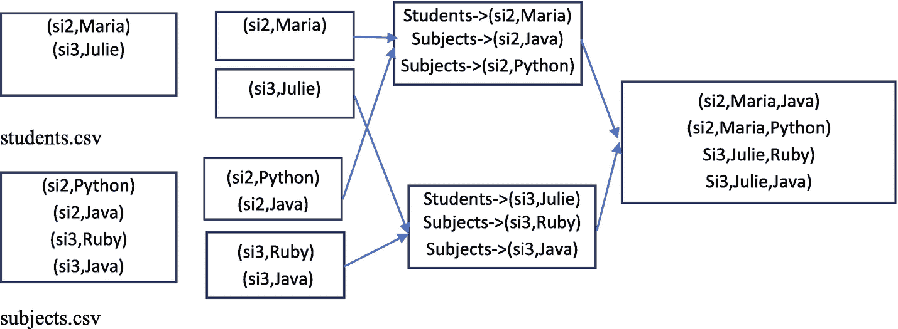

# 7. 优化 `PySpark SQL`

在本章中，我们将研究各种用于优化 SQL 查询的 `Spark SQL` 方案。Apache Spark 是一个开源框架，其设计初衷是应对大数据量。它应该能够处理海量数据。它适用于需要横向扩展处理能力的场景。在介绍 Apache Spark 中使用的优化技术之前，你需要了解横向扩展和纵向扩展的基础知识。

术语 *扩展* 是指需要增加系统的计算能力或内存容量时采取的措施。纵向扩展可以定义为向现有机器增加更多处理能力或容量。例如，当我们有一台 8GB 内存的机器，正在处理 2GB 数据时。如果数据量从 2GB 增加到 4GB，我们可能希望将内存从 8GB 扩展到 16GB。为此，我们增加 8GB 的额外内存容量。这将使机器的总内存达到 16GB。这种通过扩展现有机器资源来提高性能的机制称为 *纵向扩展*（见图 7-1）。



图 7-1 纵向扩展

另一方面，在横向扩展中，我们向现有机器添加一台机器，使其变为两台机器以提高容量。沿用同一个例子，我们增加另一台 8GB 容量的机器，使两台机器共同处理 4GB 数据，这被称为 *横向扩展*（见图 7-2）。



图 7-2 横向扩展

由于这是一个非常重要的概念，让我们看一个简单的例子。假设我们从 A 地旅行到 B 地，需要用一辆 20 座的巴士搭载 20 个人。由于座位数量满足乘客人数，一切顺利。假设现在需要搭载 30 名乘客。我们可以换一辆载客量为 30 的大巴，例如双层巴士。在这种情况下，我们只保留一辆巴士，但它的容量增加了。所以本质上，我们从 20 座巴士扩展到了 30 座巴士，并且仍然只使用一辆巴士。这就是纵向扩展，我们能够仅使用一辆巴士进行扩容。

纵向扩展的问题在于其扩展限度是有限的。例如，如果有 60 或 70 名乘客，我们可能找不到一辆能容纳所有人的巴士。因此，纵向扩展的能力是有上限的。此外，如果这辆唯一的巴士遇到任何维护问题，我们将根本无法出行。这个例子类似于软件的纵向扩展，其纵向扩展的能力同样存在上限。它也存在单点故障的问题。如果一台大型机器发生故障，我们的整个系统将会崩溃。

横向扩展解决了大部分这些问题。我们来进一步了解横向扩展。假设我们增加了一辆 20 座的巴士，现在使用两辆巴士。所以本质上，我们通过向现有车队添加一辆巴士来进行扩展。这种扩展称为横向扩展。虽然它表面上似乎解决了纵向扩展的许多问题，但横向扩展也有其自身的一系列问题。例如，在巴士的例子中，我们需要确保两辆巴士保持同步。我们必须采取额外的步骤，通过检查两辆巴士来确保所有乘客都已上车。我们可能需要始终保持两辆巴士的计划同步。此外，我们还需要更多需要管理的司机。这些都是在增加另一辆巴士时需要采取的一些额外步骤。

与此非常相似的是，在横向扩展中，我们需要确保分布式进程同步。我们需要确保所有机器的输出合并成一个最终输出。

现在我们已经介绍了纵向扩展和横向扩展，让我们从大数据角度来看待扩展。由于大数据旨在处理海量数据，纵向扩展实际上并不可行。我们必须采用横向扩展。由于需要处理的数据量将达到 TB 级和 PB 级，我们需要不断添加更多机器来进行处理。我们还需要能够在分布式环境中工作的软件。常规的 Windows 文件系统，如 `FAT` 和 `NTFS`，以及 UNIX 文件系统，如 `EXT`，无法在分布式机器集群中工作。

`HDFS` 就是这样一个可以在分布式机器集群上运行的文件系统。`HDFS` 可以从一个 5 台机器/节点的设置开始启动。随着数据量的增加，它可以轻松扩展为分布式多节点系统。除了 `HDFS`，Amazon `S3` 是另一个分布式文件系统的例子。虽然此类分布式文件系统知道如何以分布式方式存储数据，但我们仍需以分布式方式应用计算。

例如，假设我们需要找出分布在不同两台机器上的一个文件中所有学生的平均分。计算过程应分别找出系统-1 和系统-2 的平均分，并且最终它还需要知道如何从这些平均分中再计算出总体平均分。这使得分布式环境下的计算过程更加复杂。参见图 7-3。



图 7-3 分布式环境

## 即便是简单操作，也需要复杂的软件

即便是简单操作，也需要能够处理分布式计算复杂性的复杂软件。`Hadoop` 包含 `HDFS` 和 `MapReduce` 框架，可以处理来自多个节点的分布式计算。`MapReduce` 框架包含一个 `Map` 阶段，该阶段尝试在所有机器上应用计算并获取中间输出。`Reduce` 阶段则是将中间输出合并为一个单一输出。在前面的例子中，如果要使用 `MapReduce` 框架计算平均值，`Map` 阶段可以找出每个文件中学生的平均分，而 `Reduce` 阶段则通过计算这些平均分的平均值来得出最终输出。图 7-4 从高层展示了 `MapReduce` 框架。



图 7-4 假设每个节点学生人数相同的情况下，使用 `MapReduce` 框架计算平均值

虽然 `Hadoop` 的 `MapReduce` 框架非常适合分布式计算，但它需要编写大量样板代码，并且涉及大量的磁盘 I/O，这会严重影响性能。用户需要理解这个复杂的框架，这对许多用户来说非常困难。这就是 `Apache Spark` 的用武之地。

`Apache Spark` 可以轻松处理此类分布式计算。它为用户提供了易于使用的接口，消除了 `MapReduce` 所需的大部分样板代码，并将 `MapReduce` 框架中的 50 行代码缩减至 5-10 行。

`Apache Spark` 还引入了内存处理，这极大地加速了性能缓慢的磁盘 I/O。本质上重复性很高的操作可以将数据缓存在内存中，并可以多次使用。所有这些特性使 `Apache Spark` 成为大数据处理的一站式解决方案。

尽管 `Apache Spark` 原生支持以分布式方式处理海量数据，但我们仍需为 `Spark` 提供合适的环境，以便正确地分布数据。例如，在一个 10 节点集群中，如果所有数据只分布在三个节点上，而另外七个节点数据为空或数据量很少，那么，如您所见，只有这三个节点会执行所有工作，其余节点则处于空闲状态。这将导致性能下降。您需要为 `Spark` 程序提供合理的数据分布，或者提供正确的调优参数，以便相应地分布数据并提升性能。

类似地，如果在大型表上进行连接（`Join`），且连接键（`join key`）存在倾斜或分布不均，就会产生大量的数据混洗（`shuffle`）。在这种情况下，`Spark` 可能会陷入内存不足的境地。这时，我们需要使用正确的性能改进参数。

这些只是 `Spark` 需要您优化查询以从 `Spark SQL` 获得最佳性能的部分场景。

现在我们已经介绍了性能优化的背景，接下来让我们逐步学习本章的技巧，掌握 `PySpark` 的优化技术。

我们将学习以下技巧：

-   技巧 7-1. 使用 `PySpark SQL` 进行聚合
-   技巧 7-2. 使用 `PySpark SQL` 应用窗口函数
-   技巧 7-3. 使用 `PySpark SQL` 缓存数据
-   技巧 7-4. 在 `PySpark SQL` 中应用 `Distribute By`、`Sort By` 和 `Cluster By` 子句

### 本章技巧

让我们进入第一个技巧。

#### 技巧 7-1. 使用 `PySpark SQL` 进行聚合

##### 问题

您希望在 `PySpark SQL` 中使用 `Group By` 来查找每个学生的平均分。到目前为止，您已经创建了学生报告，并展示了来自 `students` 和 `subjects` 数据中各自的科目和分数。让我们尝试生成一份学生报告，以确定每个学生的平均分。

##### 解决方案

我们加载 `Students` 和 `Subjects` 数据集，并将它们连接起来：

# Spark SQL 查询与聚合

## 工作原理

让我们先加载并注册数据：

```python
>>> #加载并注册学生数据
>>> studentDf = spark.read.csv('studentData_dateofbirth.csv',header=True, inferSchema=True)
>>> studentDf.createOrReplaceTempView("StudentsDob")
>>> #加载并注册科目数据
>>> subjectsDf = spark.read.csv('subjects.csv',header=True, inferSchema=True)
>>> subjectsDf.createOrReplaceTempView("subjects")
>>> spark.sql("select * from studentsdob st join subjects sb on (st.studentId = sb.studentId)").show()
```

以下是输出结果：

```
+---------+-------+------+-------------------+---------+-------+-----+
|studentId|   name|gender|        dateofbirth|studentId|subject|marks|
+---------+-------+------+-------------------+---------+-------+-----+
|      si1|  Robin|     M|1981-12-13 00:00:00|      si1|   Java|   81|
|      si1|  Robin|     M|1981-12-13 00:00:00|      si1| Python|   75|
|      si2|  Maria|     F|1986-06-06 00:00:00|      si2|   Java|   83|
|      si2|  Maria|     F|1986-06-06 00:00:00|      si2| Python|   85|
|      si3|  Julie|     F|1988-09-05 00:00:00|      si3|   Ruby|   72|
|      si3|  Julie|     F|1988-09-05 00:00:00|      si3|   Java|   76|
|      si4|    Bob|     M|1987-05-04 00:00:00|      si4| Python|   84|
|      si4|    Bob|     M|1987-05-04 00:00:00|      si4|    C++|   78|
|      si6|William|     M|1980-11-12 00:00:00|      si6|   Java|   70|
+---------+-------+------+-------------------+---------+-------+-----+
```

您可能还记得上一章中的这个输出。让我们尝试在这个查询上使用 `Group By` 来找出每个学生的平均分。

与 UDF 的问题类似，如果我们按以下方式使用 `avg` 函数，它将无法正常工作。

```python
>>> spark.sql("select name, avg(marks) from studentsdob st join subjects sb on (st.studentId = sb.studentId)").show()
```

这是我们将会遇到的错误：

```
py4j.protocol.Py4JJavaError: An error occurred while calling o24.sql.
: org.apache.spark.sql.AnalysisException: grouping expressions sequence is empty, and 'st.`name`' is not an aggregate function. Wrap '(avg(CAST(sb.`marks` AS BIGINT)) AS `avg(marks)`)' in windowing function(s) or wrap 'st.`name`' in first() (or first_value) if you don't care which value you get.;
```

请注意，我们在这个查询中没有使用 `Group By` 子句。如果我们在没有应用 `Group By` 子句的情况下使用聚合函数，将会报错。UDF 每次调用操作一行，而 `avg` 实际上是 Spark 所谓的 *用户自定义聚合函数*（UDAF）。这类函数根据 `Group By` 子句获取一组行，并将功能应用于这些行集上。让我们看看 `Group By` 的实际应用。

这是使用 `Group By` 的查询：

```python
>>> spark.sql("select name,avg(marks) from studentsdob st left join subjects sb on (st.studentId = sb.studentId) group by name").show()
```

从这个查询中注意到，`group by name` 对 `name` 列应用了 `Group By`。`select` 子句只选择了 `name` 和 `avg(marks)`。如果您想知道如何选择要应用分组列的列，请记住，报告中“每”部分（例如每个学生或每个科目）涉及的列将参与 `Group By` 子句。您也可以在 `Group By` 子句中使用多个列或表达式。例如，如果我们想找到每个学生每个科目的平均分，我们需要在 `Group By` 子句中同时包含姓名和科目列。

以下是查询的输出结果：

```
+-------+----------+
|   name|avg(marks)|
+-------+----------+
|  Robin|      78.0|
|    Bob|      81.0|
|  Julie|      74.0|
|  Maria|      84.0|
|William|      70.0|
+-------+----------+
```

以下查询在 `Group By` 子句中使用了两个列：

```python
>>> spark.sql("select name,subject,avg(marks) from studentsdob st left join subjects sb on (st.studentId = sb.studentId) group by name,subject").show()
```

我们在 `GROUP BY` 子句中使用了 `name` 和 `subject`。这将返回所有对学生和科目组合而言唯一的记录。如果数据包含学生各学期各科目的成绩，这将为我们提供每位学生每个科目的总体平均分。

输出结果如下：

```
+-------+-------+----------+
|   name|subject|avg(marks)|
+-------+-------+----------+
|William|   Java|      70.0|
|    Bob| Python|      84.0|
|  Robin| Python|      75.0|
|  Robin|   Java|      81.0|
|  Maria| Python|      85.0|
|  Maria|   Java|      83.0|
|    Bob|    C++|      78.0|
|  Julie|   Ruby|      72.0|
|  Julie|   Java|      76.0|
+-------+-------+----------+
```

### Step 7-1-1. 查找每个科目的学生人数

在此步骤中，我们将查找参加每个考试的学生人数。让我们编写查询来获取该报告。

查询语句如下：

```python
>>> spark.sql("select subject,count(name) Students_count from studentsdob st left join subjects sb on (st.studentId = sb.studentId) group by subject").show()
```

输出结果如下：

```
+-------+--------------+
|subject|Students_count|
+-------+--------------+
|    C++|             1|
|   Ruby|             1|
| Python|             3|
|   Java|             4|
+-------+--------------+
```

### Step 7-1-2. 查找每个学生的科目数量

类似地，我们将确定每位学生参加了多少门科目的考试。

查询语句如下：

```
>>> spark.sql("select name,count(subject) Students_count from studentsdob st left join subjects sb on (st.studentId = sb.studentId) group by name").show()
```

输出结果如下：

```
+-------+--------------+
|   name|Students_count|
+-------+--------------+
|  Robin|             2|
|    Bob|             2|
|  Julie|             2|
|  Maria|             2|
|William|             1|
+-------+--------------+
```

这些查询展示了使用`GROUP BY`子句应用聚合函数的过程。在准备任何报告的数据时，这些聚合函数都非常有用。在日常业务场景中，这些是你会反复使用的报表。尤其是在数据分析中，你需要从数据中获取洞察，从不同角度对数据进行切片和切块，以获取有意义的信息。因此，理解`GROUP BY`子句在 Spark SQL 中的使用非常重要。

PySpark SQL 中可用的其他 UDAF（用户自定义聚合函数）包括`sum()`、`count()`、`countDistinct()`、`max()`、`min()`等。

需要注意的是，从性能优化的角度来看，保持这些 UDF 和 UDAF 的精简非常重要。由于这些 UDF 和 UDAF 会在 JVM 中运行，数据在传递到 JVM 之前需要被序列化。因此，如果这些函数使用不当，可能会带来显著的性能影响。同样，由于这些函数会应用于大数据领域中的数百万行数据，避免使用`log`和`print`语句是良好的实践。例如，一个仅需几秒的 UDF，当在 100 亿行数据上运行时，可能会引发严重的性能问题。

## Recipe 7-2. 使用 PySpark SQL 应用窗口函数

### 问题

你想找出每个科目中排名第一和第二的学生。

### 解决方案

Apache Spark 支持一种特殊类型的函数，称为`窗口函数`，以及其内置的 UDF（如`substr`、`round`等）和聚合函数（如`sum`和`avg`）。虽然这些 UDF 和聚合函数可以执行大多数操作，但仍有许多操作无法通过这些函数完成。因此，Spark 引入了窗口函数，它可以在处理单行数据的同时，对一组行进行操作。

### 工作原理

#### Step 7-2-1. 应用`rank`函数获取排名

此步骤使用了`rank`窗口函数。`rank`函数为选定行集中的每一行提供一个连续的序号。首先，我将对所有的行应用`rank`函数，而不进行任何窗口选择。让我们看看如何做到这一点。

以下是最简单形式的`rank`查询：

```
>>> spark.sql("select name,subject,marks,rank() over (order by name) as RANK from studentsdob st join subjects sb ON (st.studentId = sb.studentId)").show()
```

从该查询中可以看到，`rank()`函数像其他用户自定义函数一样被使用。注意，在`rank()`函数之后紧跟一个`over`子句。这个`over`子句为`rank`函数定义了行的窗口。这个窗口需要标识行的集合以及这些行的排序方式。

在此查询中，我们没有使用特定的行集，而是将表中的所有行作为一个集合。接着，我们使用了`ORDER BY name`。这用于根据`name`列对行进行排序。根据排序顺序，每一行都会被赋予一个排名。这种形式的查询可能不是很有用，但这里为了简单起见供你理解。让我们一步步来看。

输出结果如下：

```
+-------+-------+-----+----+
|   name|subject|marks|RANK|
+-------+-------+-----+----+
|    Bob|    C++|   78|   1|
|    Bob| Python|   84|   1|
|  Julie|   Java|   76|   3|
|  Julie|   Ruby|   72|   3|
|  Maria| Python|   85|   5|
|  Maria|   Java|   83|   5|
|  Robin| Python|   75|   7|
|  Robin|   Java|   81|   7|
|William|   Java|   70|   9|
+-------+-------+-----+----+
```

#### Step 7-2-2. 在`rank`函数中使用`PARTITION BY`

在之前的步骤中，我们学习了如何应用`rank`函数。现在我们将学习如何使用`PARTITION`子句将行分为多个集合。你可以将此视为在这些行集上放置一个窗口，如图 7-5 所示。



图 7-5 将行分为多个集合

如图 7-5 所示，根据科目划分了四个窗口。每个窗口具有相同的科目，即创建了 C++、Java、Python 和 Ruby 科目。现在假设对于每一行，需要根据该行所属的窗口执行特定的操作。然后，我们就可以应用窗口函数。此类函数的示例包括：

- 学生在他们参与的科目中的平均年龄是多少？
- 学生在他们参与的科目中获得的成绩的百分位数是多少？

在没有窗口函数的情况下，用纯 SQL 编写此类函数非常困难。让我们继续，使用`PARTITION`子句来创建窗口。

```
>>> spark.sql("select name,subject,marks,rank() over (PARTITION BY subject order by name) as RANK from studentsdob st join subjects sb ON (st.studentId = sb.studentId)").show()
```

在这个查询中，我们添加了一个新的`PARTITION`子句，作用于`subject`列。这意味着我们正在基于`subject`列进行窗口划分。这将为每个不同的`subject`列值创建一个单独的窗口，并仅在该窗口集的行内应用`rank`窗口函数。

输出结果如下：

从该输出中，你可以看到每个科目的学生都被分配了排名。

```
+-------+-------+-----+----+
|   name|subject|marks|RANK|
+-------+-------+-----+----+
|    Bob|    C++|   78|   1|
|  Julie|   Ruby|   72|   1|
|    Bob| Python|   84|   1|
|  Maria| Python|   85|   2|
|  Robin| Python|   75|   3|
|  Julie|   Java|   76|   1|
|  Maria|   Java|   83|   2|
|  Robin|   Java|   81|   3|
|William|   Java|   70|   4|
+-------+-------+-----+----+
```

但请注意，我们并没有得到正确的排名。这是因为`ORDER BY`列使用的是`name`而不是`marks`。让我们纠正这一点，使用`marks`列对每个科目的学生进行排序。

以下是查询语句：

```
>>> spark.sql("select name,subject,marks,rank() over (PARTITION BY subject order by marks desc) as RANK from studentsdob st join subjects sb ON (st.studentId = sb.studentId)").show()
```

请注意，我已经将排序依据改为`marks`。同时，我确保数据按降序排列，这是为了确保获得最高分数的学生获得第一名。

```
+-------+-------+-----+----+
|   name|subject|marks|RANK|
+-------+-------+-----+----+
|    Bob|    C++|   78|   1|
|  Julie|   Ruby|   72|   1|
|  Maria| Python|   85|   1|
|    Bob| Python|   84|   2|
|  Robin| Python|   75|   3|
|  Maria|   Java|   83|   1|
|  Robin|   Java|   81|   2|
|  Julie|   Java|   76|   3|
|William|   Java|   70|   4|
+-------+-------+-----+----+

#### 步骤 7-2-3：获取每个科目的前两名学生

现在我们有了排名，让我们仅从报告中识别出前两名学生。这非常简单。我们需要筛选`rank`列中值小于或等于2的行。

以下是查询语句：

```sql
>>> spark.sql("select name,subject,marks,RANK from (select name,subject,marks,rank() over (PARTITION BY subject order by marks desc) as RANK from studentsdob st join subjects sb ON (st.studentId = sb.studentId)) where RANK <= 2").show()
```

以下是输出结果。从该查询中可以看出，子查询别名在过滤条件中使用了`RANK`列。这是因为，正如我们在前一章中看到的，在查询中创建的别名列不能在同一查询中使用。因此，我们需要将其作为子查询，并从父查询中应用过滤条件。

以下是输出：

```
+-----+-------+-----+----+
| name|subject|marks|RANK|
+-----+-------+-----+----+
|  Bob|    C++|   78|   1|
|Julie|   Ruby|   72|   1|
|Maria| Python|   85|   1|
|  Bob| Python|   84|   2|
|Maria|   Java|   83|   1|
|Robin|   Java|   81|   2|
+-----+-------+-----+----+
```

我们已经成功使用了窗口函数`rank()`，并涵盖了窗口函数的概念。利用这个概念，我们可以使用任何窗口函数。

请注意，当我们将这些窗口函数应用于大数据世界中的海量数据时，会增加许多性能瓶颈。特别是在连接大表时，性能会急剧下降。因此，一个好的实践是将这些窗口函数作为预计算值使用，然后在连接中使用这些值。我们必须确保以正确的方式使用`PARTITION`子句。我们将在下一个配方中介绍如何使用`PARTITION`。

## 配方 7-3：使用 PySpark SQL 缓存数据

### 问题

你想要缓存一个表或数据集。

### 解决方案

很多时候，当我们有需要重复使用的数据集时，我们不想每次使用时都重新读取它。例如，包含国家和国家代码的数据集通常体积较小。这些数据可以很容易地放入内存，而不会占用太多空间。但我们不希望这些数据在每次使用时都被读取。因此，对于此类场景，我们可以使用 PySpark SQL 提供的 Spark 缓存。

当涉及到需要对同一数据集多次应用逻辑的机器学习算法时，缓存是实现最佳性能的最佳选择。通过缓存，Spark 会将数据保留在内存中，因此无需再次读取。从磁盘读取数据是一项昂贵的操作。鉴于其所有优势，让我们在示例中尝试使用缓存。

### 工作原理

在这个例子中，我们将首先缓存学生数据并创建一个缓存视图。之后，我们将缓存的数据与科目和作业表进行连接。

以下是缓存数据的查询语句。这里我们为缓存数据提供一个名称，类似于视图或表。

```sql
>>> spark.sql("cache table students_cached AS select * from studentsdob").show()
```

让我们尝试在查询中使用缓存数据。

以下是使用了新创建的缓存表`students_cached`的查询：

```sql
>>> spark.sql("select st.studentid,name,subject,marks from students_cached st left join subjects sb on (st.studentId = sb.studentId)").show()
```

如您所见，使用缓存表与使用普通表没有区别，只是我们获得了许多性能提升。

```
+---------+-------+-------+-----+
|studentid|   name|subject|marks|
+---------+-------+-------+-----+
|      si1|  Robin|   Java|   81|
|      si1|  Robin| Python|   75|
|      si2|  Maria|   Java|   83|
|      si2|  Maria| Python|   85|
|      si3|  Julie|   Ruby|   72|
|      si3|  Julie|   Java|   76|
|      si4|    Bob| Python|   84|
|      si4|    Bob|    C++|   78|
|      si6|William|   Java|   70|
+---------+-------+-------+-----+
```

虽然缓存非常有用，但我们需要非常谨慎地使用缓存。我们不应该缓存海量数据，这会导致内存溢出异常。在内存中处理海量数据会使 Spark 留给其他操作的内存减少。在执行完全不同的操作时，我们可能会遇到内存溢出错误，而这实际上是由于在内存中缓存了海量数据引起的。

## 配方 7-4：在 PySpark SQL 中应用 `DISTRIBUTE BY`、`SORT BY` 和 `CLUSTER BY` 子句

### 问题

你想要在 PySpark SQL 中使用 `DISTRIBUTE BY` 来有效地分区你的数据。

### 解决方案

如本章开头所述，在分布式计算环境中实现高效数据转换（高性能和资源最优利用）的关键完全取决于数据分布的有效性。如果数据在所有数据节点之间均匀分布，Spark 作业将以均衡的方式执行。否则，我们最终会看到一些任务花费最长的时间和资源，而其他任务则在几秒钟内完成。

很多时候，你可能会为作业提供最大资源（如执行器数量和执行器内存），但仍然需要等待作业完成，此时只有少数几个执行器运行数小时，而其余执行器早已完成。让我们看看原因，并了解如何避免此类行为。作业行为异常的原因有很多：

*   大部分数据位于某个节点上，导致 Spark 提供的默认分区无效。

*   连接操作所基于的键存在数据倾斜，因为连接操作只发生在少数分配的执行器中。

在这两种情况下，数据都没有被正确分区。Spark 为用户提供了机制，以确定如何从 Spark 的原始分区重新分区数据。在 Spark 程序化 API 中，这被称为 `repartition`，而在 PySpark SQL 中，它被称为 `DISTRIBUTE BY`。这是优化 Spark SQL 的最佳方法之一，但由于了解这些子句的人不多，它并未被广泛使用。

让我们看看如何在 PySpark SQL 中使用 `DISTRIBUTE BY`。

### 工作原理

此示例将 `DISTRIBUTE BY` 子句应用于 `studentId`，因为它是连接键。

在以下查询中，我们创建了两个新的 DataFrame，分别命名为 `student_distributed` 和 `subjects_distributed`。查看查询，我们正在对 `studentId` 列应用 `DISTRIBUTE BY` 子句。

创建这些 DataFrame 后，我们还将它们注册为临时视图。到目前为止，Spark 并未执行任何操作。当后续调用一个动作（action）时，Spark 将根据 `studentId` 重新分区数据，以便数据能够均匀分布到所有计算节点。

以下是查询语句：
```

```python
>>> student_distributed = spark.sql("select * from StudentsDob distribute by studentId")
>>> subjects_distributed = spark.sql("select * from subjects distribute by studentId")
>>> student_distributed.createOrReplaceTempView("student_distributed")
>>> subjects_distributed.createOrReplaceTempView("subjects_distributed")
```

由于我们没有调用 `show()` 方法，并且没有执行任何操作步骤，这些查询不会产生任何输出。一旦我们有了分布式视图，就可以在查询中使用这些视图。接下来，基于新建的分布式视图来连接 `students` 和 `subjects` 数据集。

查询如下：

```python
>>> spark.sql("select st.studentid,name,subject,marks from student_distributed st left join subjects_distributed sb on (st.studentId = sb.studentId)").show()
```

输出结果如下：

```
+---------+-------+-------+-----+
|studentid|   name|subject|marks|
+---------+-------+-------+-----+
|      si2|  Maria|   Java|   83|
|      si2|  Maria| Python|   85|
|      si4|    Bob| Python|   84|
|      si4|    Bob|    C++|   78|
|      si3|  Julie|   Ruby|   72|
|      si3|  Julie|   Java|   76|
|      si6|William|   Java|   70|
|      si1|  Robin|   Java|   81|
|      si1|  Robin| Python|   75|
+---------+-------+-------+-----+
```

理解 `Distribute By` 的使用方法，将有助于我们通过均匀分布数据来有效并行化作业。现在假设我们基于一个连接键来连接数据集，并且该键在两个数据集中都是无序的。在这种情况下，Spark 必须在节点之间进行数据混洗（shuffle），以从两个表中获取具有相同键的行。参见图 7-6。



图 7-6 Spark 在连接过程中的混洗操作

从图 7-6 中可以看到，大量数据在节点之间移动。这被称为节点间的`混洗`，减少这种混洗将有助于提升作业的性能。

我们刚刚看到 `Distribute By` 就是其中一种选择。现在尝试将 `Distribute By` 可视化。假设有两个分区，我们将会得到图 7-7。



图 7-7 使用 `Distribute By`

在图 7-7 中，请注意，即使你已经高效地并行化了连接操作，仍然存在大量的混洗。从 `subjects` 来看，数据被分发到各个地方。这种数据混洗会导致性能下降，并且在内存不足时引发内存溢出错误。减少数据混洗的方法是对 `subjects` 中的数据进行排序，然后再将其与 `students` 进行连接。在以下查询中，我们同时应用 `Distribute By` 和 `Sort By` 子句来实现最佳性能。

以下是准备经过分布和排序的 `students` 和 `subjects` 数据的查询。

```python
>>> student_distributed_sorted = spark.sql("select * from StudentsDob distribute by studentId  SORT BY studentId")
>>> subjects_distributed_sorted = spark.sql("select * from subjects distribute by studentId SORT BY studentId")
>>> student_distributed_sorted.createOrReplaceTempView("student_distributed_sorted")
>>> subjects_distributed_sorted.createOrReplaceTempView("subjects_distributed_sorted")
```

让我们查看连接后的数据输出：

```python
>>> spark.sql("select st.studentid,name,subject,marks from student_distributed_sorted st left join subjects_distributed_sorted sb on (st.studentId = sb.studentId)").show()
```

尝试将这一连接过程可视化。参见图 7-8。



图 7-8 连接过程可视化

在图 7-8 中，请注意数据混洗的次数已经减少，数据流动非常顺畅。与图 7-7 相比，混洗操作少了很多。

输出结果看起来非常相似，只不过你以更优的方式优化了查询：

```
+---------+-------+-------+-----+
|studentid|   name|subject|marks|
+---------+-------+-------+-----+
|      si2|  Maria|   Java|   83|
|      si2|  Maria| Python|   85|
|      si4|    Bob| Python|   84|
|      si4|    Bob|    C++|   78|
|      si3|  Julie|   Ruby|   72|
|      si3|  Julie|   Java|   76|
|      si6|William|   Java|   70|
|      si1|  Robin|   Java|   81|
|      si1|  Robin| Python|   75|
+---------+-------+-------+-----+
```

既然你已经同时使用了 `Distribute By` 和 `Sort By` 子句，Spark 还提供了一个可选子句来组合数据——它叫做 `Cluster By`。使用 `Cluster By` 相当于对同一列同时使用 `Distribute By` 和 `Sort By`。下面我们来看看 `Cluster By` 的实际应用。

以下是使用 `Cluster By` 子句的查询：

```python
>>> student_distributed_clustered = spark.sql("select * from StudentsDob cluster by studentId ")
>>> subjects_distributed_clustered = spark.sql("select * from subjects cluster by studentId ")
>>>student_distributed_clustered.createOrReplaceTempView("student_distributed_clustered")
>>>subjects_distributed_clustered.createOrReplaceTempView("subjects_distributed_clustered")
>>> spark.sql("select st.studentid,name,subject,marks from student_distributed_clustered st left join subjects_distributed_clustered sb on (st.studentId = sb.studentId)").show()
```

输出结果如下：

```
+---------+-------+-------+-----+
|studentid|   name|subject|marks|
+---------+-------+-------+-----+
|      si2|  Maria|   Java|   83|
|      si2|  Maria| Python|   85|
|      si4|    Bob| Python|   84|
|      si4|    Bob|    C++|   78|
|      si3|  Julie|   Ruby|   72|
|      si3|  Julie|   Java|   76|
|      si6|William|   Java|   70|
|      si1|  Robin|   Java|   81|
|      si1|  Robin| Python|   75|
+---------+-------+-------+-----+
```
在本部分中，你已经成功使用了`Distribute By`、`Sort By`和`Cluster By`子句来有效优化你的PySpark SQL查询。