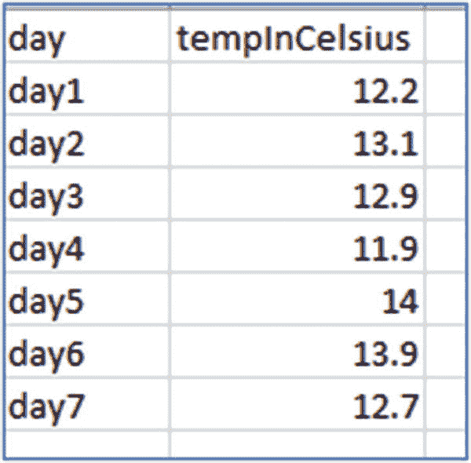
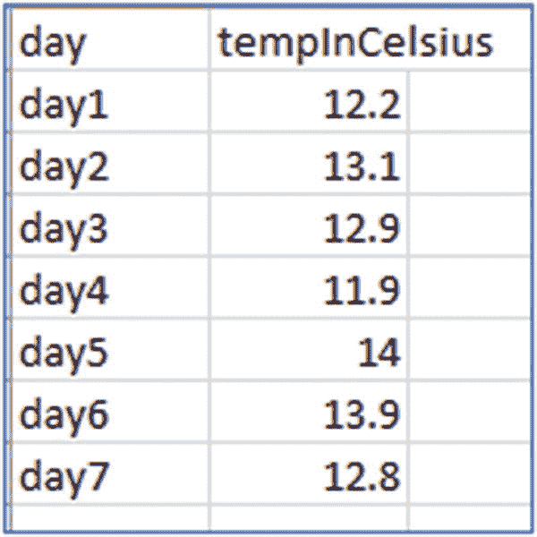
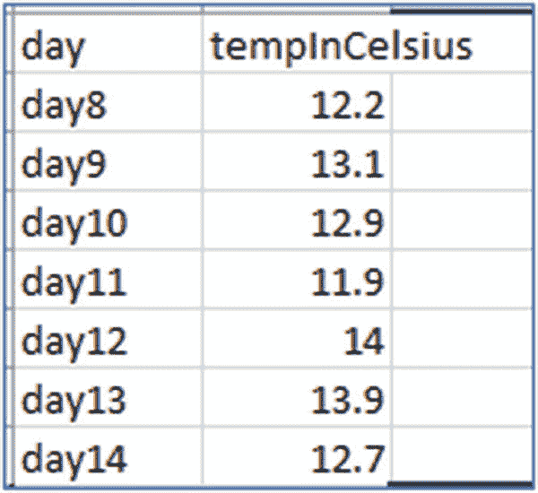
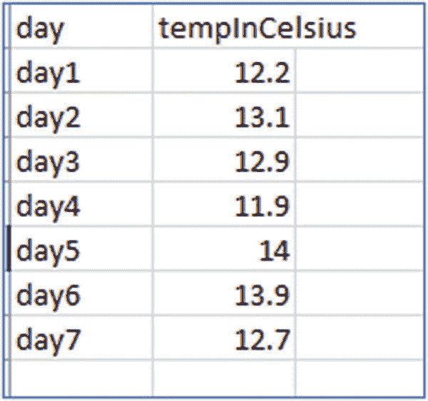
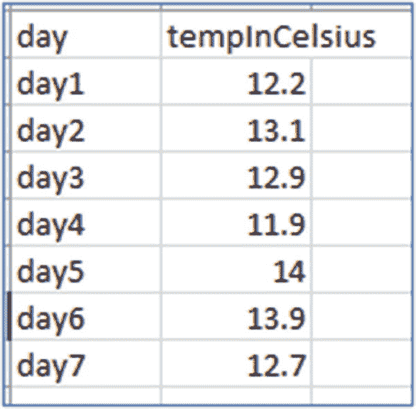
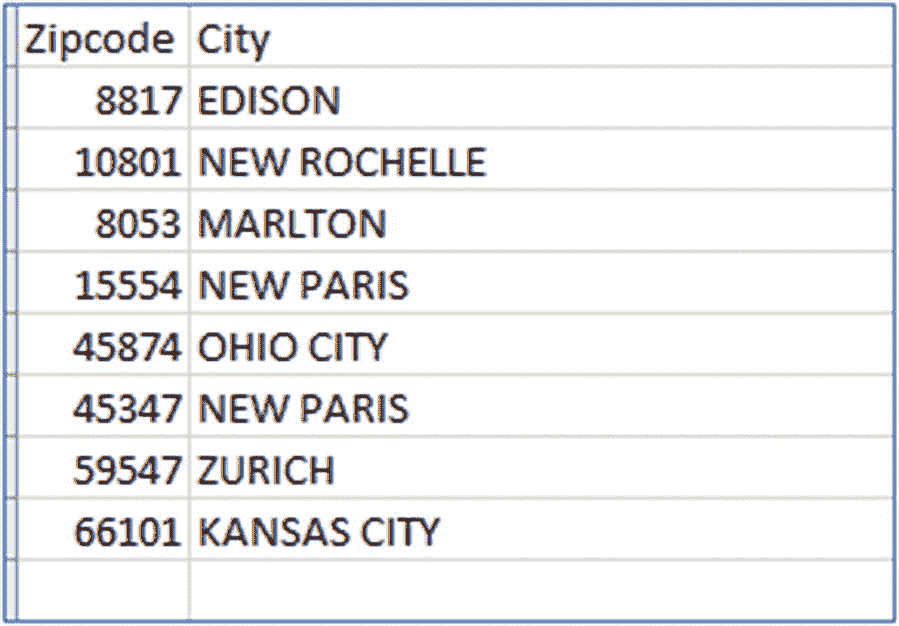
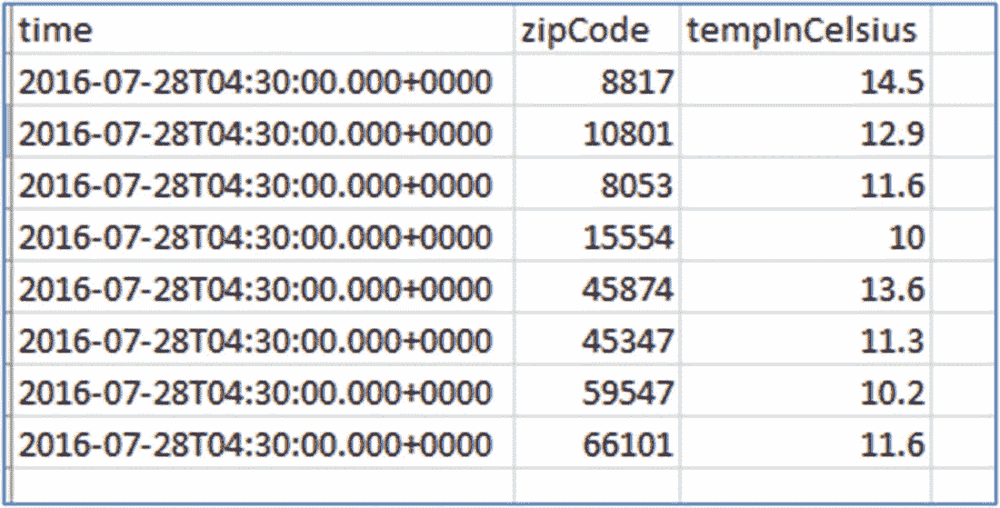
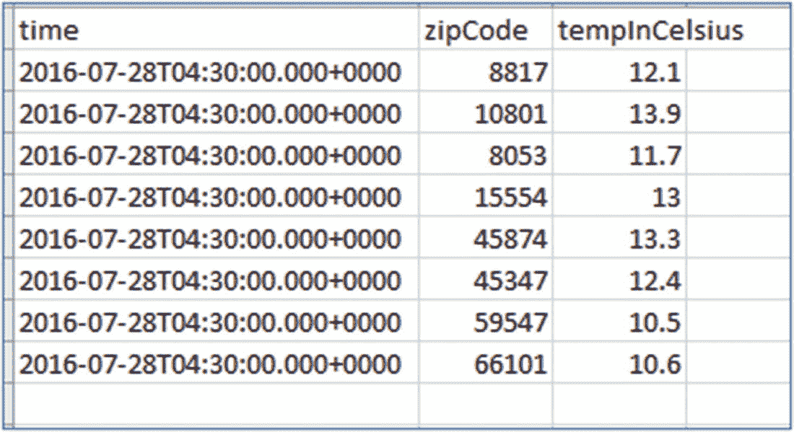
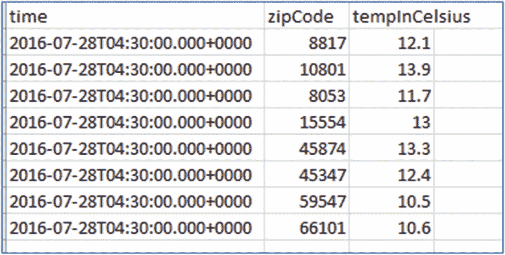

# 配方 8-1 在目录上设置流式 DataFrame

### 问题
您希望在目录上创建流式 DataFrame。

### 解决方案

作为其结构化流式处理特性的一部分，Spark 提供了多种流式处理选项。在 Spark 术语中，它们被称为*数据源*。

- **文件数据源**：本质上是指以增量文件形式获取流式数据。Spark 支持`txt`、`csv`、`json`和`parquet`等文件格式。这与从静态文件创建 DataFrame 非常相似。但对于文件数据源，您需要在预期存放增量文件的目录上创建数据流。您可能会疑惑，在使用`Kafka`及类似工具时，为何还会出现增量文件。在企业环境中，由于使用了包括大型机等遗留软件在内的多种技术，这些系统会以文件形式提供数据。因此，将增量文件视为流式数据源至关重要。我们将在后文中进一步探讨。

- **Kafka 数据源**：`Kafka`已成为大数据领域事实标准的分布式流式处理平台。`Kafka`是一个消息系统，包含支持主题的消息代理。这些主题充当消息生产者，而消费者可以消费这些消息。

- **套接字数据源和速率数据源**：这些数据源主要用于测试目的。套接字数据源可以从套接字连接读取数据。例如，您可以将 Apache Spark 连接到任意特定套接字，以消费发送到该套接字的流式数据。类似地，速率数据源可用于以任意频率生成行。它们包含时间戳和值，其中时间戳是生成行的时间，而值则是包含消息计数的长整型数。

接下来，让我们从文件数据源创建 DataFrame 流。

为便于理解，本示例将使用一组较小的温度数据。该数据仅包含两列——`day`和`tempInCelsius`，均为字符串类型。`day`列包含获取温度的日期，`tempInCelsius`表示当天的观测温度。请参见图 8-1。



图 8-1 温度数据集

该数据包含七行数据，其中标题行包含列名。

### 工作原理

首先，我们需要创建模式并将其分配给新建的 DataFrame。

使用以下代码创建模式：

```
>>> from pyspark.sql.types import StructType
>>> temperatureSchema = StructType().add("day", "string").add("tempInCelsius", "string")
```

如代码所示，首先需要导入`StructType`。然后，需要创建包含必要列及其数据类型的结构类型，如上所示。

尝试打印模式内容：

```
>>> temperatureSchema.simpleString()
```

以下是输出结果。我们可以看到模式中刚添加的两列。现在可以进入下一步了。

```
'struct'
```

下一步是从流式处理创建 DataFrame。让我们查看创建 DataFrame 的代码。

```
>>> temperature_streaming_df = spark \
... .readStream \
... .option("sep", ",") \
... .schema(userSchema) \
... .csv("temperature-data")
```

这段代码涉及多个操作。让我们逐一分析。
首先我们调用`readStream`方法。此方法对流式处理的创建至关重要，它会返回一个用于将流式数据读取为 DataFrame 的`DataStreamReader`。
接下来，我们将分隔符设置为`,`（逗号），这是因为我们使用的是逗号分隔值。

为确保 DataFrame 处于流式处理模式，我们使用如下所示的`isStreaming`方法：

```
>>> temperature_streaming_df.isStreaming
```


以下是输出结果，显示 DataFrame 正在执行流式处理：

```
True
```

然后，我们使用 `schema` 方法为 DataFrame 设置模式。最后，我们指定 Spark 应绑定并查找流数据的目录。让我们尝试打印模式，然后将 DataFrame 注册为表或视图，最后显示 DataFrame 的内容。一开始我让目录保持为空，因此你可能看不到 DataFrame 的任何输出。

打印模式

```
>>> temperature_streaming_df.printSchema()
```

以下是输出结果。输出符合预期，包含两个指定的列。

```
root
|-- day: string (nullable = true)
|-- tempInCelsius: string (nullable = true)
```

现在我们将 DataFrame 注册为一个表。

```
>>> temperature_streaming_df.createOrReplaceTempView("temperature_streaming_df")
```

我将应用一个简单的 SQL 查询来显示该表的内容。

让我们打印 DataFrame 的内容。

```
>>> spark.sql("select * from temperature_streaming_df").show()
```

唉，你会看到大量异常，最后是这条消息。

```
pyspark.sql.utils.AnalysisException: 'Queries with streaming sources must be executed with writeStream.start();;\nFileSource[temperature-data]'
```

别担心，我希望你能理解发生了什么，这样当你自己操作时，就能解决这类问题。Spark 流处理不会启动，除非你在输出接收器（sink）上调用了 `start` 方法。我们将在下一个秘籍中讨论如何设置接收器。在本秘籍中，我们介绍了 Spark Structured Streaming，以及如何从目录设置流式 DataFrame 并将其注册为表。

## 秘籍 8-2. 启动流式查询并观察其运行

### 问题
你希望将流数据持久化到文件中。

### 解决方案
正如你在上一个秘籍中看到的，除非你在流式 DataFrame 上启动一个接收器，否则流处理并没有真正激活。让我们从一个简单的流处理场景开始，然后逐步深入。要开始简单的流处理，你需要理解一些概念。

*接收器（Sinks）* 是写入输出数据的地方。Spark 支持多种接收器类型——File、Kafka、Console、foreach 和 Memory。我们将重点介绍 File、Kafka 和 Console 接收器类型。

- **File 接收器**：输出存储在指定的目录中。
- **Kafka 接收器**：输出存储在 Kafka 主题中。可能不止一个主题，多个消费者可以监听它以用于各种目的。例如，一个主题可能用于进一步处理，另一个主题可能用于将数据持久化到 Hadoop 以进行归档或将来参考。
- **Console 接收器**：用于调试目的，将数据打印到控制台。

让我们看看输出模式。输出模式定义了如何将数据写入接收器。Spark 支持三种输出模式——Append、Complete 和 Update。

- **Append**：这是默认模式，简单地将传入的数据流追加到接收器中。
- **Complete**：此模式将内存中的数据完整地写入接收器。当对流数据执行聚合查询时，需要此模式。例如，如果你需要确定在过去 15 分钟内哪些政治领袖在新闻中被提及的次数最多，等等。
- **Update**：仅将更新后的行写入接收器。

现在你已经理解了输出模式和接收器的概念，我们将启动流处理并观察这些概念的实际应用。首先，我们将流数据写入控制台，这样你就可以轻松看到输出并理解发生了什么。

为便于说明，我将使用四个文件，如图 8-2 至 8-5 所示。


图 8-5 tempData-4.csv


图 8-4 tempData-3.csv


图 8-3 tempData-2.csv


图 8-2 tempData-1.csv

### 工作原理

请务必仔细观察文件的内容。

```
>>> from pyspark.sql.types import StructType
>>> temperatureSchema = StructType().add("day", "string").add("tempInCelsius", "string")
>>> temperature_streaming_df = spark \
... .readStream \
... .option("sep", ",") \
... .schema(temperatureSchema) \
... .csv("C:\\book-author\\data\\data\\temperature-data")
```

通过这段代码，我们创建了一个流式 DataFrame。现在我们将使用 `writeStream` 方法来启动它。

以下代码启动流处理。这是一种非常简单的流处理形式，我们使用 `writeStream` 方法创建一个流，它简单地将数据写入控制台，并将持续追加传入的数据。

```
>>> query = temperature_streaming_df \
... .writeStream \
... .format("console") \
... .outputMode("append") \
... .start()
```

到目前为止，你不会看到任何输出。现在我们将 `tempData.csv` 文件放入 `temperature-data` 目录。注意接下来会发生什么。

你可以在控制台中观察到以下输出。

```

Batch: 0

+----+-------------+
| day|tempInCelsius|
+----+-------------+
|day1|         12.2|
|day2|         13.1|
|day3|         12.9|
|day4|         11.9|
|day5|           14|
|day6|         13.9|
|day7|         12.7|
+----+-------------+
```

现在我们放入 `tempData-3.csv` 文件。这是输出：

```

Batch: 1

+-----+-------------+
|  day|tempInCelsius|
+-----+-------------+
| day8|         12.2|
| day9|         13.1|
|day10|         12.9|
|day11|         11.9|
|day12|           14|
|day13|         13.9|
|day14|         12.7|
+-----+-------------+
```

从输出中注意到，`tempData-3.csv` 文件被打印到了控制台。现在是有趣的部分。我们放入 `tempData-2.csv` 文件。你可能已经注意到 `tempData-2.csv` 和 `tempData-1.csv` 文件包含相同的数据。所以理想情况下它们是重复的。在这种情况下，你将不会在控制台中看到任何输出。你可能想知道为什么看不到输出，从下一步操作可以很容易地理解这一点。在 `tempData-2.csv` 和 `tempData-4.csv` 之间，我对 `day7` 的温度做了一个小改动（现在是 12.7，而不是原来的 12.6）。通过这一个改动，你就能在控制台中看到输出了。

Spark 提供了*恰好一次*（exactly-once）的保证，这意味着每条记录都会被恰好处理一次。处理过程中不会丢失任何数据，也不会多次处理任何数据。与其他流处理解决方案相比，这是 Spark 提供的一个非常强大的特性。

```

Batch: 2

+----+-------------+
| day|tempInCelsius|
+----+-------------+
| day|tempInCelsius|
|day1|         12.2|
|day2|         13.1|
|day3|         12.9|
|day4|         11.9|
|day5|           14|
|day6|         13.9|
|day7|         12.8|
+----+-------------+
```

现在我们将看到流式 DataFrame 表示为内存表，以便我们可以直接对其应用 PySparkSQL 查询。

这是代码：

```
>>> query = temperature_streaming_df \
... .writeStream \
... .format("memory") \
... .queryName("TemperatureData") \
... .outputMode("append") \
... .start()
```

你可以看到，与之前执行此语句相比，我们做了两处改动。首先，我们将格式从 `console` 改为了 `memory`。这表示，我们不将输出写入控制台，而是要求 Spark 将数据保存在内存中。


接下来，我们调用一个名为 `queryName` 的新方法，并将 `TemperatureData` 作为其输入。这将在内存数据上创建一个表表示。以下是使用 PySparkSQL 查看表内容的方法：

```
>>> spark.sql("select * from TemperatureData").show()
```

以下是输出结果。可以看到输出为空，这是因为我们已经清除了目录中的所有数据。

```
+---+-------------+
|day|tempInCelsius|
+---+-------------+
+---+-------------+
```

现在我们将 `tempData-1.csv` 和 `tempData-3.csv` 文件添加到目录中。让我们看看添加这两个文件后的输出。

```
>>> spark.sql("select * from TemperatureData").show()
```

以下是输出结果：

```
+-----+-------------+
|  day|tempInCelsius|
+-----+-------------+
| day8|         12.2|
| day9|         13.1|
|day10|         12.9|
|day11|         11.9|
|day12|           14|
|day13|         13.9|
|day14|         12.7|
| day1|         12.2|
| day2|         13.1|
| day3|         12.9|
| day4|         11.9|
| day5|           14|
| day6|         13.9|
| day7|         12.7|
+-----+-------------+
```

## 配方 8-3. 对流数据应用 PySparkSQL

### 问题
你想对流数据应用 SQL 过滤条件。

### 解决方案
我们需要对同一个表应用过滤条件。

### 工作原理

以下是查询语句，我们过滤出 `tempInCelsius` 大于 13 的天数。由于 `tempInCelsius` 列是字符串类型，我们将其转换为 `double` 类型。

```
>>> spark.sql("select * from TemperatureData where cast(tempInCelsius as double) > 13").show()
```

以下是输出结果：

```
+-----+-------------+
|  day|tempInCelsius|
+-----+-------------+
| day9|         13.1|
|day12|           14|
|day13|         13.9|
| day2|         13.1|
| day5|           14|
| day6|         13.9|
+-----+-------------+
```

因此，借助 Spark 的结构化流，我们可以将其视为一个表，而 Spark 提供了类似 SQL 的数据处理能力。类似地，我们可以在这个表上执行任何 SQL 操作。你可能希望将这些数据与静态数据连接，以便将传入的数据进行映射，从而进行分析并生成特定方面的趋势报告。

## 配方 8-4. 连接流式数据与静态数据

### 问题
你需要将流式数据与静态数据连接。

### 解决方案
在本配方中，你需要将流式数据与静态数据连接，以便从流式数据中获取更多信息。为了完成这个配方，我对数据做了一些微调。

图 8-6 展示了本配方中使用的静态数据的快照。



**图 8-6** 静态数据

图 8-6 中的数据是表示 `ZipCode` 和 `City` 的静态数据。为了便于说明，我使用了八个城市。

流式数据将是每个城市每分钟传来的温度数据。请查看图 8-7 至 8-9 中的温度数据快照。



**图 8-9** 4 zipcode-temp-3.csv 文件



**图 8-8** 4 zipcode-temp-2.csv 文件



**图 8-7** 4 zipcode-temp-1.csv 文件

如这些图所示，这是我将要流式传输的三个文件。每个文件包含三列：

* `time` — 读取读数的时间
* `zipCode` — 读取读数的邮政编码
* `tempInCelsius` — 以摄氏度表示的温度读数

### 工作原理

#### 步骤 8-4-1. 基于邮政编码城市数据文件创建静态表

以下代码创建了该表。

```
>>> city_zipcode_df = spark.read.csv('city-zipcode.csv',header=True, inferSchema=True)
>>> city_zipcode_df.createOrReplaceTempView("CityZipcode")
>>> spark.sql("select * from CityZipcode").show()
```

以下是输出结果：

```
+-------+------------+
|Zipcode|        City|
+-------+------------+
|   8817|      EDISON|
|  10801|NEW ROCHELLE|
|   8053|     MARLTON|
|  15554|   NEW PARIS|
|  45874|   OHIO CITY|
|  45347|   NEW PARIS|
|  59547|      ZURICH|
|  66101| KANSAS CITY|
+-------+------------+
```

#### 步骤 8-4-2. 为邮政编码文件的温度数据创建流式 DataFrame

在以下代码中，我们创建 schema，然后使用它来创建流式 DataFrame。

```
>>> temperatureSchema = StructType().add("time", "timestamp").add("ZipCode", "string").add("tempInCelsius", "double")
>>> temperature_streaming_df = spark \
... .readStream \
... .option("sep", ",") \
... .schema(temperatureSchema) \
... .csv("zipcode-temp")
```

#### 步骤 8-4-3. 连接静态数据与流式数据

现在我们已经准备好执行连接操作。让我们使用 PySparkSQL 来进行连接。

```
>>> tempDF = spark.sql("select City, T.zipCode,tempInCelsius from temperature_streaming T JOIN CityZipcode C on (C.ZipCode = T.Zipcode)")
```

这里，我们连接了创建的两个表：

```
>>> query = (
...   tempDF
...     .writeStream
...     .format("console")
...     .outputMode("append")
...     .start()
... )
```

现在我们逐个放置文件。放置 `zipcode-temp-1.csv` 文件后，控制台输出如下：

```
>>> ---------------------------------------
Batch: 0

+------------+-------+-------------+
|        City|zipCode|tempInCelsius|
+------------+-------+-------------+
|      EDISON|   8817|         12.1|
|NEW ROCHELLE|  10801|         13.9|
|     MARLTON|   8053|         11.7|
|   NEW PARIS|  15554|         13.0|
|   OHIO CITY|  45874|         13.3|
|   NEW PARIS|  45347|         12.4|
|      ZURICH|  59547|         10.5|
| KANSAS CITY|  66101|         10.6|
+------------+-------+-------------+
```

放置 `zipcode-temp-2.csv` 文件后，控制台输出如下：

```

Batch: 1

+------------+-------+-------------+
|        City|zipCode|tempInCelsius|
+------------+-------+-------------+
|      EDISON|   8817|         12.1|
|NEW ROCHELLE|  10801|         13.9|
|     MARLTON|   8053|         11.7|
|   NEW PARIS|  15554|         13.0|
|   OHIO CITY|  45874|         13.3|
|   NEW PARIS|  45347|         12.4|
|      ZURICH|  59547|         10.5|
| KANSAS CITY|  66101|         10.6|
+------------+-------+-------------+
```

最后，放置 `zipcode-temp-3.csv` 文件后，控制台输出如下：

```

Batch: 2

+------------+-------+-------------+
|        City|zipCode|tempInCelsius|
+------------+-------+-------------+
|      EDISON|   8817|         14.5|
|NEW ROCHELLE|  10801|         12.9|
|     MARLTON|   8053|         11.6|
|   NEW PARIS|  15554|         10.0|
|   OHIO CITY|  45874|         13.6|
|   NEW PARIS|  45347|         11.3|
|      ZURICH|  59547|         10.2|
| KANSAS CITY|  66101|         11.6|
+------------+-------+-------------+
```

你可以观察到，`temperature_streaming` 和 `CityZipcode` 之间的连接在控制台输出中自动实现了。这就是 Spark 流处理的强大之处。除了将输出打印到控制台，你可以轻松地将其持久化到文件中，或保存在内存中并进行进一步的分析。通过本章节，你已成功使用 Spark 结构化流来处理流式数据。

