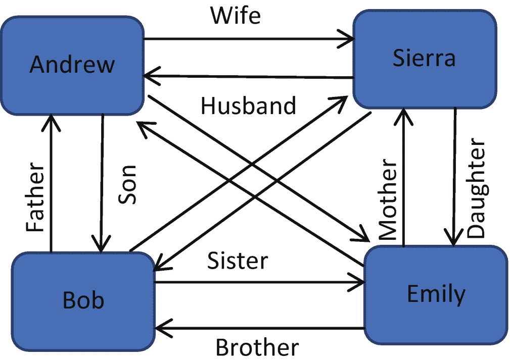
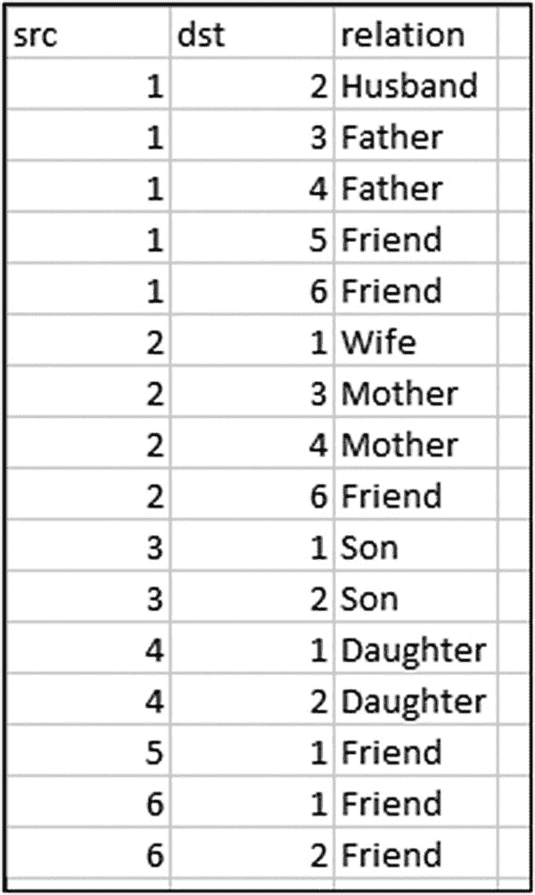
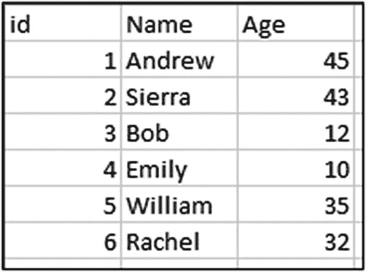

# 9. GraphFrames


## GraphFrames 与图分析

`GraphFrames`是`DataFrame`的抽象，用于执行图分析。图分析源于数学中的图论。图论是一种非常重要的理论，用于表示实体之间的关系，我们可以利用它来执行各种分析。当您使用 Google 时，每天都在应用图论。Google 引入了基于图论的`PageRank`算法，该算法试图识别与您的搜索最匹配的最具影响力的网站。

虽然图论被广泛应用于各个科学领域，计算机科学也倾向于用图论解决大量问题。图论的一些应用包括社交媒体问题、旅行、芯片设计以及许多其他领域。事实上，每次运行 Spark 任务时，您都在使用图论。Spark 使用有向无环图（DAG）来表示`RDD`，并以此来找到执行查询的最优计划。

图是由通过边相互连接的顶点组成的。顶点可以被看作是节点或实体，而边则代表这些实体之间的关系。图 9-1 可视化了一个家庭图。



**图 9-1** 图是顶点的组合

图 9-1 中的图表展示了一个由四名成员组成的小家庭——丈夫（Andrew）、妻子（Sierra）、儿子（Bob）和女儿（Emily）。人物被表示为节点，这被称为*顶点*。每个人都与其他人相连。您可以观察到，仅仅在一个四口之家中，就有 12 种关系。这些关系通过连接它们的边来表示。现在想象一个像 LinkedIn 这样的社交媒体应用，它需要连接数百万用户，那么边的数量将是巨大的。为了能够对此类数据进行分析，传统的数据库是不够的。使用传统数据库，您需要多次执行自连接，而自连接会严重拖垮您的数据库。

图论解决了诸如此类的复杂问题。Spark 提供了`GraphFrames`来表示这种图数据。在本章中，我们将学习如何创建`GraphFrames`，并应用一些最常用的算法来解决复杂问题。

在本章中，我们将讨论以下内容：
*   方案 9-1：创建`GraphFrames`
*   方案 9-2：在`GraphFrame`中应用三角计数
*   方案 9-3：应用`PageRank`算法
*   方案 9-4：应用广度优先算法

## 方案 9-1：创建 GraphFrames

### 问题
您需要从一个给定的数据集创建一个`GraphFrame`。

### 解决方案
此解决方案使用家庭关系数据。我们将使用两个数据集。图 9-2 和 9-3 展示了这些数据集。



**图 9-3** `relationship.csv`



**图 9-2** `persons.csv`

这是一个便于所有人使用和理解的典型数据集。让我们加载这个数据集。

### 工作原理
在开始使用`GraphFrames`之前，您需要在机器上安装`GraphFrames`。

如果您尚未安装`GraphFrames`并尝试使用它，您将收到以下错误信息。

```
>>> from graphframes import *
```

输出如下：

```
Traceback (most recent call last):
File "", line 1, in
ModuleNotFoundError: No module named 'graphframes'
```

您需要首先使用以下`pyspark`命令安装`GraphFrames`。

```
pyspark --packages graphframes:graphframes:0.6.0-spark2.3-s_2.11
```

在命令提示符中运行此命令。`PySpark`将自动下载`GraphFrame`包并进行安装。安装完成后，您可以通过导入`GraphFrame`包来检查，如下所示。

```
>>> from graphframes import *
```

如果不再看到错误信息，说明您可以成功使用`GraphFrame`了。

现在，让我们将`persons.csv`和`relationship.csv`数据作为`DataFrame`加载。

```
>>> personsDf = spark.read.csv('persons.csv',header=True, inferSchema=True)
>>> personsDf.createOrReplaceTempView("persons")
```

此命令将数据加载到`personsDf` `DataFrame`中，并为其创建一个临时视图。让我们查看该视图的内容。

```
>>> spark.sql("select * from persons").show()
```

输出如下：

```
+--+-------+---+
|id|   Name|Age|
+--+-------+---+
| 1| Andrew| 45|
| 2| Sierra| 43|
| 3|    Bob| 12|
| 4|  Emily| 10|
| 5|William| 35|
| 6| Rachel| 32|
+--+-------+---+
```

现在我们同样加载关系数据。以下是代码和输出：

```
>>> relationshipDf = spark.read.csv('relationship.csv',header=True, inferSchema=True)
>>> relationshipDf.createOrReplaceTempView("relationship")
>>> spark.sql("select * from relationship").show()
+---+---+--------+
|src|dst|relation|
+---+---+--------+
|  1|  2| Husband|
|  1|  3|  Father|
|  1|  4|  Father|
|  1|  5|  Friend|
|  1|  6|  Friend|
|  2|  1|    Wife|
|  2|  3|  Mother|
|  2|  4|  Mother|
|  2|  6|  Friend|
|  3|  1|     Son|
|  3|  2|     Son|
|  4|  1|Daughter|
|  4|  2|Daughter|
|  5|  1|  Friend|
|  6|  1|  Friend|
|  6|  2|  Friend|
+---+---+--------+
```

现在两个数据集都已准备就绪，我们将导入`GraphFrames`。

```
>>>from graphframes import *
>>>
Graphframes has been successfully loaded.
```

以下命令创建您的第一个`GraphFrame`。`GraphFrame`接受两个`DataFrame`作为输入：顶点和边。`GraphFrames`在列名上有一些需要遵循的命名约定。这些规则定义如下：
*   表示顶点的`DataFrame`应包含一个名为`id`的列。这里，`personsDf`包含一个名为`id`的列。
*   表示边的`DataFrame`应包含名为`src`和`dst`的列。这里，`relationshipDf`包含`src`和`dst`列。

```
>>> graph = GraphFrame(personsDf, relationshipDf)
```

让我们查看一下`graph`变量的类型。如下所示：

```
>>> graph
GraphFrame(v:[id: int, Name: string ... 1 more field], e:[src: int, dst: int ... 1 more field])
```

所以它是一个包含`v`和`e`的`GraphFrame`。`v`代表顶点，`e`代表边。

现在您已成功创建了一个`GraphFrame`，理解度（Degrees）的概念非常重要。*度*表示连接到某个顶点的边的数量。`GraphFrame`支持`inDegrees`和`outDegrees`。`inDegrees`给出指向一个顶点的入链接数量，`outDegrees`给出从一个节点出发的出边数量。理解这一点非常重要。让我们尝试查看给定示例的输出。
下面，您将找出所有连接到 Andrew 的边。

以下代码获取所有链接，并根据`id`等于`1`进行过滤：

```
>>> graph.degrees.filter("id = 1").show()
```

输出如下。请注意，在关系数据集中，Andrew（`id=1`）有 10 条记录。

```
+--+------+
|id|degree|
+--+------+
| 1|    10|
+--+------+
```

以下代码获取指向 Andrew 的入链接数量。这是通过调用`inDegrees`方法获得的。

```
>>> graph.inDegrees.filter("id = 1").show()
```

输出如下。在`dst`列中有 5 条记录对应 Andrew。

```
+--+--------+
|id|inDegree|
+--+--------+
| 1|       5|
+--+--------+
```

以下代码展示了如何使用`outDegrees`方法获取从 Andrew 出发的链接数量。

```
>>> graph.outDegrees.filter("id = 1").show()
```

输出如下。`src`列值为`1`的关系记录有 5 条。


已处理文本如下：

```
+--+---------+
|id|outDegree|
+--+---------+
| 1|        5|
+--+---------+
```

至此，你已经成功从一个顶点和边的数据集中创建了 GraphFrame。

Apache Spark 内置了多种图算法。这些算法被抽象成易于使用的 API。一旦你准备好 GraphFrame，只需调用一个方法即可使用以下任意算法。

GraphFrame 提供了以下内置算法：

* 连通分量
* 标签传播
* PageRank
* SVD++
* 最短路径
* 强连通分量
* 三角形计数

## 配方 9-2\. 在 GraphFrame 中应用三角形计数

**问题**

你需要为每个顶点计算三角形计数值。

**解决方案**

GraphFrames 提供了一个易于使用的 `triangleCount` API。当在给定的 GraphFrame 上调用该 API 时，会输出一个 DataFrame，其中为每个顶点行添加了一个 count 列。这个 count 列标识了该顶点参与了多个三角形关系。接下来，我们将演示如何获取每个顶点的三角形计数。这对于寻路问题非常有帮助，并且在 PageRank 算法中扮演着重要角色。

**工作原理**

以下代码用于计算每个顶点的三角形计数。

```
>>> graph.triangleCount().show()
```

输出如下：

```
+-----+---+-------+---+
|count| id|   Name|Age|
+-----+---+-------+---+
|    3|  1| Andrew| 45|
|    1|  6| Rachel| 32|
|    1|  3|    Bob| 12|
|    0|  5|William| 35|
|    1|  4|  Emily| 10|
|    3|  2| Sierra| 43|
+-----+---+-------+---+
```

输出中新增了一个名为 `count` 的列，表示三角形计数。结果显示，Andrew 和 Sierra 拥有最大的三角形计数，因为他们参与了三种关系：Andrew 作为父亲、朋友和丈夫，Sierra 作为母亲、朋友和妻子。至此，你已经成功创建了一个 GraphFrame 并对其进行了分析。

你也可以将 `triangleCount` 输出的 DataFrame 注册为表，并轻松地对其应用查询。我们使用 PySparkSQL 来找出所有拥有最大三角形计数的人。通过以下代码，你可以找到家庭中拥有最高三角形计数的人。之后，你可以将其与 `Persons` DataFrame 进行连接，以便查看该人的详细信息。

以下代码正是实现了这一功能。虽然你可以通过编程方式用一行代码实现相同的结果，但下面使用的是简单的 SQL 命令。

```
>>> personsTriangleCountDf.createOrReplaceTempView("personsTriangleCount")
>>> maxCountDf = spark.sql("select max(count) as max_count from personsTriangleCount")
>>> maxCountDf.createOrReplaceTempView("personsMaxTriangleCount")
>>> spark.sql("select * from personsTriangleCount P JOIN (select * from personsMaxTriangleCount) M ON (M.max_count = P.count) ").show()
```

输出如下：

```
+-----+---+------+---+---------+
|count| id|  Name|Age|max_count|
+-----+---+------+---+---------+
|    3|  1|Andrew| 45|        3|
|    3|  2|Sierra| 43|        3|
+-----+---+------+---+---------+
```

## 配方 9-3\. 应用 PageRank 算法

**问题**

你需要应用 PageRank 算法来找出这个家庭中最具影响力的人。

**解决方案**

PageRank 算法是谷歌早期的基石。它最初由谷歌的创始人提出，用于识别互联网上最重要的页面。该算法的核心思想是：最重要的页面会被其他页面最频繁地链接。同时，它也利用了另一个思想：一个页面从高排名页面获得的链接越多，该页面就越重要。因此，谷歌利用以图形式表示的链接网页来为我们识别重要页面。

PageRank 算法衡量图中每个顶点的重要性。假设有这样的场景：一个 Twitter 用户有 10 个重要的关注者，而每个关注者又有自己的众多关注者。那么，这个 Twitter 用户将比一个拥有 50 个“普通”关注者的用户获得更高的排名。也就是说，PageRank 算法会将每个重要的关注者视为对该 Twitter 用户的有效认可，从而给予该用户更高的排名。

**工作原理**

让我们看看 PageRank 算法是如何运行的。Apache Spark 使得调用 PageRank 算法变得非常简单。

```
>>> pageRank = graph.pageRank(resetProbability=0.20, maxIter=10)
```

这里，我们使用 `pageRank` 方法调用 PageRank 算法。它有两个参数：

* `resetProbability`：这是一个随机重置概率值（alpha）。
* `maxIter`：这是 `pageRank` 运行的迭代次数。

让我们查看 `pageRank`。它是一个包含顶点和边属性的 GraphFrame。

```
>>> pageRank
GraphFrame(v:[id: int, Name: string ... 2 more fields], e:[src: int, dst: int ... 2 more fields])
```

让我们查看 `vertices` 属性：

```
>>> pageRank.vertices.printSchema()
root
|-- id: integer (nullable = true)
|-- Name: string (nullable = true)
|-- Age: integer (nullable = true)
|-- pagerank: double (nullable = true)
```

你可以从原始的 `persons` 模式中看到，新增了一个名为 `pagerank` 的列。这个列由 Spark 添加，表示顶点的 PageRank 分数。

类似地，让我们查看一下该 GraphFrame 中包含的 `edges`。

```
>>> pageRank.edges.printSchema()
root
|-- src: integer (nullable = true)
|-- dst: integer (nullable = true)
|-- relation: string (nullable = true)
|-- weight: double (nullable = true)
```

如模式所示，原始关系模式中新增了一个名为 `weight` 的列。这个 `weight` 列表示对 PageRank 分数有贡献的边的权重。

让我们查看每个顶点的 PageRank 分数和每条边的权重。我们将按 PageRank 降序排列，以便能够根据与其他家庭成员的联系，看到家庭中联系最紧密的人。

以下代码以降序列出了所有顶点。

```
>>> pageRank.vertices.orderBy("pagerank",ascending=False).show()
```

让我们查看输出：

```
+--+-------+----+------------------+
|id|   Name| Age|          pagerank|
+--+-------+----+------------------+
| 1| Andrew| 45 | 1.787923121897472|
| 2| Sierra| 43 | 1.406016795082752|
| 6| Rachel| 32 |0.7723665979473922|
| 4|  Emily| 10 |0.7723665979473922|
| 3|    Bob| 12 |0.7723665979473922|
| 5|William| 35 |0.4889602891776001|
+--+-------+----+------------------+
```

从输出中可以看出，Andrew 是联系最紧密的人。

让我们查看每条边贡献的权重。这里我们按权重降序列出所有边，以便最大权重的边排在最前面。

```
>>> pageRank.edges.orderBy("weight",ascending=False).show()
```

以下是输出。从输出中可以看出，边 5, 1, Friend 获得了最大的权重。由于这种关系是唯一的，因此 William 与 Andrew 的关系获得了最大的权重。除了 Andrew，没有其他人是 William 的朋友。


```text
+---+---+--------+------+
|src|dst|relation|weight|
+---+---+--------+------+
|  5|  1|  Friend|   1.0|
|  3|  1|     Son|   0.5|
|  4|  1|Daughter|   0.5|
|  4|  2|Daughter|   0.5|
|  6|  1|  Friend|   0.5|
|  3|  2|     Son|   0.5|
|  6|  2|  Friend|   0.5|
|  2|  3|  Mother|  0.25|
|  2|  4|  Mother|  0.25|
|  2|  1|    Wife|  0.25|
|  2|  6|  Friend|  0.25|
|  1|  2| Husband|   0.2|
|  1|  6|  Friend|   0.2|
|  1|  3|  Father|   0.2|
|  1|  4|  Father|   0.2|
|  1|  5|  Friend|   0.2|
+---+---+--------+------+
```

现在你已经理解了 PageRank 算法，并将它应用到了 GraphFrames 中，接下来让我们转向广度优先算法。

