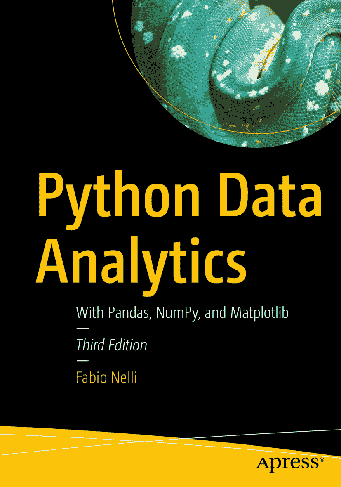

ISBN 978-1-4842-9531-1 电子书 ISBN 978-1-4842-9532-8 [`doi.org/10.1007/978-1-4842-9532-8`](https://doi.org/10.1007/978-1-4842-9532-8) © Fabio Nelli 2015, 2018, 2023 Apress 标准出版物

在本出版物中使用通用的描述性名称、注册商标、商标、服务标志等，即使未作明确声明，也不意味着这些名称不受相关保护性法律和法规的约束，因此可自由用于一般用途。出版商、作者和编辑均假定，本书中的建议和信息在出版之日是真实准确的。出版商、作者或编辑对本书所含内容或可能存在的任何错误或遗漏不作任何明示或暗示的担保。出版商对已出版地图中的管辖权主张和机构隶属关系保持中立。

本 Apress 印记由注册公司 APress Media, LLC（Springer Nature 的一部分）出版。注册公司地址为：1 New York Plaza, New York, NY 10004, U.S.A.

*“科学引领我们迈向知识的前沿，但唯有分析让我们更加清醒”*

*谨以此书献给所有不断追寻认知的人*

## 前言

距离本书上一版出版已有大约五年时间。在起草第三版时，我对文字和代码都进行了一些必要的修改。首先，所有 Python 代码已移植到 3.8 及以上版本，并且删除了所有对 Python 2.x 版本的引用。部分章节由于内容不再兼容而需要完全重写。我指的是 TensorFlow 3.x，与上一版涵盖的 TensorFlow 2.x 相比，它已经完全革新了整个参考系统。在五年间，使用 2.x 版本开发的深度学习模块和代码已被证明完全不可用。`Keras` 及其所有模块已并入 TensorFlow 库，取代了所有执行类似功能的类、函数和模块。神经网络模型的构建、其学习阶段以及所使用的函数都已完全改变。因此，在这一版中，您将有机会学习 TensorFlow 3.x 的方法，并熟悉新版本中的概念和新的范式。关于数据可视化，我决定在 matplotlib 章节中增加关于 `Seaborn` 库的信息。尽管仍处于 0.x 版本，但 `Seaborn` 已被证明是 matplotlib 在数据分析方面一个非常有用的扩展，这要归功于其统计图形显示以及与 pandas 数据框的兼容性。我希望，通过这个全面更新的第三版，我能进一步激发您使用 Python 学习并深化数据分析的热情。这本书现在将成为您宝贵的学习工具，未来也能作为可靠的手册。

> —Fabio Nelli

## 关于作者

## 关于技术审校