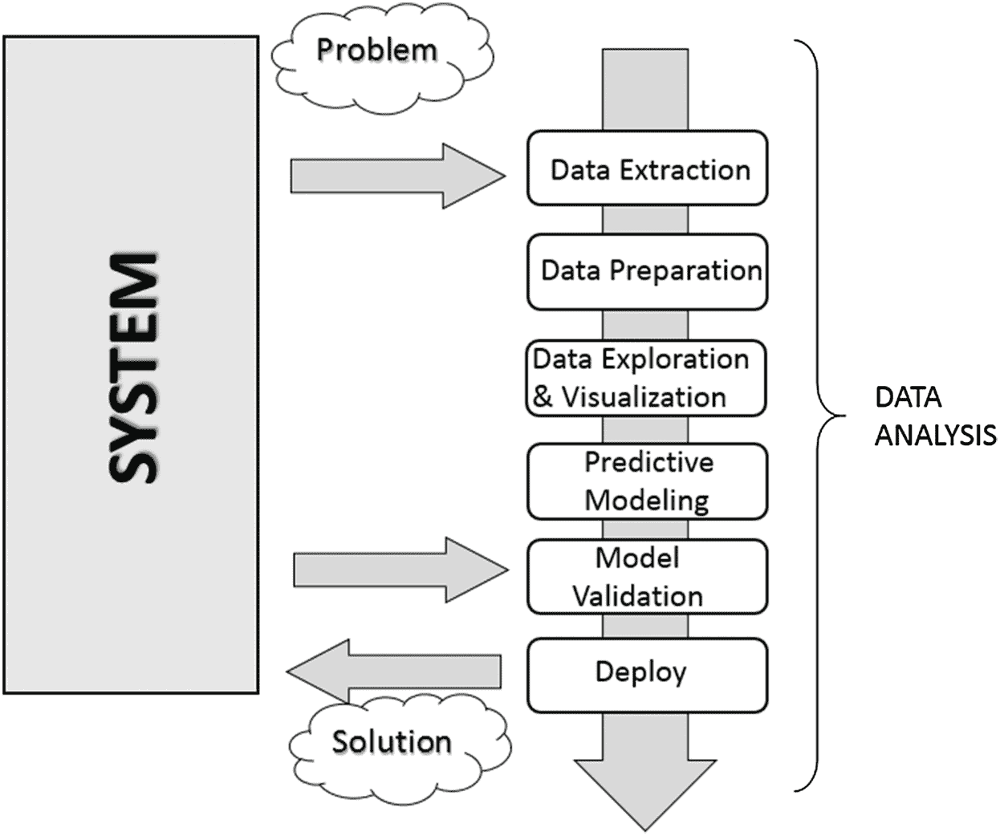
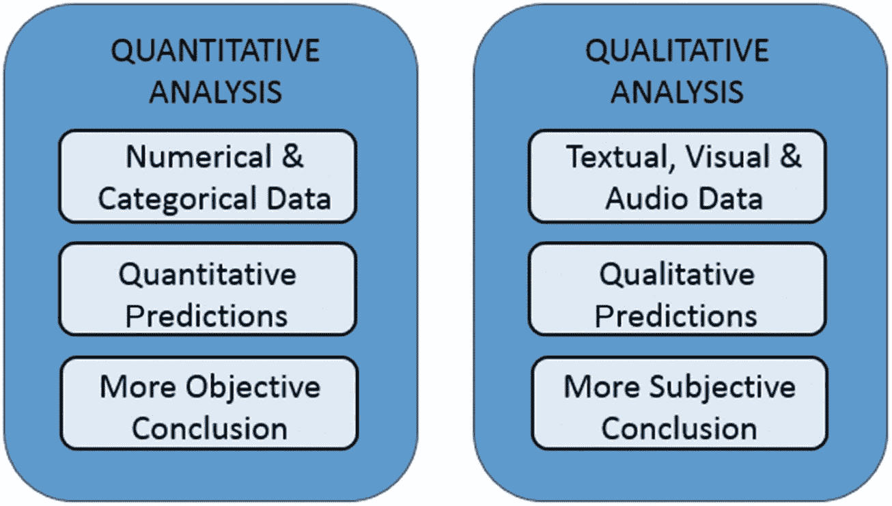
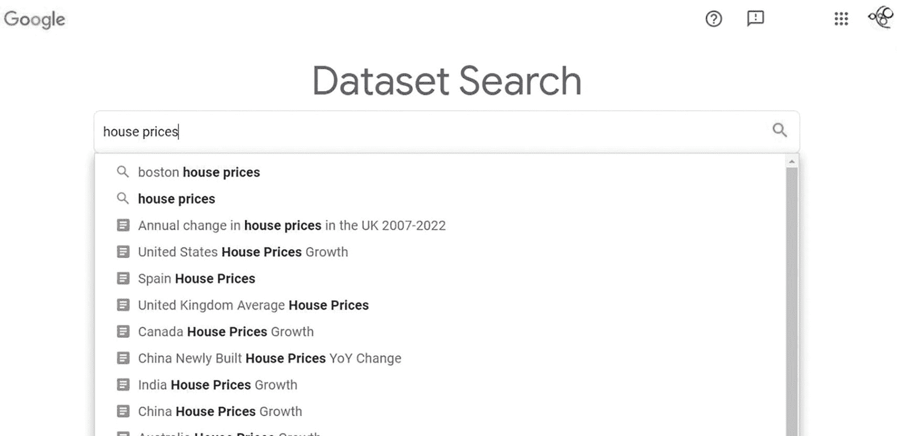
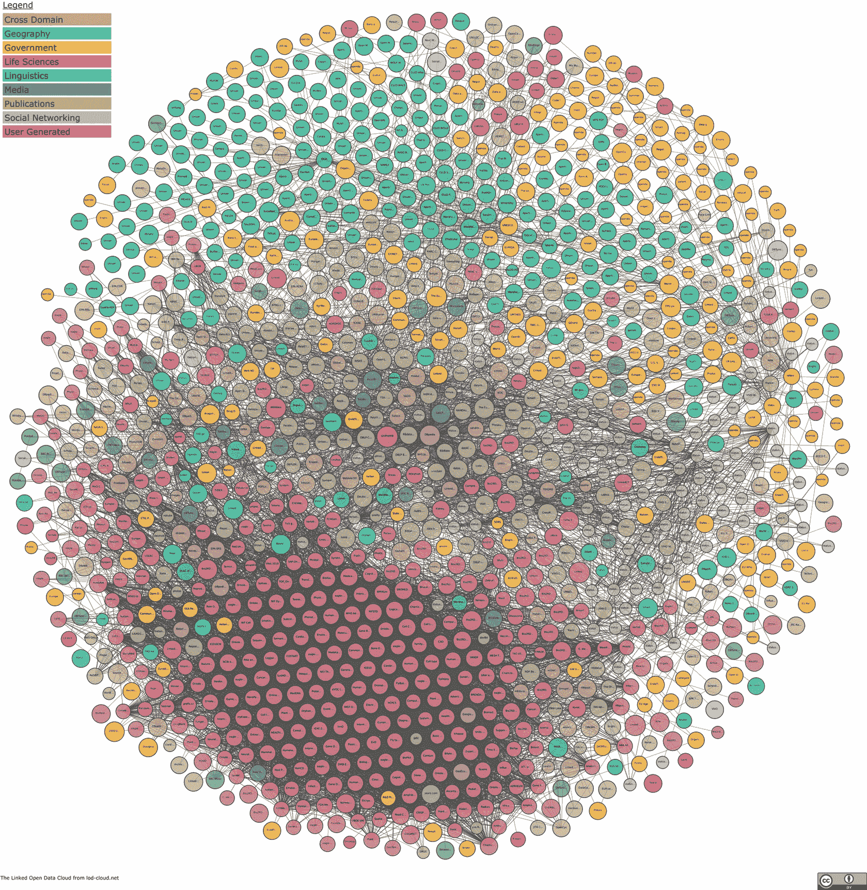

# 1. 数据分析简介

在本章中，您将迈出进入数据分析世界的第一步，详细了解构成这门学科的概念和过程。本章讨论的概念为后续章节提供了有益的背景知识，在这些章节中，这些概念和过程将通过 `Python` 代码的形式，并借助后续章节讨论的几个库来加以应用。

## 数据分析

在一个日益以信息技术为中心的世界里，每天都有海量的数据被生产和存储。这些数据通常来自自动检测系统、传感器和科学仪器，或者您每天在银行取款、购物、记录各种博客，甚至在社交网络发帖时，都会下意识地产生这些数据。但什么是数据呢？数据实际上并不是信息，至少在形式上不是。在无形的字节流中，乍一看很难理解其本质，如果它们不是严格的数字、词语或时间的话。这些信息实际上是处理的结果，它考虑到特定的数据集，并提取出可以各种方式使用的结论。这种从原始数据中提取信息的过程被称为*数据分析*。

数据分析的目的是提取那些不易推导出来的信息，但一旦理解，就能使您对产生数据的系统机制进行研究。这反过来又使您能够预测这些系统的可能响应及其随时间的变化。从最初简单的方法论式数据保护开始，数据分析已成为一门真正的学科，导致了能够生成*模型*的实际方法学的发展。模型实际上是将系统转化为数学形式。一旦有了能够以不同精度描述系统响应的数学或逻辑形式，您就可以预测其对特定输入的发展或响应。因此，数据分析的目的不在于模型本身，而在于其*预测能力*的质量。

模型的预测能力不仅取决于建模技术的质量，还取决于选择良好数据集以构建整个分析过程的能力。因此，*数据搜索*、*数据提取*以及随后的*数据准备*，虽然是分析的前期活动，但也属于数据分析本身，因为它们对结果的成败至关重要。

到目前为止，我谈到了数据及其处理，以及通过计算程序进行加工。与数据分析处理的所有阶段并行的是，各种*数据可视化*方法也得到了发展。事实上，为了理解数据（无论是单个数据还是它们在数据集中所扮演的角色），没有比开发图形表示技术更好的系统了。这些技术能够将有时期隐晦隐藏的信息转化为图表，帮助您更轻松地理解数据的含义。多年来，针对不同的数据显示模式，已经开发出多种显示方式，称为*图表*。

在数据分析过程结束时，您会得到一个模型和一组图形展示，并且能够预测所研究系统的响应；之后，就进入测试阶段。该模型使用另一组已知系统响应的数据进行测试。这些数据并不定义预测模型。根据模型复现真实观察到的响应的能力，您可以获得误差计算，并了解模型的有效性及其操作限制。这些结果可以与任何其他模型进行比较，以了解新创建的模型是否比现有模型更有效。一旦评估完毕，您就可以进入数据分析的最后阶段——*部署*。该阶段包括实施分析产生的结果，即根据模型生成的预测及其相关风险来制定决策。

数据分析非常适合许多专业活动。因此，了解它以及如何将其付诸实践非常重要。它能让您检验假设并更深入地理解您所分析的系统。

## 数据分析师的知识领域

数据分析本质上是一门适用于研究多个应用领域中出现的问题的学科。此外，数据分析包含许多工具和方法论，并且需要具备计算机、数学和统计学概念的知识。

一名优秀的数据分析师必须能够在多个学科领域内自如行动。这些学科中的许多都是数据分析方法的基础，熟练掌握它们几乎是必要的。根据应用领域和特定的数据分析项目，掌握其他学科知识也是必要的。更广泛地说，在这些领域拥有足够的经验，可以帮助你更好地理解问题以及所需数据的类型。

通常，对于数据分析的主要问题，需要组建一个跨学科的专家团队，他们能够在各自的能力领域内做出最大贡献。对于较小的问题，一名优秀的分析师必须能够识别数据分析过程中出现的问题，确定解决这些问题所需的学科和技能，学习这些学科，甚至可以向行业内最知识渊博的人请教。简而言之，分析师不仅必须能够搜索数据，还必须能够搜索关于如何处理这些数据的信息。

### 计算机科学

计算机科学知识是任何数据分析师的基本要求。事实上，只有当你具备良好的计算机科学知识和经验时，你才能高效地管理数据分析所需的工具。事实上，与数据分析相关的每一步都涉及到使用计算软件（例如 `IDL`、`MATLAB` 等）和编程语言（例如 `C++`、`Java` 和 `Python`）。

得益于信息技术，如今可用的大量数据需要特定的技能才能尽可能高效地进行管理。实际上，数据研究和提取需要了解这些不同的格式。数据结构化并存储在具有特定格式的文件或数据库表中。`XML`、`JSON` 或者仅仅是 `XLS` 或 `CSV` 文件，现在是存储和收集数据的常见格式，许多应用程序允许你读取和管理其中存储的数据。当涉及到提取数据库中包含的数据时，事情就没那么简单了，你需要了解 `SQL` 查询语言，或者使用专门为从特定数据库提取数据而开发的软件。

此外，对于某些特定类型的数据研究，数据并非以明确的格式提供，而是存在于文本文件（文档和日志文件）或网页中，或者以图表、度量值、访问者数量或 HTML 表格的形式呈现。这需要特定的专业技术来解析并最终提取这些数据（称为 *网络爬取*）。

信息技术知识对于使用当代计算机科学提供的各种工具（例如应用程序和编程语言）是必要的。这些工具反过来又用于执行数据分析和数据可视化。

本书旨在尽可能提供关于开发数据分析方法所需的所有知识。本书使用 `Python` 编程语言和专业库，这些库有助于执行数据分析的各个步骤，从数据研究到数据挖掘，再到发布预测模型的结果。

### 数学与统计学

正如你将在这本书中看到的那样，数据分析需要大量复杂的数学知识来处理和加工数据。你需要具备这方面的能力，至少足以理解你在做什么。熟悉主要的统计学概念也是必要的，因为应用于数据分析和解释的方法都基于这些概念。正如你可以说计算机科学为你提供了数据分析的工具，你也可以说统计学提供了构成数据分析基础的概念。

这门学科为分析师提供了许多工具，而如何最好地使用它们需要多年的经验。数据分析中最常用的统计技术包括：

*   贝叶斯方法

*   回归分析

*   聚类分析

在处理这些案例时，你会发现数学和统计学是如何紧密相关的。多亏了本书中介绍的特殊 `Python` 库，你将能够管理并处理它们。

### 机器学习与人工智能

属于数据分析领域的最先进的工具之一是机器学习。事实上，尽管数据可视化以及聚类和回归等技术能帮助你发现数据集的信息，但在研究阶段，你通常可能更倾向于使用专门用于在数据集中搜索模式的特殊程序。

机器学习是一门学科，它使用一整套程序和算法来分析数据，以识别模式、聚类或趋势，然后以自动化的方式提取对分析有用的信息。

这门学科正日益成为数据分析的基本工具，因此，至少对其有一般性的了解，对数据分析师来说是至关重要的。

### 专业应用领域

另一个非常重要的点是数据的领域知识（其来源——生物学、物理学、金融、材料测试、人口统计等）。事实上，尽管分析师在统计学领域接受过专门的准备，但他们还必须能够记录数据的来源，以便感知并更好地理解生成数据的机制。实际上，数据不仅仅是简单的字符串或数字；它们是任何被观测参数的表达，或者更确切地说是度量。因此，更好地理解数据的来源可以改善对它们的解释。然而，对于数据分析师来说，即使他们怀有最好的意图，这通常也代价过高，因此，寻找可以提出正确问题的顾问或关键人物是一个好做法。

## 理解数据的本质

数据分析的对象基本上是数据。因此，数据将是所有数据分析过程中的关键角色。数据构成了待处理的原材料，通过对其的处理和分析，可以提取各种信息，从而提高对所研究系统的认知水平。

### 当数据成为信息

数据是世间记录的事件。任何可以被测量或分类的事物都可以转化为数据。一旦收集完成，这些数据就可以被研究和分析，既可以用来理解事件的性质，也常常用来进行预测，或至少做出明智的决策。

### 当信息成为知识

当信息转化为一套能够帮助你更好地理解特定机制，从而对某些事件的演变做出预测的规则时，我们就可以谈论知识了。

### 数据类型

数据可以分为两个不同的类别：

*   分类数据（名义型和有序型）

*   数值数据（离散型和连续型）

*分类数据*是可以被划分为组或类别的值或观测值。有两类分类变量：*名义型*和*有序型*。名义变量在其类别中没有内在的可识别顺序。相反，有序变量具有预定顺序。

*数值数据*是来自测量的值或观测值。有两类数值：*离散*数和*连续*数。离散值是可以计数的，并且彼此不同且分离。另一方面，连续值是由测量或观测产生的值，这些值可以假定在定义范围内的任何值。

## 数据分析流程

数据分析可以被描述为一个由若干步骤组成的过程，其中原始数据经过转换和处理，最终生成数据可视化结果，并基于收集到的数据通过数学模型进行预测。因此，数据分析不过是一系列步骤，每一步都对后续步骤起着关键作用。通常，数据分析被概括为一个由以下阶段组成的过程链：

* 问题定义

* 数据提取

* 数据准备 - 数据清洗

* 数据准备 - 数据转换

* 数据探索与可视化

* 预测建模

* 模型验证/测试

* 结果的可视化与解读

* 解决方案部署（在现实世界中实施方案）

图 1-1 展示了数据分析所涉及的所有过程的示意图。

流程图解释了从系统出发，经过数据分析流程（包括数据提取、数据准备、数据探索与可视化、预测建模、模型验证以及部署）来解决问题的过程，最终解决方案又反馈回系统。

# 数据分析流程

### 问题定义

数据分析过程实际上在收集原始数据之前很久就开始了。事实上，数据分析总是从一个需要解决、且必须被明确界定的问题开始。

只有在你将注意力集中到要研究的系统上之后，才能定义问题；这个系统可以是一个机制、一个应用程序或一个流程。通常，这项研究是为了更好地理解其运作，但更具体地说，研究旨在理解其行为原理，以便能够做出预测或选择（即所谓的有依据的选择）。

对科学问题或商业问题的定义步骤及其相应的文档（`交付物`）都非常重要，这有助于将整个分析严格聚焦于获取结果。事实上，对系统进行全面或详尽的研究有时会很复杂，而且你并不总是有足够的信息来开始。因此，问题的定义，尤其是其规划，可以决定整个项目的指导方针。

问题一旦被定义并记录在案，你就可以进入数据分析的`项目规划`阶段。规划是为了理解需要哪些专业人员和资源来满足需求，从而尽可能高效地执行项目。你需要考虑与解决问题相关的事项，寻找各相关领域的专家，并安装执行数据分析所需的软件。

同样在规划阶段，你需要组建一个高效的团队。通常，这些团队应该是跨学科的，以便通过从不同角度审视数据来解决问题。因此，组建一个好的团队无疑是引领数据分析走向成功的关键因素之一。

### 数据提取

问题一旦被定义，第一步就是获取数据以进行分析。选择数据的基本目的是为了构建预测模型，因此数据选择对分析的成功也至关重要。收集的样本数据必须尽可能反映真实世界，即系统如何响应来自真实世界的刺激。例如，如果你使用海量的原始数据集，但这些数据并未被妥善收集，那么它们可能会描绘出虚假或不平衡的场景。

因此，数据选择不当，甚至是在一个不能完美代表系统的数据集上进行分析，都会导致模型偏离所研究的系统。

数据的搜索和检索通常需要一种超越纯粹技术研究和数据提取的直觉。这个过程还需要仔细理解数据的性质和形式，而这只有对问题所在应用领域具备良好经验和知识才能提供。

无论所需数据的质量和数量如何，另一个问题是使用最佳的`数据源`。

如果研究环境是实验室（技术或科学领域），且生成的数据是实验性的，那么在这种情况下，数据源很容易识别。此时，问题将仅涉及实验装置本身。

但数据分析不可能在每一个应用领域都能重现严格通过实验方式收集数据的系统。许多领域需要从外部世界搜索数据，通常依赖外部实验数据，或者更常见的是通过访谈或调查来收集。因此，在这些情况下，找到一个能够提供数据分析所需全部信息的好数据源可能相当具有挑战性。通常需要从多个数据源检索数据，以弥补不足之处，识别任何差异，并使数据集尽可能具有普遍性。

当你想要获取数据时，网络是一个不错的起点。但网络上的大部分数据可能难以抓取；事实上，并非所有数据都以文件或数据库的形式存在，而可能是以多种不同格式存在于 HTML 页面内部的内容。为此，有一种称为`网页抓取`的方法，它通过识别网页中 HTML 标签的特定出现来收集数据。有专门为此目的设计的软件，一旦发现匹配项，它就会提取所需数据。搜索完成后，你将获得一个准备进行数据分析的数据列表。

## 数据准备

在数据分析的所有步骤中，数据准备虽然看似问题不大，但实际上需要更多资源和时间来完成。数据通常从不同的数据源收集而来，每个数据源中的数据都有不同的表示方式和格式。因此，所有这些数据都必须经过处理，才能用于数据分析流程。

数据准备涉及获取、清洗、规范化以及将数据转换成一个优化的数据集，即一种通常为表格形式、且适合在设计阶段规划好的分析方法的准备格式。

许多潜在问题可能会出现，包括无效值、歧义值或缺失值、重复字段以及超出范围的数据。

## 数据探索/可视化

数据探索本质上是指通过图形或统计展示来搜寻数据，以发现其中的模式、联系和关系。数据可视化是凸显潜在模式的最佳工具。

近年来，数据可视化已发展到一定程度，其本身已成为一门真正的学科。事实上，众多技术被专门用于展示数据，并且应用了多种展示类型，以便从数据集中提取尽可能多的有效信息。

数据探索包括对数据的初步检查，这对于理解所收集信息的类型及其含义至关重要。结合在问题定义阶段所获取的信息，这种分类将决定哪种数据分析方法最适合用于建立模型定义。

通常，此阶段除了通过数据可视化对图表进行详细研究外，还可能包含以下一项或多项活动：

-   汇总数据

-   分组数据

-   探索各属性之间的关系

-   识别模式与趋势

通常，数据分析需要针对待研究的数据提出概括性的陈述。`汇总`是一个过程，通过它可以将数据简化以利于解释，同时不会牺牲重要信息。

`聚类`是一种数据分析方法，用于寻找具有共同属性（也称为`分组`）的群体。

分析的另一个重要步骤侧重于`识别`数据中的关系、趋势和异常。为了找到这类信息，我们通常不得不借助各种工具，并再次进行一轮数据分析，而这一次是在数据可视化本身之上进行。

其他数据挖掘方法，例如决策树和关联规则，能够从数据中自动提取重要的事实或规则。这些方法可以与数据可视化并行使用，以揭示数据之间的关系。

## 预测性建模

预测性建模是数据分析中使用的一个过程，用于创建或选择一个合适的统计模型，以预测某个结果的概率。

在探索数据之后，您就拥有了开发数学模型所需的所有信息，该模型能够对数据之间的关系进行编码。这些模型有助于理解所研究的系统，并且从特定角度来看，它们主要用于两个目的。第一个目的是对系统生成的数据值进行预测；在这种情况下，如果结果是数值型的，您将处理`回归模型`；如果结果是类别型的，您将处理`分类模型`。第二个目的是对新的数据产物进行分类，在这种情况下，如果结果通过类别进行标识，您将使用`分类模型`；如果结果可以通过分割进行标识，您将使用`聚类模型`。实际上，可以根据模型产生的结果类型对模型进行划分：

-   `分类模型`：如果模型类型获得的结果是类别型的。

-   `回归模型`：如果模型类型获得的结果是数值型的。

-   `聚类模型`：如果模型类型获得的结果是一个分割结果。

生成这些模型的简单方法包括线性回归、逻辑回归、分类与回归树以及 K 近邻等技术。但分析方法有很多种，每种方法都有其特定的特性，使其在某些类型的数据和分析中表现出色。这些方法中的每一种都会产生一个特定的模型，因此它们的选择与产物模型的性质相关。

其中一些模型将提供与实际系统相对应的值，并且根据其结构，它们将以简单明了的方式解释所研究系统的某些特征。其他模型将继续给出良好的预测，但其结构将不过是一个“黑箱”，解释系统特征的能力有限。

## 模型验证

模型的验证，即测试阶段，是一个重要的阶段，它允许您验证基于初始数据构建的模型。这很重要，因为它允许您通过将这些数据与实际系统直接进行比较，来评估模型所产生数据的有效性。但这一次，您所依据的是整个分析所赖以建立的初始数据集。

通常，当您使用数据构建模型时，您将这些数据称为`训练集`；当您使用它们来验证模型时，则称为`验证集`。

因此，通过比较模型产生的数据与系统产生的数据，您可以评估误差，并通过使用不同的测试数据集，您可以估算所生成模型的有效性边界。事实上，正确预测的值可能仅在某个范围内有效，或者根据所考虑的取值区间，它们可能具有不同程度的匹配度。

这个过程不仅可以让您从数值上评估模型的有效性，还可以将其与任何其他现有模型进行比较。这方面有几种技术，最著名的是`交叉验证`。这种技术基于将训练集划分为不同的部分。这些部分中的每一个依次被用作验证集，而其他所有部分则被用作训练集。通过这种迭代方式，您将得到一个不断完善优化的模型。

## 部署

这是分析过程的最后一步，旨在呈现结果，即分析的结论。在业务环境的部署过程中，分析成果转化为对委托客户的益处。在技术或科学环境中，它则转化为设计方案或科学出版物。也就是说，部署基本上包括将数据分析获得的结果付诸实践。

有多种方式可以部署数据分析或数据挖掘的结果。通常，数据分析师的部署包括为管理层或请求分析的客户撰写报告。这份文件在概念上描述了数据分析所得出的结果。报告应面向能够据此做出决策的管理人员。然后，他们将把分析的结论付诸实践。

在分析师提供的文档中，会详细讨论这四个主题：

-   分析结果

-   决策部署

-   风险分析

-   衡量业务影响

当项目的结果包括生成预测模型时，这些模型可以作为独立的应用程序进行部署，也可以集成到其他软件中。

## 定量与定性数据分析

数据分析完全聚焦于数据。根据数据的性质，可以做出一些区分。

当被分析的数据具有严格的数值或分类结构时，你谈的是`定量分析`；而当你处理的是通过自然语言描述来表达的值时，你谈的则是`定性分析`。

恰恰由于这两种分析所处理的数据性质不同，你可以观察到它们之间存在一些差异。

定量分析与具有逻辑顺序或可以某种方式进行分类的数据有关。这会在数据内部形成结构。顺序、分类和结构反过来又提供更多信息，并允许以更数学化的方式对数据进行进一步处理。这导致生成能够提供`定量预测`的模型，从而使数据分析师能够得出更客观的结论。

相反，定性分析所处理的数据通常没有结构，至少没有明显的结构，其性质既非数值型也非分类型。例如，定性研究中的数据可能包括书面文本、视觉或音频数据。因此，这种分析必须基于方法论，通常是`专门定制`的方法，来提取信息，这些信息通常会导向能够提供`定性预测`的模型。这意味着数据分析师能够得出的结论可能也包括`主观解读`。另一方面，定性分析可以探索更复杂的系统，并得出使用严格数学方法无法获得的结论。通常，这类分析涉及对不易测量的系统的研究，例如社会现象或复杂结构。

图 1-2 展示了这两种分析之间的差异。

一个图表说明了定量分析下的数值和分类数据、定量预测以及更客观的集合。定性分析包括文本、视觉和音频数据、定性预测以及更主观的结论。

**图 1-2**  
*定量和定性分析*

### 开放数据

为满足日益增长的数据需求，互联网上现在有大量的数据源。这些数据源向任何有需要的人自由提供信息，它们被称为`开放数据`。

以下是一些涉及不同主题的在线开放数据列表。你可以在附录 B 中找到更完整的在线开放数据列表和详细信息。

谷歌数据集搜索的截图。它在搜索栏中突出显示了一个关键词，内容为“房价”。搜索框下方有一组针对该关键词的建议。

**图 1-3**  
*在 `Google Dataset Search` 上搜索有关房价的数据集的示例*

- `Kaggle` ([`www.kaggle.com/datasets`](http://www.kaggle.com/datasets)) 是一个由学徒和专家级数据科学家组成的庞大社区，他们提供大量的数据集和用于分析的代码。其详尽的文档和针对机器学习各个方面的介绍也非常出色。他们还围绕解决各种问题举办有趣的竞赛。
- `DataHub` (`datahub.io/search`) 是一个社区，免费提供海量数据集以及用于其命令行管理的工具。数据集主题涵盖从金融市场到人口统计再到加密货币价格的各个领域。
- `NASA` 地球观测站 ([`https://neo.gsfc.nasa.gov/dataset_index.php/`](https://neo.gsfc.nasa.gov/dataset_index.php/)) 提供广泛的数据集，其中包含从全球气候和环境观测中收集的数据。
- `世界卫生组织` ([`www.who.int/data/collections`](http://www.who.int/data/collections)) 管理和维护与全球健康和福祉相关的广泛数据集合。
- `世界银行开放数据` ([`https://data.worldbank.org/`](https://data.worldbank.org/)) 提供可用世界银行数据集的列表，涵盖金融和银行数据、发展指标以及自 1947 年至今世界银行贷款项目的信息。
- `Data.gov` ([`https://data.gov`](https://data.gov)) 旨在收集并提供对美国政府的开放数据（即在联邦、州、地方和部落各级收集的广泛政府信息）的访问。
- `欧盟开放数据门户` ([`https://data.europa.eu/en`](https://data.europa.eu/en)) 收集并向公众公开有关欧盟成员国公共部门的各种数据集。
- `Healthdata.gov` ([`www.healthdata.gov/`](http://www.healthdata.gov/)) 为医生和研究人员提供有关健康和医疗保健的数据，以便他们进行临床研究，解决有关疾病、病毒传播和健康实践的问题，并提高全球健康水平。
- `谷歌趋势数据存储` ([`https://googletrends.github.io/data/`](https://googletrends.github.io/data/)) 收集并按主题划分提供著名且非常有用的 `Google Trends` 所收集的数据，用于自主进行分析。

最后，谷歌最近推出一个专门用于搜索数据集的页面，你可以在其中搜索一个主题，并获得一系列与你所寻找内容尽可能匹配的数据集（甚至数据源）。例如，在图 1-3 中，你可以看到，在研究房价时，会实时建议一系列数据集或数据源。

为了了解网上可用的开放数据源，你可以查看`LOD云图` ([`http://cas.lod-cloud.net`](http://cas.lod-cloud.net))，它展示了网络上当前可用的多个开放数据源之间的数据链接连接（见图 1-4）。该图包含一系列对应于可用数据源的圆形元素；它们的颜色对应于所提供数据的特定主题。图例指明了主题与颜色的对应关系。当你点击图上的一个元素时，会看到一个包含所选数据源所有信息以及如何访问它的页面。

一个数据云图展示了在线可用的跨领域、地理、政府、生命科学、语言学、媒体、出版物、社交网络和用户生成的数据源。它还表明了数据源之间的连接。

**图 1-4**  
*2023 年关联开放数据云图，作者：Max Schmachtenberg、Christian Bizer、Anja Jentzsch 和 Richard Cyganiak。* [`http://cas.lod-cloud.net`](http://cas.lod-cloud.net) [CC-BY 许可]

### Python 与数据分析

本书的核心论点是，通过`Python`来阐述数据分析的所有概念。`Python`编程语言在科学界被广泛使用，因为它拥有大量库，提供了用于分析和数据处理的一整套工具。

与其他常用于数据分析的编程语言（如`R`和`MATLAB`）相比，`Python`不仅提供了一个处理数据的平台，而且还具备一些特性，使其有别于其他语言和专业应用。不断增长的支撑库开发、更具创新性的算法实现，以及与其他编程语言（`C`和`Fortran`）交互的能力，都使`Python`在其同类语言中独树一帜。

此外，`Python`不仅专长于数据分析，还有许多其他应用，例如通用编程、脚本编写、数据库接口，以及得益于像`Django`这样的 Web 框架，近来的 Web 开发。因此，可以开发与 Web 服务器兼容的数据分析项目，并有可能将它们集成到网络上。

对于那些希望进行数据分析的人来说，`Python`及其所有相关包，在可预见的未来被认为是最佳选择。

## 结论

在本章中，你了解了什么是数据分析，更具体地说，是构成数据分析的各个过程。此外，你开始看到数据在构建预测模型中所起的作用，以及仔细筛选数据如何成为进行精准数据分析的基础。

在下一章中，你将深入探讨`Python`的愿景以及它所提供的用于执行数据分析的工具。