# 2. Python 世界入门

`Python`语言及其周边世界，由解释器、工具、编辑器、库、笔记本等组成。这个`Python`世界近年来急剧扩展，不断丰富并呈现出多种形态，这有时会让初次接触它的开发者感到复杂甚至有些困惑。因此，如果你是第一次接触`Python`，面对如此众多的选择，可能会感到迷茫，尤其是不知道从哪里开始。

本章将为你概述整个`Python`世界。你首先会了解`Python`语言及其独特特性。你将学习从哪里开始，什么是解释器，以及如何编写你的第一行`Python`代码，然后介绍一些新的、更高级的交互式编写方式，例如`IPython`和`IPython Notebook`。

## Python——编程语言

`Python`编程语言由 Guido Von Rossum 于 1991 年创建，其前身是一种名为`ABC`的语言。可以用一系列形容词来描述这种语言：

- 解释型
- 可移植
- 面向对象
- 交互式
- 可交互
- 开源
- 易于理解和使用的

`Python`是一种`解释型`编程语言，也就是说，它是伪编译的。一旦编写好代码，就需要一个`解释器`来运行它。解释器是安装在每台机器上的程序；它解释并运行源代码。与`C`、`C++`和`Java`等语言不同，`Python`没有编译环节。

`Python`是一种高度`可移植`的编程语言。决定使用解释器作为读取和运行代码的接口有一个关键优势：可移植性。事实上，你可以在任何平台（`Linux`、`Windows`和`Mac`）上安装解释器，而`Python`代码本身不会改变。因此，`Python`经常被用于许多小型设备，例如`Raspberry Pi`和其他微控制器。

`Python`是一种`面向对象`的编程语言。事实上，它允许你指定对象的类并实现它们的继承。但与`C++`和`Java`不同，它没有构造函数或析构函数。`Python`还允许你在代码中实现特定的结构来管理异常。然而，该语言的结构非常灵活，允许你使用面向对象之外的其他编程方法。例如，你可以使用函数式或向量化的方法。

`Python`是一种`交互式`编程语言。由于`Python`使用解释器来执行，这种语言根据其使用的上下文会呈现出非常不同的面貌。事实上，你可以编写长串的代码，类似于你在`C++`或`Java`中所做的那样，然后运行程序；或者你也可以一次性输入命令行并执行一条命令，立即得到结果。然后，根据结果，你可以决定接下来运行什么命令。这种高度交互的执行代码方式使`Python`的计算环境类似于`MATLAB`。`Python`的这一特性是它深受科学界欢迎的原因之一。

`Python`是一种可以`交互`的编程语言。事实上，这种编程语言可以与用其他编程语言（如`C/C++`和`FORTRAN`）编写的代码进行交互。这甚至也是一个制胜之选。事实上，凭借这一点，`Python`可以弥补它唯一的弱点——执行速度。作为一种高度动态的编程语言，`Python`的性质有时会导致程序的执行速度比用其他语言编译的相应静态程序慢 100 倍。解决这类性能问题的方法是将`Python`与其他语言的编译代码进行交互，并将其当作自己的代码来使用。

`Python`是一种`开源`编程语言。`CPython`，即`Python`语言的参考实现，是完全免费和开源的。此外，网络上的每个模块或库都是开源的，它们的代码可以在线获取。每个月，一个庞大的开发者社区都会进行改进，以使这种语言及其所有库更加丰富和高效。`CPython`由非营利组织`Python Software Foundation`管理，该组织成立于 2001 年，其任务是推广、保护和发展`Python`编程语言。

最后，`Python`是一种易于使用和学习的语言。这方面或许是最重要的，因为这是开发者（即使是新手）面对的最直接的方面。`Python`代码的高度直观性和易读性常常让人对这门编程语言产生“好感”，因此大多数编程新手都选择使用它。然而，它的简单并不意味着狭隘，因为`Python`是一种正在计算机各个领域传播的语言。此外，与现有的诸如`C++`、`Java`和`FORTRAN`等本质上非常复杂的编程语言相比，`Python`正在以非常简单的方式实现这一切。

### 解释器与代码的执行阶段

与 Java 或 C 等编程语言不同，它们的代码必须先编译才能执行，而 Python 是一种允许直接执行指令的语言。实际上，可以通过两种方式执行用 Python 编写的代码。你可以通过运行 `python` 命令后跟文件名来执行整个程序（`.py` 文件），也可以通过一个特殊的命令控制台（以 `>>>` 提示符为特征）打开一个会话（运行不带参数的 `python` 命令）。在这个控制台中，你可以一次输入一条指令，并通过直接执行立即获得结果。

在这两种情况下，插入的代码都会立即执行，无需经历显式编译或其他操作。

这种直接执行的操作可以概括为四个阶段：

- 词法分析或分词
- 语法分析
- 编译
- 解释

`词法分析`（或`分词`）是初始阶段，在此阶段中，Python（人类可读的）代码被转换为一系列逻辑实体，即所谓的词法标记（参见图 2-1）。

`语法分析`是下一阶段，在此阶段中，语法分析器检查词法标记的语法和文法，并生成一个抽象语法树（AST）作为结果。

`编译`是编译器读取 AST 并根据此信息生成 Python 字节码（`.pyc` 或 `.pyo` 文件）的阶段，其中包含非常基础的执行指令。尽管这是一个编译阶段，但生成的字节码仍然是平台无关的，这与 Java 语言中的情况非常相似。

最后一个阶段是`解释`，在此阶段中，生成的字节码由`Python 虚拟机（PVM）`执行。

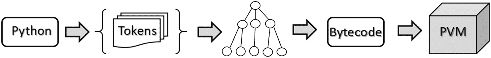

一个流程图展示了从 Python 到 PVM，经过标记、语法分析和字节码的流程。

**图 2-1** Python 解释器执行的步骤

你可以在 [`www.ics.uci.edu/~pattis/ICS-31/lectures/tokens.pdf`](https://www.ics.uci.edu/%257Epattis/ICS-31/lectures/tokens.pdf) 找到有关此过程的良好文档。

所有这些阶段都由解释器执行，对于 Python 而言，解释器是一个基础组件。当提到 Python 解释器时，通常指的是 `/usr/bin/python` 二进制文件。实际上，目前存在多个版本的 Python 解释器，每个版本在其性质和规范上都存在深刻差异。

#### CPython

标准的 Python 解释器是 CPython，它用 C 语言编写。这使得基于 C 的库可以在 Python 上使用。CPython 可在多种平台上使用，包括 ARM、iOS 和 RISC。尽管如此，CPython 在可移植性和其他规范方面进行了优化，但在速度方面并未优化。

#### Cython

CPython 解释器中 C 的强烈内在特性通过 Cython 项目得到了进一步延伸。该项目基于创建一个将 Python 代码转换为 C 代码的编译器。然后，这段 C 代码在运行时于 Cython 环境中执行。这种编译系统使得将 C 语义引入 Python 代码以提高效率成为可能。该系统促成了两个编程语言世界的融合，诞生了`Cython`，它可以被视为一种新的编程语言。你可以在网上找到相关文档。我建议你访问 `cython.readthedocs.io/en/latest/`。

#### Pyston

Pyston ([`www.pyston.org/`](http://www.pyston.org/)) 是 CPython 解释器的一个分支，它实现了性能优化。该项目正是为了获得一个能够随时间推移替代 CPython，以弥补其在执行速度方面性能不佳的解释器而产生的。最近的结果似乎证实了这些预测，报告显示，对于大型的实际应用，其性能提升了 30%。不幸的是，由于缺乏兼容的二进制包，Pyston 包必须在下载阶段重新构建。

#### Jython

与 Cython 并行，有一个用 Java 构建和编译的版本，称为 `Jython`。它由 Jim Hugunin 于 1997 年创建（[`www.jython.org/`](http://www.jython.org/)）。Jython 是 Python 编程语言在 Java 中的一种实现；它的进一步特点是使用 Java 类而不是 Python 模块来实现 Python 的扩展和包。

#### IronPython

.NET 框架也提供了在其内部执行 Python 代码的可能性。为此，你可以使用 IronPython 解释器（[`https://ironpython.net/`](https://ironpython.net/)）。该解释器允许 .NET 开发人员在 Visual Studio 平台上开发 Python 程序，并与 .NET 平台的其他开发工具完美集成。

该项目最初由 Jim Hugunin 于 2006 年构建并发布了 1.0 版本，随后由微软的一个小团队支持，直到 2010 年的 2.7 版本。自那时起，直到当前的 3.4 版本，又发布了众多其他版本，所有版本均由一群志愿者在微软的 CodePlex 仓库中向前移植。

# PyPy

`PyPy`解释器是一个`JIT`（即时）编译器，它在运行时将Python代码直接转换为机器码。做出这一选择是为了加速Python的执行。然而，这一选择导致使用了较小子集的Python命令，定义为`RPython`。有关更多信息，请查阅官方网站[`www.pypy.org/`](http://www.pypy.org/)。

# RustPython

顾名思义，`RustPython`（`rustpython.github.io/`）是一个用`Rust`编写的Python解释器。这种编程语言相当新，但正越来越受欢迎。`RustPython`是一个像`CPython`一样的解释器，但也可以用作`JIT`编译器。它还允许你执行嵌入在`Rust`程序中的Python代码，并将代码编译成`WebAssembly`，因此你可以直接从Web浏览器运行Python代码。

# 安装Python

为了用Python开发程序，你需要在你的操作系统上安装它。Linux发行版和macOS X机器应该预装了某个版本的Python。如果没有，或者你想用另一个版本替换该版本，你可以轻松安装它。安装Python的过程因操作系统而异。然而，这是一个相当简单的操作。

在Debian-Ubuntu Linux系统上，首先要做的是检查你的系统上是否已安装Python以及当前使用的是哪个版本。

打开一个终端（按`ALT+CTRL+T`）并输入以下命令：

```bash
python3 --version
```

如果你得到版本号作为输出，那么Python已存在于Ubuntu系统上。如果你收到错误消息，则Python尚未安装。

在最后一种情况下：

```bash
sudo apt install python3
```

另一方面，如果当前版本较旧，你可以通过输入以下命令将其更新为你的Linux发行版的最新版本：

```bash
sudo apt --only-upgrade install python3
```

最后，如果你想在你的系统上安装一个特定版本，你必须像下面这样明确指定它：

```bash
sudo apt install python3.10
```

在使用`rpm`包的Red Hat和CentOS Linux系统上，请改为运行以下命令：

```bash
yum install python3
```

如果你运行的是Windows或macOS X，你可以前往Python官方网站（[`www.python.org`](http://www.python.org)）并下载你偏好的版本。在这种情况下，这些包会自动安装。

然而，如今有些发行版提供了一些工具，使得管理和安装Python、所有库以及相关应用程序更加容易。我强烈建议你选择网上可用的发行版之一。

## Python发行版

由于Python编程语言的成功，多年来已经开发了许多Python工具来满足各种功能需求。工具数量如此之多，以至于几乎不可能手动管理所有工具。

在这方面，许多Python发行版能够有效地管理数百个Python包。事实上，与其单独下载仅包含标准库的解释器，然后再逐个安装所有附加库，安装一个Python发行版要容易得多。

这些发行版的核心是*包管理器*，它们不过是能够自动管理、安装、升级、配置和删除属于该发行版的Python包的应用程序。它们的功能非常有用，因为用户只需针对某个特定包（例如安装操作）发出请求，然后包管理器（通常通过互联网）就会分析所需的版本以及与其他任何包的所有依赖关系，并在这些依赖包缺失时进行下载，从而执行该操作。

## Anaconda

`Anaconda`是由Continuum Analytics（`www.anaconda.com`）发布的一个免费的Python包发行版。该发行版支持Linux、Windows和macOS X操作系统。`Anaconda`除了提供Python世界中发布的最新包之外，还捆绑了搭建Python开发环境所需的大部分工具。

事实上，当你在系统上安装了`Anaconda`发行版后，就能使用本章描述的许多工具和应用程序，而无需担心分别安装和管理的麻烦。该基础发行版包括*Spyder*（一个用于开发复杂Python程序的IDE）、*Jupyter Notebook*（一个以图形化和有序方式与Python进行交互式操作的出色工具）以及*Anaconda Navigator*（一个用于管理包和虚拟环境的图形化面板）。

整个`Anaconda`发行版的管理由一个名为`conda`的应用程序来执行。这是`Anaconda`发行版的包管理器及环境管理器，它负责处理所有的包及其版本。

```bash
conda install 
```

该发行版最有趣的特性之一是其管理多个开发环境的能力，每个环境都可拥有自己的Python版本。使用`Anaconda`，你可以通过创建多个虚拟环境，同时独立地使用不同的Python版本进行工作。例如，即使你系统当前的Python版本仍是3.10，你也可以创建一个基于Python 3.11的环境。为此，你可以在控制台中编写以下命令：

```bash
conda create -n py311 python=3.11 anaconda
```

这将生成一个新的`Anaconda`虚拟环境，其中包含Python 3.11版本相关的所有包。此安装不会影响系统上已安装的Python版本，也不会产生任何冲突。当不再需要这个新的虚拟环境时，你可以直接卸载它，而完全不会改变操作系统上安装的Python系统。安装完成后，你可以通过输入以下命令来激活这个新环境：

```bash
source activate py311
```

在Windows上，请使用以下命令：

```cmd
activate py311
C:\Users\Fabio>activate py311
(py311) C:\Users\Fabio>
```

你可以创建任意数量的Python版本，只需更改`conda create`命令中通过`python`选项传递的参数即可。当你想回到原来使用的Python版本工作时，请使用以下命令：

```bash
source deactivate
```

在Windows上，请使用此命令：

```cmd
(py311) C:\Users\Fabio>deactivate
Deactivating environment "py311"...
C:\Users\Fabio>
```

## Anaconda Navigator

虽然`Anaconda`发行版的基础是用于管理包和虚拟环境的`conda`命令，但通过命令控制台操作并不总是实用和高效的。正如你将在本书后续章节中看到的，`Anaconda`提供了一个名为*Anaconda Navigator*的图形化工具，它允许你以图形化且非常简单的方式管理虚拟环境和相关包（见图 2-2）。

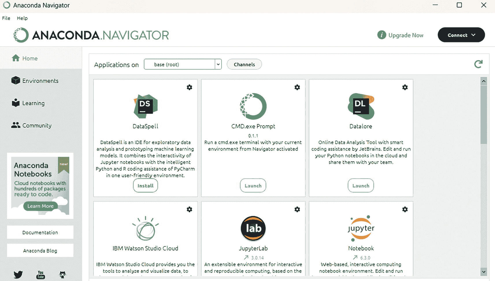

*一个Jupyter Lab 3.5.3应用程序的截图。徽标是一个标注有“lab”的球体。底部有一个标注为“启动”的按钮。*

**图 2-2** `Anaconda Navigator`的主页面板

`Anaconda Navigator`主要由四个面板组成：

- 主页（Home）
- 环境（Environments）
- 学习（Learning）
- 社区（Community）

每个面板均可通过左侧清晰可见的按钮列表进行选择。

主页面板列出了针对给定虚拟环境已安装（或可用）的所有Python（以及R）开发应用程序。默认情况下，`Anaconda Navigator`会显示基础操作系统环境，在顶部中央的下拉菜单中将其称为`base(root)`（见图 2-2）。

第二个面板名为“环境”（Environments），显示了发行版中创建的所有虚拟环境（见图 2-3）。在此面板中，可以通过直接点击来选择要激活的虚拟环境，它将显示该虚拟环境上所有已安装（或可用）的包及其对应版本。

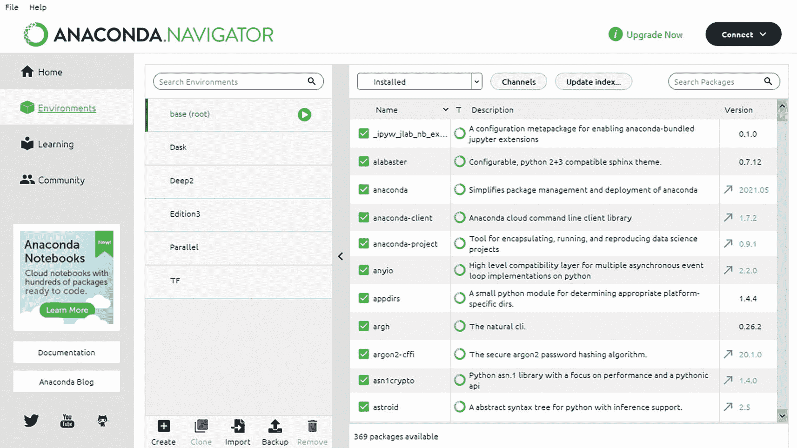

*一个Anaconda navigator页面的截图，展示了base root环境下带有名称和描述的项目列表。*

**图 2-3** `Anaconda Navigator`中的环境面板

同样在环境面板中，可以通过选择基本的Python版本来创建新的虚拟环境。同样地，这些虚拟环境可以使用图 2-4所示的菜单进行删除、克隆、备份或导入。


*用于创建、克隆、导入、备份和移除操作的5个图标按钮。*

**图 2-4** 在`Anaconda Navigator`中管理虚拟环境的按钮菜单

但这还不是全部。`Anaconda Navigator` 不仅仅是一个用于管理 Python 应用程序、虚拟环境和包的实用工具。在第三个名为“学习”（Learning）的面板中（见图 2-5），它提供了通往许多实用 Python 库（包括本书中介绍的那些库）主要网站的链接。点击其中一个链接，你可以访问到大量文档。如果你每天都用 Python 编程，这些资料随时可用是非常有用的。

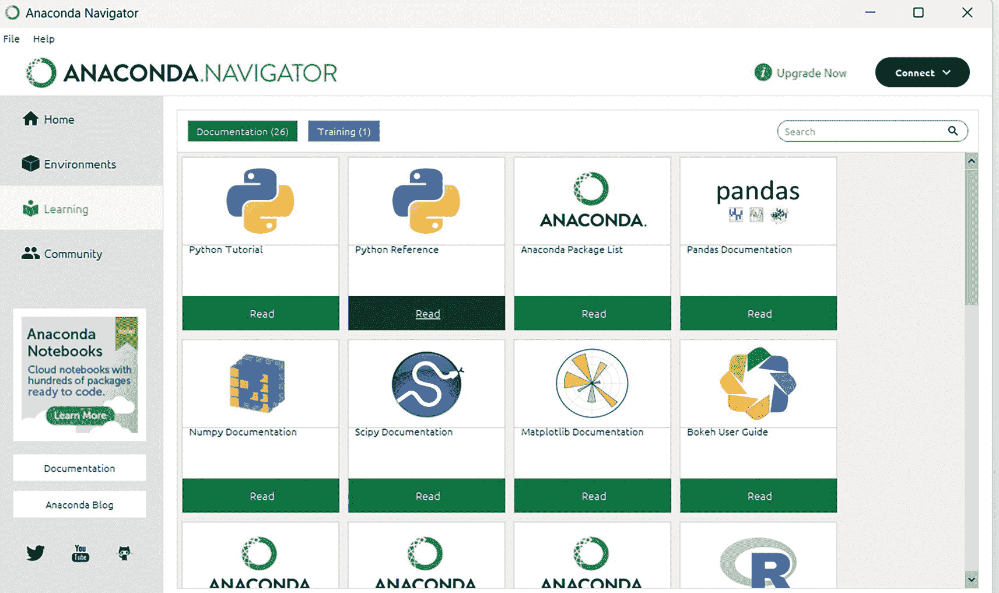

`一个 anaconda navigator 学习面板的截图，展示了与 Python 教程和参考、Anaconda 包列表、pandas、numpy、scipy、matplotlib 文档以及 bokeh 用户指南相关的文档和培训模块。`

**图 2-5** `Anaconda Navigator` 的学习面板

与这个面板相同的是接下来的“社区”（Community）面板。这里也有链接，但这次指向的是来自主要 Python 开发和数据分析社区的论坛。

`Anaconda` 平台，凭借其多种应用程序和 `Anaconda Navigator`，使开发者能够利用这个简单而有组织的工作环境，并为 Python 代码开发做好充分准备。该平台已成为该领域从业人员近乎标准的选择，这并非偶然。

### 使用 Python

Python 功能丰富，但简单且非常灵活。它允许你将开发活动扩展到许多工作领域（数据分析、科学计算、图形界面等）。正是因为这个原因，Python 可以在许多不同的上下文中使用，这通常取决于开发者的喜好和能力。本节将介绍在本书中使用的各种 Python 使用方法。根据各个章节讨论的不同主题，将具体使用这些不同的方法，因为它们更适合手头的任务。

#### Python Shell

接触 Python 世界最简单的方法是在 Python shell 中打开一个会话，这是一个运行命令行的终端。实际上，你可以一次输入一条命令，并立即测试其运行效果。这种模式清晰地展现了 Python 底层解释器的本质。事实上，解释器可以一次读取一条命令，并保留前几行中指定的变量状态，这种行为类似于 `MATLAB` 和其他计算软件。

当你第一次接触 Python 时，这种方法会很有帮助。你可以一次测试一条命令，而无需编写、编辑并运行一个可能包含许多行代码的完整程序。

这种模式也适用于逐行测试和调试 Python 代码，或者只是进行计算。要在终端上启动一个会话，只需在命令行中输入以下内容：

```
C:\Users\nelli>python
Python 3.10 | packaged by Anaconda, Inc. | (main, Mar  1 2023, 18:18:21) [MSC v.1916 64 bit (AMD64)] on win32
Type "help", "copyright", "credits" or "license" for more information.
>>>
```

现在 Python shell 已激活，解释器已准备好接收 Python 命令。从输入最简单的命令开始，但这是入门编程的经典命令。

```
>>> print("Hello World!")
Hello World!
```

如果你的系统上有 `Anaconda` 平台，你可以打开一个与你想要工作的特定虚拟环境相关的 Python shell。在这种情况下，从 `Anaconda Navigator` 的 Home 面板中，从下拉菜单激活虚拟环境，然后点击 `CMD.exe Prompt` 应用程序的 Launch 按钮，如图 2-6 所示。

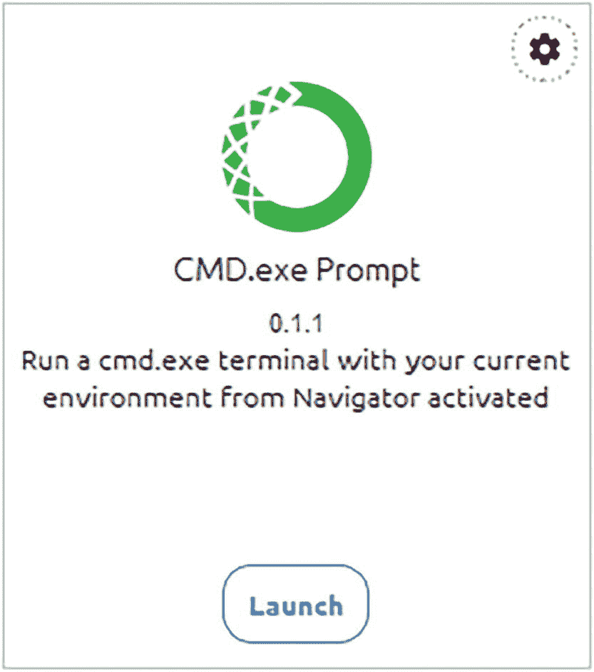

`一个显示为 "run a cmd.exe terminal with your current environment from the navigator activated" 文本的 CMD.exe prompt 0.1.1 窗口。文本下方是一个标有 "launch" 的按钮。右上角是一个齿轮图标。`

**图 2-6**

`Anaconda Navigator` 中的 `CMD.exe Prompt` 应用程序

将打开一个命令控制台，其提示符中会以方括号前缀显示活动虚拟环境的名称。在那里，你可以运行 `python` 命令来激活 Python shell。

```
(Edition3) C:\Users\nelli>python
Python 3.11.0 | packaged by Anaconda, Inc. | (main, Mar  1 2023, 18:18:21) [MSC v.1916 64 bit (AMD64)] on win32
Type "help", "copyright", "credits" or "license" for more information.
>>>
```

#### 运行完整程序

熟悉 Python 的最佳方法是编写一个完整的程序，然后从终端运行它。首先，使用一个简单的文本编辑器编写程序。例如，你可以使用清单 2-1 中所示的代码，并将其保存为 `MyFirstProgram.py`。

```
myname = input("What is your name?\n")
print("Hi %s, I'm glad to say: Hello world!" %myname)
清单 2-1
MyFirstProgram.py
```

现在你已经用 Python 编写了第一个程序，可以通过在命令行中调用 `python` 命令，然后跟上包含程序代码的文件名来直接运行它。

```
python MyFirstProgram.py
```

从输出来看，程序会询问你的名字。一旦你输入名字，它就会打招呼。

```
What is your name?
Fabio Nelli
Hi Fabio Nelli, I'm glad to say: Hello world!
```

#### 使用 IDE 实现代码

比之前的方法更全面的方法是使用 IDE（集成开发环境）。这些编辑器提供了一个工作环境，用于开发你的 Python 代码。它们拥有丰富的工具，使开发者的工作更轻松，尤其是在调试时。在接下来的几节中，你将详细了解当前可用的 IDE。

#### 与 Python 交互

使用 Python 的最后一个方法，在我看来，也许是创新性最强的，那就是交互式方法。事实上，除了前面三种方法之外，这种方法还为你提供了与 Python 代码直接交互的机会。

在这方面，`IPython` 的引入极大地丰富了 Python 世界。`IPython` 是一个非常强大的工具，专门为满足 Python 解释器和开发者之间的交互需求而设计，在这种方法下，开发者扮演着分析师、工程师或研究员的角色。`IPython` 及其特性将在后面的章节中更详细地解释。

### 编写 Python 代码

在上一节中，你看到了如何编写一个打印字符串 `"Hello World"` 的简单程序。现在在本节中，你将简要概述 Python 语言的基础知识。

本节的目的不是教你用 Python 编程，也不是阐述该编程语言的语法规则，而只是为了让你快速了解一些继续学习本书后续主题所必需的 Python 基本原则。

如果你已经了解 Python 语言，可以安全地跳过这个介绍性的部分。相反，如果你不熟悉编程，并且在理解这些主题时感到困难，我强烈建议你查阅在线文档、教程和各种课程。

#### 进行计算

你已经看到 `print()` 函数对于打印几乎任何内容都很有用。Python 除了是一个打印工具外，还是一个很棒的 `计算器`。在 Python shell 上启动一个会话，并开始执行这些数学运算：

```
>>> 1 + 2

>>> (1.045 * 3)/4
0.78375
>>> 4 ** 2

>>> ((4 + 5j) * (2 + 3j))
(-7+22j)
>>> 4 < (2*3)
True
```

Python 可以计算许多类型的数据，包括复数以及带有布尔值的条件。正如你从这些计算中看到的，Python 解释器直接返回计算结果，而无需使用 `print()` 函数。这同样适用于变量中包含的值。只需调用变量名即可查看其内容。

```
>>> a = 12 * 3.4
>>> a
40.8
```

#### 导入库与函数

你已了解到 Python 的一大特色在于能够通过导入众多包和模块来扩展其功能。要完整导入一个模块，你必须使用 `import` 命令。

```
>>> import math
```

这样一来，`math` 包中包含的所有函数都能在你的 Python 会话中使用，因此你可以直接调用它们。这样，你就扩展了启动 Python 会话时可用的标准函数集。这些函数通过以下表达式调用：

```
library_name.function_name()
```

例如，你现在可以计算变量 `a` 中数值的正弦值。

```
>>> math.sin(a)
```

如你所见，函数需与库名一同调用。有时你可能会看到如下声明导入的表达式：

```
>>> from math import *
```

尽管这可以正常工作，但出于良好实践倡导，应避免使用。实际上，以这种方式编写导入语句，会导致导入所有函数时无需指明它们所属的库。

```
>>> sin(a)
0.040693257349864856
```

这种导入方式可能引发严重错误，尤其在导入的库数量众多时。事实上，不同库包含同名函数的情况并不少见，将所有内容全部导入会导致后导入的同名函数覆盖先前导入的函数。因此，程序的行为可能产生大量错误，甚至出现异常运行状况。

实际上，这种导入方式通常只用于有限数量的函数，即程序运行严格必需的函数，从而在完全不需要时避免导入整个库。

```
>>> from math import sin
```

## 数据结构

你在前面的示例中了解了如何使用包含单个值的简单变量。Python 提供了大量极其有用的数据结构。这些数据结构可以同时容纳大量数据，有时甚至能存放不同类型的数据。提供的各种数据结构根据其内部数据的组织方式而定义。

* 列表（List）
* 集合（Set）
* 字符串（Strings）
* 元组（Tuples）
* 字典（Dictionary）
* 双端队列（Deque）
* 堆（Heap）

这只是能用 Python 创建的所有数据结构中的一小部分。在这些数据结构中，最常用的是*字典*和*列表*。

*字典*类型（也定义为 *dicts*）是一种数据结构，其中每个特定值都与一个称为*键*的特定标签相关联。字典中的收集的数据没有内部顺序，只是键/值对的定义。

```
>>> dict = {'name':'William', 'age':25, 'city':'London'}
```

如果你想访问字典中的特定值，必须指明关联的键名。

```
>>> dict["name"]
'William'
```

如果你想遍历字典中的值对，必须使用 `for-in` 结构。这可以通过使用 `items()` 函数来实现。

```
>>> for key, value in dict.items():
...    print(key,value)
...
name William
age 25
city London
```

*列表*类型是一种数据结构，它以精确的顺序包含多个对象，形成一个序列，可以向其中添加和移除元素。每个项目都根据序列的顺序标有一个数字，称为*索引*。

```
>>> list = [1,2,3,4]
>>> list
[1, 2, 3, 4]
```

如果你想访问单个元素，只需在方括号中指定其索引即可（列表中的第一个项目的索引为 `0`），而如果你要取出列表的一部分（或一个序列），只需用索引 `i` 和 `j` 指定对应部分两端的范围即可。

```
>>> list[2]

>>> list[1:3]
[2, 3]
```

如果你使用负索引，则表示你从列表的最后一个项目开始，逐渐向前移动。

```
>>> list[-1]
```

为了遍历列表中的元素，你可以使用 `for-in` 结构。

```
>>> items = [1,2,3,4,5]
>>> for item in items:
...        print(item + 1)
...
```

## 函数式编程

前面示例中展示的 `for-in` 循环与其他编程语言中的循环非常相似。然而，如果你想成为一名“Python”开发者，你应该避免使用显式循环。Python 提供了替代方法，指定了诸如*函数式编程*（面向表达式的编程）之类的编程技术。

Python 为开发函数式编程提供的工具包括一系列函数：

* `map(function, list)`
* `filter(function, list)`
* `reduce(function, list)`
* `lambda`
* `list comprehension`

你刚才看到的 `for` 循环有一个特定目的，即对每个项目应用操作，然后以某种方式收集结果。这可以通过 `map()` 函数实现。

```
>>> items = [1,2,3,4,5]
>>> def inc(x): return x+1
...
>>> list(map(inc,items))
[2, 3, 4, 5, 6]
```

在前面的示例中，首先定义了要对每个元素执行操作的函数，然后将其作为第一个参数传递给 `map()`。Python 允许你直接在第一个参数中使用 `lambda` 定义函数，极大地减少了代码量，并将前面的结构压缩成一行代码。

```
>>> list(map((lambda x: x+1),items))
[2, 3, 4, 5, 6]
```

另外两个以类似方式工作的函数是 `filter()` 和 `reduce()`。`filter()` 函数提取列表中对函数返回 `True` 的元素。而 `reduce()` 函数则考虑列表中的所有元素以产生一个单一结果。要使用 `reduce()`，你必须导入 `functools` 模块。

```
>>> list(filter((lambda x: x < 3), items))
[1, 2]
>>> from functools import reduce
>>> reduce((lambda x,y: x/y), items)
0.008333333333333333
```

这两个函数都通过使用 `for` 循环实现了其他类型。它们替代了这些循环及其功能，而这些功能也可以用简单的函数来替代表达。这正是*函数式编程*的构成要素。

函数式编程的最后一个概念是*列表推导式*。这个概念用于以非常自然和简单的方式构建列表，其引用方式类似于数学家描述数据集。序列中的值通过特定的函数或操作来定义。

```
>>> S = [x**2 for x in range(5)]
>>> S
[0, 1, 4, 9, 16]
```

## 缩进

对于来自其他编程语言的开发者来说，一个独特之处在于*缩进*所扮演的角色。虽然你过去管理缩进纯粹出于美观原因，让代码更具可读性，但在 Python 中，缩进通过在逻辑块之间划分代码，在代码实现中扮演着不可或缺的角色。事实上，在 Java、C 和 C++ 中，每行代码由分号（`;`）分隔，而在 Python 中，你无需指定任何符号来分隔它们，包括用于指示逻辑块的花括号。

在 Python 中，这些角色通过缩进来处理；也就是说，根据代码行的起始位置，解释器判断它是否属于某个逻辑块。

```
>>> a = 4
>>> if a > 3:
...    if a < 5:
...       print("I'm four")
...
I'm four
```

```
>>> if a > 3:
...    if a < 5:
...       print("I'm four")
...    else:
...       print("I'm a big number")
...
I'm four
```

在这个例子中你可以看到，根据 `else` 命令的缩进方式，两个条件（由我在字符串中指定）表达了不同的含义。

## IPython

IPython 是 Python 的一个进阶版本，包含一系列工具：

* `IPython` shell，这是一个强大的交互式 shell，能极大地增强 Python 终端的功能。
* `QtConsole`，它是 shell 和 GUI 的混合体，允许你在控制台内部显示图形，而无需打开单独窗口。
* `IPython Notebook`，即 `Jupyter Notebook`，这是一个 Web 界面，允许你在单个表示中混合文本、可执行代码、图形和公式。

### IPython Shell

这个 shell 表面上类似于从命令行运行的 Python 会话，但实际上，它提供了许多其他功能，使其比经典 shell 更强大、更通用。要启动此 shell，只需在命令行输入 `ipython`。

```
> ipython
Python 3.11.0 | packaged by Anaconda, Inc. | (main, Mar  1 2023, 18:18:21) [MSC v.1916 64 bit (AMD64)]
Type 'copyright', 'credits' or 'license' for more information
IPython 8.12.0 -- An enhanced Interactive Python. Type '?' for help.
In [1]:
```

如你所见，会出现一个带有值 `In [1]` 的特定提示符。这意味着它是第一行输入。实际上，`IPython` 提供了一种带输入输出缓存的编号（索引）提示符系统。

```
In [1]: print("Hello World!")
Hello World!
In [2]: 3/2
Out[2]: 1.5
In [3]: 5.0/2
Out[3]: 2.5
In [4]:
```

同样的情况也适用于输出值，它们用 `Out[1]`、`Out[2]` 等表示。`IPython` 将你输入的所有内容保存为变量。事实上，所有输入的条目都作为字段包含在一个名为 `In` 的列表中。

## Jupyter

### Jupyter 项目

`IPython` 近年来发展迅猛，随着 `IPython` 3.0 的发布，一切都朝着一个名为 `Jupyter` 的新项目发展（[`jupyter.org`](https://jupyter.org)）。

`Jupyter` 项目 logo

`IPython` 将作为 Python shell 和 `Jupyter` 的内核继续存在，但 Notebook 和其他属于 `IPython` 项目的与语言无关的组件将转移，以组建新的 `Jupyter` 项目。

### Jupyter QtConsole

为了从命令行启动此应用程序，你必须输入以下命令：

```
jupyter qtconsole
```

该应用程序包含一个 GUI，具有 `IPython` shell 中的所有功能。

IPython QtConsole

### Jupyter Notebook

`Jupyter Notebook` 是这个交互式环境的最新演进形式。实际上，使用 `Jupyter Notebook`，你可以将可执行代码、文本、公式、图像和动画合并到单个 Web 文档中。这对多种用途都很有用，例如演示、教程、调试等。

显示 Jupyter Notebook 的网页

要在 Web 浏览器中启动 `Jupyter Notebook`，请在控制台中运行以下命令：

```
jupyter notebook
```

如果你使用的是 `Anaconda Navigator`，则在 `Home` 面板中，单击 `Jupyter Notebook` 应用的 `Launch` 按钮即可启动它。

Anaconda Navigator 中的 Jupyter Notebook 应用

### Jupyter Lab

另一个结合了迄今为止所有应用特点的应用是 `Jupyter Lab`。它像 `Jupyter Notebook` 一样在浏览器中运行，但这是一个真正的开发环境，你可以在其中以文件、会话、笔记本等形式管理文件、数据和代码。

要在 Web 浏览器中启动 `Jupyter Lab`，请在控制台中运行以下命令：

```
jupyter lab
```

该应用也与其他应用一起出现在 `Anaconda Navigator` 中，要从其中一个虚拟环境启动它，只需单击相应图标的 `Launch` 按钮即可。

Anaconda Navigator 中的 Jupyter Lab 图标

启动该应用将打开默认浏览器（如果尚未打开），并加载 `https://localhost:8892/lab` 页面，该页面就是 `Jupyter Lab`。

Jupyter Lab 应用

## PyPI——Python 包索引

Python 包索引（`PyPI`）是一个软件仓库，包含所有 Python 编程所需的软件——例如，属于其他 Python 库的所有 Python 包。该仓库的内容由各个包的开发者直接管理，他们负责用其发布库的最新版本更新仓库。要查看仓库中包含的包列表，请访问 `PyPI` 的官方页面：[`pypi.python.org/pypi`](https://pypi.python.org/pypi)。

至于这些包的管理，你可以使用 `pip` 应用，它是 `PyPI` 的包管理器。

通过从命令行启动它，你可以管理所有包，并单独决定某个包是应该安装、升级还是移除。`pip` 将检查该包是否已安装，或者是否需要更新，以控制依赖关系，并评估是否需要其他包。此外，它还管理下载和安装过程。

```
$ pip install >
$ pip search >
$ pip show >
$ pip unistall >
```

## Python 的 IDE

尽管大多数 Python 开发者习惯于直接从 shell（`Python` 或 `IPython`）编写代码，但也有一些 IDE（集成开发环境）可用。事实上，除了文本编辑器之外，这些图形编辑器还提供了一系列在编写代码过程中非常有用的工具。例如，代码自动补全、查看与命令关联的文档、调试和断点等，只是这类应用能提供的部分工具。

### Spyder

`Spyder`（科学 Python 开发环境）是一款集成开发环境（IDE），其功能与 `MATLAB` 的 IDE 类似（见图 2-13）。它的文本编辑器功能丰富，具备语法高亮和代码分析工具。此外，你还可以在图形应用程序中集成现成的小部件。

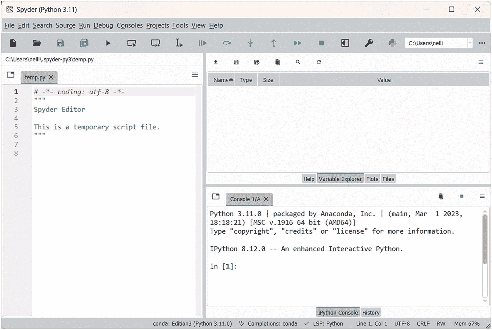

一张 `Spyder` Python 3.11 页面的截图展示了左侧面板中的脚本文件，以及右侧面板顶部和底部分别显示变量探索器和 `IPython` 控制台。

图 2-13 `Spyder` IDE

### Eclipse (PyDev)

那些使用过其他编程语言的开发者肯定熟悉 `Eclipse`，这是一款完全用 Java 开发（因此需要在你的电脑上安装 Java）的通用 IDE，它为多种编程语言提供开发环境（见图 2-14）。得益于一个名为 `PyDev` 的额外插件的安装，也存在一个用于 Python 开发的 `Eclipse` 版本。

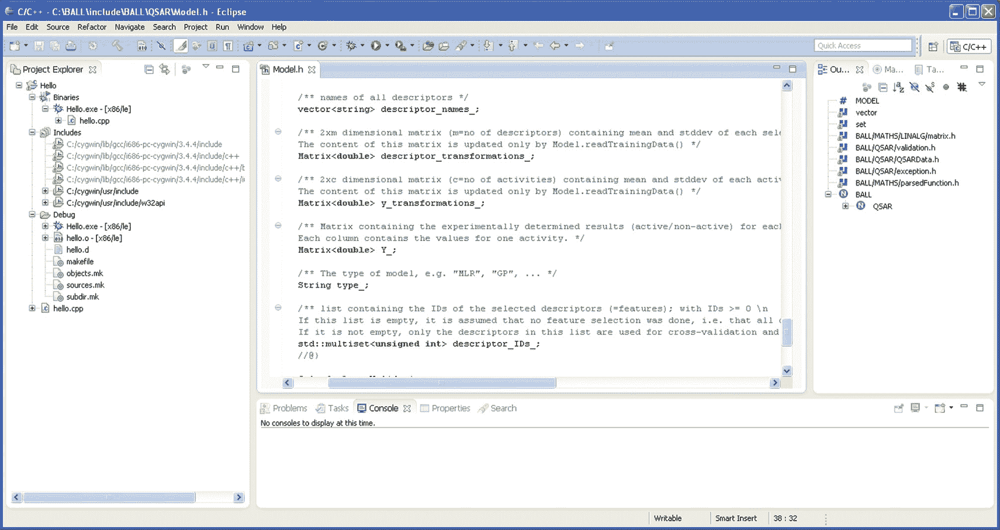

一张 C 和 C++ 页面的截图展示了左侧面板项目资源管理器选项卡下的一个列表、中间面板中用于 model h 的命令行，以及右侧面板输出选项卡下的一个列表。

图 2-14 `Eclipse` IDE

### Sublime

这款文本编辑器是 Python 程序员青睐的环境之一（见图 2-15）。事实上，该应用程序有许多可用插件，使得 Python 实现变得简单而愉悦。

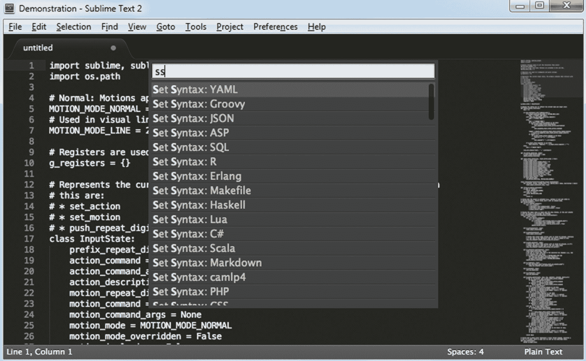

一张演示 `Sublime Text 2` 的截图展示了左侧面板中一个未命名选项卡下的代码行。一个重叠的搜索栏显示文本 `s s`，并提供一个选项列表。

图 2-15 `Sublime` IDE

### Liclipse

与 `Spyder` 类似，`Liclipse` 是一款专门为 Python 语言设计的开发环境（见图 2-16）。它与 `Eclipse` IDE 非常相似，但完全适用于 Python 特定用途，无需安装像 `PyDev` 这样的插件。因此，它的安装和设置比 `Eclipse` 简单得多。

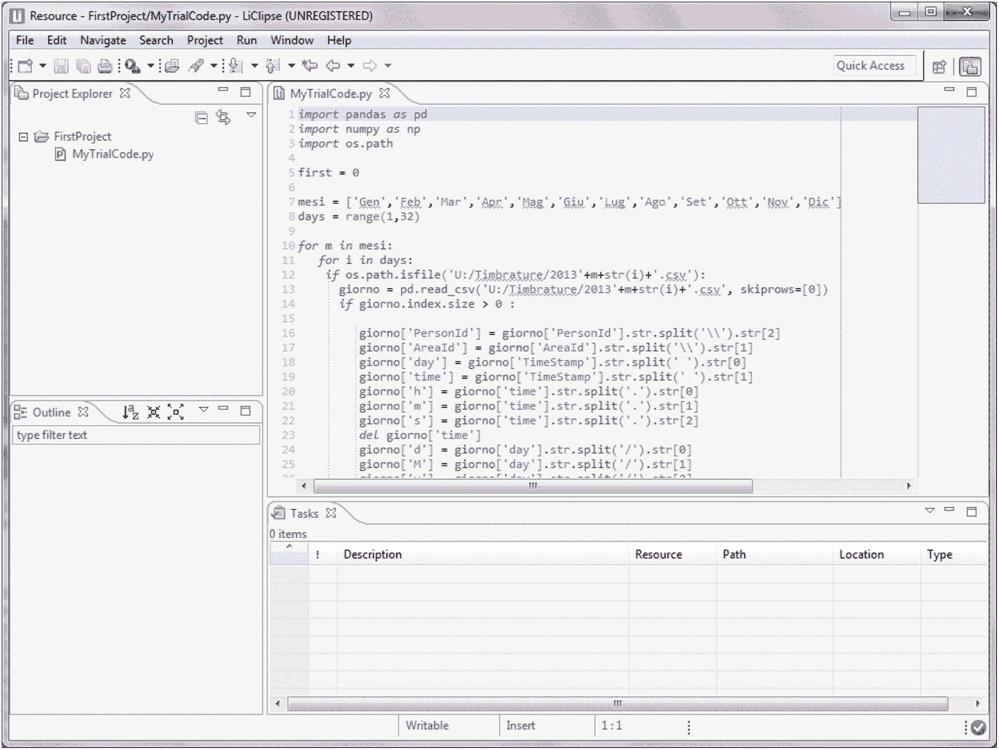

一张 `liclipse` 的截图展示了左侧面板顶部和底部的项目资源管理器和大纲。在右侧面板中，它展示了顶部和底部分别显示的 `my_trial_code.py` 和任务。

图 2-16 `Liclipse` IDE

### NinjaIDE

`NinjaIDE`（`NinjaIDE` 意为“不只是另一个 IDE”），其特点是名称本身是一个递归缩写，是一款专用于 Python 语言的 IDE（见图 2-17）。这是一款非常新的应用程序，许多开发者正在其上面投入精力。它已经非常有前景，很可能在未来几年内，这款 IDE 会带来许多惊喜。

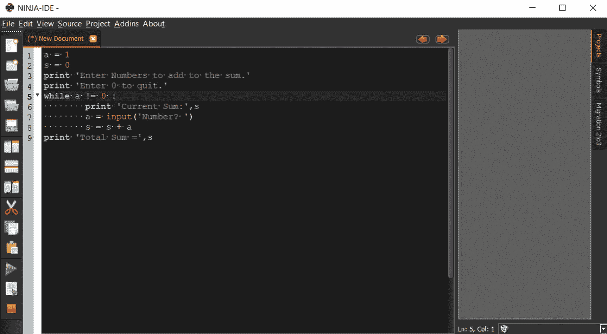

一张 `Ninja IDE` 的截图展示了在新文档选项卡下包含 `print` 和 `while` 命令的 9 行代码。

图 2-17 `Ninja` IDE

### Komodo IDE

`Komodo` 是一款功能非常强大的 IDE，内置丰富的工具，使其成为一个完整且专业的开发环境（见图 2-18）。`Komodo` 开发环境是付费软件，使用 C++ 编写，可适配多种编程语言，包括 Python。

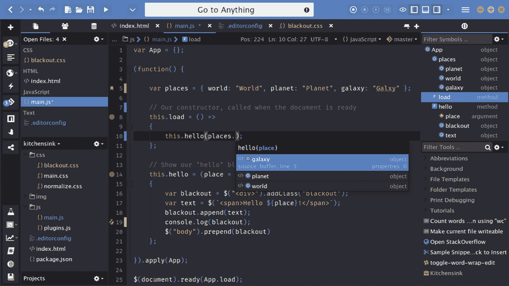

一张 `Komodo` IDE 的截图展示了左上角的打开文件选项卡、左下角的“kitchens ink”、中央面板的代码行，以及右侧面板顶部和底部分别的筛选工具和符号。

图 2-18 `Komodo` IDE

## SciPy

`SciPy`（发音为“sigh pie”）是一组专门用于科学计算的 Python 开源库。这些库中的许多都是本书多个章节的主角，因为掌握它们对于数据分析至关重要。它们共同构成了一套用于计算和显示数据的工具。它在功能上丝毫不逊色于其他专门用于计算和数据分析的环境（例如 R 或 `MATLAB`）。在属于 `SciPy` 组的库中，有三个库将在以下章节中特别讨论：

*   `NumPy`

*   `matplotlib`


# 第二章：Python 世界的基本要素

在简要介绍数据分析领域后，我们进入 Python 的世界。本章将探讨构成 Python 生态系统的基本要素。

## 核心库介绍

### NumPy

这个库的名称意为 `数值 Python`，它构成了许多源自它的其他 Python 库的核心。实际上，`NumPy` 是 Python 中进行科学计算的基础库，因为它提供了 Python 基础包无法提供的数据结构和高性能函数。事实上，正如你在本书后面将看到的，`NumPy` 定义了一种特定的数据结构，即定义为 `ndarray` 的 *N* 维数组。

掌握这个库对于数值计算至关重要，因为正确使用它可以极大地影响你的计算性能。由于其独特的特性，`NumPy` 在本书中几乎无处不在，因此本书用一整章（第 3 章）来专门介绍它。

该包为标准 Python 提供了一些增强功能：

*   `Ndarray`：一种多维数组，比 Python 基础包提供的数组更快、更高效。
*   逐元素计算：一组用于对数组进行此类计算以及数组间数学运算的函数。
*   读写数据集：一组用于读取和写入存储在硬盘中的数据的工具。
*   与其他语言（如 C、C++ 和 FORTRAN）集成：一组用于集成使用这些编程语言开发的代码的工具。

### Pandas

这个包提供了复杂的数据结构和函数，专门设计用于让数据处理变得简单、快速和高效。这个包是 Python 数据分析的核心。因此，学习和应用这个包是你贯穿全书（尤其是第 4、5 和 6 章）的主要目标。掌握它的每一个细节，特别是在应用于数据分析时，是本书的基本目标。

这个包的基本概念是 `DataFrame`，一种带有行和列标签的二维表格数据结构。

`Pandas` 将 `NumPy` 库的高性能特性应用于电子表格或关系数据库（SQL 数据库）中的数据操作。实际上，通过使用高级索引，可以轻松地对这种数据结构执行许多操作，例如重塑、切片、聚合和子集选择。

### matplotlib

这个包是目前最流行的用于生成 2D 图表和其他数据可视化的 Python 库。由于数据分析需要可视化工具，这个库最适合此目的。在第 7 章中，你将详细了解这个功能丰富的库，从而知道如何以最佳方式呈现你的分析结果。

## 结语

在本章中，我们阐述了构成 Python 世界的所有基本特征。通过简要示例介绍了 Python 编程语言的基本概念，解释了其创新之处以及它与其他编程语言相比的独特优势。此外，还展示了在不同层面使用 Python 的多种方式。首先，你了解了如何使用简单的命令行解释器，然后介绍了一系列简单的图形用户界面，最后讲解了复杂的开发环境，即集成开发环境（IDE），例如 `Spyder`、`Liclipse` 和 `NinjaIDE`。

我们还介绍了高度创新的项目 `Jupyter`（`IPython`），展示了如何以交互方式开发 Python 代码，特别是使用 `Jupyter Notebook`。

此外，本章着重说明了 Python 的模块化特性——能够通过外部库扩展 Python 提供的基本标准函数集。在这方面，我们介绍了 `PyPI` 在线仓库以及其他 Python 发行版，如 `Anaconda` 和 `Enthought Canopy`。

在下一章中，你将学习第一个库 `NumPy`，它是 Python 中所有数值计算的基础。你将了解 `ndarray` 这种数据结构，它是后续章节数据分析中使用的更复杂数据结构的基础。
