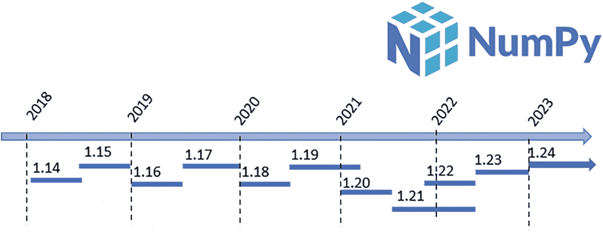
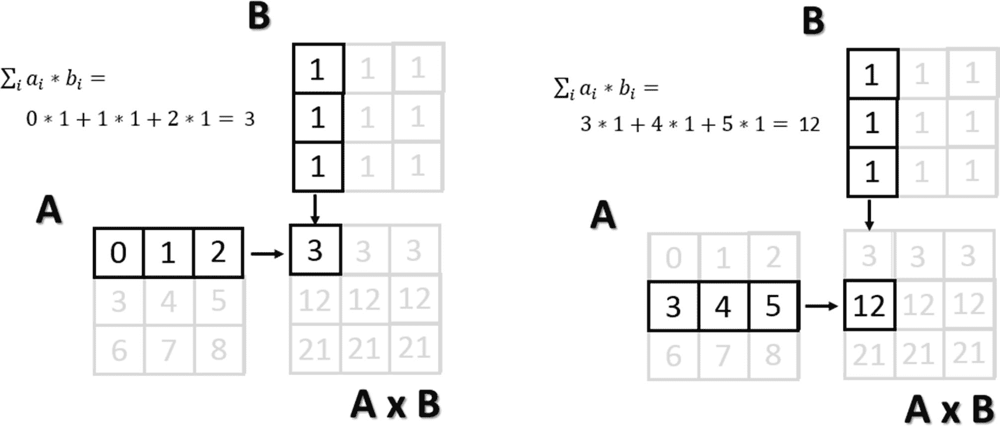

# 3. NumPy 库

`NumPy` 是一个用于 Python 科学计算，特别是数据分析的基础包。事实上，这个库是大量数学和科学 Python 包的基础，其中就包括你将在本书后续内容中看到的 `pandas` 库。这个专注于数据分析的库完全是利用 `NumPy` 引入的概念开发的。实际上，标准 Python 库提供的内置工具对于数据分析中的大多数计算来说可能过于简单或不够用。

掌握 `NumPy` 库的知识对于能够使用所有科学计算 Python 包至关重要，特别是使用和理解 `pandas` 库。`pandas` 库是后续章节的主要主题。

如果你已经熟悉这个库，可以直接进入下一章；否则，你可以将本章视为复习基本概念或通过运行本章示例来重新熟悉它的途径。

## NumPy：历史沿革

在 Python 语言的早期，开发者需要执行数值计算，尤其是在科学界使用该语言时。

第一次尝试是 Jim Hugunin 在 1995 年开发的 `Numeric`，随后出现了另一个名为 `Numarray` 的替代包。这两个包都专门用于数组计算，并且各有其适用场景下的优势。因此，它们根据实际情况被区别使用。这种模棱两可的情况后来促成了统一这两个包的想法。Travis Oliphant 为此开始开发 `NumPy` 库。其第一个版本（v 1.0）于 2006 年发布。

从那时起，`NumPy` 被证明是用于科学计算的 Python 扩展库，并且目前是用于计算多维数组和大数组最广泛使用的包。此外，该包附带了一系列函数，可以让你以极高效率对数组执行操作，并进行高级数学计算。

目前，`NumPy` 是开源软件，采用 `BSD` 许可证。许多贡献者扩展了这个库的潜力。现在，`NumPy` 已发布到 `1.24` 版本。如图 3-1 所示，该库正在持续开发中，大约每六个月发布一个版本。



一张时间线图展示了 2018 年至 2023 年 `NumPy` 的发布情况。从版本 `1.14` 开始，到 `1.24` 结束。每年大约有两个版本发布。

图 3-1：过去五年 `NumPy` 的版本发布情况，并带有新的 `NumPy` 标志 `[CC BY-SA 4.0 Isabela Presedo-Floyd]`

## NumPy 的安装

除了需要一个可运行的 Python 平台外，该库没有任何其他要求，因此安装它应该不会造成任何问题。通常，该模块作为基本包存在于大多数 Python 发行版中；但是，如果没有，你可以在之后安装它。

然而，无论你使用什么平台，与你将在本书中使用的所有其他库一样，对于 `NumPy`，也建议使用 `Anaconda` 发行版的平台。这可以让你干净地管理 `NumPy` 的安装方面，并轻松创建和管理用于安装它的虚拟环境。这样，你就可以使用不同的 Python 版本和 `NumPy` 版本来测试和开发代码，而无需每次都卸载并重新安装所有内容。

如果你有 `Anaconda`，只需编写以下命令来安装 `NumPy`：

```
conda install numpy
```

如果你想在没有该发行版支持的情况下工作，请使用命令行 `pip` 命令来安装 `NumPy` 库（参见 [`https://pypi.org/project/numpy/`](https://pypi.org/project/numpy/)）：

```
pip install numpy
```

一旦 `NumPy` 安装到你的发行版中，要导入 Python 会话中的 `NumPy` 模块，请编写：

```python
>>> import numpy as np
```

另一方面，如果你正在编写代码，为了访问 `NumPy` 及其函数，你需要在 Python 代码的开头插入这条指令。

## `ndarray`：库的核心

`NumPy` 库基于一个主要对象：`ndarray`（代表 N 维数组）。这个对象是一个多维、同质的数组，具有预定的元素数量：同质是因为其中几乎所有元素都具有相同的类型和大小。事实上，数据类型由另一个名为 `dtype`（数据类型）的 `NumPy` 对象指定；每个 `ndarray` 仅关联一种 `dtype`。

数组的维度和元素数量由其 `shape` 定义，`shape` 是一个由 *N* 个正整数组成的元组，指定了每个维度的大小。维度被称为 `axes`（轴），轴的数量被称为 `rank`（秩）。

此外，`NumPy` 数组的另一个特点是其大小是固定的，也就是说，一旦你在创建时定义了它们的大小，它就不会改变。这种行为与 Python 列表不同，Python 列表的大小可以增长或缩小。

定义一个新的 `ndarray` 最简单的方法是使用 `array()` 函数，将要包含在其中的元素组成的 Python 列表作为参数传递给它。

```python
>>> a = np.array([1, 2, 3])
>>> a
array([1, 2, 3])
```

你可以通过将新变量传递给 `type()` 函数，轻松地检查新创建的对象是否是一个 `ndarray`。

```python
>>> type(a)
```

为了知道新创建的 `ndarray` 关联的 `dtype`，你必须使用 `dtype` 属性。

注意

`dtype`、`shape` 和其他属性的结果在不同操作系统和 Python 发行版中可能有所不同。

```python
>>> a.dtype
dtype('int32')
```

刚刚创建的数组有一个轴，因此其秩为 1，而其形状应为 `(3,)`。要从相应的数组中获取这些值，只需使用 `ndim` 属性获取轴数，使用 `size` 属性确定数组长度，并使用 `shape` 属性获取其形状。

```python
>>> a.ndim
>>> a.size
>>> a.shape
(3,)
```

你刚刚看到的是最简单的一维数组情况。但数组的使用可以很容易地扩展到多个维度。例如，如果你定义一个 2x2 的二维数组：

```python
>>> b = np.array([[1.3, 2.4],[0.3, 4.1]])
>>> b
array([[1.2, 2.4],
       [0.3, 3. ]])
>>> b.dtype
dtype('float64')
>>> b.ndim
>>> b.size
>>> b.shape
(2, 2)
```

这个数组的秩为 2，因为它有两个轴，每个轴的长度为 2。

另一个重要的属性是 `itemsize`，它可以与 `ndarray` 对象一起使用。它定义了数组中每个元素的大小（以字节为单位），而 `data` 是包含数组实际元素的缓冲区。这第二个属性仍然不常用，因为要访问数组中的数据，你会使用索引机制，这将在接下来的章节中看到。

```python
>>> b.itemsize
>>> b.data
```

### 创建一个数组

要创建一个新数组，你可以遵循不同的路径。最常见的路径是你在上一节中看到的，通过一个列表或列表序列作为 `array()` 函数的参数。

```python
>>> c = np.array([[1, 2, 3],[4, 5, 6]])
>>> c
array([[1, 2, 3],
       [4, 5, 6]])
```

除了列表，`array()` 函数还可以接受元组和元组序列。

```python
>>> d = np.array(((1, 2, 3),(4, 5, 6)))
>>> d
array([[1, 2, 3],
       [4, 5, 6]])
```

它也可以接受元组和相互关联的列表的序列。

```python
>>> e = np.array([(1, 2, 3), [4, 5, 6], (7, 8, 9)])
>>> e
array([[1, 2, 3],
       [4, 5, 6],
       [7, 8, 9]])
```

# 数据类型

到目前为止，你只看到了简单的整数和浮点数值，但 NumPy 数组被设计为包含多种数据类型（见表 3-1）。例如，你可以使用字符串数据类型：

**表 3-1** NumPy 支持的数据类型

| 数据类型 | 描述 |
| --- | --- |
| `bool_` | 布尔值（`true` 或 `false`），存储为一个字节 |
| `int_` | 有符号整数类型（与 C 的 `long` 和 Python 的 `int` 相同；通常为 `int64` 或 `int32`，取决于平台） |
| `intc` | 有符号整数类型，等同于 C 的 `int`（通常为 `int32` 或 `int64`） |
| `intp` | 用于索引的整数（与 C 的 `size_t` 相同；通常为 `int32` 或 `int64`） |
| `int8` | 8 位有符号整数类型的别名（–128 到 127） |
| `int16` | 16 位有符号整数类型的别名（–32768 到 32767） |
| `int32` | 32 位有符号整数类型的别名（–2147483648 到 2147483647） |
| `int64` | 64 位有符号整数类型的别名（–9223372036854775808 到 9223372036854775807） |
| `uint8` | 8 位无符号整数类型的别名（0 到 255） |
| `uint16` | 16 位无符号整数类型的别名（0 到 65535） |
| `uint32` | 32 位无符号整数类型的别名（0 到 4294967295） |
| `uint64` | 64 位无符号整数类型的别名（0 到 18446744073709551615） |
| `float_` | `float64` 的简写 |
| `float16` | 半精度浮点数：符号位 1 位，指数 5 位，尾数 10 位 |
| `float32` | 单精度浮点数：符号位 1 位，指数 8 位，尾数 23 位 |
| `float64` | 双精度浮点数：符号位 1 位，指数 11 位，尾数 52 位 |
| `complex_` | `complex128` 的简写 |
| `complex64` | 复数，由两个 32 位浮点数表示（实部和虚部） |
| `complex128` | 复数，由两个 64 位浮点数表示（实部和虚部） |

```python
>>> g = np.array([['a', 'b'],['c', 'd']])
>>> g
array([['a', 'b'],
       ['c', 'd']], dtype='<U1')
>>> g.dtype
dtype('<U1')
>>> g.dtype.name
'str32'
```

# dtype 选项

`array()` 函数不只接受一个参数。你已经看到，每个 `ndarray` 对象都与一个 `dtype` 对象关联，该对象唯一定义了将占据数组中每个元素的数据类型。默认情况下，`array()` 函数可以根据列表或元组序列中包含的值关联最合适的类型。实际上，你可以使用 `dtype` 选项作为函数的参数来显式地定义 `dtype`。

例如，如果你想定义一个具有复数值的数组，你可以如下使用 `dtype` 选项：

```python
>>> f = np.array([[1, 2, 3],[4, 5, 6]], dtype=complex)
>>> f
array([[ 1.+0.j,  2.+0.j,  3.+0.j],
       [ 4.+0.j,  5.+0.j,  6.+0.j]])
```

## 数组的内在创建

NumPy 库提供了一组用于生成具有初始内容的 `ndarray`s 的函数，这些数组根据函数的不同而包含不同的值。在本章以及整本书中，您会发现这些功能非常有用。事实上，它们仅用一行代码就能生成大量数据。

例如，`zeros()` 函数创建一个全零数组，其维度由参数的形状定义。例如，要创建一个 3x3 的二维数组，可以使用：

```python
>>> np.zeros((3, 3))
array([[ 0.,  0.,  0.],
       [ 0.,  0.,  0.],
       [ 0.,  0.,  0.]])
```

而 `ones()` 函数则以非常相似的方式创建一个全为一的数组。

```python
>>> np.ones((3, 3))
array([[ 1.,  1.,  1.],
       [ 1.,  1.,  1.],
       [ 1.,  1.,  1.]])
```

默认情况下，这两个函数创建的是数据类型为 `float64` 的数组。一个特别有用的功能是 `arange()`。该函数生成包含数值序列的 NumPy 数组，这些序列根据传递的参数遵循特定规则。例如，如果你想生成一个 0 到 10 之间的数值序列，你只需向该函数传递一个参数——你想要结束序列的值。

```python
>>> np.arange(0, 10)
array([0, 1, 2, 3, 4, 5, 6, 7, 8, 9])
```

如果你不想从 0 开始，而是想从另一个值开始，只需指定两个参数：第一个是起始值，第二个是结束值。

```python
>>> np.arange(4, 10)
array([4, 5, 6, 7, 8, 9])
```

还可以生成具有精确间隔的数值序列。如果指定了 `arange()` 函数的第三个参数，它将表示序列中一个值与下一个值之间的间隔。

```python
>>> np.arange(0, 12, 3)
array([0, 3, 6, 9])
```

此外，这第三个参数也可以是浮点数。

```python
>>> np.arange(0, 6, 0.6)
array([ 0. ,  0.6,  1.2,  1.8,  2.4,  3. ,  3.6,  4.2,  4.8,  5.4])
```

到目前为止，你只创建了一维数组。要生成二维数组，你仍然可以继续使用 `arange()` 函数，但需要与 `reshape()` 函数结合使用。该函数按照 `shape` 参数指定的方式，将一个线性数组分割成不同的部分。

```python
>>> np.arange(0, 12).reshape(3, 4)
array([[ 0,  1,  2,  3],
       [ 4,  5,  6,  7],
       [ 8,  9, 10, 11]])
```

另一个与 `arange()` 非常相似的函数是 `linspace()`。该函数仍然将序列的起始值和结束值作为前两个参数，但第三个参数不是指定一个元素与下一个元素之间的距离，而是定义你希望将该区间分割成的元素数量。

```python
>>> np.linspace(0,10,5)
array([  0. ,   2.5,   5. ,   7.5,  10. ])
```

最后，另一种获取已包含值的数组的方法是使用随机值填充它们。这可以通过使用 `numpy.random` 模块的 `random()` 函数来实现。此函数将生成一个包含参数中指定数量元素的数组。

```python
>>> np.random.random(3)
array([ 0.78610272,  0.90630642,  0.80007102])
```

每次运行时获得的数字都会不同。要创建一个多维数组，只需将数组的大小作为参数传递即可。

```python
>>> np.random.random((3,3))
array([[ 0.07878569,  0.7176506 ,  0.05662501],
       [ 0.82919021,  0.80349121,  0.30254079],
       [ 0.93347404,  0.65868278,  0.37379618]])
```

## 基本操作

到目前为止，你已经了解了如何创建新的 NumPy 数组以及如何在其中定义元素。现在是时候看看如何对这些数组应用各种操作了。

### 算术运算符

你将首先在数组上执行的操作是算术运算符。最明显的是对数组进行标量的加法和乘法运算。

```python
>>> a = np.arange(4)
>>> a
array([0, 1, 2, 3])
>>> a+4
array([4, 5, 6, 7])
>>> a*2
array([0, 2, 4, 6])
```

这些运算符也可以用于两个数组之间。在 NumPy 中，这些运算是逐元素执行的，也就是说，运算符只应用于对应的元素之间。这些对象占据相同的位置，因此最终结果是一个新数组，其中包含位于操作数相同位置的结果（参见图 3-2）。


**图 3-2** 逐元素加法

# 算术运算

```python
>>> b = np.arange(4,8)
>>> b
array([4, 5, 6, 7])
>>> a + b
array([ 4,  6,  8, 10])
>>> a – b
array([–4, –4, –4, –4])
>>> a * b
array([ 0,  5, 12, 21])
```

此外，这些运算符也可用于函数，前提是返回的值是一个 NumPy 数组。例如，你可以将数组乘以数组 `b` 中元素的正弦值或平方根。

```python
>>> a * np.sin(b)
array([–0.        , –0.95892427, –0.558831  ,  1.9709598 ])
>>> a * np.sqrt(b)
array([ 0.        ,  2.23606798,  4.89897949,  7.93725393])
```

接着讨论多维的情况，即使在这里，算术运算符也继续逐元素地工作。

```python
>>> A = np.arange(0, 9).reshape(3, 3)
>>> A
array([[0, 1, 2],
       [3, 4, 5],
       [6, 7, 8]])
>>> B = np.ones((3, 3))
>>> B
array([[ 1.,  1.,  1.],
       [ 1.,  1.,  1.],
       [ 1.,  1.,  1.]])
>>> A * B
array([[ 0.,  1.,  2.],
       [ 3.,  4.,  5.],
       [ 6.,  7.,  8.]])
```

## 矩阵乘积

选择逐元素操作是 NumPy 库的一个独特方面。事实上，在许多其他用于数据分析的工具中，`*` 运算符应用于两个矩阵时被理解为矩阵乘积。使用 NumPy，这种乘积则由 `dot()` 函数表示。此操作不是逐元素的。

```python
>>> np.dot(A,B)
array([[  3.,   3.,   3.],
       [ 12.,  12.,  12.],
       [ 21.,  21.,  21.]])
```

每个位置的结果是第一个矩阵对应行的每个元素与第二个矩阵对应列的对应元素的乘积之和。图 3-3 说明了矩阵乘积过程中执行的过程（对两个元素运行）。



一幅插图表示两个标有 `A` 和 `B` 的 3x3 矩阵。它展示了计算 `A` 乘以 `B` 的值的公式，即 `A` 的行值与 `B` 的列值乘积之和。

**图 3-3** 计算作为矩阵乘积结果的矩阵元素

另一种写法是使用 `dot()` 函数作为两个矩阵之一的对象的函数。

```python
>>> A.dot(B)
array([[  3.,   3.,   3.],
       [ 12.,  12.,  12.],
       [ 21.,  21.,  21.]])
```

请注意，由于矩阵乘积不是交换运算，操作数的顺序很重要。事实上，`A * B` 不等于 `B * A`。

```python
>>> np.dot(B,A)
array([[  9.,  12.,  15.],
       [  9.,  12.,  15.],
       [  9.,  12.,  15.]])
```

## 自增和自减运算符

实际上，Python 中没有这样的运算符，因为没有名为 `++` 或 `––` 的运算符。要增加或减少值，你必须使用诸如 `+=` 和 `–=` 之类的运算符。这些运算符与你之前看到的没有什么不同，只是它们不会创建一个包含结果的新数组，而是将结果重新赋值给同一个数组。

```python
>>> a = np.arange(4)
>>> a
array([0, 1, 2, 3])
>>> a += 1
>>> a
array([1, 2, 3, 4])
>>> a –= 1
>>> a
array([0, 1, 2, 3])
```

因此，使用这些运算符的范围比简单的、使值增加一个单位的自增运算符要广泛得多，并且它们可以应用于许多情况。例如，每当你想要更改数组中的值而不生成新数组时，你都需要它们。

```python
>>> a += 4
>>> a
array([4, 5, 6, 7])
>>> a *= 2
>>> a
array([ 8, 10, 12, 14])
```

# 通用函数（ufunc）

通用函数，通常称为 *ufunc*，是一种以逐元素方式对数组进行操作的函数。这意味着它分别作用于输入数组的每一个单独元素，并在一个新的输出数组中生成相应的结果。最终，你将得到一个与输入数组大小相同的数组。

有许多数学和三角函数都符合这一定义；例如，使用 `sqrt()` 计算平方根，使用 `log()` 计算对数，或使用 `sin()` 计算正弦值。

```python
>>> a = np.arange(1, 5)
>>> a
array([1, 2, 3, 4])
>>> np.sqrt(a)
array([ 1\.        ,  1.41421356,  1.73205081,  2\.        ])
>>> np.log(a)
array([ 0\.        ,  0.69314718,  1.09861229,  1.38629436])
>>> np.sin(a)
array([ 0.84147098,  0.90929743,  0.14112001, –0.7568025 ])
```

许多常见的数学函数已经在 NumPy 库中实现。

# 聚合函数

聚合函数对一组值（例如一个数组）执行运算，并产生一个单一结果。因此，数组中所有元素的总和就是一个聚合函数。`ndarray` 类中实现了许多此类函数，因此可以直接在要执行计算的数组上调用它们。

```python
>>> a = np.array([3.3, 4.5, 1.2, 5.7, 0.3])
>>> a.sum()
15.0
>>> a.min()
0.3
>>> a.max()
5.7
>>> a.mean()
3.0
>>> a.std()
2.0079840636817816
```

# 索引、切片和迭代

在前面的章节中，你了解了如何创建数组以及如何对其执行运算。在本节中，你将了解如何操作这些对象。你将学习如何通过索引和切片选择元素，以获取其中包含的值，或进行赋值以更改它们的值。最后，你还将了解如何在其内部进行迭代。