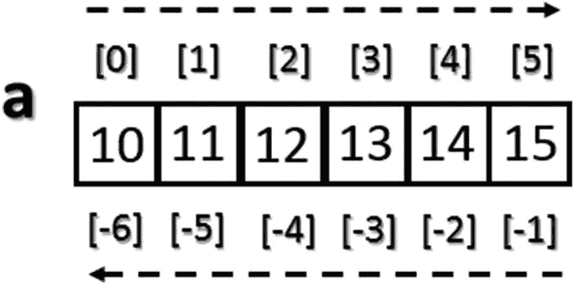
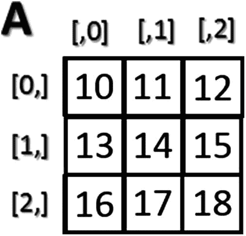
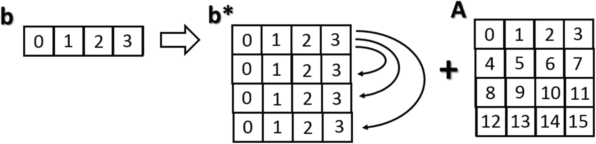

# 索引

数组索引始终使用方括号（`[ ]`）来索引数组的元素，以便可以单独引用这些元素用于各种用途，例如提取值、选择项目，甚至分配新值。

当你创建一个新数组时，也会自动创建一个合适的缩放索引（见图 3-4）。



**图 3-4** - 索引一维 `ndarray`

为了访问数组的单个元素，你可以引用它的索引。

```
>>> a = np.arange(10, 16)
>>> a
array([10, 11, 12, 13, 14, 15])
>>> a[4]
```

NumPy 数组也接受负索引。这些索引具有从 0 到 -1、-2 等的相同递增序列，但实际上，它们会使末尾元素逐渐移向初始元素，即负索引值更小的那个元素。

```
>>> a[–1]
>>> a[–6]
```

要一次选择多个项目，你可以在方括号中传递一个索引数组。

```
>>> a[[1, 3, 4]]
array([11, 13, 14])
```

现在来看二维情况，即矩阵，它们被表示为由行和列组成的矩形数组，由两个轴定义，其中轴 0 由行表示，轴 1 由列表示。因此，这种情况下的索引由一对值表示：第一个值是行的索引，第二个值是列的索引。因此，如果你想访问矩阵中的值或选择元素，你仍然使用方括号，但这次有两个值 `[row index, column index]`（见图 3-5）。



**图 3-5** - 索引二维数组

```
>>> A = np.arange(10, 19).reshape((3, 3))
>>> A
array([[10, 11, 12],
[13, 14, 15],
[16, 17, 18]])
```

如果你想取出第二行第三列的元素，你必须插入这对 `[1, 2]`。

```
>>> A[1, 2]
```

## 切片

*切片*允许你提取数组的一部分以生成新的数组。当你使用 Python 列表对数组进行切片时，生成的数组是副本，但在 NumPy 中，这些数组是同一底层缓冲区的视图。

根据你想要提取（或查看）的数组部分，你必须使用切片语法；也就是说，你在方括号内使用由冒号（`:`）分隔的数字序列。

如果你想提取数组的一部分，例如从第二个到第六个元素，你必须插入起始元素的索引（即 1）和结束元素的索引（即 5），用冒号（`:`）分隔。

```
>>> a = np.arange(10, 16)
>>> a
array([10, 11, 12, 13, 14, 15])
>>> a[1:5]
array([11, 12, 13, 14])
```

现在，如果你想从之前的部分中提取一个项目，并跳过特定数量的后续项目，然后提取下一个并再次跳过，你可以使用第三个数字来定义元素序列中的间隔。例如，值为 2 时，数组将交替获取元素。

```
>>> a[1:5:2]
array([11, 13])
```

为了更好地理解切片语法，你还应该查看不使用显式数值的情况。如果你省略第一个数字，NumPy 会将其隐式解释为 0（即数组的起始元素）。如果你省略第二个数字，它将被解释为数组的最大索引；如果你省略最后一个数字，它将被解释为 1。所有元素都将被考虑，没有间隔。

```
>>> a[::2]
array([10, 12, 14])
>>> a[:5:2]
array([10, 12, 14])
>>> a[:5:]
array([10, 11, 12, 13, 14])
```

对于二维数组，切片语法仍然适用，但需要分别为行和列定义。例如，如果你想只提取第一行：

```
>>> A = np.arange(10, 19).reshape((3, 3))
>>> A
array([[10, 11, 12],
[13, 14, 15],
[16, 17, 18]])
>>> A[0,:]
array([10, 11, 12])
```

正如你在第二个索引中看到的，如果只留下冒号而不定义数字，你将选择所有列。相反，如果你想提取第一列的所有值，你必须写成相反的形式。

```
>>> A[:,0]
array([10, 13, 16])
```

此外，如果你想提取一个较小的矩阵，你需要使用定义它们的索引显式地定义所有区间。

```
>>> A[0:2, 0:2]
array([[10, 11],
[13, 14]])
```

如果要提取的行或列的索引不连续，你可以指定一个索引数组。

```
>>> A[[0,2], 0:2]
array([[10, 11],
[16, 17]])
```

## 迭代数组

在 Python 中，迭代数组中的元素非常简单；只需要使用 `for` 结构即可。

```
>>> for i in a:
...      print(i)
...
```

当然，即使在这里，转向二维情况时，你也可以考虑使用两层嵌套的 `for` 循环结构。第一个循环将扫描数组的行，第二个循环将扫描列。实际上，如果你将 `for` 循环应用于矩阵，它将始终按照第一个轴进行扫描。

```
>>> for row in A:
...      print(row)
...
[10 11 12]
[13 14 15]
[16 17 18]
```

如果你想逐元素进行迭代，可以使用以下结构，在 `A.flat` 上应用 `for` 循环。

```
>>> for item in A.flat:
...       print(item)
...
```

然而，尽管如此，NumPy 还是提供了一种比 `for` 循环更优雅的替代方案。通常，你需要通过迭代来对行、列或单个元素应用一个函数。如果你想要启动一个聚合函数，该函数为每一列或每一行返回一个计算值，那么有一种最佳方法可以交由 NumPy 来管理迭代：那就是 `apply_along_axis()` 函数。

此函数接受三个参数：`聚合函数`、应用迭代的轴，以及数组。如果 `axis` 选项等于 0，则迭代逐列求值；如果 `axis` 等于 1，则迭代逐行求值。例如，你可以先按列计算平均值，再按行计算平均值。

```
>>> np.apply_along_axis(np.mean, axis=0, arr=A)
array([ 13.,  14.,  15.])
>>> np.apply_along_axis(np.mean, axis=1, arr=A)
array([ 11.,  14.,  17.])
```

前面的例子使用了 NumPy 库中已定义的函数，但这并不妨碍你定义自己的函数。你同样也使用了聚合函数。然而，这也不禁止你使用 ufunc。在这种情况下，按列迭代和按行迭代会产生相同的结果。事实上，使用 ufunc 会进行逐元素的一次迭代。

```
>>> def foo(x):
...     return x/2
...
>>> np.apply_along_axis(foo, axis=1, arr=A)
array([[5.,  5.5, 6. ],
[6.5, 7.,  7.5],
[8.,  8.5, 9. ]])
>>> np.apply_along_axis(foo, axis=0, arr=A)
array([[5.,  5.5, 6.],
[6.5, 7.,  7.5],
[8.,  8.5, 9.]])
```

如你所见，无论迭代是按行还是按列执行，ufunc 函数都会将输入数组的每个元素的值减半。

## 条件与布尔数组

到目前为止，你已经使用索引和切片来选择或提取数组的一个子集。这些方法使用的是数值索引。另一种选择性提取数组中元素的方法是使用条件和布尔运算符。

假设你想在一个包含 0 到 1 之间随机数的 4x4 矩阵中，选择所有小于 0.5 的值。

```
>>> A = np.random.random((4, 4))
>>> A
array([[ 0.03536295,  0.0035115 ,  0.54742404,  0.68960999],
[ 0.21264709,  0.17121982,  0.81090212,  0.43408927],
[ 0.77116263,  0.04523647,  0.84632378,  0.54450749],
[ 0.86964585,  0.6470581 ,  0.42582897,  0.22286282]])
```

一旦定义了随机数矩阵，如果你应用一个运算符条件，你将得到一个布尔数组作为返回值，其中满足条件的位置为真值。在这个例子中，就是所有值小于 0.5 的位置。

# 布尔索引与形状操作

实际上，布尔数组被隐式地用于选择数组的部分内容。事实上，通过将先前的条件直接插入方括号内，你可以提取出所有小于 0.5 的元素，从而获得一个新数组。

```
>>> A[A < 0.5]
array([ 0.03536295,  0.0035115 ,  0.21264709,  0.17121982,  0.43408927,
       0.04523647,  0.42582897,  0.22286282])
```

## 形状操作

你已经看到，在创建二维数组时，可以借助 `reshape()` 函数将一维数组转换为矩阵。

```
>>> a = np.random.random(12)
>>> a
array([ 0.77841574,  0.39654203,  0.38188665,  0.26704305,  0.27519705,
       0.78115866,  0.96019214,  0.59328414,  0.52008642,  0.10862692,
       0.41894881,  0.73581471])
>>> A = a.reshape(3, 4)
>>> A
array([[ 0.77841574,  0.39654203,  0.38188665,  0.26704305],
       [ 0.27519705,  0.78115866,  0.96019214,  0.59328414],
       [ 0.52008642,  0.10862692,  0.41894881,  0.73581471]])
```

`reshape()` 函数返回一个新数组，因此可以创建新对象。但是，如果你想通过修改形状来改变对象本身，则必须直接将包含新维度的元组赋值给它的 `shape` 属性。

```
>>> a.shape = (3, 4)
>>> a
array([[ 0.77841574,  0.39654203,  0.38188665,  0.26704305],
       [ 0.27519705,  0.78115866,  0.96019214,  0.59328414],
       [ 0.52008642,  0.10862692,  0.41894881,  0.73581471]])
```

如你所见，这次是起始数组改变了形状，并且没有返回任何对象。逆操作也是可行的；也就是说，你可以将二维数组转换为一维数组。这可以通过使用 `ravel()` 函数来实现。

```
>>> a = a.ravel()
>>> a
array([ 0.77841574,  0.39654203,  0.38188665,  0.26704305,  0.27519705,
       0.78115866,  0.96019214,  0.59328414,  0.52008642,  0.10862692,
       0.41894881,  0.73581471])
```

或者，你也可以直接作用于数组本身的 `shape` 属性。

```
>>> a.shape = (A.size)
>>> a
array([ 0.77841574,  0.39654203,  0.38188665,  0.26704305,  0.27519705,
       0.78115866,  0.96019214,  0.59328414,  0.52008642,  0.10862692,
       0.41894881,  0.73581471])
```

另一个重要的操作是转置矩阵，即将行与列互换。NumPy 通过 `transpose()` 函数提供了此功能。

```
>>> A.transpose()
array([[ 0.77841574,  0.27519705,  0.52008642],
       [ 0.39654203,  0.78115866,  0.10862692],
       [ 0.38188665,  0.96019214,  0.41894881],
       [ 0.26704305,  0.59328414,  0.73581471]])
```

## 数组操作

通常你需要使用已经创建的数组来创建新数组。在本节中，你将看到如何通过连接或拆分已定义的数组来创建新数组。

### 连接数组

你可以合并多个数组以形成一个包含所有数组的新数组。NumPy 使用了堆叠的概念，并在这方面提供了许多函数。例如，你可以使用 `vstack()` 函数进行垂直堆叠，该函数将第二个数组作为新行添加到第一个数组中。在这种情况下，数组在垂直方向上增长。相比之下，`hstack()` 函数执行水平堆叠；也就是说，第二个数组被添加到第一个数组的列上。

```
>>> A = np.ones((3, 3))
>>> B = np.zeros((3, 3))
>>> np.vstack((A, B))
array([[ 1.,  1.,  1.],
       [ 1.,  1.,  1.],
       [ 1.,  1.,  1.],
       [ 0.,  0.,  0.],
       [ 0.,  0.,  0.],
       [ 0.,  0.,  0.]])
>>> np.hstack((A,B))
array([[ 1.,  1.,  1.,  0.,  0.,  0.],
       [ 1.,  1.,  1.,  0.,  0.,  0.],
       [ 1.,  1.,  1.,  0.,  0.,  0.]])
```

另外两个执行多个数组堆叠的函数是 `column_stack()` 和 `row_stack()`。这些函数的操作方式与前两个函数不同。通常这些函数用于一维数组，它们被堆叠为列或行，以形成一个新的二维数组。

```
>>> a = np.array([0, 1, 2])
>>> b = np.array([3, 4, 5])
>>> c = np.array([6, 7, 8])
>>> np.column_stack((a, b, c))
array([[0, 3, 6],
       [1, 4, 7],
       [2, 5, 8]])
>>> np.row_stack((a, b, c))
array([[0, 1, 2],
       [3, 4, 5],
       [6, 7, 8]])
```

#### 分割数组

在上一节中，你了解了如何通过堆叠来组装多个数组。现在你将看到如何将一个数组分割成几个部分。在 NumPy 中，你可以使用分割来实现这一点。同样，这里也有一组函数，可以通过 `hsplit()` 函数进行水平分割，以及通过 `vsplit()` 函数进行垂直分割。

```
>>> A = np.arange(16).reshape((4, 4))
>>> A
array([[ 0,  1,  2,  3],
       [ 4,  5,  6,  7],
       [ 8,  9, 10, 11],
       [12, 13, 14, 15]])
```

因此，如果你想水平分割数组，即将数组的宽度分成两部分，那么 4x4 的矩阵 `A` 将被分割成两个 2x4 的矩阵。

```
>>> [B,C] = np.hsplit(A, 2)
>>> B
array([[ 0,  1],
       [ 4,  5],
       [ 8,  9],
       [12, 13]])
>>> C
array([[ 2,  3],
       [ 6,  7],
       [10, 11],
       [14, 15]])
```

相反，如果你想垂直分割数组，即将数组的高度分成两部分，那么 4x4 的矩阵 `A` 将被分割成两个 4x2 的矩阵。

```
>>> [B,C] = np.vsplit(A, 2)
>>> B
array([[0, 1, 2, 3],
       [4, 5, 6, 7]])
>>> C
array([[ 8,  9, 10, 11],
       [12, 13, 14, 15]])
```

一个更复杂的命令是 `split()` 函数，它允许你将数组分割成非对称的部分。传递数组作为参数，你还必须指定要分割部分的索引。如果你使用了 `axis = 1` 选项，那么这些索引将是列索引；如果选项是 `axis = 0`，那么它们将是行索引。

例如，如果你想将矩阵分成三部分，第一部分将包含第一列，第二部分将包含第二和第三列，第三部分将包含最后一列，你必须按以下方式指定三个索引。

```
>>> [A1,A2,A3] = np.split(A,[1,3],axis=1)
>>> A1
array([[ 0],
       [ 4],
       [ 8],
       [12]])
>>> A2
array([[ 1,  2],
       [ 5,  6],
       [ 9, 10],
       [13, 14]])
>>> A3
array([[ 3],
       [ 7],
       [11],
       [15]])
```

你可以按行执行相同的操作。

```
>>> [A1,A2,A3] = np.split(A,[1,3],axis=0)
>>> A1
array([[0, 1, 2, 3]])
>>> A2
array([[ 4,  5,  6,  7],
[ 8,  9, 10, 11]])
>>> A3
array([[12, 13, 14, 15]])
```

此特性也包含了 `vsplit()` 和 `hsplit()` 函数的功能。

## 基本概念

本节描述了 NumPy 库的基本概念。**副本**（copy）和**视图**（view）之间的区别在于它们何时返回值。**广播**（broadcasting）机制也在本节中进行了介绍，它隐式地出现在许多 NumPy 函数中。

### 对象的副本或视图

你可能已经注意到，在使用 NumPy 时，特别是在操作数组时，你可以返回数组的副本或视图。没有任何 NumPy 赋值操作会生成数组或其包含的任何元素的副本。

```
>>> a = np.array([1, 2, 3, 4])
>>> b = a
>>> b
array([1, 2, 3, 4])
>>> a[2] = 0
>>> b
array([1, 2, 0, 4])
```

如果你将一个数组 `a` 赋值给另一个数组 `b`，你并没有复制它；数组 `b` 只是调用数组 `a` 的另一种方式。事实上，通过改变 `a` 的第三个元素的值，你也会改变 `b` 的第三个值。当你对数组进行切片时，返回的对象是原始数组的一个*视图*。

```
>>> c = a[0:2]
>>> c
array([1, 2])
>>> a[0] = 0
>>> c
array([0, 2])
```

如你所见，即使在切片时，你实际上指向的是同一个对象。如果你想生成一个完整且独立的数组，请使用 `copy()` 函数。

```
>>> a = np.array([1, 2, 3, 4])
>>> c = a.copy()
>>> c
array([1, 2, 3, 4])
>>> a[0] = 0
>>> c
array([1, 2, 3, 4])
```

在这种情况下，即使你更改了数组 `a` 中的元素，数组 `c` 也保持不变。

### 向量化

**向量化**（*Vectorization*）和**广播**（*broadcasting*）是 NumPy 内部实现的基础。向量化是指在代码开发过程中没有显式循环。这些循环实际上无法省略，但在内部实现，然后被代码中的其他结构所替代。应用向量化可以使代码更简洁、更易读，并且可以说其外观看起来更“Pythonic”。事实上，由于向量化，许多操作呈现出更加数学化的表达方式。例如，NumPy 允许你按如下所示表达两个数组的乘法：

```
a * b
```

甚至两个矩阵的乘法：

```
A * B
```

在其他语言中，此类操作将需要用许多嵌套循环和 `for` 结构来表达。例如，第一个操作将按以下方式表达：

```
for (i = 0; i < rows; i++){
c[i] = a[i]*b[i];
}
```

而矩阵的乘积将表达如下：

```
for( i=0; i < rows; i++){
for(j=0; j < columns; j++){
c[i][j] = a[i][j]*b[i][j];
}
}
```

你可以看到，使用 NumPy 使代码更具可读性且更具数学性。

### 广播

*广播*允许一个运算符或函数作用于两个或多个数组，即使这些数组的形状不同。也就是说，并非所有维度都能进行广播；它们必须满足特定规则。

你已经了解到，使用 NumPy 可以通过形状对多维数组进行分类，形状是一个表示每个维度元素长度的元组。

当两个数组的所有维度都兼容时，即可进行广播，即每个维度的长度必须相等，或者其中一个维度的长度必须为 1。如果这两个条件都不满足，则会引发异常，提示两个数组不兼容。

```
>>> A = np.arange(16).reshape(4, 4)
>>> b = np.arange(4)
>>> A
array([[ 0,  1,  2,  3],
[ 4,  5,  6,  7],
[ 8,  9, 10, 11],
[12, 13, 14, 15]])
>>> b
array([0, 1, 2, 3])
```

在本例中，你得到了两个数组：

```
4 x 4
```

广播有两条规则。首先，你必须为每个缺失的维度补上 1。如果兼容性规则现在得到满足，你就可以应用广播并转向第二条规则。例如：

```
4 x 4
4 x 1
```

兼容性规则已满足。然后你可以转向广播的第二条规则。此规则解释了如何扩展最小数组的尺寸，使其与最大数组的尺寸相同，以便可以应用逐元素的函数或运算符。

第二条规则假设缺失的元素（尺寸为 1 的长度）由扩展尺寸中包含的值的副本填充（参见图 3-6）。



一个图示展示了一个包含值 0、1、2 和 3 的矩形块，箭头指向一个标记为 b* 的 4 乘 4 表格，该表格的每一列都有相同的值 0、1、2 和 3。它描绘了广播规则，结果是一个值为 0 到 15 的 4 乘 4 表格。

**图 3-6** 应用广播的第二条规则

现在两个数组具有相同的维度，它们内部的值可以相加。

```
>>> A + b
array([[ 0,  2,  4,  6],
[ 4,  6,  8, 10],
[ 8, 10, 12, 14],
[12, 14, 16, 18]])
```

这是一个简单的情况，其中一个数组比另一个数组小。可能存在更复杂的情况，两个数组形状不同，并且每个数组仅在特定维度上比另一个数组小。

```
>>> m = np.arange(6).reshape(3, 1, 2)
>>> n = np.arange(6).reshape(3, 2, 1)
>>> m
array([[[0, 1]],
[[2, 3]],
[[4, 5]]])
>>> n
array([[[0],
[1]],
[[2],
[3]],
[[4],
[5]]])
```

即使在这种情况下，通过分析两个数组的形状，你可以发现它们是兼容的，因此可以应用广播规则。

```
3 x 1 x 2
3 x 2 x 1
```

在此例中，两个数组都经历了维度扩展（广播）。

```
m* = [[[0,1],             n* = [[[0,0],
[0,1]],                   [1,1]],
[[2,3],                   [[2,2],
[2,3]],                   [3,3]],
[[4,5],                   [[4,4],
[4,5]]]                   [5,5]]]
```

然后你可以，例如，在逐元素的基础上对两个数组应用加法运算符。

```
>>> m + n
array([[[ 0,  1],
[ 1,  2]],
[[ 4,  5],
[ 5,  6]],
[[ 8,  9],
[ 9, 10]]])
```

## 结构化数组

到目前为止，在前几节的各种示例中，你看到了一维和二维数组。NumPy 允许你创建不仅在尺寸上，而且在结构上都更为复杂的数组，称为*结构化数组*。这种类型的数组包含*结构体*或记录，而不是单个元素。

例如，你可以创建一个以结构体为元素的简单数组。借助 `dtype` 选项，你可以指定一个逗号分隔的标识符列表，以指示构成结构体的元素，以及其数据类型和顺序。

```
字节                      b1
整数                      i1, i2, i4, i8
无符号整数                u1, u2, u4, u8
浮点数                    f2, f4, f8
复数                      c8, c16
固定长度字符串             a
```

例如，如果你想指定一个由整数、长度为 6 的字符串和布尔值组成的结构体，你可以在 `dtype` 选项中使用相应的标识符按正确顺序指定这三种数据类型。

**注意：** `dtype` 和其他格式属性的结果可能因不同的操作系统和 Python 发行版而异。

```
>>> structured = np.array([(1, 'First', 0.5, 1+2j),(2, 'Second', 1.3, 2-2j), (3, 'Third', 0.8, 1+3j)],dtype=('i2, a6, f4, c8'))
>>> structured
array([(1, b'First', 0.5, 1+2.j),
(2, b'Second', 1.3, 2.-2.j),
(3, b'Third', 0.8, 1.+3.j)],
dtype=[('f0', '<i2'), ('f1', 'S6'), ('f2', '<f4'), ('f3', '<c8')])
```

你也可以通过指定 `int8`、`uint8`、`float16`、`complex64` 等来显式地使用数据类型。
```

# NumPy 数组操作与数据读写

## 结构化数组索引与字段名

```python
>>> structured = np.array([(1, 'First', 0.5, 1+2j),(2, 'Second', 1.3,2-2j), (3, 'Third', 0.8, 1+3j)],dtype=('int16, a6, float32, complex64'))
>>> structured
array([(1, b'First', 0.5, 1.+2.j),
(2, b'Second', 1.3, 2.-2.j),
(3, b'Third', 0.8, 1.+3.j)],
dtype=[('f0', '<i2'), ('f1', 'S6'), ('f2', '<f4'), ('f3', '<c8')])
```
两种情况结果相同。在数组内部，你会看到一个 `dtype` 序列，其中包含结构体中每个元素的名称及其对应的数据类型。

写入适当的引用索引，你将获得相应的行，其中包含结构体。

```python
>>> structured[1]
(2, b'Second', 1.3, 2.-2.j)
```
自动分配给结构体中每个元素的名称可以被视为数组的列名。使用它们作为结构化索引，你可以引用所有相同类型或相同列的元素。

```python
>>> structured['f1']
array([b'First', b'Second', b'Third'], dtype='|S6')
```
正如你刚才所见，这些名称是自动分配的，带有一个 `f`（代表字段）和一个指示序列位置的前进整数。实际上，使用更有意义的名称来指定这些名称会更有用。这是可行的，你可以在声明数组时进行：

```python
>>> structured = np.array([(1,'First',0.5,1+2j),(2,'Second',1.3,2-2j),(3,'Third',0.8,1+3j)],dtype=[('id','i2'),('position','a6'),('value','f4'),('complex','c8')])
>>> structured
array([(1, b'First', 0.5, 1.+2.j),
(2, b'Second', 1.3, 2.-2.j),
(3, b'Third', 0.8, 1.+3.j)],
dtype=[('id', '<i2'), ('position', 'S6'), ('value', '<f4'), ('complex', '<c8')])
```
或者你也可以在稍后的时间进行，通过重新定义分配给结构化数组的 `dtype` 属性的名称元组。

```python
>>> structured.dtype.names = ('id','order','value','complex')
```
现在你可以为各个字段类型使用有意义的名称：

```python
>>> structured['order']
array([b'First', b'Second', b'Third'],  dtype='|S6')
```

# 在文件中读写数组数据

NumPy 中一个尚未讨论的非常重要的方面是读取文件中所包含数据的过程。这个过程非常有用，特别是当你必须处理以数组形式收集的大量数据时。这是一种非常常见的数据分析操作，因为要分析的数据集规模几乎总是非常庞大，因此手动管理它是不明智的，甚至是不可能的。

NumPy 提供了一组函数，使数据分析人员能够将计算结果保存到文本文件或二进制文件中。类似地，NumPy 允许你读取文件中写入的数据并将其转换为数组。

## 在二进制文件中加载和保存数据

NumPy 提供了一对函数，名为 `save()` 和 `load()`，使您能够保存并在之后检索以二进制格式存储的数据。

当您有一个需要保存的数组时，例如一个包含数据分析处理结果的数组，只需调用 `save()` 函数，并将文件名和该数组作为参数指定。该文件将自动获得 `.npy` 扩展名。

```python
>>> data = np.random.random((3,3))
>>> data
array([[0.47941017, 0.43759768, 0.76636206],
[0.51928993, 0.06358527, 0.72109914],
[0.64501488, 0.94113659, 0.42052306]])
>>> np.save('saved_data',data)
```
当您需要恢复存储在 `saved_data.npy` 文件中的数据时，您可以使用 `load()` 函数，将文件名作为参数指定，这次需要加上 `.npy` 扩展名。

```python
>>> loaded_data = np.load('saved_data.npy')
>>> loaded_data
array([[0.47941017, 0.43759768, 0.76636206],
[0.51928993, 0.06358527, 0.72109914],
[0.64501488, 0.94113659, 0.42052306]])
```

## 读取包含表格数据的文件

很多时候，您想要读取或保存的数据是文本格式（例如 TXT 或 CSV）。您可能会以这种格式（而非二进制格式）保存数据，因为这样，无论您使用的是 NumPy 还是其他任何应用程序，都可以独立访问这些文件。以 CSV（逗号分隔值）格式的数据集为例，该格式的数据以表格形式收集，值之间用逗号分隔（参见清单 3-1）。

```csv
id,value1,value2,value3
1,123,1.4,23
2,110,0.5,18
3,164,2.1,19
Listing 3-1
ch3_data.csv
```
为了能够读取文本文件中的数据并将值插入数组，NumPy 提供了一个名为 `genfromtxt()` 的函数。通常，此函数接受三个参数：包含数据的文件名、分隔值的字符（在此例中为逗号）以及数据是否包含列标题。

```python
>>> data = np.genfromtxt('ch3_data.csv', delimiter=',', names=True)
>>> data
array([(1.0, 123.0, 1.4, 23.0), (2.0, 110.0, 0.5, 18.0),
(3.0, 164.0, 2.1, 19.0)],
dtype=[('id', '<f8'), ('value1', '<f8'), ('value2', '<f8'), ('value3', '<f8')])
```
从结果可以看出，您会得到一个结构化数组，其中列标题已成为字段名。

此函数隐式地执行两个循环：第一个循环每次读取一行，第二个循环分离并转换其中包含的值，插入专门创建的连续元素。此功能的一个积极方面是，如果某些数据缺失，该函数也能处理。

以之前移除了一些条目的文件为例（参见清单 3-2）。将其保存为 `data2.csv`。

```csv
id,value1,value2,value3
1,123,1.4,23
2,110,,18
3,,2.1,19
Listing 3-2
ch3_data2.csv
```
运行这些命令，您可以看到 `genfromtxt()` 函数如何用 `nan` 值替换文件中的空白。

```python
>>> data2 = np.genfromtxt('ch3_data2.csv', delimiter=',', names=True)
>>> data2
array([(1.0, 123.0, 1.4, 23.0), (2.0, 110.0, nan, 18.0),
(3.0, nan, 2.1, 19.0)],
dtype=[('id', '<f8'), ('value1', '<f8'), ('value2', '<f8'), ('value3', '<f8')])
```
在数组底部，您可以找到文件中包含的列标题。这些标题可以被视为标签，作为索引来按列提取值。

```python
>>> data2['id']
array([ 1.,  2.,  3.])
```
相反，通过传统方式使用数字索引，您可以提取与行对应的数据。

```python
>>> data2[0]
(1.0, 123.0, 1.4, 23.0)
```

# 结论

在本章中，您学习了 NumPy 库的所有主要方面，并熟悉了一系列特性，这些特性构成了您在本书后续内容中将遇到的许多其他内容的基础。事实上，这些概念中有许多来自其他更专业的科学计算库，但这些库都是基于本库进行结构化和开发的。

您看到了如何借助 `ndarray` 来扩展 Python 的功能，使其成为适用于科学计算和数据分析的语言。

因此，对于任何想要涉足数据分析领域的人来说，掌握 NumPy 知识至关重要。

下一章将介绍一个名为 pandas 的新库，它构建在 NumPy 之上，因此包含了本章阐述的所有基本概念。然而，pandas 扩展了这些概念，使其更适合数据分析。