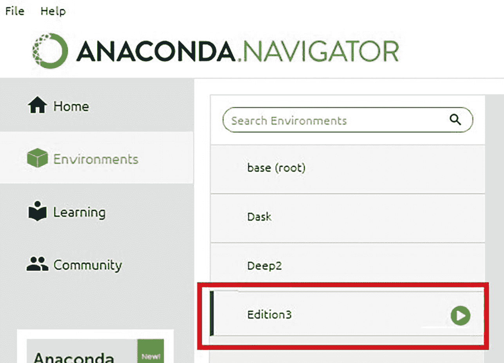
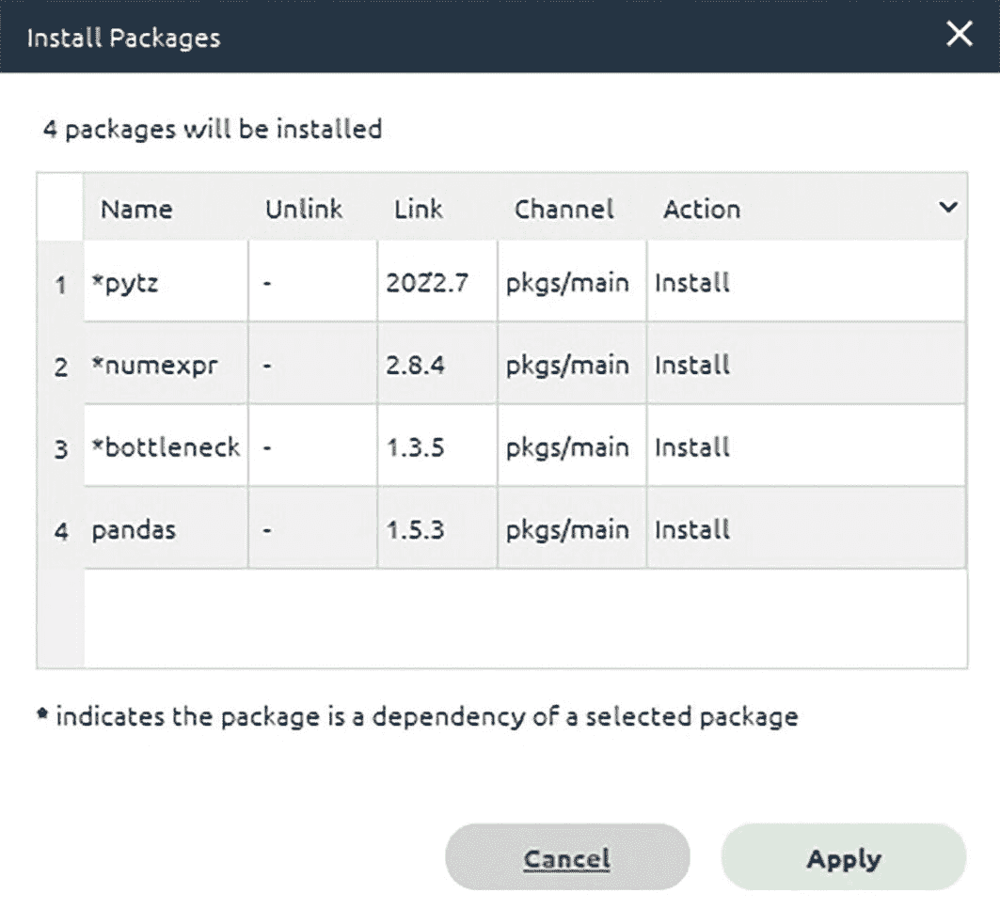
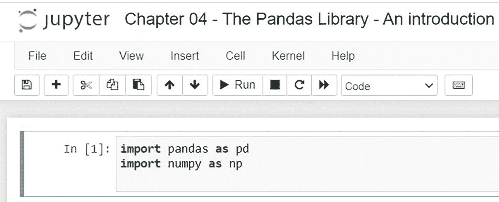
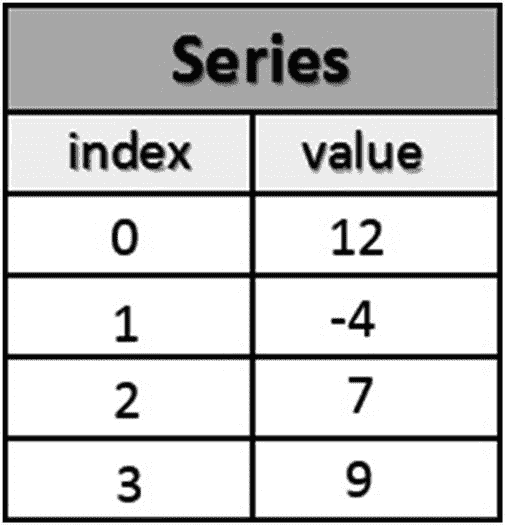
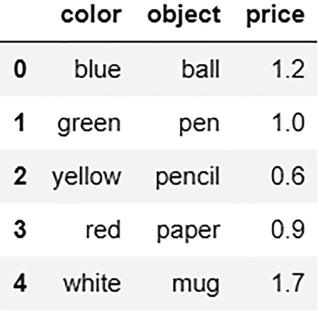

# pandas 库——简介

本章将进入本书的核心：pandas 库。这个出色的 Python 库对于任何想要使用 Python 作为编程语言进行数据分析的人来说，都是一个完美的工具。

首先，您将了解该库的基本方面以及如何在系统上安装它，然后您将熟悉称为 Series 和 DataFrame 的两种数据结构。在本章中，您将使用 pandas 库提供的一组基本函数来执行最常见的数据处理任务。熟悉这些操作是本书其余部分的关键目标。这就是为什么重复本章直到您对其内容感到满意非常重要。

此外，通过一系列示例，您将学习 pandas 库中引入的一些特别新的概念：索引数据结构。在本章及后续章节中，您将学习如何充分利用此功能进行数据处理。

最后，您将看到如何通过称为分层索引的过程，将索引的概念同时扩展到多个层级。

## pandas：Python 数据分析库

pandas 是一个用于高度专业化数据分析的开源 Python 库。它目前是所有使用 Python 语言的专业人士为分析和决策的统计目的而需要学习的参考点。

该库主要由 Wes McKinney 从 2008 年开始设计并开发。2012 年，他的一位同事 Sien Chang 加入了开发。他们共同建立了 Python 社区中使用最广泛的库之一。

pandas 源于对特定数据分析库的需求，该库能以尽可能简单的方式提供所有用于数据处理、数据提取和数据操作的工具。

这个 Python 包是基于 NumPy 库设计的。这一选择对于 pandas 的成功和快速传播至关重要。事实上，这一选择不仅使该库与大多数其他模块兼容，而且还利用了 NumPy 模块的高质量。

另一个基本选择是为数据分析设计专门的*ad hoc*数据结构。实际上，与其使用 Python 内置或其他库提供的现有数据结构，不如开发两种新的数据结构。

这些数据结构旨在处理关系数据或有标签数据，从而使您能够管理与 SQL 关系数据库和 Excel 电子表格设计的功能相似的数据。

事实上，在整本书中，您将看到一系列用于数据分析的基本操作，这些操作通常在数据库表和电子表格上使用。pandas 实际上提供了一组扩展的函数和方法，使您能够高效地执行这些操作。

因此，pandas 的主要目的是为所有接近数据分析世界的人提供所有的构建模块。


## 安装 pandas

安装 pandas 库最简单且通用的方法是使用预打包的解决方案，即通过 Anaconda 发行版进行安装。事实上，多年来，该发行版已围绕数据分析环境不断发展，成为了该领域从业者的参考平台。除了 pandas，它还可提供许多其他专门用于数据分析、机器学习和数据可视化的库。它还提供了实用的开发与分析工具，以及 Jupyter Notebook。

### 通过 Anaconda 安装

对于选择使用 Anaconda 发行版的用户来说，管理安装过程非常简单。最简便的方式是通过图形界面：启动 Anaconda Navigator，然后从 Environments 面板中选择要安装库的虚拟环境，如图 4-1 所示。这将激活用于安装 pandas 的 Python 虚拟环境，以便运行本书中的示例。



Anaconda Navigator 截图：通过在 Anaconda Navigator 中选择并激活版本 3 的虚拟环境来激活 Python 虚拟环境。

图 4-1：使用 Anaconda Navigator 选择并激活 Python 虚拟环境

激活所需的虚拟环境后，转到 Anaconda Navigator 的右侧，从顶部的下拉菜单中选择 All。这将显示所有可用包（已安装和未安装）的列表，以及它们对应所选 Python 版本的版本号。搜索 pandas（见图 4-2 中的步骤 1）。几乎立即就会显示所有与 pandas 相关的包。选择对应 pandas 库的包（如图 4-2 中的步骤 2 所示）。此时，通过点击右下角的 Apply 按钮开始安装该包（如图 4-2 中的步骤 3 所示）。


Anaconda Navigator 截图：通过搜索、选择并启动 pandas 数据量分析库的安装过程。

图 4-2：搜索并选择 pandas 包，然后使用 Anaconda Navigator 开始安装

几秒钟后，将出现一个窗口，显示要安装的包及其版本列表（包括 pandas 及其依赖项），如图 4-3 所示。点击 Apply 按钮确认安装。底部的滚动条将显示安装进度。



一个表格，从左到右分别有 5 列：名称、卸载、链接、通道和操作，以及 4 行显示要安装的包。

图 4-3：在 Anaconda Navigator 中安装包时显示的待安装包及其版本列表

如果你更喜欢命令行操作，即使在 Anaconda 发行版中，也有一个控制台可用于检查和安装包。仍然在 Anaconda Navigator 的 Home 面板中，选择 CMD.exe Prompt 打开一个命令控制台（如图 4-4 所示）。将打开另一个窗口，其中包含与你激活的虚拟环境相关的控制台，你可以在此手动输入所有命令。


Anaconda Navigator 截图：通过在 Anaconda Navigator 中启动所选虚拟环境的 CMD.exe 命令控制台来启动 Python 虚拟环境控制台。

图 4-4：从 Anaconda Navigator 启动 Python 虚拟环境命令控制台

就我而言，因为我当前使用的是 Windows 系统，并且正工作在一个名为 `Edition3` 的 Python 虚拟环境中，所以看到以下提示符。

```
(Edition3) C:\Users\nelli>
```

首先，你需要检查 pandas 模块是否已安装，如果已安装，版本是多少。为此，在终端中输入以下命令：

```
conda list pandas
```

因为我的电脑（Windows）上已安装了该模块，所以得到以下结果：

```
# packages in environment at C:\Users\nelli\anaconda3\envs\Edition3:
#
# Name                    Version                   Build  Channel
pandas                     1.5.3                        py311heda8569_0
```

如果尚未安装 pandas，则需要安装它。输入以下命令来安装：

```
conda install pandas
```

Anaconda 会立即检查所有依赖项，并管理其他模块的安装，你无需过多操心。

```
## Package Plan ##
environment location: C:\Users\nelli\anaconda3\envs\Edition3
added / updated specs:
- pandas
The following NEW packages will be INSTALLED:
bottleneck         pkgs/main/win-64::bottleneck-1.3.5-py311h5bb9823_0 None
numexpr            pkgs/main/win-64::numexpr-2.8.4-py311hffd1eac_0 None
pandas             pkgs/main/win-64::pandas-1.5.3-py311heda8569_0 None
pytz               pkgs/main/win-64::pytz-2022.7-py311haa95532_0 NoneProceed ([y]/n)?
```

输入 `y` 以继续安装。

如果你想将包升级到更新版本，命令非常简单直观：

```
conda update pandas
```

系统将检查 `pandas` 的版本及其所依赖的所有模块的版本，然后提示任何可用的更新。接着，它会询问是否继续更新。

### 通过 PyPI 安装

如果你没有使用 Anaconda 平台，那么通过 PyPI 并使用 `pip` 命令是将 pandas 库安装到你的 Python 环境中的最简单方法。从控制台输入以下命令：

```
pip install pandas
```


## pandas 入门指南

正如你在安装过程中所见，使用 pandas 有多种方式。你可以选择打开一个 Jupyter 笔记本，使用 QtConsole（IPython GUI），或者更简单地，开启一个简单的 Python 控制台会话，然后逐条输入指令。没有绝对最佳的方法；所有这些方法都各有优缺点，具体取决于使用场景。最重要的一点是以交互方式操作代码，逐条输入命令。通过这种方式，你将有机会熟悉本章所讲解的各个函数和数据结构。

此外，各个示例中定义的数据和函数在整个章节中都保持有效，这意味着你无需每次都重新定义它们。我们建议你在每个示例结束时，重复执行各种命令，酌情修改它们，并观察操作过程中数据结构内部值的变化。这种方法非常适合熟悉本章涵盖的不同主题，让你有机会与所阅读的内容进行自由交互。

**注意：** 本章假定你对 Python 和 NumPy 有一定的了解。如果遇到任何困难，可以阅读本书的第 2 章和第 3 章。

首先，在 Python shell 上打开一个会话，然后导入 pandas 库。导入 pandas 模块的通用做法如下：

```
>>> import pandas as pd
>>> import numpy as np
```

因此，在本章及全书后续内容中，每当你看到 `pd` 和 `np`，它们都是指代这两个库中的对象或方法，尽管你可能会倾向于以这种方式导入 pandas 模块：

```
>>> from pandas import *
```

这样，你就不再需要用 `pd` 来引用函数、对象或方法；但通常 Python 社区不认为这是一种良好的做法。如果你在使用 Jupyter，请在笔记本的第一个单元格中导入这两个库并运行，如图 4-5 所示。



一张 Jupyter Notebook 的截图展示了导入 NumPy 和 pandas。代码片段描绘了为进行数据处理和分析而导入 NumPy 和 pandas 库。

**图 4-5** 在 Jupyter Notebook 中导入 NumPy 和 pandas 库

从现在开始，本书示例中插入的任何代码行都将对应于笔记本中的一个单元格。就像你在 Python 控制台按下 ENTER 键会立即看到输入命令的结果一样，你也要将命令写入 Notebook 的单个单元格中并执行。

## pandas 数据结构简介

pandas 的核心是两个主要的数据结构，数据分析过程中通常进行的所有操作都集中在这两个结构上：

*   Series
*   Dataframes

*Series*（序列），正如你将看到的，是一种旨在容纳一维数据序列的数据结构，而 *Dataframe*（数据框）则是一种更复杂的数据结构，旨在包含具有多个维度的情况。

尽管这些数据结构并非解决问题的万能方法，但它们为大多数应用提供了有效且稳健的工具。事实上，它们仍然非常易于理解和使用。此外，许多更复杂的数据结构情况仍然可以追溯到这两种简单的情况。

然而，它们的特性建立在一个特定功能之上——在其结构中集成了索引对象和标签。你将看到，这个功能使得这些数据结构易于操作。

### Series（序列）

*Series* 是 pandas 库中用于表示一维数据结构的对象，类似于数组，但具有一些额外的功能。其内部结构很简单（见图 4-6），由两个相互关联的数组组成。主数组保存数据（任何 NumPy 类型的数据），其中每个元素都与另一个称为*索引*的数组中的标签相关联。



一个表示序列的表格包含两列，分别标注为索引和值。索引列下 4 行的数据如下：0, 1, 2, 3。值列下 4 行的数据如下：12, 负 4, 7, 9。

**图 4-6** 序列对象的结构

#### 声明一个 Series

要创建图 4-1 中指定的序列，只需调用 `Series()` 构造函数，并传入一个包含要加入值的数组作为参数。

```
>>> s = pd.Series([12,-4,7,9])
>>> s
0    12
1    -4
2     7
3     9
dtype: int64
```

正如你从序列的输出中所见，左侧是索引中的值（一系列标签），右侧是对应的值。

如果在定义序列时没有指定任何索引，默认情况下，pandas 会分配从 0 开始递增的数值作为标签。在这种情况下，标签对应于序列对象中元素的位置（在数组中的索引）。

然而，通常更可取的做法是使用有意义的标签来创建序列，以便区分和识别每个项目，而无需考虑它们在序列中的插入顺序。

在这种情况下，在调用构造函数时，需要包含 `index` 选项，并分配一个包含标签的字符串数组。

```
>>> s = pd.Series([12,-4,7,9], index=['a','b','c','d'])
>>> s
a    12
b    -4
c     7
d     9
dtype: int64
```

如果你想单独查看组成此数据结构的两个数组，可以按如下方式调用序列的两个属性：`index` 和 `values`。

```
>>> s.values
array([12, -4,  7,  9], dtype=int64)
>>> s.index
Index(['a', 'b', 'c', 'd'], dtype='object')
```

#### 选择内部元素

你可以像选择普通 NumPy 数组一样，通过指定键来选择单个元素。

```
>>> s[2]
```

或者，你也可以指定与索引位置对应的标签。

```
>>> s['b']
```

以同样的方式选择 NumPy 数组中的多个项目，你可以指定以下内容：

```
>>> s[0:2]
a    12
b    -4
dtype: int64
```

在这种情况下，你可以使用对应的标签，但需在数组中指定标签列表。

```
>>> s[['b','c']]
b   -4
c    7
dtype: int64
```

#### 为元素赋值

现在你已经知道如何选择单个元素，那么也知道了如何为它们赋予新值。事实上，你可以通过索引或标签来选择值。

```
>>> s[1] = 0
>>> s
a    12
b     0
c     7
d     9
dtype: int64
>>> s['b'] = 1
>>> s
a    12
b     1
c     7
d     9
dtype: int64
```

#### 从 NumPy 数组和其他 Series 定义 Series

你可以从 NumPy 数组或现有的序列开始定义一个新的序列。

```
>>> arr = np.array([1,2,3,4])
>>> s3 = pd.Series(arr)
>>> s3
0    1
1    2
2    3
3    4
dtype: int64
>>> s4 = pd.Series(s)
>>> s4
a    12
b     4
c     7
d     9
dtype: int64
```

请始终牢记，NumPy 数组或原始序列中包含的值不是被复制过来的，而是通过引用传递的。也就是说，对象是动态地插入到新的序列对象中的。如果它发生了变化，例如其内部元素值发生变化，那么这些变化也会在 new 序列对象中出现。

```
>>> s3
0    1
1    2
2    3
3    4
dtype: int64
>>> arr[2] = -2
>>> s3
0    1
1    2
2   -2
3    4
dtype: int64
```

正如你在本例中所看到的，通过更改 `arr` 数组的第三个元素，代码也修改了 `s3` 序列中的对应元素。


好的，这是根据您的要求翻译后的中文文档。


#### 筛选值

得益于选择 `NumPy` 库作为 `pandas` 库的基础，并因此应用于其数据结构，许多适用于 `NumPy` 数组的操作也被扩展到了 Series 中。其中之一就是通过条件筛选数据结构中包含的值。

例如，如果你需要知道 Series 中哪些元素大于 `8`，你可以编写如下代码：

```
>>> s[s > 8]
a    12
d     9
dtype: int64
```

#### 运算与数学函数

其他操作，如运算符（`+`、`-`、`*` 和 `/`）以及适用于 `NumPy` 数组的数学函数，也可以扩展到 Series 中。

对于运算符，你可以直接编写算术表达式。

```
>>> s / 2
a    6.0
b   -2.0
c    3.5
d    4.5
dtype: float64
```

然而，对于 `NumPy` 的数学函数，你必须指定以 `np` 引用的函数，并将 Series 实例作为参数传入。

```
>>> np.log(s)
a    2.484907
b    0.000000
c    1.945910
d    2.197225
dtype: float64
```

#### 值评估

Series 中经常有重复的值。这时你可能需要获取关于这些样本的更多信息，包括是否存在任何重复值，以及某个特定值是否存在于该 Series 中。

在这方面，你可以声明一个包含许多重复值的 Series。

```
>>> serd = pd.Series([1,0,2,1,2,3], index=['white','white','blue','green','green','yellow'])
>>> serd
white     1
white     0
blue      2
green     1
green     2
yellow    3
dtype: int64
```

要了解 Series 中包含的所有值（排除重复项），你可以使用 `unique()` 函数。返回值是一个数组，包含 Series 中的唯一值，尽管顺序可能不固定。

```
>>> serd.unique()
array([1, 0, 2, 3], dtype=int64)
```

与 `unique()` 类似的一个函数是 `value_counts()`，它不仅返回唯一值，还会计算这些值在 Series 中出现的次数。

```
>>> serd.value_counts()
2    2
1    2
3    1
0    1
dtype: int64
```

最后，`isin()` 用于评估成员关系，即给定的值列表。此函数告诉你这些值是否包含在数据结构中。返回的布尔值在筛选 Series 或 DataFrame 列中的数据时非常有用。

```
>>> serd.isin([0,3])
white     False
white      True
blue      False
green     False
green     False
yellow     True
dtype: bool
>>> serd[serd.isin([0,3])]
white     0
yellow    3
dtype: int64
```

#### NaN 值

前面的例子尝试计算负数的对数，结果得到了 `NaN`。这个特定的值 `NaN`（Not a Number，非数字）在 `pandas` 数据结构中用于表示存在空字段或无法用数值定义的内容。

通常，这些 `NaN` 值是一个问题，必须通过某种方式进行管理，尤其是在数据分析期间。这些数据通常在从有问题的来源提取数据或来源缺少数据时生成。此外，正如你刚刚看到的，`NaN` 值也可能在特殊情况下生成，例如计算负值的对数，或某些计算或函数执行过程中出现异常。在后面的章节中，你将看到如何应用不同的策略来解决 `NaN` 值的问题。

尽管 `NaN` 值具有问题性质，但 `pandas` 允许你显式地定义 `NaN` 并将它们添加到数据结构（如 Series）中。在包含值的数组中，你可以在任何想要定义缺失值的地方输入 `np.NaN`。

```
>>> s2 = pd.Series([5,-3,np.NaN,14])
>>> s2
0     5.0
1    -3.0
2   NaN
3    14.0
dtype: float64
```

`isnull()` 和 `notnull()` 函数对于识别没有值的索引非常有用。

```
>>> s2.isnull()
0    False
1    False
2     True
3    False
dtype: bool
>>> s2.notnull()
0     True
1     True
2    False
3     True
dtype: bool
```

实际上，这些函数返回两个包含布尔值的 Series，根据对应项是否为 `NaN` 值来包含 `True` 和 `False` 值。`isnull()` 函数对 Series 中的 `NaN` 值返回 `True`；反过来，`notnull()` 函数在值不是 `NaN` 时返回 `True`。这些函数通常被放在过滤器内部以构成条件。

```
>>> s2[s2.notnull()]
0     5.0
1    -3.0
3    14.0
dtype: float64
>>> s2[s2.isnull()]
2   NaN
dtype: float64
```

#### Series 作为字典

另一种看待 Series 的方式是将其视为一个 `dict`（字典）对象。这种相似性在定义 Series 对象时也得到了利用。事实上，你可以从之前定义好的 `dict` 创建一个 Series。

```
>>> mydict = {'red': 2000, 'blue': 1000, 'yellow': 500,
'orange': 1000}
>>> myseries = pd.Series(mydict)
>>> myseries
red       2000
blue      1000
yellow     500
orange    1000
dtype: int64
```

从这个例子可以看出，索引数组由键填充，而数据则由相应的值填充。你也可以单独定义索引数组。在这种情况下，会检查 `dict` 的键与索引标签数组之间的对应关系。如果存在不匹配，`pandas` 会添加 `NaN` 值。

```
>>> colors = ['red','yellow','orange','blue','green']
>>> myseries = pd.Series(mydict, index=colors)
>>> myseries
red       2000.0
yellow     500.0
orange    1000.0
blue      1000.0
green      NaN
dtype: float64
```

#### Series 之间的运算

你已经看到了如何在 Series 和标量值之间执行算术运算。在两个 Series 之间执行运算也是可能的，但这时标签也会发挥作用。

事实上，这类数据结构的一大潜力在于，Series 可以通过识别它们之间对应的标签，来对齐地址不同的数据。

在下面的例子中，你将两个仅在标签上有一些共同元素的 Series 相加。

```
>>> mydict2 = {'red':400,'yellow':1000,'black':700}
>>> myseries2 = pd.Series(mydict2)
>>> myseries + myseries2
black      NaN
blue       NaN
green      NaN
orange     NaN
red       2400.0
yellow    1500.0
dtype: float64
```

你得到一个新的 Series 对象，其中只有具有相同标签的项被相加了。存在于两个 Series 之一中的所有其他标签仍然会被添加到结果中，但其值为 `NaN`。

### DataFrame

*DataFrame* 是一种表格化的数据结构，与电子表格非常相似。这种数据结构旨在将 Series 扩展到多个维度。实际上，DataFrame 由有序的列集合组成（参见图 4-7），每一列都可以包含不同类型的值（数值型、字符串、布尔型等）。

一个数据框结构包含 2 列：索引和列。列有三个子列，分别标记为颜色、对象和价格。行展示了各列对应的数据。

**图 4-7** DataFrame 结构

与 Series（其有一个包含每个元素关联标签的索引数组）不同，DataFrame 有两个索引数组。第一个与行关联的索引数组，其功能与 Series 中的索引数组非常相似。实际上，每个标签都与该行中的所有值相关联。第二个数组包含一系列标签，每个标签都与一个特定的列相关联。

DataFrame 也可以被理解为一个由 Series 组成的 `dict`，其中键是列名，值是构成 DataFrame 各列的 Series。此外，每个 Series 中的所有元素都根据一个称为*索引*的标签数组进行映射。


#### 定义数据框

创建新数据框最常见的方式是将一个`dict`对象传递给`DataFrame()`构造函数。这个`dict`对象包含你想定义的每一列的键，并为每个键对应一个包含值的数组。

```
>>> data = {'color' : ['blue','green','yellow','red','white'],
'object' : ['ball','pen','pencil','paper','mug'],
'price' : [1.2,1.0,0.6,0.9,1.7]}
>>> frame = pd.DataFrame(data)
>>> frame
color  object price
0    blue    ball   1.2
1   green     pen   1.0
2  yellow  pencil   0.6
3     red   paper   0.9
4   white     mug   1.7
```

如果你正在使用 Jupyter 并运行此命令，你将不会得到与在 Python 控制台中相同的经典输出。相反，你会得到数据框的图形化表示，如图 4-8 所示。



一个包含 color、object 和 price 三列以及从 0 到 4 共 5 行的表格。color 列下 5 行的数据如下：blue、green、yellow、red、white。object 列下 5 行的数据如下：ball、pen、pencil、paper、mug。price 列下 5 行的数据如下：1.2、1.0、0.6、0.9、1.7。

**图 4-8** 在 Jupyter Notebook 上运行后得到的数据框图形化结果

如果你想从中创建数据框的`dict`对象包含的数据多于你感兴趣的部分，你可以进行选择。在数据框的构造函数中，你可以使用`columns`选项指定一个列序列。列将按照序列的顺序创建，无论它们在`dict`对象中是如何存放的。

```
>>> frame2 = pd.DataFrame(data, columns=['object','price'])
>>> frame2
object price
0    ball   1.2
1     pen   1.0
2  pencil   0.6
3   paper   0.9
4     mug   1.7
```

即使对于数据框对象，如果没有在`index`数组中显式指定标签，pandas 也会自动分配一个从 0 开始的数字序列。相反，如果你想为数据框的索引分配标签，则必须使用`index`选项并为其分配一个包含标签的数组。

```
>>> frame2 = pd.DataFrame(data, index=['one','two','three','four','five'])
>>> frame2
color  object  price
one      blue    ball    1.2
two     green     pen    1.0
three  yellow  pencil    0.6
four      red   paper    0.9
five    white     mug    1.7
```

既然我已经介绍了这两个名为`index`和`columns`的新选项，那么很容易想象出定义数据框的另一种方法。你可以不使用`dict`对象，而是在构造函数中按以下顺序定义三个参数：一个数据矩阵、一个分配给`index`选项的包含标签的数组，以及一个分配给`columns`选项的包含列名的数组。

在许多示例中，正如你从现在开始将在本书中看到的，为了快速简便地创建一个值矩阵，你可以使用`np.arange(16).reshape((4,4))`，它会生成一个从 0 递增到 15 的 4x4 矩阵。

```
>>> frame3 = pd.DataFrame(np.arange(16).reshape((4,4)),
...                   index=['red','blue','yellow','white'],
...                   columns=['ball','pen','pencil','paper'])
>>> frame3
ball  pen  pencil  paper
red        0    1       2      3
blue       4    5       6      7
yellow     8    9      10     11
white     12   13      14     15
```

#### 选择元素

如果你想知道数据框的所有列名，可以在数据框对象实例上指定`columns`属性。

```
>>> frame.columns
Index(['colors', 'object', 'price'], dtype='object')
```

类似地，要获取索引列表，你应该指定`index`属性。

```
>>> frame.index
RangeIndex(start=0, stop=5, step=1)
```

你也可以使用`values`属性获取数据结构中包含的整个数据集。

```
>>> frame.values
array([['blue', 'ball', 1.2],
['green', 'pen', 1.0],
['yellow', 'pencil', 0.6],
['red', 'paper', 0.9],
['white', 'mug', 1.7]], dtype=object)
```

或者，如果你只对选择某一列的内容感兴趣，可以写入该列的名称。

```
>>> frame['price']
0    1.2
1    1.0
2    0.6
3    0.9
4    1.7
Name: price, dtype: float64
```

如你所见，返回值是一个 Series 对象。另一种实现方式是使用列名作为数据框实例的一个属性。

```
>>> frame.price
0    1.2
1    1.0
2    0.6
3    0.9
4    1.7
Name: price, dtype: float64
```

对于数据框中的行，可以使用`loc`属性并传入要提取的行的索引值。

```
>>> frame.loc[2]
color     yellow
object    pencil
price        0.6
Name: 2, dtype: object
```

返回的对象又是一个 Series，其中列名变成了数组索引的标签，值则成为了 Series 的数据。

要选择多行，你可以指定一个包含要插入的行序列的数组：

```
>>> frame.loc[[2,4]]
color  object  price
2  yellow  pencil    0.6
4   white     mug    1.7
```

如果你需要提取数据框的一部分，选择要提取的行，可以使用索引的引用编号。实际上，你可以将一行视为数据框的一部分，它以行的索引作为起始值（在接下来的例子中为 0），并以你想要的行之上的行作为结束值（在接下来的例子中）。

```
>>> frame[0:1]
color object  price
0  blue   ball    1.2
```

如你所见，返回值是一个包含单行的 DataFrame 对象。如果你需要多行，必须扩展选择范围。

```
>>> frame[1:3]
color  object  price
1   green     pen    1.0
2  yellow  pencil    0.6
```

最后，如果你想要获取数据框中的单个值，可以先使用列名，然后再使用行的索引或标签。

```
>>> frame['object'][3]
'paper'
```


## 赋值

一旦你理解了如何访问构成数据框（dataframe）的各种元素，你就可以遵循相同的逻辑来添加或修改其中的值。

例如，你已经看到，在数据框结构中，索引数组由 `index` 属性指定，包含列名的行由 `columns` 属性指定。那么，你也可以使用 `name` 属性为这两个子结构分配一个标签来标识它们。

```
>>> frame.index.name = 'id'
>>> frame.columns.name = 'item'
>>> frame
item   color  object  price
id
0       blue    ball    1.2
1      green     pen    1.0
2     yellow  pencil    0.6
3        red   paper    0.9
4      white     mug    1.7
```

pandas 数据结构的最佳特性之一是其高度的灵活性。实际上，你可以在任何层级进行干预以改变内部数据结构。例如，一个非常常见的操作是添加一个新列。

你可以通过简单地给数据框的实例赋值并指定一个新的列名来实现这一点。

```
>>> frame['new'] = 12
>>> frame
colors  object price  new
0    blue    ball   1.2   12
1   green     pen   1.0   12
2  yellow  pencil   0.6   12
3     red   paper   0.9   12
4   white     mug   1.7   12
```

从这个结果可以看出，新增了一个名为 `new` 的列，其值为 `12`，并复制到了每个元素中。

但是，如果你想更新某个列的内容，则必须使用一个数组。

```
>>> frame['new'] = [3.0,1.3,2.2,0.8,1.1]
>>> frame
color  object  price  new
0    blue    ball    1.2  3.0
1   green     pen    1.0  1.3
2  yellow  pencil    0.6  2.2
3     red   paper    0.9  0.8
4   white     mug    1.7  1.1
```

如果你想更新整列，可以采用类似的方法，例如使用 `np.arange()` 函数用预定的序列更新列的值。

数据框的列也可以通过将序列（series）赋值给其中一列来创建，例如通过使用 `np.arange()` 指定一个包含递增数值的序列。

```
>>> ser = pd.Series(np.arange(5))
>>> ser
0    0
1    1
2    2
3    3
4    4
dtype: int32
>>> frame['new'] = ser
>>> frame
color  object  price  new
0    blue    ball    1.2    0
1   green     pen    1.0    1
2  yellow  pencil    0.6    2
3     red   paper    0.9    3
4   white     mug    1.7    4
```

最后，要更改单个值，只需选中该项并赋予其新值。这个操作看起来非常简单直观。为了访问元素，我可以想到先插入列索引，再插入行索引，从而获取当前值。

实际上，如果我编写以下命令：

```
>>> frame['price'][2]
0.6
```

我确实得到了数据框中相应元素的值。但如果我尝试对该元素进行赋值以修改其值，则会收到一个警告消息。

```
>>> frame['price'][2] = 3.3
SettingWithCopyWarning:
A value is trying to be set on a copy of a slice from a DataFrame
```

然而，如果检查数据框内部，我发现该元素的值已经被修改了。

```
>>> frame
color  object  price  new
0    blue    ball    1.2    0
1   green     pen    1.0    1
2  yellow  pencil    3.3    2
3     red   paper    0.9    3
4   white     mug    1.7    4
```

实际上，该消息警告你，这种命名方式在处理内部切片（可能生成副本或视图）时可能导致赋值错误。在这个简单案例中不会发生，但在更复杂的情况（涉及带有索引列表和条件的复杂索引赋值）下，则可能发生。因此，编写先前命令的更正确、更清晰的方式是通过 `loc()` 函数定义数据框切片的索引以进行选择/赋值。

```
>>> frame.loc[ 2, 'price'] = 3.3
```

## 值成员资格

你已经见过应用于序列（series）以确定值集合成员资格的 `isin()` 函数。这个功能同样适用于数据框对象。

```
>>> frame.isin([1.0,'pen'])
color object  price  new
0  False  False  False  False
1  False   True   True  True
2  False  False  False  False
3  False  False  False  False
4  False  False  False  False
```

你将得到一个包含布尔值的数据框，其中 `True` 表示满足成员资格条件的值。如果你将返回的值作为条件传递，你将得到一个新的数据框，其中只包含满足条件的值。

```
>>> frame[frame.isin([1.0,'pen'])]
color object  price  new
0   NaN    NaN    NaN  NaN
1   NaN    pen    1.0  1.0
2   NaN    NaN    NaN  NaN
3   NaN    NaN    NaN  NaN
4   NaN    NaN    NaN  NaN
```

## 删除列

如果你想删除整列及其所有内容，请使用 `del` 命令。

```
>>> del frame['new']
>>> frame
colors  object price
0    blue    ball   1.2
1   green     pen   1.0
2  yellow  pencil   3.3
3     red   paper   0.9
4   white     mug   1.7
```

## 过滤

即使是数据框，你也可以通过应用某些条件来进行过滤。例如，假设你想获取所有列值低于某个阈值的元素，例如价格低于 1.2 的元素。你只需将此条件插入数据框的索引中。

```
>>> frame[frame['price'] < 1.2]
colors  object price
1   green     pen   1.0
3     red   paper   0.9
```

你将得到一个数据框，其中仅包含价格低于 1.2 的元素，并保持其原始位置。这样，你就对数据框的元素执行了过滤操作。

## 从嵌套字典创建数据框

Python 中一种非常常见的数据结构是嵌套的 `dict`，如下所示：

```
nestdict = { 'red': { 2012: 22, 2013: 33 },
'white': { 2011: 13, 2012: 22, 2013: 16},
'blue': {2011: 17, 2012: 27, 2013: 18}}
```

当这种数据结构被直接作为参数传递给 `DataFrame()` 构造器时，pandas 会将其解释为：外部键作为列名，内部键作为索引标签。

在解释嵌套结构的过程中，可能并非所有字段都能成功匹配。pandas 通过向缺失值添加 `NaN` 值来弥补这种不一致。

```
>>> nestdict = {'red':{2012: 22, 2013: 33},
...             'white':{2011: 13, 2012: 22, 2013: 16},
...             'blue': {2011: 17, 2012: 27, 2013: 18}}
>>> frame2 = pd.DataFrame(nestdict)
>>> frame2
red  white  blue
2012  22.0     22    27
2013  33.0     16    18
2011   NaN     13    17
```

## 数据框的转置

在处理表格数据结构时，你可能需要执行的操作之一是转置（即列变为行，行变为列）。pandas 允许你以非常简单的方式实现这一点。你可以通过在数据框后添加 `T` 属性来获取其转置。

```
>>> frame2.T
2012  2013  2011
red    22.0  33.0   NaN
white  22.0  16.0  13.0
blue   27.0  18.0  17.0
```


好的，作为高级文档工程师和翻译员，我将严格遵循您的注意事项和示例格式，将给定的英文文本翻译成中文。


### 索引对象

现在你了解了 Series 和 DataFrame 是什么以及它们的结构，你可能已经察觉到这些数据结构的特性。事实上，它们的大部分优秀特性都归功于集成了这些数据结构中的 `Index` 对象。

`Index` 对象负责轴上的标签以及其他元数据，比如轴的名称。你已经看到过，一个包含标签的数组是如何被转换为 `Index` 对象的，并且你需要在构造函数中指定 `index` 选项。

```
>>> ser = pd.Series([5,0,3,8,4], index=['red','blue','yellow','white','green'])
>>> ser.index
Index(['red', 'blue', 'yellow', 'white', 'green'], dtype='object')
```

与 pandas 数据结构（Series 和 DataFrame）中的所有其他元素不同，`Index` 对象是不可变的。一旦声明，就无法更改。这确保了它们在不同数据结构之间的安全共享。

每个 `Index` 对象都拥有许多方法和属性，当你需要了解它们包含的值时，这些方法和属性会很有用。

#### Index 上的方法

有一些特定的方法可以让你从数据结构中获取关于索引的信息。例如，`idmin()` 和 `idmax()` 这两个函数，分别返回具有最小值和最大值的索引。

```
>>> ser.idxmin()
'blue'
>>> ser.idxmax()
'white'
```

#### 具有重复标签的 Index

到目前为止，你看到的所有情况中，单个数据结构内的索引都具有唯一的标签。尽管许多函数要求满足此条件才能运行，但此条件对于 pandas 的数据结构并非强制性的。

以下示例定义了一个包含一些重复标签的 Series。

```
>>> serd = pd.Series(range(6), index=['white','white','blue','green','green','yellow'])
>>> serd
white     0
white     1
blue      2
green     3
green     4
yellow    5
dtype: int64
```

关于数据结构中元素的选择，如果存在多个具有相同标签的值，那么你将获得一个 Series 而不是单个元素。

```
>>> serd['white']
white    0
white    1
dtype: int64
```

同样的逻辑也适用于 DataFrame，具有重复索引时也会返回一个 DataFrame。

对于小型数据结构，识别重复索引很容易，但如果结构逐渐变大，这就变得困难了。在这方面，pandas 为你提供了 `Index` 对象所拥有的 `is_unique` 属性。这个属性会告诉你结构数据（包括 Series 和 DataFrame）内部是否存在具有重复标签的索引。

```
>>> serd.index.is_unique
False
>>> frame.index.is_unique
True
```

## Index 的其他功能

与 Python 中常用的数据结构相比，你会看到 pandas 不仅利用了 NumPy 数组提供的高性能特性，还选择将索引集成到其中。

事实证明，这个选择相当成功。实际上，尽管现有的动态结构提供了巨大的灵活性，但使用内部的引用结构（例如标签所提供的引用），使得开发人员能够以更简单、更直接的方式执行操作。

本节详细分析了许多利用这种机制的基本功能。

*   重新索引
*   删除
*   对齐

### 重新索引

之前提到，一旦在数据结构中声明，`Index` 对象就不能被更改了。这是正确的，但是通过执行重新索引，你也可以克服这个问题。

事实上，可以从一个已有的数据结构中获得一个新的数据结构，在这个新结构中，可以重新定义索引规则。

```
>>> ser = pd.Series([2,5,7,4], index=['one','two','three','four'])
>>> ser
one      2
two      5
three    7
four     4
dtype: int64
```

为了对这个 Series 进行重新索引，pandas 为你提供了 `reindex()` 函数。这个函数创建一个新的 `series` 对象，其中原 series 的值根据新的标签序列重新排列。

在重新索引期间，可以更改索引序列的顺序，删除某些索引，以及添加新的索引。在添加新标签的情况下，pandas 会添加 `NaN` 作为对应的值。

```
>>> ser.reindex(['three','four','five','one'])
three     7.0
four      4.0
five      NaN
one       2.0
dtype: float64
```

从返回的值可以看出，标签的顺序已经完全重新排列了。标签 `two` 对应的值已被删除，并且 Series 中出现了一个名为 `five` 的新标签。

然而，要衡量重新索引的过程，定义标签列表可能会很麻烦，尤其是在大型 DataFrame 中。你可以使用一种方法来自动填充或插值。

为了更好地理解这种自动重新索引的模式，定义以下 Series。

```
>>> ser3 = pd.Series([1,5,6,3],index=[0,3,5,6])
>>> ser3
0    1
3    5
5    6
6    3
dtype: int64
```

正如在这个例子中看到的，`index` 列不是一个完美的数字序列；实际上，存在一些缺失值（1, 2, 和 4）。一个常见的需求是执行插值，以获得完整的数字序列。为了实现这一点，你可以使用 `method` 选项设置为 `ffill` 的重新索引。此外，你需要为索引设置一个范围值。在这种情况下，要指定一个介于 0 和 5 之间的值集合，你可以使用 `range(6)` 作为参数。

```
>>> ser3.reindex(range(6),method='ffill')
0    1
1    1
2    1
3    5
4    5
5    6
dtype: int64
```

正如你从结果中看到的，在原始 Series 中不存在的索引已经被添加了。通过插值，这些索引被分配了原始 Series 中具有最低索引的值。实际上，索引 1 和 2 的值为 1，它属于索引 0。

如果你希望在插值期间分配此索引的下一个值，则必须使用 `bfill` 方法。

```
>>> ser3.reindex(range(6),method='bfill')
0    1
1    5
2    5
3    5
4    6
5    6
dtype: int64
```

在这种情况下，分配给索引 1 和 2 的值是值 5，它属于索引 3。

将 Series 的重新索引概念扩展到 DataFrame，你不仅可以对索引（行）进行重新排列，还可以对列进行重新排列，甚至两者同时进行。如前所述，添加新列或新索引是可能的，但由于原始数据结构中存在缺失值，pandas 会为它们添加 `NaN` 值。

```
>>> frame.reindex(range(5), method='ffill',columns=['colors','price','new','object'])
colors price  new     object
0    blue   1.2  blue    ball
1   green   1.0  green   pen
2  yellow   3.3  yellow  pencil
3     red   0.9  red     paper
4   white   1.7  white   mug
```


### 删除操作

另一个与`Index`对象相关的操作是删除。由于使用了标签来指示索引和列名，删除行或列变得简单。

同样针对此场景，pandas 提供了一个专门的函数来处理该操作，名为`drop()`。该方法将返回一个不包含你要删除项目的新对象。

例如，假设你需要从序列中删除单个元素。为此，先定义一个包含四个元素和四个不同标签的泛型序列。

```
>>> ser = pd.Series(np.arange(4.), index=['red','blue','yellow','white'])
>>> ser
red       0.0
blue      1.0
yellow    2.0
white     3.0
dtype: float64
```

现在假设，你想要删除标签为`yellow`的对应元素。只需将该标签作为`drop()`函数的参数即可完成删除。

```
>>> ser.drop('yellow')
red      0.0
blue     1.0
white    3.0
dtype: float64
```

若要删除多个元素，只需传入一个包含对应标签的数组。

```
>>> ser.drop(['blue','white'])
red       0.0
yellow    2.0
dtype: float64
```

对于数据框而言，可以通过引用两个轴的标签来删除值。以下示例声明了一个数据框。

```
>>> frame = pd.DataFrame(np.arange(16).reshape((4,4)),
...                   index=['red','blue','yellow','white'],
...                   columns=['ball','pen','pencil','paper'])
>>> frame
ball  pen  pencil  paper
red        0    1       2      3
blue       4    5       6      7
yellow     8    9      10     11
white     12   13      14     15
```

要删除行，只需传入行的索引。

```
>>> frame.drop(['blue','yellow'])
ball  pen  pencil  paper
red       0    1       2      3
white    12   13      14     15
```

要删除列，你始终需要指定列的索引，但必须同时指明从哪个轴删除元素，这可以通过`axis`选项实现。因此，要引用列名，应指定`axis = 1`。

```
>>> frame.drop(['pen','pencil'],axis=1)
ball  paper
red        0      3
blue       4      7
yellow     8     11
white     12     15
```

### 算术运算与数据对齐

涉及数据结构中索引的最强大功能之一，是 pandas 能够对齐来自两个不同数据结构的索引。这在对其执行算术运算时尤为突出。实际上，在这些运算过程中，两个结构之间的索引不仅顺序可能不同，甚至可能只存在于其中一个结构中。

从后续示例中可以看出，pandas 在进行这些运算时，在对齐索引方面展现出了强大的能力。例如，你可以先考虑定义两个序列，它们分别拥有两组不完全匹配的标签数组。

```
>>> s1 = pd.Series([3,2,5,1],['white','yellow','green','blue'])
>>> s2 = pd.Series([1,4,7,2,1],['white','yellow','black','blue','brown'])
```

现在，在各种算术运算中，考虑简单的加法。正如你从刚声明的两个序列中看到的，有些标签在两个序列中都存在，而另一些标签则只出现在其中一个序列中。当标签在两个运算对象中都存在时，它们的值将被相加；反之，这些标签也会出现在结果（新序列）中，但其值为`NaN`。

```
>>> s1 + s2
black    NaN
blue     3.0
brown    NaN
green    NaN
white    4.0
yellow   6.0
dtype: float64
```

对于数据框而言，尽管看起来可能更复杂，但其对齐遵循相同的原理，只是同时对行和列进行对齐。

```
>>> frame1 = pd.DataFrame(np.arange(16).reshape((4,4)),
...                   index=['red','blue','yellow','white'],
...                   columns=['ball','pen','pencil','paper'])
>>> frame2 = pd.DataFrame(np.arange(12).reshape((4,3)),
...                   index=['blue','green','white','yellow'],
...                   columns=['mug','pen','ball'])
>>> frame1
ball  pen  pencil  paper
red        0    1       2      3
blue       4    5       6      7
yellow     8    9      10     11
white     12   13      14     15
>>> frame2
mug  pen  ball
blue      0    1     2
green     3    4     5
white     6    7     8
yellow    9   10    11
>>> frame1 + frame2
ball  mug  paper  pen  pencil
blue     6.0  NaN    NaN  6.0     NaN
green    NaN  NaN    NaN  NaN     NaN
red      NaN  NaN    NaN  NaN     NaN
white    20.0 NaN    NaN  20.0    NaN
yellow   19.0 NaN    NaN  19.0    NaN
```

## 数据结构之间的运算

既然你已经熟悉了序列和数据框这样的数据结构，并且看到了如何对其执行各种基本运算，现在是时候探讨涉及两个或更多这些结构的运算了。

例如，在上一节中，你了解了算术运算符如何应用于两个这样的对象之间。本节将深入探讨可在两个数据结构之间执行的运算主题。

### 灵活的算术方法

你刚刚了解了如何直接在 pandas 数据结构上使用数学运算符。同样的运算也可以使用相应的方法来完成，这些方法被称为*灵活的算术方法*。

- `add()`
- `sub()`
- `div()`
- `mul()`

要调用这些函数，你需要采用与使用数学运算符时不同的规范。例如，与其写成两个数据框之间的加法，如 `frame1 + frame2`，不如使用以下格式：

```
>>> frame1.add(frame2)
ball  mug  paper   pen  pencil
blue      6.0  NaN    NaN   6.0     NaN
green     NaN  NaN    NaN   NaN     NaN
red       NaN  NaN    NaN   NaN    NaN
white    20.0  NaN    NaN  20.0    NaN
yellow   19.0  NaN    NaN  19.0    NaN
```

如你所见，结果与使用加法运算符`+`得到的结果相同。你还可以注意到，如果索引和列名在序列之间差异很大，你最终会得到一个充满`NaN`值的新数据框。稍后在本章中你将看到如何处理这类数据。


## 数据框与序列之间的运算

回到算术运算符的话题，`pandas` 允许你在不同结构之间进行运算，例如数据框和序列之间。举例来说，你可以通过以下方式定义这两种结构。

```
>>> frame = pd.DataFrame(np.arange(16).reshape((4,4)),
...                   index=['red','blue','yellow','white'],
...                   columns=['ball','pen','pencil','paper'])
>>> frame
ball  pen  pencil  paper
red        0    1       2      3
blue       4    5       6      7
yellow     8    9      10     11
white     12   13      14     15
>>> ser = pd.Series(np.arange(4), index=['ball','pen','pencil','paper'])
>>> ser
ball      0
pen       1
pencil    2
paper     3
dtype: int64
```

特意创建这两个新定义的数据结构，是为了让 `ser` 的索引与数据框的列名相匹配。这样，你就可以直接进行运算了。

```
>>> frame - ser
ball  pen  pencil  paper
red        0    0       0      0
blue       4    4       4      4
yellow     8    8       8      8
white     12   12      12     12
```

如你所见，序列中的元素会从数据框里与该序列索引对应的列值中减去。无论行索引是什么，该列的所有值都会减去这个数值。

如果某个索引在两个数据结构之一中不存在，结果中将会产生一个带有该索引的新列，且该列的所有元素都将为 `NaN`。

```
>>> ser['mug'] = 9
>>> ser
ball      0
pen       1
pencil    2
paper     3
mug       9
dtype: int64
>>> frame - ser
ball  mug  paper  pen  pencil
red        0  NaN      0    0       0
blue       4  NaN      4    4       4
yellow     8  NaN      8    8       8
white     12  NaN     12   12      12
```

## 函数应用与映射

本节涵盖 pandas 库的函数。

### 逐元素函数

pandas 库建立在 NumPy 的基础上，并通过将 NumPy 的许多特性适配到序列和数据框等新数据结构上，对其进行了扩展。其中就包括*通用函数*，即 *ufunc*。这类函数对数据结构中的每个元素进行操作。

```
>>> frame = pd.DataFrame(np.arange(16).reshape((4,4)),
...                   index=['red','blue','yellow','white'],
...                   columns=['ball','pen','pencil','paper'])
>>> frame
ball  pen  pencil  paper
red        0    1       2      3
blue       4    5       6      7
yellow     8    9      10     11
white     12   13      14     15
```

例如，你可以使用 NumPy 的 `np.sqrt()` 来计算数据框中每个值的平方根。

```
>>> np.sqrt(frame)
ball       pen    pencil     paper
red     0.000000  1.000000  1.414214  1.732051
blue    2.000000  2.236068  2.449490  2.645751
yellow  2.828427  3.000000  3.162278  3.316625
white   3.464102  3.605551  3.741657  3.872983
```

### 按行或按列函数

函数的应用不仅限于 `ufunc` 函数，还包括用户定义的函数。关键在于这些函数作用于一个一维数组，并返回一个单一的数值作为结果。例如，你可以定义一个 lambda 函数来计算数组中元素的范围。

```
>>> f = lambda x: x.max() - x.min()
```

也可以这样定义函数：

```
>>> def f(x):
...    return x.max() - x.min()
...
```

使用 `apply()` 函数，你可以将刚定义的函数应用于数据框。

```
>>> frame.apply(f)
ball      12
pen       12
pencil    12
paper     12
dtype: int64
```

这次的结果是每列一个值。但如果你希望按行而不是按列应用函数，则需要将 `axis` 选项设置为 1。

```
>>> frame.apply(f, axis=1)
red       3
blue      3
yellow    3
white     3
dtype: int64
```

`apply()` 方法并不强制要求返回一个标量值。它也可以返回一个序列。一个有用的场景是同时应用多个函数。在这种情况下，每个被应用的特性会对应两个或更多的值。这可以通过以下方式定义函数来实现：

```
>>> def f(x):
...     return pd.Series([x.min(), x.max()], index=['min','max'])
...
```

然后，像之前一样应用该函数。但这次，由于返回的是一个对象，你将得到一个数据框而不是序列，其中包含的行数与函数返回值的个数相同。

```
>>> frame.apply(f)
ball  pen  pencil  paper
min     0    1       2      3
max    12   13      14     15
```

### 统计函数

大多数用于数组的统计函数对数据框仍然有效，因此不再需要使用 `apply()` 函数。例如，`sum()` 和 `mean()` 这类函数可以分别计算数据框中元素的总和与平均值。

```
>>> frame.sum()
ball      24
pen       28
pencil    32
paper     36
dtype: int64
>>> frame.mean()
ball      6.0
pen       7.0
pencil    8.0
paper     9.0
dtype: float64
```

还有一个名为 `describe()` 的函数，可以一次性获取汇总统计信息。

```
>>> frame.describe()
ball        pen     pencil      paper
count   4.000000   4.000000   4.000000   4.000000
mean    6.000000   7.000000   8.000000   9.000000
std     5.163978   5.163978   5.163978   5.163978
min     0.000000   1.000000   2.000000   3.000000
25%     3.000000   4.000000   5.000000   6.000000
50%     6.000000   7.000000   8.000000   9.000000
75%     9.000000  10.000000  11.000000  12.000000
max    12.000000  13.000000  14.000000  15.000000
```


## 排序与排名

另一个利用索引的基本操作是排序。对数据进行排序通常是必需的，并且能够轻松完成排序非常重要。Pandas 提供了 `sort_index()` 函数，它会返回一个与原始对象相同但元素已排序的新对象。

首先来看如何对序列中的项目进行排序。由于需要排序的索引列表只有一个，这个操作非常简单。

```
>>> ser = pd.Series([5,0,3,8,4],
...     index=['red','blue','yellow','white','green'])
>>> ser
red       5
blue      0
yellow    3
white     8
green     4
dtype: int64
>>> ser.sort_index()
blue      0
green     4
red       5
white     8
yellow    3
dtype: int64
```

如你所见，项目按其标签的字母升序排序（从 A 到 Z）。这是默认行为，但你可以通过将 `ascending` 选项设置为 `False` 来设定相反的顺序。

```
>>> ser.sort_index(ascending=False)
yellow    3
white     8
red       5
green     4
blue      0
dtype: int64
```

对于 DataFrame，可以对其两个轴中的每一个独立执行排序。因此，如果你想按行的索引排序，只需像之前一样继续使用不带参数的 `sort_index()` 函数。或者，如果你希望按列排序，需要将 `axis` 选项设置为 1。

```
>>> frame = pd.DataFrame(np.arange(16).reshape((4,4)),
...                   index=['red','blue','yellow','white'],
...                   columns=['ball','pen','pencil','paper'])
>>> frame
ball  pen  pencil  paper
red        0    1       2      3
blue       4    5       6      7
yellow     8    9      10     11
white     12   13      14     15
>>> frame.sort_index()
ball  pen  pencil  paper
blue       4    5       6      7
red        0    1       2      3
white     12   13      14     15
yellow     8    9      10     11
>>> frame.sort_index(axis=1)
ball  paper  pen  pencil
red        0      3    1       2
blue       4      7    5       6
yellow     8     11    9      10
white     12     15   13      14
```

到目前为止，你已经学习了如何根据索引对值进行排序。但很多时候，你可能需要对数据结构中包含的值进行排序。在这种情况下，你需要根据排序的对象是序列还是 DataFrame 来区分处理。

如果你想对序列进行排序，需要使用 `sort_values()` 函数。

```
>>> ser.sort_values()
blue      0
yellow    3
green     4
red       5
white     8
dtype: int64
```

如果你需要对 DataFrame 中的值进行排序，可以使用之前看到的 `sort_values()` 函数，但需要加上 `by` 选项。然后，你必须指定用于排序的列的名称。

```
>>> frame.sort_values(by='pen')
ball  pen  pencil  paper
red        0    1       2      3
blue       4    5       6      7
yellow     8    9      10     11
white     12   13      14     15
```

如果排序标准基于两列或多列，你可以将一个包含列名称的数组赋值给 `by` 选项。

```
>>> frame.sort_values(by=['pen','pencil'])
ball  pen  pencil  paper
red        0    1       2      3
blue       4    5       6      7
yellow     8    9      10     11
white     12   13      14     15
```

**排名** 是一种与排序密切相关的操作。它主要是为序列中的每个元素分配一个排名（即一个从 0 开始然后逐渐增加的值）。排名将从最低值开始分配到最高值。

```
>>> ser.rank()
red       4.0
blue      1.0
yellow    2.0
white     5.0
green     3.0
dtype: float64
```

排名也可以按照数据在数据结构中的已有顺序进行分配（无需排序操作）。在这种情况下，你只需在 `method` 选项中赋予 `first` 值即可。

```
>>> ser.rank(method='first')
red       4.0
blue      1.0
yellow    2.0
white     5.0
green     3.0
dtype: float64
```

默认情况下，排名也遵循升序排序。要反转此标准，请将 `ascending` 选项设置为 `False`。

```
>>> ser.rank(ascending=False)
red       2.0
blue      5.0
yellow    4.0
white     1.0
green     3.0
dtype: float64
```

## 相关性和协方差

两个重要的统计计算是相关性和协方差，在 Pandas 中分别由 `corr()` 和 `cov()` 函数表示。这类计算通常涉及两个序列。

```
>>> seq2 = pd.Series([3,4,3,4,5,4,3,2],['2006','2007','2008',
'2009','2010','2011','2012','2013'])
>>> seq = pd.Series([1,2,3,4,4,3,2,1],['2006','2007','2008',
'2009','2010','2011','2012','2013'])
>>> seq.corr(seq2)
0.7745966692414835
>>> seq.cov(seq2)
0.8571428571428571
```

协方差和相关性也可以应用于单个 DataFrame。在这种情况下，它们会以两个新的 DataFrame 对象的形式返回相应的矩阵。

```
>>> frame2 = pd.DataFrame([[1,4,3,6],[4,5,6,1],[3,3,1,5],[4,1,6,4]],
...                     index=['red','blue','yellow','white'],
...                     columns=['ball','pen','pencil','paper'])
>>> frame2
ball  pen  pencil  paper
red        1    4       3      6
blue       4    5       6      1
yellow     3    3       1      5
white      4    1       6      4
>>> frame2.corr()
ball       pen    pencil     paper
ball    1.000000 -0.276026  0.577350 -0.763763
pen    -0.276026  1.000000 -0.079682 -0.361403
pencil  0.577350 -0.079682  1.000000 -0.692935
paper  -0.763763 -0.361403 -0.692935  1.000000
>>> frame2.cov()
ball       pen    pencil     paper
ball    2.000000 -0.666667  2.000000 -2.333333
pen    -0.666667  2.916667 -0.333333 -1.333333
pencil  2.000000 -0.333333  6.000000 -3.666667
paper  -2.333333 -1.333333 -3.666667  4.666667
```

使用 `corrwith()` 方法，你可以计算 DataFrame 的列或行与一个序列或另一个 `DataFrame()` 之间的逐对相关性。

```
>>> ser = pd.Series([0,1,2,3,9],
...                   index=['red','blue','yellow','white','green'])
>>> ser
red       0
blue      1
yellow    2
white     3
green     9
dtype: int64
>>> frame2.corrwith(ser)
ball      0.730297
pen      -0.831522
pencil    0.210819
paper    -0.119523
dtype: float64
>>> frame2.corrwith(frame)
ball      0.730297
pen      -0.831522
pencil    0.210819
paper    -0.119523
dtype: float64
```

## “非数字”数据

在前面的章节中，你看到了缺失数据是如何轻易形成的。它们可以通过 `NaN`（非数字）值在数据结构中被识别出来。因此，在数据分析中，数据结构中包含未定义的值是很常见的。

然而，Pandas 旨在更好地处理这种可能性。实际上，在本节中，你将学习如何处理这些值，以便能够规避许多问题。例如，在 Pandas 库中，计算描述性统计时会隐式地排除 `NaN` 值。

### 分配 NaN 值

如果你需要专门为数据结构中的某个元素分配一个 `NaN` 值，你可以使用 NumPy 库的 `np.NaN`（或 `np.nan`）值。

```
>>> ser = pd.Series([0,1,2,np.NaN,9],
...                   index=['red','blue','yellow','white','green'])
>>> ser
red      0.0
blue     1.0
yellow   2.0
white    NaN
green    9.0
dtype: float64
>>> ser['white'] = None
>>> ser
red      0.0
blue     1.0
yellow   2.0
white    NaN
green    9.0
dtype: float64
```


### 过滤 NaN 值

在数据分析过程中，有多种方法可以剔除`NaN`值。手动逐个元素地剔除既繁琐又危险，而且你永远无法确定是否已剔除所有`NaN`值。这时，`dropna()`函数就能派上用场了。

```
>>> ser.dropna()
red     0.0
blue    1.0
yellow  2.0
green   9.0
dtype: float64
```

你也可以直接将`notnull()`放在选择条件中来执行过滤功能。

```
>>> ser[ser.notnull()]
red     0.0
blue    1.0
yellow  2.0
green   9.0
dtype: float64
```

如果你在处理 DataFrame，情况会稍微复杂一些。如果你对这种类型的对象使用`dropna()`函数，只要某一列或某一行中存在一个`NaN`值，它就会将其剔除。

```
>>> frame3 = pd.DataFrame([[6,np.nan,6],[np.nan,np.nan,np.nan],[2,np.nan,5]],
...                        index = ['blue','green','red'],
...                        columns = ['ball','mug','pen'])
>>> frame3
ball  mug  pen
blue    6.0  NaN  6.0
green   NaN  NaN  NaN
red     2.0  NaN  5.0
>>> frame3.dropna()
Empty DataFrame
Columns: [ball, mug, pen]
Index: []
```

因此，为了避免整行或整列完全消失，你应该指定`how`选项，并将其赋值为`all`。这会告诉`dropna()`函数只删除那些*所有*元素都是`NaN`的行或列。

```
>>> frame3.dropna(how='all')
ball  mug  pen
blue   6.0  NaN  6.0
red    2.0  NaN  5.0
```

### 填充 NaN 值

与其冒着在数据分析中丢弃可能相关数据的风险来过滤数据结构中的`NaN`值，不如用其他数值替换它们。对于大多数情况，`fillna()`函数是一个很好的选择。该方法接受一个参数，即用于替换任何`NaN`的值。这个值可以对所有情况都相同。

```
>>> frame3.fillna(0)
ball  mug  pen
blue    6.0  0.0  6.0
green   0.0  0.0  0.0
red     2.0  0.0  5.0
```

或者，你也可以根据不同的列替换`NaN`值，逐一指定索引及其对应的值。

```
>>> frame3.fillna({'ball':1,'mug':0,'pen':99})
ball  mug   pen
blue    6.0  0.0   6.0
green   1.0  0.0  99.0
red     2.0  0.0   5.0
```

## 分层索引与层级调整

*分层索引*是 pandas 的一个非常重要的特性，因为它允许你在单个轴上拥有多个级别的索引。它为你提供了一种在二维结构中处理多维数据的方法。

让我们从一个简单的例子开始，创建一个包含两个索引数组的 Series，即创建一个具有两个层级的数据结构。

```
>>> mser = pd.Series(np.random.rand(8),
...        index=[['white','white','white','blue','blue','red','red',
'red'],
...               ['up','down','right','up','down','up','down','left']])
>>> mser
white  up       0.461689
down     0.643121
right    0.956163
blue   up       0.728021
down     0.813079
red    up       0.536433
down     0.606161
left     0.996686
dtype: float64
>>> mser.index
Pd.MultiIndex(levels=[['blue', 'red', 'white'], ['down',
'left', 'right', 'up']],
...        labels=[[2, 2, 2, 0, 0, 1, 1, 1],
[3, 0, 2, 3, 0, 3, 0, 1]])
```

通过指定分层索引，选择值的子集在某种程度上得到了简化。

实际上，你可以使用经典方式为第一个索引的给定值选择值：

```
>>> mser['white']
up       0.461689
down     0.643121
right    0.956163
dtype: float64
```

或者，你也可以通过以下方式为第二个索引的给定值选择值：

```
>>> mser[:,'up']
white    0.461689
blue     0.728021
red      0.536433
dtype: float64
```

直观地看，如果你想选择一个特定的值，你需要指定两个索引。

```
>>> mser['white','up']
0.46168915430531676
```

分层索引在数据重塑和基于分组的操作（如数据透视表）中扮演着关键角色。例如，可以使用一个称为`unstack()`的特殊函数将数据重新排列并用于 DataFrame 中。此函数将具有分层索引的 Series 转换为一个简单的 DataFrame，其中第二组索引被转换为一组新的列。

```
>>> mser.unstack()
down      left     right        up
blue   0.813079       NaN       NaN  0.728021
red    0.606161  0.996686       NaN  0.536433
white  0.643121       NaN  0.956163  0.461689
```

如果你想执行反向操作，即将 DataFrame 转换为 Series，请使用`stack()`函数。

```
>>> frame
ball  pen  pencil  paper
red        0    1       2      3
blue       4    5       6      7
yellow     8    9      10     11
white     12   13      14     15
>>> frame.stack()
red     ball       0
pen        1
pencil     2
paper      3
blue    ball       4
pen        5
pencil     6
paper      7
yellow  ball       8
pen        9
pencil    10
paper     11
white   ball      12
pen       13
pencil    14
paper     15
dtype: int32
```

对于 DataFrame，可以为行和列都定义分层索引。在声明 DataFrame 时，你需要为`index`和`columns`选项定义一个数组的数组。

```
>>> mframe = pd.DataFrame(np.random.randn(16).reshape(4,4),
...      index=[['white','white','red','red'], ['up','down','up','down']],
...      columns=[['pen','pen','paper','paper'],[1,2,1,2]])
>>> mframe
pen               paper
1         2         1         2
white up   -1.964055  1.312100 -0.914750 -0.941930
down -1.886825  1.700858 -1.060846 -0.197669
red   up   -1.561761  1.225509 -0.244772  0.345843
down  2.668155  0.528971 -1.633708  0.921735
```

### 重新排序与排序层级

有时，你可能需要重新排列轴上层级的顺序，或者根据特定层级的值进行排序。

`swaplevel()`函数接受要互换的两个层级的名称作为参数，并返回一个新的对象，其中这两个层级已互换，而数据保持不变。

```
>>> mframe.columns.names = ['objects','id']
>>> mframe.index.names = ['colors','status']
>>> mframe
objects             pen               paper
id                    1         2         1         2
colors status
white  up     -1.964055  1.312100 -0.914750 -0.941930
down   -1.886825  1.700858 -1.060846 -0.197669
red    up     -1.561761  1.225509 -0.244772  0.345843
down    2.668155  0.528971 -1.633708  0.921735
>>> mframe.swaplevel('colors','status')
objects             pen               paper
id                    1         2         1         2
status colors
up     white  -1.964055  1.312100 -0.914750 -0.941930
down   white  -1.886825  1.700858 -1.060846 -0.197669
up     red    -1.561761  1.225509 -0.244772  0.345843
down   red     2.668155  0.528971 -1.633708  0.921735
```

相反，`sort_index()`函数通过指定参数，仅考虑某一特定层级的数据进行排序。

```
>>> mframe.sort_index(level='colors')
objects             pen               paper
id                    1         2         1         2
colors status
red    down    2.668155  0.528971 -1.633708  0.921735
up     -1.561761  1.225509 -0.244772  0.345843
white  down   -1.886825  1.700858 -1.060846 -0.197669
up     -1.964055  1.312100 -0.914750 -0.941930
```


### 使用 `groupby` 替代 `level` 进行汇总统计

许多在 DataFrame 或 Series 上执行的描述性统计和汇总统计仍然有一个 `level` 选项，你可以通过它来确定统计应在哪个层级上进行。

到现在为止，如果你想要创建一个行级统计量，只需通过向 `level` 选项传递层级名称来指定它。

```
>>> mframe.sum(level='colors')
objects       pen               paper
id              1         2         1         2
colors
red      1.106394  1.754480 -1.878480  1.267578
white   -3.850881  3.012959 -1.975596 -1.139599
```

不幸的是，如果你运行此命令，虽然会得到正确的结果，但该操作已被弃用，并且会发出警告消息。

未来警告：在 DataFrame 和 Series 聚合中使用 `level` 关键字已被弃用，并将在未来版本中移除。

另一方面，如果你想与新的和未来的 pandas 版本保持一致，就需要改变你的方法。与其应用选择层级，不如通过以下方式对需要执行 `sum` 操作的部分进行分组：

```
>>> mframe.groupby('colors').sum()
objects       pen               paper
id              1         2         1         2
colors
red      1.106394  1.754480 -1.878480  1.267578
white   -3.850881  3.012959 -1.975596 -1.139599
```

结果是相同的，但不会收到警告消息。

当你想要在列的某个特定层级（例如 `id`）上进行统计时，也必须做同样的事情。不要指定下面这个使用 `level` 选项的命令：

```
>>> mframe.sum(level='id', axis=1)
```

你需要在第二轴（`axis=1`）和索引 `id` 上定义一个分组。同样，你这样做而不是在 `level` 选项中指定它，而这正是到目前为止的做法。如果你运行该命令，会得到相同的结果，但不会收到警告消息。

```
>>> mframe.groupby('id', axis=1).sum()
id                    1         2
colors status
white  up     -2.878806  0.370170
down   -2.947672  1.503189
red    up     -1.806532  1.571352
down    1.034447  1.450706
```

## 结论

本章介绍了 **pandas** 库。你学习了如何安装它，并对其特性有了整体了解。

你了解了两种基本数据结构，即 **Series** 和 **DataFrame**，以及它们的操作和主要特性。特别是，你发现了在这些结构中索引的重要性，以及如何最好地对其进行操作。最后，你了解了通过创建层级索引来扩展这些结构复杂性的可能性，从而将其中包含的数据分布到不同的子层级中。

在下一章中，你将学习如何从外部源（如文件）捕获数据，以及反过来如何将分析结果写入这些源。

