# matplotlib 库

`matplotlib` 是一个专注于开发二维图表（含 3D 图表）的 Python 库。近年来，它在科学和工程领域得到了广泛的应用（[`https://matplotlib.org/`](https://matplotlib.org/)）。

在其所有使其成为最常用数据图形化表示工具的特性中，有几个尤为突出：
- 使用极其简便
- 渐进式开发与交互式数据可视化
- 支持 LaTeX 表达式和文本
- 对图形元素有更强的控制力
- 能够导出为多种格式，例如 PNG、PDF、SVG 和 EPS

`matplotlib` 的设计目标是在图形视图和语法形式两方面，尽可能还原与 MATLAB 相似的环境。这种方法已被证明是成功的，因为它能够利用已上市多年且在专业技术和科学界广泛普及的软件（MATLAB）的经验。`matplotlib` 不仅基于该领域多数专家熟知且相当熟悉的方案，还利用了多年来使其使用变得可推导且简便的优化成果。这使得该库成为首次接触数据可视化人士（尤其是那些没有任何 MATLAB 等应用使用经验的人）的绝佳选择。

除了简便性和可推导性之外，`matplotlib` 库还从 MATLAB 继承了交互性。也就是说，分析师可以逐条输入命令，以控制数据图形化表示的渐进式开发。这种模式非常适合 Python 中更具交互性的方法，如 IPython QtConsole 和 Jupyter Notebook（参见第 2 章），从而提供了一个在数据分析方面毫不逊色于 Mathematica、IDL 或 MATLAB 等其他工具的环境。

开发这个出色库的天才们，其巧妙之处在于使用并融合了当前科学领域中可用且正在使用的优秀事物。正如你所见，这不仅限于 MATLAB 及类似软件的操作模式，还包括以 LaTeX 为代表的科学表达式和符号的文本格式化模型。由于其出色的科学表达式显示与呈现能力，LaTeX 在需要强制视觉呈现积分、求和与导数等表达式的科学出版物和文档中，一直是不可替代的元素。因此，`matplotlib` 集成了这一卓越工具，以提升图表的表征能力。

此外，你绝不能忘记 `matplotlib` 并非一个独立的应用程序，而是像 Python 这样的编程语言的库。因此，它充分利用了编程语言所提供的潜力。`matplotlib` 就像一个图形库，允许你以编程方式管理构成图表的图形元素，从而能够全面控制图形显示。对图形表示进行编程的能力，使你能够在多个环境中管理数据表示的可重复性，尤其是在进行修改或数据更新时。

再者，由于 `matplotlib` 是一个 Python 库，它使你能充分发挥任何使用该语言的开发者可获取的其他库的全部潜力。实际上，在数据分析方面，`matplotlib` 通常会与 `NumPy` 和 `pandas` 等其他库协同工作，但许多其他库也能毫无问题地集成进来。

最后，通过使用该库编码获得的图形表示，可以导出为最常见的图形格式（例如 PNG 和 SVG），然后用于其他应用程序、文档、网页等。

## 安装

安装 `matplotlib` 库有多种选择。如果你选择使用 Anaconda 发行版，安装 `matplotlib` 包非常简单。你可以通过图形化方式，使用 Anaconda Navigator 来完成。激活你需要工作的虚拟环境，然后在发行版的待安装包中查找 `matplotlib`，如图 7-1 中的第 1、2、3、4 点所示。接着，在可用包列表中选择 `matplotlib` 和 `matplotlib-base` 这两个包。最后，点击右下角的 Apply 按钮开始安装。

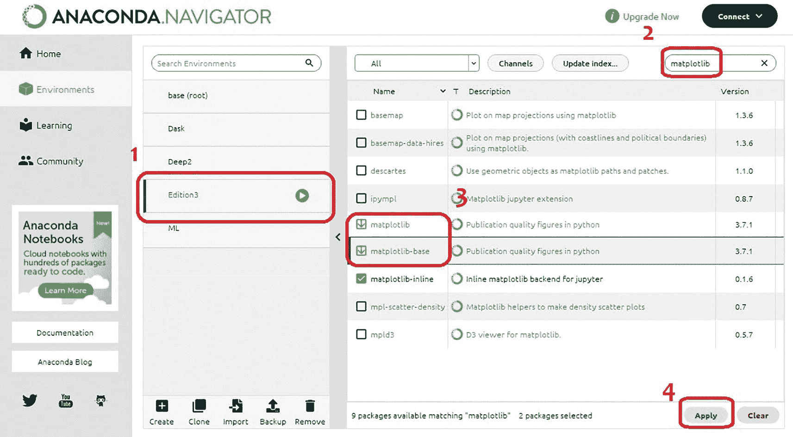

Anaconda Navigator 的截图分为三部分。左侧选中了 Environment 选项。中心位置带有播放图标的 Edition 3 被标记为 1。右侧一个标有 matplotlib 的搜索框被标记为 2。右侧部分包含一个表格。matplotlib 和 matplotlib base 被标记为 3。

图 7-1 使用 Anaconda Navigator 安装 matplotlib

不久之后，会出现一个对话框，其中会显示依赖项，并要求你确认安装。再次点击 Apply 完成安装。

如果你更偏好使用命令控制台，在 Anaconda 上你可以通过 CMD.exe Prompt 打开一个会话，然后输入以下命令：

```
conda install matplotlib
```

如果你决定不采用系统上的 Anaconda 平台，你可以直接使用系统的命令控制台，通过 `pip` 命令来安装 `matplotlib`。

```
pip install matplotlib
```

在输出中，你将看到安装所需的所有依赖项。随后，系统会以 YES-NO 的形式要求你确认是否继续安装。按 `y` 键完成安装。

## matplotlib 架构

`matplotlib` 必须承担的关键任务之一是提供一系列函数和工具，以允许表示和操作一个 Figure（主对象），以及构成它的所有内部对象。然而，`matplotlib` 不仅处理图形，还提供了用于事件处理和动画图形能力的所有工具。因此，得益于这些附加功能，`matplotlib` 可以基于键盘按键或鼠标移动触发的事件，生成交互式图表。

`matplotlib` 的架构在逻辑上分为三层，它们被放置在不同的层级上（见图 7-2）。通信是单向的，即每一层都可以与下一层通信，而较低层则不能与上层通信。


一个自上而下的垂直流程图。Scripting 指向 Artist。Artist 指向 Backend。

图 7-2 matplotlib 架构的三层

这三层如下：
- Scripting (脚本层)
- Artist (艺术层)
- Backend (后端层)

### 后端层

在图 7-2 所示的 `matplotlib` 架构图中，工作在最低层级的是 Backend 层。该层包含 `matplotlib` 的 API，这是一组在低层级实现图形元素的类。

- `FigureCanvas` 是体现绘图区域概念的对象。
- `Renderer` 是在 `FigureCanvas` 上进行绘制的对象。
- `Event` 是处理用户输入（键盘和鼠标事件）的对象。

### 艺术家层

作为中间层，存在一个名为艺术家的图层。构成图表的所有元素，例如标题、轴标签、标记等，都是 `Artist` 对象的实例。每个实例都在一个层级结构中扮演着自己的角色（如图 7-3 所示）。

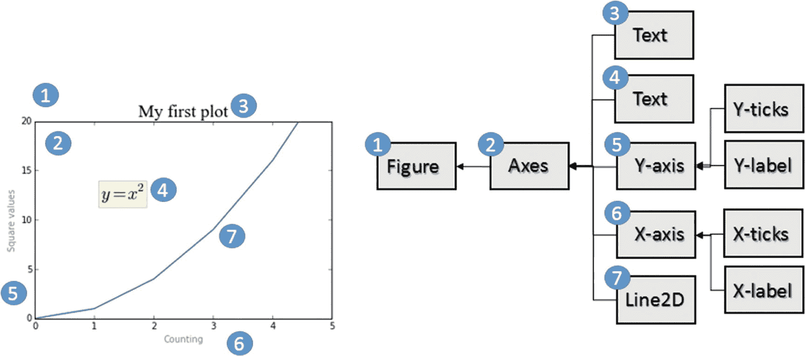

一张平方值与计数的关系图，显示一条递增曲线和编号为 1 到 7 的 7 个圆圈。曲线方程为 `y = x squared`。右侧的流程图显示了指向文本的 `Y-ticks`、`Y-label`、`X-ticks` 和 `X-label`，以及 `Y-axis`、`X-axis` 和 `line 2 D`，接着是坐标轴和图形。

**图 7-3** – 图表的每个元素都对应一个按层级结构组织的 `Artist` 实例。

有两种 `Artist` 类：原生类和复合类。
- 原生艺术家是构成图表中图形表示基本元素的独立对象，例如 `Line2D`，或作为几何图形如 `Rectangle` 或 `Circle`，甚至是文本片段。
- 复合艺术家是由多个基本元素（即原生艺术家）组成的图形元素。复合艺术家例如 `Axis`、`Ticks`、`Axes` 和 `Figures`（见图 7-4）。

通常，在此层级工作时，你需要经常处理层级结构中更高层的对象，如 `Figure`、`Axes` 和 `Axis`。因此，充分理解这些对象是什么以及它们在图形表示中扮演的角色至关重要。图 7-4 展示了在此层级的所有实现中通常使用的三个主要 `Artist` 对象（复合艺术家）。

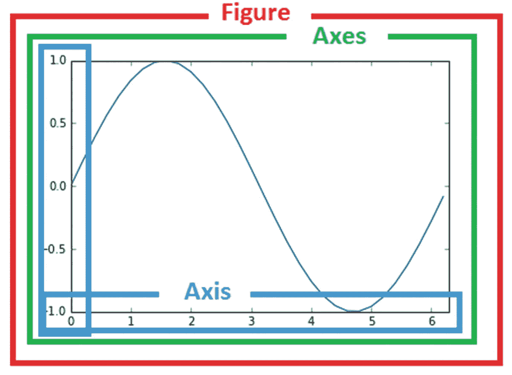

一个包含在两个同心正方形内的图形。外正方形标记为 `figure`，内正方形标记为 `axes`。该图形有一条经过 `(0, 0)`、`(1.5, 1)`、`(3, 0)`、`(4.75, -1)` 和 `(6.2, -0.1)` 点的正弦曲线。这些数值是近似值。

**图 7-4** – `Artist` 层层级结构中的三个主要 `Artist` 对象。

- `Figure` 是层级结构中层次最高的对象。它对应于整个图形表示，通常可以包含多个 `Axes`。
- `Axes` 通常就是你所说的绘图或图表。每个 `Axis` 对象只属于一个 `Figure`，并由两个 `Artist` `Axis`（三维情况下为三个）来标识。其他对象，如标题、x 轴标签和 y 轴标签，都属于这个复合艺术家。
- `Axis` 对象负责处理要在 `Axes` 上表示的数值，定义坐标轴范围并管理刻度（坐标轴上的标记）和刻度标签（每个刻度上显示的标签文本）。刻度的位置由一个称为 `Locator` 的对象调整，而刻度标签的格式化则由一个称为 `Formatter` 的对象控制。

# 脚本层 (pyplot)

`Artist` 类及其相关函数（`matplotlib` API）特别适合所有开发者，尤其是那些在 Web 应用服务器上工作或开发 GUI 的开发者。但对于计算目的，特别是数据分析和可视化，脚本层是最佳选择。这一层由一个名为 `pyplot` 的接口组成。

## pylab 和 pyplot

通常会提到 `pylab` 和 `pyplot`。但这两个包之间有什么区别？`pylab` 是一个随 `matplotlib` 一起安装的模块，而 `pyplot` 是 `matplotlib` 的一个内部模块。你经常会看到使用其中一种方法的参考。

```python
from pylab import *
```

和

```python
import matplotlib.pyplot as plt
import numpy as np
```

`pylab` 将 `pyplot` 的功能与 `NumPy` 的功能结合到一个单一的命名空间中，因此你不需要单独导入 `NumPy`。此外，如果你导入 `pylab`，就可以直接调用 `pyplot` 和 `NumPy` 函数，而无需引用任何模块（命名空间），使环境更类似于 MATLAB。

```python
plot(x,y)
array([1,2,3,4])
```

而不是

```python
plt.plot()
np.array([1,2,3,4])
```

`pyplot` 包为 `matplotlib` 库的编程提供了经典的 Python 接口，拥有自己的命名空间，并需要单独导入 `NumPy` 包。本书选择的是这种方法；这是本章的主要议题；并且将在本书的其余部分使用。这种方法得到了大多数 Python 开发者的认同和采纳。

## pyplot

`pyplot` 模块是命令式函数的集合，允许你像使用 MATLAB 一样使用 `matplotlib`。每个 `pyplot` 函数都会对 `Figure` 对象进行操作或做出一些更改，例如，创建 `Figure` 本身、创建绘图区域、绘制线条、用标签装饰图表等。

`pyplot` 也是 `有状态的`，它会跟踪当前图形及其绘图区域的状态。被调用的函数作用于当前图形。

### 绘图窗口

为了熟悉 `matplotlib` 库，特别是 `pyplot`，你将开始创建一个简单的交互式图表。使用 `matplotlib`，这个操作非常简单；实际上，你只需三行代码就能实现。

首先，你可以从一个简单的命令控制台开始使用 `matplotlib`，在那里一次输入一条命令。

第一件事是导入 `pyplot` 包并将其重命名为 `plt`。

```python
>>> import matplotlib.pyplot as plt
```

在 Python 中，构造函数通常不是必需的；一切都是隐式定义的。事实上，当你导入包时，拥有所有图形功能的 `plt` 对象已经被实例化并准备就绪。因此，你可以直接使用 `plot()` 函数来传递要绘制的值。

因此，你可以简单地将想要表示的值作为整数序列传递。

```python
>>> plt.plot([1,2,3,4])
```

从输出中可以看到，生成了一个 `Line2D` 对象。该对象是一条表示图表中数据点线性趋势的线。

```python
[]
```

现在一切就绪。你只需使用 `show()` 函数给出显示图表的命令。

```python
>>> plt.show()
```

结果将如图 7-5 所示。一个名为`绘图窗口`的窗口，带有工具栏和其中绘制的图形，将出现在命令控制台旁边（这与使用 MATLAB 时的情况非常相似）。

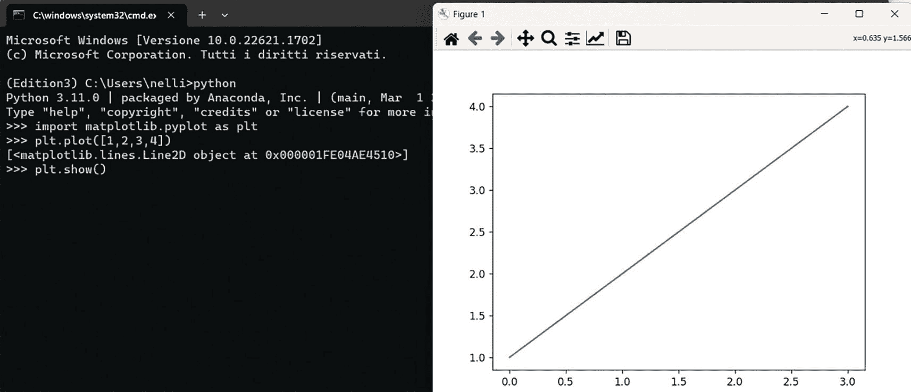

一张屏幕截图，左边是微软 Windows 上的 Python 代码，右边是一个图表。图表中有一条递增的线，经过点 (0, 1)、(0.5, 1.5)、(1, 2)、(1.5, 2.5)、(2, 3)、(2.5, 3.5) 和 (3, 4)。数值为近似值。

**图 7-5** 绘图窗口

绘图窗口顶部有一个包含一系列按钮的工具栏。

*  主页图标。重置为原始视图
*  带有左右箭头的上一个或下一个图标。转到上一个/下一个视图
*  加号图标，用于沿坐标轴缩放。左键平移坐标轴，右键缩放
*  带有放大镜的缩放图标。缩放到矩形区域
*  带有三个带点平行水平线的配置图标。配置子图
*  带有锯齿形箭头的编辑图标。编辑坐标轴、曲线和图像参数
*  保存图标。保存/导出图形

你很快就能看到，这个窗口允许你作为一个独立的应用程序，自主、独立地管理生成的图像。

### 使用 Jupyter Notebook 进行数据可视化

一种更便捷、更专业地使用 matplot 生成的图表进行交互式工作的方法是使用 Jupyter Notebook。

事实上，通过在 Jupyter 上打开一个 Notebook 并输入之前的代码，你会发现图表将直接集成显示在 Notebook 中，而无需直接调用 `show()` 命令（见图 7-6）。

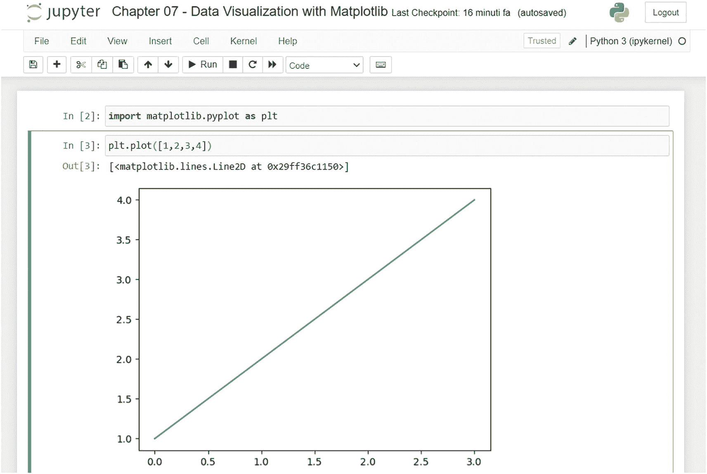

一张屏幕截图包含两行带输入和输出的代码，以及一个带递增线的折线图。该线经过点 (0, 1)、(0.5, 1.5)、(1, 2)、(1.5, 2.5)、(2, 3)、(2.5, 3.5) 和 (3, 4)。数值为近似值。

**图 7-6** 在 Jupyter Notebook 中查看图表

如果你只向 `plt.plot()` 函数传递一个数字列表或数组，`matplotlib` 会假定这是图表的 `y` 值序列，并将其与 `x` 值的自然序列（0, 1, 2, 3, ...）关联起来。

通常，图表表示的是值对 (x, y)，所以如果你想正确定义一个图表，必须定义两个数组，第一个包含 x 轴上的值，第二个包含 y 轴上的值。然后，你再添加第二个数组，其中包含 y 轴上点的值。现在，第一个数组中的点将对应 x 轴上点的值。

你可以在一个新单元格中编写以下代码，或者编辑之前的单元格。在第一种情况下，你将得到一个与第一个图表完全分离的新图表；在第二种情况下，现有图表将根据新值进行更新。

```python
plt.plot([1,2,3,4],[1,4,9,16])
```

在这两种情况下，结果都类似于图 7-7 所示。

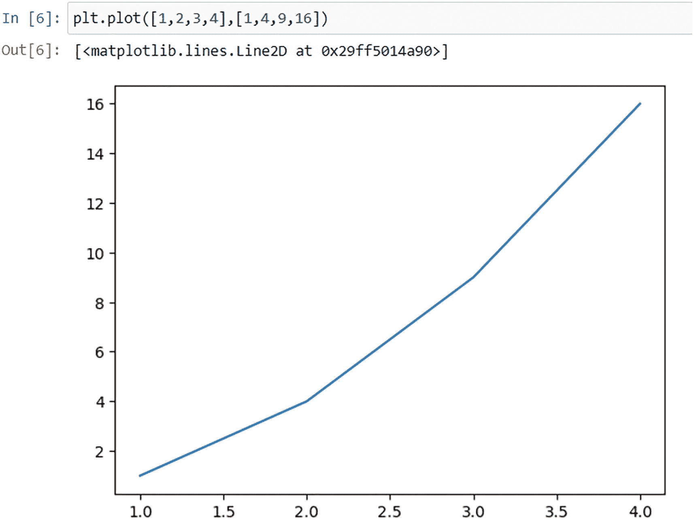

一张屏幕截图包含两行带输入和输出的代码，以及一个带递增线的折线图。该线经过点 (1, 1)、(1.5, 3)、(2, 4)、(2.5, 7)、(3, 9)、(3.5, 13) 和 (4, 16)。数值为近似值。

**图 7-7** 在 Jupyter Notebook 中查看图表

### 设置图表的属性

`plot()` 函数可以接受第三个参数，该参数描述了如何在图表上表示数据点的具体方式。如图 7-7 所示，这些点由一条蓝色线表示。事实上，如果你未另行指定，图表将根据 `plt.plot()` 函数的默认配置进行绘制：

* 坐标轴的大小与输入数据的范围完美匹配
* 既没有标题也没有坐标轴标签
* 没有图例
* 绘制一条连接数据点的蓝色线

因此，你可能希望改变这种表示方式，以获得一个真正的图表，其中每个值对 (x, y) 都由一个红点表示。那么，你必须添加第三个参数来定义图形的某些特征，以覆盖默认特征。在这种情况下，你可以将 `'ro'` 作为第三个参数传递给 `plot()` 函数。

```python
plt.plot([1,2,3,4],[1,4,9,16],'ro')
```

运行 Notebook 的单元格，你将得到如图 7-8 所示的图表。

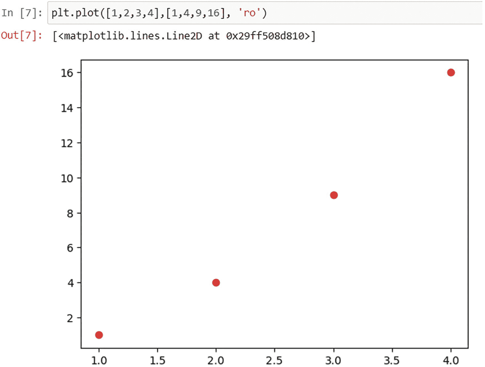

一张包含两行带输入和输出的代码以及一个散点图的屏幕截图。数据点位于 (1, 1)、(2, 4)、(3, 9) 和 (4, 16)。数值为近似值。

**图 7-8** (x, y) 值对在图表中用红色圆圈表示

另一种可能改变默认行为的做法是，在列表 `[xmin, xmax, ymin, ymax]` 中定义 x 轴和 y 轴的范围，然后将其作为参数传递给 `axis()` 函数。

除了坐标轴范围，还可以定义图表的许多其他特征。例如，你也可以使用 `title()` 函数添加标题。然后，在 Notebook 的单元格中编写以下代码：

```python
plt.axis([0,5,0,20])
plt.title('My first plot')
plt.plot([1,2,3,4],[1,4,9,16],'ro')
```

在图 7-9 中，你可以看到新的设置如何使图表更具可读性。事实上，数据集的端点现在显示在图表内部而非边缘。图表的标题现在也显示在顶部。

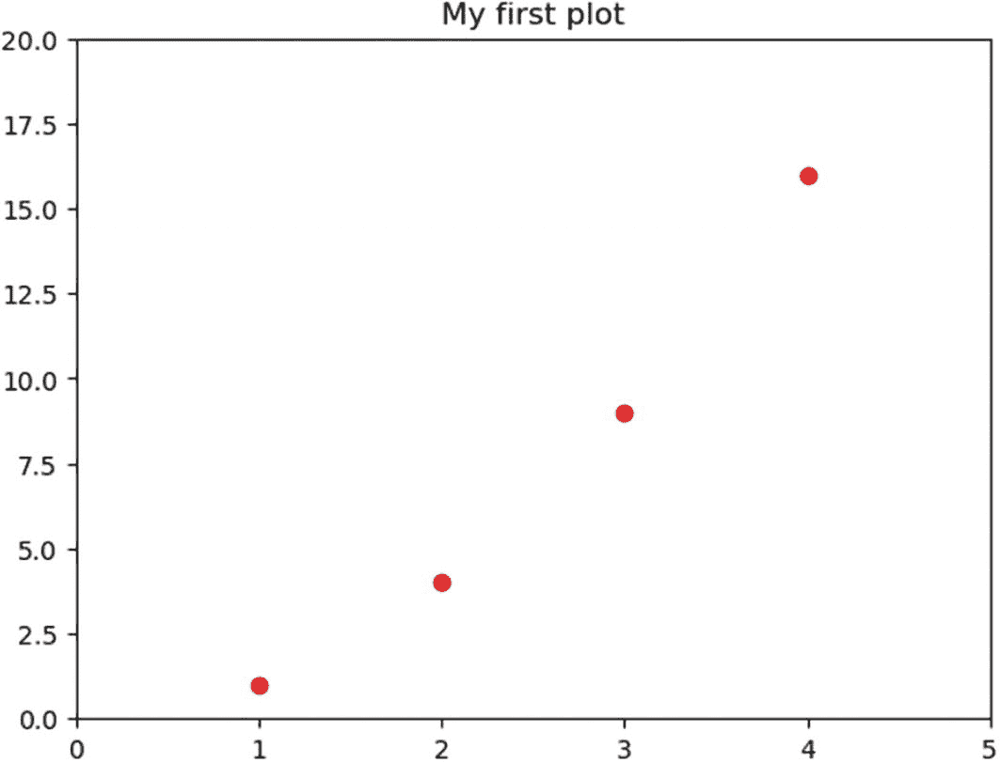

一个标题为“我的第一个图表”（`My first plot`）的散点图，数据点位于 (1, 1)、(2, 4)、(3, 9) 和 (4, 16)。纵轴范围从 0 到 20，增量为 2.5。横轴范围从 0 到 5，增量为 1。数值为近似值。

**图 7-9** 设置属性后的图表

## `matplotlib`与`NumPy`

尽管`matplotlib`库是一个完全图形化的库，但其基础是`NumPy`库。事实上，你已经看到了如何将列表作为参数传递，既用于表示数据，也用于设置坐标轴的边界。这些列表已在内部转换为`NumPy`数组。因此，你可以直接将`NumPy`数组作为输入数据。这些经`pandas`处理过的数据数组，无需进一步处理即可直接用于`matplotlib`。

举个例子，你将看到如何在同一个图中绘制三种不同的趋势（见图[7-10]）。你可以选择`math`模块中的`sin()`函数作为此示例。你需要导入它。为了生成遵循正弦趋势的点，你可以使用`NumPy`库。使用`arange()`函数生成 x 轴上的一系列点，而对于 y 轴上的值，你将使用`map()`函数将`sin()`函数应用于数组的所有项（无需使用`for`循环）。

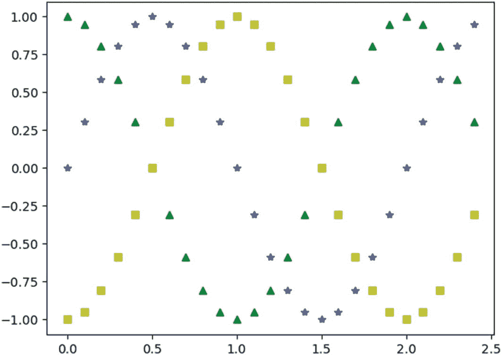

三个正弦曲线图。三角形图在(0, 1)和(2, 1)处达到峰值，在(1, -1)处达到谷值。星形图在(0.5, 1)和(2.5, 1)处达到峰值，在(1.5, -1)处达到谷值。方形图在(1, 1)处达到峰值，在(0, -1)和(2, -1)处达到谷值。

图 7-10 由标记表示的相位相差π/4 的三个正弦趋势

```python
import math
import numpy as np
t = np.arange(0,2.5,0.1)
y1 = np.sin(math.pi*t)
y2 = np.sin(math.pi*t+math.pi/2)
y3 = np.sin(math.pi*t-math.pi/2)
plt.plot(t,y1,'b*',t,y2,'g^',t,y3,'ys')
```

如图[7-10]所示，该图使用三种不同的颜色和标记表示了三个不同的时间趋势。在这些情况下，当函数趋势如此明显时，用点图可能不是最合适的表示方式，最好使用线图（见图[7-10]）。为了用颜色以外的方式区分三种趋势，你可以使用由点和虚线（`-`和`.`）的不同组合构成的样式。

```python
plt.plot(t,y1,'b--',t,y2,'g',t,y3,'r-.')
```

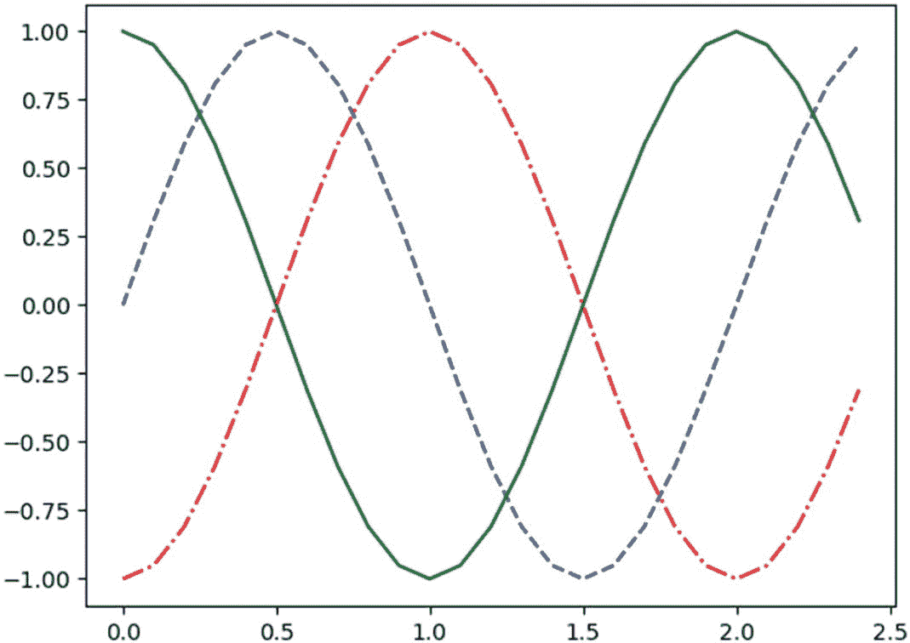

三条正弦波。实线波大约在(0, 1)和(2, 1)处达到峰值，在(1, -1)处达到谷值。蓝色波在(0.5, 1)和(2.5, 1)处达到峰值，在(1.5, -1)处达到谷值。红色波在(1, 1)处达到峰值，在(0, -1)和(2, -1)处达到谷值。

图 7-11 此图表使用彩色线条表示三个正弦模式

## 使用`kwargs`

构成图表的对象具有许多特征属性。这些属性都有默认值，但可以通过使用*关键字参数*（通常称为`kwargs`）进行设置。

这些关键字作为参数传递给函数。在`matplotlib`库的各种函数的参考文档中，你总会发现它们在最后一个位置被引用为`kwargs`。例如，你在这些示例中使用的`plot()`函数在文档中的引用方式如下。

```
matplotlib.pyplot.plot(*args, **kwargs)
```

作为一个实际例子，如果设置了`linewidth`关键字，可以更改线条的粗细（见图[7-12]）。

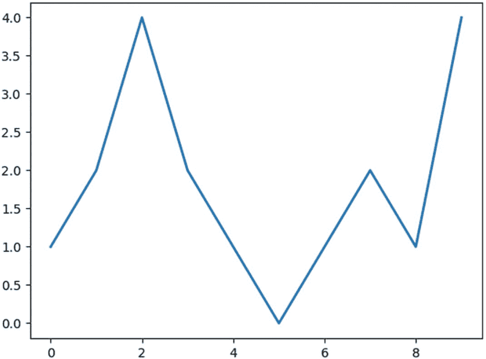

一张折线图绘制了一条波动线，该线经过(0, 1)、(1, 2)、(2, 4)、(3, 2)、(5, 0)、(7, 2)、(8, 1.1)和(9, 4)。垂直轴范围从 0 到 4，增量为 0.5。水平轴范围从 0 到 8，增量为 2。数值为近似值。

图 7-12 线条的粗细可以直接从`plot()`函数设置

```python
plt.plot([1,2,4,2,1,0,1,2,1,4],linewidth=2.0)
```

### 使用多个图形和坐标轴

到目前为止，你已经看到所有`pyplot`命令如何路由到单个图形的显示。实际上，`matplotlib`允许你同时管理多个图形，并且在每个图形中，它提供了查看定义为子图的不同图的能力。

因此，当你使用`pyplot`时，必须始终记住当前图形和当前坐标轴（即图形中显示的图）的概念。现在你将看到一个在单个图形中表示两个子图的示例。`subplot()`函数除了将图形划分到不同的绘图区域外，还用于将命令聚焦到特定的子图上。

传递给`subplot()`函数的参数设置了划分模式，并确定哪个是当前子图。当前子图将是唯一受这些命令影响的图形。`subplot()`函数的参数由三个整数组成。第一个数字定义了图形垂直分成多少部分。第二个数字定义了图形水平分成多少部分。第三个数字选择哪个是当前子图，你可以向其发送命令。

现在你将显示两个正弦趋势（正弦和余弦），最好的方法是将画布垂直分成两个水平子图（如图[7-13]所示）。因此，要作为参数传递的数字是`211`和`212`。

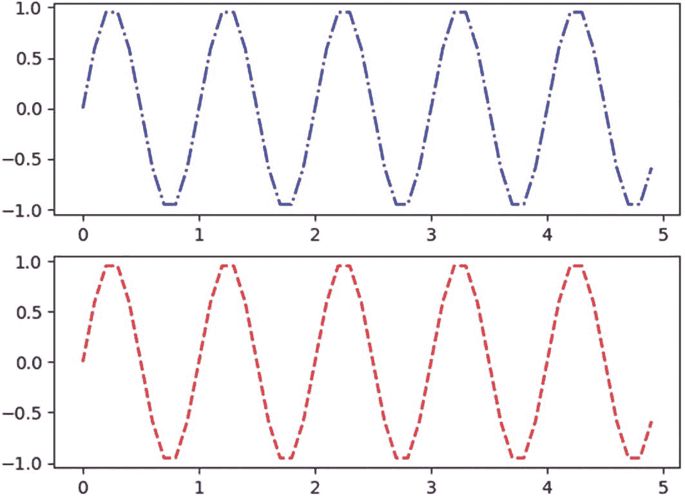

两个具有相似正弦波形的图，延伸于(0, 0)和(4.9, -0.6)之间。垂直轴范围从-1 到 1，增量为 0.5。水平轴范围从 0 到 5，增量为 1。数值为近似值。

图 7-13 该图被分成两个水平子图

```python
t = np.arange(0,5,0.1)
y1 = np.sin(2*np.pi*t)
y2 = np.sin(2*np.pi*t)
plt.subplot(211)
plt.plot(t,y1,'b-.')
plt.subplot(212)
plt.plot(t,y2,'r--')
```

你可以通过将图形分成两个垂直子图来做同样的事情。要作为参数传递给`subplot()`函数的数字是`121`和`122`（如图[7-14]所示）。

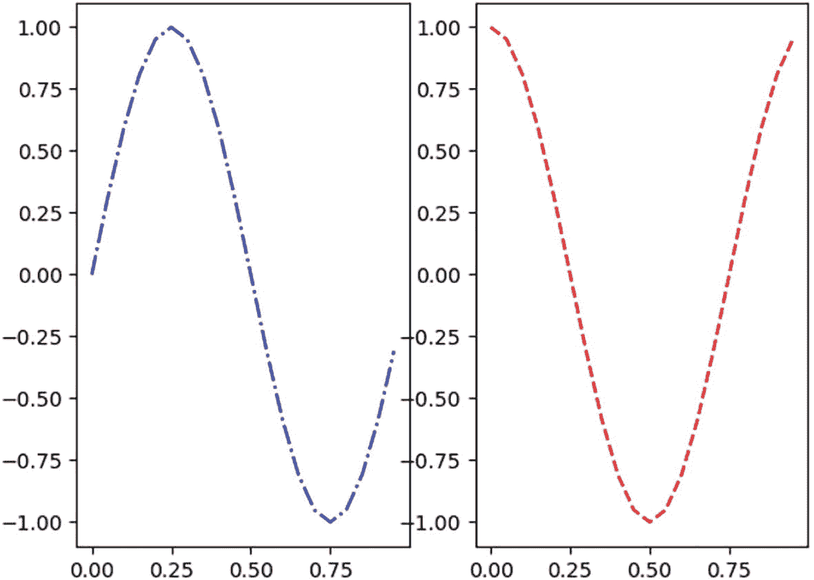

两个图。左侧是一个在(0.25, 1)处达到峰值并在(0.75, -1)处达到谷值的正弦波。右侧是一个在(0.5, -1)处达到谷值的 U 形曲线。垂直轴范围从-1 到 1，增量为 0.25，水平轴范围从 0 到 0.755，增量为 0.25。

图 7-14 该图被分成两个垂直子图

```python
t = np.arange(0.,1.,0.05)
y1 = np.sin(2*np.pi*t)
y2 = np.cos(2*np.pi*t)
plt.subplot(121)
plt.plot(t,y1,'b-.')
plt.subplot(122)
plt.plot(t,y2,'r--')
```

## 向图表添加元素

为了使图表更具信息量，很多时候仅用线条或标记表示数据并使用两个坐标轴分配值范围是不够的。事实上，还有许多其他元素可以添加到图表中，以丰富其附加信息。在本节中，你将看到如何向图表添加元素，例如文本标签、图例等。

### 添加文本

你已经看到如何通过`title()`函数为图表添加标题。还可以添加另外两种文字提示，即轴标签。这可以通过使用另外两个特定函数来实现，它们分别是`xlabel()`和`ylabel()`。这些函数接受一个字符串作为参数，该字符串将作为显示文本。现在，为图表添加两个轴标签，它们描述每个轴所对应的数值类型（如图 7‑15 所示）。

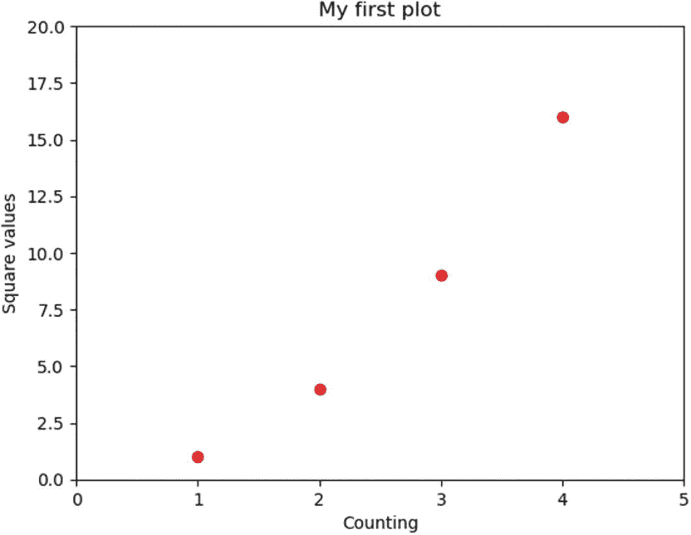

一张平方值与计数关系的散点图，包含四个数据点，分别位于 (1, 1)、(2, 4)、(3, 9) 和 (4, 16)。图表标题为“我的第一个图表”。数值为近似值。

**图 7‑15** – 添加轴标签后，图表信息更丰富

```python
plt.axis([0,5,0,20])
plt.title('My first plot')
plt.xlabel('Counting')
plt.ylabel('Square values')
plt.plot([1,2,3,4],[1,4,9,16],'ro')
```

借助关键字参数，你可以改变文本的特性。例如，你可以通过更改字体和增大字号来修改标题。你还可以修改轴标签的颜色，以突出图表的标题（如图 7‑16 所示）。

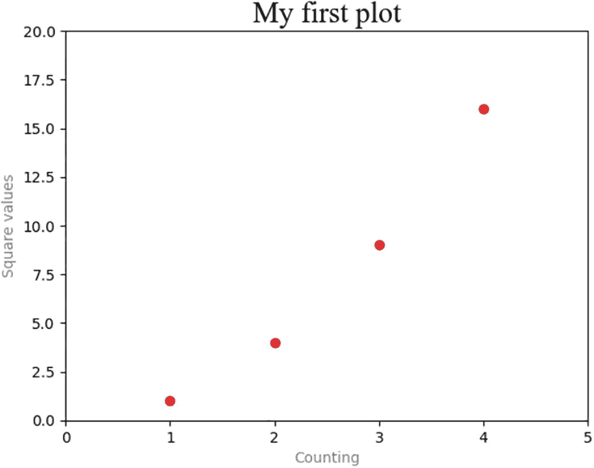

一张平方值与计数关系的散点图，包含四个数据点，分别位于 (1, 1)、(2, 4)、(3, 9) 和 (4, 16)。图表标题为“我的第一个图表”。数值为近似值。

**图 7‑16** – 通过设置关键字参数可以修改文本

# 添加文本与标签

```python
plt.axis([0,5,0,20])
plt.title('My first plot',fontsize=20,fontname='Times New Roman')
plt.xlabel('Counting',color='gray')
plt.ylabel('Square values',color='gray')
plt.plot([1,2,3,4],[1,4,9,16],'ro')
```

但`matplotlib`的功能远不止于此：`pyplot`允许你在图表内的任意位置添加文本。这一功能通过一个名为`text()`的特定函数来实现。

```python
text(x, y, s, fontdict=None, **kwargs)
```

前两个参数是文本放置位置的坐标。`s`是要添加的文本字符串，`fontdict`（可选）是你要使用的字体。最后，你还可以添加关键字参数。

为图表中的每个数据点添加标签。由于`text()`函数的前两个参数是图表的坐标，因此你需要使用图表中四个点的坐标，并在y轴上稍作偏移。

```python
plt.axis([0,5,0,20])
plt.title('My first plot',fontsize=20,fontname='Times New Roman')
plt.xlabel('Counting',color='gray')
plt.ylabel('Square values',color='gray')
plt.text(1,1.5,'First')
plt.text(2,4.5,'Second')
plt.text(3,9.5,'Third')
plt.text(4,16.5,'Fourth')
plt.plot([1,2,3,4],[1,4,9,16],'ro')
```

如图7‑17所示，现在图表中的每个数据点都带有一个标签。

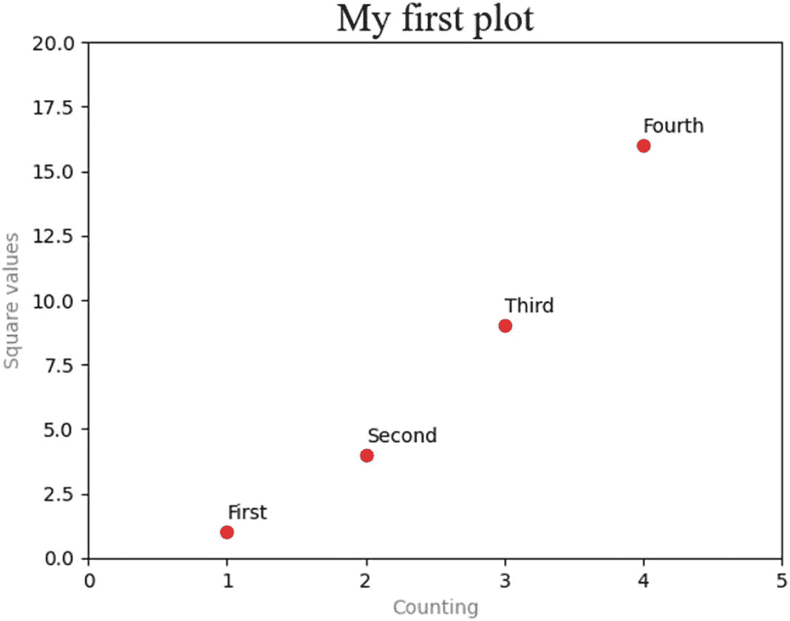

**图7‑17** – 图表中的每个数据点都有一个信息丰富的标签

一张平方值与计数关系的散点图，标题为“我的第一个图表”。数据点如下：第一点(1, 1)，第二点(2, 4)，第三点(3, 9)，第四点(4, 16)。数值为近似值。

由于`matplotlib`是一个面向科学领域设计的图形库，因此它必须能够充分利用科学语言的全部潜力，包括数学表达式。`matplotlib`提供了集成LaTeX表达式的可能性，从而允许你在图表中插入数学表达式。

为此，你可以将LaTeX表达式添加到文本中，并将其用两个`$`字符括起来。解释器会将其识别为LaTeX表达式，并转换成相应的图形，该图形可以是数学表达式、公式、数学字符或希腊字母。通常，你需要在包含LaTeX表达式的字符串前加上一个`r`，表示原始文本，以避免意外的转义序列。

在这里，你还可以使用关键字参数进一步丰富图表中要显示的文本。因此，作为示例，你可以添加描述数据点所遵循趋势的公式，并将其放在一个带颜色的边界框内（见图7‑18）。

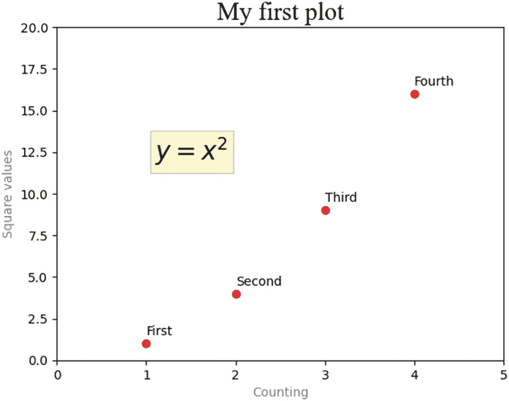

**图7‑18** – 任何数学表达式都可以在图表中显示

一张平方值与计数关系的散点图，标题为“我的第一个图表”。数据点如下：第一点(1, 1)，第二点(2, 4)，第三点(3, 9)，第四点(4, 16)。数值为近似值。方程显示为`y = x`的平方。

```python
plt.axis([0,5,0,20])
plt.title('My first plot',fontsize=20,fontname='Times New Roman')
plt.xlabel('Counting',color='gray')
plt.ylabel('Square values',color='gray')
plt.text(1,1.5,'First')
plt.text(2,4.5,'Second')
plt.text(3,9.5,'Third')
plt.text(4,16.5,'Fourth')
plt.text(1.1,12,r'$y = x²$',fontsize=20,bbox={'facecolor':'yellow','alpha':0.2})
plt.plot([1,2,3,4],[1,4,9,16],'ro')
```

要全面了解LaTeX提供的功能，请查阅本书的附录A。

### 添加网格

另一个可以添加到图表中的元素是网格。添加网格通常有助于更好地理解图表中每个数据点的位置。

为图表添加网格是一个非常简单的操作：只需添加`grid()`函数，并传入`True`作为参数即可（见图7‑19）。

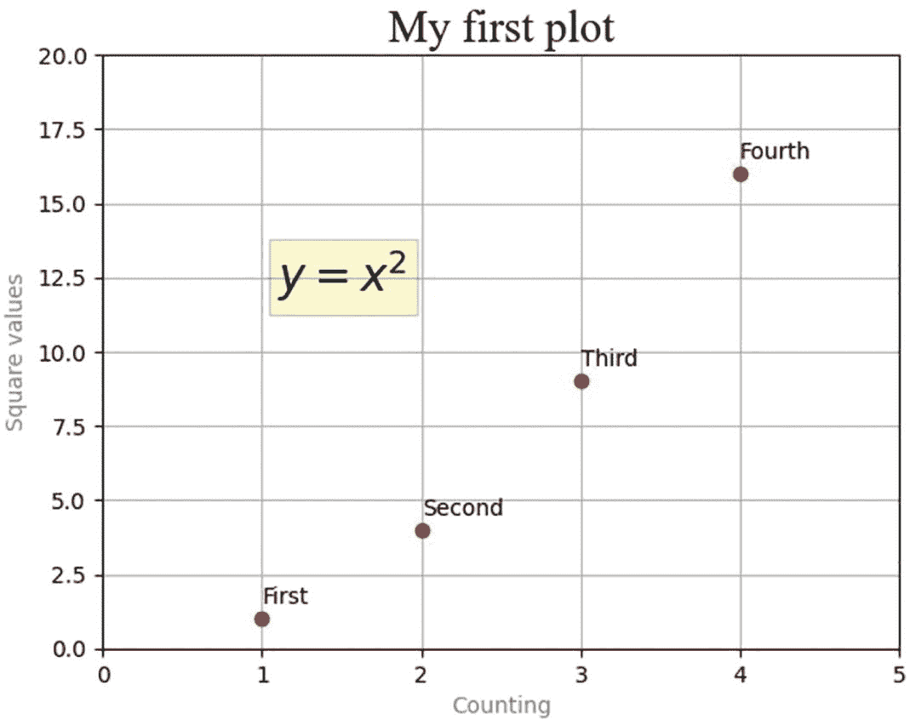

**图7‑19** – 网格使读取图表中表示的数据点数值变得更加容易

一张平方值与计数关系的散点图，标题为“我的第一个图表”。数据点如下：第一点(1, 1)，第二点(2, 4)，第三点(3, 9)，第四点(4, 16)。数值为近似值。方程显示为`y = x`的平方。

```python
plt.axis([0,5,0,20])
plt.title('My first plot',fontsize=20,fontname='Times New Roman')
plt.xlabel('Counting',color='gray')
plt.ylabel('Square values',color='gray')
plt.text(1,1.5,'First')
plt.text(2,4.5,'Second')
plt.text(3,9.5,'Third')
plt.text(4,16.5,'Fourth')
plt.text(1.1,12,r'$y = x²$',fontsize=20,bbox={'facecolor':'yellow','alpha':0.2})
plt.grid(True)
plt.plot([1,2,3,4],[1,4,9,16],'ro')
```

## 添加图例

任何图表中另一个非常重要的组成部分就是图例。`pyplot`也为这类对象提供了特定函数：`legend()`。

使用`legend()`函数并传入一个表示图例文字的字符串，即可为图表添加图例。在本例中，你为输入数据数组指定了`First series`名称（见图7-20）。

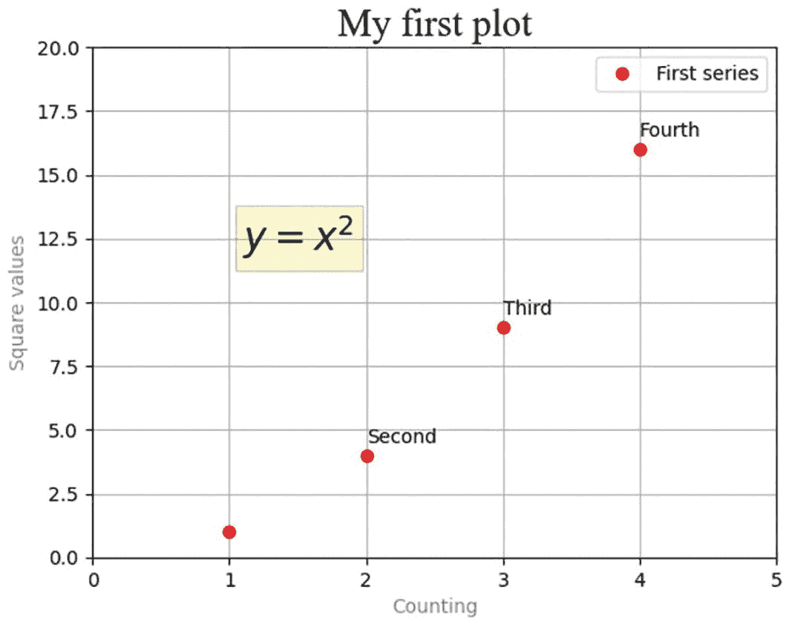

**图7-20** 图例默认添加到右上角

一张平方值对计数的散点图，标题为“我的第一个图”。数据点如下：第一个(1, 1)，第二个(2, 4)，第三个(3, 9)，第四个(4, 16)。数值为近似值。方程显示为`y = x`的平方。这些数据点代表第一个系列。

```python
plt.axis([0,5,0,20])
plt.title('My first plot',fontsize=20,fontname='Times New Roman')
plt.xlabel('Counting',color='gray')
plt.ylabel('Square values',color='gray')
plt.text(2,4.5,'Second')
plt.text(3,9.5,'Third')
plt.text(4,16.5,'Fourth')
plt.text(1.1,12,'$y = x²$',fontsize=20,bbox={'facecolor':'yellow','alpha':0.2})
plt.grid(True)
plt.plot([1,2,3,4],[1,4,9,16],'ro')
plt.legend(['First series'])
```

如图7-20所示，图例默认添加到右上角。如果你想改变这一行为，则需要添加一些`kwargs`参数。例如，为`loc` kwarg参数分配0到10的数字来设置图例占据的位置。每个数字对应图表的一个角（见表7-1）。默认值为1，即右上角。在下一个示例中，你将把图例移动到左上角，使其不与图表中表示的数据点重叠。

**表7-1** `loc`关键字参数的可用值

| 位置代码 | 位置字符串 |
| :--- | :--- |
| `0` | `best` |
| `1` | `upper-right` |
| `2` | `upper-left` |
| `3` | `lower-right` |
| `4` | `lower-left` |
| `5` | `right` |
| `6` | `center-left` |
| `7` | `center-right` |
| `8` | `lower-center` |
| `9` | `upper-center` |
| `10` | `center` |

# 图例、保存图表与处理日期值

在你开始修改代码移动图例之前，我想补充一点小说明。通常，图例用于通过与某种颜色和/或标记相关联的标签，向读者说明数据系列的定义，以便在图表中区分该系列。在之前的示例中，你只使用了一个由单个`plot()`函数表达的系列。现在，你需要关注一个更常见的情况，即同一个图表同时显示多个系列。图表中的每个系列将由特定的颜色和标记来区分（见图7-21）。在代码方面，每个系列则通过调用`plot()`函数来体现，并且它们定义的顺序对应于作为参数传递给`legend()`函数的文本标签的顺序。

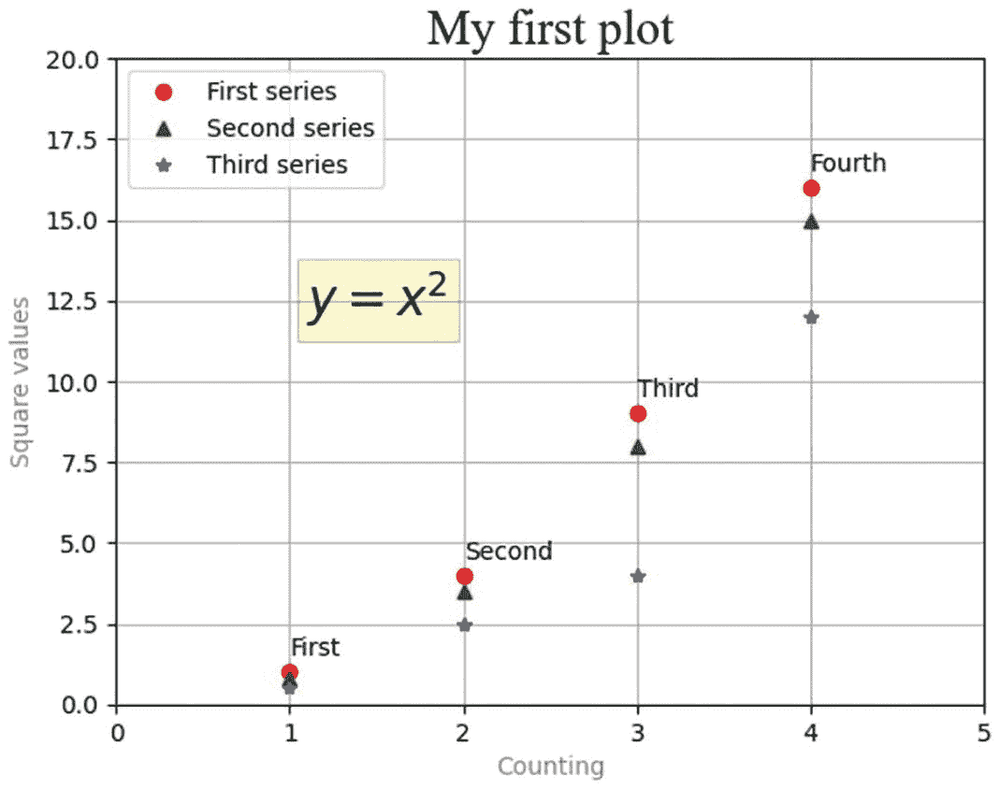

一张平方值对计数的散点图，标题为“我的第一个图”。数据点如下：第一个 (1, 1)，第二个 (2, 4)，第三个 (3, 9)，第四个 (4, 16)。数值为近似值。方程显示为`y = x`的平方。数据点代表第一个系列。

**图 7-21** 每个多系列图表都必须有图例

```python
import matplotlib.pyplot as plt
plt.axis([0,5,0,20])
plt.title('My first plot',fontsize=20,fontname='Times New Roman')
plt.xlabel('Counting',color='gray')
plt.ylabel('Square values',color='gray')
plt.text(1,1.5,'First')
plt.text(2,4.5,'Second')
plt.text(3,9.5,'Third')
plt.text(4,16.5,'Fourth')
plt.text(1.1,12,'$y = x²$',fontsize=20,bbox={'facecolor':'yellow','alpha':0.2})
plt.grid(True)
plt.plot([1,2,3,4],[1,4,9,16],'ro')
plt.plot([1,2,3,4],[0.8,3.5,8,15],'g^')
plt.plot([1,2,3,4],[0.5,2.5,4,12],'b*')
plt.legend(['First series','Second series','Third series'],loc=2)
```

## 保存你的图表

在本节中，你将学习如何根据需求以不同方式保存图表。如果你需要在不同的笔记本或 Python 会话中重现图表，或在未来项目中重复使用，保存 Python 代码是一个好习惯。另一方面，如果你需要制作报告或演示文稿，将图表保存为图像则非常有用。此外，还可以将图表保存为 HTML 页面，这在需要在线共享你的工作时非常有用。

### 保存代码

正如你在前几节的示例中所见，关于单个图表表示的代码已经增长到相当多的行数。一旦你认为开发过程达到了一个不错的节点，就可以选择将所有代码行保存到一个`.py`文件中，以便随时调用。

你可以使用魔术命令`%save`，后面跟上你想保存的文件名，再跟上一个或多个包含你想保存代码行的输入提示符编号。如果所有代码都只写在一个提示符中，就像本例这样，你只需添加其编号；否则，如果你想保存写在多个提示符中的代码，例如从 `10` 到 `20`，你需要用`-`分隔这两个数字来指示这个范围，即`10-20`。

在你的例子中，你将保存位于编号为`21`的输入提示符中、代表第一个图表底层的 Python 代码。

```
In [21]: import matplotlib.pyplot as plt
...
```

你需要在新的单元格中插入以下命令，然后执行它以将代码保存到新的`.py`文件中。

```
%save my_first_chart 171
```

启动该命令后，你将收到一条输出消息，告知已在工作目录中创建了名为`my_first_chart.py`的新文件及其包含的代码，如图 7-22 所示。

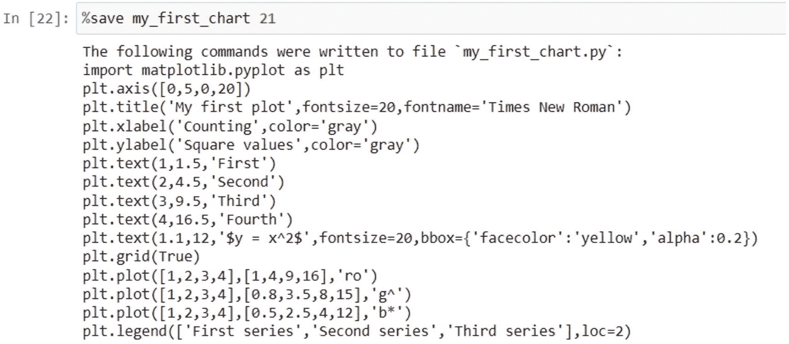

一张截图。十四行命令指示了文件“我的第一个图”的输入。文件名显示为“My_First_Chart.py”。

**图 7-22** 单元格内编写的代码可以保存到文件中

与保存类似，可以将文件中的代码加载到笔记本的单元格中；你可以使用魔术命令`%load`来实现。

```
%load my_first_chart.py
```

如果你对文件中的代码不感兴趣，只对其输出感兴趣，你可以在单元格内写入魔术命令`%run`。

```
%run my_first_chart.py
```

在本例中，结果是在单元格的输出中显示图表可视化。

### 将你的笔记本保存为 HTML 文件或其他文件格式

能够使用 Jupyter Notebook 的一个有趣方面是可以将此 Notebook 转换为 HTML 页面。在 Notebook 菜单上，单击“文件”，然后选择“下载为”，即可查看 Notebook 可以转换为多少种文件格式（见图 7-23）。

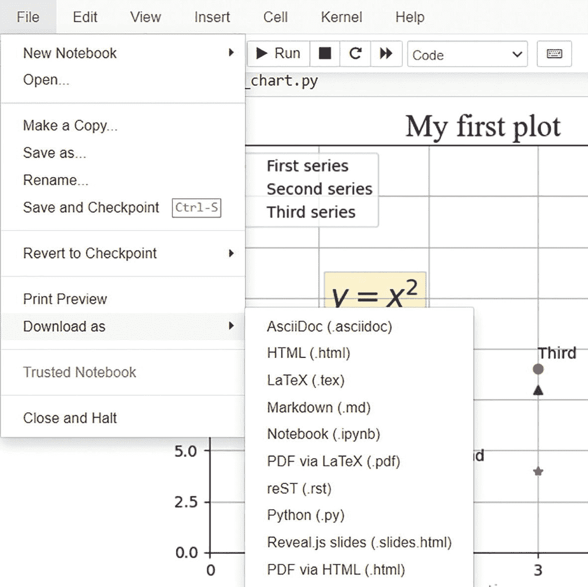

一张截图。左侧选中了文件菜单中的“下载为”选项。右侧是一个散点图，包含三个标注为第一、第二和第三系列的数据簇。方程显示为`y = x`的平方。标题显示为“我的第一个图”。

**图 7-23** 你可以将当前会话保存为网页

### 将图表直接另存为图像

如果你只对将图表图形保存为图像文件感兴趣，而忽略会话期间所写的所有代码，这也是可以实现的。实际上，借助`savefig()`函数，你可以直接以 PNG 格式保存图表，不过需要注意将该函数添加到同一系列命令的末尾（否则你会得到一个空白的 PNG 文件）。

```python
plt.axis([0,5,0,20])
plt.title('我的第一个图',fontsize=20,fontname='Times New Roman')
plt.xlabel('计数',color='gray')
plt.ylabel('平方值',color='gray')
plt.text(1,1.5,'第一个')
plt.text(2,4.5,'第二个')
plt.text(3,9.5,'第三个')
plt.text(4,16.5,'第四个')
plt.text(1.1,12,'$y = x²$',fontsize=20,bbox={'facecolor':'yellow','alpha':0.2})
plt.grid(True)
plt.plot([1,2,3,4],[1,4,9,16],'ro')
plt.plot([1,2,3,4],[0.8,3.5,8,15],'g^')
plt.plot([1,2,3,4],[0.5,2.5,4,12],'b*')
plt.legend(['第一系列','第二系列','第三系列'],loc=2)
plt.savefig('my_chart.png')
```

执行上述代码后，你的工作目录中将创建一个新文件。该文件将命名为`my_chart.png`，并且包含你的图表图像。

## 处理日期值

进行数据分析时最常见的难题之一是处理日期时间类型的数据。将这些数据显示在坐标轴（通常是 x 轴）上可能会比较棘手，尤其是在管理刻度线时（见图 7-24）。

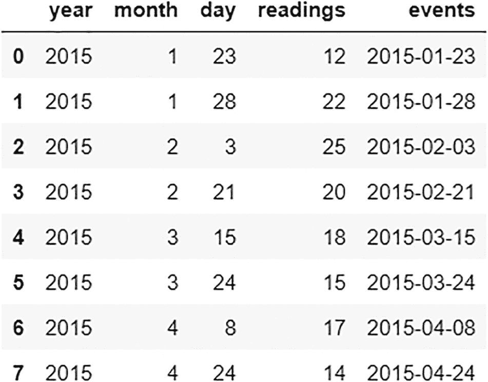

一个表格有 5 列 8 行。列标题分别为年份、月份、日期、读数和事件。

**图 7-24** 包含日期时间数据列的数据框

使用一个含有类似下列列的数据框作为数据源来展示数据是非常常见的：

```python
import pandas as pd
import datetime
df = pd.DataFrame({'year': 2015,
'month': [1,1,2,2,3,3,4,4],
'day': [23,28,3,21,15,24,8,24],
'readings': [12,22,25,20,18,15,17,14]})
df['events'] = pd.to_datetime(df[['year','month','day']])
df
```

运行这段代码，你将得到一个类似于图 7-24 所示的数据框，其中有一个包含日期时间类型值的`Events`列。

这种情况下，你可能想使用折线图来可视化`Readings`值随时间变化的趋势。这非常简单；你可以使用`plot()`函数获得一条如图 7-25 所示的图表折线。

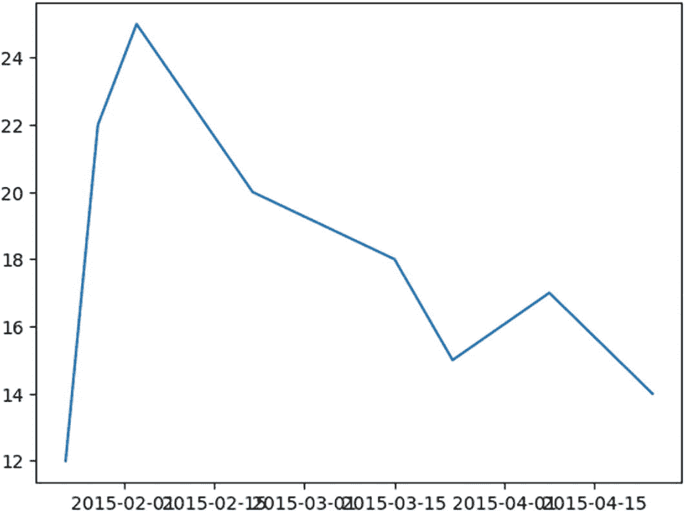

一个折线图绘制了一条波动的线，该线在 2015 年 2 月 2 日左右升至最高点 25，随后在 2015 年 3 月 15 日到 4 月 1 日期间降至 15。接着又升至 17 后跌至 14。数值均为近似值。

**图 7-25** 如果不加以处理，显示日期时间值可能会带来麻烦

```python
import matplotlib.pyplot as plt
plt.plot(df['events'],df['readings'])
```

如图 7-25 所示，刻度线的自动管理（尤其是刻度标签）可能是一场灾难。以这种方式表示的日期难以阅读，各个数据点之间没有明确的时间间隔，并且还存在重叠现象。

因此，为了管理日期，建议使用合适的对象来定义时间刻度。首先需要导入`matplotlib.dates`，这是一个专门用于此类数据的模块。然后，通过`MonthLocator()`和`DayLocator()`函数来定义时间刻度，比如本例中定义天和月的刻度。在这些情况下，格式化也非常重要，为了避免重叠或不必要的引用，必须将刻度标签限制在必要内容上，本例中即为“年-月”。这种格式可以作为参数传递给`DateFormatter()`函数。

定义好天和月这两种刻度后，就可以在 x 轴上设置两种不同的刻度线，方法是在`xaxis`对象上使用`set_major_locator()`和`set_minor_locator()`函数。而要设置与月份相关的刻度标签的文本格式，则需要使用`set_major_formatter()`函数。

完成所有这些设置后，最终你将得到图 7-26 所示的图形。

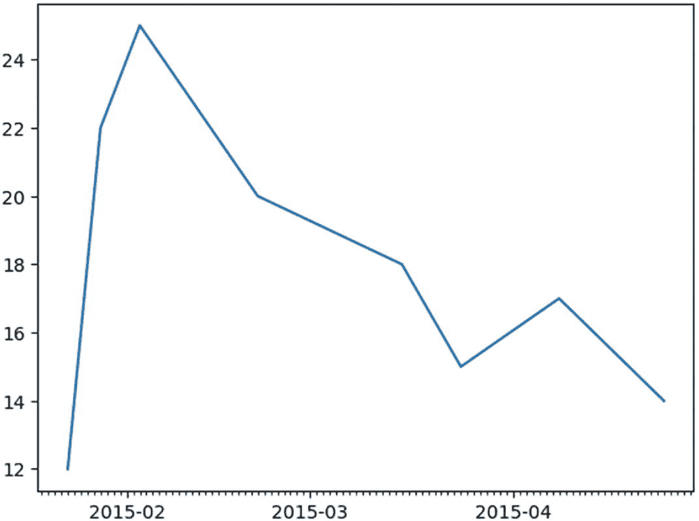

一个折线图绘制了一条波动的线，该线在 2015 年 2 月升至最高点 25，随后在 2015 年 4 月前降至 15。接着又升至 17 后跌至 14。数值均为近似值。

`图 7-26` 现在 x 轴的刻度标签仅涉及月份，使得图表更易于阅读

```
import numpy as np
import matplotlib.pyplot as plt
import matplotlib.dates as mdates
months = mdates.MonthLocator()
days = mdates.DayLocator()
timeFmt = mdates.DateFormatter('%Y-%m')
fig, ax = plt.subplots()
plt.plot(df['events'],df['readings'])
ax.xaxis.set_major_locator(months)
ax.xaxis.set_major_formatter(timeFmt)
ax.xaxis.set_minor_locator(days)
```

## 图表类型学

在前面的章节中，你已经看到了许多与`matplotlib`库架构相关的示例。既然你已经熟悉了在图表中使用主要图形元素，那么是时候来看一系列关于不同类型图表的示例了，从最常见的折线图、条形图和饼图开始，直到讨论一些更复杂但也常被使用的图表。

本章的这部分非常重要，因为这个库的目的是可视化数据分析产生的结果。因此，知道如何选择合适的图表类型是一个基本环节。请记住，优秀的数据分析如果呈现方式不当，可能会导致对实验结果产生错误的解读。

### 折线图

在所有图表类型中，折线图是最简单的。折线图是由一条线连接的一系列数据点。每个数据点由一对值`(x, y)`组成，这些值将根据两个轴（`x`轴和`y`轴）的数值比例显示在图表中。

举例来说，你可以先绘制由数学函数生成的点。然后，考虑这样一个通用的数学函数：

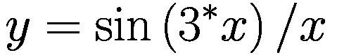

因此，如果你想创建一个数据点序列，你需要创建两个 NumPy 数组。首先，创建一个包含 x 轴参考值`x`的数组。为了定义一个递增的值序列，你将使用`np.arange()`函数。由于函数是正弦函数，你应该使用希腊字母 pi（`np.pi`）的倍数和约数作为参考值。然后，利用这些值序列，你可以通过直接将`np.sin()`函数应用于这些值来获得`y`值（这要归功于 NumPy！）。

完成这些之后，你需要通过调用`plot()`函数来绘制它们。你将得到一个折线图，如图 7-27 所示。

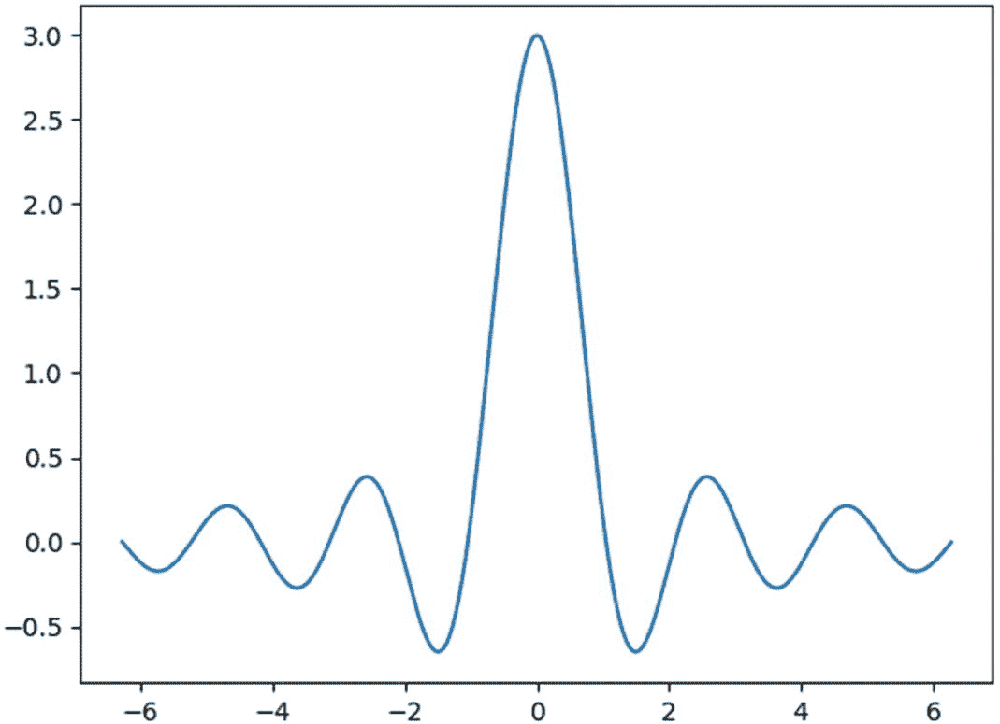

一个图绘制了一条钟形曲线和两侧两个较小的峰值。钟形曲线的峰值为 (0, 3)。左侧较小曲线的峰值分别为 (-4.5, 0.25)、(-2.5, 0.4)，右侧的峰值分别为 (2.5, 0.4)、(4.5, 0.25)。这些值为近似值。

`图 7-27` 以折线图表示的数学函数

```
import matplotlib.pyplot as plt
import numpy as np
x = np.arange(-2*np.pi,2*np.pi,0.01)
y = np.sin(3*x)/x
plt.plot(x,y)
```

现在你可以扩展到需要显示一系列函数的情况，例如：

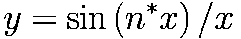

其中参数`n`是变化的。

```
import matplotlib.pyplot as plt
import numpy as np
x = np.arange(-2*np.pi,2*np.pi,0.01)
y = np.sin(x)/x
y2 = np.sin(2*x)/x
y3 = np.sin(3*x)/x
plt.plot(x,y)
plt.plot(x,y2)
plt.plot(x,y3)
```

如图 7-28 所示，每条线会自动分配不同的颜色。所有图形都绘制在同一个尺度上；也就是说，每个系列的数据点都参照相同的 x 轴和 y 轴。这是因为每次调用`plot()`函数都会考虑到之前对同一函数的调用，所以该图会应用这些更改，并记住之前的命令，直到该图被显示出来（在 Python 中使用`show()`，在 IPython QtConsole 中使用 Enter）。

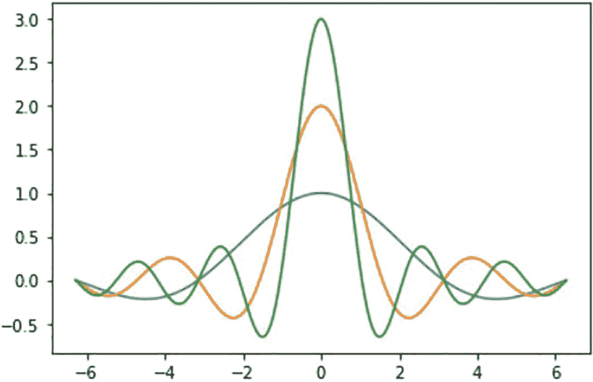

一个包含三条重叠钟形曲线的图。最上面的曲线两侧有 4 个峰值，中间的曲线两侧有 2 个峰值，最下面的曲线没有其他峰值。从上到下曲线的峰值位于 (0, 3)、(0, 1.9) 和 (0, 1)。这些值为近似值。

`图 7-28` 在同一图表中用不同颜色绘制了三个不同的系列

正如你在前面章节中看到的，除了默认设置，你还可以选择线条类型、颜色等。作为`plot()`函数的第三个参数，你可以指定一些对应颜色的代码（参见表 7-2）以及其他对应线条样式的代码，所有这些都包含在同一个字符串中。另一种可能性是分别使用两个关键字参数——`color`来定义颜色，`linestyle`来定义线条样式（见图 7-29）。

`表 7-2` 颜色代码

| 代码 | 颜色 |
| --- | --- |
| `b` | `blue` (蓝色) |
| `g` | `green` (绿色) |
| `r` | `red` (红色) |
| `c` | `cyan` (青色) |
| `m` | `magenta` (品红色) |
| `y` | `yellow` (黄色) |
| `k` | `black` (黑色) |
| `w` | `white` (白色) |

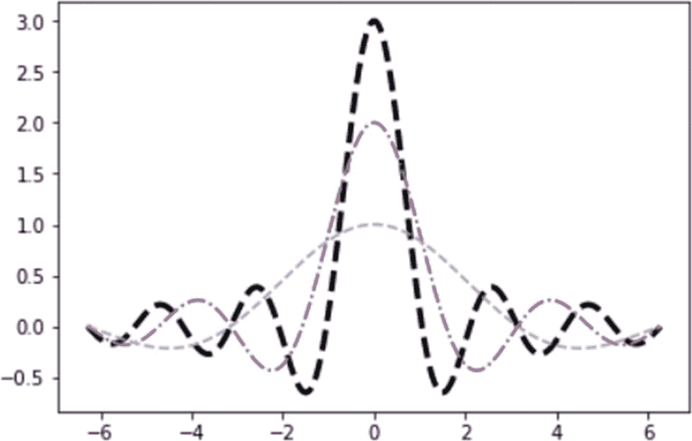

一个包含三条重叠虚线钟形曲线的图。最上面的曲线两侧有 4 个峰值，中间的曲线两侧有 2 个峰值，最下面的曲线没有其他峰值。从上到下曲线的峰值位于 (0, 3)、(0, 2) 和 (0, 1)。这些值为近似值。

`图 7-29` 你可以使用字符代码定义颜色和线条样式

```
import matplotlib.pyplot as plt
import numpy as np
x = np.arange(-2*np.pi,2*np.pi,0.01)
y = np.sin(x)/x
y2 = np.sin(2*x)/x
y3 = np.sin(3*x)/x
plt.plot(x,y,'k--',linewidth=3)
plt.plot(x,y2,'m-.')
plt.plot(x,y3,color='#87a3cc',linestyle='--')
```

你刚刚在 x 轴上定义了一个从 -2π 到 2π 的范围，但默认情况下，刻度上的值以数值形式显示。因此，你需要将这些数值替换为 π 的倍数。你也可以替换 y 轴上的刻度。要做到这一切，你必须使用`xticks()`和`yticks()`函数，为每个函数传递两个列表。第一个列表包含放置刻度的位置的值，第二个列表包含刻度标签。在这种特殊情况下，你必须使用包含 LaTeX 格式的字符串，以便正确显示 π 符号。记住，要在两个`$`字符内定义它们，并添加`r`作为前缀。

# 使用 matplotlib 和 pandas 进行可视化

## 基本线图与坐标轴设置

首先，我们可以使用 `matplotlib` 绘制基本的线图。例如，绘制三个不同的函数曲线：

```python
import matplotlib.pyplot as plt
import numpy as np
x = np.arange(-2*np.pi,2*np.pi,0.01)
y = np.sin(3*x)/x
y2 = np.sin(2*x)/x
y3 = np.sin(x)/x
plt.plot(x,y,color='b')
plt.plot(x,y2,color='r')
plt.plot(x,y3,color='g')
plt.xticks([-2*np.pi, -np.pi, 0, np.pi, 2*np.pi],
[r'$-2\pi$',r'$-\pi$',r'$0$',r'$+\pi$',r'$+2\pi$'])
plt.yticks([-1,0,1,2,3],
[r'$-1$',r'$0$',r'$+1$',r'$+2$',r'$+3$'])
```

最后，你将得到一个清晰美观的折线图，其中显示了希腊字符，如图 7-30 所示。

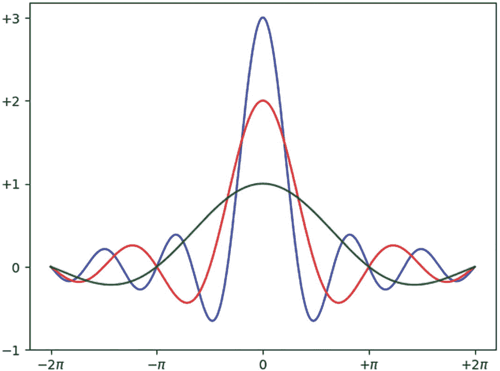

一个包含三条重叠钟形曲线的图。最上面的曲线两侧有 4 个峰值，中间的曲线两侧有 2 个峰值，最下面的曲线没有其他峰值。从上到下曲线的峰值位于 `(0, 3)`、`(0, 2)` 和 `(0, 1)`。这些值为近似值。

**图 7-30** 可以通过添加带有 LaTeX 格式的文本来改进刻度标签

在你目前看到的所有线性图表中，`x` 轴和 `y` 轴总是放置在图形的边缘（对应于边界框的边）。另一种显示坐标轴的方式是让两条轴穿过原点 `(0, 0)`，即两条笛卡尔坐标轴。

要做到这一点，你必须首先通过 `gca()` 函数获取 `Axes` 对象。然后通过这个对象，你可以选择构成边界框的四个边中的每一个，指定每个边的位置：右、左、下、上。使用 `set_color()` 函数并指定颜色为 `none` 来裁剪掉不与任何轴匹配的边（右边和上边）。然后，对应于 `x` 轴和 `y` 轴的边通过 `set_position()` 函数移动到穿过原点 `(0, 0)` 的位置。

```python
import matplotlib.pyplot as plt
import numpy as np
x = np.arange(-2*np.pi,2*np.pi,0.01)
y = np.sin(3*x)/x
y2 = np.sin(2*x)/x
y3 = np.sin(x)/x
plt.plot(x,y,color='b')
plt.plot(x,y2,color='r')
plt.plot(x,y3,color='g')
plt.xticks([-2*np.pi, -np.pi, 0, np.pi, 2*np.pi],
[r'$-2\pi$',r'$-\pi$',r'$0$',r'$+\pi$',r'$+2\pi$'])
plt.yticks([-1,0,+1,+2,+3],
[r'$-1$',r'$0$',r'$+1$',r'$+2$',r'$+3$'])
ax = plt.gca()
ax.spines['right'].set_color('none')
ax.spines['top'].set_color('none')
ax.xaxis.set_ticks_position('bottom')
ax.spines['bottom'].set_position(('data',0))
ax.yaxis.set_ticks_position('left')
ax.spines['left'].set_position(('data',0))
```

现在，图表将显示两条轴在图形中间交叉，即笛卡尔坐标轴的原点，如图 7-31 所示。

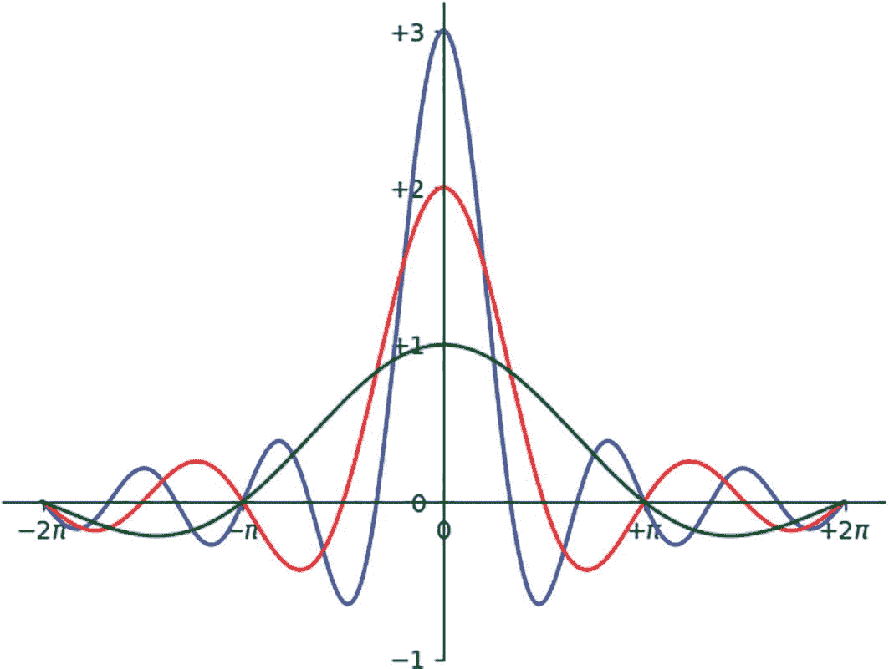

一个二维平面，上面有三个重叠的钟形曲线。最上面的曲线两侧有 4 个峰，中间的曲线两侧有 2 个峰，最下面的曲线没有其他峰。从上到下曲线的峰值分别为 `(0, 3)`、`(0, 2)` 和 `(0, 1)`。这些数值是近似值。

**图 7-31** 图表显示了两个笛卡尔坐标轴

## 图表标注与直方图

通常，使用标记来指定线上的特定点，并可选地添加箭头以更好地指示点的位置，这是非常有用的。例如，这个标记可以是一个 LaTeX 表达式，比如函数 `sinx/x` 当 `x` 趋于 0 时的极限公式。

在这方面，`matplotlib` 提供了一个名为 `annotate()` 的函数，它在这些情况下特别有用，即使获得良好结果所需的众多 `kwargs` 可能使其设置相当复杂。第一个参数是要表示的字符串，包含 LaTeX 表达式；然后可以添加各种 `kwargs`。图表中需要注意的点通过一个包含该点坐标 `[x, y]` 的列表传递给 `xy` kwarg 来指示。文本标记与要突出显示的点之间的距离由 `xytext` kwarg 定义，并通过一条曲线箭头表示，其特性在 `arrowprops` kwarg 中定义。

```python
import matplotlib.pyplot as plt
import numpy as np
x = np.arange(-2*np.pi,2*np.pi,0.01)
y = np.sin(3*x)/x
y2 = np.sin(2*x)/x
y3 = np.sin(x)/x
plt.plot(x,y,color='b')
plt.plot(x,y2,color='r')
plt.plot(x,y3,color='g')
plt.xticks([-2*np.pi, -np.pi, 0, np.pi, 2*np.pi],
[r'$-2\pi$',r'$-\pi$',r'$0$',r'$+\pi$',r'$+2\pi$'])
plt.yticks([-1,0,+1,+2,+3],
[r'$-1$',r'$0$',r'$+1$',r'$+2$',r'$+3$'])
plt.annotate(r'$\lim_{x\to 0}\frac{\sin(x)}{x}= 1$',
xy=[0,1],xycoords='data',
xytext=[30,30],
fontsize=16,
textcoords='offset points',
arrowprops=dict(arrowstyle="->",connectionstyle="arc3,rad=.2"))
ax = plt.gca()
ax.spines['right'].set_color('none')
ax.spines['top'].set_color('none')
ax.xaxis.set_ticks_position('bottom')
ax.spines['bottom'].set_position(('data',0))
ax.yaxis.set_ticks_position('left')
ax.spines['left'].set_position(('data',0))
```

运行这段代码，你将得到带有极限数学符号的图表，该点由箭头指向，如图 7-32 所示。

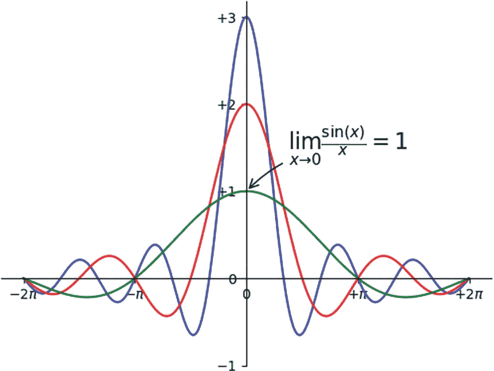

一个二维平面，上面有三个重叠的钟形曲线。最上面的曲线两侧有 4 个峰，中间的曲线有 2 个峰。最下面的曲线由极限 `x` 趋于 0 时 `sine x / x = 1` 定义。从上到下曲线的峰值大约在 `(0, 3)`、`(0, 1.9)` 和 `(0, 1)` 处。

**图 7-32** 使用 `annotate()` 函数可以将数学表达式添加到图表中

## 使用 pandas 绘制线图

现在转向更实际的案例，或者至少是与数据分析更相关的案例，是时候看看将 `matplotlib` 库应用于 `pandas` 库的数据框是多么容易了。将数据框中的数据可视化为线性图表非常容易。只需将数据框作为参数传递给 `plot()` 函数，即可获得一个多系列线性图表（见图 7-33）。

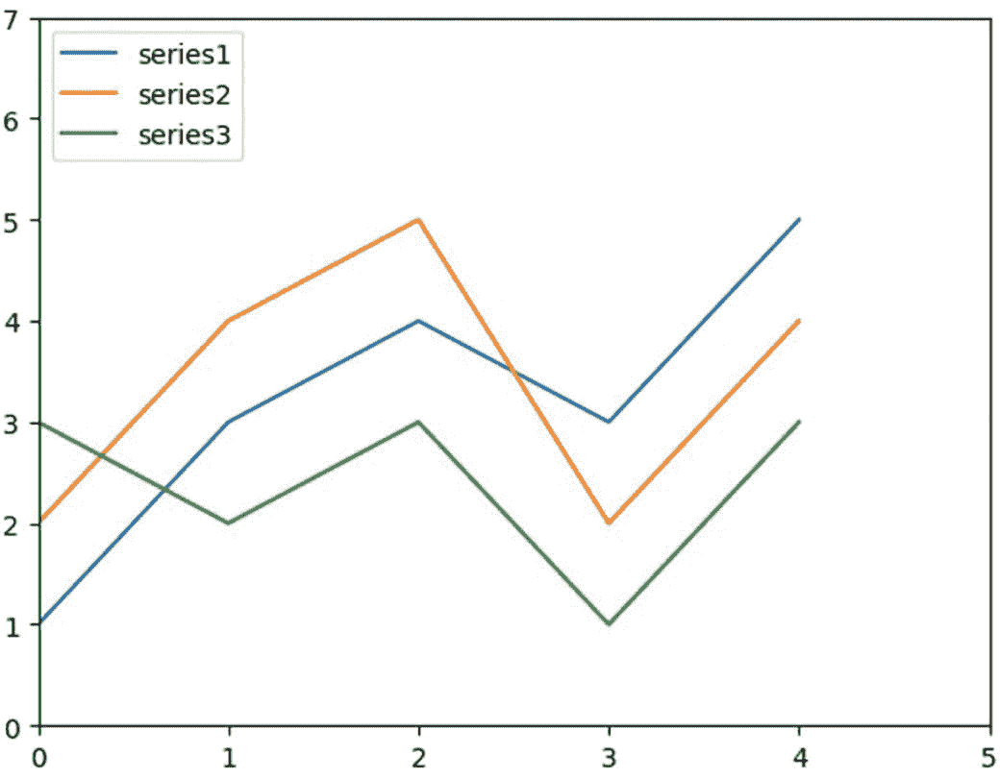

一个有 3 条波动且重叠的线条的折线图。系列 1 经过 `(0, 1)`、`(1, 3)`、`(2, 4)`、`(3, 3)` 和 `(4, 5)`。系列 2 经过 `(0, 2)`、`(1, 4)`、`(2, 5)`、`(3, 2)` 和 `(4, 4)`。系列 3 经过 `(0, 3)`、`(1, 2)`、`(2, 2.8)`、`(3, 1)` 和 `(4, 3)`。数值是近似值。

**图 7-33** 多系列线图显示了 pandas 数据框中的数据

```python
import matplotlib.pyplot as plt
import numpy as np
import pandas as pd
data = {'series1':[1,3,4,3,5],
'series2':[2,4,5,2,4],
'series3':[3,2,3,1,3]}
df = pd.DataFrame(data)
x = np.arange(5)
plt.axis([0,5,0,7])
plt.plot(x,df)
plt.legend(data, loc=2)
```

## 直方图

*直方图*由在 x 轴上建立的相邻矩形组成，这些矩形被分割成称为组距的离散区间，其面积与该组距内事件发生的频率成正比。这种可视化方式通常用于样本分布的统计研究中。

为了表示直方图，`pyplot`提供了一个名为`hist()`的特殊函数。这个图形函数还有一个其他生成图表的函数所不具备的特性。`hist()`函数除了绘制直方图外，还会返回一个元组，其中包含直方图计算的结果。实际上，`hist()`函数还可以实现直方图的计算，也就是说，只需提供一个样本值序列作为参数以及要分成的组数，它就会负责将样本范围划分为多个区间（组距），然后计算每个组距内的事件发生次数。此操作的结果，除了以图形形式显示（见图 7-34）外，还将以元组的形式返回。

`(n, bins, patches)`

要理解这个操作，最好的方法是举一个实际的例子。然后你可以使用`random.randint()`函数生成一个包含 100 个从 0 到 100 的随机值的总体。

```python
import matplotlib.pyplot as plt
import numpy as np
pop = np.random.randint(0,100,100)
pop
Out[ ]:
array([53, 11, 34, 75, 40, 89, 97, 78, 19, 50, 65, 30, 11, 38, 27, 11, 33,
23, 22, 54, 78, 83, 66, 19, 15, 70, 32, 78, 50, 56, 42, 60, 48, 13,
70, 83, 23, 69,  7, 76, 69,  8, 62,  5, 92, 71, 42, 98, 51, 20, 46,
32, 53, 64,  7, 22, 84, 14, 82, 39, 17, 27, 73,  5, 78, 41, 90, 73,
33, 57, 43, 57, 76, 98, 84, 62, 11, 98, 37, 95, 31, 86, 24, 83, 58,
83, 95, 48, 67, 96, 82,  8, 54, 41, 72, 32, 92, 64,  3,  4])
```

现在，通过将`hist()`函数作为参数传递，创建这些样本的直方图。例如，假设你想将事件发生次数分成 20 个组距（如果未指定，默认值为 10 个组距）。为此，你必须使用`bin` kwarg，如图 7-33 所示。

```python
n,bins,patches = plt.hist(pop,bins=20)
```

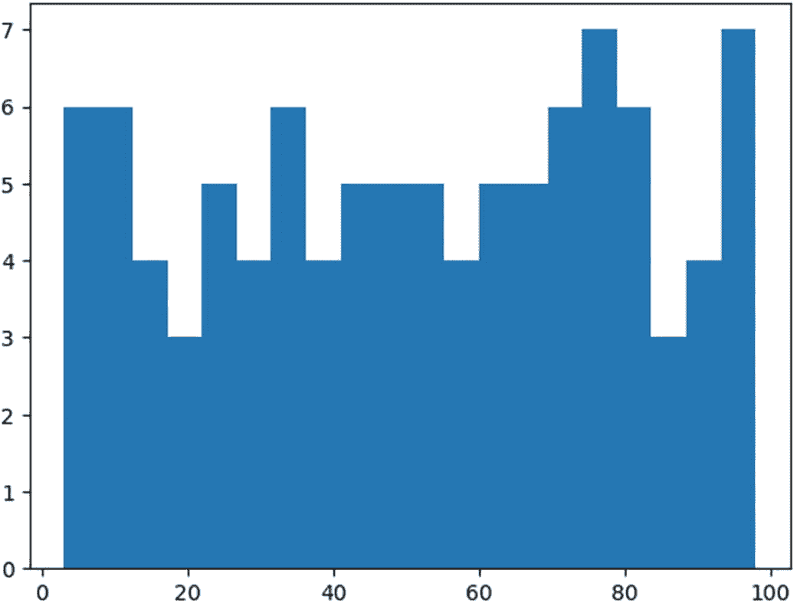

一个直方图，数据从左到右如下：`(5, 6)`、`(10, 6)`、`(15, 4)`、`(20, 3)`、`(25, 5)`、`(30, 4)`、`(35, 6)`、`(40, 4)`、`(45, 5)`、`(50, 5)`、`(55, 5)`、`(60, 4)`、`(65, 5)`、`(70, 6)`、`(75, 7)`、`(80, 6)`、`(85, 3)`、`(90, 4)`和`(95, 7)`。数值是近似值。

**图 7-34**

直方图显示了每个组距内的事件发生次数

### 条形图

另一种非常常见的图表类型是条形图。它与直方图非常相似，但不同之处在于，x 轴不用来引用数值，而是引用类别。使用 `matplotlib` 的 `bar()` 函数可以非常简单地实现条形图。

```python
import matplotlib.pyplot as plt
index = [0,1,2,3,4]
values = [5,7,3,4,6]
plt.bar(index,values)
```

通过这几行代码，您就可以得到如图 7-35 所示的条形图。

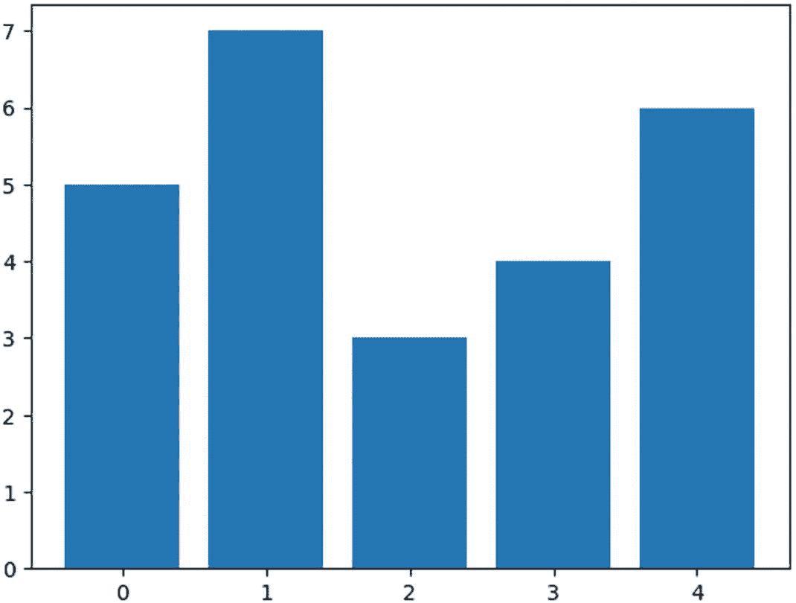

一个包含以下数据的条形图：(0, 5), (1, 7), (2, 3), (3, 4), (4, 6)。数值为近似值。

图 7-35

使用 `matplotlib` 创建的最简单的条形图

如果您查看图 7-34，您会看到索引被绘制在 x 轴上每个条形的起始位置。实际上，因为每个条形对应一个类别，所以最好通过刻度标签来指定类别，这些标签由一个传递给 `xticks()` 函数的字符串列表定义。至于这些刻度标签的位置，您需要将一个包含与它们在 x 轴上位置相对应的值的列表作为 `xticks()` 函数的第一个参数传递。最终您将得到一个条形图，如图 7-36 所示。

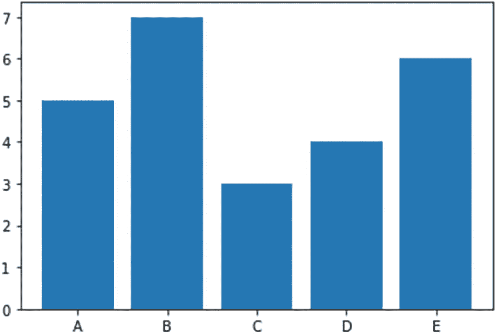

一个包含以下数据的条形图：A, 5；B, 7；C, 3；D, 4；E, 6。数值为近似值。

图 7-36

x 轴上带类别标签的简单条形图

```python
import numpy as np
index = np.arange(5)
values1 = [5,7,3,4,6]
plt.bar(index,values1)
plt.xticks(index,['A','B','C','D','E'])
```

实际上，您可以采取许多其他步骤来进一步完善条形图。每个这样的修饰都是通过在 `bar()` 函数中添加一个特定的关键字参数（kwarg）作为参数来实现的。例如，您可以通过 `yerr` 关键字参数以及一个包含标准差值的列表来添加条形的标准差。这个关键字参数通常与另一个名为 `error_kw` 的关键字参数结合使用，而 `error_kw` 又接受专门用于表示误差线的其他关键字参数。在这种情况下使用的两个非常特定的关键字参数是 `eColor`，它指定误差线的颜色，以及 `capsize`，它定义了标记误差线末端的横向线条的宽度。

您可以使用的另一个关键字参数是 `alpha`，它表示着色条形的透明度程度。`alpha` 是一个从 0 到 1 的值。当这个值为 `0` 时，对象完全透明，随着值的增加会逐渐变得明显，直到达到 `1`，颜色才被完全呈现。

像往常一样，建议使用图例，因此在这种情况下，您应该使用一个名为 `label` 的关键字参数来标识您正在表示的数据系列。

最终您将得到一个带误差线的条形图，如图 7-37 所示。

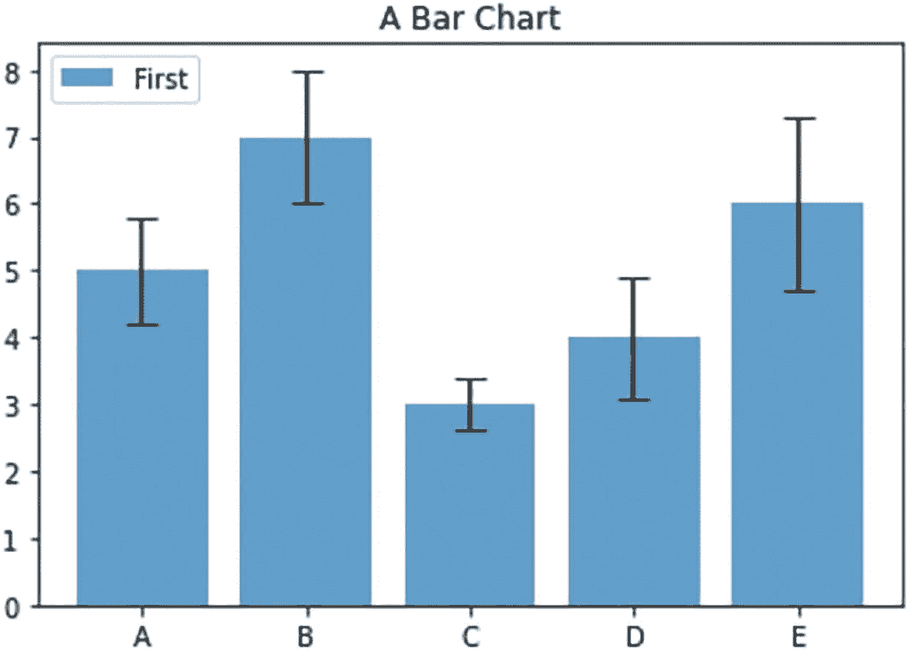

一个带误差线的条形图包含以下数据。条形 A 的值约为 5，误差线范围从 4.2 到 5.8。B：值 7，误差线范围从 6 到 8。C：值 3，误差线范围从 2.6 到 3.4。D：值 4，误差线范围从 3.2 到 5。E：值 6，误差线范围从 4.6 到 7.4。

图 7-37

带误差线的条形图

```python
import numpy as np
index = np.arange(5)
values1 = [5,7,3,4,6]
std1 = [0.8,1,0.4,0.9,1.3]
plt.title('A Bar Chart')
plt.bar(index,values1,yerr=std1,
error_kw={'ecolor':'0.1','capsize':6},
alpha=0.7,label='First')
plt.xticks(index,['A','B','C','D','E'])
plt.legend(loc=2)
```

## 水平条形图

到目前为止，您看到的都是垂直方向的条形图。也存在水平方向的条形图。这种模式由名为 `barh()` 的特殊函数实现。适用于 `bar()` 函数的参数和关键字参数同样适用于此函数。您需要注意的唯一变化是坐标轴的角色互换了。现在，类别由 y 轴表示，而数值显示在 x 轴上（见图 7-38）。

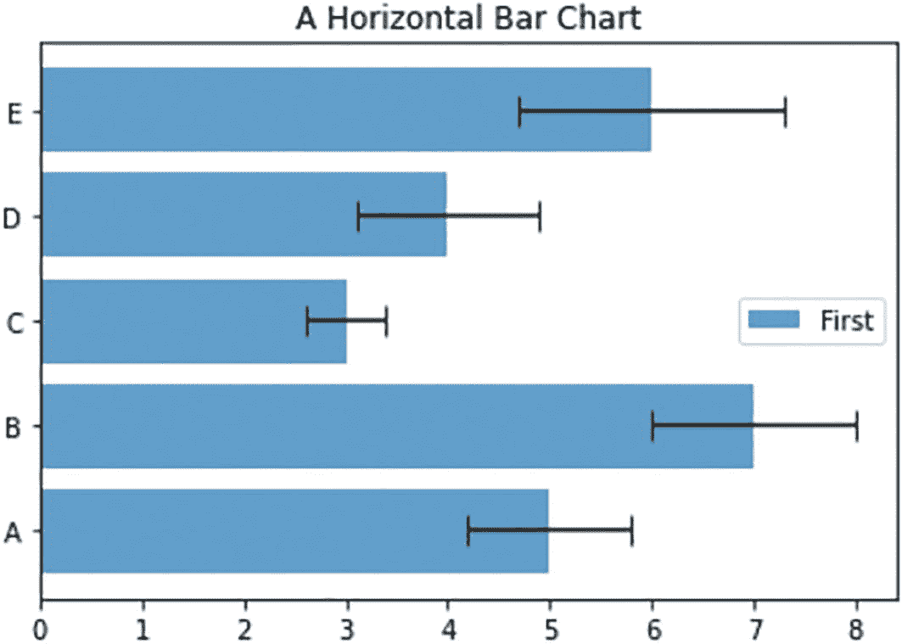

一个带误差线的水平条形图。条形 A 的值约为 5，误差线范围从 4.2 到 5.8。B：值 7，误差线范围从 6 到 8。C：值 3，误差线范围从 2.6 到 3.4。D：值 4，误差线范围从 3.2 到 5。E：值 6，误差线范围从 4.6 到 7.4。

图 7-38

一个简单的水平条形图

```python
import matplotlib.pyplot as plt
import numpy as np
index = np.arange(5)
values1 = [5,7,3,4,6]
std1 = [0.8,1,0.4,0.9,1.3]
plt.title('A Horizontal Bar Chart')
plt.barh(index,values1,xerr=std1,error_kw={'ecolor':'0.1','capsize':6},alpha=0.7,label='First')
plt.yticks(index,['A','B','C','D','E'])
plt.legend(loc=5)
```

## 多系列条形图

与折线图类似，条形图通常用于同时显示更大的数据系列。但在这种情况下，有必要就如何构建多系列条形图做一些说明。到目前为止，您已经定义了一个索引序列，每个索引对应一个条形，并将其分配给 x 轴。这些索引应该代表类别。然而，在这种情况下，多个条形必须共享同一个类别。

# 多系列柱状图

解决这个问题的一种方法是将一个索引所占用的空间（为了方便，其宽度设为 1）分割成与共享该索引的条形数量相同的若干部分。此外，建议添加一些空间，作为分隔一个类别与下一个类别的间隙（如图 7-39 所示）。

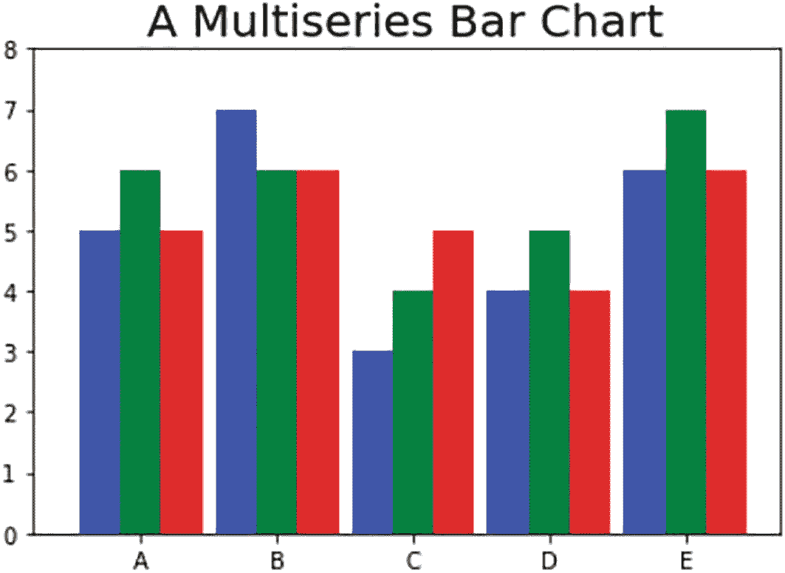

图 7-39：一个显示三个系列的多系列条形图

```python
import matplotlib.pyplot as plt
import numpy as np
index = np.arange(5)+0.5
values1 = [5,7,3,4,6]
values2 = [6,6,4,5,7]
values3 = [5,6,5,4,6]
bw = 0.3
plt.axis([0,5.5,0,8])
plt.title('A Multiseries Bar Chart',fontsize=20)
plt.bar(index,values1,bw,color='b')
plt.bar(index+bw,values2,bw,color='g')
plt.bar(index+2*bw,values3,bw,color='r')
plt.xticks(index+bw,['A','B','C','D','E'])
```

对于多系列水平条形图（见图 7-40），情况非常相似。您需要将 `bar()` 函数替换为相应的 `barh()` 函数，并记得将 `xticks()` 函数替换为 `yticks()` 函数。您还需要在 `axis()` 函数中反转坐标轴覆盖的数值范围。

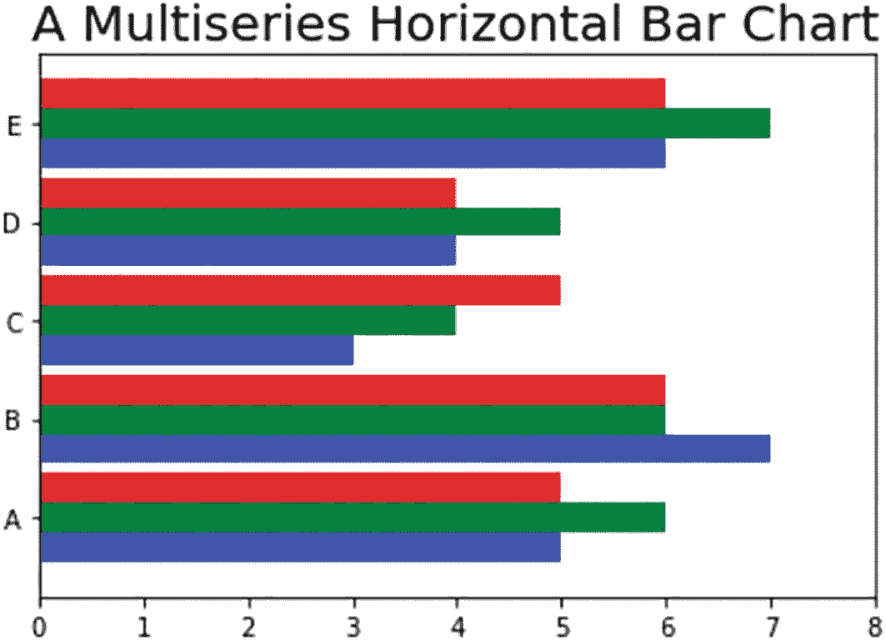

图 7-40：一个多系列水平条形图

```python
import matplotlib.pyplot as plt
import numpy as np
index = np.arange(5)+0.5
values1 = [5,7,3,4,6]
values2 = [6,6,4,5,7]
values3 = [5,6,5,4,6]
bw = 0.3
plt.axis([0,8,0,5.5])
plt.title('A Multiseries Horizontal Bar Chart',fontsize=20)
plt.barh(index,values1,bw,color='b')
plt.barh(index+bw,values2,bw,color='g')
plt.barh(index+2*bw,values3,bw,color='r')
plt.yticks(index+bw,['A','B','C','D','E'])
```

### 使用 pandas DataFrame 创建多系列柱状图

如在线图中所见，`matplotlib` 库也提供了直接将包含数据分析结果的 dataframe 对象以柱状图形式呈现的功能。并且，它同样能快速、直接、自动地完成这一操作。你只需对 dataframe 对象应用 `plot()` 函数，并在其中指定一个名为 `kind` 的关键字参数（kwarg），为其赋予你想要表示的图表类型，此处应为 `bar`。无需任何其他设置，即可得到如图 7-41 所示的柱状图。

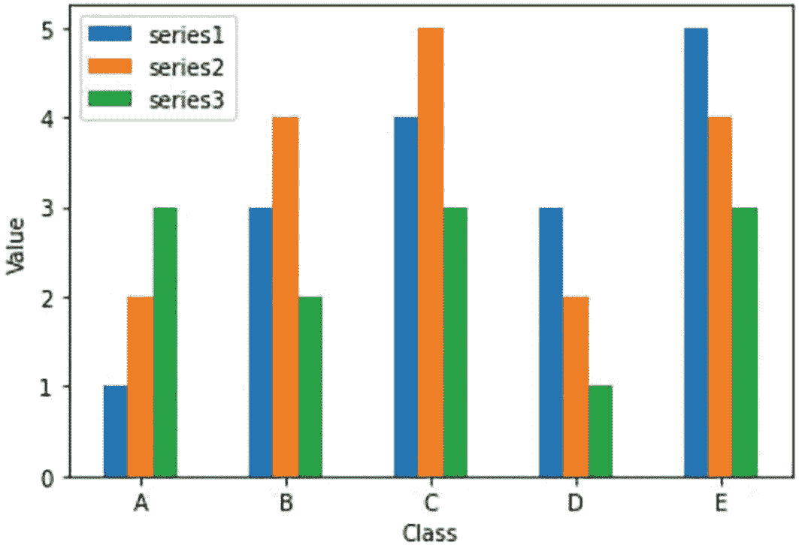

图 7-41：dataframe 中的数值可直接显示为柱状图

```python
import matplotlib.pyplot as plt
import numpy as np
import pandas as pd
data = {'series1':[1,3,4,3,5],
'series2':[2,4,5,2,4],
'series3':[3,2,3,1,3]}
df = pd.DataFrame(data, index=['A','B','C','D','E'])
df.plot(kind='bar', xlabel='Class',rot=0, ylabel='Value')
```

然而，如果你希望获得更多控制权，或者你的案例有此类需求，你仍然可以将 dataframe 的部分数据提取为 NumPy 数组，并按照本节前述示例的方式使用。也就是说，将它们作为单独的参数传递给 `matplotlib` 的函数。

此外，关于水平柱状图，可以应用相同的规则，但记得将 `barh` 设为 `kind` 关键字参数的值。

```python
import matplotlib.pyplot as plt
import numpy as np
import pandas as pd
data = {'series1':[1,3,4,3,5],
'series2':[2,4,5,2,4],
'series3':[3,2,3,1,3]}
df = pd.DataFrame(data, index=['A','B','C','D','E'])
df.plot(kind='barh',ylabel='Class', xlabel='Value')
```

你将得到一个多系列水平柱状图，如图 7-42 所示。

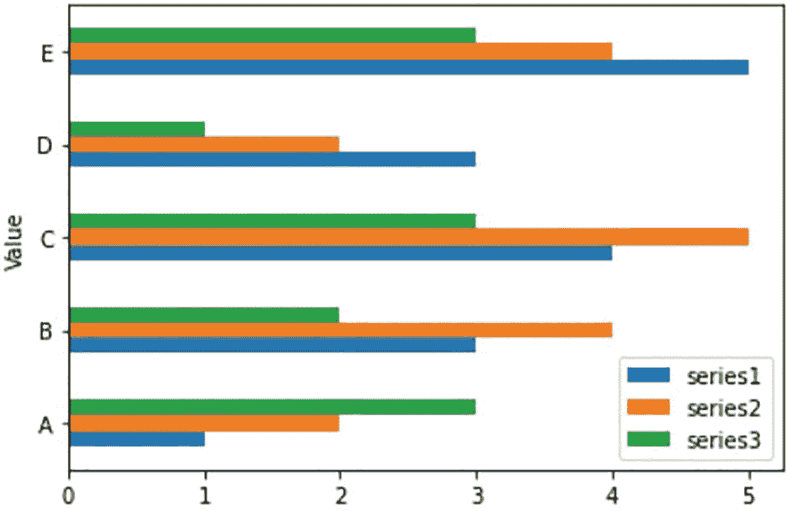

图 7-42：水平柱状图是可视化 dataframe 数值的有效替代方案

### 多系列堆叠柱状图

表示多系列柱状图的另一种方式是堆叠形式，其中柱子一个叠放在另一个之上。这在你想展示所有柱子总和的总值时特别有用。

要将简单的多系列柱状图转换为堆叠柱状图，你需要为每个 `bar()` 函数添加 `bottom` 关键字参数。每个系列都必须分配给相应的 `bottom` 关键字参数。最后，你将得到如图 7-43 所示的堆叠柱状图。

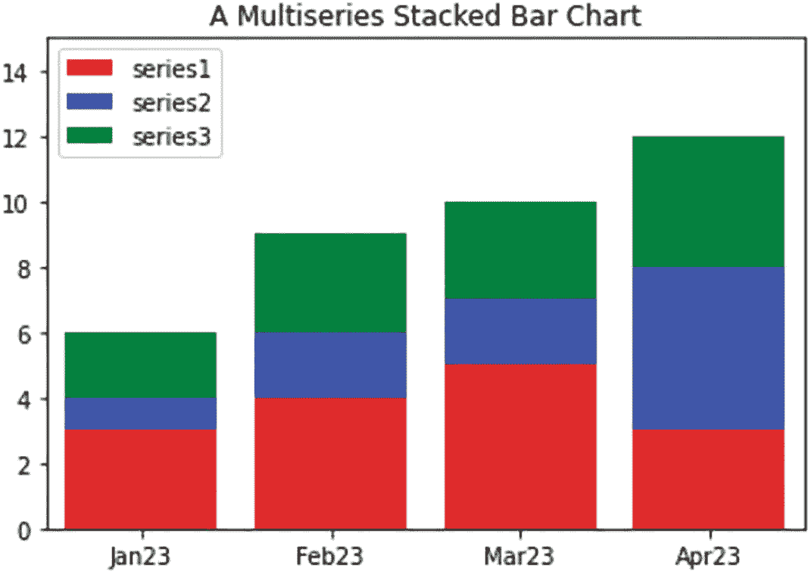

图 7-43：一个多系列堆叠柱状图

```python
import matplotlib.pyplot as plt
import numpy as np
series1 = np.array([3,4,5,3])
series2 = np.array([1,2,2,5])
series3 = np.array([2,3,3,4])
index = np.arange(4)
plt.axis([-0.5,3.5,0,15])
plt.title('A Multiseries Stacked Bar Chart')
plt.bar(index,series1,color='r')
plt.bar(index,series2,color='b',bottom=series1)
plt.bar(index,series3,color='g',bottom=(series2+series1))
plt.xticks(index,['Jan23','Feb23','Mar23','Apr23'])
plt.legend(['series1','series2','series3'], loc='upper left')
```

同样地，要创建等效的水平堆叠柱状图，你需要将 `bar()` 函数替换为 `barh()` 函数，并注意同时更改其他参数。实际上，`xticks()` 函数应替换为 `yticks()` 函数，因为类别的标签现在需要在 y 轴上显示。完成所有这些更改后，你将得到如图 7-44 所示的水平堆叠柱状图。

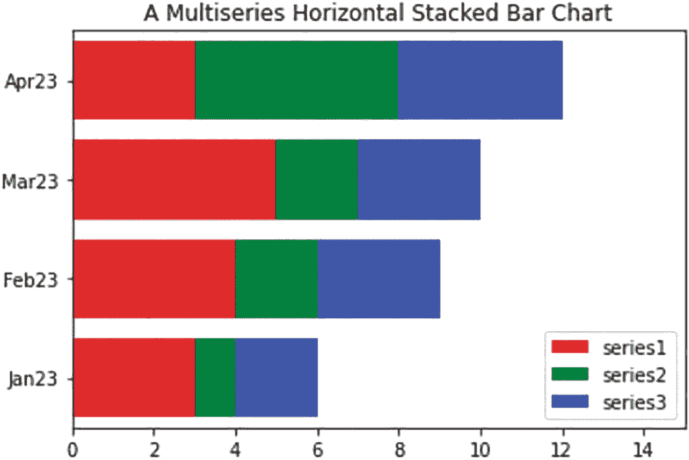

图 7-44：一个多系列水平堆叠柱状图

# 数据可视化图表类型

```python
import matplotlib.pyplot as plt
import numpy as np
index = np.arange(4)
series1 = np.array([3,4,5,3])
series2 = np.array([1,2,2,5])
series3 = np.array([2,3,3,4])
plt.axis([0,15,-0.5,3.5])
plt.title('A Multiseries Horizontal Stacked Bar Chart')
plt.barh(index,series1,color='r')
plt.barh(index,series2,color='g',left=series1)
plt.barh(index,series3,color='b',left=(series1+series2))
plt.yticks(index,['Jan23','Feb23','Mar23','Apr23'])
plt.legend(['series1','series2','series3'], loc='lower right')
```

## 使用 pandas DataFrame 创建堆叠柱状图

同样对于堆叠柱状图，使用 `plot()` 函数直接表示 `DataFrame` 对象中包含的数值非常简单。你只需要添加一个参数，将 `stacked` 关键字参数设置为 `True`（见图 7-45）。

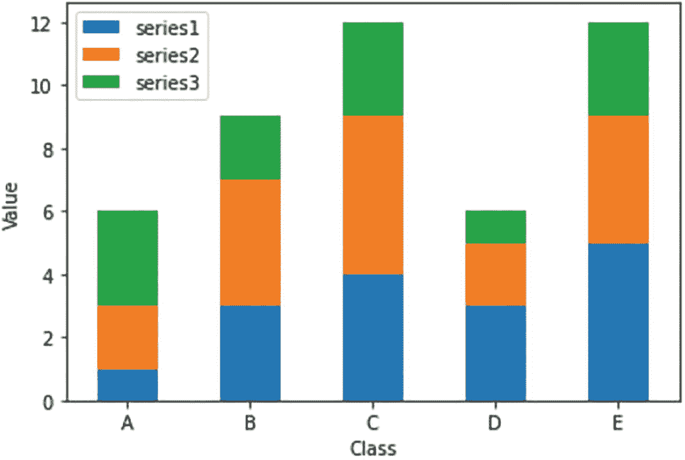

**图 7-45** dataframe 的数值可直接显示为堆叠柱状图

一个显示数值与类别关系的堆叠柱状图。从下到上的柱子分别代表序列 1、2 和 3。A 对应 1、2、3。B 对应 3、4、2。C 对应 4、5、3。D 对应 3、2、1。E 对应 5、4、3。数值为近似值。

```python
import matplotlib.pyplot as plt
import pandas as pd
data = {'series1':[1,3,4,3,5],
'series2':[2,4,5,2,4],
'series3':[3,2,3,1,3]}
df = pd.DataFrame(data, index=['A','B','C','D','E'])
df.plot(kind='bar', stacked=True, rot=0, xlabel='Class', ylabel='Value')
```

## 其他柱状图表示形式

另一种非常有用的表示形式是比较柱状图，其中具有相同类别的两系列数值通过沿 y 轴相反方向放置柱状条来进行比较。为此，你必须将其中一个系列的 y 值设为负数。在此示例中，你还会看到以不同方式为柱状条内部着色的可能性。实际上，你可以通过在特定的关键字参数 `facecolor` 上设置两种不同的颜色来实现。

此外，在此示例中，你将看到如何在每个柱状条的末尾添加带有标签的 y 值。这可以提高柱状图的可读性。你可以使用 `for` 循环来实现，其中 `text()` 函数将显示 y 值。你可以使用两个名为 `ha` 和 `va` 的关键字参数来调整标签位置，这两个参数分别控制水平和垂直对齐方式。结果将如图 7-46 所示。

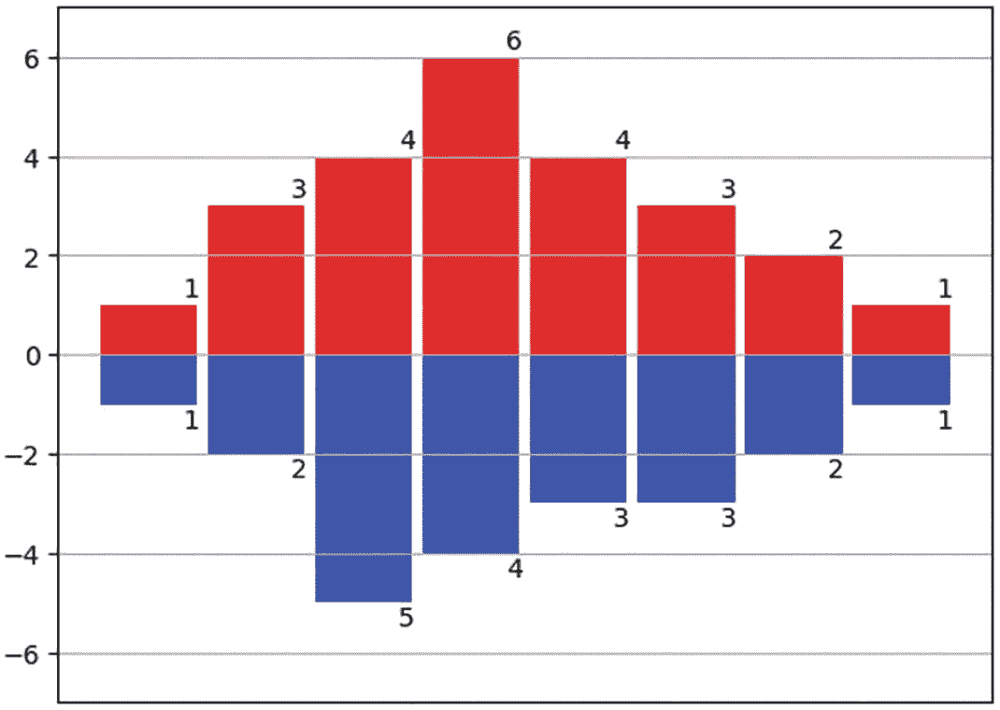

**图 7-46** 可以使用这种柱状图比较两个序列

一个包含两个序列的堆叠柱状图。从左到右的数值如下：1 和 1，2 和 3，5 和 4，4 和 6，3 和 4，3 和 3，2 和 2，以及 1 和 1。数值为近似值。

```python
import matplotlib.pyplot as plt
x0 = np.arange(8)
y1 = np.array([1,3,4,6,4,3,2,1])
y2 = np.array([1,2,5,4,3,3,2,1])
plt.ylim(-7,7)
plt.bar(x0,y1,0.9,facecolor='r')
plt.bar(x0,-y2,0.9,facecolor='b')
plt.xticks(())
plt.grid(True)
for x, y in zip(x0, y1):
plt.text(x + 0.4, y + 0.05, '%d' % y, ha='center', va= 'bottom')
for x, y in zip(x0, y2):
plt.text(x + 0.4, -y - 0.05, '%d' % y, ha='center', va= 'top')
```

## 饼图

饼图是柱状图的另一种数据展示方式，通过 `pie()` 函数即可轻松绘制。与这类函数相同，你只需将包含待显示数值的列表作为主要参数传入。这里我选用了百分比（总和为 100），但你可以使用任意数值。`pie()` 函数会自动计算出各数值所占的百分比。

对于这类图表，你还需要通过 kwargs 定义关键特性。例如，若想定义与输入数值序列对应的颜色序列，需使用 `colors` 参数。你需要为其分配一个字符串列表，每个字符串代表所需颜色的名称。另一个重要特性是为饼图的每个扇区添加标签，这可以通过 `labels` 参数实现，为其分配一个包含待显示标签的字符串列表即可。

此外，为使饼图呈现完美圆形，需在末尾添加 `axis()` 函数，并传入字符串 `'equal'` 作为参数。最终得到的饼图如图 7-47 所示。

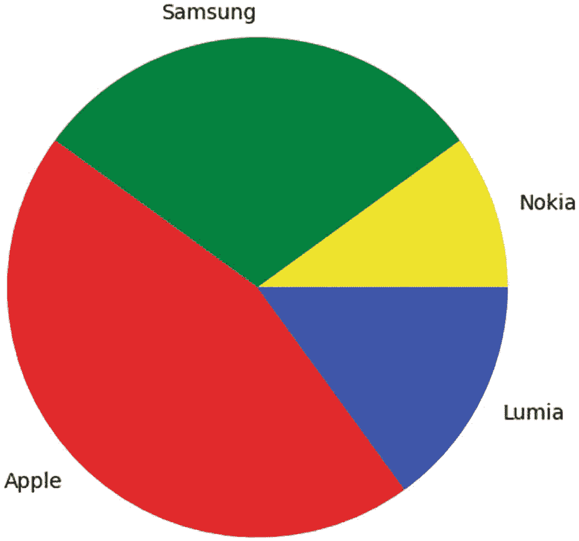

**图 7-47** 一个非常简单的饼图

该饼图包含四个扇区，按降序排列如下：苹果占比最高，紧随其后的是三星、Lumia 和诺基亚。

```python
import matplotlib.pyplot as plt
labels = ['Nokia','Samsung','Apple','Lumia']
values = [10,30,45,15]
colors = ['yellow','green','red','blue']
plt.pie(values,labels=labels,colors=colors)
plt.axis('equal')
```

若要为饼图增加复杂度，可以将某个扇区从饼图中分离出来。当你想突出显示特定扇区时，通常会使用这种技巧。例如，这里可以突出显示关于诺基亚的扇区。为此，有一个名为 `explode` 的特殊参数。它实际上是一个由 0 或 1 组成的浮点数序列，其中 1 表示完全分离的扇区，0 表示完全位于饼图中的扇区。所有中间值则对应不同程度的分离（见图 7-48）。

你还可以使用 `title()` 函数为饼图添加标题。通过添加 `startangle` 参数可以调整饼图的旋转角度，该参数接受 0 到 360 之间的整数值，精确对应旋转角度（0 为默认值）。修改后的图表应如图 7-48 所示。

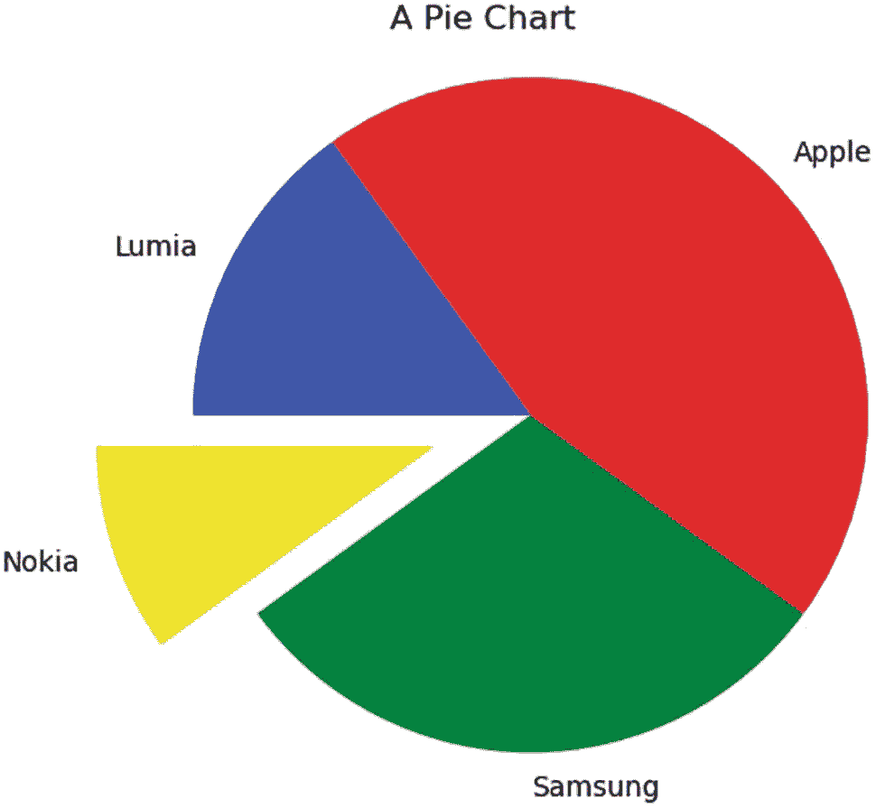

**图 7-48** 一个更高级的饼图

该饼图包含四个扇区，按降序排列如下：苹果占比最高，紧随其后的是三星、Lumia 和诺基亚。数值最小的标签为诺基亚的扇区被分离出来。

```python
import matplotlib.pyplot as plt
labels = ['Nokia','Samsung','Apple','Lumia']
values = [10,30,45,15]
colors = ['yellow','green','red','blue']
explode = [0.3,0,0,0]
plt.title('A Pie Chart')
plt.pie(values,labels=labels,colors=colors,explode=explode,startangle=180)
plt.axis('equal')
```

但饼图的可添加元素远不止于此。例如，饼图没有带刻度的坐标轴，因此很难直观判断每个扇区所代表的精确百分比。为解决这一问题，你可以使用 `autopct` 参数，它会在每个扇区中心添加显示对应数值的文本标签。

若想让图表更具视觉吸引力，可以通过设置 `shadow` 参数为 `True` 来添加阴影效果。最终得到的饼图如图 7-49 所示。

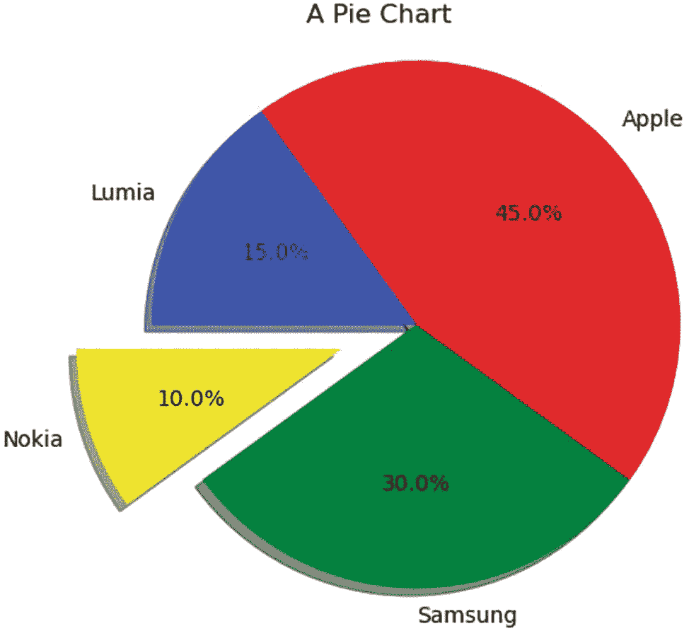

**图 7-49** 一个更高级的饼图

该饼图包含四个扇区，按降序排列如下：苹果 45%，三星 30%，Lumia 15%，诺基亚 10%。标签为诺基亚的扇区被分离出来。

```python
import matplotlib.pyplot as plt
labels = ['Nokia','Samsung','Apple','Lumia']
values = [10,30,45,15]
colors = ['yellow','green','red','blue']
explode = [0.3,0,0,0]
plt.title('A Pie Chart')
plt.pie(values,
labels=labels,
colors=colors,
explode=explode,
shadow=True,
autopct='%1.1f%%',
startangle=180)plt.axis('equal')
```

# 使用 pandas 数据框绘制饼图

对于饼图，你也可以表示数据框对象中包含的数值。但在此情况下，饼图一次只能表示一个序列，因此本示例中通过指定`df['series1']`仅显示第一个序列的值。你需要通过`plot()`函数中的`kind`参数指定图表类型，此处设为`pie`。此外，由于希望饼图呈现完美圆形，必须添加`figsize`参数。最终得到的饼图如图 7-50 所示。


系列 1 的饼图包含五个扇区，标签分别为 0、1、2、3、4 和 5。扇区按降序排列为 4、2、3、1、0。

**图 7-50** pandas 数据框中的数值可直接绘制成饼图

```python
import matplotlib.pyplot as plt
import pandas as pd
data = {'series1':[1,3,4,3,5],
'series2':[2,4,5,2,4],
'series3':[3,2,3,1,3]}
df = pd.DataFrame(data)
df['series1'].plot(kind='pie',figsize=(6,6))
```

# 高级图表

除了柱状图和饼图等更经典的图表外，你可能还想用其他方式呈现结果。在互联网和各种出版物中，有许多讨论和提出替代性图形解决方案的案例，其中一些方案确实构思巧妙、引人入胜。本节仅展示部分图形表示；关于此主题更详细的讨论超出了本书的范畴。你可以将本节视为对数据可视化这一不断扩展领域的入门介绍。

## 等高线图

科学领域中一种非常常见的图表类型是`等高线图`或`等高线地图`。这种可视化方法实际上适用于通过等高线图来显示三维曲面，该图由闭合曲线构成，这些曲线标示了曲面上处于相同水平高度、或具有相同`z`值的点。

尽管等高线图在视觉上结构非常复杂，但由于`matplotlib`库的存在，其实现并不困难。首先，你需要一个函数`z = f(x, y)`来生成三维曲面。然后，一旦你定义了将决定地图显示区域的`x`、`y`值范围，就可以通过对每一对`(x, y)`应用刚刚定义的函数`f(x, y)`来计算`z`值，从而得到一个`z`值矩阵。最后，借助`contour()`函数，你可以生成该曲面的等高线图。通常，人们还希望为等高线图添加一个颜色映射。也就是说，由等高线围成的区域会填充上由颜色映射定义的渐变色。例如，如图 7-51 所示，你可以用逐渐加深的蓝色调表示负值，随着正值增加，颜色过渡到黄色，然后变为红色。


一张等高线图。黄色圆圈标注为 0.8，它们被标注为 0.6、0.4 和 0.2 的同心边界线所包围。带有虚线边界的紫色图标注为负 0.6。右侧的垂直标尺范围为从底部的负 0.8 到顶部的 1，刻度增量为 0.2。

图 7-51：等高线图可以描述曲面的`z`值

此外，在处理这类图形时，在图表侧面添加一个颜色标尺作为参考几乎是必须的。只需在代码末尾添加`colorbar()`函数即可实现。

```python
import matplotlib.pyplot as plt
import numpy as np
dx = 0.01; dy = 0.01
x = np.arange(-2.0,2.0,dx)
y = np.arange(-2.0,2.0,dy)
X,Y = np.meshgrid(x,y)
def f(x,y):
return (1 - y**5 + x**5)*np.exp(-x**2-y**2)
C = plt.contour(X,Y,f(X,Y),8,colors='black')
plt.contourf(X,Y,f(X,Y),8)
plt.clabel(C, inline=1, fontsize=10)
plt.colorbar()
```

标准的颜色渐变（颜色映射）如图 7-51 所示。你可以从大量可用的颜色映射中进行选择，只需通过`cmap`关键字参数指定即可。

## 极坐标图

另一种流行的先进图表类型是`极坐标图`。这种图表的特点是一系列径向延伸的扇形区域；每个区域占据一定的角度。因此，你可以通过将两个不同数值分配给极坐标图的特征量——即半径`r`的延伸长度和扇形区域所占的角度`θ`——来显示这两个数值。实际上，这些就是极坐标`(r, θ)`，这是一种在坐标轴上表示函数的替代方式。从图形角度看，你可以将其想象成一种兼具饼图和柱状图特点的图表。事实上，如同饼图一样，每个扇形的角度提供了该类别相对于总量的百分比信息。而对于柱状图，径向延伸长度则代表该类别的数值。

到目前为止，你使用的是使用单个字符作为颜色代码的标准颜色集（例如，`r`表示红色）。实际上，你可以使用任何你想要的颜色序列。你只需定义一个字符串值列表，其中包含对应于你想要颜色的、采用`#rrggbb`格式的 RGB 代码。

奇怪的是，要获得极坐标图，你必须使用`bar()`函数，并传入包含角度`θ`的列表和每个扇形径向延伸长度的列表。结果将得到一个极坐标图，如图 7-52 所示。


一个极坐标图，数据按逆时针方向排列如下：0 度，4。45 度，7。90 度，5。135 度，3。180 度，1。225 度，5。270 度，6。315 度，7。

图 7-52：一个极坐标图

```python
import matplotlib.pyplot as plt
import numpy as np
N = 8
theta = np.arange(0.,2 * np.pi, 2 * np.pi / N)
radii = np.array([4,7,5,3,1,5,6,7])
plt.axes([0.025, 0.025, 0.95, 0.95], polar=True)
colors = np.array(['#4bb2c5', '#c5b47f', '#EAA228', '#579575', '#839557', '#958c12', '#953579', '#4b5de4'])
bars = plt.bar(theta, radii, width=(2*np.pi/N), bottom=0.0, color=colors)
```

## `mplot3d` 工具包

`mplot3d`工具包包含在所有标准版本的`matplotlib`安装中，它允许你将可视化能力扩展到 3D 数据。如果图形显示在单独的窗口中，你可以用鼠标旋转三维表示的坐标轴。

使用这个工具包，你仍然使用`Figure`对象，只是不再使用`Axes`对象，而是定义一种新类型的对象，称为`Axes3D`，该对象由此工具包引入。因此，如果你想要使用`Axes3D`对象，需要在代码中添加一个新的导入。

```python
from mpl_toolkits.mplot3d import Axes3D
```

### 3D 曲面

在之前的小节中，你使用等高线图通过等高线来表示三维曲面。使用`mplot3D`工具包，你可以直接在 3D 中绘制曲面。在此示例中，你使用了与等高线图中相同的函数`z = f(x, y)`。

一旦你计算了`meshgrid`，就可以使用`plot_surface()`函数查看曲面。将显示一个蓝色的三维曲面，如图 7-53 所示。


一个三维曲面图，矩形区域内有三个峰值，分别位于 (0.5, 0.4)、(-1.25, 0.5) 和 (-2, 0)。垂直轴范围从 -0.6 到 1。其他轴范围从 -2 到 2。数值为近似值。

图 7-53：使用`mplot3d`工具包可以表示三维曲面

```python
from mpl_toolkits.mplot3d import Axes3D
import matplotlib.pyplot as plt
fig = plt.figure()
ax = fig.add_subplot(111, projection="3d")
X = np.arange(-2,2,0.1)
Y = np.arange(-2,2,0.1)
X,Y = np.meshgrid(X,Y)
def f(x,y):
return (1 - y**5 + x**5)*np.exp(-x**2-y**2)
ax.plot_surface(X,Y,f(X,Y), rstride=1, cstride=1)
```

通过更改颜色映射，例如设置`cmap`关键字参数，可以使三维曲面最为突出。你还可以使用`view_init()`函数旋转曲面。实际上，该函数通过调整名为`elev`和`azim`的两个关键字参数来改变观察曲面的视点。通过它们的组合，你可以从任何角度显示曲面。第一个关键字参数调整观察曲面的高度，而`azim`调整曲面的旋转角度。

例如，你可以使用`plt.cm.hot`更改颜色映射，并将视点移动到`elev=30`和`azim=125`。结果如图 7-54 所示。


一个三维曲面图，三个最高峰位于 (0.5, 0.7)、(1.5, 0.45) 和 (-1, 0.7)，两个最低谷位于 (-1.5, -0.5) 和 (0, 1.5)。垂直轴范围从 -0.6 到 1。其他轴范围从 -2 到 2。数值为近似值。

图 7-54：三维曲面可以旋转并从更高的视点进行观察

```python
from mpl_toolkits.mplot3d import Axes3D
import matplotlib.pyplot as plt
fig = plt.figure()
ax = fig.add_subplot(111, projection="3d")
X = np.arange(-2,2,0.1)
Y = np.arange(-2,2,0.1)
X,Y = np.meshgrid(X,Y)
def f(x,y):
return (1 - y**5 + x**5)*np.exp(-x**2-y**2)
ax.plot_surface(X,Y,f(X,Y), rstride=1, cstride=1, cmap=plt.cm.hot)
ax.view_init(elev=30,azim=125)
```

### 3D 散点图

在所有 3D 视图模式中，最常用的仍是 3D 散点图。通过这种可视化方式，您可以识别数据点是否遵循特定趋势，但最重要的是判断它们是否倾向于聚类。

在此情况下，您使用与 2D 情况相同的 `scatter()` 函数，但将其应用于 `Axes3D` 对象。通过这样做，您可以将不同系列（通过多次调用 `scatter()` 函数表示）全部可视化在同一个 3D 表示中（参见图 7-55）。


图 7-55：此 3D 散点图显示了三个不同的簇

```python
import matplotlib.pyplot as plt
import numpy as np
from mpl_toolkits.mplot3d import Axes3D
xs = np.random.randint(30,40,100)
ys = np.random.randint(20,30,100)
zs = np.random.randint(10,20,100)
xs2 = np.random.randint(50,60,100)
ys2 = np.random.randint(30,40,100)
zs2 = np.random.randint(50,70,100)
xs3 = np.random.randint(10,30,100)
ys3 = np.random.randint(40,50,100)
zs3 = np.random.randint(40,50,100)
fig = plt.figure()
ax = fig.add_subplot(111, projection="3d")
ax.scatter(xs,ys,zs)
ax.scatter(xs2,ys2,zs2,c='r',marker='^')
ax.scatter(xs3,ys3,zs3,c='g',marker='*')
ax.set_xlabel('X Label')
ax.set_ylabel('Y Label')
ax.set_zlabel('Z Label')
```

### 3D 条形图

数据分析中另一种广泛使用的 3D 图是 3D 条形图。同样在此情况下，您将 `bar()` 函数应用于 `Axes3D` 对象。如果您定义了多个系列，可以在同一个 3D 可视化中累积多次调用 `bar()` 函数（参见图 7-56）。


图 7-56：一个 3D 条形图

```python
import matplotlib.pyplot as plt
import numpy as np
from mpl_toolkits.mplot3d import Axes3D
x = np.arange(8)
y = np.random.randint(0,10,8)
y2 = y + np.random.randint(0,3,8)
y3 = y2 + np.random.randint(0,3,8)
y4 = y3 + np.random.randint(0,3,8)
y5 = y4 + np.random.randint(0,3,8)
clr = ['#4bb2c5', '#c5b47f', '#EAA228', '#579575', '#839557', '#958c12', '#953579', '#4b5de4']
fig = plt.figure()
ax = fig.add_subplot(111, projection="3d")
ax.bar(x,y,0,zdir='y',color=clr)
ax.bar(x,y2,10,zdir='y',color=clr)
ax.bar(x,y3,20,zdir='y',color=clr)
ax.bar(x,y4,30,zdir='y',color=clr)
ax.bar(x,y5,40,zdir='y',color=clr)
ax.set_xlabel('X Axis')
ax.set_ylabel('Y Axis')
ax.set_zlabel('Z Axis')
ax.view_init(elev=40)
```

## 多面板图

到目前为止，您已经看到了通过图表表示数据的不同方式。您还了解了如何通过子图在同一图形中分隔显示更多图表。在本节中，您将通过分析更复杂的案例来加深对这个主题的理解。

### 在其他子图中显示子图

现在将解释一种更高级的方法：在框架内，在图表中显示其他图表的能力。由于您处理的是框架，即 `Axes` 对象，您需要将主 `Axes`（即常规图表）与要添加的框架（将是另一个 `Axes` 实例）分开。为此，您使用 `figures()` 函数获取 `Figure` 对象，然后使用 `add_axes()` 函数在该对象上定义两个不同的 `Axes` 对象。此示例的结果见图 7-57。


图 7-57：一个子图显示在另一个图中

```python
import matplotlib.pyplot as plt
fig = plt.figure()
ax = fig.add_axes([0.1,0.1,0.8,0.8])
inner_ax = fig.add_axes([0.6,0.6,0.25,0.25])
```

为了更好地理解这种显示方式的效果，您可以用真实数据填充之前的 `Axes` 对象，如图 7-58 所示。


图 7-58：一个更真实的子图嵌套图可视化

```python
import matplotlib.pyplot as plt
import numpy as np
fig = plt.figure()
ax = fig.add_axes([0.1,0.1,0.8,0.8])
inner_ax = fig.add_axes([0.6,0.6,0.25,0.25])
x1 = np.arange(10)
y1 = np.array([1,2,7,1,5,2,4,2,3,1])
x2 = np.arange(10)
y2 = np.array([1,3,4,5,4,5,2,6,4,3])
ax.plot(x1,y1)
inner_ax.plot(x2,y2)
```

### 子图网格

您已经了解如何创建子图。使用 `subplots()` 函数然后分割绘图区域来添加子图相当简单。`matplotlib` 允许您使用另一个名为 `GridSpec()` 的函数来处理更复杂的情况。这种划分允许将绘图区域分割成子区域的网格，您可以为每个子图分配一个或多个子区域，最终可以获得不同大小和方向的子图，如图 7-59 所示。


图 7-59：可以在子区域网格上定义不同大小的子图

既然您已经清楚如何通过将各个区域分配给子图来管理网格，那么是时候了解如何使用这些子图了。实际上，您可以使用每个`add_subplot()`函数返回的`Axes`对象来调用`plot()`函数并绘制相应的图形（参见图7-60）。

```python
import matplotlib.pyplot as plt
gs = plt.GridSpec(3,3)
fig = plt.figure(figsize=(6,6))
fig.add_subplot(gs[1,:2])
fig.add_subplot(gs[0,:2])
fig.add_subplot(gs[2,0])
fig.add_subplot(gs[:2,2])
fig.add_subplot(gs[2,1:])
```


1. 一个条形图，数据点为 (0, 3), (1, 2), (2, 4), (3, 6), (4, 4)。 2. 一个折线图，线条穿过 (0, 9.5), (6, 9.5), (7, 3)。 3. 一个折线图，线条穿过 (0, 3), (1, 2), (4, 4)。 4. 一个条形图，数据点为 (3, 0), (2, 1), (4, 2), (6, 3), (4, 4)。 5. 一个包含 2 个点的散点图。

图 7-60
子图网格可以同时显示多个图形

```python
import matplotlib.pyplot as plt
import numpy as np
gs = plt.GridSpec(3,3)
fig = plt.figure(figsize=(6,6))
x1 = np.array([1,3,2,5])
y1 = np.array([4,3,7,2])
x2 = np.arange(5)
y2 = np.array([3,2,4,6,4])
s1 = fig.add_subplot(gs[1,:2])
s1.plot(x,y,'r')
s2 = fig.add_subplot(gs[0,:2])
s2.bar(x2,y2)
s3 = fig.add_subplot(gs[2,0])
s3.barh(x2,y2,color='g')
s4 = fig.add_subplot(gs[:2,2])
s4.plot(x2,y2,'k')
s5 = fig.add_subplot(gs[2,1:])
s5.plot(x1,y1,'b^',x2,y2,'yo')
```

## Seaborn 库

`Seaborn`是一个基于`matplotlib`库的数据可视化库。与`matplotlib`不同，该库已提供了融合了图形与统计计算元素的现成图形解决方案。此库专为与`pandas`及其数据结构紧密配合而设计。

首先你需要在虚拟环境中安装`seaborn`库。如果你使用的是Anaconda平台，可以直接通过Anaconda Navigator进行安装。在你正在使用的虚拟环境的可用包中选择该包，然后启动安装，如图7-61所示。


Anaconda Navigator窗口的截图包含三部分。左侧是主页、环境、学习与社区选项卡。环境选项已被选中。中央选中了带播放图标的Edition 3。右侧是标有Seaborn的搜索框。

图 7-61
通过Anaconda Navigator安装Seaborn

或者你也可以通过`CMD.exe`提示符控制台安装`seaborn`库。输入以下命令：

```
conda install seaborn
```

对于那些没有Anaconda平台的用户，仍然可以通过PyPI系统使用`pip`命令安装该包。

```
pip install seaborn
```

一旦Seaborn安装完成，你可以打开一个IPython会话，或者更确切地说，一个Jupyter Notebook，并导入该库：

```
import seaborn as sns
```

此时你就可以开始使用Seaborn制图了。这项任务分为三个部分：

*   选择主题

*   加载数据集

*   创建图表

让我们从一个极其简单的示例开始，介绍这三个步骤。

首先你需要选择一个主题。我所说的主题，是指一系列决定图形布局和样式的图形设置（形状、颜色、网格）。在这方面，Seaborn提供了一系列现成的主题，可以通过使用`set_theme()`函数并将主题名称作为参数传入来选择。如果你想使用默认主题，则无需向该函数设置任何参数。

```
sns.set_theme()
```

否则，你可以根据需要或喜好指定各种样式和预定义调色板，通过指定可选参数及其相对名称来实现。例如：

```
sns.set_theme(style='darkgrid', palette='Set2')
```

此示例将图形主题设置为具有深色网格背景，并使用该库中众多可用调色板之一。

此时，下一步是加载一个包含要在图表中显示的点和信息的数据集。稍后你将看到如何从`pandas`数据框加载数据，但眼下你将使用该库中众多示例数据集之一。

```
tips = sns.load_dataset("tips")
tips
```

结果，你将得到一个数据框（见图7-62），其中包含与不同个体留给餐厅服务员的小费相关的一系列数据，按性别、餐点类型以及餐费成本分类。


一个表格有 7 列和 244 行。显示第 0 到 4 行以及第 239 到 243 行，中间有省略号。列标题依次为总账单、小费、性别、是否吸烟、星期、时段和人数。

图 7-62
Seaborn库中小费数据框的内容

现在你已经查看了数据框的内容，你可能想要创建一个图表，其中不同的的小费（x轴）与支付的账单（y轴）相关联。要使用Seaborn制作图表，你可以使用`relplot()`函数。该函数接受大量参数，这些参数将指定数据框中的不同数据如何与图表的不同特征相关联。在此例中，非常简单，因为你只需要将`Tip`和`Total_Bill`列中包含的值关联到笛卡尔坐标轴上。

```python
sns.relplot(
    data=tips,
    x='total_bill', y='tip',
)
```

在这种情况下，你将得到一个与图7-63相同的散点图。


一个显示小费与总账单金额之间正相关关系的散点图。部分数据点包括 (2, 0.7)、(10, 2)、(20, 3)、(30, 5)、(40, 7.5) 和 (51, 10)。数值为近似值。

**图 7-63**
Seaborn散点图，展示了小费与支付账单之间的关系

你可以观察到这些数据点趋向于某种线性关系，这种关系倾向于将小费定义为支付账单金额的20%，尽管小费低于此值的可能性很大，而高于此值的可能性非常小。

你可以通过向图表中添加更多信息来推进数据分析。查看`tips`数据框，你会发现每笔小费都与付款人的性别相关联。我们来探究一下不同性别在支付小费时是否存在不同趋势。你需要将性别信息插入到图表中，通过使用`style`和`hue`参数来区分所显示数据点的外观，这两个参数分别表示数据点的形状及其颜色。

```python
sns.relplot(
    data=tips,
    x='total_bill', y='tip',
    hue='sex', style='sex',
)
```

运行代码后，你将得到一个与图7-64相同的图表。


一个显示小费与总账单金额之间关系的散点图，其中包含两组呈正相关关系的数据点。部分数据点如下：男性：(10, 1.8)、(20, 3)、(30, 5.5)、(40, 7.5) 和 (51, 10)。女性：(2, 0.8)、(10, 2)、(20, 4.2)、(30, 5) 和 (43, 5)。数值为近似值。

**图 7-64**
散点图，图中数据点根据付款人性别进行了区分

在这种情况下，很明显，无论付款人是男性还是女性，其行为都没有区别。

但Seaborn不仅限于图形表示，它还提供了统计工具，可以分析要显示的数据，并据此添加包含统计信息的图形组件。在散点图的示例中，小费金额与支付账单之间存在离散的线性关系。Seaborn为此提供了一个专用函数`lmplot()`。它会生成一个类似于之前用`relplot()`绘制的散点图，但在此基础上，还会在散点图上添加一条显示回归拟合的图形。

```python
sns.lmplot(data=tips, x='total_bill', y='tip')
```

运行此函数，你将得到一个如图7-65所示的散点图。


`图 7-65`

带有线性回归图形元素的散点图

正如你所见，一开始通过快速扫描得出的“20% 趋势”这一判断被证明是错误的。观察这条直线的趋势，很明显，随着支付金额的增加，这个比例值逐渐减小。因此可以推测，对于 10 美元这样的小额账单，存在 20% 的小费趋势，但随着金额的增加，小费比例会逐渐下降（尽管小费的绝对金额似乎在持续增加）。

延续这种数据分析的思路，你之前假设小费比例不依赖于付款人的性别。因此，你可以考虑性别细分来重新绘制之前的图表。

```python
sns.lmplot(data=tips, x='total_bill', y='tip', hue='sex')
```

运行此函数，你将得到一个如图 7-66 所示的散点图。


一张小费与总账单的散点图显示了两个正相关的图。其中一些数据点如下。男性：(10, 1.8), (20, 3), (30, 5), (40, 4.8), (51, 10)。女性：(3, 0.8), (10, 2), (20, 4.2), (30, 5), (43, 5)。两条相交的线穿过这些点。以上数值均为近似值。

`图 7-66` 按性别进行线性回归的散点图

如您所见，您匆匆一瞥所做出的假设被证明是正确的。男性和女性的线性回归线几乎完全相同。

但是，如果您想要以数字形式而非仅图形形式获取统计信息呢？到目前为止，您已经看到，`Seaborn` 可以以图形方式为统计评估（例如在一组点上的线性回归）添加元素。然而，要添加精确的数值以在散点图上显示，则必须使用 `SciPy` 库来获取这些数值。

如果要将这些数字添加到图表中，您需要在前一种情况（即不区分性别的情况，因为统计数据几乎相同）中添加几行代码。

```python
import seaborn as sns
import matplotlib.pyplot as plt
from scipy import stats

g = sns.lmplot(data=tips, x='total_bill', y='tip')

def annotate(data, **kws):
    slope, intercept, r, p, std_err = stats.linregress(data['total_bill'], data['tip'])
    ax = plt.gca()
    ax.text(.05, .8, 'y={0:.1f}x+{1:.1f}, r={2:.2f}, \np={3:.2g}, std_err={4:.3f}'.format(slope, intercept, r, p, std_err),
            transform=ax.transAxes)

g.map_dataframe(annotate)
plt.show()
```

这样就得到了包含线性回归所有统计信息的散点图，例如直线的系数、*rho* 和 *p* 值以及标准差（见图 7-67）。


一张小费与总账单的散点图显示正相关。一些数据点为 (3, 0.7), (10, 2), (20, 3), (30, 4.3), (40, 4.8) 和 (51, 10)。数值均为近似值。公式为 y = 0.1x + 0.9，r = 0.68，p = 6.7e-34，标准误 = 0.007。

`图 7-67` 添加了从 `SciPy` 获取的线性回归统计值的散点图

使用 `Seaborn` 的另一个有趣方法是图形化地研究一系列样本的统计分布。通过图形观察某些值的分布方式，可以让您获取关于所研究值类型的大量信息。例如，使用 `tips` 数据框示例，借助 `Seaborn` 可以可视化小费和已支付账单的值的分布，以便对所考虑的样本进行分析。在这方面，`jointplot()` 函数允许您保留像之前看到的散点图，同时在 x 轴和 y 轴上添加相应轴上点的值的分布作为条形图。

```python
sns.jointplot(data=tips, x='total_bill', y='tip')
```

执行这个简单的函数，您会得到一个精彩的散点图，如图 7-68 所示。


一张小费与总账单的散点图显示正相关。顶部是一个呈右偏趋势的条形图，右侧则是波动趋势。数据点包括 (10, 2), (20, 3), (30, 4.3), (40, 5), (48, 9) 和 (51, 10)。数值均为近似值。

`图 7-68` 在两个坐标轴上添加了值分布的散点图

一眼看去，您可以看到两个分布非常相似，主要集中在 15 美元的账单和 3 美元的小费上达到最大值。通过重新引入性别区分，可以获得关于样本总体的其他有用信息。在这种情况下，只需将 `sex` 值添加到 `hue` 参数即可。

```python
sns.jointplot(data=tips, x='total_bill', y='tip', hue='sex')
```

如果运行这个函数，您会得到一个类似于图 7-69 所示的散点图。


一张小费与总账单的散点图显示了两个正相关的图。顶部和右侧各有两个右偏的曲线图。男性：(10, 1.5), (20, 3), (30, 5.5), (51, 10)。女性：(5, 1), (10, 2), (20, 4.2), (30, 5), (43, 5)。数值均为近似值。

`图 7-69` 按性别区分的总体的散点图，并附有相应的值分布

数据框中与男性相关的值多于女性。就分布而言，男性似乎在餐厅支付的账单略高（也许是因为他们吃得更多，或者因为他们可能更慷慨……  一个眨眼的表情符号。），而在“慷慨程度”方面，两性之间看不出差异，因为两个分布的最大值点相当。在账单方面，尽管男性总体的分布范围更大，但其最大值点却向更高的数字偏移。

到目前为止，您使用了库中众多可用数据集之一，但在实际案例中，您将需要使用库外部的数据框。考虑一个您曾用于 `matplotlib` 生成多系列条形图的其中一个数据框作为示例。

```python
import numpy as np
import pandas as pd

data = {'type':['A','B','C','D','E'],
        'series1':[1,3,4,3,5],
        'series2':[2,4,5,2,4],
        'series3':[3,2,3,1,3]}
df = pd.DataFrame(data)
df
```

运行代码后，您将得到如图 7-70 所示的数据框。


一个表格，有 4 列和 5 行。列标题分别为 `type`、`series1`、`series2` 和 `series3`。

`图 7-70` 用于使用 `Seaborn` 生成多系列条形图的数据框

但这种形式的数据框不适合直接与 `Seaborn` 一起使用。最好将其转换为不同的形式。确实，在该数据框中，有三个相同类型的列：`series1`、`series2` 和 `series3`。您可以将这三列合并为一列，并添加一个新列，其中包含这些列的名称作为值。为此，您可以使用*取消透视*，在 `pandas` 中通过 `melt()` 函数实现。

```python
df_unpivot = pd.melt(df, id_vars='type', value_vars=['series1', 'series2', 'series3'])
df_unpivot
```

执行取消透视操作后，您将得到一个新的数据框，如图 7-71 所示。


一个表格，有 3 列和 15 行。列标题分别为 `type`、`variable` 和 `value`。

`图 7-71` 对初始数据框进行取消透视操作的结果

现在您有了一个结构适合与 `Seaborn` 一起使用的数据框，您可以使用 `barplot()` 函数来生成图表。

```python
import seaborn as sns
%matplotlib inline

sns.barplot(data=df_unpivot, x='type', y='value', hue='variable')
```

```
运行代码后，您将得到一个类似图 7-72 所示的条形图。


一个三重条形图绘制了值相对于类型的关系。条形代表系列 1、2 和 3。A 中条形的值为 1、2、3。B 中为 3、4、2。C 中为 4、5、3。D 中为 3、2、1。E 中为 5、4、3。数值均为近似值。

**图 7-72** 多系列条形图

### 你已学到的内容

你在这里看到的只是`Seaborn`提供的众多图形可能性之一。针对每个案例研究，建议寻找一种合适的图形方式以及相应的图形-统计方法。鉴于可能遇到的情况种类繁多，最好的建议是查阅官方文档（`https://seaborn.pydata.org/index.html`）寻找最佳解决方案。

## 结论

在本章中，你了解了`matplotlib`库的所有基本方面，并通过一系列示例，掌握了处理数据可视化的基础工具。你已经熟悉了如何用几行代码开发不同类型图表的多个示例。随后，本章通过一系列示例介绍了`seaborn`库，该库利用`stat`元素扩展了`matplotlib`的图形功能。

本章结束了本书中关于提供执行数据分析基础工具的库的部分。在下一章中，你将开始学习与数据分析关系最密切的主题。
```