# 8. 使用 scikit-learn 进行机器学习

在构成数据分析的一系列流程中，预测模型的构建阶段及其验证是由一个名为`scikit-learn`的强大库来完成的。在本章中，你将看到一些示例，这些示例说明了使用几种不同方法构建预测模型的基本过程。

## scikit-learn 库

`scikit-learn`是一个集成了许多机器学习算法的 Python 模块。该库最初由 Cournapeu 于 2007 年开发，但第一个正式版本发布于 2010 年。

该库是 SciPy（科学计算 Python）小组的一部分，这个小组是一组为科学计算（尤其是数据分析）而创建的库，本书讨论了其中的许多库。通常，这些库被定义为*SciKits*，因此该库名称的第一部分由此而来。该库名称的第二部分源于*机器学习*，即该库所属的学科。

## 机器学习

机器学习是一门研究在数据分析过程中识别数据集中模式的方法的学科。具体来说，它涉及开发能从数据中学习并进行预测的算法。每种方法都基于构建一个特定的模型。

属于机器学习的众多方法，每一种都有其独特的特性，这些特性取决于数据的性质以及你想要构建的预测模型。选择应用哪种方法被称为*学习问题*。

在学习阶段要进行模式识别的数据可以是每个元素包含单个值的数组，也可以是包含多元值的数组。这些值通常被称为*特征*或*属性*。

### 监督学习与无监督学习

根据数据类型和要构建的模型，可以将学习问题分为两大类：监督学习和无监督学习。

#### 监督学习

监督学习是指训练集包含你想要预测的额外属性（*目标*）的方法。借助这些值，当需要提交新值（*测试集*）时，你可以指导模型提供类似的值。

*   *分类*——训练集中的数据属于两个或多个类别；然后，已经带有标签的数据可以让你教会系统识别区分每个类别的特征。当需要考虑系统未知的新值时，系统可以根据其特征评估其类别。

*   *回归*——当要预测的值是一个连续变量时。最容易理解的情况是，你想根据散点图中表示的一系列点找到描述趋势的线。

#### 无监督学习

无监督学习是指训练集由一系列输入值`x`组成，且没有任何对应的目标值的方法。

*   *聚类*——这些方法的目标是发现数据集中相似的样本组。

*   *降维*——将高维数据集缩减为仅包含两到三个维度的数据集，这不仅有助于数据可视化，还可以将非常高维的数据转换为维度低得多的数据，使得每个低维度都能传达更多信息。

除了这两个主要类别之外，还有另一组用于验证和评估模型的方法。

### 训练集和测试集

机器学习使系统能够从数据集中学习模型的属性，并将这些属性应用于新数据。这是因为机器学习中的常见做法是评估算法。这种评估包括将数据分为两部分：一部分称为*训练集*，用于学习数据的属性；另一部分称为*测试集*，用于测试这些属性。

## 使用 scikit-learn 进行监督学习

在本章中，你会看到一些监督学习的示例。

*   分类，使用鸢尾花数据集
    *   K-最近邻分类器
    *   支持向量机（`SVC`）
*   回归，使用糖尿病数据集
    *   线性回归
    *   支持向量机（`SVR`）

监督学习包括通过读取训练集中的值来学习两个或多个特征之间可能的模式；这种学习之所以可能，是因为训练集包含了已知的结果（目标或标签）。`scikit-learn`中的所有模型都称为*监督估计器*，使用执行训练的`fit(x, y)`函数。`x`包含观察到的特征，而`y`表示目标。一旦估计器完成训练，它就可以预测任何未标记的新观察值`x`的`y`值。此操作通过使用`predict(x)`函数完成。


### 鸢尾花数据集

*鸢尾花数据集* 是罗纳德·费希尔爵士于 1936 年首次使用的一个特定数据集。它通常也被称为安德森鸢尾花数据集，以其收集者通过测量鸢尾花各部分尺寸来采集数据而得名。该数据集收集了三种不同鸢尾花（*注：原文此处列出三种，但中文通用名称为：山鸢尾、维吉尼亚鸢尾和杂色鸢尾*）的数据。这些数据对应着花萼的长度和宽度，以及花瓣的长度和宽度（见图 8-1）。

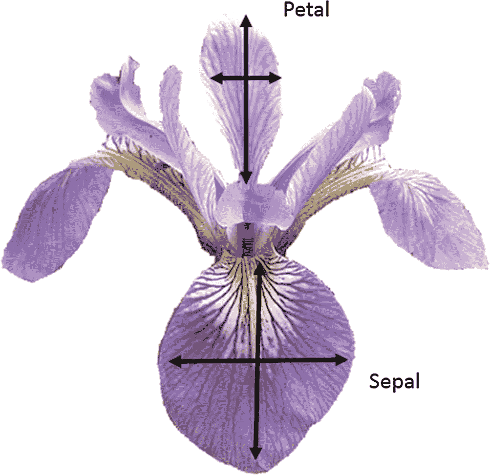

一幅鸢尾花图解。箭头标示了花瓣和花萼的长度与宽度。

图 8-1

杂色鸢尾及其花瓣与花萼的宽度和长度

该数据集目前被广泛用作许多类型分析的良好范例，尤其是用于*分类*问题，这类问题可以通过机器学习方法来解决。因此，`scikit-learn`库也理所当然地将此数据集作为一个 150x4 的 NumPy 数组提供。

现在，你将通过将其导入到 Jupyter Notebook 或普通的 Python 会话中来详细研究这个数据集。

```
from sklearn import datasets
iris = datasets.load_iris()
```

通过这种方式，你将所有与鸢尾花数据集相关的数据和元数据都加载到了`iris`变量中。要查看此变量中收集的数据值，只需调用`iris`变量的`data`属性即可。

```
iris.data
Out[ ]:
array([[ 5.1,  3.5,  1.4,  0.2],
[ 4.9,  3\. ,  1.4,  0.2],
[ 4.7,  3.2,  1.3,  0.2],
[ 4.6,  3.1,  1.5,  0.2],
...
```

如你所见，你得到了一个包含 150 个元素的数组，每个元素包含四个数值：分别代表花萼和花瓣的尺寸。

要确定每个样本属于哪种花，则需要参考`target`属性。

```
iris.target
Out[ ]:
array([0, 0, 0, 0, 0, 0, 0, 0, 0, 0, 0, 0, 0, 0, 0, 0, 0, 0, 0, 0, 0, 0, 0,
0, 0, 0, 0, 0, 0, 0, 0, 0, 0, 0, 0, 0, 0, 0, 0, 0, 0, 0, 0, 0, 0, 0,
0, 0, 0, 0, 1, 1, 1, 1, 1, 1, 1, 1, 1, 1, 1, 1, 1, 1, 1, 1, 1, 1, 1,
1, 1, 1, 1, 1, 1, 1, 1, 1, 1, 1, 1, 1, 1, 1, 1, 1, 1, 1, 1, 1, 1, 1,
1, 1, 1, 1, 1, 1, 1, 1, 2, 2, 2, 2, 2, 2, 2, 2, 2, 2, 2, 2, 2, 2, 2,
2, 2, 2, 2, 2, 2, 2, 2, 2, 2, 2, 2, 2, 2, 2, 2, 2, 2, 2, 2, 2, 2, 2,
2, 2, 2, 2, 2, 2, 2, 2, 2, 2, 2, 2])
```

你得到了 150 个样本，每个样本对应三个可能的整数值（0、1 和 2），分别对应三种鸢尾花。要确定物种与数字的对应关系，你需要调用`target_names`属性。

```
iris.target_names
Out[ ]:
array(['setosa', 'versicolor', 'virginica'], dtype='<U10')
```

为了更好地理解这个数据集，你可以使用`matplotlib`库，运用你在第 7 章学到的技巧。因此，创建一个散点图，以三种不同颜色显示这三种不同的物种。x 轴将表示花萼的长度，而 y 轴将表示花萼的宽度。

```
import matplotlib.pyplot as plt
import matplotlib.patches as mpatches
from sklearn import datasets
iris = datasets.load_iris()
x = iris.data[:,0]  #X 轴 - 花萼长度
y = iris.data[:,1]  #Y 轴 - 花萼宽度
species = iris.target     #物种
x_min, x_max = x.min() - .5,x.max() + .5
y_min, y_max = y.min() - .5,y.max() + .5
#使用 MATPLOTLIB 绘制散点图
plt.figure()
plt.title('Iris Dataset - Classification By Sepal Sizes')
plt.scatter(x,y, c=species)
plt.xlabel('Sepal length')
plt.ylabel('Sepal width')
plt.xlim(x_min, x_max)
plt.ylim(y_min, y_max)
plt.xticks(())
plt.yticks(())
plt.show()
```

结果，你将得到如图 8-2 所示的散点图。蓝色点代表山鸢尾，绿色点代表杂色鸢尾，红色点代表维吉尼亚鸢尾。

从图 8-2 中，你可以看到山鸢尾的特征与其他两种有何不同，它们形成了一个独立的蓝色点簇，与其他点簇分开。

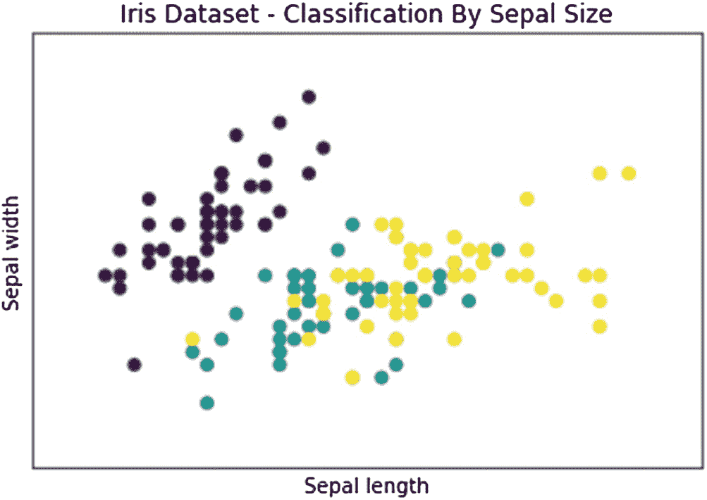

来自鸢尾花数据集的散点图，展示了花萼宽度与花萼长度的关系。图中绘制了三个不同的物种，如山鸢尾、杂色鸢尾和维吉尼亚鸢尾。山鸢尾形成一个簇，与其他两个物种分离。

图 8-2

不同的鸢尾花物种以不同颜色显示

尝试遵循相同的步骤，但这次使用另外两个变量——即花瓣的长度和宽度测量值。你可以使用相同的代码，只需更改几个值。

```
import matplotlib.pyplot as plt
import matplotlib.patches as mpatches
from sklearn import datasets
iris = datasets.load_iris()
x = iris.data[:,2]  #X 轴 - 花瓣长度
y = iris.data[:,3]  #Y 轴 - 花瓣宽度
species = iris.target     #物种
x_min, x_max = x.min() - .5,x.max() + .5
y_min, y_max = y.min() - .5,y.max() + .5
#散点图
plt.figure()
plt.title('Iris Dataset - Classification By Petal Sizes', size=14)
plt.scatter(x,y, c=species)
plt.xlabel('Petal length')
plt.ylabel('Petal width')
plt.xlim(x_min, x_max)
plt.ylim(y_min, y_max)
plt.xticks(())
plt.yticks(())
```

结果如图 8-3 所示的散点图。在这种情况下，三个物种之间的划分更加明显。如你所见，形成了三个不同的簇。

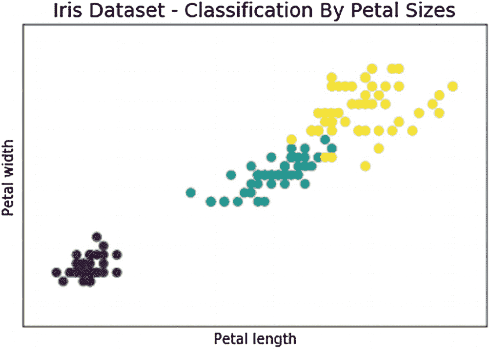

来自鸢尾花数据集的散点图，展示了花瓣宽度与花瓣长度的关系，涉及山鸢尾、杂色鸢尾和维吉尼亚鸢尾。所有三个物种都形成了独立的簇。这些图共同呈现出一个递增趋势。

图 8-3

不同的鸢尾花物种以不同颜色显示


### PCA（主成分分析）降维

你已经看到，如何通过花瓣和萼片的四项测量数据来表征三个鸢尾花物种。这展示了两个散点图，一个针对花瓣，一个针对萼片，但是如何将这一切统一起来呢？四个维度的问题，即便是三维散点图也无法解决。

针对这一点，人们开发了一种名为*主成分分析（PCA）*的特殊技术。这项技术允许你减少系统的维度数量，同时保留用于表征各个点的所有信息。新的维度被称为*主成分*。

因此，PCA 在应用机器学习算法之前使用，因为它能最小化所使用的变量数量。它通过分析每个变量对数据集中最大方差量的贡献来实现这一点。它会确定哪些特征贡献不显著（即它们与其他特征提供相同的信息），然后将它们丢弃，从机器学习模型的计算中剔除。这极大地简化了模型及其相关的计算。

这项技术压缩了参与机器学习计算的特征数量，通过创建更少数量的新特征（或者说，对现有特征进行变换），同时保留与原始数据集（近似）相同的信息。

从严格的数学角度来看，根据输入数据矩阵`X`（`观测数` x `特征数`），可以得到协方差矩阵`Cov(X)`，然后用它来计算特征向量（主成分）及其对应的特征值。得到的 k 个特征向量就是主成分（参见图 8-4）。前 k 个主成分是 k 个最大特征值对应的特征向量。

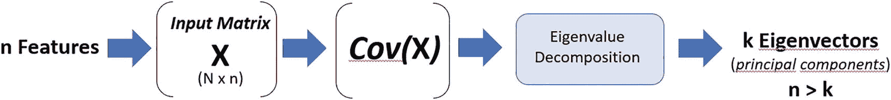

与 PCA 降维技术相关的流程图。它从 N 个特征开始，接着是输入矩阵 X、X 的协方差矩阵 COV、特征分解，以及 K 个主成分特征向量，其中 N 大于 K。

图 8-4
PCA 技术涉及的过程

现在，我们用鸢尾花数据集来实践一下。你在上一节看到，这个数据集由四个特征组成。你可以应用 PCA 方法来详细分析这项技术。为了看看是否有可能减少特征数量，同时仍为机器学习模型保留尽可能多的信息，编写以下代码：

```
from sklearn.decomposition import PCA
import numpy as np
covar_matrix = PCA(n_components=4)
covar_matrix.fit(iris.data)
variance = covar_matrix.explained_variance_ratio_
var = np.cumsum(np.round(variance, decimals=3)*100)
var
Out[ ]:
array([ 92.5, 97.8, 99.5, 100\. ])
```

这段代码首先从`sklearn.decomposition`模块导入了`PCA()`函数，并用它来推导协方差矩阵。在这个例子中，通过将`n_components`参数设为`4`，该技术在计算中考虑了所有四个特征（因此，n = k）。然后，它使用`fit()`方法在此矩阵上进行特征值分解。此时，你可以评估四个特征各自对数据集方差最大值的贡献。提取出方差后，使用 NumPy 的`cumsum()`函数，就能得到每个新增特征贡献的累计百分比。从结果可以看出，即使将输入数据集的规模减少到只有一个特征，你仍能保留 92%的信息。因此可以说，单个特征的信息可能已经几乎足以获得一个良好的机器学习模型。你可以通过`matplotlib`直观地看到这一切。

```
plt.ylabel('% Variance explained')
plt.xlabel('# of Features')
plt.title('PCA Analysis')
plt.ylim(90, 100.5)
plt.xticks([0, 1, 2, 3], [1,2,3,4])
plt.axvline(2, linestyle='--', c='#bbbbbb' )
plt.plot(var)
```

运行这段代码会生成一个类似于图 8-5 所示的图形。

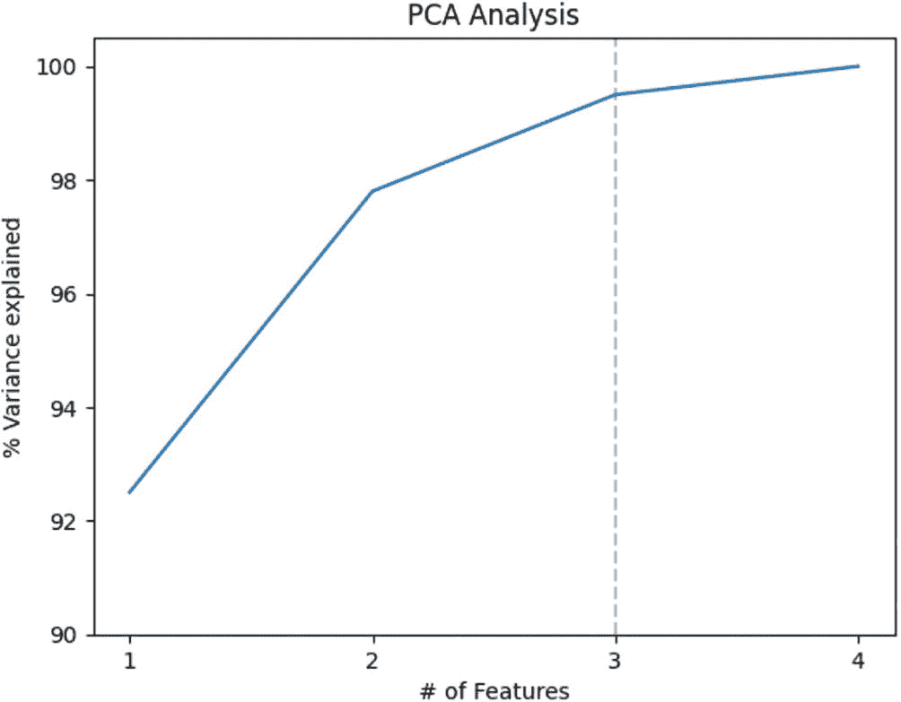

PCA 分析的百分比方差解释与四个特征的折线图。曲线趋势显示，第一个、第二个和第三个特征的值分别为 92.3%、98%和 99.5%。第三个特征处有一条虚线。值为估算值。

图 8-5
每个特征对总方差的贡献

你从图 8-5 中可以清楚地看到，使用三个特征就足以构建一个良好的模型，其值达到 99.5%。为此目的，使用第四个特征几乎是多余的，可以将其剔除，从而简化计算。

在这种情况下，你可以将系统从四维降至三维，并在三维散点图中绘制结果。

`scikit-learn`中用于降维的函数是`fit_transform()`函数。它属于`PCA`对象。再次应用你刚才使用的函数和方法。

```
from sklearn.decomposition import PCA
x_reduced = PCA(n_components=3).fit_transform(iris.data)
```

另外，为了可视化新的数值，你将使用`matplotlib`的`mpl_toolkits.mplot3d`模块绘制一个三维散点图。如果你不记得如何操作，请参阅第 7 章的“三维散点图”部分。

```
import matplotlib.pyplot as plt
from mpl_toolkits.mplot3d import Axes3D
from sklearn import datasets
from sklearn.decomposition import PCA
iris = datasets.load_iris()
species = iris.target     #Species
x_reduced = PCA(n_components=3).fit_transform(iris.data)
#SCATTERPLOT 3D
fig = plt.figure()
ax = Axes3D(fig)
ax.set_title('Iris Dataset by PCA', size=14)
ax.scatter(x_reduced[:,0],x_reduced[:,1],x_reduced[:,2], c=species)
ax.set_xlabel('First eigenvector')
ax.set_ylabel('Second eigenvector')
ax.set_zlabel('Third eigenvector')
ax.w_xaxis.set_ticklabels(())
ax.w_yaxis.set_ticklabels(())
ax.w_zaxis.set_ticklabels(())
```

结果将是图 8-6 所示的散点图。三个鸢尾花物种彼此之间被很好地表征，形成了各自的聚类。

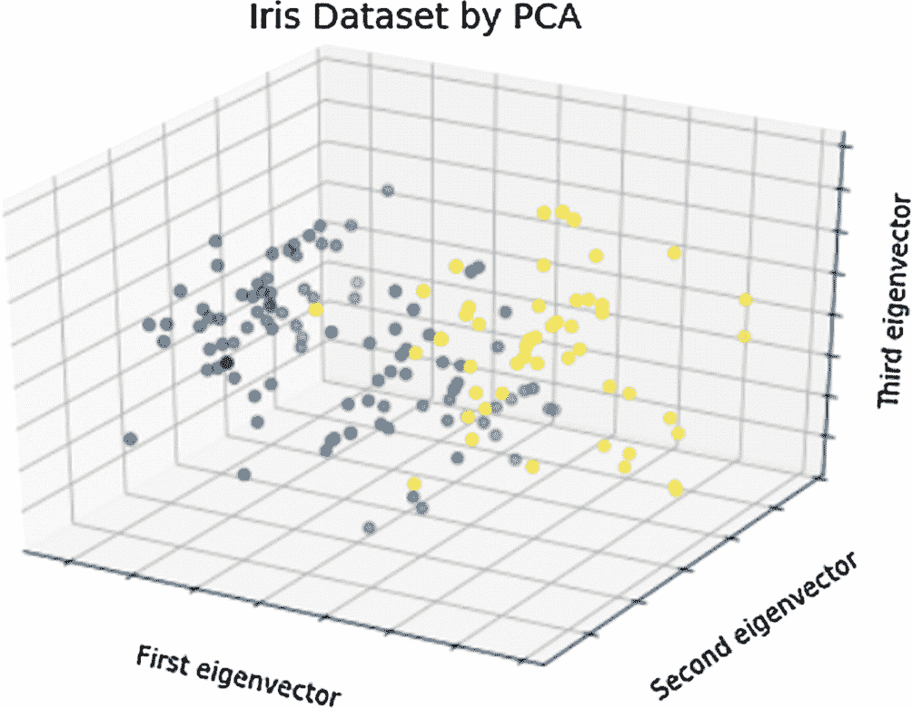

一个三维散点图，展示了通过 PCA 分析得出的鸢尾花数据集的第一个、第二个和第三个特征向量。这三个物种以不同的颜色呈现，并形成了彼此分离的聚类。

图 8-6
三维散点图，显示了代表每个鸢尾花物种的三个聚类


## K-近邻分类器

现在，你将执行一项*分类*任务，为了用`scikit-learn`库完成此操作，你需要一个*分类器*。

给定一个鸢尾花的新测量值，分类器的任务是确定它属于三个物种中的哪一个。最简单的分类器是*最近邻*。该算法在训练集中寻找最接近新测试样本的观测值。

事实上，KNN 算法背后的机制是机器学习中最简单、最直接的方法之一。尽管如此，KNN 仍然是该领域最常用的技术之一，不仅用于分类，还用于回归和异常检测等其他问题。

该算法首先计算待分类的新数据点在（多维）特征空间中与所有已知类别（或已被评估过的）数据点之间的距离。要计算两点之间的距离，可以使用不同的技术，例如欧几里得距离（我们都在学校学过）、闵可夫斯基距离、曼哈顿距离等。欧几里得方法看似最佳，但实际上对于高维数据，它的效果不再那么理想。

一旦距离计算完成，KNN 算法就会在所有点中选出距离待分类点最近的 K 个点。这个 K 值正是“K-近邻”算法名称的由来。在分类问题中，新点将被判定给 K 个近邻中拥有最多点的类别。见图 8-7。

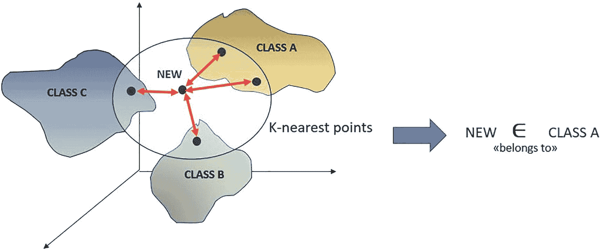

K N N 算法的示意图。从一个包含 A、B、C 三个类别的三维平面开始。从所有三个类别中圈出 K 个最近的点。这里，选中的新点属于 A 类。

**图 8-7** KNN 的分类机制

此时需要考虑的一个非常重要的概念是*训练集*和*测试集*（已在第 1 章中介绍过）。实际上，如果你只有一个单一的数据集，重要的是不要将同一组数据既用于测试又用于训练。在这方面，数据集中的元素被分为两部分，一部分用于训练算法，另一部分用于执行验证。

因此，在继续之前，你必须将你的鸢尾花数据集分为两部分。然而，明智的做法是先随机打乱数组元素，然后再进行划分。事实上，数据通常是按特定顺序收集的，而在你的案例中，鸢尾花数据集的条目是按物种排序的。为了混合数据集的元素，你可以使用一个名为 `random.permutation()` 的 NumPy 函数。混洗后的数据集包含 150 个不同的观测值；前 140 个用作训练集，其余 10 个用作测试集。

```
import numpy as np
from sklearn import datasets
np.random.seed(0)
iris = datasets.load_iris()
x = iris.data
y = iris.target
i = np.random.permutation(len(iris.data))
x_train = x[i[:-10]]
y_train = y[i[:-10]]
x_test = x[i[-10:]]
y_test = y[i[-10:]]
```

现在你可以应用 K-近邻算法。导入 `KNeighborsClassifier`，调用分类器的构造函数，然后使用 `fit()` 函数训练它。

```
from sklearn.neighbors import KNeighborsClassifier
knn = KNeighborsClassifier()
knn.fit(x_train,y_train)
KNeighborsClassifier(algorithm='auto',
leaf_size=30,
metric='minkowski',
metric_params=None,
n_neighbors=5,
p=2,
weights='uniform')
```

现在你拥有一个由 140 个观测值训练而成的、包含 `knn` 分类器的预测模型，接下来你将检验其有效性。该分类器应能正确预测测试集中十个观测值对应的鸢尾花物种。为了获得预测结果，你必须使用 `predict()` 函数，该函数将直接应用到预测模型 `knn` 上。最后，将预测结果与 `y_test` 中包含的实际观测结果进行比较。

```
knn.predict(x_test)
Out[ ]: array([1, 2, 1, 0, 0, 0, 2, 1, 2, 0])
y_test
Out[ ]: array([1, 1, 1, 0, 0, 0, 2, 1, 2, 0])
```

你可以看到得到了 10% 的错误率。你可以使用二维散点图表示的花萼决策边界将所有这一切可视化。

```
import numpy as np
import matplotlib.pyplot as plt
from matplotlib.colors import ListedColormap
from sklearn import datasets
from sklearn.neighbors import KNeighborsClassifier
iris = datasets.load_iris()
x = iris.data[:,:2]      #X 轴 - 花萼长度-宽度
y = iris.target          #Y 轴 - 物种
x_min, x_max = x[:,0].min() - .5,x[:,0].max() + .5
y_min, y_max = x[:,1].min() - .5,x[:,1].max() + .5
#网格
cmap_light = ListedColormap(['#AAAAFF','#AAFFAA','#FFAAAA'])
h = .02
xx, yy = np.meshgrid(np.arange(x_min, x_max, h), np.arange(y_min, y_max, h))
knn = KNeighborsClassifier()
knn.fit(x,y)
Z = knn.predict(np.c_[xx.ravel(),yy.ravel()])
Z = Z.reshape(xx.shape)
plt.figure()
plt.pcolormesh(xx,yy,Z,cmap=cmap_light, shading='auto')
#绘制训练点
plt.scatter(x[:,0],x[:,1],c=y)
plt.xlim(xx.min(),xx.max())
plt.ylim(yy.min(),yy.max())
Out[ ]: (1.5, 4.900000000000003)
```

你会得到如图 8-8 所示的散点图决策边界细分。

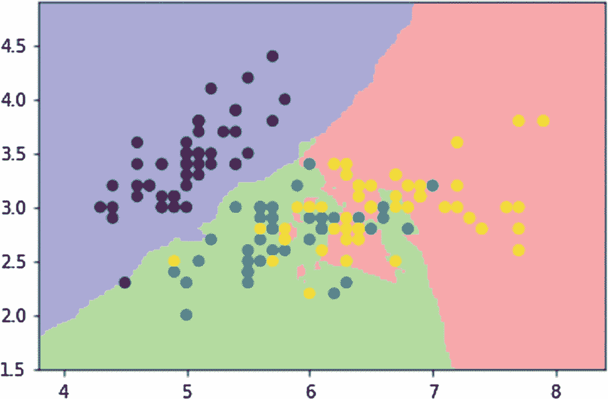

一幅展示花萼决策边界的二维散点图和区域图。它包括三个不同色调的细分区域。这里，一个物种形成一个单独的聚类，另外两个物种共同形成一个聚类。

**图 8-8** 三种决策边界由三种不同的颜色表示

你可以考虑花瓣尺寸来做同样的事情。

```
import numpy as np
import matplotlib.pyplot as plt
from matplotlib.colors import ListedColormap
from sklearn import datasets
from sklearn.neighbors import KNeighborsClassifier
iris = datasets.load_iris()
x = iris.data[:,2:4]      #X 轴 - 花瓣长度-宽度
y = iris.target           #Y 轴 - 物种
x_min, x_max = x[:,0].min() - .5,x[:,0].max() + .5
y_min, y_max = x[:,1].min() - .5,x[:,1].max() + .5
#网格
cmap_light = ListedColormap(['#AAAAFF','#AAFFAA','#FFAAAA'])
h = .02
xx, yy = np.meshgrid(np.arange(x_min, x_max, h), np.arange(y_min, y_max, h))
knn = KNeighborsClassifier()
knn.fit(x,y)
Z = knn.predict(np.c_[xx.ravel(),yy.ravel()])
Z = Z.reshape(xx.shape)
plt.figure()
plt.pcolormesh(xx,yy,Z,cmap=cmap_light, shading='auto')
#绘制训练点
plt.scatter(x[:,0],x[:,1],c=y)
plt.xlim(xx.min(),xx.max())
plt.ylim(yy.min(),yy.max())
Out[ ]: (-0.40000000000000002, 2.9800000000000031)
```

如图 8-9 所示，你会得到关于考虑花瓣尺寸的鸢尾花特征描述的相应决策边界。

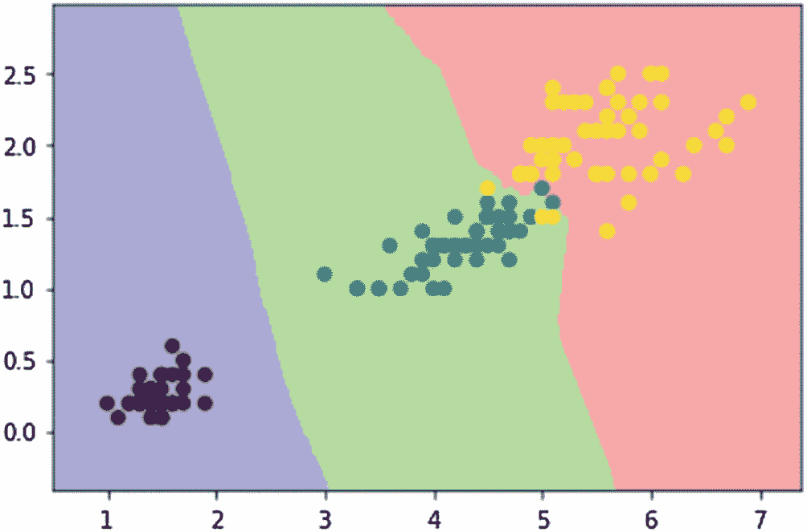

一幅二维散点图和区域图，表示花瓣尺寸的决策边界。它包括三个不同色调的区域。这里，所有三个物种都形成了独立的聚类。聚类中的点呈现出递增趋势。

**图 8-9** 描述花瓣尺寸的二维散点图上的决策边界


## 糖尿病数据集

在 `scikit-learn` 库提供的诸多数据集中，有一个糖尿病数据集。该数据集于 2004 年首次被使用（出自 Efron、Hastie、Johnstone 和 Tibshirani 合著的《*统计年鉴*》）。此后，它便成为研究各种预测模型及其有效性的广泛使用的示例。

要加载该数据集中的数据，首先必须导入 `scikit-learn` 库的 `datasets` 模块，然后调用 `load_diabetes()` 函数，将数据集加载到一个名为 `diabetes` 的变量中。

```python
from sklearn import datasets
diabetes = datasets.load_diabetes()
```

该数据集包含从 442 名患者身上收集的生理数据，以及与之对应的目标值，即一年后疾病进展的指标。生理数据占据前十个列，其数值分别表示以下指标：

- 年龄
- 性别
- 身体质量指数
- 血压
- S1、S2、S3、S4、S5 和 S6（六项血清测量值）

这些测量值可以通过调用 `data` 属性获得。如果你查看数据集中的数值，会发现它们与你预期的数值大相径庭。例如，查看第一位患者的十项数值。

```python
diabetes.data[0]
Out[ ]:
array([ 0.03807591,  0.05068012,  0.06169621,  0.02187235, -0.0442235 ,
-0.03482076, -0.04340085, -0.00259226,  0.01990842, -0.01764613])
```

这些数值实际上是处理后的结果。十项数值中的每一项都经过了均值中心化处理，随后又根据标准差乘以样本数进行了缩放。验证后发现，每列数值的平方和等于 1。尝试使用年龄测量值进行此计算；你将得到一个非常接近 1 的数值。

```python
np.sum(diabetes.data[:,0]**2)
Out[ ]: 1.0000000000000746
```

尽管这些数值已经归一化，因此难以解读，但它们仍然表达了这十项生理特征，因此并未失去其价值或统计信息。

至于疾病进展的指标，即必须与预测结果相对应的数值，这些可以通过 `target` 属性获得。

```python
diabetes.target
Out[ ]:
array( 151.,   75.,  141.,  206.,  135.,   97.,  138.,   63.,  110.,
310.,  101.,   69.,  179.,  185.,  118.,  171.,  166.,  144.,
97.,  168.,   68.,   49.,   68.,  245.,  184.,  202.,  137
. . .
```

你将获得一系列介于 25 到 346 之间的 442 个整数值。

## 线性回归：最小二乘回归

线性回归是一种使用训练集中包含的数据来构建线性模型的过程。最简单的模型基于一条`直线`的方程，并用两个参数 `a` 和 `b` 来表征它。计算这些参数的目标是使残差平方和尽可能小。

![$$ y={a}^{\ast }x+c $$

在这个表达式中，`x` 是训练集，`y` 是目标值，`b` 是斜率，`c` 是模型所表示的`直线`的截距。在 `scikit-learn` 中，要使用线性回归的预测模型，必须导入 `linear_model` 模块，然后使用制造者 `LinearRegression()` 构造函数创建预测模型，并将其命名为 `linreg`。

```python
from sklearn import linear_model
linreg = linear_model.LinearRegression()
```

为了练习一个线性回归的示例，你可以使用前面描述的糖尿病数据集。首先，你需要将 442 名患者分成一个训练集（由前 422 名患者组成）和一个测试集（由最后 20 名患者组成）。

```python
from sklearn import datasets
diabetes = datasets.load_diabetes()
x_train = diabetes.data[:-20]
y_train = diabetes.target[:-20]
x_test = diabetes.data[-20:]
y_test = diabetes.target[-20:]
```

现在，通过使用 `fit()` 函数将训练集应用于预测模型。

```python
linreg.fit(x_train,y_train)
Out[ ]: LinearRegression()
```

模型训练完成后，你可以使用预测模型的 `coef_` 属性，获得为每个生理变量计算的十个 `b` 系数。

```python
linreg.coef_
Out[ ]:
array([  3.03499549e-01,  -2.37639315e+02,   5.10530605e+02,
3.27736980e+02,  -8.14131709e+02,   4.92814588e+02,
1.02848452e+02,   1.84606489e+02,   7.43519617e+02,
7.60951722e+01])
```

如果将测试集应用于 `linreg` 预测模型，你将得到一系列目标值，这些值将与实际观测到的数值进行比较。

```python
linreg.predict(x_test)
Out[ ]:
array([ 197.61846908,  155.43979328,  172.88665147,  111.53537279,
164.80054784,  131.06954875,  259.12237761,  100.47935157,
117.0601052 ,  124.30503555,  218.36632793,   61.19831284,
132.25046751,  120.3332925 ,   52.54458691,  194.03798088,
102.57139702,  123.56604987,  211.0346317 ,   52.60335674])
y_test
Out[ ]:
array([ 233.,   91.,  111.,  152.,  120.,   67.,  310.,   94.,  183.,
66.,  173.,   72.,   49.,   64.,   48.,  178.,  104.,  132.,
220.,   57.])
```

然而，一个衡量预测是否完美的良好指标是*方差*。方差越接近 `1`，预测就越完美。

```python
linreg.score(x_test, y_test)
Out[ ]: 0.58507530226905713
```

现在，你将开始进行线性回归，仅考虑一个生理因素，例如，可以从年龄开始。

```python
import numpy as np
import matplotlib.pyplot as plt
from sklearn import linear_model
from sklearn import datasets
diabetes = datasets.load_diabetes()
x_train = diabetes.data[:-20]
y_train = diabetes.target[:-20]
x_test = diabetes.data[-20:]
y_test = diabetes.target[-20:]
x0_test = x_test[:,0]
x0_train = x_train[:,0]
x0_test = x0_test[:,np.newaxis]
x0_train = x0_train[:,np.newaxis]
linreg = linear_model.LinearRegression()
linreg.fit(x0_train,y_train)
y = linreg.predict(x0_test)
plt.scatter(x0_test,y_test,color='k')
plt.plot(x0_test,y,color='b',linewidth=3)
```

图 8-10 显示了代表患者年龄与疾病进展之间线性相关性的直线。

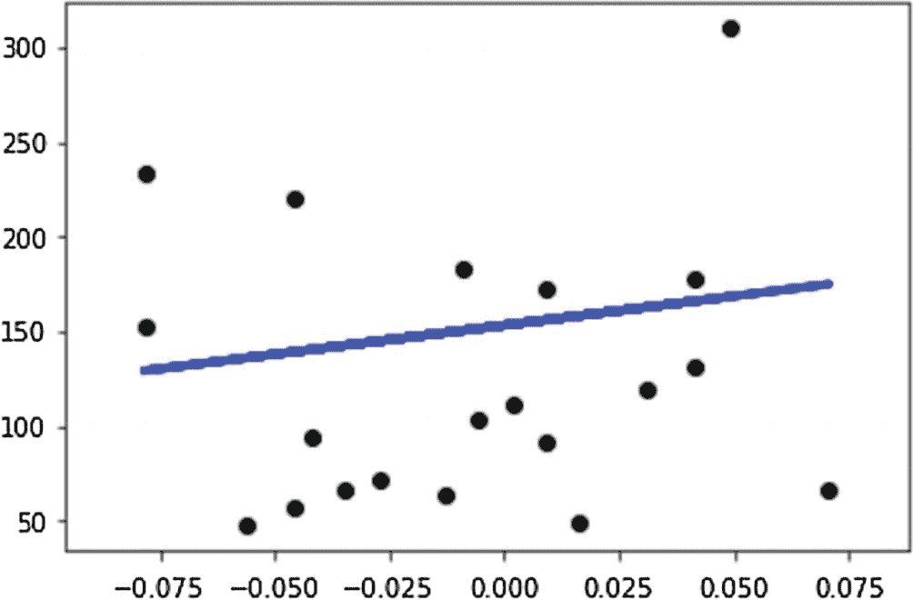

散点图和折线图绘制了患者的生理因素（年龄）与疾病进展的关系。它包含一条线性回归线，定义了该因素与疾病之间的相关性。最佳拟合线延伸于 (负 0.075, 125) 和 (0.075, 175) 之间。数值为近似值。

**图 8-10**


线性回归表示特征与目标之间的线性相关性。

实际上，糖尿病数据集中有十个生理因素。因此，为了更全面地了解整个训练集，你可以为每个生理特征创建一个线性回归模型，从而生成十个模型，并通过线性图表观察每个模型的结果。

```python
import numpy as np
import matplotlib.pyplot as plt
from sklearn import linear_model
from sklearn import datasets
diabetes = datasets.load_diabetes()
x_train = diabetes.data[:-20]
y_train = diabetes.target[:-20]
x_test = diabetes.data[-20:]
y_test = diabetes.target[-20:]
plt.figure(figsize=(8,12))
for f in range(0,10):
xi_test = x_test[:,f]
xi_train = x_train[:,f]
xi_test = xi_test[:,np.newaxis]
xi_train = xi_train[:,np.newaxis]
linreg.fit(xi_train,y_train)
y = linreg.predict(xi_test)
plt.subplot(5,2,f+1)
plt.scatter(xi_test,y_test,color='k')
plt.plot(xi_test,y,color='b',linewidth=3)
```

图 8-11 展示了十个线性图表，每个图表代表一个生理因素与糖尿病进展之间的相关性。

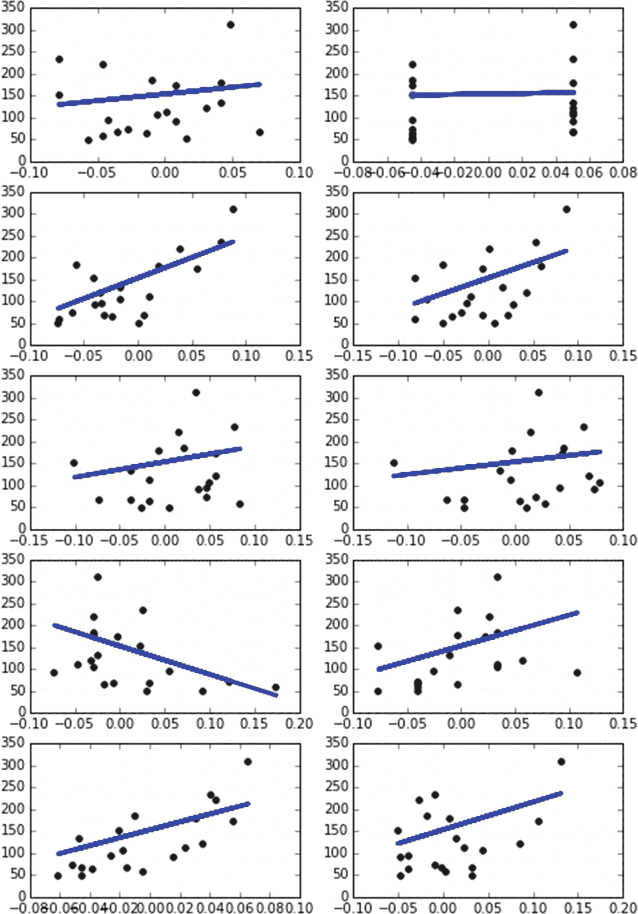

十个散点图和折线图绘制了糖尿病数据集中的十个生理因素。所有图中的拟合线均呈上升趋势，但图 1 中的拟合线呈下降趋势。所有图中的散点分布在拟合线周围及其附近。

**图 8-11** 十个线性图表，显示生理因素与糖尿病进展之间的相关性

## 支持向量机 (SVM)

*支持向量机* 是一系列机器学习技术，最初由 Vapnik 及其同事在 90 年代初于 AT&T 实验室开发。这类方法的基础实际上是一种名为 *支持向量* 的算法，它是早期算法 *广义肖像* 的泛化，该算法于 1963 年同样由 Vapnik 在俄罗斯开发。

简单来说，SVM 分类器是二元或判别模型，作用于两个类别的区分。其主要任务基本上是区分新观测值属于两个类别中的哪一个。在学习阶段，这些分类器将观测值投影到一个称为 *决策空间* 的多维空间中，并构建一个称为 *决策边界* 的分隔面，将该空间划分为两个归属区域。在最简单的情况下，即线性情况下，决策边界将由一个平面（在三维空间中）或一条直线（在二维空间中）表示。在更复杂的情况下，分隔面是具有越来越复杂形状的曲面。

对于 SVM 也是如此，数据点分布在一个多维空间中，每个轴对应特定特征值的分布。SVM 的目的是找到一个超平面，将空间分隔成两个类别（见图 8-12）。

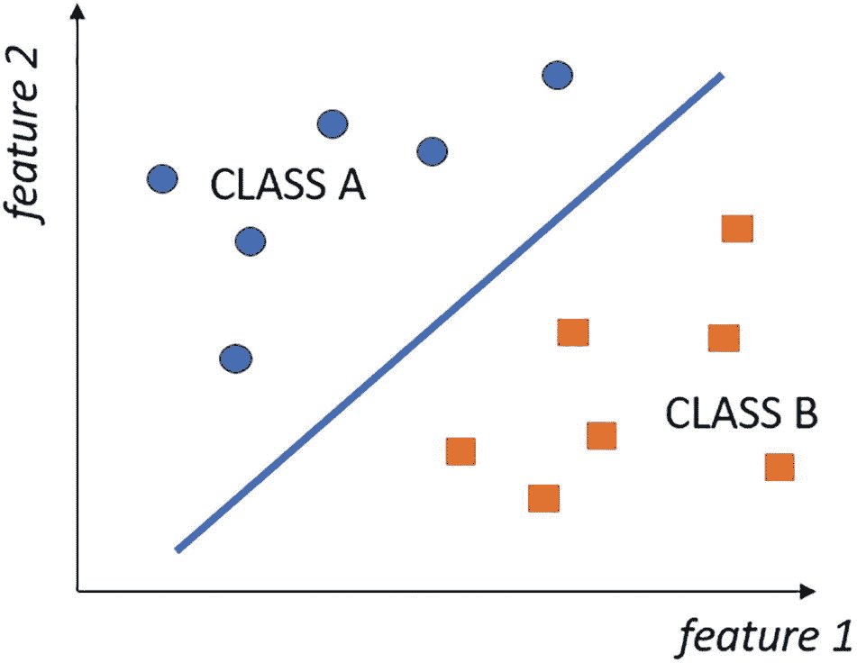

特征 2 与特征 1 的散点图和折线图。图中包含一条斜线，将类别 A 和 B 分开。线上方的点代表类别 A，线下方的点代表类别 B。它们分别形成聚集区域。

**图 8-12** SVM 将决策空间划分为两个区域，每个类别一个区域，并定义一条直线（决策边界）

所定义的直线不能仅限于将两个类别的点彼此分开，还必须满足特定要求。SVM 会找到距离分割线最近的点。这些点被称为“支持向量”，该算法也因此得名（见图 8-13）。

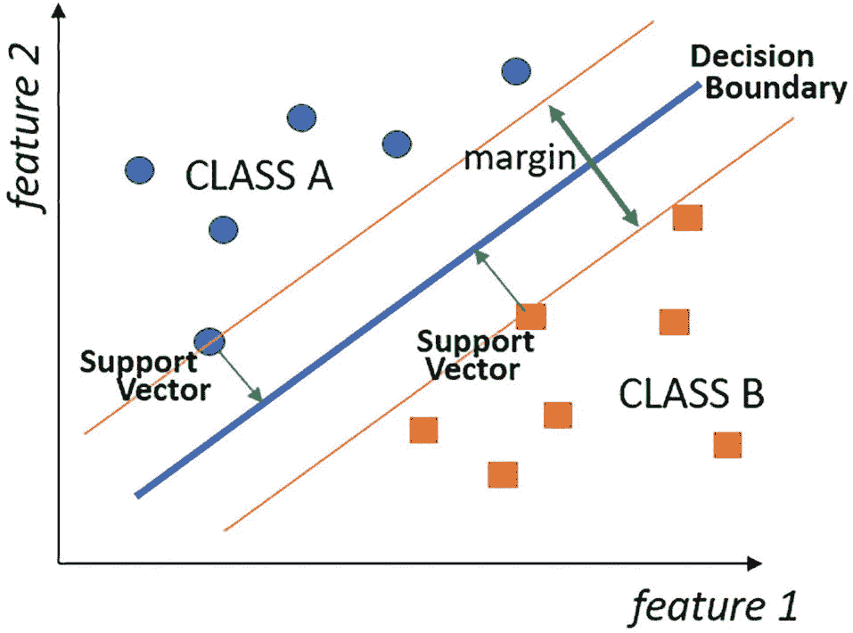

特征 2 与特征 1 的散点图与折线图。图中包含一条标记为“决策边界”的斜线，将类别 A 与 B 分开。到该直线距离最近的两个类别的点即为支持向量。间隔是支持向量之间的距离。

**图 8-13** SVM 优化决策边界，最大化支持向量点之间的间隔

支持向量与决策边界（直线）之间的距离称为间隔。SVM 的任务是最大化这个间隔。当间隔达到最大值时，决策边界即为最优。

SVM 是一种非常灵活的技术，适用于许多应用场景。它既可以用于回归，即 *SVR（支持向量回归）*，也可以用于分类，即 *SVC（支持向量分类）*。


### 支持向量分类（SVC）

如果你想更好地理解此算法的工作原理，可以从最简单的情况入手，即线性二维情况，其中决策边界是一条将决策区域一分为二的直线。以一个简单的训练集为例，该训练集中有一些点被分配到两个不同的类别。该训练集将包含 11 个点（观测值），这些点具有两个不同属性，其值介于 0 到 4 之间。这些值将存储在一个名为`x`的 NumPy 数组中。这些点所属的类别（两个类别之一）由另一个名为`y`的数组中的 0 或 1 值定义。

通过散点图可视化这些点在空间中的分布，该空间随后将被定义为决策空间（见图 8-14）。

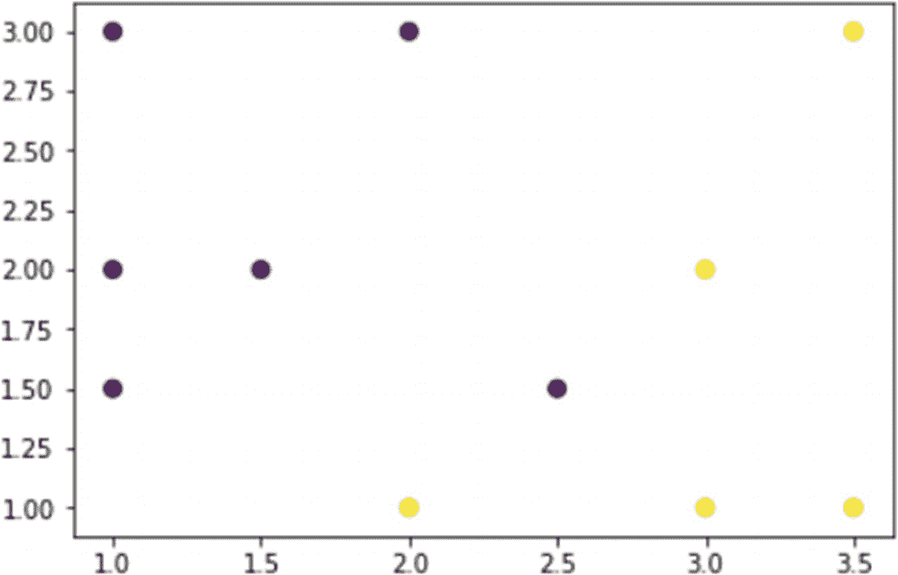

一张散点图在分布空间中绘制了两个不同类别的点。这两个类别的近似点如下所示：
1.  (1.0, 2)、(1.0, 1.50)、(1.0, 3)、(1.5, 2)、(2, 3) 和 (2.5, 1.5)
2.  (2.0, 1.0)、(3.0, 1.0)、(3.5, 1.0)、(3.0, 2.00)、(3.0, 2.00) 和 (3.5, 3.00)

**图 8-14** 训练集的散点图展示了决策空间

```
import numpy as np
import matplotlib.pyplot as plt
from sklearn import svm
x = np.array([[1,3],[1,2],[1,1.5],[1.5,2],[2,3],[2.5,1.5],
[2,1],[3,1],[3,2],[3.5,1],[3.5,3]])
y = [0]*6 + [1]*5
plt.scatter(x[:,0],x[:,1],c=y,s=50,alpha=0.9)
```

现在，您已经定义了训练集，可以应用 SVC（支持向量分类）算法了。该算法将创建一条直线（决策边界），以便将决策区域分成两部分（见图 8-15），这条直线将被放置的位置会使得训练集中最近观测值之间的距离最大化。这个条件应产生两个不同的部分，同一类别的所有点都应包含在其中。

接着，您将 SVC 算法应用于该训练集。为此，首先使用`SVC()`构造函数定义模型，并将内核设置为线性。（*内核*是用于模式分析的一类算法。）然后，您使用`fit()`函数，并将训练集作为参数传递给它。模型训练完成后，您可以使用`decision_function()`函数绘制决策边界。然后，您绘制散点图，并为决策空间的两个部分提供不同的颜色。

```
import numpy as np
import matplotlib.pyplot as plt
from sklearn import svm
x = np.array([[1,3],[1,2],[1,1.5],[1.5,2],[2,3],[2.5,1.5],
[2,1],[3,1],[3,2],[3.5,1],[3.5,3]])
y = [0]*6 + [1]*5
svc = svm.SVC(kernel='linear').fit(x,y)
X,Y = np.mgrid[0:4:200j,0:4:200j]
Z = svc.decision_function(np.c_[X.ravel(),Y.ravel()])
Z = Z.reshape(X.shape)
plt.contourf(X,Y,Z > 0,alpha=0.1)
plt.contour(X,Y,Z,colors=['k'], linestyles=['-'],levels=[0])
plt.scatter(x[:,0],x[:,1],c=y,s=50,alpha=0.9)
```

在图 8-15 中，您可以看到包含两个类别的两个部分。可以说划分是成功的，除了浅色部分中有一个暗点。

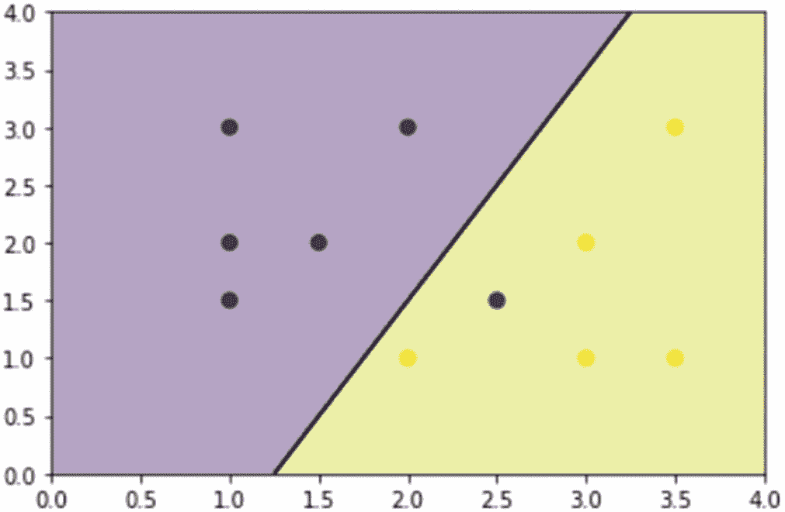

一个散点与区域图展示了两个不同类别的决策边界。代表决策边界的直线在 (1.25, 0) 和 (3.25, 4.0) 之间延伸。属于第一类的点 (2.5, 1.25) 被绘制在了第二类区域中。数值为近似值。

**图 8-15** 决策区域被分成两部分

一旦模型训练完毕，就很容易理解预测是如何进行的。从图形上看，根据新观测值所处的位置，您将知道它属于两个类别中的哪一个。

相反，从更程序化的角度来看，`predict()`函数将返回其对应所属类别的编号（`0` 表示蓝色类别，`1` 表示红色类别）。

```
svc.predict([[1.5,2.5]])
Out[ ]: array([0])
svc.predict([[2.5,1]])
Out[ ]: array([1])
```

SVC 算法中的一个相关概念是*正则化*。它由`C`参数设置，较小的`C`值意味着使用分离线周围许多或所有观测值来计算间隔（更强的正则化），而较大的`C`值意味着使用靠近分离线的观测值来计算间隔（更弱的正则化）。除非另有说明，`C`的默认值等于`1`。您可以通过`support_vectors`数组来标识并高亮参与间隔计算的这些点。

```
import numpy as np
import matplotlib.pyplot as plt
from sklearn import svm
x = np.array([[1,3],[1,2],[1,1.5],[1.5,2],[2,3],[2.5,1.5],
[2,1],[3,1],[3,2],[3.5,1],[3.5,3]])
y = [0]*6 + [1]*5
svc = svm.SVC(kernel='linear',C=1).fit(x,y)
X,Y = np.mgrid[0:4:200j,0:4:200j]
Z = svc.decision_function(np.c_[X.ravel(),Y.ravel()])
Z = Z.reshape(X.shape)
plt.contourf(X,Y,Z > 0,alpha=0.1)
plt.contour(X,Y,Z,colors=['k','k','k'], linestyles=['--','-','--'],levels=[-1,0,1])
plt.scatter(svc.support_vectors_[:,0],svc.support_vectors_[:,1],s=120,facecolors='r')
plt.scatter(x[:,0],x[:,1],c=y,s=50,alpha=0.9)
```

这些点在散点图中由带圆圈的标记表示。此外，它们将位于分离线附近的一个评估区域内（参见图 8-16 中的虚线）。

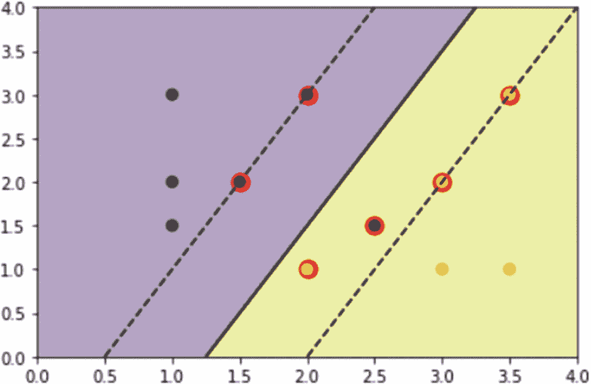

一个散点与区域图绘制了具有较大 C 值时的点数。决策边界的直线在 (1.25, 0) 和 (3.25, 4.0) 之间延伸。一条斜线穿过第一类中的 (1.25, 2) 和 (2, 3) 点。另一条斜线穿过第二类中的 (3, 1.7) 和 (3.5, 3) 点。

**图 8-16** 参与计算的点数取决于 C 参数

为了观察对决策边界的影响，您可以将值限制为 `C = 0.1`。看看将有多少点被纳入考虑。

```
import numpy as np
import matplotlib.pyplot as plt
from sklearn import svm
x = np.array([[1,3],[1,2],[1,1.5],[1.5,2],[2,3],[2.5,1.5],
[2,1],[3,1],[3,2],[3.5,1],[3.5,3]])
y = [0]*6 + [1]*5
svc = svm.SVC(kernel='linear',C=0.1).fit(x,y)
X,Y = np.mgrid[0:4:200j,0:4:200j]
Z = svc.decision_function(np.c_[X.ravel(),Y.ravel()])
Z = Z.reshape(X.shape)
plt.contourf(X,Y,Z > 0,alpha=0.1)
plt.contour(X,Y,Z,colors=['k','k','k'], linestyles=['--','-','--'],levels=[-1,0,1])
plt.scatter(svc.support_vectors_[:,0],svc.support_vectors_[:,1],s=120,facecolors='w')
plt.scatter(x[:,0],x[:,1],c=y,s=50,alpha=0.9)
```

被纳入考虑的点数增加了，因此分离线（决策边界）的方向发生了改变。但现在有两个点位于错误的决策区域中（参见图 8-17）。

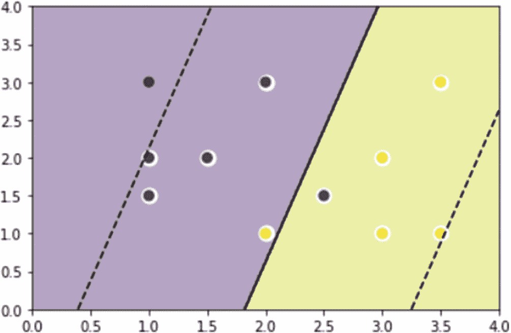

一个散点与区域图绘制了当 C = 0.1 时的点数。决策边界的直线在 (1.80, 0) 和 (3, 4.0) 之间延伸。一条斜线穿过第一类中的 (1.0, 2.0) 点。另一条斜线穿过 (3.5, 1.0) 点。数值为近似值。

**图 8-17** 当 C 减小时，参与计算的点数会增加


好的，作为高级文档工程师和翻译员，我将遵循您提供的注意事项和示例，将给定的英文文本翻译成中文。


### 非线性 SVC

到目前为止，你已经看到了 SVC 线性算法，它定义了一条旨在分割两个类别的分隔线。还存在更复杂的 SVC 算法，它们基于相同的原理（即最大化与表面最近的点之间的距离）来建立曲线（2D）或曲面（3D）。本节将研究使用多项式核的系统。

顾名思义，你可以定义一个多项式曲线，将决策区域划分为两部分。多项式的次数可以通过 `degree` 选项来定义。即使在这种情况下，`C` 是正则化系数。尝试应用一个采用三次多项式核且 `C` 系数等于 `1` 的 SVC 算法。

```python
import numpy as np
import matplotlib.pyplot as plt
from sklearn import svm
x = np.array([[1,3],[1,2],[1,1.5],[1.5,2],[2,3],[2.5,1.5],
[2,1],[3,1],[3,2],[3.5,1],[3.5,3]])
y = [0]*6 + [1]*5
svc = svm.SVC(kernel='poly',C=1, degree=3).fit(x,y)
X,Y = np.mgrid[0:4:200j,0:4:200j]
Z = svc.decision_function(np.c_[X.ravel(),Y.ravel()])
Z = Z.reshape(X.shape)
plt.contourf(X,Y,Z > 0,alpha=0.1)
plt.contour(X,Y,Z,colors=['k','k','k'], linestyles=['--','-','--'],levels=[-1,0,1])
plt.scatter(svc.support_vectors_[:,0],svc.support_vectors_[:,1],s=120,facecolors='w')
plt.scatter(x[:,0],x[:,1],c=y,s=50,alpha=0.9)
```

你将得到如图 8-18 所示的情况。

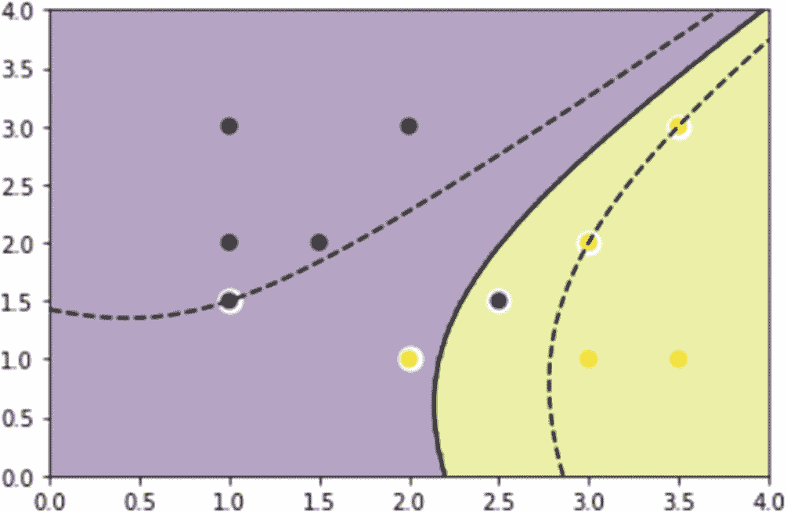

一张散点与区域图绘制了多项式核的决策边界。它包括一条将决策区域划分为两部分的多项式曲线。两部分以不同的阴影显示。它包括两条虚线曲线，用于最大化最近点到表面的距离。

**图 8-18** 使用带有多项式核的 SVC 的决策空间

另一种类型的非线性核是*径向基函数 (RBF)*。在这种情况下，分隔曲线倾向于相对于训练集的观测点来径向定义区域。

```python
import numpy as np
import matplotlib.pyplot as plt
from sklearn import svm
x = np.array([[1,3],[1,2],[1,1.5],[1.5,2],[2,3],[2.5,1.5],
[2,1],[3,1],[3,2],[3.5,1],[3.5,3]])
y = [0]*6 + [1]*5
svc = svm.SVC(kernel='rbf', C=1, gamma=3).fit(x,y)
X,Y = np.mgrid[0:4:200j,0:4:200j]
Z = svc.decision_function(np.c_[X.ravel(),Y.ravel()])
Z = Z.reshape(X.shape)
plt.contourf(X,Y,Z > 0,alpha=0.1)
plt.contour(X,Y,Z,colors=['k','k','k'], linestyles=['--','-','--'],levels=[-1,0,1])
plt.scatter(svc.support_vectors_[:,0],svc.support_vectors_[:,1],s=120,facecolors='w')
plt.scatter(x[:,0],x[:,1],c=y,s=50,alpha=0.9)
```

在图 8-19 中，你可以看到决策的两个部分，并且训练集的所有点都正确地定位在其中。

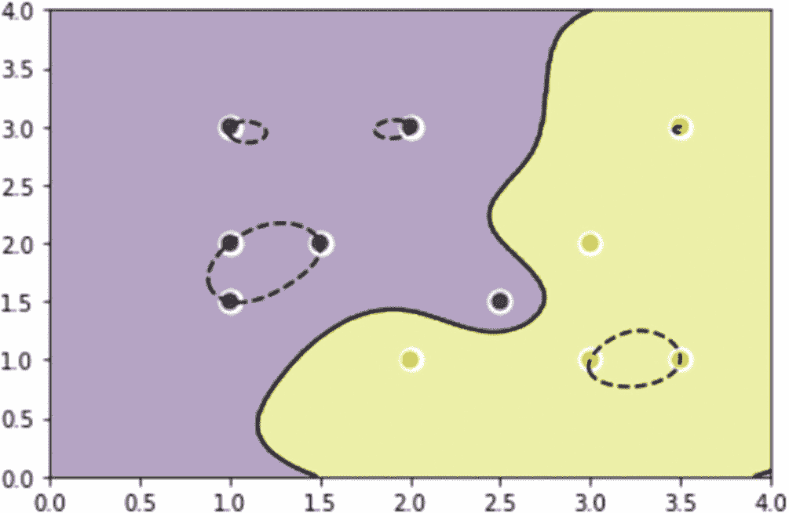

一张散点与区域图绘制了带有训练集观测点的决策部分。它由两个不同阴影的部分组成。训练集的点用虚线圆圈定位。

**图 8-19** 使用带有 RBF 核的 SVC 的决策区域

### 使用鸢尾花数据集绘制不同的 SVM 分类器

刚才看到的 SVM 示例基于一个非常简单的数据集。本节将针对使用 SVC 的分类问题使用更复杂的数据集。事实上，它将使用之前用过的数据集：鸢尾花数据集。

之前使用的 SVC 算法从只包含两个类别的训练集中学习。在这种情况下，您将把案例扩展到三个分类，因为鸢尾花数据集被分为三个类别，对应于三种不同的花卉。

在这种情况下，决策边界相互交叉，将决策区域（2D）或决策体积（3D）细分为多个部分。

线性模型都具有线性决策边界（相交的超平面），而具有非线性核（多项式或高斯 RBF）的模型则具有非线性决策边界。这些边界更加灵活，其形状取决于核的类型及其参数。

```python
import numpy as np
import matplotlib.pyplot as plt
from sklearn import svm, datasets
iris = datasets.load_iris()
x = iris.data[:,:2]
y = iris.target
h = .05
svc = svm.SVC(kernel='linear',C=1.0).fit(x,y)
x_min,x_max = x[:,0].min() - .5, x[:,0].max() + .5
y_min,y_max = x[:,1].min() - .5, x[:,1].max() + .5
h = .02
X, Y = np.meshgrid(np.arange(x_min, x_max, h), np.arange(y_min,y_max,h))
Z = svc.predict(np.c_[X.ravel(),Y.ravel()])
Z = Z.reshape(X.shape)
plt.contourf(X,Y,Z,alpha=0.1)
plt.contour(X,Y,Z,colors='k')
plt.scatter(x[:,0],x[:,1],c=y)
```

在图 8-20 中，决策空间被决策边界分割成了三个部分。

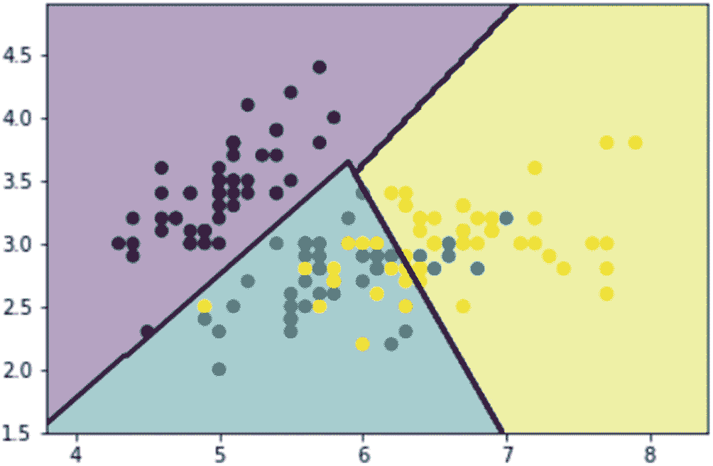

一张散点与区域图绘制了被分割成三个部分的决策边界，并带有数据点簇。线性和非线性模型由相应的决策边界分隔。

**图 8-20** 决策边界将决策区域划分为三个不同的部分

现在是时候应用非线性核来生成非线性决策边界了，例如多项式核。

```python
import numpy as np
import matplotlib.pyplot as plt
from sklearn import svm, datasets
iris = datasets.load_iris()
x = iris.data[:,:2]
y = iris.target
h = .05
svc = svm.SVC(kernel='poly',C=1.0,degree=3).fit(x,y)
x_min,x_max = x[:,0].min() - .5, x[:,0].max() + .5
y_min,y_max = x[:,1].min() - .5, x[:,1].max() + .5
h = .02
X, Y = np.meshgrid(np.arange(x_min, x_max, h), np.arange(y_min,y_max,h))
Z = svc.predict(np.c_[X.ravel(),Y.ravel()])
Z = Z.reshape(X.shape)
plt.contourf(X,Y,Z,alpha=0.1)
plt.contour(X,Y,Z,colors='k')
plt.scatter(x[:,0],x[:,1],c=y)
```

图 8-21 展示了多项式决策边界与线性情况相比，如何以截然不同的方式分割区域。

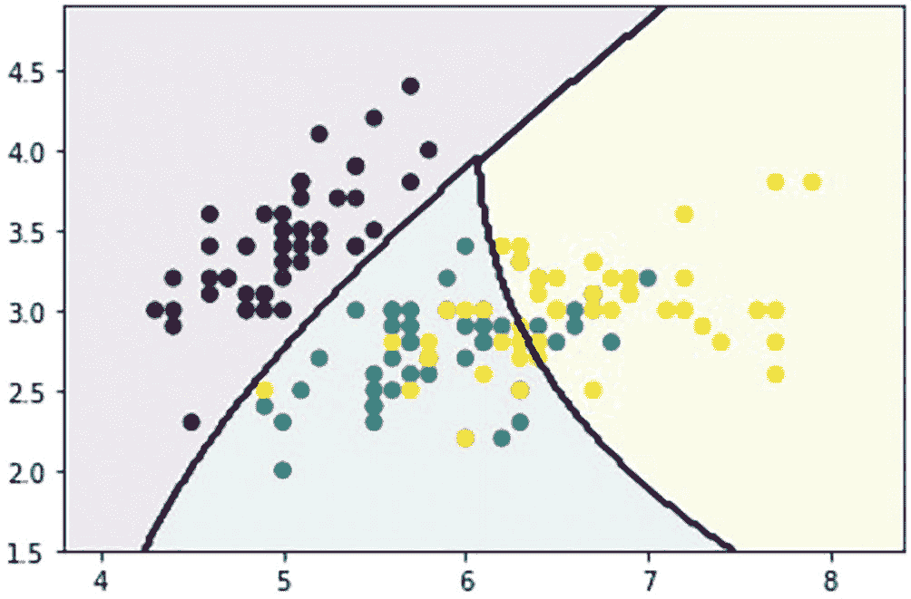

一张散点与区域图绘制了多项式决策边界。它包括三度。其中一个度形成了一个独立的簇。决策边界被划分为三个区域，每个区域有不同的阴影。

**图 8-21** 即使在多项式情况下，三个部分也几乎保持不变

现在你可以应用 RBF 核来观察区域分布上的差异。只需在 `svm.SVC()` 函数中将内核值更新为 `rbf` 即可。

```python
svc = svm.SVC(kernel='rbf', gamma=3, C=1.0).fit(x,y)
```

图 8-22 展示了 RBF 核如何生成径向区域。

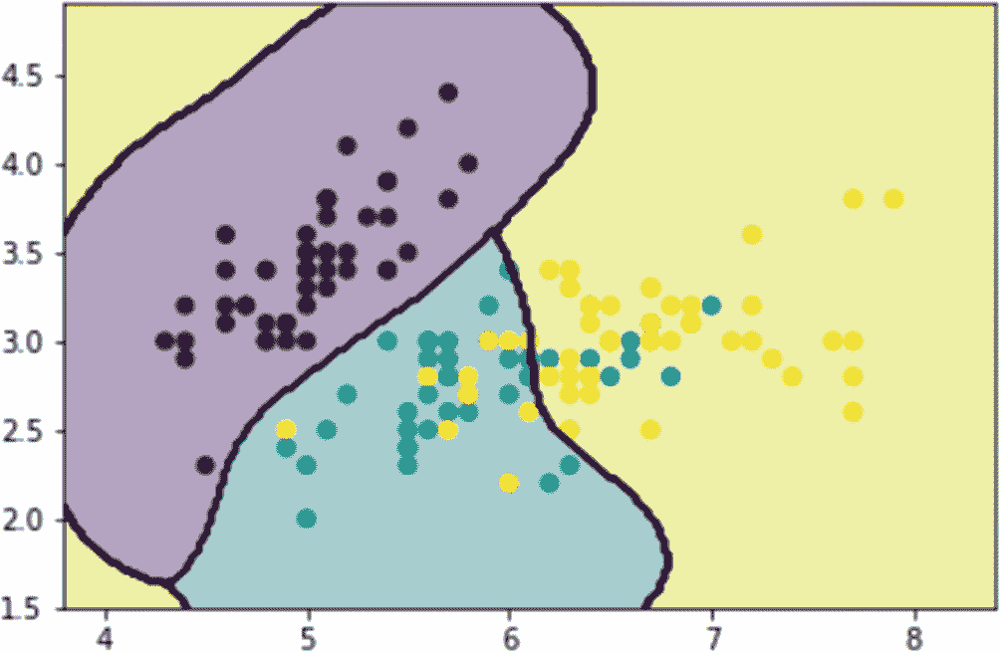

一张散点与区域图绘制了径向决策边界。它被分为三个区域，具有不同的阴影。两个度各自形成了独立的簇，并带有各自的决策边界。

**图 8-22** RBF 核定义了径向决策区域


### 支持向量回归（SVR）

`SVC()` 方法可以扩展用来解决回归问题。这种方法被称为*支持向量回归*。

由 `SVC()` 生成的模型实际上并不依赖完整的训练集，而仅使用了部分元素，即那些最接近决策边界的元素。类似地，由 `SVR()` 生成的模型也仅依赖于训练集的一个子集。

本节演示了 `SVR` 算法如何使用你在本章中见过的糖尿病数据集。作为示例，它仅引用了第三项生理数据。该算法执行了三种不同的回归：一种线性回归和两种非线性（多项式）回归。线性情况会产生一条直线，因为线性预测模型与之前见过的线性回归非常相似，而多项式回归是基于二次和三次构建的。`SVR()` 函数与之前见过的 `SVC()` 函数几乎完全相同。

唯一需要考虑的是，测试数据集必须按升序排序。

```python
import numpy as np
import matplotlib.pyplot as plt
from sklearn import svm
from sklearn import datasets
diabetes = datasets.load_diabetes()
x_train = diabetes.data[:-20]
y_train = diabetes.target[:-20]
x_test = diabetes.data[-20:]
y_test = diabetes.target[-20:]
x0_test = x_test[:,2]
x0_train = x_train[:,2]
x0_test = x0_test[:,np.newaxis]
x0_train = x0_train[:,np.newaxis]
x0_test.sort(axis=0)
x0_test = x0_test*100
x0_train = x0_train*100
svr = svm.SVR(kernel='linear',C=1000)
svr2 = svm.SVR(kernel='poly',C=1000,degree=2)
svr3 = svm.SVR(kernel='poly',C=1000,degree=3)
svr.fit(x0_train,y_train)
svr2.fit(x0_train,y_train)
svr3.fit(x0_train,y_train)
y = svr.predict(x0_test)
y2 = svr2.predict(x0_test)
y3 = svr3.predict(x0_test)
plt.scatter(x0_test,y_test,color='k')
plt.plot(x0_test,y,color='b')
plt.plot(x0_test,y2,c='r')
plt.plot(x0_test,y3,c='g')
```

三条回归曲线用三种颜色表示。线性回归为蓝色（直线）；二次多项式（向上凹的曲线，即抛物线）为红色；三次多项式为绿色（见图 8-23）。

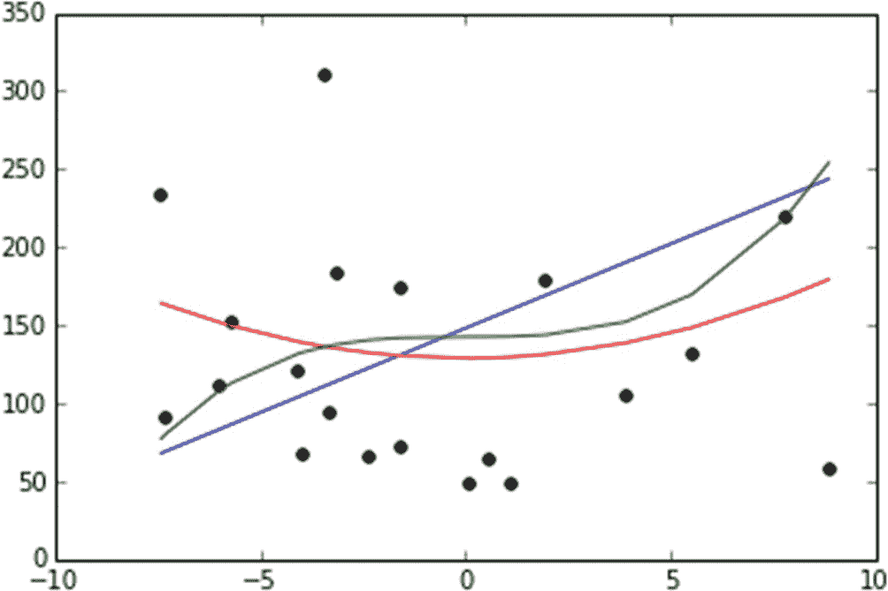

散点图和线图绘制了糖尿病的测试数据集。它包含三种不同的回归：一种线性回归和两种多项式回归。这三条曲线以不同颜色区分。两条多项式曲线代表了二次和三次多项式。散点分布在重叠线条的内部和周围。

**图 8-23** 从训练集出发，三条回归曲线产生了截然不同的趋势

## 结论

在本章中，你看到了使用 `scikit-learn` 库解决回归和分类问题的简单案例。通过一些实际示例，我们以实践的方式介绍了预测模型验证阶段的许多概念。

在下一章中，你将看到一个完整的案例，通过一个实际示例讨论数据分析的所有步骤。所有内容均在 IPython Notebook 中实现，这是一个交互式且创新的环境，非常适合分享数据分析的每一步。它包含交互式文档，可用作报告或网络演示。

