# 12. 识别手写数字

到目前为止，你已经看到了如何将数据分析技术应用于包含数字和字符串的`pandas`数据帧。但是，数据分析并不局限于数字和字符串，因为图像和声音也可以被分析和分类。

在这个简短但同等重要的章节中，你将学习手写识别。

## 手写识别

识别手写文本是一个可以追溯到首批需要识别手写文档中单个字符的自动机器的问题。例如，想想邮局信件上的邮政编码，以及识别这五位数字所需的自动化。为了实现邮件的自动高效分拣，对这些编码的完美识别是必需的。

在其他可能想到的应用中，包括 OCR（光学字符识别）软件。OCR 软件必须读取手写文本或印刷书籍的页面，以生成每个字符都定义明确的通用电子文档。

但手写识别问题的历史更久远，更准确地说，可以追溯到 20 世纪初（1920 年代），当时伊曼纽尔·戈德堡（1881-1970）开始了关于这个问题的研究，并指出统计方法将是一个最佳选择。

为了在 Python 中解决这个问题，`scikit-learn` 库提供了一个很好的示例。这个库可以帮助你更好地理解这项技术、所涉及的问题以及进行预测的可能性。

## 使用 scikit-learn 识别手写数字

`scikit-learn` 库（[`http://scikit-learn.org/`](http://scikit-learn.org/)）使你能以一种与本书此前使用的方法略有不同的方式来处理这类数据分析。要分析的数据与数值或字符串密切相关，但也可能涉及图像和声音。

你在此章面临的问题涉及预测一个数值，然后读取和解释使用手写字体的图像。

在这种情况下，你有一个*估计器*，其任务是通过`fit()`函数进行学习，一旦它达到一定程度的预测能力（模型足够有效），它将使用`predict()`函数生成预测。训练集和验证集这次是由一系列图像创建的。

本章使用 Jupyter Notebook 来运行 Python 代码示例，因此请打开 Jupyter 并创建一个新的 Notebook。

在这种情况下，一个有用的估计器是`sklearn.svm.SVC`，它使用了支持向量分类（SVC）技术。

因此，你必须导入`scikit-learn`库的`svm`模块。你可以创建一个 SVC 类型的估计器，然后选择一个初始设置，为参数`C`和`gamma`分配通用值。在分析过程中，这些值可以以不同的方式进行调整。

```
from sklearn import svm
svc = svm.SVC(gamma=0.001, C=100.)
```

## 数字数据集

正如你在第 8 章中看到的，`scikit-learn` 库提供了许多数据集，这些数据集对于测试许多数据分析和结果预测问题非常有用。同样在这种情况下，存在一个名为 *Digits* 的图像数据集。

该数据集由 1,797 张大小为 8x8 像素的图像组成。每张图像都是一个灰度手写数字，如图 12-1 所示。

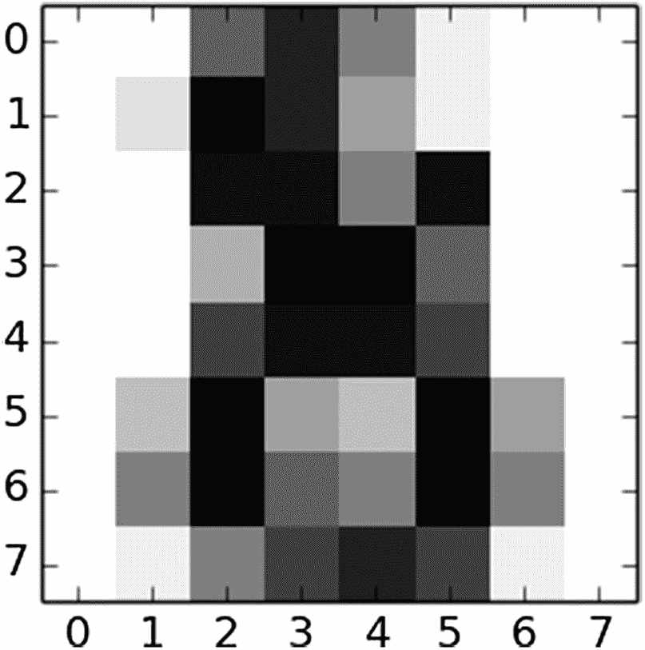

**一个数字数据集的 SVM 图由聚集在一起的灰度块组成，以生成一个数字图像。**

**图 12-1** 构成 Digits 数据集的 1,797 张手写数字图像之一

因此，你可以将 Digits 数据集加载到你的 Notebook 中。

```
from sklearn import datasets
digits = datasets.load_digits()
```

加载数据集后，你可以分析其内容。首先，你可以通过调用`DESCR`属性来读取关于数据集的大量信息。

```
print(digits.DESCR)
```

关于数据集的文本描述、为创建数据集做出贡献的作者以及参考文献如图 12-2 所示。

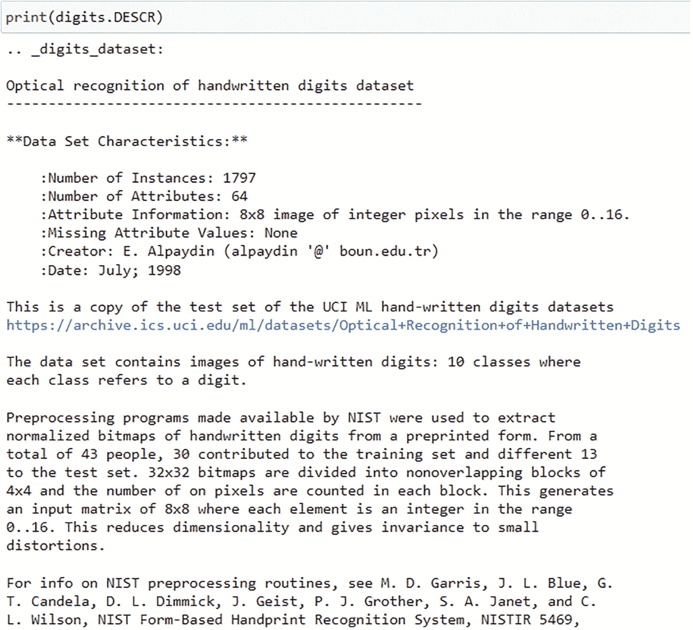

**数据集文本描述的截图。列出了数据集的特征。底部是 UCIML 测试集的链接。描述了 NIST 预处理程序。**

**图 12-2** `scikit-learn` 库中的每个数据集都有一个包含所有信息的字段

手写数字的图像包含在`digits.images`数组中。该数组中的每个元素都是一张图像，由一个 8x8 的数值矩阵表示，这些数值对应灰度数组。白色的值为 0，黑色的值为 15。

```
digits.images[0]
```

你将得到以下结果：

```
array([[  0.,   0.,   5.,  13.,   9.,   1.,   0.,   0.],
[  0.,   0.,  13.,  15.,  10.,  15.,   5.,   0.],
[  0.,   3.,  15.,   2.,   0.,  11.,   8.,   0.],
[  0.,   4.,  12.,   0.,   0.,   8.,   8.,   0.],
[  0.,   5.,   8.,   0.,   0.,   9.,   8.,   0.],
[  0.,   4.,  11.,   0.,   1.,  12.,   7.,   0.],
[  0.,   2.,  14.,   5.,  10.,  12.,   0.,   0.],
[  0.,   0.,   6.,  13.,  10.,   0.,   0.,   0.]])
```

你可以使用`matplotlib`库直观地检查此结果的内容。

```
import matplotlib.pyplot as plt
plt.imshow(digits.images[0], cmap=plt.cm.gray_r, interpolation='nearest')
```

当你启动此命令时，你将获得如图 12-3 所示的灰度图像。

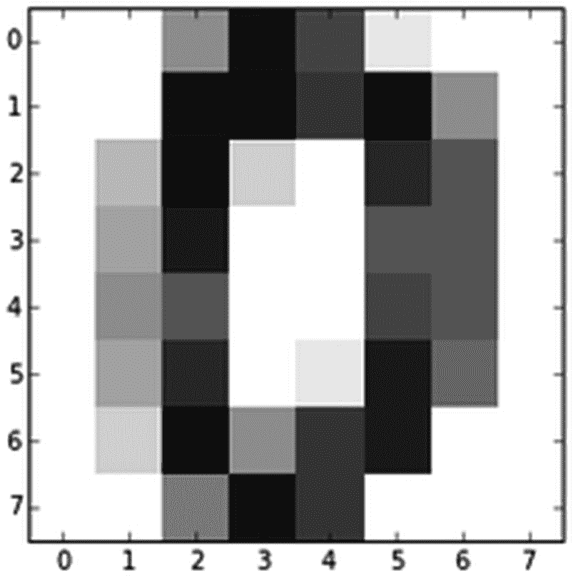

**一个数字数据集的 SVM 图由聚集在一起的灰度块组成，通过生成数字图像。**

**图 12-3** 1,797 个手写数字中的一个

图像所代表的数值，即目标值，包含在`digits.target`数组中。

```
digits.target
```

结果示例：

```
array([0, 1, 2, ..., 8, 9, 8])
```

据报告，该数据集是一个由 1,797 张图像组成的训练集。你可以判断这是否属实。

```
digits.target.size
```

## 学习与预测

现在你已经将 Digits 数据集加载到你的 Notebook 中，并定义了一个 SVC 估计器，你可以开始学习了。

如你在第 8 章中所学，一旦你定义了一个预测模型，你必须用一个训练集来训练它，这个训练集是一组你已经知道其类别的数据。鉴于 Digits 数据集中包含的大量元素，你肯定会得到一个非常有效的模型，即能够相当确定地识别出手写数字的模型。

该数据集包含 1,797 个元素，因此你可以将前 1,791 个作为训练集，并使用最后 6 个作为验证集。

你可以使用`matplotlib`库详细查看这六个手写数字：

```python
import matplotlib.pyplot as plt
plt.subplot(321)
plt.imshow(digits.images[1791], cmap=plt.cm.gray_r, interpolation='nearest')
plt.subplot(322)
plt.imshow(digits.images[1792], cmap=plt.cm.gray_r, interpolation='nearest')
plt.subplot(323)
plt.imshow(digits.images[1793], cmap=plt.cm.gray_r, interpolation='nearest')
plt.subplot(324)
plt.imshow(digits.images[1794], cmap=plt.cm.gray_r, interpolation='nearest')
plt.subplot(325)
plt.imshow(digits.images[1795], cmap=plt.cm.gray_r, interpolation='nearest')
plt.subplot(326)
plt.imshow(digits.images[1796], cmap=plt.cm.gray_r, interpolation='nearest')
```

生成的图像将包含六个数字，如图 12-4 所示。

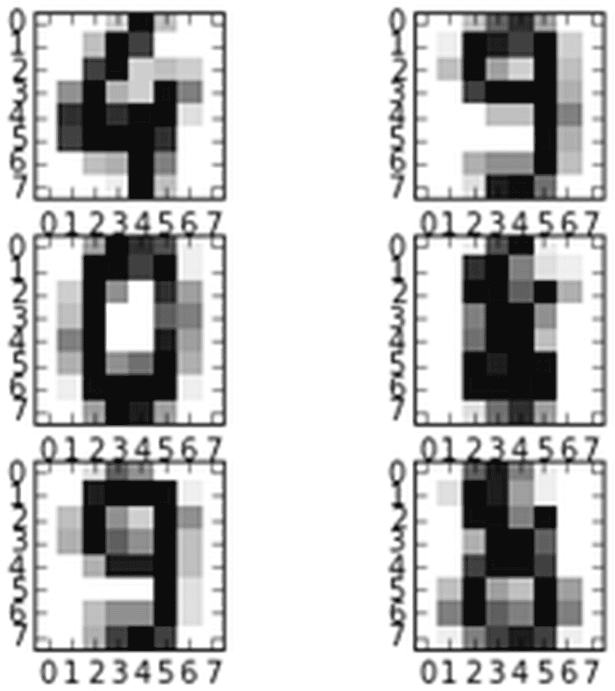

6 张由灰度块聚类组成数字图像的 SVM 图。识别出的数字包括 4、9、0 和 9。

**图 12-4** 验证集的六个数字

现在你可以训练之前定义的`svc`估计器。

```python
svc.fit(digits.data[1:1790], digits.target[1:1790])
```

运行后会生成如图 12-5 所示的图像。

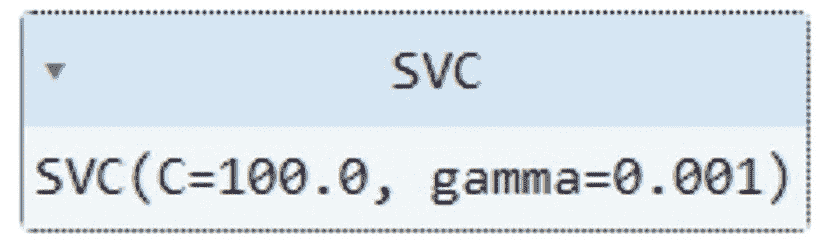

# 手写数字识别：从SVC到TensorFlow

SVC 参数的两行截图。第 1 行：SVC。第 2 行：SVC 参数 `C=100.0`，`gamma=0.001`。

**图 12-5** `SVC` 估计器的参数

现在你需要测试估计器，让它解释验证集中的六个数字。

```python
svc.predict(digits.data[1791:1976])
Out [ ]: array([4, 9, 0, 8, 9, 8])
```

将结果与真实数字对比，如下所示：

```python
digits.target[1791:1976]
Out [ ]:
array([4, 9, 0, 8, 9, 8])
```

可以看到`svc`估计器已经正确学习。它成功识别了手写数字，并正确解释了验证集中的所有六个数字。

## 使用 TensorFlow 识别手写数字

你刚刚看到了机器学习技术如何识别手写数字的示例。现在同样的任务将应用于你在第 9 章学过的深度学习技术。与第 9 章的情况类似，以下关于 TensorFlow 的部分已从上一版完全重写。实际上，这里你也会使用全新的 TensorFlow 2.x 版本，它与 TensorFlow 1.x 完全不同。因此这里使用的代码在本书旧版中是没有的。

鉴于 MNIST 数据集的重要价值，TensorFlow 库也包含了一份副本。因此，使用该数据集对神经网络进行研究和测试将非常容易，无需从其他数据源下载或导入。

除了 TensorFlow，还需要安装`tensorflow-dataset`包。你可以通过 Anaconda Navigator 或命令控制台完成安装：

```bash
conda install tensorflow-dataset
```

如果你没有 Anaconda 平台，也可以通过 PyPI 系统安装该包。

```bash
pip install tensorflow-dataset
```

在 Jupyter Notebook（或任何 Python 会话）中导入 MNIST 数据集非常简单。实际上，使用 TensorFlow 2.x 新版本时，无需从其他库导入像 MNIST 这样的测试数据集，因为它们已经包含在 Keras 中，而 Keras 集成在你已导入的`tensorflow`模块内。你可以直接导入`numpy`、`matplotlib`以及包含 MNIST 数据集的`tensorflow`库。

```python
import numpy as np
import matplotlib.pyplot as plt
import tensorflow as tf
```

现在，只需编写下面一行代码即可直接将数据集加载到 Notebook 中。

```python
(x_train, y_train),(x_test, y_test) = tf.keras.datasets.mnist.load_data()
```

然后你可以直接将数据集加载到 Notebook 中。

```python
x_validation = x_train[55000:]
x_train = x_train[:55000]
y_validation = y_train[55000:]
y_train = y_train[:55000]
len(x_train)
Out [ ]:

len(x_test)
Out [ ]:

len(x_validation)
Out [ ]:
```

MNIST 数据被分为三部分：55000 个训练数据点（`x_train`）、10000 个测试数据点（`x_test`）和 5000 个验证数据点（`x_validation`）。

所有这些数据将被提交给模型：`x`是特征数据集，`y`是标签数据集。正如你之前所见，这些是手写字母的图像。你可以查看训练数据集（特征）的第一张图像。

```python
x_train[0].shape
Out [ ]:
(28, 28)
```

这是一张边长为 28 像素的方形图像。

```python
plt.imshow(x_train[0], cmap=plt.cm.gray_r, interpolation='nearest')
```

你将获得一张手写数字的黑白图像，类似于图 12-6 所示。

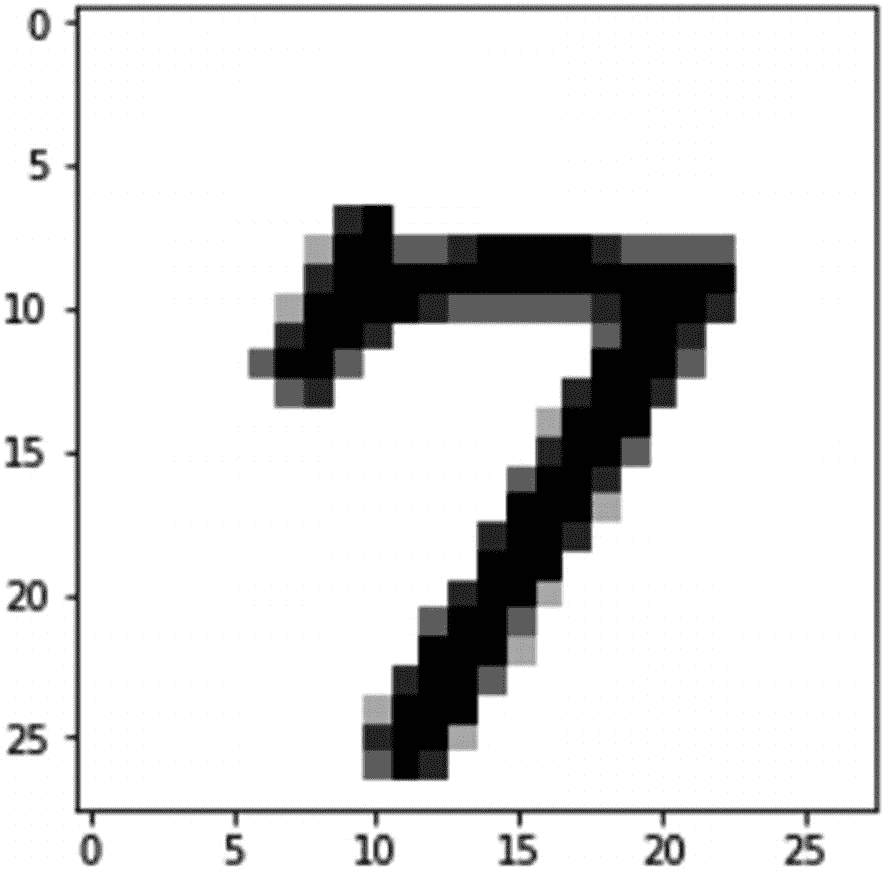

一张 MNIST 数据集的图表，显示训练集中的一个手写数字。识别出的数字是 7。

**图 12-6** TensorFlow 库提供的 MNIST 数据集中训练集的一个数字

为了让你更直观地了解 MNIST 数据集的内容，下面的可视化效果更好：

```python
fig, ax = plt.subplots(10, 10)
k = 0
for i in range(10):
    for j in range(10):
        ax[i][j].imshow(x_train[k].reshape(28, 28),
                        cmap=plt.cm.gray_r,
                        interpolation='nearest',
                        aspect='auto')
        ax[i][j].set_xticks([])
        ax[i][j].set_yticks([])
        k += 1
```

运行代码后，你将得到数据集中 100 个数字的图案，如图 12-7 所示。

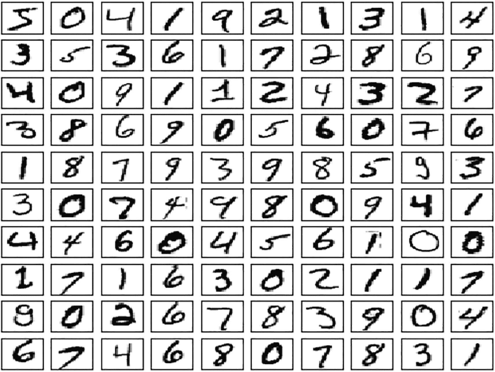

一张来自 MNIST 数据集的 10 列 10 行表格图。每个单元格内有一个潦草的手写数字。

**图 12-7** TensorFlow 库提供的 MNIST 数据集中训练集的 100 个数字

由于这些是图像，因此是二维数组，正如你在第 9 章所学，你需要在神经网络的起始处使用一个展平层，将输入数据展平为一维。

至于要提交给神经网络的数值类型，它们的取值范围是 0 到 255 的整数。

```python
print(np.max(x_train))
np.min(x_train)
Out [ ]:
```

实际上，这些是灰度图像，与 RGB 颜色类似，其值范围在 0 到 255 之间。因此，你还需要向神经网络模型添加一个归一化层。

现在将所有数组转换为张量，以便在 TensorFlow 中使用。

```python
train_features = tf.convert_to_tensor(x_train)
train_labels = tf.convert_to_tensor(y_train)
test_features = tf.convert_to_tensor(x_test)
test_labels =  tf.convert_to_tensor(y_test)
exp_features = tf.convert_to_tensor(x_validation)
```

我们以其中一个张量为例，看看其特征。

```python
train_features
Out [ ]:
<tf.Tensor: shape=(55000, 28, 28), dtype=uint8, numpy=
array([[[0, 0, 0, ..., 0, 0, 0],
        [0, 0, 0, ..., 0, 0, 0],
        [0, 0, 0, ..., 0, 0, 0],
        ...,
        [0, 0, 0, ..., 0, 0, 0],
        [0, 0, 0, ..., 0, 0, 0],
        [0, 0, 0, ..., 0, 0, 0]],
        ...
```

得到的结果符合预期。

## 使用 SLP 进行学习与预测

现在你已经了解了如何使用 TensorFlow 获取训练集、测试集和验证集，是时候使用神经网络进行分析了，这与你在第 9 章使用的方法非常相似。让我们从一个单层感知器（SLP）开始。

首先定义一个模型，它包含一个具有十个输出的单稠密层，这十个输出对应于 0 到 9 的十个数字，也对应于待识别手写数字的十个类别。在这个单层之上，你将添加两个层：`Normalization`和`Flatten`。前者将图像的像素值从 0 到 255 归一化到 0 到 1 的范围，后者将 28x28 图像的二维数组转换为一维数组。

```python
model = tf.keras.Sequential([
    tf.keras.layers.Normalization(),
    tf.keras.layers.Flatten(input_shape=(28, 28)),
    tf.keras.layers.Dense(10, activation='sigmoid')
])
```

在模型定义完成后，您可以对其进行编译，设置`Adam`为优化器，并将`sparse_categorical_crossentropy`作为损失函数。随后，使用 20 个周期（epochs）开始训练模型。

```markdown
## 监控损失趋势

```python
model.compile(
    optimizer='adam',
    loss='sparse_categorical_crossentropy',
    metrics=['accuracy'])
h = model.fit(train_features, train_labels, epochs=20)
```

输出：

```
Epoch 1/20
1719/1719 [==============================] - 3s 1ms/step - loss: 10.6817 - accuracy: 0.8341
Epoch 2/20
1719/1719 [==============================] - 2s 1ms/step - loss: 6.1368 - accuracy: 0.8759
Epoch 3/20
1719/1719 [==============================] - 3s 2ms/step - loss: 5.7782 - accuracy: 0.8798
Epoch 4/20
1719/1719 [==============================] - 3s 1ms/step - loss: 5.5405 - accuracy: 0.8824
Epoch 5/20
1719/1719 [==============================] - 2s 1ms/step - loss: 5.4812 - accuracy: 0.8840
Epoch 6/20
1719/1719 [==============================] - 2s 1ms/step - loss: 5.3873 - accuracy: 0.8851
Epoch 7/20
1719/1719 [==============================] - 2s 1ms/step - loss: 5.3120 - accuracy: 0.8861
...
```

现在，通过图形监控损失（loss）的趋势，来检查`history`中的学习阶段。

```python
acc_set = h.history['loss']
epoch_set = h.epoch
plt.plot(epoch_set, acc_set, 'o', label='Training phase')
plt.ylabel('loss')
plt.xlabel('epoch')
plt.legend()
```

运行上述代码，您将得到如图 12-8 所示的折线图。

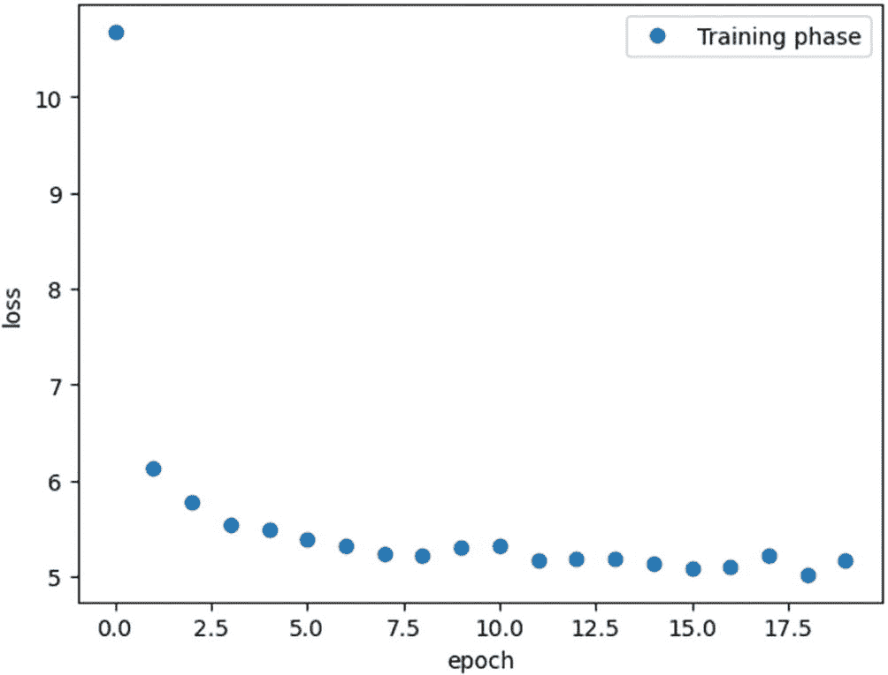

`图 12-8` SLP 神经网络学习阶段的损失趋势

## 模型评估与预测

您也可以使用以下代码行对模型进行数值化评估：

```python
model.evaluate(test_features, test_labels)
```

输出：

```
313/313 [==============================] - 1s 1ms/step - loss: 5.8654 - accuracy: 0.8925
[5.865407466888428, 0.8924999833106995]
```

从这些数值可以看出，0.89 的准确率并非最优，且损失值似乎没有大幅下降，而是稳定在 5.86 左右。

让我们看看这个模型如何识别那些既未用于学习也未用于测试的手写数字。为此，我们额外留出了一个第三个数据集：`exp_features`。您在模型中添加了`Softmax`层，以便输出属于各个类别的概率。然后，让新训练好的 SLP 模型进行预测。

```python
probability_model = tf.keras.Sequential([
    model,
    tf.keras.layers.Softmax()
])
predictions = probability_model.predict(exp_features)
```

输出：

```
157/157 [==============================] - 0s 981us/step
```

现在取第一张待预测的图像，并查看其在十个数字上的识别概率。

```python
predictions[0]
```

输出：

```
array([0.04717345, 0.12823072, 0.12823072, 0.12823072, 0.1282307 ,
       0.08905466, 0.04721416, 0.04717345, 0.12823072, 0.12823072],
      dtype=float32)
```

从输出的十个概率列表来看，情况并不直观。如果使用图形方法，将各种概率绘制成条形图，效果会更好。

```python
p = plt.bar(np.arange(10), predictions[0])
plt.xticks(np.arange(10))
predicted_label = np.argmax(predictions[0])
p[predicted_label].set_color('red')
```

运行上述代码将得到一个类似于图 12-9 的条形图。

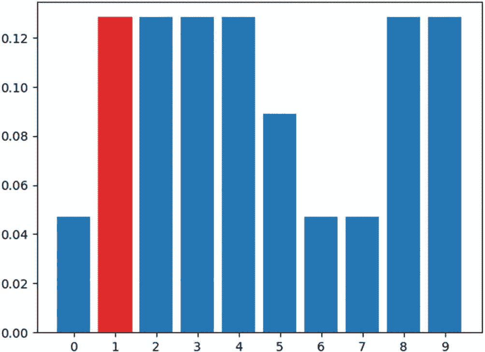

`图 12-9` SLP 神经网络学习阶段的损失趋势

您可以立即发现，许多数字具有相同的概率可能是图像中所代表的数字。尽管条形图以红色显示了最可能的图形，但在此例中存在一个错误，因为其他许多图形具有相同的概率（在数值相等的情况下，图表只显示了第一个最大值）。因此预测并不成功。现在确定提交给模型的图像的真实值。

```python
y_validation[0]
```

输出：

```
Out [ ]:
```

您也可以以图形方式查看它。

```python
plt.imshow(x_validation[0], cmap=plt.cm.gray_r, interpolation='nearest')
```

执行上述代码，您将得到如图 12-10 所示的数字。

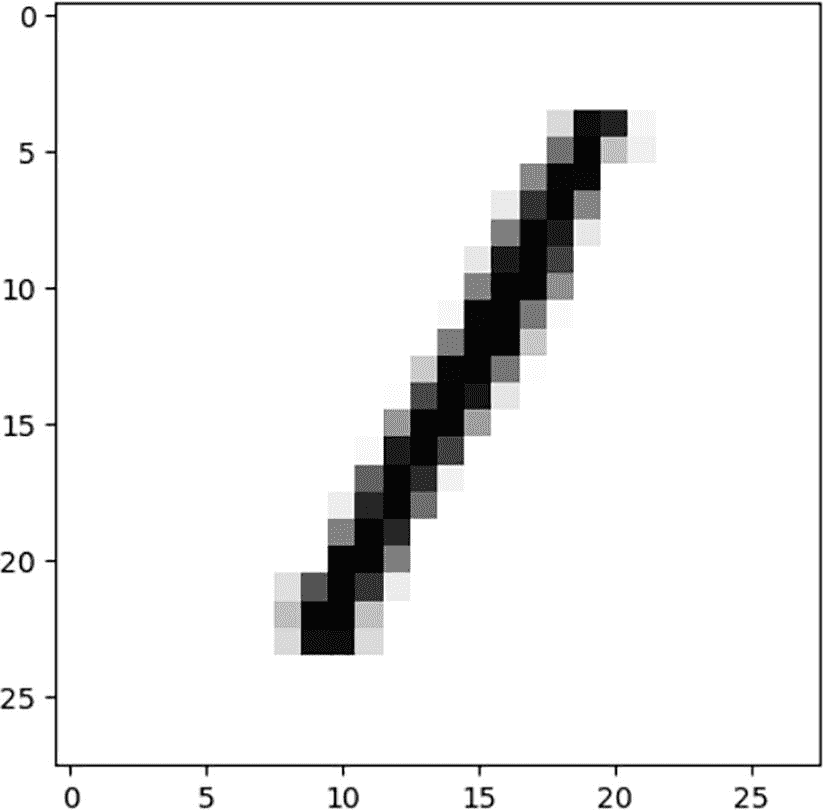

`图 12-10` 图像显示手写数字 1

由灰度块聚类而成的 SLP 模型图生成一个手写数字图像。识别出的数字是 1。

如您所见，它是数字 1，存在于最可能的结果中。然而，可能的选项太多，因此您不能认为这是一个好的预测。现在选取一个更容易识别的数字，看看 SLP 模型是否能正确识别它。

选择第 14 个数字，它很容易识别。

```python
plt.imshow(x_validation[13], cmap=plt.cm.gray_r, interpolation='nearest')
```

运行代码，您将得到这个易于识别的数字的图像，如图 12-11 所示。

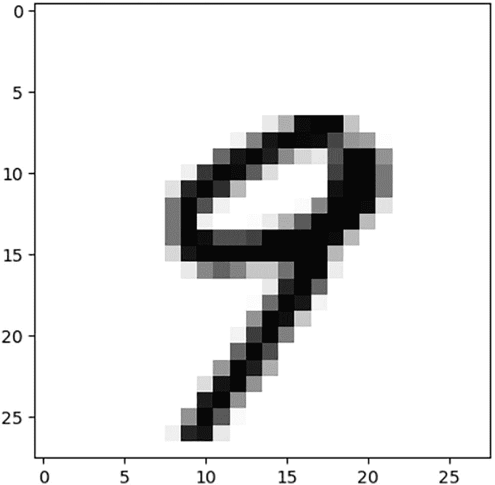

`图 12-11` 图像显示手写数字 9

由灰度块聚类而成的 SLP 模型图生成一个手写数字图像。识别出的数字是 9。

图像清晰地显示了数字 9。现在检查相应的标签。

```python
y_validation[13]
```

输出：

```
Out [ ]:
```

让我们看看，在这个非常简单的例子中，模型是否清晰识别出了数字 9。

```python
predictions[13]
```

输出：

```
array([0.07372559, 0.07270355, 0.07317524, 0.07424378, 0.13360192,
       0.07305884, 0.07261127, 0.13158722, 0.09798288, 0.1973097 ],
      dtype=float32)
```

您也可以以图形方式查看这个结果。

```python
p = plt.bar(np.arange(10),predictions[13])
plt.xticks(np.arange(10))
predicted_label = np.argmax(predictions[13])
p[predicted_label].set_color('red')
```
```

```
运行代码将得到如图 12-12 所示的条形图。

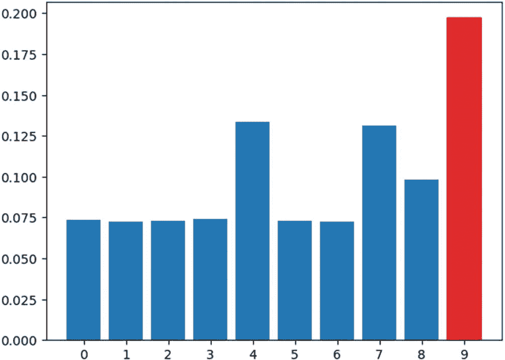

一个关于数组与数字 0 到 9 的条形图。各条形及其数值分别为：0 0.073, 1 0.072, 2 0.073, 3 0.074, 4 0.133, 5 0.073, 6 0.072, 7 0.131, 8 0.097, 9 0.197。条形 9 被高亮显示。数据为估计值。

### 图 12-12
条形图显示数字 9 是最可能的结果（红色条形）

尽管这次它正确猜中了数字，但赋予其大约 20% 的概率肯定不是一个好的预测。这个数字很容易识别，它应该拥有比其他数字高得多的识别概率。

## 使用多层感知器（MLP）进行学习与预测

鉴于 SLP 模型的成绩尚可，本节将构建一个更为复杂的神经网络，拥有更多层和更多神经元。该网络使用带有一个隐藏层的多层感知器（MLP）模型来预测手写数字。此外，它将第一层的神经元数量增加到 256 个，并为其隐藏层再增加 128 个神经元。输出层保持不变，为十个神经元（待分类的十个数字）。

```python
model = tf.keras.Sequential([
    tf.keras.layers.Normalization(),
    tf.keras.layers.Flatten(input_shape=(28, 28)),
    tf.keras.layers.Dense(256, activation='sigmoid'),
    tf.keras.layers.Dense(128, activation='sigmoid'),
    tf.keras.layers.Dense(10, activation='sigmoid')
])
```

您可以编译模型，并使用与前一个模型相同数量（20）的轮次进行训练。

```python
model.compile(optimizer='adam',
              loss='sparse_categorical_crossentropy',
              metrics=['accuracy'])
h = model.fit(train_features, train_labels, epochs=20)
```

```
Out [ ]:
Epoch 1/20
1719/1719 [==============================] - 4s 2ms/step - loss: 0.4885 - accuracy: 0.8658
Epoch 2/20
1719/1719 [==============================] - 4s 2ms/step - loss: 0.3243 - accuracy: 0.9013
Epoch 3/20
1719/1719 [==============================] - 3s 2ms/step - loss: 0.2935 - accuracy: 0.9093
Epoch 4/20
1719/1719 [==============================] - 3s 2ms/step - loss: 0.2630 - accuracy: 0.9171
Epoch 5/20
1719/1719 [==============================] - 3s 2ms/step - loss: 0.2423 - accuracy: 0.9250
Epoch 6/20
1719/1719 [==============================] - 3s 2ms/step - loss: 0.2370 - accuracy: 0.9268
Epoch 7/20
...
```

您也可以以图形方式观察模型学习阶段中的损失趋势。

```python
acc_set = h.history['loss']
epoch_set = h.epoch
plt.plot(epoch_set, acc_set, 'o', label='Training phase')
plt.ylabel('loss')
plt.xlabel('epoch')
plt.legend()
```

执行上述代码，您将得到如图 12-13 所示的图。

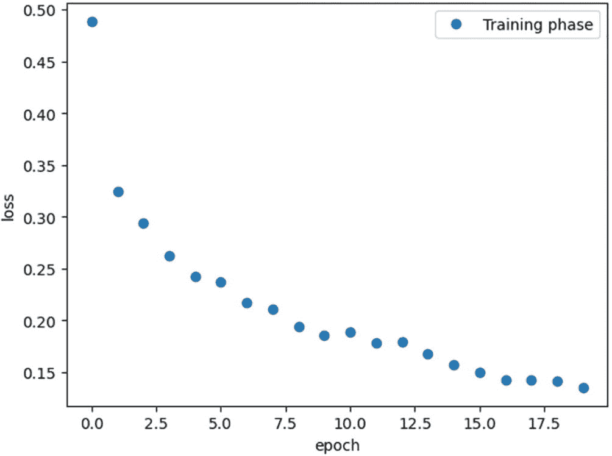

一个关于损失值与轮次的数据点图。数据代表训练阶段。该图从(0.0, 0.49)开始，下降至(0.9, 0.3)，然后逐渐减少到(18, 0.10)。数据为估计值。

### 图 12-13
图像显示了训练阶段中损失值是如何被优化的

您还可以通过数值来评估模型的学习过程。

```python
model.evaluate(test_features, test_labels)
```

```
Out [ ]:
313/313 [==============================] - 1s 1ms/step - loss: 0.1537 - accuracy: 0.9511
[0.1537058800458908, 0.9510999917984009]
```

正如您清晰所见，这次的学习，除了过程规整外，还达到了良好的准确率值和较低的损失值。您也可以在训练阶段增加轮次数，以进一步提高这个 MLP 模型的预测能力。但保持现状不变，以便将此模型的性能与之前的模型进行比较。

现在您可以看到，这个模型使用您提交给 SLP 模型的相同两个图像是如何识别数字的。

```python
probability_model = tf.keras.Sequential([
    model,
    tf.keras.layers.Softmax()
])
predictions = probability_model.predict(exp_features)
```

```
Out [ ]:
157/157 [==============================] - 0s 1ms/step
```

首先，您观察了模型如何为数字 1 的图像分配属于十个数字的概率。

```python
predictions[0]
```

```
array([0.07896608, 0.21424502, 0.08096407, 0.07952367, 0.08464722,
       0.07919335, 0.08132026, 0.11285783, 0.10845622, 0.07982624],
      dtype=float32)
```

您可以在条形图中以图形方式表示这些概率。

```python
p = plt.bar(np.arange(10), predictions[0])
plt.xticks(np.arange(10))
predicted_label = np.argmax(predictions[0])
p[predicted_label].set_color('red')
```

运行这段代码，您将得到如图 12-14 所示的条形图。

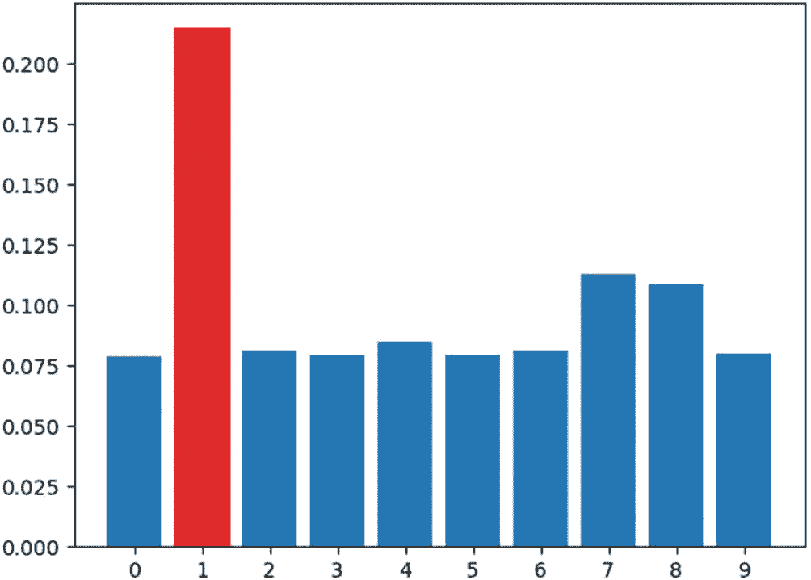

一个关于数组与数字 0 到 9 的条形图。各条形及其数值分别为：0 0.078, 1 0.214, 2 0.080, 3 0.079, 4 0.084, 5 0.079, 6 0.081, 7 0.112, 8 0.108, 9 0.079。条形 1 被高亮显示。数据为估计值。

### 图 12-14
条形图显示数字 1 是最可能的结果（红色条形）

如您所见，这个模型猜中了图像中表示的数字，并且其概率远高于其他数字。这一次，数字 1 被清晰识别。

如果您对第二个图像（代表数字 9）执行相同操作，您将得到类似的结果，如图 12-15 中的条形图所示。


## 条形图与文本数据分析

一个从 0 到 9 的数字与其对应数值的条形图。条形及其数值分别为：0：0.073，1：0.072，2：0.073，3：0.074，4：0.133，5：0.073，6：0.072，7：0.131，8：0.097，9：0.197。条形 9 被高亮显示。数据为估计值。

**图 12-15**
该条形图显示数字 1 为最可能的数字（红色条形）。

因此，显而易见，一个更复杂的神经网络模型（例如示例中使用的模型）效率更高：它学习更快，并且更擅长识别图像中的手写数字。但并非总是更复杂的神经网络模型就能带来潜力的提升。只有对各种模型、所使用的优化方法、选择的损失函数以及所有其他参数进行充分研究，才能证明模型的准确性。因此，如果你对此感兴趣，我邀请你进一步研究这个主题。

### 结论

在本章中，你学到了这一数据分析过程具有多么广泛的应用可能性。它不仅限于对数值和文本数据的分析，还可以分析图像，例如由摄像头或扫描仪读取的手写数字。此外，你已经看到，得益于机器学习和深度学习技术，预测模型可以提供最优结果。这些技术借助如 `TensorFlow` 等库，成为强大的分析工具。

## 13. 使用 `NLTK` 进行文本数据分析

在本书中，你已经看到了各种分析技术和众多示例，它们处理的是数值或表格形式的数据，这类数据易于通过数学表达式和统计技术进行处理。但大多数数据由文本组成，这些文本遵循因语言而异的语法规则（有时甚至不遵循规则 :)）。在文本中，单词及其可归因的意义（以及它们传递的情感）可以成为非常有用的信息来源。

在本章中，你将学习一些使用 `NLTK`（自然语言工具包）库的文本分析技术，该库允许你执行原本复杂的操作。此外，涵盖的主题将帮助你理解数据分析这一重要部分。

### 文本分析技术

近年来，随着大数据的出现以及来自互联网的海量文本数据，许多文本分析技术应运而生。事实上，这种形式的数据可能非常难以分析，但同时，考虑到数据的巨大可用性，它也代表了许多有用信息的来源。只需想想所有产生的文学作品——例如，互联网上发布的大量帖子。社交网络上的评论和聊天记录也是巨大的数据来源，特别是对于理解某个特定话题的赞成或反对程度。

因此，分析这些文本已成为一个巨大的兴趣点，并且为此引入了许多技术，形成了一个真正的学科。下面列出了一些更重要的技术。

**预处理：**

*   小写转换
*   单词和句子分词
*   标点符号移除
*   停用词移除
*   词干提取
*   词形还原

**文本分析：**

*   词频分布分析
*   模式识别
*   词性标注
*   链接与关联分析
*   情感分析

### 自然语言工具包 (`NLTK`)

如果你使用 `Python` 编程并希望分析文本形式的数据，目前最常用的工具之一是 `Python` 自然语言工具包 (`NLTK`)。`NLTK` 只不过是一个 `Python` 库（[www.nltk.org](http://www.nltk.org)），其中包含许多专门用于处理和文本数据分析的工具。`NLTK` 创建于 2001 年，最初用于教育目的，随着时间的推移，它发展到了一个成为真正分析工具的程度。

在 `NLTK` 库中，还有一个大型的示例文本集合，称为 *语料库*。这个文本集合主要取自文学作品，并且作为应用基于 `NLTK` 库开发的技术的基准非常有用。特别是，它被用来执行测试（其作用类似于 `TensorFlow` 中的 `MNIST` 数据集，在第 9 章中讨论过）。

在你的计算机上安装 `NLTK` 是一个非常简单的操作。

如果你目前没有使用 Anaconda 平台，你可以使用 `PyPI` 系统安装它。

```
pip install nltk
```

另一方面，如果你使用 Anaconda 平台进行 `Python` 项目开发，在你想要使用的虚拟环境中，可以通过 Anaconda Navigator 图形化地安装 `nltk` 包，或者通过命令控制台：

```
conda install nltk
```

### 导入 `NLTK` 库与 `NLTK` 下载器工具

为了更好地熟悉 `NLTK`，没有比直接使用 `Python` 代码更好的方法了。通过这种方式，你可以逐步观察和理解这个库的运行方式。

你首先需要做的是打开一个 Jupyter Notebook。第一个命令用于导入 `NLTK` 库。

```python
import nltk
```

然后，你需要从语料库集合中导入文本。为此，有一个名为 `nltk.download_shell()` 的函数，它可以打开一个名为 `NLTK` 下载器的工具。该下载器允许你通过引导式选项进行选择。

如果你在终端中输入以下命令：

```
nltk.download_shell()
```

你将会看到 `NLTK` 下载器以文本格式提示各种选项，如图 13-1 所示。

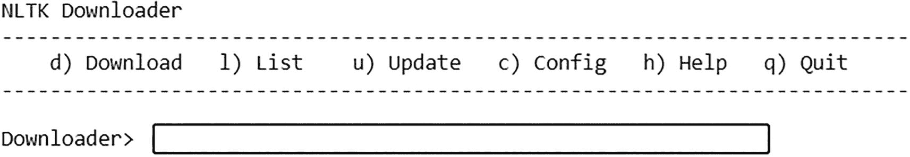

一个 Jupyter Notebook 的屏幕截图。它包含一个顶部的 `NLTK` 下载器，以及一系列显示的选项，包括 `download`、`list`、`update`、`config`、`help` 和 `quit`。在系列选项下方是一个下载器文本框。

**图 13-1**
Jupyter Notebook 中的 `NLTK` 下载器

现在，工具正在等待一个选项。如果你想查看可能的 `NLTK` 扩展列表，输入 `L` 选择 `list` 并按下 `Enter`。你将会立即看到所有属于 `NLTK` 的可下载包的列表，你可以下载这些包来扩展 `NLTK` 的功能，包括语料库集合的文本。

```
Packages:

[ ] abc................. Australian Broadcasting Commission 2006

[ ] alpino.............. Alpino Dutch Treebank

[ ] averaged_perceptron_tagger Averaged Perceptron Tagger

[ ] averaged_perceptron_tagger_ru Averaged Perceptron Tagger (Russian)

[ ] basque_grammars..... Grammars for Basque

[ ] biocreative_ppi..... BioCreAtIvE (Critical Assessment of Information

Extraction Systems in Biology)

[ ] bllip_wsj_no_aux.... BLLIP Parser: WSJ Model

[ ] book_grammars....... Grammars from NLTK Book

[ ] brown............... Brown Corpus

[ ] brown_tei........... Brown Corpus (TEI XML Version)

[ ] cess_cat............ CESS-CAT Treebank

[ ] cess_esp............ CESS-ESP Treebank

[ ] chat80.............. Chat-80 Data Files

[ ] city_database....... City Database

[ ] cmudict............. The Carnegie Mellon Pronouncing Dictionary (0.6)

[ ] comparative_sentences Comparative Sentence Dataset

[ ] comtrans............ ComTrans Corpus Sample

[ ] conll2000........... CONLL 2000 Chunking Corpus

[ ] conll2002........... CONLL 2002 Named Entity Recognition Corpus

Hit Enter to continue:
```

## 使用 NLTK 下载包

再次按下回车键将继续按字母顺序显示列表中的其他包。一直按回车键直到列表结束，即可查看所有可能的包。在列表末尾，NLTK 下载器的不同初始选项将重新出现。

要创建一系列示例来学习该库，你需要一系列文本来进行处理。非常适合此目的的文本来源是古腾堡语料库，它存在于语料库集合中。古腾堡语料库是从名为“古腾堡计划”的电子档案中提取的一小部分文本（[www. gutenberg. org](http://www.gutenberg.org)）。该档案中有超过 25,000 本电子书。

> **注意**
> 请注意，在意大利等一些国家，该网站无法访问。

要下载此包，首先输入 `d` 选项进行下载。该工具会询问包名称，因此你随后输入名称 `gutenberg`。

```
d) Download   l) List    u) Update   c) Config   h) Help   q) Quit

Downloader> d

Download which package (l=list; x=cancel)?

Identifier> gutenberg
```

此时，包将开始下载。

当你已经知道要下载的包名称时，只需输入命令 `nltk.download()`，并将包名称作为参数传入。这将不会打开 NLTK 下载器工具，而是直接下载所需的包。因此，之前的操作等效于编写：

```python
nltk.download('gutenberg')
```

下载完成后，你可以通过 `fileids()` 函数查看包的内容，该函数会显示其中包含的文件名称。

```python
gb = nltk.corpus.gutenberg
print("Gutenberg files:", gb.fileids())
```

终端上将显示一个数组，其中包含 `gutenberg` 包中的所有文本文件。

```
Out [ ]:
Gutenberg files: ['austen-emma.txt', 'austen-persuasion.txt', 'austen-sense.txt', 'bible-kjv.txt', 'blake-poems.txt', 'bryant-stories.txt', 'burgess-busterbrown.txt', 'carroll-alice.txt', 'chesterton-ball.txt', 'chesterton-brown.txt', 'chesterton-thursday.txt', 'edgeworth-parents.txt', 'melville-moby_dick.txt', 'milton-paradise.txt', 'shakespeare-caesar.txt', 'shakespeare-hamlet.txt', 'shakespeare-macbeth.txt', 'whitman-leaves.txt']
```

要访问其中一个文件的内部内容，你首先选择一个文件，例如莎士比亚的《麦克白》（`shakespeare-macbeth.txt`），然后将其赋值给一个方便的变量。一种提取模式是用于提取单词，即你想创建一个以单词为元素的数组。为此，你需要使用 `words()` 函数。

```python
macbeth = nltk.corpus.gutenberg.words('shakespeare-macbeth.txt')
```

如果你想查看此文本的长度（以单词计），可以使用 `len()` 函数。

```python
len(macbeth)
```

用于这些示例的文本因此由 23,140 个单词组成。

`macbeth` 变量是一个包含文本单词的长数组。如果你想查看文本的前十个单词，可以编写以下命令。

```python
macbeth[:10]
```

```
Out [ ]:
['[', 'The', 'Tragedie', 'of', 'Macbeth', 'by', 'William', 'Shakespeare', '1603', ']']
```

如你所见，前十个单词包含了作品标题，但也包含了方括号，它们表示句子的开始和结束。如果你使用 `sents()` 函数进行句子提取模式，你会得到一个结构更清晰的数组，每个句子作为一个元素。这些元素本身又是以单词为元素的数组。

```python
macbeth_sents = nltk.corpus.gutenberg.sents('shakespeare-macbeth.txt')
macbeth_sents[:5]
```

```
Out [ ]:
[['[', 'The', 'Tragedie', 'of', 'Macbeth', 'by', 'William', 'Shakespeare', '1603', ']'], ['Actus', 'Primus', '.'], ['Scoena', 'Prima', '.'], ['Thunder', 'and', 'Lightning', '.'], ['Enter', 'three', 'Witches', '.']]
```

## 使用 NLTK 搜索单词

当你拥有 NLTK 语料库（即从文本中提取的单词数组）时，最基本的操作之一是在其内部进行搜索。搜索的概念与你习惯的略有不同。

`concordance()` 函数会查找作为参数传入的单词在语料库中的所有出现位置。第一次运行此命令时，系统需要几秒钟才能返回结果。后续运行会更快。实际上，第一次在语料库上执行此命令时，它会为搜索创建内容索引，该索引将在后续调用中使用。这解释了为什么系统第一次需要更长时间。

首先，确保语料库是一个 `nltk.Text` 对象，然后在内部搜索单词 `'Stage'`。

```python
text = nltk.Text(macbeth)
text.concordance('Stage')
```

```
Out [ ]:
Displaying 3 of 3 matches:
nts with Dishes and Seruice ouer the Stage . Then enter Macbeth Macb . If it we
with mans Act , Threatens his bloody Stage : byth ' Clock ' tis Day , And yet d
struts and frets his houre vpon the Stage , And then is heard no more . It is
```

你得到了文本中三个不同的出现位置。

NLTK 中另一种搜索单词的形式是上下文搜索。即，查找你所搜索单词的前一个词和后一个词。为此，你必须使用 `common_contexts()` 函数。

```python
text.common_contexts(['Stage'])
```

```
Out [ ]:
the_ bloody_: the_,
```

如果你查看之前搜索的结果，可以看到这三个结果与上述内容相符。

一旦你理解了 NLTK 在搜索中如何处理单词及其上下文的概念，就很容易理解同义词的概念。即，假设所有具有相同上下文的单词都可能是同义词。要搜索所有与所搜索单词具有相同上下文的单词，你必须使用 `similar()` 函数。

```python
text.similar('Stage')
```

```
Out [ ]:
fogge ayre bleeding reuolt good shew heeles skie other sea feare
consequence heart braine seruice herbenger lady round deed doore
```

对于那些不习惯处理和分析文本数据的人来说，这些工具非常强大。

## 使用 NLTK 过滤停用词

下载所有停用词后，你可以只选择与英文相关的部分，并将其保存在变量 `sw` 中。

```python
sw = set(nltk.corpus.stopwords.words('english'))
print(len(sw))
list(sw)[:10]
```

```
Out [ ]:
['through', 'are', 'than', 'nor', 'ain', "didn't", 'didn', "shan't", 'down', 'our']
```

根据 NLTK，英文词汇中共有 179 个停用词。现在你可以使用这些停用词来过滤 `macbeth` 变量。

```python
macbeth_filtered = [w for w in macbeth if w.lower() not in sw]
fd = nltk.FreqDist(macbeth_filtered)
fd.most_common(10)
```

```
Out [ ]:
[(',', 1962), ('.', 1235), ("'", 637), (':', 477), ('?', 241), ('Macb', 137), ('haue', 117), ('-', 100), ('Enter', 80), ('thou', 63)]
```

现在返回了前十个最常见的单词，可以看到停用词已被去除，但结果仍不尽人意。实际上，单词中仍然存在标点符号。要消除所有标点，你可以修改之前的代码，在过滤器中插入一个包含标点符号的标点数组。这个标点数组可以通过导入 `string` 模块获得。

```python
import string

punctuation = set(string.punctuation)

macbeth_filtered2 = [w.lower() for w in macbeth if w.lower() not in sw and w.lower() not in punctuation]
```

现在你可以重新计算单词的频率分布。

```python
fd = nltk.FreqDist(macbeth_filtered2)

fd.most_common(10)

Out[12]:
[('macb', 137),
 ('haue', 122),
 ('thou', 90),
 ('enter', 81),
 ('shall', 68),
 ('macbeth', 62),
 ('vpon', 62),
 ('thee', 61),
 ('macd', 58),
 ('vs', 57)]
```

最终，你得到了想要的结果。

## 从文本中选择单词

另一种处理和分析数据的方式是根据特定特征从文本体中提取单词。例如，你可能对基于单词长度提取单词感兴趣。

为了获取所有最长的单词，例如长度超过 12 个字符的单词，你可以输入以下命令。

```python
long_words = [w for w in macbeth if len(w) > 12]
```

现在所有长度超过 12 个字符的单词都已存入 `long_words` 变量中。你可以使用 `sort()` 函数按字母顺序列出它们。

```python
sorted(long_words)

Out[13]:
['Assassination',
 'Chamberlaines',
 'Distinguishes',
 'Gallowgrosses',
 'Metaphysicall',
 'Northumberland',
 'Voluptuousnesse',
 'commendations',
 'multitudinous',
 'supernaturall',
 'vnaccompanied']
```

如你所见，共有 11 个单词符合这个标准。

另一个例子是查找所有包含特定字符序列的单词，例如 `'ious'`。你只需更改 `for in` 循环中的条件即可获得所需的选择。

```python
ious_words = [w for w in macbeth if 'ious' in w]

ious_words = set(ious_words)

sorted(ious_words)

Out[14]:
['Auaricious',
 'Gracious',
 'Industrious',
 'Iudicious',
 'Luxurious',
 'Malicious',
 'Obliuious',
 'Pious',
 'Rebellious',
 'compunctious',
 'furious',
 'gracious',
 'pernicious',
 'pernitious',
 'pious',
 'precious',
 'rebellious',
 'sacrilegious',
 'serious',
 'spacious',
 'tedious']
```

这个例子使用了 `sort()` 并对列表进行了集合转换，从而去除了重复单词。这两个例子只是向你展示此工具的潜力及其过滤单词的简便性的起点。

## 双词组与搭配

文本分析的另一个基本要素是考虑单词对（双词组）而不是单个单词。例如，单词“is”和“yellow”构成一个双词组，因为它们的组合是可能且是有意义的。因此可以在文本数据中找到“is yellow”。我们都知道，在某些文学作品中，有些双词组非常常见，以至于它们几乎总是同时出现。例如，“fast food”、“pay attention”、“good morning”等。这些双词组被称为搭配。

文本分析还可以涉及在所分析的文本中查找任何双词组。要找到它们，只需使用 `bigrams()` 函数。为了从双词组中排除停用词和标点，你必须使用已经过滤过的单词集，例如 `macbeth_filtered2`。

```python
bgrms = nltk.FreqDist(nltk.bigrams(macbeth_filtered2))

bgrms.most_common(15)

Out[15]:
[(('enter', 'macbeth'), 16),
 (('exeunt', 'scena'), 15),
 (('thane', 'cawdor'), 13),
 (('knock', 'knock'), 10),
 (('st', 'thou'), 9),
 (('thou', 'art'), 9),
 (('lord', 'macb'), 9),
 (('haue', 'done'), 8),
 (('macb', 'haue'), 8),
 (('good', 'lord'), 8),
 (('let', 'vs'), 7),
 (('enter', 'lady'), 7),
 (('wee', 'l'), 7),
 (('would', 'st'), 6),
 (('macbeth', 'macb'), 6)]
```

通过显示文本中最常见的双词组，可以发现语言搭配。

除了双词组，还可以有基于三词组的搭配，即三个单词的组合。在这种情况下，使用 `trigrams()` 函数。

```python
tgrms = nltk.FreqDist(nltk.trigrams(macbeth_filtered2))

tgrms.most_common(10)

Out[16]:
[(('knock', 'knock', 'knock'), 6),
 (('enter', 'macbeth', 'macb'), 5),
 (('enter', 'three', 'witches'), 4),
 (('exeunt', 'scena', 'secunda'), 4),
 (('good', 'lord', 'macb'), 4),
 (('three', 'witches', '1'), 3),
 (('exeunt', 'scena', 'tertia'), 3),
 (('thunder', 'enter', 'three'), 3),
 (('exeunt', 'scena', 'quarta'), 3),
 (('scena', 'prima', 'enter'), 3)]
```

## 预处理步骤

文本预处理是文本分析中最重要和基础的阶段之一。在从各种可用来源收集要分析的文本后，你会发现，为了在各种 NLP 技术中使用文本，有必要对其进行清洗、转换，然后专门准备使其可用。本节介绍一些更常见的预处理操作。

*小写转换* 可能是最频繁和常见的操作，不仅在预处理阶段，在分析的后继阶段也是如此。事实上，文本中包含许多字符大写的单词。大多数解析技术都要求将所有单词转为小写，这样“word”和“Word”就被视为同一个单词。

在 Python 中，这个操作非常简单（不需要使用 `nltk` 库），因为字符串变量具有 `lower()` 方法来应用转换。

```python
text = 'This is a Demo Sentence'

lower_text = text.lower()

lower_text

Out[17]:
'this is a demo sentence'
```

*单词分词* 是 NLP 中另一个非常常见的操作。文本由单词组成，单词之间有空格。因此，将文本转换为单词列表的操作对于能够用计算机处理文本至关重要。NLTK 提供了 `word_tokenize()` 函数来实现此目的。但首先你需要从 `nltk` 下载 `'punkt'` 资源。

```python
nltk.download('punkt')

text = 'This is a Demo Sentence'

tokens = nltk.word_tokenize(text)

tokens

Out[18]:
['This', 'is', 'a', 'Demo', 'Sentence']
```

分词也可以在更高层次上进行，即通过将组成文本的句子分开，并将它们转换为列表中的元素，而不是单个单词。在这种情况下，使用 `sent_tokenize()` 函数。

```python
text = 'This is a Demo Sentence. This is another sentence'

tokens = nltk.sent_tokenize(text)

tokens

Out[19]:
['This is a Demo Sentence.', 'This is another sentence']
```

## 另一个常见的预处理操作是 `标点符号去除`。

通常你需要对从社交网络或网络产品评论中获取的评论进行分析。许多此类文本富含标点符号，这会影响到其中单词的正确分词。对于这个操作，NLTK 提供了一个特殊的 tokenizer 对象，叫做 `RegexpTokenizer`，它允许你通过正则表达式定义分词标准。下面的示例设置了 `RegexpTokenizer` 以去除文本中存在的所有标点符号。

```python
from nltk.tokenize import RegexpTokenizer

text = 'This% is a #!!@ Sentence full of punctuation marks :-) '

regexpt = RegexpTokenizer(r'[a-zA-Z0-9]+')

tokens = regexpt.tokenize(text)

tokens
```

Out [ ]:
```
['This', 'is', 'a', 'Sentence', 'full', 'of', 'punctuation', 'marks']
```

## `停用词移除`操作则更为复杂。

实际上，停用词并不是可以通过正则表达式丢弃的特殊字符，而是那些“无法为文本提供信息”的真实单词。这些单词显然与每种语言相关，并且在不同语言中有所变化。在英语中，像“the”、“a”、“on”和“in”这类词基本上就是停用词。要从被分析的文本中移除它们，你可以按如下方式操作。

首先，从 `nltk` 加载停用词，然后将其导入代码中。执行常规的词元化操作，之后再移除英语停用词。

```python
nltk.download('stopwords')

from nltk.corpus import stopwords

text = 'This is a Demo Sentence. This is another sentence'

eng_sw = stopwords.words('english')

tokens = nltk.word_tokenize(text)

clean_tokens = [word for word in tokens if word not in eng_sw]

clean_tokens
```

Out [ ]:
```
['This', 'Demo', 'Sentence', '.', 'This', 'another', 'sentence']
```

另一种预处理操作涉及语言学。诸如 `词干提取` 和 `词形还原` 之类的操作，通过评估单词的语言学词根（前者）和词元（后者）来对单个单词进行处理。词干提取会将所有具有相同词根的单词归组，将它们视为同一个单词。而词形还原则是查找一个单词或动词的所有屈折形式，并将它们归到同一个词元下，将它们视为同一个单词。

因此，就词干提取而言，你在词元中就能获得文本所包含单词的所有词根。从 NLTK 中导入一个可用的词干提取器 `SnowballStemmer`，并将其设置为英语。然后对单词执行经典的分词操作。只有在此时，才通过将单词转换为其语言学词根来完成清洗。

```python
from nltk.stem import SnowballStemmer

text = 'This operation operates for the operator curiosity. A decisive decision'

stemmer = SnowballStemmer('english')

tokens = nltk.word_tokenize(text)

stemmed_tokens = [stemmer.stem(word) for word in tokens]

print(stemmed_tokens)
```

Out [ ]:
```
['this', 'oper', 'oper', 'for', 'the', 'oper', 'curios', '.', 'a', 'decis', 'decis']
```

至于词形还原，操作非常相似。但首先需要从 `nltk` 下载两个组件，例如 `WordNet` 和 `Omw`。对文本执行经典的分词操作，然后定义一个词形还原器。此时，将其应用于词元，以对单个单词进行词形还原。所有屈折形式都被合并在一起，包括单复数单词和动词的时态变化。

```python
nltk.download('omw-1.4')

nltk.download('wordnet')

from nltk.stem import WordNetLemmatizer

text = 'A verb: I split, it splits. Splitted verbs.'

tokens = nltk.word_tokenize(text)

lmtzr = WordNetLemmatizer()

lemma_tokens = [lmtzr.lemmatize(word) for word in tokens]

print(lemma_tokens)
```

Out [ ]:
```
['A', 'verb', ':', 'I', 'split', ',', 'it', 'split', '.', 'Splitted', 'verb', '.']
```

## 使用网络上的文本

到目前为止，你已经看到了一系列示例，这些示例使用了 NLTK 库中作为 `gutenberg` 有序包含的文本（称为语料库）。但实际上，你需要访问互联网来提取文本，并将其收集为语料库，以便使用 NLTK 进行分析。在本节中，你将看到此类操作有多么简单。首先，需要导入一个允许你连接网页内容的库。`urllib` 库非常适合此目的，因为它允许你从互联网下载文本内容，包括 HTML 页面。

因此，首先从 `urllib` 库中导入专门处理此类操作的 `request()` 函数。

```python
from urllib import request
```

然后，需要编写包含待提取文本页面的 URL。仍然以 `gutenberg` 项目为例，你可以选择，例如，一本陀思妥耶夫斯基写的书（[www.gutenberg.org](http://www.gutenberg.org)）。网站上提供不同格式的文本；本例使用原始格式（`.txt`）的文本。

```python
url = "http://www.gutenberg.org/files/2554/2554-0.txt"

response = request.urlopen(url)

raw = response.read().decode('utf8')
```

原始文本中包含了从互联网下载的整本书的文本内容。务必检查所下载内容。为此，查看前 75 个字符就足够了。

```python
raw[:75]
```

Out [ ]:
```
'\ufeffThe Project Gutenberg EBook of Crime and Punishment, by Fyodor Dostoevsky\r'
```

如你所见，这些字符对应着文本的标题。你可以看到文本的第一个单词处还有一个错误。实际上存在 Unicode 字符 `BOM \ufeff`。出现这种情况是因为本例使用了 `utf8` 解码系统，这在大多数情况下有效，但在此例中不行。本例中最合适的系统是 `utf-8-sig`。用正确的值替换不正确的值。

```python
raw = response.read().decode('utf8-sig')

raw[:75]
```

Out [ ]:
```
'The Project Gutenberg EBook of Crime and Punishment, by Fyodor Dostoevsky\r\n'
```

为了能够对其进行处理，必须将其转换为与 NLTK 兼容的语料库。为此，请输入以下转换命令。

```python
tokens = nltk.word_tokenize(raw)

webtext = nltk.Text(tokens)
```

这些命令所做的无非是使用 `nltk.word_tokenize()` 函数将字符文本分割成词元（即单词），然后使用 `nltk.Text()` 将词元转换为适合 NLTK 的文本主体。

你可以通过输入以下命令来查看标题：

```python
webtext[:12]
```

Out [ ]:
```
['The',

'Project',

'Gutenberg',

'EBook',

'of',

'Crime',

'and',

'Punishment',

',',

'by',

'Fyodor',

'Dostoevsky']
```

现在，你有了一个正确的语料库，可以在此基础上进行分析。

## 从 HTML 页面提取文本

在前一个示例中，你从互联网下载的文本创建了一个 NLTK 语料库。但互联网上的大多数文档都是以 HTML 页面形式存在的。在本节中，你将了解如何从 HTML 页面中提取文本。

你仍然使用 `urllib` 库的 `request()` 函数来下载网页的 HTML 内容。

```python
url = "https://news.bbc.co.uk/2/hi/health/2284783.stm"
```

# 情感分析

情感分析是一个近期才发展起来的新研究领域，旨在评估人们对特定话题的看法。该学科基于多种文本分析技术，其应用领域主要集中于社交媒体和论坛（观点挖掘）。通过用户的评论和反馈，情感分析算法能够根据特定关键词评估用户的好感度或评价。这种好感度被称为观点，具有三种可能值：正面、中性或负面。因此，观点评估本质上是一种分类问题。

许多情感分析技术实际上是分类算法，与你在前几章（参见第 8 章和第 9 章）学习的机器学习和深度学习算法类似。为了更好地理解这种方法，我以官方网站（`http://www.nltk.org/book/ch06.html`）上使用朴素贝叶斯算法的分类教程为例，该网站还提供了许多其他有用的示例，以帮助更好地理解该库。

作为训练集，该示例使用了 NLTK（自然语言工具包）中的另一个语料库：`movie_reviews`。该语料库包含大量电影评论，每条评论都包含一段长度不等的文本，以及一个用于指明该评论是正面还是负面的字段。因此，它是一个很好的学习材料。

本教程的目的是找出负面文档中重复出现最多的词，或者正面文档中重复出现较多的词，从而聚焦于与观点相关的关键词。该评估通过 NLTK 中集成的朴素贝叶斯分类器进行。

首先，名为 `movie_reviews` 的语料库至关重要。

```python
nltk.download('movie_reviews')
Out [ ]:
[nltk_data] Downloading package movie_reviews to
[nltk_data]     C:\Users\nelli\AppData\Roaming\nltk_data...
[nltk_data]   Package movie_reviews is already up-to-date!
True
```

然后，你从获取的语料库中构建训练集，创建一个名为 `documents` 的元素对数组。该数组的第一个字段包含单条评论的文本，第二个字段包含其负面或正面评价。最后，你以随机顺序打乱数组中的所有元素。

```python
import random
reviews = nltk.corpus.movie_reviews
documents = [(list(reviews.words(fileid)), category)
for category in reviews.categories()
for fileid in reviews.fileids(category)]
random.shuffle(documents)
```

为了更好地理解这一点，我们仔细查看一下 `documents` 的内容。第一个元素包含两个字段；第一个字段是包含所有使用词汇的评论。

```python
first_review = ' '.join(documents[0][0])
print(first_review)
Out [ ]:
topless women talk about their lives falls into that category that i mentioned in the devil ' s advocate : movies that have a brilliant beginning but don ' t know how to end . it begins by introducing us to a selection of characters who all know each other . there is liz , who oversleeps and so is running late for her appointment, prue who is getting married,...
```

第二个字段则包含该评论的评价：

```python
documents[0][1]
Out [ ]:
'neg'
```

但训练集尚未准备好；实际上，你需要创建语料库中所有单词的频率分布。然后使用 `list()` 函数将该分布转换为列表。

```python
all_words = nltk.FreqDist(w.lower() for w in reviews.words())
word_features = list(all_words)
```

下一步是定义一个用于计算特征（即足以确定评论观点的关键词）的函数。

```python
def document_features(document, word_features):
    document_words = set(document)
    features = {}
    for word in word_features:
        features['{}'.format(word)] = (word in document_words)
    return features
```

定义好 `document_features()` 函数后，你就可以从文档中创建特征集。

```python
featuresets = [(document_features(d,word_features), c) for (d,c) in documents]
```

目标是创建整个电影语料库中包含的所有单词的集合，分析每个单词在单条评论中是否存在（`True` 或 `False`），并查看它们对评论的正面或负面判断贡献了多少。一个词在负面评论中出现得越频繁，而在正面评论中出现得越少，它就越容易被评估为“负面”词。反之亦然，用于评估“正面”词。

要确定如何将该特征集划分为训练集和测试集，你首先需要知道它包含多少个元素。

```python
len(featuresets)
Out [ ]:
```

为了评估模型的准确性，你使用该集的前 1,500 个元素作为训练集，后 500 个元素作为测试集。

```python
train_set, test_set = featuresets[1500:], featuresets[:500]
```

最后，你应用 NLTK 库提供的朴素贝叶斯分类器对该问题进行分类。然后，你将测试集提交给模型，计算其准确性。

```python
classifier = nltk.NaiveBayesClassifier.train(train_set)
print(nltk.classify.accuracy(classifier, test_set))
Out [ ]:
0.85
```

该准确性不如前几章的例子高，但这里你处理的是文本中包含的词汇，因此相对于数值问题，创建精确模型是非常困难的。

现在你已经完成了分析，可以查看哪些词在评估评论的负面或正面观点时权重最大。

```python
classifier.show_most_informative_features(10)
Out [ ]:
Most Informative Features
compelling = True              pos : neg    =     11.9 : 1.0
outstanding = True              pos : neg    =     11.2 : 1.0
lame = True              neg : pos    =     10.2 : 1.0
extraordinary = True              pos : neg    =      9.7 : 1.0
lucas = True              pos : neg    =      9.7 : 1.0
bore = True              neg : pos    =      8.3 : 1.0
catch = True              neg : pos    =      8.3 : 1.0
journey = True              pos : neg    =      8.3 : 1.0
magnificent = True              pos : neg    =      8.3 : 1.0
triumph = True              pos : neg    =      8.3 : 1.0
```

## HTML 语料库处理

```python
html = request.urlopen(url).read().decode('utf8')
html[:120]
Out [ ]:
'\r\n\r\n<hea'
```

不过，现在转换成 NLTK 语料库需要一个额外的库 `bs4 (BeautifulSoup)`，它为你提供了能够识别 HTML 标签并提取其中所含文本的合适解析器。

```python
from bs4 import BeautifulSoup

raw = BeautifulSoup(html, "lxml").get_text()
tokens = nltk.word_tokenize(raw)
text = nltk.Text(tokens)
```

现在，在这种情况下你也拥有了一个语料库，尽管你通常需要执行比前一种情况更复杂的清洗操作，才能消除那些你不感兴趣的单词。

查看结果，你不会惊讶地发现，单词`badly`是一个负面观点词，而`finest`是一个正面观点词。有趣的是，`julie`是一个负面观点词。

## 结论

在本章中，你初步了解了文本分析的世界。事实上，还有许多其他技术和示例可以讨论。然而，在学完本章后，你应该熟悉了分析的这个分支，并且尤其开始了解`NLTK`（自然语言工具包）库，这是一个用于文本分析的强大工具。

# 14. 使用 OpenCV 进行图像分析与计算机视觉

在前面的章节中，数据分析完全集中在数值数据和表格化数据上，而在上一章中，你了解了如何处理和分析文本形式的数据。本书以介绍数据分析的最后一个方面——图像分析——作为恰当的收尾。本章将介绍计算机视觉和人脸识别等主题。你将看到深度学习技术是如何成为这类分析的基础的。此外，还将介绍另一个名为 `openCV` 的库，它一直是图像分析的参考标准。

## 图像分析与计算机视觉

在本书中，你已经看到分析的目的在于从被研究的系统中提取新信息、提炼新概念与特征。你之前用数字和文本数据完成了这一过程，而图像同样可以做到。这一分析分支被称为图像分析，其基础是应用于图像的计算技术（称为图像滤波器），你将在后续章节中了解这些技术。

近年来，尤其是得益于深度学习的发展，图像分析在解决此前无法实现的问题上取得了巨大突破，由此催生了一门名为计算机视觉的新学科。

在第 9 章中，你学习了人工智能——这是处理纯粹“人类相关”问题的计算分支。计算机视觉正是其中的一部分，因为其目标是复制人脑感知图像的方式。

事实上，“看见”不仅仅是获取二维图像，更重要的是对该区域内容的解读。捕获的图像会被分解并加工成逐渐抽象的表示层次（轮廓、图形、物体和文字），从而能被人类思维所识别。

同样地，计算机视觉旨在处理二维图像并从中提取相同的表示层次。这是通过多种操作实现的，这些操作可分类如下：
*   检测：检测图像中的形状、物体或其他研究对象（例如，寻找汽车）
*   识别：将识别出的对象归入通用类别（例如，按品牌和类型细分汽车）
*   辨识：识别出前一类别中的某个具体实例（例如，找到我的车）

## OpenCV 与 Python

OpenCV（开源计算机视觉库）是一个用 C++ 编写的、专用于计算机视觉和图像分析的库（[`https://opencv.org/`](https://opencv.org/)）。这个由 Gary Bradsky 设计的强大库最初是 Intel 的一个项目，首个版本于 2000 年发布。随着时间的推移，它以开源许可证形式发布，并逐渐普及，目前已达到 4.8 版本（2023 年 6 月）。目前，OpenCV 支持众多与计算机视觉和机器学习相关的算法，并且功能与日俱增。

它的实用性和广泛传播恰恰源于其竞争对手：`matlab`。实际上，需要处理图像分析的人有两种选择：购买 `matlab` 软件包，或者编译并安装开源版本的 OpenCV。显而易见，许多人选择了第二种方案。

## OpenCV 与深度学习

计算机视觉与深度学习之间有着密切的联系。由于 2017 年是深度学习发展的关键一年（阅读我在 [`www.meccanismocomplesso.org/en/2017-the-year-of-deep-learning-frameworks/`](http://www.meccanismocomplesso.org/en/2017-the-year-of-deep-learning-frameworks/) 发表的相关文章），OpenCV 3.3 新版本的发布增强了该库的功能，引入了许多深度学习及神经网络的新特性。实际上，该库有一个名为 `dnn`（深度神经网络）的模块专门负责这一领域。该模块专门为与多种深度学习框架（包括 Caffe2、TensorFlow 和 PyTorch）配合使用而开发（关于这些框架的信息，请参见第 9 章）。

## 安装 OpenCV

你可以通过官方网站 ([`https://opencv.org/releases/`](https://opencv.org/releases/)) 在许多操作系统（Windows、iOS 和 Android）上安装 OpenCV 软件包。

如果你使用 Anaconda 作为分发介质，我推荐采用此方法。安装过程非常简单且干净。

```
conda install opencv
```

遗憾的是，对于 Linux 系统，没有官方的 PyPI 包（即通过 `pip` 安装）可用。需要手动安装，其过程可能因使用的发行版和版本而异。互联网上有许多相关流程，有些或多或少是可行的。

## 图像处理与分析初步

本节旨在让你熟悉 `opencv` 库。首先，你将学习如何加载和显示图像。接着，你将对其进行一些简单操作，如两幅图像的相加、相减，并查看图像融合的示例。所有这些操作都非常有用，因为它们构成许多其他图像分析操作的基础。

### 开始之前

安装好 `opencv` 库后，你可以在 Jupyter QtConsole 或 Jupyter Notebook 中打开一个 IPython 会话。

在开始编程之前，你需要导入 `openCV` 库。

```
import numpy as np
import cv2
```

### 加载并显示图像

首先，主要因为 OpenCV 处理的是图片，所以了解如何在 Python 程序中加载图像、进行操作处理，并最终查看结果就显得至关重要。

你需要做的第一件事是使用 `openCV` 库读取包含图像的文件。你可以使用 `imread()` 方法来完成此操作。此方法读取 JPG 等压缩格式的文件，并将其转换为由对应色阶和位置的数值矩阵组成的数据结构。

> 注意：你可以在本书的源代码中找到这些图像和文件。

```
img = cv2.imread('italy2018.jpg')
```

如果你对更多细节感兴趣，可以直接查看图像的内容。你会看到一个数组的数组，每个数组对应图像的一个特定位置，并且每个位置都由 0 到 255 之间的数字特征化。

实际上，如果你查看图像第一个元素的内容，会得到以下结果。

```
img[0]
Out [ ]:
array([[38, 43, 11],
       [37, 42, 10],
       [36, 41,  9],
       ...,
       [24, 37, 15],
       [22, 36, 12],
       [23, 36, 12]], dtype=uint8)
```

继续编写代码，你现在使用 `matplotlib` 库来显示加载到 `img` 变量中的图像。首先，从 `matplotlib` 库中导入绘图所需的内容：

```
from matplotlib import pyplot as plt
```

现在，你可以使用 `pyplot` 的 `imshow()` 方法来显示已加载的图像。由于 OpenCV 中默认的颜色格式是 BGR（蓝、绿、红），因此通过 `cv2.COLOR_BGR2RGB` 指定转换为 RGB 格式非常重要。此外，由于 `pyplot` 是为绘图而设置的，你需要移除显示的坐标轴和刻度，因此通过设置 `plt.axis` 为 `off` 来禁用它们。

```
plt.axis('off')
plt.imshow(cv2.cvtColor(img, cv2.COLOR_BGR2RGB))
plt.show()
```

执行此命令时，将打开一个新窗口并显示图 14-1 中的图像。


一张照片显示意大利国家队的一群队员正在操场上慢跑，他们穿着队服。

**图 14-1** 意大利国家足球队训练时的照片

### 处理图像

现在你已经学会了如何查看文件系统中的现有图像，可以进入下一步：通过对图像执行操作来处理图像，并将结果保存到新文件中。

继续之前的示例，你将使用相同的代码。不过这次，你将执行一个简单的图像处理，例如，分解三个 RGB 通道。然后，你将交换这些通道以形成一幅新图像。这幅新图像的所有颜色都将改变。

加载图像后，将其分解为三个 RGB 通道。你可以使用 `split()` 方法轻松做到这一点。

```
b,r,g = cv2.split(img)
```

现在重新组合这三个通道，但需要改变顺序，例如交换红色通道和绿色通道。你可以使用 `merge()` 方法轻松地重新组合通道。

```
img2 = cv2.merge((b,g,r))
```

新图像存储在 `img2` 变量中。在一个新窗口中，将其与原始图像一同显示。

```
plt.axis('off')
plt.imshow(cv2.cvtColor(img2, cv2.COLOR_BGR2RGB))
plt.show()
```

运行程序后，会出现一个显示颜色已改变的新窗口（如图 14-2 所示）。


一张经过处理的照片，描绘了意大利国家队的一群男子在操场上慢跑。照片的颜色已从 BGR 转换为 RGB。

**图 14-2** 处理后的图像颜色已改变

### 保存新图像

最后，你需要通过文件系统保存新图像。在程序末尾，添加一个 `imwrite()` 方法，并指定要保存的新文件名，文件也可以有其他格式，例如 PNG。

```
cv2.imwrite('italy2018altered.png', img2)
Out [ ]:
True
```

执行此命令后，你会注意到工作区中出现了一个新的 `italy2018altered.png` 文件。

## 图像基本运算

# 图像加法与混合

最基本的运算是两幅图像的加法。使用 `openCV` 库，此操作非常简单，你可以通过 `cv2.add()` 函数来实现。得到的结果将是两幅图像的组合。但请记住，要进行加法运算的两幅图像必须具有相同的尺寸。在本例中，两幅图像都是 512x331 像素。

你需要做的第一件事是加载另一幅尺寸相同的图像，在本例中是 `soccer.jpg`（你可以在源代码中找到它）。

```python
img2 = cv2.imread('soccer.jpg')
plt.axis('off')
plt.imshow(img2)
plt.show()
```

执行代码后，你将得到图 14-3 所示的图像。


一张足球躺在操场上的照片。

**图 14-3** 一张尺寸相同（512x331 像素）的新图像

现在，使用 `add()` 函数将两幅图像相加。

```python
img3 = cv2.add(img, img2)
plt.axis('off')
plt.imshow(cv2.cvtColor(img3, cv2.COLOR_BGR2RGB))
plt.show()
```

执行此代码后，你将得到两幅图像的组合（如图 14-4 所示）。遗憾的是，效果并不理想。


一幅两幅照片组合的插图，描绘了意大利国家队男子在操场上慢跑以及一个足球。

**图 14-4** 通过将两幅图像相加得到的新图像

结果并非你所期望。实际上是白色占主导，这是对每个像素分别计算 RGB 三个值简单算术和的结果。实际上，你知道 RGB 三个分量各取值 0 到 255。因此，如果某个像素值的总和大于 255（这很有可能），该值仍将为 255。因此，简单的图像加法并不会产生两幅图像融合的效果，而是逐渐向白色偏移。稍后你将学习如何将两幅图像相加，以创建一幅融合了两幅图像各一半的新图像（这不是算术和）。

你可以通过相减两幅图像来做同样的事情。此操作可以使用 `cv2.subtract()` 函数执行。这次你预期会得到一幅越来越偏向黑色的图像。将 `cv2.add()` 函数替换为以下内容。

```python
img3 = cv2.subtract(img, img2)
plt.axis('off')
plt.imshow(cv2.cvtColor(img3, cv2.COLOR_BGR2RGB))
plt.show()
```

运行程序后，你将得到一幅暗得多的图像（尽管你可能看不太清），如图 14-5 所示。


一幅照片描绘了将足球从意大利国家队男子慢跑和足球的组合照片中移除后的效果。足球的轮廓以暗色调呈现。

**图 14-5** 从一幅图像中减去另一幅图像得到的新图像

请注意，如果反过来，从第二幅图像中减去第一幅图像，效果会更差。

```python
img3 = cv2.subtract(img2, img)
plt.axis('off')
plt.imshow(cv2.cvtColor(img3, cv2.COLOR_BGR2RGB))
plt.show()
```

你会得到一幅发黑的图像，如图 14-6 所示。


一幅照片描绘了将球员群体从意大利国家队男子慢跑和足球的组合照片中移除后的效果。球员的轮廓以暗色调呈现。

**图 14-6** 从一幅图像中减去另一幅图像得到的新图像

然而，这有助于我们了解运算子的顺序对结果很重要。

更具体地说，你已经看到，用 `opencv` 库创建的图像不过是一个数组的数组，它完全符合 NumPy 的规则。因此，你可以使用 NumPy 提供的矩阵间运算，例如矩阵加法。但要注意，结果肯定是不一样的。

```python
img = img1 + img2
```

实际上，`cv2.add()` 和 `cv2.subtract()` 函数会将值保持在 0 到 255 之间，无论运算子的值是多少。如果和超过 255，结果会以不同的方式解释，从而产生非常奇怪的色彩效果（可能是取 255 的模）。当减法产生负值时也是如此；结果将为 0。算术运算不具备此特性。

不过，你可以直接尝试一下。

```python
img3 = img + img2
plt.axis('off')
plt.imshow(cv2.cvtColor(img3, cv2.COLOR_BGR2RGB))
plt.show()
```

执行此代码后，你会得到一幅色彩对比非常强烈的图像（即超过 255 的那些点），如图 14-7 所示。


一幅插图表示将意大利国家队男子慢跑和足球的两张照片相加，结果产生了高色彩对比度的 RGB 色调。

**图 14-7** 将两幅图像作为两个 NumPy 矩阵相加得到的图像

# 图像混合

在前面的例子中，你看到两幅图像的相加或相减并不会产生介于两者之间的中间图像，而是使颜色向白色或黑色改变。正确的操作称为*混合*。也就是说，你可以想象将两幅图像叠加在一起，一幅放在上面，并使其逐渐变得越来越透明。通过逐渐调整透明度，你得到两幅图像的混合，从而创建一幅位于中间的新图像。混合操作并非简单的加法；其公式对应以下方程。

`img = α · img1 + (1 – α) · img2`，其中 `0 ≥ α ≥ 1`

从这个方程可以看出，两幅图像有两个数值系数，取值范围在 0 到 1 之间。随着 `α` 参数的增长，你会从第一幅图像平滑过渡到第二幅图像。`opencv` 库通过 `cv2.addWeighted()` 函数提供了混合操作。

因此，如果你想在两幅源图像之间创建一幅中间图像，可以使用以下代码。

```python
img3 = cv2.addWeighted(img, 0.3, img2, 0.7, 0)
plt.axis('off')
plt.imshow(cv2.cvtColor(img3, cv2.COLOR_BGR2RGB))
plt.show()
```

结果将是一幅类似于图 14-8 所示的图像。


一幅插图表示将意大利国家队男子慢跑和足球的两张照片进行混合，呈现出透明叠加的效果。

**图 14-8** 通过图像混合得到的新图像

# 图像分析

上一节示例的目的是理解图像不过是 NumPy 数组。因此，这些数值矩阵是可以被处理的。所以，你可以实现许多数学函数来处理这些矩阵中的数值，从而获得新图像。这些通过运算得到的新图像，将用于提供新的信息。

这就是*图像分析*的基本概念。从原始图像（矩阵）到结果图像（矩阵）所进行的数学运算被称为*图像滤镜*（见图 14-9）。要理解这个过程，你肯定接触过照片编辑应用（如 Photoshop）。无论如何，你肯定见过可以应用到照片上的滤镜。这些滤镜实质上就是*算法*（一系列数学运算），用于修改原始图像矩阵中的数值。

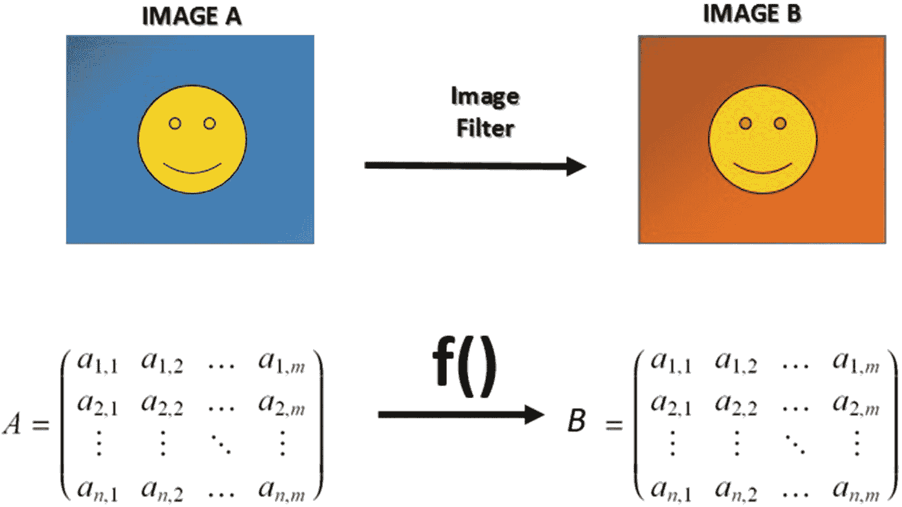

两幅插图。A，图像 A 显示一个方框内的笑脸符号。通过应用图像滤镜生成图像 B，它是图像 A 的彩色版本。B，通过 F 括号表示从 A 到 B 的矩阵变化。矩阵有 m 列和 n 行。

图 14-9 图像分析基础的图像滤镜示意图

# 边缘检测与图像梯度分析

在前面的章节中，你学习了一些对图像分析有用的基本操作。在本节中，你将从一个真实的图像分析案例开始，即*边缘检测*。

## 边缘检测

在分析图像时，尤其是在计算机视觉领域，基本操作之一是理解图像的内容，例如物体和人。首先需要理解图像中可能呈现的形式。要理解所呈现的几何形状，就必须识别出将物体与背景或其他物体区分开来的轮廓。这正是边缘检测的任务。

在边缘检测领域，已经开发了大量算法和技术，它们利用不同的原理来确定物体的轮廓。其中许多技术基于颜色梯度的原理，并利用图像梯度分析过程。

## 图像梯度理论

在可应用于图像的各种操作中，有图像的*卷积*运算，即应用特定的滤镜来编辑图像，以获取信息或其他用途。你已经知道，图像被表示为一个大的数值矩阵，其中每个像素的颜色由矩阵中 0 到 255 之间的数字表示。卷积过程通过应用数学运算（*图像滤镜*）处理所有这些数值，并在一个相同尺寸的新矩阵中生成新的数值。

其中一种运算是*导数*。简单来说，导数是能够计算数值变化速率（在空间、时间等方面）的数学运算。导数在图像情况下为何重要？因为它与颜色变化有关，这种变化称为*梯度*。能够计算颜色的梯度是检测图像边缘的绝佳工具。事实上，你的眼睛之所以能区分图像中图形的轮廓，正是由于颜色之间的跳跃。此外，你的眼睛能够通过从亮到暗的各种颜色深浅（即梯度）来感知深度。

由此可见，测量图像中的梯度对于检测图像边缘至关重要。这可以通过对图像执行一个简单的运算（即滤镜）来完成。

为了从数学角度更好地理解这一点，请看图 14-10。

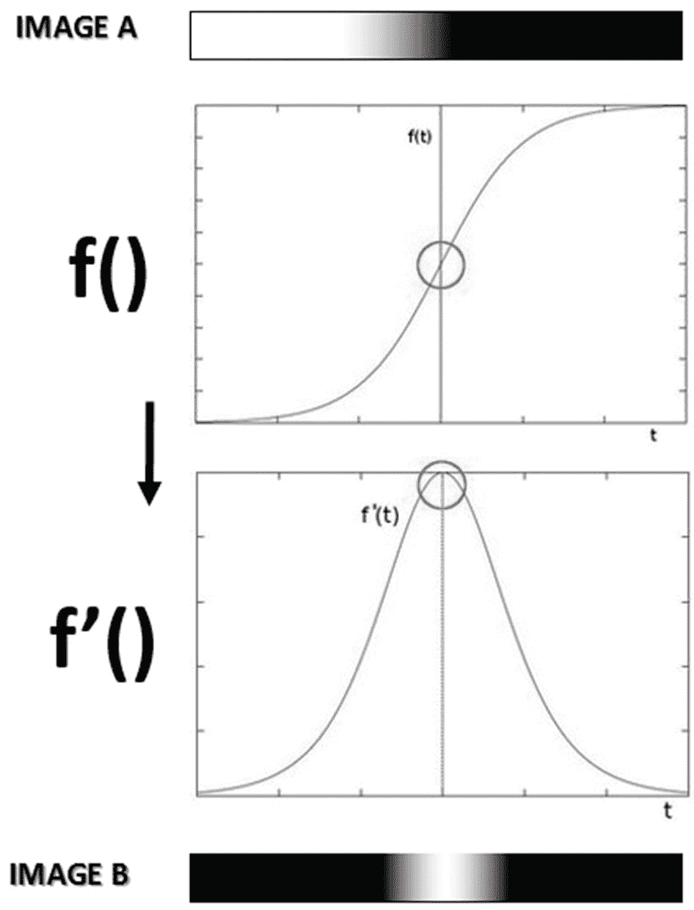

图像 A 和 B 的两个水平渐变块及其各自的图表。在图像 A 中，块的右侧有一个较暗的区域，而在图像 B 中，左右角都有暗区。在图表 A 中，线条呈上升趋势，而在图表 B 中，线条呈钟形趋势。

图 14-10 图像梯度理论示意图

如图 14-10 所示，边缘无非是一种色调到另一种色调的快速过渡。为简化起见，0 代表黑色，1 代表白色。所有灰色阴影都是 0 到 1 之间的浮点值。如果将所有对应的梯度值绘制成图表，就会得到函数`f()`。如图所示，存在一个从 0 到 1 的突变，这指示了边缘。函数`f()`的导数产生函数`f'()`。可以看到，色调的最大变化会导致数值接近 1。因此，在颜色转换时，你会得到一个图像，其中白色将指示边缘。

## 使用图像梯度分析进行边缘检测的实践示例

进入实践部分，你将使用两张专门为测试轮廓分析而创建的图像，因为它们包含几个重要特征。

第一张图像（如图 14-11 所示）由黑白两色构成的两个箭头组成，对应文件`blackandwhite.jpg`。在这张图像中，颜色对比非常强烈，并且箭头的轮廓具有所有可能的朝向（水平、垂直和对角线）。这张测试图像将评估边缘检测在黑白色调系统中的效果。

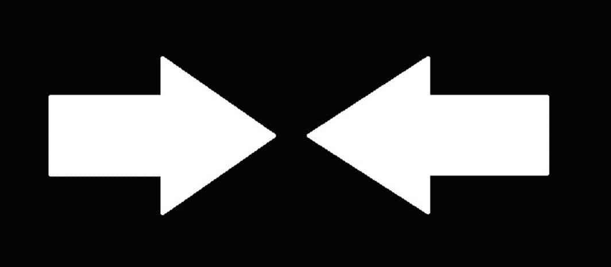

一幅深色背景上两个颜色较浅、相互指向的箭头的插图。

图 14-11 代表两个箭头的黑白图像

第二张图像`gradients.jpg`展示了不同的灰色渐变，当这些渐变彼此相邻放置时，会形成矩形，其边缘包含了所有可能的渐变和色调组合（如图 14-12 所示）。这张图像是评估系统真实边缘检测能力的一个良好测试。

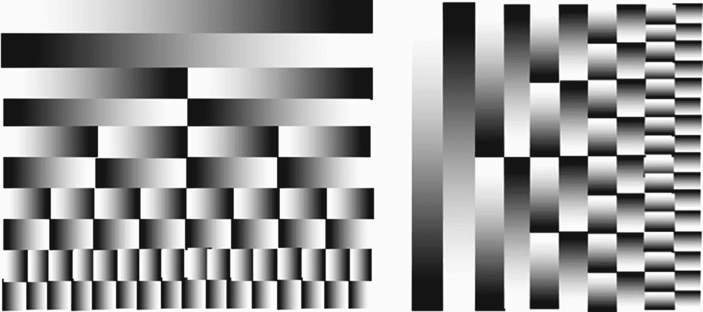

两幅水平与垂直方向的两组灰色渐变图案彼此相邻排列的插图，每组有十行十列，形成一个方块。

图 14-12 一组彼此相邻放置的灰色渐变

现在你可以开始编写边缘检测所需的代码。你将使用`matplotlib`在同一窗口中显示不同的图像。在此测试中，你将使用 OpenCV 提供的两种不同类型的图像滤镜：`sobel`和`laplacian`。实际上，它们的名称对应于对矩阵（图像）执行的数学运算的名称。`openCV`库提供了`cv2.Sobel()`和`cv2.Laplacian()`来应用这两种计算。

首先，从分析应用于`blackandwhite.jpg`图像的边缘检测开始。

```python
from matplotlib import pyplot as plt
img = cv2.imread('blackandwhite.jpg',0)
laplacian = cv2.Laplacian(img, cv2.CV_64F)
sobelx = cv2.Sobel(img,cv2.CV_64F,1,0,ksize=5)
sobely = cv2.Sobel(img,cv2.CV_64F,0,1,ksize=5)
plt.subplot(2,2,1),plt.imshow(img,cmap = 'gray')
plt.title('Original'), plt.xticks([]), plt.yticks([])
plt.subplot(2,2,2),plt.imshow(laplacian,cmap = 'gray')
plt.title('Laplacian'), plt.xticks([]), plt.yticks([])
plt.subplot(2,2,3),plt.imshow(sobelx,cmap = 'gray')
plt.title('Sobel Y'), plt.xticks([]), plt.yticks([])
plt.subplot(2,2,4),plt.imshow(sobely,cmap = 'gray')
plt.title('Sobel Y'), plt.xticks([]), plt.yticks([])
plt.show()
```

当你运行这段代码时，你会得到一个包含四个方框的窗口（如图 14-13 所示）。第一个方框是原始的黑白图像，而其他三个方框是三种滤波器应用于该图像后的结果。


4 张插图。A，原始图像，两个较浅色的箭头在深色背景上相对。B，拉普拉斯算子，箭头区域在灰色背景上被突出显示。C 和 D，Sobel X 和 Y，箭头的部分边缘在灰色背景上被检测到。

图 14-13 对 `blackandwhite.jpg` 图像应用边缘检测的结果

关于 Sobel 滤波器，即使仅限于水平或垂直方向，边缘检测也是完美的。对角线在两种情况下都可见，因为它们同时具有水平和垂直分量，但 Sobel X 中的水平边缘和 Sobel Y 中的垂直边缘无论如何都无法被检测到。通过组合两个滤波器（两个导数的计算）得到拉普拉斯滤波器，边缘的确定是全向的，但会损失一些分辨率。实际上，你可以看到对应边缘的波纹更加柔和。灰度着色对于检测边缘和梯度非常有用，但如果你只对检测边缘感兴趣，则必须在`cv2.CV_8U`中设置输出图像文件。

因此，你可以在之前代码的滤波器函数中将输出数据类型从`cv2.CV_64F`更改为`cv2.CV_8U`。如下所示，替换传递给两个图像滤波器的参数。

```python
laplacian = cv2.Laplacian(img, cv2.CV_8U)
sobelx = cv2.Sobel(img,cv2.CV_8U,1,0,ksize=5)
sobely = cv2.Sobel(img,cv2.CV_8U,0,1,ksize=5)
```

运行代码，你将得到类似的结果（如图 14-14 所示），但这次只有黑白两种颜色，边缘在黑色背景上以白色显示。


4 张深色背景上的插图。A，原始图像，两个较浅色的箭头相对。B，拉普拉斯算子，箭头区域被突出显示。C 和 D，Sobel X 和 Y，检测到箭头的部分边缘。

图 14-14 对 `blackandwhite.jpg` 图像应用边缘检测的结果

如果你仔细观察 Sobel 滤波器 X 和 Y 的面板，你会立刻注意到有些不对劲。缺失的边缘在哪里？在图 14-15 中留意这个问题。


4 张深色背景上的插图。A，原始图像，两个较浅色的箭头相对。B，拉普拉斯算子，箭头区域被突出显示。C 和 D，Sobel X 和 Y，检测到箭头的部分边缘。缺失的部分被圈出并标有问号。

图 14-15 `blackandwhite.jpg` 图像中缺失的边缘

实际上，转换数据时出现了问题。用`cv2.CV_64F`值在灰度中报告的梯度，在从黑色变为白色时由正值（正斜率）表示。然而，在从白色变为黑色时，它们由负值（负斜率）表示。在从`cv2.CV_64F`转换到`cv2.CV_8U`的过程中，所有负斜率都被归零，从而导致与这些边缘相关的信息丢失。当程序显示图像时，从白色到黑色的边缘不会显示出来。为了克服这个问题，你应该在滤波器输出中保持`cv2.CV_64F`格式的数据（而不是`cv2.CV_8U`），然后计算绝对值，最后再转换为`cv2.CV_8U`。

对代码进行以下修改：

```python
laplacian64 = cv2.Laplacian(img, cv2.CV_64F)
sobelx64 = cv2.Sobel(img,cv2.CV_64F,1,0,ksize=5)
sobely64 = cv2.Sobel(img,cv2.CV_64F,0,1,ksize=5)
laplacian = np.uint8(np.absolute(laplacian64))
sobelx = np.uint8(np.absolute(sobelx64))
sobely = np.uint8(np.absolute(sobely64))
plt.subplot(2,2,1),plt.imshow(img,cmap = 'gray')
plt.title('Original'), plt.xticks([]), plt.yticks([])
plt.subplot(2,2,2),plt.imshow(laplacian,cmap = 'gray')
plt.title('Laplacian'), plt.xticks([]), plt.yticks([])
plt.subplot(2,2,3),plt.imshow(sobelx,cmap = 'gray')
plt.title('Sobel Y'), plt.xticks([]), plt.yticks([])
plt.subplot(2,2,4),plt.imshow(sobely,cmap = 'gray')
plt.title('Sobel Y'), plt.xticks([]), plt.yticks([])
plt.show()
```

现在，如果你执行它，你将得到正确的表示，即箭头边缘在黑色背景上以白色显示（如图 14-16 所示）。正如你所看到的，`Sobel X` 和 `Sobel Y` 中没有出现边缘，因为它们与检测方向（水平和垂直）平行。

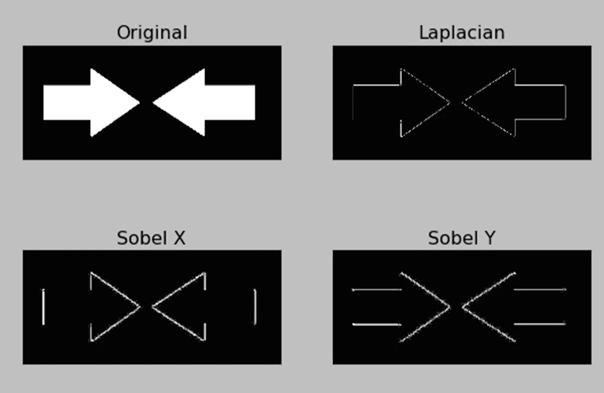

4 张深色背景上的插图。A，原始图像，两个较浅色的箭头相对。B，拉普拉斯算子，箭头区域被突出显示。C 和 D，`Sobel X` 和 Y，检测到箭头的整个边缘。

**图 14-16** 对 `blackandwhite.jpg` 图像应用边缘检测的结果

除了边缘之外，你还会发现拉普拉斯和 `Sobel` 滤波器也可以检测灰度梯度的级别。将你所学的应用到 `gradient.jpg` 图像上。你需要对之前的代码做一些修改，只保留一个图像（拉普拉斯）可见。

```python
from matplotlib import pyplot as plt
img = cv2.imread('gradients.jpg',0)
laplacian = cv2.Laplacian(img, cv2.CV_64F)
sobelx = cv2.Sobel(img,cv2.CV_64F,1,0,ksize=5)
sobely = cv2.Sobel(img,cv2.CV_64F,0,1,ksize=5)
laplacian64 = cv2.Laplacian(img, cv2.CV_64F)
sobelx64 = cv2.Sobel(img,cv2.CV_64F,1,0,ksize=5)
sobely64 = cv2.Sobel(img,cv2.CV_64F,0,1,ksize=5)
laplacian = np.uint8(np.absolute(laplacian64))
sobelx = np.uint8(np.absolute(sobelx64))
sobely = np.uint8(np.absolute(sobely64))
plt.imshow(laplacian,cmap = 'gray')
plt.title('Laplacian'), plt.xticks([]), plt.yticks([])
plt.show()
```

通过执行这段代码，你将获得一张在黑色背景上显示白色边缘的图像（如图 14-17 所示）。

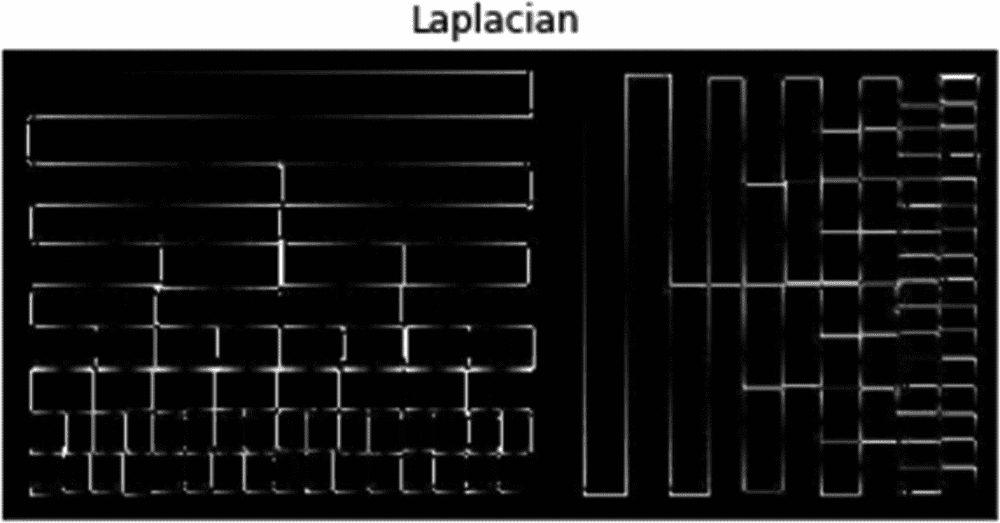

2 张插图，显示了并排的水平方向和垂直方向的两组渐变图案。它在深色背景上描绘了部分白色边缘。

**图 14-17** 对 `gradients.jpg` 图像应用边缘检测的结果

## 一个深度学习示例：人脸检测

在本章的最后部分，你将注意力转移到另一个在计算机视觉中被高度研究和应用的案例：人脸检测。这比边缘检测复杂得多，并且基于识别图像中的人脸。鉴于问题的复杂性，人脸检测使用了深度学习。事实上，这项技术的基础是专门设计用于识别照片中不同主体（包括人脸）的神经网络。物体检测技术的工作原理也非常相似。这个例子对于充分理解计算机视觉的核心——解释照片中存在的主体——非常有用。

在这个例子中，你将使用一个已经训练好的神经网络。事实上，为此类问题训练一个神经网络可能是一项复杂的操作，需要大量的时间和资源。幸运的是，网络上已经有一些经过训练的神经网络可以执行这类操作。对于这个测试，你将使用一个使用 `Caffe2` 框架开发的模型（更多信息请参见第 9 章）。

当您希望在 `OpenCV` 环境中使用 `Caffe` 模型的深度神经网络模块时，需要以下两类文件：

- 一个 `prototxt` 文件，用于定义模型架构（即各层本身）。您将使用从网络下载的 `deploy.prototxt.txt` 文件（[`github.com/opencv/opencv/blob/master/samples/dnn/face_detector/deploy.prototxt`](https://github.com/opencv/opencv/blob/master/samples/dnn/face_detector/deploy.prototxt)）。
- 一个 `caffemodel` 文件，其中包含深度神经网络中各实际层的权重。该文件最为关键，因为它包含了该神经网络为执行特定任务而进行的所有“学习”。针对您的需求，可在此处获取一个 `caffemodel` 文件：[`github.com/opencv/opencv_3rdparty/tree/dnn_samples_face_detector_20170830`](https://github.com/opencv/opencv_3rdparty/tree/dnn_samples_face_detector_20170830)。

**注意：** 您也可以在本节源代码中找到这些文件。

现在您已拥有所需的一切，首先上传神经网络模型及所有学习相关信息。`opencv` 库支持多种深度学习框架，并内置了许多辅助功能。特别地（正如本章开头所述），`OpenCV` 拥有 `dnn` 模块，专门负责此类操作。

要加载已学习的神经网络，您可以使用 `dnn.readNetFromCaffe()` 函数。

```python
net = cv2.dnn.readNetFromCaffe('deploy.prototxt.txt', 'res10_300x300_ssd_iter_140000.caffemodel')
```

作为测试图像，您可以使用意大利国家队球员的照片 `italy2018.jpg`。这张图片是一个绝佳示例，因为其中包含许多人脸。

```python
image = cv2.imread('italy2018.jpg')
(h, w) = image.shape[:2]
```

另一个名为 `dnn.blobFromImage()` 的函数负责对图像进行预处理，以适应神经网络的需求。例如，将图像调整为 300x300 像素，以便使用针对该尺寸图像训练好的 `caffemodel` 文件。

```python
blob = cv2.dnn.blobFromImage(cv2.resize(image, (300, 300)), 1.0, (300, 300), (104.0, 177.0, 123.0))
```

然后定义一个置信度阈值，其推荐值为 0.5。

```python
confidence_threshold = 0.5
```

最后执行人脸检测测试。

```python
net.setInput(blob)
detections = net.forward()
for i in range(0, detections.shape[2]):
    confidence = detections[0, 0, i, 2]
    if confidence > confidence_threshold:
        box = detections[0, 0, i, 3:7] * np.array([w, h, w, h])
        (startX, startY, endX, endY) = box.astype("int")
        text = "{:.2f}%".format(confidence * 100)
        y = startY - 10 if startY - 10 > 10 else startY + 10
        cv2.rectangle(image, (startX, startY), (endX, endY),(0, 0, 255), 2)
        cv2.putText(image, text, (startX, y), cv2.FONT_HERSHEY_SIMPLEX, 0.45, (0, 0, 255), 2)
plt.axis('off')
plt.imshow(cv2.cvtColor(image, cv2.COLOR_BGR2RGB))
plt.show()
```

执行代码后，将弹出一个窗口，显示人脸检测的处理结果（如图 14-18 所示）。结果令人难以置信，因为所有球员的面部均被检测到。您可以看到每张人脸被红色方框圈出，并在图像中以置信度百分比高亮显示。根据测试开始时指定的 `confidence_threshold` 参数，所有置信度百分比均大于 50%。

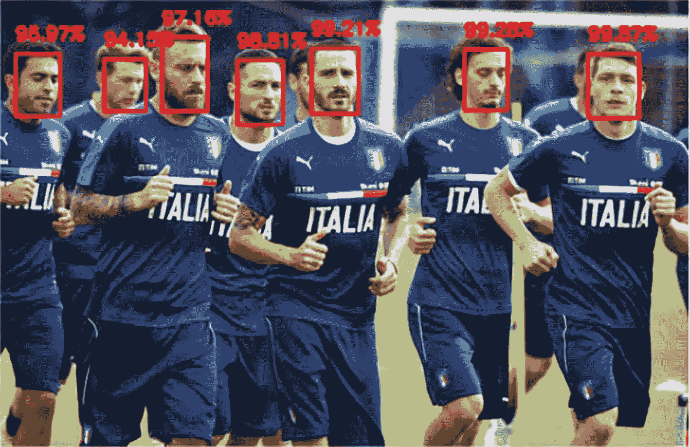

一张照片展示了意大利国家队队员在操场慢跑的场景。每位球员的面部均被边界框识别，并标注了置信度百分比。

**图 14-18** 国家队足球运动员的面部均已准确识别。

## 结论

在本章中，你看到了构成图像分析（尤其是计算机视觉）基础的一些简单技术示例。实际中，你了解了图像如何通过滤镜进行处理，以及如何利用边缘检测构建一些复杂的技术。你还看到了计算机视觉如何通过使用深度学习神经网络来识别图像中的人脸（即人脸检测）。

希望本章能成为你深入探索该主题的良好起点。如果你有兴趣，可以在我的网站 [`https://meccanismocomplesso.org`](https://meccanismocomplesso.org) 找到关于此主题的深入信息。

# 索引

## A
- 口音
- 准确率
- 激活函数
- Adam 优化方法
- `add()` 函数
- 亚得里亚海
- 聚合函数
- 算法
- 亚马逊云服务 (AWS)
- Anaconda
- Anaconda Navigator
  - 按钮菜单
  - `conda` 命令
  - 环境面板
  - 主页面板
  - 相同面板
  - 学习面板
  - 操作系统环境
- `annotate()` 函数
- `apply()` 函数
- `arange()` 函数
- 算术运算符
- 数组操作
  - 另请参阅 NumPy 库
  - 连接
  - 分割
- 人工智能
  - 机器学习
  - 关系
- 人工神经网络
  - 多层感知器
  - 单层感知器
- 赋值
- 属性
- `autopct` 关键字参数
- 坐标轴
- `axis()` 函数
- 轴标签

## B
- 反向传播算法
- 鲍德温县
- 柱状图
  - 水平
  - matplotlib
  - 多系列
  - 多系列
  - 展示方式
  - 堆叠
  - 3D
  - x 轴
- `bar()` 函数
- `barh()` 函数
- 条形图
- `barplot()` 函数
- `bfill` 方法
- 大数据
- 双词搭配
- `bigrams()` 函数
- 二分类
- 二进制文件
- 分箱
- 二项式
- 分箱
- 生物神经网络
- 混合
- 书籍
- 布尔运算符
- 博斯托克
- 广播

## C
- Caffe2
- `caffemodel`
- 笛卡尔轴
- 笛卡尔坐标
- 笛卡尔平面
- 笛卡尔点
- 类别数据
- CentOS Linux 系统
- 图表
  - 添加元素
    - 网格
    - 图例
    - 文本
  - 条形图
    - 参见柱状图
  - 等高线图
  - 折线图
  - 饼图
  - 极坐标图
  - 保存
    - 代码
    - 为图像
    - 笔记本
  - 类型学
- 等值区域图
  - 地理表示
  - TopoJSON
  - 美国人口
- 分类模型
- 气候数据
- 聚类柱状图
- 聚类模型
- 代码执行阶段
- 代码保存
- 搭配
- `colorbar()` 函数
- 颜色代码
- 列删除
- 逗号分隔值 (CSV)
  - 另请参阅文本文件
  - 数据读取
  - pandas
- `common_contexts()` 函数
- `compile()` 函数
- 编译
- 复合艺术家
- 计算机科学知识
- 计算机视觉
- 统一计算设备架构 (CUDA)
- `concatenate()` 函数
- 连接
  - 数据合并
  - 数据框
  - 分层索引
- `concordance()` 函数
- 等高线地图
- 等高线图
- 卷积
- 语料库
- 相关性
- `corrwith()` 方法
- 协方差
- cPickle
- CPython
- `create_engine()` 函数
- 交叉验证技术
- `cut()` 函数
- `cv2.add()` 函数
- `cv2.subtract()` 函数
- Cython

## D
- `data` 属性
- 数据聚合
  - 进阶
  - 分类
  - `GroupBy`
  - 分组迭代
  - 分层分组
  - SQL 语言
- 数据分析
  - 数据探索/可视化
  - 数据性质
  - 部署
  - 描述
  - 提取，数据
  - 知识领域
  - 模型验证
  - 预测建模
  - 预测能力
  - 准备
  - 问题定义
  - 过程
  - 与 Python
  - 定量/定性
  - 阶段
  - 统计技术
  - 类型
- 数据探索
- 数据提取
- 数据流图
- 数据框
  - 赋值
  - 列
  - 元素选择
  - 过滤
  - 成员值
  - 嵌套字典
  - 与序列
  - 转置
- `DataFrame()` 构造函数
- `Data.gov`
- DataHub
- 数据准备
  - 合并
  - 拼接
  - 列表
  - 合并操作
  - pandas 库
  - 数据透视
    - 另请参阅数据透视
  - 列删除
- 数据集
- 数据源查找
- 数据结构
  - 数据框和序列
  - 灵活的算术方法
  - 操作
- 数据转换
  - 重复项删除
  - 映射
- 数据可视化
  - 图表
    - 参见图表
  - 使用 Jupyter Notebook
- 日期值处理
- `DayLocator()` 函数
- DBPedia
- Debian-Ubuntu Linux 系统
- 决策边界
- `decision_function()` 函数
- 决策空间
- 深度学习
  - 人工神经网络
  - 数据可用性
  - 机器学习
  - 神经网络与 GPU
  - OpenCV
  - Python 框架
  - 关系
  - TensorFlow
- 人口统计学
- 部署
- 导数
- `DESCR` 属性
- `describe()` 函数
- 检测
- 糖尿病数据集
- 手写数字数据集
- `digits.images` 数组
- 离散化
- 显示子图
- 距海距离
- D3 库
- `dnn.blobFromImage()`
- `dnn.readNetFromCaffe()` 函数
- Docker
- `document_features()` 函数
- NLTK 下载工具
- `drop()` 函数
- `dropna()` 函数

# 排版后的 Markdown 文档

## D

- `dtype` 选项
- `duplicated()` 函数

## E

- Eclipse (PyDev)
- 边缘检测
- 基本操作，图像
- 元素选择
- 逐元素加法
- 误差线
- 欧几里得方法
- 欧盟开放数据门户
- 评估阶段
- 执行阶段
- 可扩展标记语言 (XML)

## F

- 人脸检测
- `figures()` 函数
- `fileids()` 函数
- 过滤
- 金融数据
- `fit()` 函数
- 字体
- 格式化器
- 分数
- 函数式编程
- 分组函数
- 函数，pandas
    - 按元素
    - 行/列
    - 统计

## G

- `genfromtxt()`
- `getroot()` 函数
- Google Trends 数据存储
- 政府数据
- 梯度
- `gradients.jpg`
- 图形处理器 (GPU)
- 网格加法
- `grid()` 函数
- `GridSpec()`
- GroupBy
- `groupby()` 函数
- 分组迭代
    - 变换链
    - 数据部分
- `gutenberg`
- 古腾堡语料库

## H

- 手写数字
    - 数字数据集
    - 学习与预测
    - MLP
    - SLP
    - 识别
    - scikit-learn 库
    - TensorFlow
- 分层数据格式 (HDF5)
- 健康数据
- `Healthdata.gov`
- 分层分组
- 分层索引
- `hist()` 函数
- 直方图
- 水平条形图
- 水平子图
- `hstack()` 函数
- `HTML()` 函数
- HTML 文件
    - 读取数据
    - 写入数据
    - 保存

## I

- 标识符
- 图像分析
    - 与计算机视觉
    - 滤镜
- 图像混合
- 图像滤镜
- 图像梯度理论
    - `blackandwhite.jpg` 文件
    - 黑色背景
    - 黑色边缘
    - 卷积
    - 导数
    - 梯度
    - 灰度
    - opencv 库
    - 输出数据
    - 值
- 图像处理
    - 基本操作
    - IPython 会话
    - 加载与显示
    - 保存图像
    - 图像处理工作
- `imread()` 方法
- `imwrite()` 方法
- 缩进
- 索引
    - 算术与数据对齐
    - 删除
    - 重复标签
    - 合并
    - 重新索引
- 索引操作
- 索引对象
    - 重复标签
    - 方法
- `index` 选项
- 信息与知识
    - 另请参阅 知识领域
- 安装，Python
    - Anaconda
    - Anaconda Navigator
    - 代码编写
    - 发行版
    - 函数式编程
    - 与 IDE
    - 程序运行
- 集成开发环境 (IDE)
- 内部元素
- 物联网 (IoT)
- 解释器
- 数组的固有创建
- I/O API 工具
- IPython
    - Jupyter Lab
    - Jupyter Notebook
    - Jupyter 项目
    - Jupyter QtConsole
    - shell
    - 工具
- IPython Notebook
- 鸢尾花数据集
- 鸢尾花数据集
- IronPython
- `isin()` 函数
- `isnull()` 函数

## J

- JavaScript D3 库
- JavaScript 对象表示法 (JSON)
- `join()` 函数
- JOIN 查询
- `jointplot()` 函数
- Jupyter Lab
- Jupyter Notebook
    - 图表
    - 数据分析
    - 数据可视化
    - 在 Markdown 单元格中
    - matplotlib 库/NumPy
    - Python 单元格
    - 下标/上标
    - 值对
- Jupyter QtConsole
- Jython

## K

- Kaggle
- Keras 层
- K 近邻算法 (KNN)
- 知识领域
    - 人工智能
    - 计算机科学
    - 机器学习
    - 数学与统计学
- Komodo
- `kwargs`
    - 坐标轴
    - `linewidth` 关键字
    - 多图形
    - `plot()` 函数

## L

- 标签
- `Latex()` 函数
- LaTeX
- 学习曲线
- 学习阶段
- 学习问题
- 最小二乘回归
- `legend()` 函数
- 添加图例
- 词形还原
- 层次化
- Liclipse IDE
- 线性回归
- 折线图
- `list()` 函数
- `lmplot()`
- `load()` 函数
- 定位器
- `loc` 关键字
- LOD 云图
- 小写转换

## M

- `macbeth` 变量
- 机器学习 (ML)
    - 人工智能
    - scikit-learn
    - 另请参阅 Scikit-learn 库
    - 关系
    - 监督学习
    - 测试集
    - 训练集
    - 无监督学习
- `map()` 函数
- 映射
    - 添加值
    - 重命名索引
    - 替换值
- `match()` 函数
- 数学函数
- MATLAB
- matplot 生成的图表
- matplotlib 函数
- matplotlib 库
    - 艺术家层
    - 后端层
    - 图形表示
    - 图形视图/语法形式
    - 安装
    - 交互性
    - `kwargs`
    - 与 NumPy
    - 绘图窗口
    - pylab
    - pyplot
    - 脚本层
    - 二维图表
- 矩阵乘积
- `merge()` 函数
- `merge()` 方法
- 合并操作
- 元字符
- 气象数据
    - 亚得里亚海
    - CSV 文件
    - 数据框结构
    - 寻找数据源
    - 湿度
    - 交点
    - Jupyter Notebook
    - 波河河谷
    - 玫瑰风图
    - 温度趋势
- Microsoft Excel 文件
- MNIST
- 模型构建
- 模型编译
- 模型测试
- 模型训练
- `MonthLocator()` 函数
- `most_common()` 函数
- `movie_reviews`
- `mplot3d` 工具包
    - 3D 散点图
    - 3D 曲面
- 多层感知器 (MLP)
    - 人工神经网络
    - 学习与预测
    - TensorFlow，隐藏层
- 多面板图
    - 显示子图
    - 子图
- 多系列条形图
- 多系列堆叠条形图
- 音乐数据
- `myFrame.html`

## N

- 朴素贝叶斯分类器
- NASA 地球观测数据
- 自然语言工具包 (NLTK)
    - 语料库
        - 下载器工具
        - HTML 页面
            - 搜索、词语
            - 网络文本
            - 词频
            - 文本中的词汇
- `ndarray`（N 维数组）
    - 数组创建
    - `array()` 函数
    - 数据类型
    - `dtype` 选项
    - 内置创建
    - 形状和轴
- 神经网络
- 新闻报纸
- NinjaIDE（不只是另一个 IDE）
- `nltk` 包
    - `nltk.download()`
    - `nltk.download_shell()`
    - `nltk.FreqDist()` 函数
    - `nltk.Text`
    - `nltk.word_tokenize()` 函数
- 节点
- 归一化
- NoSQL 数据库
- 非数值 (`NaN`)
- 赋值
    - 填充出现位置
    - 过滤掉值
    - 值
- 笔记本
- `notnull()` 函数
- `np.arange()` 函数
- `np.sin()` 函数
- Numarray
- 数值数据
- NumPy 数组
    - 过滤值


### `matplotlib` 库

### `NumPy` 库

#### 广播

### 条件与布尔运算符

### 副本


# 索引

## 安装

### 迭代数组

### 标志

### 多维数组

### `ndarray`

### 对象视图

### 运算

### 聚合函数

### 算术运算

### 自增与自减

### 矩阵乘积

### 通用函数 (`ufunc`)

### 读写数组数据

### 形状操作

### 切片

### 结构化数组

### 向量化

## NumPy 矩阵

## O

### 开放数据

## 开放数据源

## 开源计算机视觉库 (OpenCV)

### 与深度学习

### 安装

### 与 Python

## OpenWeatherMap 网站

## 光学字符识别 (OCR)

## 异常值

## P

## 包管理器

## `pandas.concat()` 函数

## Pandas 数据框

### `pandas.DataFrame.combine_first()` 函数

### `pandas.io.sql` 模块

### Pandas 库

### (另请参阅 `Pickle` 模块)

## 赋值

## CSV 和文本文件

## 数据聚合

## 数据准备

## 数据转换

### 评估值

### 过滤值

### HTML 文件

### 安装

#### 通过 Anaconda

#### 通过 PyPI

## 与数据库交互

### 内部元素

## I/O API 工具

## JSON 数据

### 折线图

### Microsoft Excel 文件

### 多序列柱状图

### NoSQL 数据库

### NumPy 数组

### 运算/数学函数

### 饼图

### Python 数据分析

### 序列/数据框

### 堆叠柱状图

### XML 文件

## `pandas.merge()` 函数

## 解析

## 排列

## pgAdmin

## `Pickle` 模块

### 与 Pandas 一起使用

### Python 对象

### 饼图

### `pie()` 函数

### 数据透视

## `plot()` 函数

## 绘图属性

## `plot_surface()` 函数

### 绘图窗口

## `plt.plot()` 函数

### 极坐标图

## 政治数据

## 多项式核

## `pop2022` 数据框

## PostgreSQL 数据库

## 波河河谷

## `predict()` 函数

## 预测制作

## 预测建模

## 预测能力

## `prepare()` 函数

## 预处理步骤

## 原始图形元素

## 主成分分析 (PCA)

## 概率

## 专业领域

## 项目规划阶段

## `prototxt` 文件

## 出版物

## 公共数据集

## 标点符号去除

## `pylab`

## `pyplot`

### `pyplot` 的 `imshow()` 方法

## PyPy 解释器

### Pyston

## PyTables

### Python

### 计算

### 执行阶段

### 安装 (请参阅安装, Python)

### 交互式编程语言

### 可交互的

### 解释型编程语言

### 解释器

### 库/函数导入

### 面向对象编程语言

### 开源编程语言

### Pandas 库

### `pickle` 模块

### 可移植编程语言

### 壳层

## Python 包索引 (PyPI)

### 下载与安装

### Eclipse

### IDE

### Komodo

### Liclipse

### NinjaIDE

### 仓库

## SciPy

### Spyder

### Sublime

## Python 虚拟机 (PVM)

## PyTorch

## Q

## QtConsole

## 定性数据分析

## 定量数据分析

## R

## 径向基函数 (RBF)

## 激进分子

## `random.randint()` 函数

## 随机抽样

## 排序

## `read_csv()`

## `read_html()` 函数

## `read_table()` 函数

## Red Hat

### 正则表达式

## `RegexpTokenizer`

## 回归模型

### 正则表达式

### 重新索引

## `relplot()` 函数

## `rename()` 函数

## `render()` 函数

## 重新排序层级

## `replace()` 函数

## `request()` 函数

## `require.config()`

## `reshape()` 函数

## RoseWind

## RoseWind_Speed

### RustPython

## S

## `savefig()` 函数

## `save()` 函数

## `scatter()` 函数

## 科学 Python 开发环境 (Spyder)

## Scikit-learn 库

## 糖尿病数据集

### 手写数字

### 鸢尾花数据集

### KNN 分类器

### 线性回归

### `svm` 模块

## SciKits

## SciPy

### `matplotlib`

### NumPy

### Pandas

## Seaborn 库

### `CMD.exe` 提示符

### 内容

### 数据框

#### 按性别

#### 性别区分

#### 相同图表

### 安装

### 线性回归

### 多序列柱状图

### 可选参数

### 概率

## 情感分析

## `sents()` 函数

## `sent_tokenize()` 函数

## 序列

### 声明

### 作为字典

### 运算

## `Series()` 构造函数

## `set_position()` 函数

## `set_theme()` 函数

## `shadow` 关键字参数

## 形状操作

## `ShowRoseWind()` 函数

## `ShowRoseWind_Speed()` 函数

## `similar()` 函数

## `sin()` 函数

## 单层感知器 (SLP)

## 人工神经网络

### 学习/预测

### 使用 TensorFlow

## `sklearn.decomposition` 模块

### 切片

## `SnowballStemmer`

## Sobel 滤波器

## 社交数据

## Softmax

## `sort()` 函数

## `sort_index()` 函数

## 排序

## `sort_values()` 函数

## 分割-应用-合并

## `split()` 函数

### 分割数组

## 体育数据

## `sqlalchemy`

## SQLite3

## SQL 查询语言

## 堆叠柱状图

## 堆叠数字

## `stack()` 函数

### 统计函数

## `std()` 函数

## 词干提取

## 停用词

## `string` 函数

## 字符串操作

### 内置方法

### 正则表达式

## 结构化数组

## 主观解读

## `subplot()` 函数

## 子图

## 下标

## 摘要过程

## 上标

## 有监督估计器

## 有监督学习 (另请参阅 Scikit-learn 库)

## 支持向量分类 (SVC)

### C 参数

### 非线性

### 正则化

### 直线分离

### 训练集

### 可视化分布

## 支持向量机 (SVM)

### 数据点

### 决策边界

### 决策空间

### 鸢尾花数据集

### 与 SVC (请参阅支持向量分类 (SVC))

### 与 SVR

## 支持向量回归 (SVR)

## `support_vectors` 数组

## 支持向量

### `svc` 估计器

### `SVC()` 构造函数

### `svm.SVC()` 函数

## T

## 表格数据

## `take()` 函数

## `target` 属性

## 模板对象

## 十条折线图

## TensorBoard

## TensorFlow

### 数据流图

### 深度学习

#### Google 的框架

#### 手写数字

#### 安装

#### Jupyter Notebook

#### 加载数据

##### CSV 文件

##### Pandas 数据框

#### 张量

#### TensorFlow 1.x

#### TensorFlow 2.x

#### TensorFlow Fold

#### TensorFlow Transform

### 张量

### 对张量的操作

### 参数

## 测试集

## `text()` 函数

## 文本文件

### 读取

### 正则表达式

## 文本数据分析技术

## Theano

## `title()` 函数

## `to_csv()` 函数

## `to_json()` 函数

## 分词

## TopoJSON

## 训练集

## `transform()` 方法

## 转置

## TSV 文件

## TXT 文件 (另请参阅文本文件)

## 类型列表

## U

## 美国人口普查局

## 通用函数 (`ufunc`)

## 无监督学习

## `urllib` 库

## V

## `value_counts()` 函数

## 值成员关系

## 值评估

## 方差

## 向量化

## W

## 网页抓取

## 风数据

## 风速

## `words()` 函数

## 词频

## 世界银行开放数据

## 世界卫生组织

## X

## `xticks()` 函数

## Y, Z

## `yticks()` 函数