# 9. 深度学习与 TensorFlow

本章概述了深度学习的世界及其技术所依托的人工神经网络。此外，在用于深度学习的 Python 框架中，你将使用 *TensorFlow*，它是研究和开发深度学习分析技术的绝佳工具。借助这个库，你将了解如何开发构成深度学习基础的不同神经网络模型。特别是在本第三版中，解释和示例代码基于新的 TensorFlow 2.x 版本，该版本整合了 Keras，并对模块和实现范式进行了彻底的革新。

## 人工智能、机器学习和深度学习

对于任何从事数据分析领域的人来说，这三个术语在互联网、文本以及与此主题相关的研讨会上都非常常见。但它们之间是什么关系？它们实际上又包含什么内容？

在本节中，你将阅读到这三个术语的详细定义。你将了解到，在近几十年里，为了创建越来越复杂的算法，并能够越来越高效地进行预测和数据分类，机器学习是如何应运而生的。然后，你将了解到，由于新的技术创新，特别是 GPU 计算能力的实现，基于神经网络的深度学习技术是如何被开发出来的。

### 人工智能

*人工智能* 一词最早由约翰·麦卡锡在 1956 年提出，当时技术世界充满了巨大的希望和热情。那是在电子学和像整个房间一样大的计算机的黎明时期，它们只能做几项简单的计算，但与人类相比，它们做得高效且快速。当时人们已经预见了电子智能未来可能的发展。

但无需深入科幻小说的世界，当前最适合人工智能（常被称为 AI）的定义，可以简要概括为以下这句话：

> *计算机能够自动执行那些看似仅与人类智能相关的操作。*

因此，人工智能的概念是一个动态的概念，它随着机器本身的进步以及“人类专属”概念的变化而变化。在 60 年代和 70 年代，我们将人工智能视为计算机执行计算和寻找复杂问题数学解决方案的能力，这些问题是“伟大科学家专属的”。而在 80 年代和 90 年代，AI 在评估风险、资源和决策方面的能力得以成熟。到了 2000 年，随着计算机计算潜力的持续增长，这些系统通过机器学习进行学习的可能性也被添加到定义中。

最后，在最近几年，人工智能的概念聚焦于视觉和听觉识别操作，而这些操作直到最近还被认为是“人类专属的”。

这些操作包括：

*   图像识别
*   目标检测
*   目标分割
*   语言翻译
*   自然语言理解
*   语音识别

得益于深度学习技术，这些问题仍在研究中。

### 机器学习是人工智能的一个分支

在上一章中，你已经详细了解了机器学习，其中包含了许多用于分类或预测数据的不同技术的示例。

*机器学习（ML）*，连同其所有的技术和算法，是人工智能的一个庞大分支。事实上，当你使用能够学习（学习系统）来解决各种不久前还被“认为是人类专属”的问题时，你就在引用它，同时仍处于人工智能的范畴内。


### 深度学习是机器学习的一个分支

在机器学习技术中，可以进一步定义一个子类，称为深度学习。你在第 8 章中看到，机器学习使用的系统能够学习，这可以通过系统内部的特性（通常是固定模型的参数）来实现，这些特性会响应于旨在用于学习（训练集）的输入数据而进行修改。

深度学习技术则向前迈进了一步。实际上，深度学习系统的结构设计使得这些内在特征并非预先存在于模型中，而是由系统在学习过程中自动提取和检测。在能够做到这一点的系统中，本章特别指的是人工神经网络。

### 人工智能、机器学习与深度学习间的关系

总而言之，在本节中，你已经了解到机器学习和深度学习实际上是人工智能的子类。图 9-1 直观地展示了这些类别之间的关系。

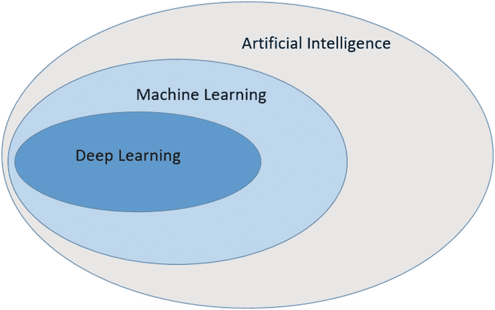

一幅三个椭圆嵌套在一起的示意图。从最内层到最外层的椭圆，标签依次为：深度学习、机器学习、人工智能。

图 9-1

人工智能、机器学习与深度学习间的关系示意图

## 深度学习

在本节中，你将了解促成深度学习发展的一些关键因素，并看到在最近几年里取得了哪些重大进展。

### 神经网络与 GPU

在上一节中，你了解到在人工智能领域，深度学习直到最近几年才流行起来，正是为了解决视觉和听觉识别问题。

在深度学习的背景下，近年来开发了许多计算技术和算法，充分发挥了 `Python` 语言的潜力。但深度学习的理论基础实际上可以追溯到多年前。事实上，神经网络的概念是在 1943 年被提出的，而关于人工神经网络及其应用的首批理论研究则是在 20 世纪 60 年代发展起来的。

事实是，直到最近几年，神经网络及其相关的深度学习技术才被证明在解决许多人工智能问题上非常有用。这是因为直到现在才出现了能够以实用且高效的方式实现这些技术的硬件。

实际上，在应用层面，深度学习需要极其复杂的数学运算，这涉及数百万甚至数十亿的参数。即便是上世纪 90 年代功能强大的 CPU，也无法有效执行这类运算。即使在今天，尽管 CPU 的性能有了显著提升，但计算过程仍然需要很长的处理时间。这种低效率源于 CPU 的特殊架构，其设计初衷是为了高效执行神经网络并不需要的数学运算。

近几十年来，得益于视频游戏市场巨大的商业推动力，一种新型硬件——*图形处理器（GPU）*得以发展。事实上，这类处理器被设计用于管理越来越高效的矢量计算，例如矩阵乘法，这是实现 3D 现实模拟和渲染所必需的。

得益于这项技术创新，许多深度学习技术得以实现。实际上，为了实现神经网络及其学习过程，会使用张量（多维矩阵）进行大量的数学运算。这正是 GPU 能够更高效完成的工作。得益于它们的贡献，深度学习的处理速度提升了数个数量级（从数月缩短到数天）。

### 数据可用性：开放数据源、物联网与大数据

影响深度学习发展的另一个非常重要的因素是可供访问的庞大数据库。事实上，数据是神经网络运行的基本要素，无论是对于学习阶段还是验证阶段都是如此。

得益于互联网在全球的普及，现在每个人都能访问和产生数据。虽然几年前只有少数组织提供用于分析的数据，但如今，得益于 `IoT`（物联网），许多传感器和设备都在获取数据并将其在网络上共享。不仅如此，就连社交媒体和搜索引擎（如 Facebook、谷歌等）也能收集海量数据，实时分析连接到其服务的数百万用户（称为*大数据*）。

如今，许多与你希望用深度学习技术解决的问题相关的数据都容易获得，其中许多是免费形式的（作为开放数据源）。

### Python

促成深度学习技术巨大成功和广泛普及的另一个因素是 `Python` 编程语言。

在过去，规划神经网络系统非常复杂。唯一能够胜任这项任务的语言是 `C++`，这是一种非常复杂、难以使用且只有少数专家掌握的语言。此外，为了使用 GPU（此类计算所必需的），还必须了解 `CUDA`（统一计算设备架构），即 `NVIDIA` 显卡的硬件开发架构及其全部技术规格。

如今，得益于 `Python`，神经网络和深度学习技术的编程已经变得高层化。实际上，程序员不再需要考虑显卡（GPU）的架构和技术规格，可以完全专注于与深度学习相关的部分。此外，`Python` 语言的特性使程序员能够开发出简单直观的代码。你在上一章中已经通过机器学习体验过这一点，深度学习亦是如此。

### 深度学习 Python 框架

在过去两年中，许多开发者组织和社区一直在开发 `Python` 框架，这些框架极大地简化了深度学习技术的计算和应用。人们对此热情高涨，其中许多库几乎是以竞争的方式执行相同的操作，但它们各自基于不同的内部机制。

在如今可免费获得的这些框架中，值得提一下一些正在获得成功的框架。

*   `TensorFlow` 是一个用于数值计算的开源库，其使用基于数据流图。在这些图中，节点代表数学运算，边代表张量（多维数据数组）。其架构非常灵活，可以将计算分布到多个 CPU 和多个 GPU 上。
*   `Caffe2` 是一个为简化深度学习工作而开发的框架。它允许你利用云端 GPU 的能力来测试模型和算法计算。
*   `PyTorch` 是一个完全基于 GPU 使用的科学计算框架。它工作方式高效，是近期开发的，目前尚未完全成熟。但它已经证明了自己是科学研究的强大工具。
*   `Theano` 是科学领域中最常用的 `Python` 库，用于开发、定义和评估数学表达式及物理模型。不幸的是，开发团队已宣布将不再发布新版本。然而，由于无论是在文献中还是在网络上，都有大量使用该库开发的程序，它仍然是一个参考框架。


## 人工神经网络

*人工神经网络*是深度学习的基本要素，也是几乎所有深度学习技术的基础。事实上，这类系统之所以能够学习，得益于其参考生物神经回路而构建的特殊结构。

在本节中，你将详细了解人工神经网络是什么以及它们是如何构建的。

### 人工神经网络的结构

人工神经网络是通过连接结构中重复出现的简单基本组件而创建的复杂结构。根据这些基本组件的数量和连接类型，会形成越来越复杂的网络，其架构各异，每一种架构在解决不同深度学习问题的学习和能力方面都呈现出独特的特点。

图 9-2 展示了一个通用人工神经网络的结构示例。

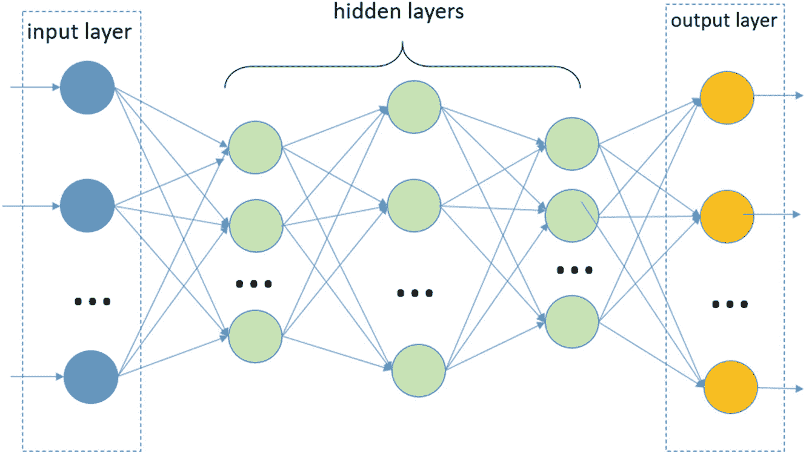

一个人工神经网络模型的示意结构图。它由若干输入层、隐藏层和输出层组成。节点用深色圆圈表示，边用箭头指示。

图 9-2

一个通用人工神经网络结构的示意图

这些基本单元被称为*节点*（如图 9-2 中所示的深色圆圈），它们在生物模型中模拟了神经网络中神经元的功能。这些人工神经元执行非常简单的操作，类似于其生物对应物。当它们接收到的输入信号总和超过激活阈值时，它们就会被激活。

这些节点可以通过称为*边*的连接相互传输信号，边模拟了生物突触的功能（如图 9-2 中所示的箭头）。通过这些边，一个神经元发出的信号会传递到下一个神经元，并起到过滤器的作用。也就是说，一条边会根据预设规则（通常每条边都应用一个不同的*权重*），将神经元的输出信息转换为抑制性或兴奋性信号，从而降低或增强其强度。

神经网络有一定数量的节点用于从外部接收输入信号（见图 9-2）。这第一组节点通常被表示在神经网络示意图的最左端一列。这组节点代表了神经网络的第一层（*输入层*）。根据接收到的输入信号，这些神经元中的一部分（或全部）会被激活，处理接收到的信号，并通过边将结果作为输出传输给另一组神经元。

这第二组节点位于神经网络中的中间位置，被称为*隐藏层*。这是因为这组神经元既不与外部进行输入通信，也不进行输出通信，因此是隐藏起来的。如图 9-2 所示，这些神经元中的每一个都有许多输入边，通常与前一层所有神经元相连。这些隐藏神经元同样会在总输入信号超过某个阈值时被激活。如果被激活，它们将处理信号并将其传输给另一组神经元（在图 9-2 所示示意图的右向方向上）。这组神经元可以是另一个隐藏层，或者是*输出层*，也就是将结果直接发送到外部的最后一层。

总的来说，数据流会进入神经网络（从左到右），根据其结构以或简单或复杂的方式进行处理，并产生一个输出结果。

神经网络的行为、能力和效率将完全取决于节点如何连接，以及分配给每一层的总层数和神经元数量。所有这些因素共同定义了*神经网络架构*。

### 单层感知器（SLP）

*单层感知器（SLP）* 是最简单的神经网络模型，由弗兰克·罗森布拉特于 1958 年设计。其架构如图 9-3 所示。

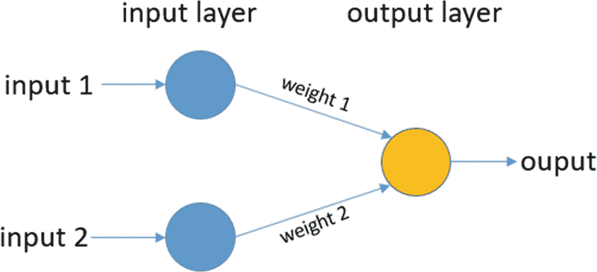

一个单层感知器的神经网络模型。它由两个输入层组成，之后是权重 1 和权重 2，最后以一个输出层结束。

图 9-3

单层感知器（SLP）架构

单层感知器（SLP）的结构非常简单；它是一个没有隐藏层的两层神经网络，其中若干输入神经元通过不同的连接向一个输出神经元发送信号，每条连接都有自己的权重。图 9-4 更详细地展示了这类神经网络的内部工作机制。

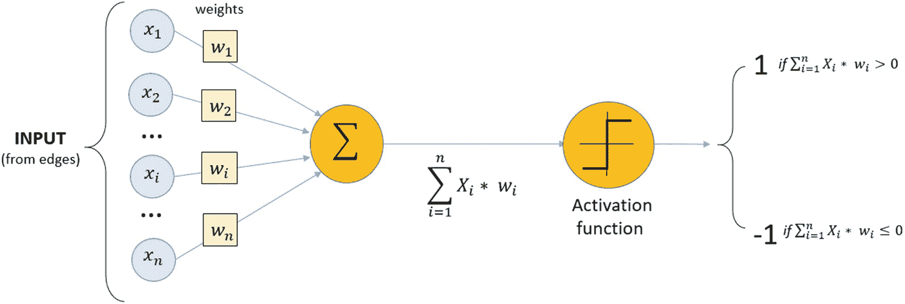

一个复杂的单层感知器神经网络模型。它由若干输入、权重，之后是 sigma 函数、激活函数组成，最后以两个数学运算结束。

图 9-4

一个更详细的单层感知器（SLP）表示图，其中内部操作以数学形式表达

该结构的边在此数学模型中通过一个由神经元本地记忆组成的权重向量来表示。

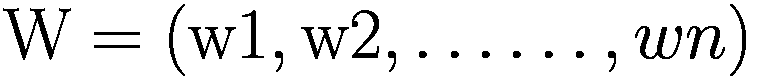

输出神经元接收一个输入向量信号 `xi`，每个信号来自不同的神经元。

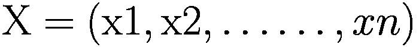

然后它通过加权和对输入信号进行处理。

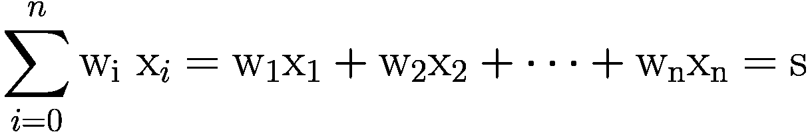

输出神经元感知到总信号 `s`。如果该信号超过神经元的激活阈值，神经元将被激活，发送值 `1`；否则，它将保持未激活状态，发送 `-1`。

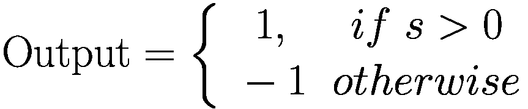

这是最简单的*激活函数*（见图 9-5 中的函数 A），但你也可以使用其他更复杂的函数，例如 sigmoid 函数（见图 9-5 中的函数 D）。

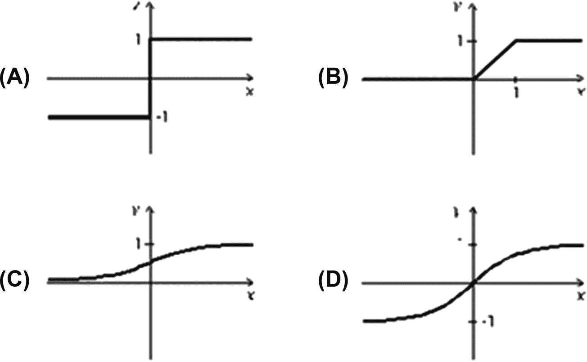

四个 X 对 Y 的曲线图。A. 双极阈值函数。位于正值和负值之间。B. 单极阈值函数。位于正值上。C. 单极 sigmoid 函数，位于正值上。D. 双极 sigmoid 函数，位于正值和负值之间。

图 9-5

激活函数的一些示例

现在你已经了解了 SLP 神经网络的结构，接下来可以看看它们是如何学习的。

神经网络的学习过程被称为*学习阶段*，它是迭代进行的。也就是说，会执行预定数量的神经网络操作周期。在每个周期中，`wi` 突触的权重都会被略微修改。每个学习周期被称为一个*时期（epoch）*。为了进行学习，你必须使用适当的输入数据，称为*训练集*（你已经在第 8 章中深入使用过它们）。


## 神经网络中的监督学习

在训练集中，针对每个输入值，都能获得期望的输出值。通过比较神经网络产生的输出值与期望值，可以分析差异并修改权重值，同时还能降低这些差异。在实践中，这是通过最小化特定于深度学习问题的`成本函数（损失）`来实现的。事实上，不同连接的权值会在每个周期（epoch）被修改，以最小化成本（`损失`）。

总之，监督学习被应用于神经网络。

学习阶段结束后，会进入`评估阶段`，在此阶段，已学习过的`SLP`感知机必须分析另一组输入（测试集），这组输入的结果也是已知的。通过评估获得值与期望值的差异，就能了解神经网络解决深度学习问题的能力水平。通常会用猜对案例与猜错案例的百分比来表示这个值，它被称为`准确率`。

### 多层感知机 (MLP)

一种更复杂且高效的架构是`多层感知机 (MLP)`。在这种结构中，输入层和输出层之间有一个或多个隐藏层。该架构如图 9-6 所示。

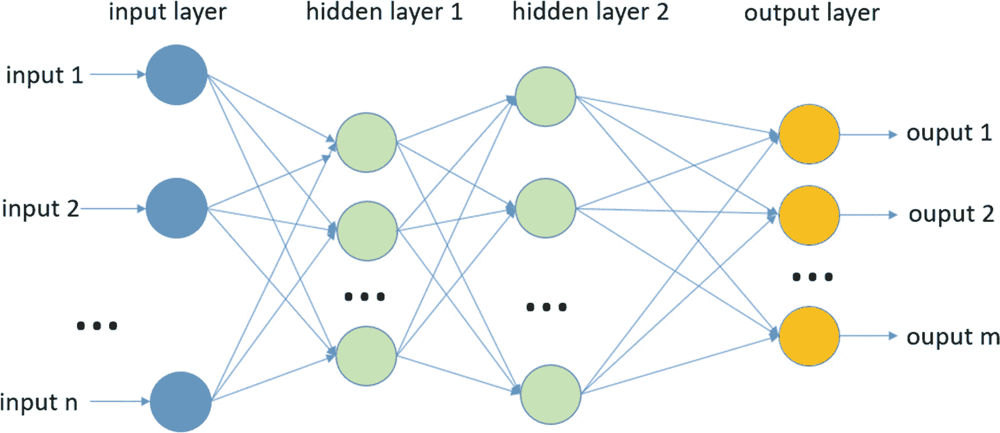

图 9-6：多层感知机 (MLP) 架构

学习阶段结束后，会进入`评估阶段`，在此阶段，已学习过的`SLP`感知机必须分析另一组输入（测试集），这组输入的结果也是已知的。通过评估获得值与期望值的差异，就能了解神经网络解决深度学习问题的能力水平。通常会用猜对案例与猜错案例的百分比来表示这个值，它被称为`准确率`。

尽管更加复杂，但`MLP`神经网络模型主要基于与`SLP`神经网络模型相同的概念。即使在`MLP`中，每个连接也都被分配了权重。这些权重必须基于对训练集的评估来最小化，这与`SLP`非常相似。同样地，每个节点都必须通过激活函数处理所有传入信号，即使这次由于存在多个隐藏层，使得神经网络能够学习更多内容，`更有效地适应`深度学习试图解决的问题类型。

另一方面，从实践角度来看，这种系统更高的复杂度需要更复杂的算法来支持学习阶段和评估阶段。其中之一是`反向传播算法`，它用于有效地修改各个连接的权重以最小化成本函数，从而使输出值快速且渐进地收敛于期望值。

其他算法则专门用于成本（或误差）函数的最小化阶段，通常被称为`梯度下降`技术。

对这些算法的研究和详细分析超出了本文的范围，本文仅对该论题起到介绍作用，目标是尽可能保持深度学习主题的简单和清晰。如果你有兴趣，我建议你通过各类书籍和互联网进一步深入研究该主题。

### 人工神经网络与生物神经网络的对应关系

到目前为止，你已经看到了深度学习如何使用称为人工神经网络的基本结构来模拟人脑的功能，特别是在处理信息的方式上。

在最高阅读层面上，这两个系统之间也存在真实的对应关系。事实上，你刚刚看到神经网络具有基于神经元层的结构。第一层处理传入信号，然后将其传递到下一层，下一层再处理它，依此类推，直到得出最终结果。对于每一层神经元，传入的信息都以某种方式被处理，生成相同信息的`不同表示层次`。

事实上，人工神经网络整个运作过程无非是将信息转化为越来越抽象层次的过程。

这种运作方式与大脑皮层中发生的情况完全相同。例如，当眼睛接收到一个图像时，图像信号会经过多个处理阶段（就像神经网络的层），在这些阶段中，例如，首先检测图形的轮廓（边缘检测），然后是几何形状（形状感知），接着是识别物体及其名称。因此，传入的信息经历了不同概念层次的转换，从图像，到线条，到几何图形，最终到达一个单词。

## TensorFlow

在本章的前面部分，你看到了 Python 中有几个框架允许你开发深度学习项目。其中之一是`TensorFlow`。在本节中，你将详细了解这个框架，包括它是如何工作的，以及如何利用它来实现深度学习的神经网络。

### TensorFlow：谷歌的框架

`TensorFlow` ([`www.tensorflow.org`](http://www.tensorflow.org)) 是由 Google Brain Team 开发的一个库，该团队是谷歌领导下的一个名为 Machine Learning Intelligence 的研究组织。

这个库的目的是为机器学习和深度学习研究领域提供一个优秀的工具。

`TensorFlow` 的第一个版本由谷歌于 2017 年 2 月发布，在一年半的时间里，发布了众多更新，极大地增强了这个库的潜力、稳定性和可用性。这主要归功于大量专业人员和研究人员对该框架的充分使用。目前，`TensorFlow` 已经是一个成熟的深度学习框架，互联网上有丰富的文档、教程和项目可供参考。

除了主包之外，随着时间的推移，还发布了其他许多库，包括：

*   `TensorBoard` — 一个用于可视化`TensorFlow`内部图的工具包 ([`https://github.com/tensorflow/tensorboard`](https://github.com/tensorflow/tensorboard))。
*   `TensorFlow Fold` — 生成优美的动态计算图 ([`https://github.com/tensorflow/fold`](https://github.com/tensorflow/fold))
*   `TensorFlow Transform` — 创建和管理输入数据管道 ([`https://github.com/tensorflow/transform`](https://github.com/tensorflow/transform))


### TensorFlow：数据流图

TensorFlow（[`www.tensorflow.org`](http://www.tensorflow.org)）是一个由谷歌大脑团队开发的库，该团队隶属于机器学习情报组，是一个由谷歌领导的研发机构。

TensorFlow 完全基于图的结构化与使用，以及数据在其中的流动，并利用这些图来进行数学计算。

在 TensorFlow 运行时系统内部创建的图被称为*数据流图*，它会根据作为计算基础的数学模型在运行时构建。实际上，TensorFlow 允许你通过一系列在代码中实现的指令来定义任何数学模型。TensorFlow 会负责将该模型在内部转换成数据流图。

当你构建深度学习神经网络模型时，它会被转换成数据流图。鉴于神经网络结构与图的数学表示之间巨大的相似性，很容易理解为什么这个库非常适合用于开发深度学习项目。

TensorFlow 并不局限于深度学习，它也可以用于表示人工神经网络。许多其他计算和分析方法都可以通过这个库来实现，因为任何物理系统都可以用数学模型来表示。事实上，这个库还可以用于实现其他机器学习技术，例如通过计算偏微分来研究复杂的物理系统，等等。

数据流图中的节点代表数学运算，而图中的边则代表张量（多维数据数组）。TensorFlow 这个名称源于这些张量代表了数据通过图的流动，这些图可用于建模人工神经网络。

## 开始使用 TensorFlow 编程

现在你已经大致了解了 TensorFlow 框架的构成，可以开始使用这个库进行工作了。在本节中，你将了解如何安装这个框架，理解旧版 1.x 与新版之间的区别，以及新版的关键特性。

### TensorFlow 2.x 与 TensorFlow 1.x 对比

正如本章开头所预期的，在第三版中，与使用 TensorFlow 进行深度学习相关的文本和示例代码已完全重写。这是因为自 2019 年以来，引入了新版的 TensorFlow 2.x。它带来了许多变化。TensorFlow 1.x 版本中的许多模块已被移除或转移。`Keras` 已完全被整合为一个神经网络管理模块，因此，之前的大多数编程机制和范式（例如，第二版中使用 TensorFlow 1.x 的那些）已不再兼容。

鉴于近年来使用 TensorFlow 1.x 开发了大量程序，确保这些程序能够继续兼容并因此可用非常重要。为了迅速解决这个问题，谷歌提供了一种无需大量重写即可继续使用旧代码的方法。

在代码开头，你只需替换经典的导入语句：

```
import tensorflow as tf
```

为以下语句：

```
import tensorflow.compat.v1 as tf
```

这个替换通常应能保证使用 TensorFlow 1.x 开发的代码完美执行，即使你当前的版本是 TensorFlow 2.x。

对于当前的项目，如果你正准备使用 TensorFlow 开发一个新的深度学习项目，唯一合理的方式是遵循 TensorFlow 2.x 的范式。这就是本章只提及这个最新版本，而没有转录旧代码的原因。

### 安装 TensorFlow

在开始工作之前，你需要在你的电脑上安装这个库。

如果 TensorFlow 库已经安装，那么确定当前的版本很有用，特别是考虑到 TensorFlow 1.x 和 TensorFlow 2.x 之间的差异。你可以通过打开一个 Python 会话并输入以下代码行来轻松查明：

```
import tensorflow as tf
tf.__version__
```

如果存在 1.x 版本，最好的方式是创建一个新的虚拟环境，在其中安装 2.x 版本，同时不影响系统上已安装模块的配置。如果系统中没有这个库，你可以轻松地安装 TensorFlow 2.x。如之前章节所述，最优解决方案是拥有 Anaconda 平台，并从 Navigator 中以图形方式安装 TensorFlow 包。如果你更喜欢使用命令行，同样在 Anaconda 中，你可以输入以下命令：

```
conda install tensorflow
```

另一方面，如果你没有（或不想要）Anaconda 平台，你可以通过 PyPI 安全地安装 TensorFlow：

```
pip install tensorflow
```

注意：在撰写本书时，我在 Anaconda 中发现 TensorFlow 与其他库在基于 Python 3.10 和 3.11 的虚拟环境中存在一些兼容性问题。于是我创建了一个 Python 3.9 的虚拟环境，并没有遇到任何问题。

### 使用 Jupyter Notebook 编程

一旦 TensorFlow 安装完毕，你就可以开始使用这个库进行编程了。本章的示例使用了 Jupyter Notebook，但你也可以打开一个普通的 Python 会话来做同样的事情。

随着 TensorFlow 最新版本的发布，对资源的需求变得越来越重要。如果没有适当的预防措施，使用 IPython 和 Jupyter Notebook 等应用进行深度学习可能无法实现。因此，在这种情况下，有必要在开始工作之前（同样适用于 IPython）在 Notebook 的第一个单元格中添加以下代码行：

```
import os
os.environ["KMP_DUPLICATE_LIB_OK"]="TRUE"
```

具体来说，通过改变这个环境变量，可以通知你正在操作的系统上激活的 OpenMP API：如果创建了它的另一个实例（这种情况会导致 Jupyter Notebook 崩溃），不要制造问题。


### 张量

TensorFlow 库的基本元素是*张量*。实际上，数据流图中流动的数据就是张量（见图 9-7）。

一组五个不同维度的张量示例。它们分别是 1 维、2 维、3 维、4 维和 5 维张量。一个 1×5 的矩阵表示一个 4 维张量，而一个 5×5 的矩阵表示一个 5 维张量。

**图 9-7** 不同维度下的张量表示

一个张量由三个参数来标识：

* **阶** — 张量的维度（矩阵的阶为 2，向量的阶为 1）
* **形状** — 行数和列数（例如，(3.3) 表示一个 3x3 的矩阵）
* **类型** — 张量元素的数据类型

张量本质上就是多维数组。在前面的章节中，你已经看到了借助 NumPy 库获取它们是多么容易。你可以从使用该库定义一个张量开始。

```python
import numpy as np
t = np.arange(9).reshape((3,3))
t
array([[0, 1, 2],
[3, 4, 5],
[6, 7, 8]])
```

你可以非常轻松地将这个多维数组转换为 TensorFlow 张量，这要归功于 `tf.convert_to_tensor()` 函数，它接收要转换的数组作为参数。

```python
tensor = tf.convert_to_tensor(t)
tensor
Out [ ]:
```

在从数组转换为张量的过程中，也可以更改数据类型。在这种情况下，你可以添加可选的第二个参数 `dtype` 来指定新的数据类型。例如，如果你想将整数输入转换为浮点数，可以这样写：

```python
tensor2 = tf.convert_to_tensor(t, dtype='float64')
tensor2
Out [ ]:
```

如你所见，你得到了一个张量，它包含了与用 NumPy 定义的多维数组相同的值和维度。这种方法对于计算深度学习非常有用，因为许多输入值都是以 NumPy 数组的形式提供的。

但是，张量也可以直接使用 TensorFlow 构建，无需使用 NumPy 库。有许多函数可以快速便捷地创建和提升张量。

例如，如果你想初始化一个所有值都为`0`的张量，可以使用 `tf.zeros()` 方法。

```python
t0 = tf.zeros((3,3),'float64')
t0
Out [ ]:
```

同样地，如果你想要一个所有值都为`1`的张量，可以使用 `tf.ones()` 方法。

```python
t1 = tf.ones((3,3),'float64')
t1
Out [ ]:
```

最后，还可以借助 `tf.random_uniform()` 函数创建一个包含随机值的张量，这些随机值遵循均匀分布（在某个范围内所有值出现的可能性均等）。

例如，如果你想要一个 3x3 的张量，其浮点数值在`0`到`1`之间，可以这样写：

```python
trand = tf.random.uniform((3, 3), minval=0, maxval=1, dtype=tf.float32)
trand
Out [ ]:
```

创建一个包含服从正态分布（可指定均值和标准差）的数值的张量通常也很有用。你可以使用 `tf.random_normal()` 函数来实现这一点。

例如，如果你想创建一个大小为 3x3、均值为`0`、标准差为`3`的张量，可以这样写：

```python
tnorm = tf.random.normal((3, 3), mean=0, stddev=3)
tnorm
Out [ ]:
```

### 从 Pandas 数据框加载数据到张量

到目前为止，你已经了解了如何手动在张量中定义数据，或者如何将 NumPy 数组转换为张量。但在数据分析中，一个更常见的操作是将数据框中的数据插入到张量中。事实上，在 Python 的数据分析过程中，数据框是最常用的格式之一。正如你马上会看到的，在 TensorFlow 中这个操作非常简单。

首先，在你的 Notebook 中导入 `pandas` 库。

```python
import pandas as pd
```

现在，定义一个简单的数据框作为基本示例。

```python
df = pd.DataFrame(np.array([[1, 2, 3],
[4, 5, 6],
[7, 8, 9]]),
columns=['a', 'b', 'c'])
df
```

输出将得到一个类似图 9-8 所示的数据框。

一个示例 pandas 数据框。它是一个 3 行 4 列的矩阵形式。行标题是 0、1、2，列标题是 A、B、C。第 1 行条目是 1、2、3。第 2 行条目是 4、5、6。第 3 行条目是 7、8、9。

**图 9-8** 一个简单的 pandas 数据框示例

要将数据框中的数据转换为张量，你可以使用之前用过的 `tf.convert_to_tensor()` 函数。实际上，该函数也接受 pandas 数据框作为参数。

```python
tensor_df = tf.convert_to_tensor(df)
tensor_df
Out [ ]:
```

从结果可以看出，转换非常简单。然而，你很少需要加载数据框中的所有数据，更多时候只需要加载一个或多个列的值。因此，你更常会使用以下形式，在数据框内选择你感兴趣的列（或数据）。

```python
tensor_df = tf.convert_to_tensor(df[['a','b']])
tensor_df
Out[ ]:
```

### 从 CSV 文件加载数据到张量

待分析数据的另一种常见格式是文件，尤其是 CSV 文件。在这种情况下，CSV 文件的数据也可以使用 pandas 加载到张量中。实际上，pandas 库提供了许多函数，用于将 CSV 文件（以及其他格式）中包含的数据加载到数据框中。然后，可以使用之前介绍的 `tf.convert_to_tensor()` 函数将这些数据框转换为张量。

例如，你可以加载 `training_data.csv` 文件中的数据，该文件包含在本章后续开发和研究所用到的一些模型示例中的训练数据。为此，你需要使用 pandas 提供的函数 `read_csv()`。

```python
df = pd.read_csv('training_data.csv')
df
```

通过加载 CSV 中包含的数据，你将得到一个类似图 9-9 所示的数据框。

训练数据集的一个示例数据框。它包含三个列标题：X 坐标、Y 坐标和标签。它有从 0 到 10 的笛卡尔坐标点及其对应的 X、Y 坐标和标签。标签值为 0 或 1。

**图 9-9** 包含训练数据集的 pandas 数据框

数据框中的训练数据集包含三列。前两列表示笛卡尔平面上点的 X、Y 坐标，而第三列包含标签，即这些点所属的类别。正如你在机器学习（第 8 章）中所学到的，训练数据集由两部分组成——特征和标签。同样的规则也适用于深度学习，因此你需要从数据框中提取两个不同的张量，一个用于特征，一个用于标签。

```python
df_features = df.copy()
df_labels = df_features.pop('label')
data_features = tf.convert_to_tensor(df_features)
data_features
Out [ ]:
```

对标签张量执行相同的操作。

```python
data_labels = tf.convert_to_tensor(df_labels)
data_labels
Out [ ]:
```

使用 `tf.convert_to_tensor()` 函数，你现在有了两个张量：一个用于特征，包含点的 X、Y 坐标；另一个用于标签，包含点所属的类别。


### 张量操作

定义张量后，就需要对它们执行操作。大多数基于张量的数学计算都建立在张量的加法和乘法运算之上。

定义两个张量 `t1` 和 `t2`，用于执行张量间的运算。

```python
t1 = tf.random.uniform((3, 3), minval=0, maxval=1, dtype=tf.float32)
t1
Out [ ]:

t2 = tf.random.uniform((3, 3), minval=0, maxval=1, dtype=tf.float32)
t2
Out [ ]:
```

对这两个张量求和时，使用 `tf.add()` 函数。执行乘法时，则使用 `tf.matmul()` 函数。

```python
sum = tf.add(t1,t2)
sum
Out [ ]:

mul = tf.matmul(t1,t2)
mul
Out [ ]:
```

另一种常见的张量操作是计算行列式。TensorFlow 为此提供了 `tf.linalg.det()` 方法：

```python
det = tf.linalg.det(t1)
det
Out [ ]:
```

新的 `tf.linalg` 模块（在 TensorFlow 2.x 中引入）除了行列式计算外，还包含许多其他矩阵代数运算，这些运算在张量计算中非常有用。这些函数与基础操作相结合，使你能实现许多使用张量的数学表达式。

## 使用 TensorFlow 开发深度学习模型

了解了张量（TensorFlow 中待处理数据的基础）之后，可以进一步简要分析使用神经网络创建深度学习模型的关键步骤，以及使用 TensorFlow 2.x 进行训练和测试的阶段。这些步骤如下：

*   定义张量（训练集和测试集）
*   模型构建
*   模型编译
*   模型训练
*   模型测试
*   进行预测

上一节你已经了解了第一部分——如何从训练和测试数据集中准备张量。下一节将介绍模型构建。

## 模型构建

在构建基于神经网络的模型时，必须定义各层的配置方式。正如你在本章第一部分所见，每个神经网络都由一个或多个神经元层组成。使用 TensorFlow 2.x，无需定义每个神经元以及构成网络的各个连接。你可以使用 Keras 中预定义的层。

例如：

```python
tf.keras.layers.Dense
```

这对应于一个神经元层，其中所有连接都与相邻的神经元层建立，称为“常规密集连接神经网络层”。

另一个广泛使用的层如下：

```python
tf.keras.layers.Flatten
```

该层通常用于神经网络的起始部分，当特征数据集不是一维时。它允许你展平数据，使其成为一维，从而可供后续神经网络层使用。

为了更好地理解，如果你想将一张图像输入神经网络，该图像由 (nxn) 个像素组成，因此是二维的。插入一个 `Flatten` 层将使该训练数据集变为一维。

另一个广泛使用的层如下：

```python
tf.keras.layers.Normalization
```

该层与前一层一样，也被置于神经网络的第一层，用于对输入数据进行归一化。这在机器学习中非常常见，能使数据更易于处理。

因此，得益于 Keras 与 TensorFlow 2.x 的集成，模型的构建可以使用许多预定义的层，这些层内部包含一整套学习参数，这些参数会在训练阶段发生变化。这些参数已经定义好，因此模型构建操作要容易得多。

实际上，要构建像本章开头看到的那种简单神经网络，只需定义 `tf.keras.Sequential()`，并在其中按构建顺序放入各种预定义层即可。

```python
model = tf.keras.Sequential([
tf.keras.layers.Flatten(input_shape(128,128)),
tf.keras.layers.Dense(128),
tf.keras.layers.Dense(12)
])
```

刚刚描述的模型表示一个两层神经网络（无隐藏层），其中二维张量（如 128x128 像素的图像）在第一层被转换为一维，随后被传递到由 128 个神经元组成的第一层。这些神经元又连接到另一个包含 12 个神经元的层，该层可能对应着 12 个类别（稍后将看到这一点）。

## 模型编译

现在模型已定义，需要对其进行编译。这第二步需要选择函数和训练参数：

*   **损失函数**：衡量模型在训练阶段应达到的准确度。
*   **优化器**：负责在训练阶段如何以及更新哪些参数。
*   **指标**：用于监控模型训练（和测试）进度的参数。

所有这些元素在 Keras 模块中都已可用，从而提供了一套立即可用于模型中的工具。

因此，编译模型简化为一个简单的 `compile()` 函数，这三个元素作为参数在其内部定义。

```python
model.compile( optimizer = 'adam',
loss=tf.keras.losses.SparseCategoricalCrossentropy(from_logits=True),
metrics = ['accuracy']
)
```

如你所见，在 TensorFlow 2.x 新版本中，模型的构建和编译是快速且高层的操作，这与之前版本需要详细定义大部分元素形成了对比。

## 模型训练与测试

现在模型已编译，可以开始训练和测试了。在这两个阶段，需要使用一个包含*特征*（描述研究对象的系列变量）和*标签*（解决方案，例如对象所属的类别）的数据集。这与上一章（第 8 章）中看到的机器学习非常相似。数据集被分为训练数据集和测试数据集，前者规模要大得多。

随后，每个特征被细分为两个张量，最终得到四个张量：

*   `train_features`
*   `train_labels`
*   `test_features`
*   `test_labels`

前两个张量用于模型学习，使用 `fit()` 函数。

```python
model.fit(train_features, train_labels, epochs=100)
```

周期数（epochs）是第三个参数，代表学习阶段执行的次数。在每个阶段，准确率指标应该提升，这表明模型学习成功。完成后，你得到一个训练好的模型，可以用于测试。此时，使用另外两个张量（`test_features` 和 `test_labels`）来评估模型的预测能力。这些预测值与 `test_labels` 中包含的值之间的差异将提供预测的准确率。

对于测试阶段，使用 `evaluate()` 函数。

```python
test_loss, test_acc = model.evaluate( test_features, test_labels, verbose=2)
```

该函数将返回模型的损失值和准确率。


## 预测生成

最后一个阶段将模型用于其创建时的目的，即对未知解决方案的输入数据（例如，它所属的类别）进行预测。

在这个阶段，通常会向模型添加一个名为 `Softmax` 的额外层。它被放置在神经网络的末端，用于将最后一层（logits）的输出转换为概率值。在这种情况下，无需重新编译新训练好的模型，但可以通过在末端添加该层来扩展模型。这样，你就定义了一个新的扩展模型。

```
probability_model = tf.keras.Sequential([
model,
tf.keras.layers.Softmax()
])
```

为了完成深度学习步骤，模型会对未知解决方案的数据进行预测。你需要创建一个新的张量，并将其提交给 `predict()` 函数。

```
predictions = probability_model.predict(samples_features)
```

返回值是一个包含所有预测结果的数组，这些结果以百分比形式呈现。可以利用该数组获取预测元素所属的类别。

```
np.argmax(prediction[i])
```

其中 `i` 是数据集中的第 i 个元素。

## TensorFlow 2.x 实战示例

从理论角度来说，你现在应该已经掌握了足够的基础知识，可以开始处理实际的案例了。让我们将目前所学的内容应用到不同类型的神经网络中。

-   单层感知器 (SLP)
-   具有一个隐藏层的多层神经网络
-   具有两个隐藏层的多层神经网络

### 使用 TensorFlow 实现单层感知器

为了更好地理解如何使用 TensorFlow 开发神经网络，你将开始实现一个尽可能简单的单层感知器 (SLP) 神经网络。你将使用 TensorFlow 库提供的工具。通过运用本章学到的概念，并逐步引入新的概念，你可以实现一个单层感知器 (SLP) 神经网络。

#### 准备工作

开始之前，请打开一个新的 Jupyter Notebook，或者关闭并重新启动内核。会话打开后，导入所有必要的模块：

```
import os
os.environ["KMP_DUPLICATE_LIB_OK"]="TRUE"
import tensorflow as tf
import numpy as np
import matplotlib.pyplot as plt
```

#### 待分析数据

对于本章要讨论的示例，我们将使用在第 8 章中，特别是“支持向量机 (SVM)”一节中使用过的一系列数据。

我们将研究的数据集是一组分布在笛卡尔坐标轴上的 11 个点，这些点被分成两个类别。前六个点属于第一类，其余五个属于第二类。这些点的坐标 (x, y) 包含在 NumPy `inputX` 数组中，而它们所属的类别则在 `inputY` 中指明。`inputY` 是一个由两个元素组成的数组列表，每个元素对应其所属的类别。第一个或第二个元素中的值 `1` 表示该点所属的类别。

如果某个元素的值为 `[1.0]`，那么它属于第一类。如果值为 `[0,1]`，则属于第二类。这些值是浮点数，原因是深度学习优化计算的需要。稍后你将看到，神经网络的测试结果也是浮点数，表示一个元素属于第一类或第二类的概率。

例如，假设神经网络会给出某个元素的如下结果：

```
[0.910, 0.090]
```

这个结果意味着神经网络认为被分析的元素有 91% 的概率属于第一类，9% 的概率属于第二类。你将在本节末尾看到实际应用，但提前解释这个概念对于更好地理解某些值的目的非常重要。

根据第 8 章 SVM 示例中获取的值，你可以定义以下数值。

```
#Training set
inputX = np.array([[1.,3.],[1.,2.],[1.,1.5],
[1.5,2.],[2.,3.],[2.5,1.5],
[2.,1.],[3.,1.],[3.,2.],
[3.5,1.],[3.5,3.]])
inputY = [[1.,0.]]*6+ [[0.,1.]]*5
print(inputX)
print(inputY)
Out [ ]:
[[1\.  3\. ]
[1\.  2\. ]
[1\.  1.5]
[1.5 2\. ]
[2\.  3\. ]
[2.5 1.5]
[2\.  1\. ]
[3\.  1\. ]
[3\.  2\. ]
[3.5 1\. ]
[3.5 3\. ]]
[[1.0, 0.0], [1.0, 0.0], [1.0, 0.0], [1.0, 0.0], [1.0, 0.0], [1.0, 0.0], [0.0, 1.0], [0.0, 1.0], [0.0, 1.0], [0.0, 1.0], [0.0, 1.0]]
```

实际上，你之前已经见过这些数值，当时我们讨论了如何通过将 CSV 文件转换为 pandas 数据框来导入数据。这里我们使用 NumPy 数组版本（与机器学习中，特别是支持向量机技术部分使用的版本相同），以提供一种可转换为张量的起始数据版本。对于初始数据集，你可以自由选择你喜欢的格式。

为了更好地观察这些点在空间中的分布情况以及它们所属的类别，最直接的方法就是用 `matplotlib` 将它们全部绘制出来。

```
yc = [0]*5 + [1]*6
print(yc)
plt.scatter(inputX[:,0],inputX[:,1],c=yc, s=50, alpha=0.9)
plt.show()
Out [ ]:
[0, 0, 0, 0, 0, 1, 1, 1, 1, 1, 1]
```

你将得到如图 9-8 所示的图表。

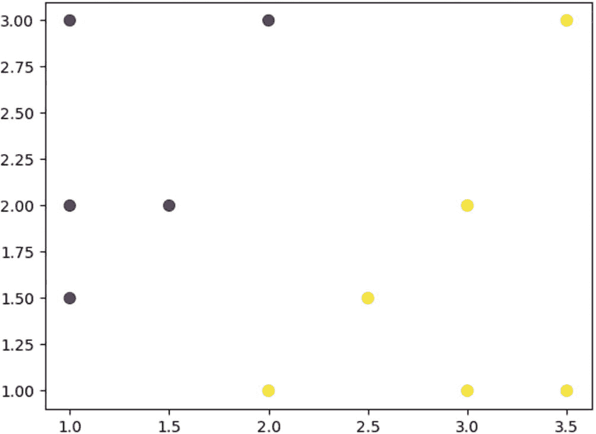

一个图表描绘了针对两个不同类别的训练数据集。一个类别用深色阴影表示，另一个用浅色阴影表示。这两个阴影区域被分隔到两个相反的区域。左上半部分被一个类别覆盖，右下半部分被另一个类别覆盖。

图 9-10

训练集是一组笛卡尔坐标点，分为两个类别（用浅色和深色表示）

为了帮助进行图形表示（如图 9-8 中的颜色分配所示），我们使用 `yc` 数组替换了 `inputY` 数组。


如您所见，这两个类别清晰地位于两个相对的区域内。第一个区域覆盖左上部分，第二个区域覆盖右下部分。乍看之下，它们似乎仅由一条假想的对角线划分，但为了增加系统的复杂性，其中存在一个例外：点 6 位于其他点的内部区域。

接下来值得关注的是，您实现的神经网络将如何（以及是否能够）正确地为这类点分配类别。

随后，您按照之前演示的方式，将训练数组中的值转换为张量。

```
train_features = tf.convert_to_tensor(inputX)
train_labels = tf.convert_to_tensor(inputY)
train_features
Out [ ]:

train_labels
Out [ ]:

```

现在，您可以基于图 9-11 中的神经网络构建单层感知器模型，并将各个 Keras 层添加到模型定义中。

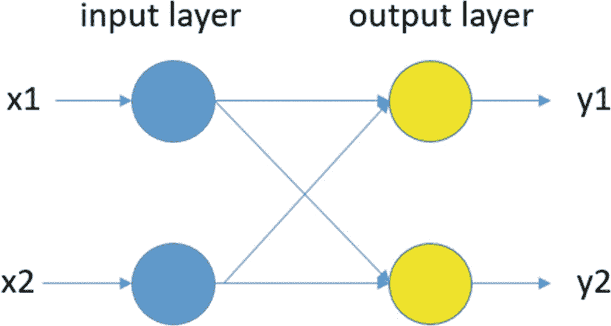

一个单层感知器的示例神经网络模型。它由两个输入`X1`和`X2`构成，其后跟随两个输入层，以及两个带有两个输出`Y1`和`Y2`的输出层。

图 9-11
本例中使用的单层感知器模型

```
model = tf.keras.Sequential([
tf.keras.layers.Dense(2),
tf.keras.layers.Dense(2)
])
```

如您所见，这是一个非常简单的模型，但足以应对诸如本例这类简单场景中的预测任务。

由于这是一个二分类问题，您可以在编译时选择`BinaryCrossentropy`作为损失函数。

```
model.compile(optimizer='SGD',
loss=tf.keras.losses.BinaryCrossentropy(from_logits=True),
metrics=['accuracy'])
```

模型编译完成后，即可进入训练阶段。选择 200 个周期，这应该足够让模型进行充分学习。

```
h = model.fit(train_features, train_labels, epochs=2000)
Out [ ]:
Epoch 1/2000
1/1 [==============================] - 1s 637ms/step - loss: 2.0271 - accuracy: 0.5455
Epoch 2/2000
1/1 [==============================] - 0s 4ms/step - loss: 1.9807 - accuracy: 0.5455
Epoch 3/2000
1/1 [==============================] - 0s 5ms/step - loss: 1.9356 - accuracy: 0.5455
Epoch 4/2000
1/1 [==============================] - 0s 9ms/step - loss: 1.8918 - accuracy: 0.5455
Epoch 5/2000
1/1 [==============================] - 0s 8ms/step - loss: 1.8493 - accuracy: 0.5455
Epoch 6/2000
1/1 [==============================] - 0s 6ms/step - loss: 1.8079 - accuracy: 0.5455
Epoch 7/2000
...
```

在输出中，您将看到每个周期完整的学习情况，并通过滚动条显示各个周期的完成进度。每个输出行旁边会相应地显示损失值和准确率值。

然而，很明显，这种输出方式并非理解神经网络模型在学习阶段表现的最佳途径。为此，我将输出结果保存在返回值`h`（代表历史记录）中，您可以利用它进行图形化展示，从而辅助分析。

从历史变量中提取各个时期对应的损失值。

```
acc_set = h.history['loss']
epoch_set = h.epoch
```

借助`matplotlib`库，将这些值绘制成图表，以图形方式观察学习进度。

```
# 返回包含每第 100 个元素的新列表
plt.plot(epoch_set[0::100],acc_set[0::100], 'o', label='Training phase')
plt.ylabel('loss')
plt.xlabel('epoch')
plt.legend()
```

结果，您将获得一个类似于图 9-12 所示的图表。

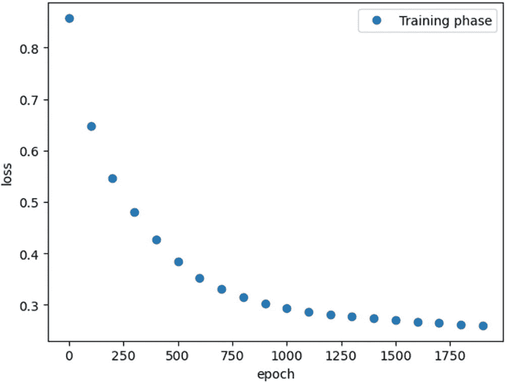

训练阶段的损失值与周期数关系图。该图包含 1750 个周期，最终损失值约为 1。训练阶段的损失值逐渐下降。

图 9-12
学习阶段中损失值的变化情况。

现在进入测试阶段，定义另外两个张量。


```
testX = np.array([[1.,2.25],[1.25,3.],
[2,2.5],[2.25,2.75],
[2.5,3.],[2.,0.9],
[2.5,1.2],[3.,1.25],
[3.,1.5],[3.5,2.],
[3.5,2.5]])
testY = [[1.,0.]]*5 + [[0.,1.]]*6
test_features = tf.convert_to_tensor(testX)
test_labels = tf.convert_to_tensor(testY)
```

评估新训练的 SLP 模型的精度。

```
test_loss, test_acc = model.evaluate(test_features, test_labels, verbose=2)
Out [ ]:
1/1 - 0s - loss: 0.1812 - accuracy: 1.0000 - 233ms/epoch - 233ms/step
```

如您所见，考虑到分类的简单性，精度达到了最高水平。因此，您可以预期新训练的模型具有非常好的预测水平。

现在进入正式的分类阶段，向神经网络传递大量数据（笛卡尔平面上的点），而不知道它们属于哪个类别。事实上，这正是神经网络告知您可能类别的时刻。

为此，程序模拟实验数据，在笛卡尔平面上创建完全随机的点。例如，您可以生成一个包含 1,000 个随机点的数组。

```
exp_features = 3*np.random.random((1000,2))
```

现在，您使用 Softmax 扩展模型，以获得不同点属于这两个类别的概率输出。

```
probability_model = tf.keras.Sequential([
model,
tf.keras.layers.Softmax()
])
```

现在，使用您刚刚扩展的模型对实验数据进行预测。

```
predictions = probability_model.predict(exp_features)
```

让我们确定单个点属于这两个类别的概率。例如，第一个点：

```
predictions[0]
Out [ ]:
array([0.073105 , 0.9268949], dtype=float32)
```

另一方面，如果我们想直接知道它属于两个类别中的哪一个，我们编写以下代码来获取它所属的类别（0 表示第一类，1 表示第二类）：

```
np.argmax(predictions[0])
Out [ ]:

```

除了以文本方式逐点分析之外，还有一种图形化方式来可视化这些预测的结果。在之前的散点图中，您用两种颜色（黄色和紫色）对笛卡尔平面上的点进行了分类。现在，既然您考虑了某个点属于这两个类别的概率，那么对于所有中间概率，将显示渐变的中间颜色。它将根据距离某个类别的接近程度，从黄色渐变为紫色。

```
yc = predictions[:,1]
plt.scatter(exp_features[:,0],exp_features[:,1],c=yc, s=50, alpha=1)
plt.show()
```

运行代码，您将得到一个如图 9-13 所示的散点图。

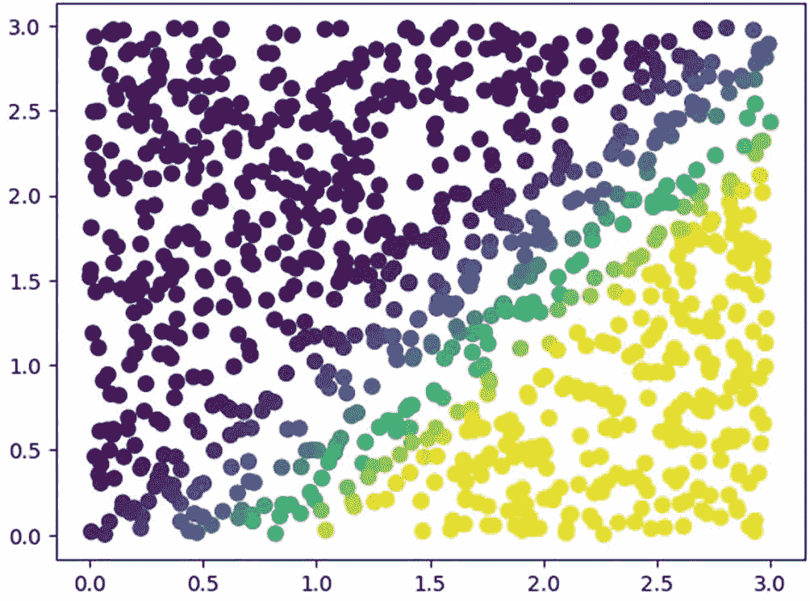

散点图描绘了两个类别的中间概率。这些点被三种不同的色调对角分隔。平面上确定了两种色调，一种在右上角，一种在左下角。中间的色调表示不确定区域。

**图 9-13** 包含所有实验点及其所属类别估计的散点图

如您根据色调所见，平面上划分出两个分类区域，中央部分（绿色）的颜色渐变表示不确定区域。

通过决定根据点属于某一类或另一类的概率来建立分类结果，可以使分类结果更易于理解和清晰。如果某点属于某个类别的概率大于 0.5，则该点属于该类别。

您可以通过要求每个点根据最可能的选项属于一个或另一个类别来修改先前的散点图。

```
yc = np.round(predictions[:,1])
plt.scatter(exp_features[:,0],exp_features[:,1],c=yc, s=50, alpha=1)
plt.show()
```

运行代码，您将得到一个如图 9-14 所示的散点图。

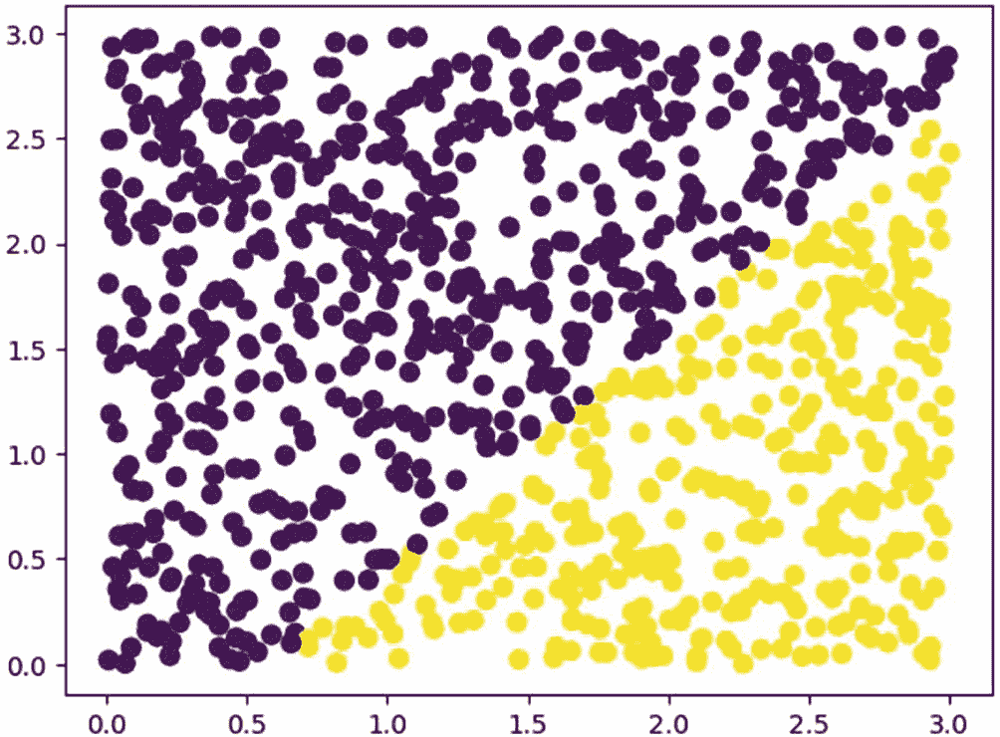

散点图描绘了两个类别的预测点。这些点被对角划分为两个区域。右上部分和左下部分属于两个不同的类别。它们通过两种色调进行区分。

**图 9-14** 这些点划分出对应于两个类别的两个区域

在图 9-14 所示的散点图中，您可以清晰地看到表征两个所属类别的笛卡尔平面的两个区域。

### 使用 TensorFlow 的多层感知器（带一个隐藏层）

在本节中，您将处理与上一节相同的问题，但使用的是 MLP（多层感知器）神经网络。

启动一个新的 Jupyter Notebook，或者继续使用同一个，但重置内核。

正如您在本章前面所看到的，MLP 神经网络与 SLP 神经网络的不同之处在于它可以有一个或多个隐藏层。

为了构建这个模型（与之前的模型相比，它有一个包含两个神经元的隐藏层），您定义一个与之前类似的模型，但带有一个中间的 `Dense` 层。

```
model = tf.keras.Sequential([
tf.keras.layers.Dense(2),
tf.keras.layers.Dense(2),
tf.keras.layers.Dense(2)
])
```

下一步是编译模型，选择一种优化方法。对于 MLP 神经网络，**Adam** 优化方法是一个不错的选择。相反，保持损失函数和评估指标不变。

```
model.compile(optimizer='Adam',
loss=tf.keras.losses.BinaryCrossentropy(from_logits=True),
metrics=['accuracy'])
```

与之前的 SLP 模型一样，使用相同的训练数据集对其进行训练。

```
h = model.fit(train_features, train_labels, epochs=2000)
Out [ ]:
Epoch 1/2000
1/1 [==============================] - 0s 426ms/step - loss: 1.8568 - accuracy: 0.4545
Epoch 2/2000
1/1 [==============================] - 0s 3ms/step - loss: 1.8473 - accuracy: 0.4545
Epoch 3/2000
1/1 [==============================] - 0s 3ms/step - loss: 1.8378 - accuracy: 0.4545
Epoch 4/2000
1/1 [==============================] - 0s 646us/step - loss: 1.8284 - accuracy: 0.4545
Epoch 5/2000
1/1 [==============================] - 0s 0s/step - loss: 1.8190 - accuracy: 0.4545
Epoch 6/2000
1/1 [==============================] - 0s 0s/step - loss: 1.8097 - accuracy: 0.4545
Epoch 7/2000
1/1 [==============================] - 0s 14ms/step - loss: 1.8004 - accuracy: 0.4545
Epoch 8/2000
...
```

提取训练历史记录并创建相同的图表，以显示模型在训练过程中的行为。

```
acc_set = h.history['loss']
epoch_set = h.epoch# 返回较大列表中每第 50 个元素的列表
plt.plot(epoch_set[0::50],acc_set[0::50], 'o', label='训练阶段')
plt.ylabel('损失')
plt.xlabel('周期')
plt.legend()
```

运行之前的代码，您将得到一个如图 9-15 所示的图表。

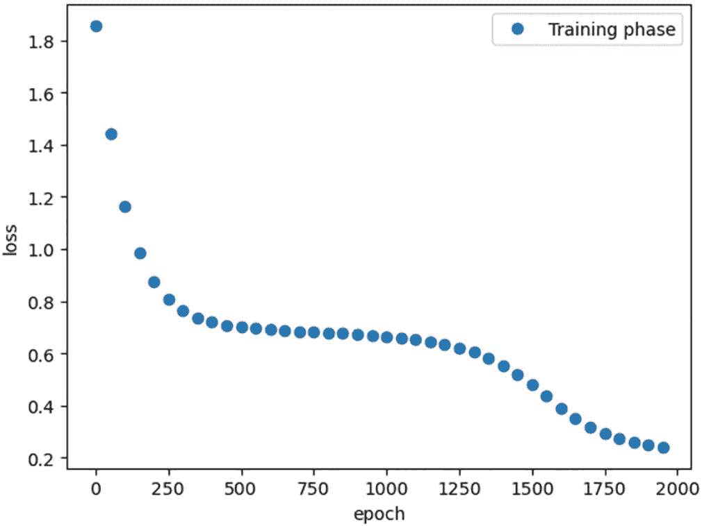

训练阶段损失值与周期的折线图。点从 0 周期时的损失值 1.8 开始，到 2000 周期时的 0.3 结束。值为近似值。

**图 9-15** MLP 模型的学习曲线显示了两个不同的优化阶段

如您所见，即使是一个更复杂的神经网络也显示出不同的学习阶段。在这种情况下，选择 2000 个周期对于提高模型的预测能力至关重要。如果您在 1000 个周期处停止，损失值将为 0.7，而不是 0.2。

作为测试这最后一个模型的结果，您获得了 100% 的精度和 0.1 的损失值。

```
test_loss, test_acc = model.evaluate(test_features, test_labels, verbose=2)
Out [ ]:
1/1 - 0s - loss: 0.1602 - accuracy: 1.0000 - 105ms/epoch - 105ms/step
```


### 使用 TensorFlow 实现多层感知机（含两个隐藏层）

在本节中，你将拓展之前的网络结构，在第一个隐藏层中加入两个神经元（共四个），并添加一个包含两个神经元的第二个隐藏层。

和之前一样，启动一个新的 Jupyter Notebook 并编写之前示例的必要代码，或重启内核并执行包含必要代码的单元格。

```
model = tf.keras.Sequential([
    tf.keras.layers.Dense(2),
    tf.keras.layers.Dense(4),
    tf.keras.layers.Dense(2),
    tf.keras.layers.Dense(2)
])
model.compile(optimizer='Adam',
              loss=tf.keras.losses.BinaryCrossentropy(from_logits=True),
              metrics=['accuracy'])
```

然后，使用与之前相同的训练数据集来训练这个新的双层隐藏层 MLP 模型。

```
h = model.fit(train_features, train_labels, epochs=2000)
Out [ ]:
Epoch 1/2000
1/1 [==============================] - 1s 826ms/step - loss: 0.6980 - accuracy: 0.4545
Epoch 2/2000
1/1 [==============================] - 0s 3ms/step - loss: 0.6970 - accuracy: 0.4545
Epoch 3/2000
1/1 [==============================] - 0s 3ms/step - loss: 0.6961 - accuracy: 0.4545
Epoch 4/2000
1/1 [==============================] - 0s 0s/step - loss: 0.6953 - accuracy: 0.4545
Epoch 5/2000
1/1 [==============================] - 0s 0s/step - loss: 0.6945 - accuracy: 0.4545
Epoch 6/2000
1/1 [==============================] - 0s 0s/step - loss: 0.6938 - accuracy: 0.4545
Epoch 7/2000
1/1 [==============================] - 0s 3ms/step - loss: 0.6931 - accuracy: 0.4545
Epoch 8/2000
1/1 [==============================] - 0s 0s/step - loss: 0.6925 - accuracy: 0.4545
...
```

对于这个模型，你还可以通过图表展示损失值随训练轮次增加的变化，来分析神经网络的学习阶段。

```
acc_set = h.history['loss']
epoch_set = h.epoch
# 从一个大列表中每 50 项提取一项并返回列表
plt.plot(epoch_set[0::50], acc_set[0::50], 'o', label='训练阶段')
plt.ylabel('损失')
plt.xlabel('轮次')
plt.legend()
```

运行代码后，你将得到如图 9-16 所示的图表。

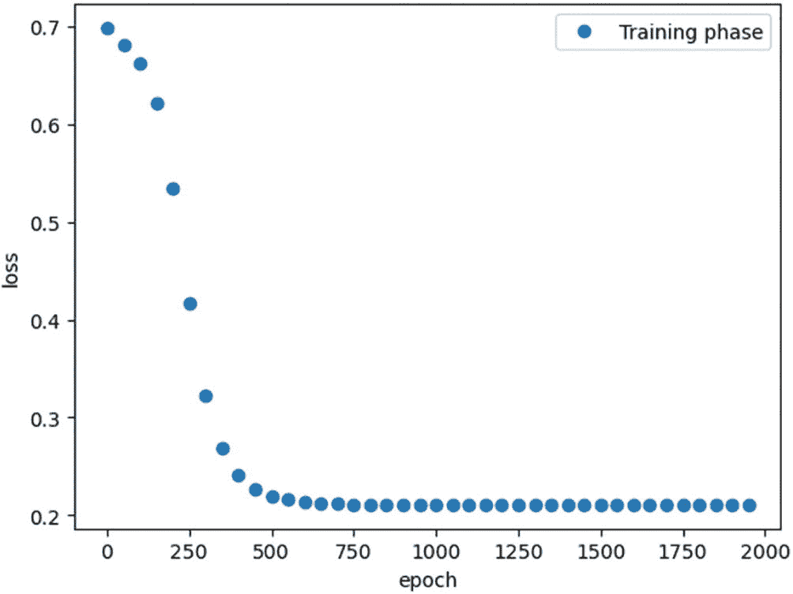

训练阶段的损失 vs 轮次图表。图中的曲线从第 0 轮损失 0.7 开始，到第 2000 轮损失 0.2 结束，数值为近似值。

**图 9-16** 双层隐藏层 MLP 在学习过程中损失的变化趋势

从图 9-16 可以看出，这种情况下的学习速度比之前快得多（在第 1000 轮时效果已经不错了）。

```
test_loss, test_acc = model.evaluate(test_features, test_labels, verbose=2)
Out [ ]:
1/1 - 0s - loss: 0.0951 - accuracy: 1.0000 - 124ms/epoch - 124ms/step
```

优化后的损失是迄今为止最好的结果，而且仅用了 700 轮（损失值为 0.0951，而之前的情况在 2000 轮时损失值为 0.16）。显然，增加一个含有四个神经元的隐藏层使模型更快、更高效。

## 结论

在本章中，你了解了机器学习中一个以神经网络为计算结构的分支——深度学习。你阅读了深度学习基本概念的概述，这包括神经网络及其结构。最后，借助 TensorFlow 库，你实现了不同类型的神经网络，例如单层感知机和多层感知机。

深度学习及其各种技术和算法是一个非常复杂的主题，在一章中很难充分讲解。然而，你现在已经熟悉了深度学习，可以开始实现更复杂的神经网络了。

