# 10. 示例——气象数据

互联网上较易获取的一类数据是气象数据。许多网站提供关于气压、温度、湿度、降雨量等多种气象参数的历史数据。你只需指定地点和日期，就能得到一个包含气象站测量数据集的文件。这些数据蕴藏着广泛的信息。正如你在本书第一章中读到的，数据分析的目的是将原始数据转化为信息，再进一步转化为知识。

在本章中，你将看到一个如何使用气象数据的简单示例。这个示例有助于你大致了解如何应用前几章中提到的许多技术。

## 待检验的假设：临海距离的影响

在撰写本章时，正值夏初，气温不断升高。每逢周末，许多内陆居民会前往山区村庄或海滨城市，以享受一丝清凉，远离内陆城市的闷热天气。这一现象一直让我好奇：临海距离对气候有何影响？

这个简单的问题可以成为数据分析的一个良好起点。我并不想将本章内容伪装成严谨的科学结论；它只是为了给那些热爱数据分析的人提供一种将知识付诸实践的方式，以回答这个问题——临海距离对当地气候有何影响（如果有的话）？

### 研究中的系统：亚得里亚海与波河平原

问题定义之后，就需要寻找一个非常适合研究数据、并为该问题提供合适背景的系统。

首先，你需要一片海。好吧，我人在意大利，有很多海可以选择，因为意大利是一个被海洋包围的半岛。为什么要把自己局限在意大利呢？嗯，这个问题涉及一种典型的意大利人行为，即他们在夏季会躲到靠近海的地方，以避开内陆的炎热。由于不清楚其他国家的人是否有同样行为，我将只把意大利作为研究系统。

但我们应该考虑研究意大利的哪些区域呢？我们能否评估不同距离下海洋的影响？这会带来很多问题。事实上，意大利山区众多，且没有太多内陆延伸数千公里、地形均匀的土地。因此，为了评估海洋的影响，我把山脉排除在外，因为它们可能会引入许多其他影响气候的因素，例如海拔。

意大利非常适合进行这项评估的区域是波河平原。这片平原从亚得里亚海开始，向内陆延伸数百公里（见图 10-1）。它被山脉环绕，但山谷的宽度减轻了任何山脉效应。这里也有许多城镇，因此很容易选择一组离海越来越远的城市，以便在这次评估中覆盖近 400 公里的距离。

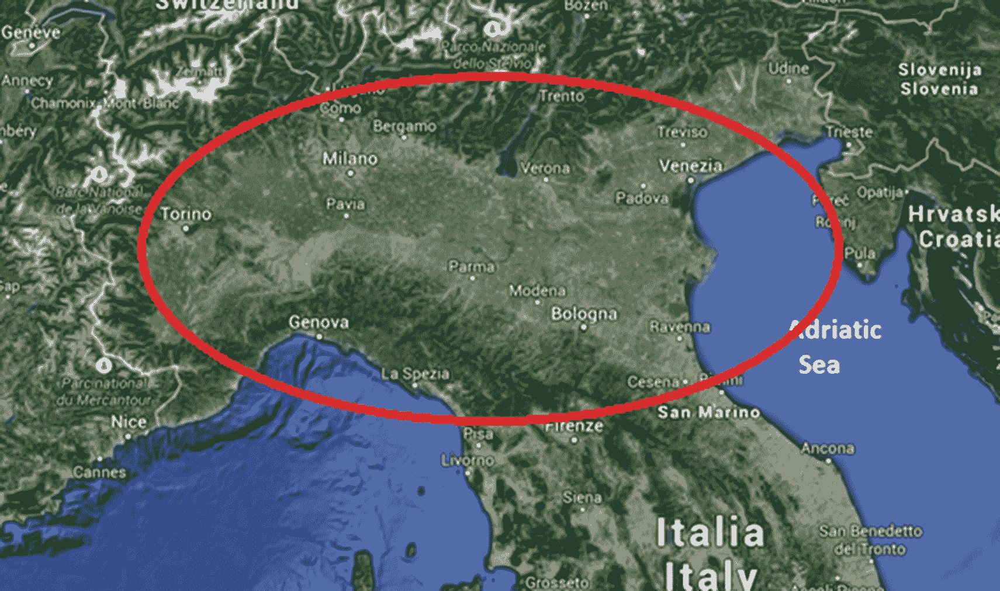

一张谷歌地图截图，突出显示了意大利北部地区，包括米兰、都灵、热那亚、博洛尼亚、威尼斯和其他地点。

`图 10-1` – 波河平原与亚得里亚海图像（谷歌地图）

第一步是选择一组十个城市作为参考标准。选择这些城市是为了覆盖整个平原的范围（见图 10-2）。

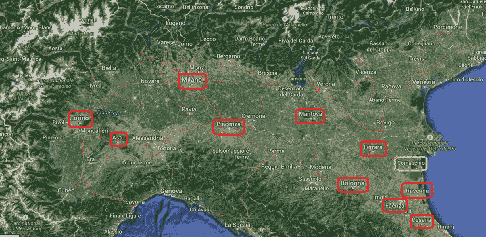

一张谷歌地图截图，在意大利地图上突出显示了米兰、都灵、阿斯蒂、皮亚琴察、曼托瓦、费拉拉、博洛尼亚、法恩扎、切塞纳、拉文纳和科马基奥等地区。

`图 10-2` – 选为样本的十个城市（还有一个用作离海距离的参考点）

在图 10-2 中，你可以看到被选中用于分析天气数据的十个城市：五个城市在最初的 100 公里内，另外五个分布在剩余的 300 公里内。

以下是选定的城市：
- 费拉拉
- 都灵
- 曼托瓦
- 米兰
- 拉文纳
- 阿斯蒂
- 博洛尼亚
- 皮亚琴察
- 切塞纳
- 法恩扎

现在你需要确定这些城市离海的距离。你可以通过多种步骤获得这些数值。在这种情况下，你可以使用 TheDistanceNow 网站（`www.thedistancenow.com/`）提供的服务，该网站支持多种语言（见图 10-3）。


一张 Distance Now 网页的截图。标题写着测量城市间的距离。它提供两个文本框用于输入城市名称。有一个标有“开始”的按钮用于测量距离。

`图 10-3` – TheDistanceNow 网站允许你计算两个城市之间的距离

借助这项服务，可以计算出这些城市离海的近似距离。你可以通过选择一个沿海城市作为目的地来实现。对于其中许多城市，可以选择科马基奥市作为参考点来计算离海的距离（见图 10-2）。一旦确定了这十个城市的距离，你将得到表 10-1 中所示的值。

`表 10-1` – 十个城市离海的距离

| 城市 | 距离（公里） | 备注 |
| :--- | :--- | :--- |
| 拉文纳 | 8 | 使用谷歌地球测量 |
| 切塞纳 | 14 | 使用谷歌地球测量 |
| 法恩扎 | 37 | 法恩扎-拉文纳距离 + 8 公里 |
| 费拉拉 | 47 | 费拉拉-科马基奥距离 |
| 博洛尼亚 | 71 | 博洛尼亚-科马基奥距离 |
| 曼托瓦 | 121 | 曼托瓦-科马基奥距离 |
| 皮亚琴察 | 200 | 皮亚琴察-科马基奥距离 |
| 米兰 | 250 | 米兰-科马基奥距离 |
| 阿斯蒂 | 315 | 阿斯蒂-科马基奥距离 |
| 都灵 | 357 | 都灵-科马基奥距离 |

## 寻找数据源

一旦定义了所研究的系统，就需要建立一个数据源，从中获取所需数据。通过浏览互联网，你可以发现许多提供世界各地不同地点气象数据的网站。其中一个网站是 OpenWeather，网址为 `openweathermap.org`（见图 10-4）。

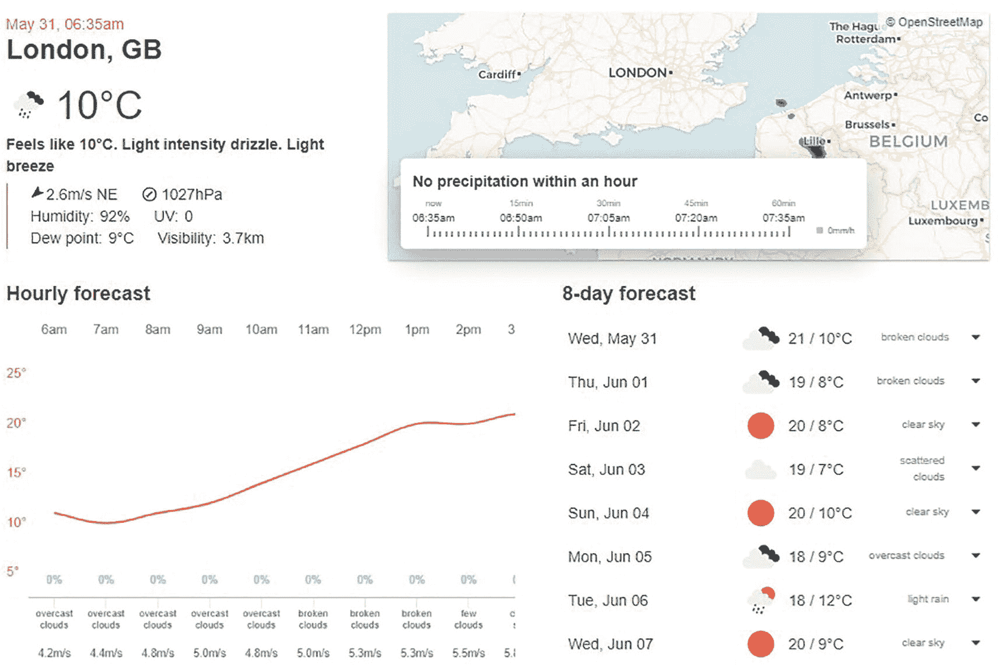

一张截图显示了伦敦的天气详情，以及一张每小时气温预报的折线图和一张 8 天预报表格。顶部是一张伦敦地图，表明一小时内无降水。

`图 10-4` – OpenWeather 网站

在你注册账户并收到一个应用程序 ID 代码后，该网站允许你通过指定城市，以 URL 请求的方式捕获数据。

```
https://api.openweathermap.org/data/2.5/weather?q=Atlanta,US&appid=5807ad2a45eb6bf4e81d137dafe74e15
```

此请求将返回一个 JSON 文件，其中包含有关该城市当前天气状况的所有信息（见图 10-5）。此 JSON 文件将提交给 Python pandas 库进行数据分析。

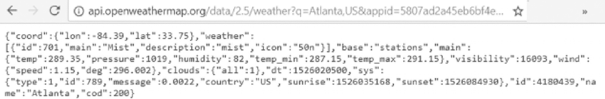

一张截图显示了搜索栏中的一个 URL，以及底部的一个 JSON 文件。JSON 文件代表了亚特兰大的天气，其中包括薄雾、气压、温度、湿度、风、气压和云层的详细信息。

`图 10-5` – 包含所查询城市气象数据的 JSON 文件

## 在 Jupyter Notebook 上进行数据分析

本章讲解如何使用 Jupyter Notebook 进行数据分析。它允许你逐步输入并学习代码片段。

服务启动后，创建一个新的 Notebook。

首先，导入必要的库：

```
import numpy as np
import pandas as pd
import datetime
```

第一步是通过特定请求研究从站点接收到的数据结构。

从研究选定的城市中选择一个城市，例如费拉拉，并使用指定的 URL 请求其当前气象数据。在没有浏览器的情况下，可以使用 `request.get().text` 函数获取页面的文本内容。由于获取的内容是 JSON 格式，你可以直接使用 `json.load()` 函数按照此格式读取接收到的文本。

```
import json
import requests
ferrara = json.loads(requests.get('https://api.openweathermap.org/data/2.5/weather?q=Ferrara,IT&appid=5807ad2a45eb6bf4e81d137dafe74e15').text)
```

现在你可以查看包含费拉拉市气象数据的 JSON 文件内容。

# JSON 数据分析

## 示例：处理 OpenWeatherMap API 响应

以下是获取费拉拉市（Ferrara）天气数据的 JSON 响应示例。

```json
ferrara
Out [ ]:
{'coord': {'lon': 11.8333, 'lat': 44.8},
'weather': [{'id': 804,
'main': 'Clouds',
'description': 'overcast clouds',
'icon': '04d'}],
'base': 'stations',
'main': {'temp': 292.51,
'feels_like': 292.22,
'temp_min': 292.04,
'temp_max': 293.74,
'pressure': 1017,
'humidity': 66,
'sea_level': 1017,
'grnd_level': 1017},
'visibility': 10000,
'wind': {'speed': 2.68, 'deg': 50, 'gust': 7.76},
'clouds': {'all': 100},
'dt': 1685511558,
'sys': {'type': 2,
'id': 2007888,
'country': 'IT',
'sunrise': 1685503859,
'sunset': 1685558996},
'timezone': 7200,
'id': 3177088,
'name': 'Provincia di Ferrara',
'cod': 200}
```

当你想要分析 JSON 文件的结构时，以下命令很有用：

```python
list(ferrara.keys())
Out [ ]:
['coord',
'weather',
'base',
'main',
'visibility',
'wind',
'clouds',
'dt',
'sys',
'id',
'name',
'cod']
```

这样，你就可以获得构成 JSON 文件内部结构的所有键的列表。一旦知道了这些键的名称，就可以轻松访问内部数据。

```python
print('Coordinates = ', ferrara['coord'])
print('Weather = ', ferrara['weather'])
print('base = ', ferrara['base'])
print('main = ', ferrara['main'])
print('visibility = ', ferrara['visibility'])
print('wind = ', ferrara['wind'])
print('clouds = ', ferrara['clouds'])
print('dt = ', ferrara['dt'])
print('sys = ', ferrara['sys'])
print('id = ', ferrara['id'])
print('name = ', ferrara['name'])
print('cod = ', ferrara['cod'])
Out [ ]:
Coordinates =  {'lon': 11.8333, 'lat': 44.8}
Weather =  [{'id': 804, 'main': 'Clouds', 'description': 'overcast clouds', 'icon': '04d'}]
base =  stations
main =  {'temp': 292.51, 'feels_like': 292.22, 'temp_min': 292.04, 'temp_max': 293.74, 'pressure': 1017, 'humidity': 66, 'sea_level': 1017, 'grnd_level': 1017}
visibility =  10000
wind =  {'speed': 2.68, 'deg': 50, 'gust': 7.76}
clouds =  {'all': 100}
dt =  1685511558
sys =  {'type': 2, 'id': 2007888, 'country': 'IT', 'sunrise': 1685503859, 'sunset': 1685558996}
id =  3177088
name =  Provincia di Ferrara
cod =  200
```

现在选择你认为对此类分析最有趣或有用的值。例如，一个重要的值是温度：

```python
ferrara['main']['temp']
Out [ ]:
292.51
```

这种初始结构分析的目的是识别 JSON 结构中可能最重要的数据。这些数据必须经过处理才能进行分析。也就是说，必须从结构中提取数据，根据需要进行清洗或修改，并按顺序放入数据框（`dataframe`）中。这样，你就可以应用本书介绍的所有数据分析技术了。

## 数据提取与清洗函数

避免重复相同代码的一个便捷方法是将一些提取过程插入到一个函数中，例如下面的函数：

```python
def prepare(city,city_name):
    temp = [ ]
    humidity = [ ]
    pressure = [ ]
    description = [ ]
    dt = [ ]
    wind_speed = [ ]
    wind_deg = [ ]
    temp.append(city['main']['temp']-273.15)
    humidity.append(city['main']['humidity'])
    pressure.append(city['main']['pressure'])
    description.append(city['weather'][0]['description'])
    dt.append(city['dt'])
    wind_speed.append(city['wind']['speed'])
    wind_deg.append(city['wind']['deg'])
    headings = ['temp','humidity','pressure','description','dt','wind_speed','wind_deg']
    data = [temp,humidity,pressure,description,dt,wind_speed,wind_deg]
    df = pd.DataFrame(data,index=headings)
    city = df.T
    city['city'] = city_name
    city['day'] = city['dt'].apply(datetime.datetime.fromtimestamp)
    return city
```

这个函数所做的不过是从 JSON 结构中获取你感兴趣的气象数据，一旦这些数据经过清洗或修改（例如日期和时间），它们就会被收集到数据框的一行中（如图 10-6 所示）。

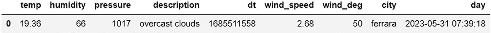

一个表格展示了温度、湿度、气压、天气描述、风速、风向度数、城市和日期等值。

**图 10-6** 通过从 JSON 提取并处理数据得到的数据框

```python
t1 = prepare(ferrara,'ferrara')
t1
```

在列表列中描述的 JSON 结构的所有参数中，以下这些最适合本研究：

*   温度
*   湿度
*   气压
*   天气描述
*   风速
*   风向度数

所有这些属性将与从 `dt` 列表示的采集时间相关联，该列包含一个时间戳作为数据类型。这个值难以阅读，因此你可以将其转换为日期时间格式，以便以你更熟悉的方式表示日期和时间。新列将被命名为 `day`。

```python
city['day'] = city['dt'].apply(datetime.datetime.fromtimestamp)
```

温度以开尔文为单位，你可以通过从每个值中减去 273.15 来将这些值转换为摄氏度。

最后，添加通过 `prepare()` 函数的第二个参数传入的城市名称。

## 合并多时间点数据

数据是在一天中不同的时间间隔内定期收集的。例如，你可以使用一个程序每小时执行一次这些请求。每次采集的数据框结构中的一行将被添加到与该城市相关的总数据框中，例如，称为 `df_ferrara`（如图 10-7 所示）。

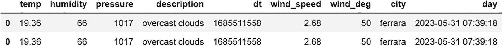

一个表格展示了温度、湿度、气压、天气描述、风速、风向度数、城市和日期等值。它显示了费拉拉市两次相同的值。

**图 10-7** 对应于一个城市的数据框结构

```python
df_ferrara = t1
t2 = prepare(ferrara,'ferrara')
df_ferrara = pd.concat([df_ferrara, t2])
df_ferrara
```

通常，对于此分析有用的数据在 JSON 源中不存在。在这种情况下，你必须求助于其他数据源，并将缺失的数据导入到结构中。在此示例中，城市与海洋的距离是必不可少的。对你想要分析列表中所有城市重复上述过程。然后将距离值添加到获得的数据框中。

## 处理后的气象数据分析

出于实际目的，我已收集了分析所涉及的所有城市的数据。我已在 `dataframe` 中处理并整理了这些数据，并将其保存为 CSV 文件。

如果你想引用本章中使用的数据，需要加载我在撰写时保存的十个 CSV 文件。这些文件包含经过处理、可用于此分析的数据。

```
df_ferrara=pd.read_csv('ferrara_270615.csv')
df_milano=pd.read_csv('milano_270615.csv')
df_mantova=pd.read_csv('mantova_270615.csv')
df_ravenna=pd.read_csv('ravenna_270615.csv')
df_torino=pd.read_csv('torino_270615.csv')
df_asti=pd.read_csv('asti_270615.csv')
df_bologna=pd.read_csv('bologna_270615.csv')
df_piacenza=pd.read_csv('piacenza_270615.csv')
df_cesena=pd.read_csv('cesena_270615.csv')
df_faenza=pd.read_csv('faenza_270615.csv')
```

借助 `pandas` 的 `read_csv()` 函数，你只需一步即可将 CSV 文件转换为 `dataframe`。

一旦你将每个城市的数据作为 `dataframe` 上传后，便可轻松查看其内容。

```
df_cesena
```

如图 10-8 所示，Jupyter Notebook 通过生成图形化表格，使读取数据框变得更加容易。此外，你可以看到每行显示了一天中每个小时的测量值，覆盖了过去大约 20 小时的时间线。

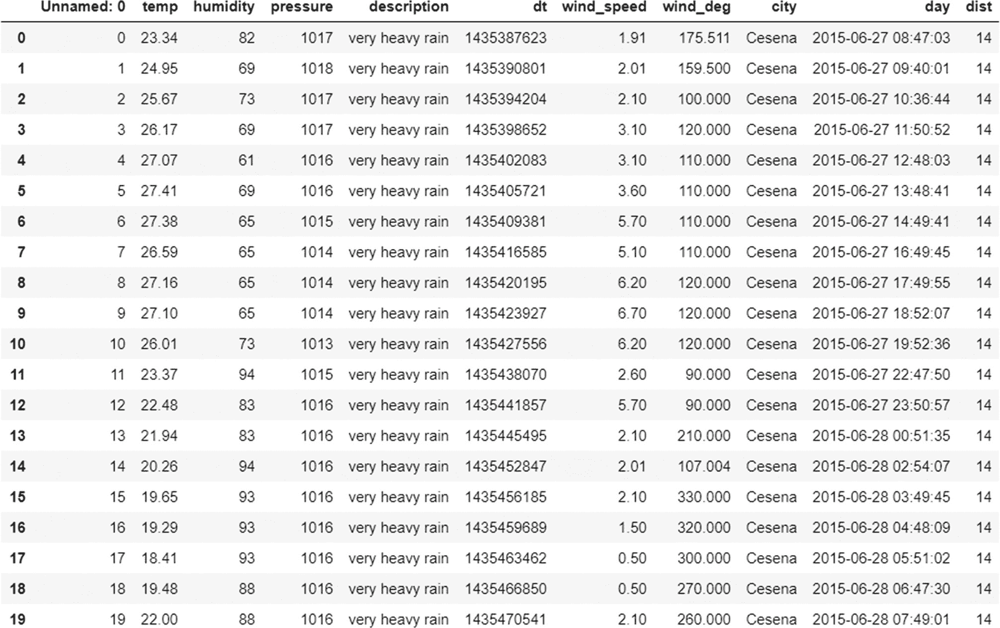

一个表格有 11 列和 20 行。列标题分别为：`unnamed 0`、`温度`、`湿度`、`气压`、`描述`、`风速`、`风向`、`城市`、`日期`和`距离`。它表示切塞纳市的值。

图 10-8 对应一个城市的数据框结构

在图 10-8 所示的例子中，请注意只有 19 行。事实上，观察其他城市，气象测量系统在测量过程中有时会失效，导致采集中断。如果收集的数据像本例一样构成 19 行，足以描述当天气象属性的趋势。然而，检查所有十个数据框的大小是个好习惯。如果一个城市提供的数据不足以描述每日趋势，你需要用另一个城市替换它。

有一种简单的方法可以检查大小，而无需一个接一个地查看表格。借助 `shape()` 函数，你可以确定每个城市获取的数据行数。

```
print(df_ferrara.shape)
print(df_milano.shape)
print(df_mantova.shape)
print(df_ravenna.shape)
print(df_torino.shape)
print(df_asti.shape)
print(df_bologna.shape)
print(df_piacenza.shape)
print(df_cesena.shape)
print(df_faenza.shape)
```

这将得到以下结果：

```
(20, 9)
(18, 9)
(20, 9)
(18, 9)
(20, 9)
(20, 9)
(20, 9)
(20, 9)
(20, 9)
(19, 9)
```

正如你所见，选择十个城市是最优的，因为控制单元提供了足够的数据来继续进行数据分析。

分析你刚收集的数据的一种常规方法是使用数据可视化。你了解到 `matplotlib` 库包含一套用于生成图表以显示数据的工具。事实上，数据可视化能在数据分析过程中帮助你发现所研究系统的特征。

接下来，激活所需的库：

```
%matplotlib inline
import matplotlib.pyplot as plt
import matplotlib.dates as mdates
```

例如，有一种简单的方法可以分析一天中的温度趋势。以米兰市为例。

```
y1 = df_milano['temp']
df_milano['day'] = pd.to_datetime(df_milano['day'])
x1 = df_milano['day']
fig, ax = plt.subplots()
plt.xticks(rotation=70)
hours = mdates.DateFormatter('%H:%M')
ax.xaxis.set_major_formatter(hours)
ax.plot(x1,y1,'r')
```

执行这段代码，你将得到如图 10-9 所示的图表。如你所见，温度趋势遵循近乎正弦的曲线模式，其特点是温度在早晨上升，在午后最热时段（下午 2:00 到 6:00 之间）达到最大值。然后温度下降，在黎明前（即早上 6:00）达到最小值。

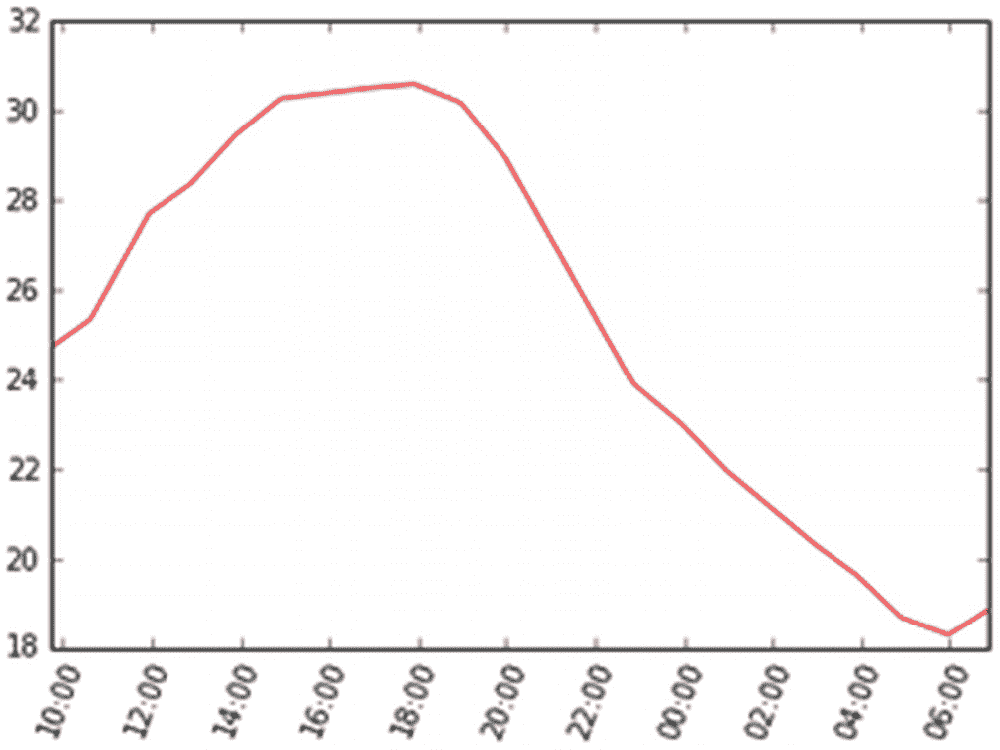

一张折线图显示，温度在起初上升至下午 6 点后呈下降趋势。峰值温度浮动在 30 到 32 左右，并在早上 6 点降至最低。

图 10-9 米兰一天中的温度趋势

由于你的分析目的是尝试解读天气，因此可以评估海洋如何以及是否影响了这一趋势。这一次，你同时评估不同城市的趋势。这是判断分析方向是否正确的唯一方法。因此，选择离海最近的三个城市和离海最远的三个城市。

```
y1 = df_ravenna['temp']
df_ravenna['day'] = pd.to_datetime(df_ravenna['day'])
x1 = df_ravenna['day']
y2 = df_faenza['temp']
df_faenza['day'] = pd.to_datetime(df_faenza['day'])
x2 = df_faenza['day']
y3 = df_cesena['temp']
df_cesena['day'] = pd.to_datetime(df_cesena['day'])
x3 = df_cesena['day']
y4 = df_milano['temp']
df_milano['day'] = pd.to_datetime(df_milano['day'])
x4 = df_milano['day']
y5 = df_asti['temp']
df_asti['day'] = pd.to_datetime(df_asti['day'])
x5 = df_asti['day']
y6 = df_torino['temp']
df_torino['day'] = pd.to_datetime(df_torino['day'])
x6 = df_torino['day']
fig, ax = plt.subplots()
plt.xticks(rotation=70)
hours = mdates.DateFormatter('%H:%M')
ax.xaxis.set_major_formatter(hours)
plt.plot(x1,y1,'r',x2,y2,'r',x3,y3,'r')
plt.plot(x4,y4,'g',x5,y5,'g',x6,y6,'g')
```

这段代码将生成如图 10-10 所示的图表。离海最近的三个城市的温度以红色显示，而离海最远的三个城市的温度则以绿色显示。

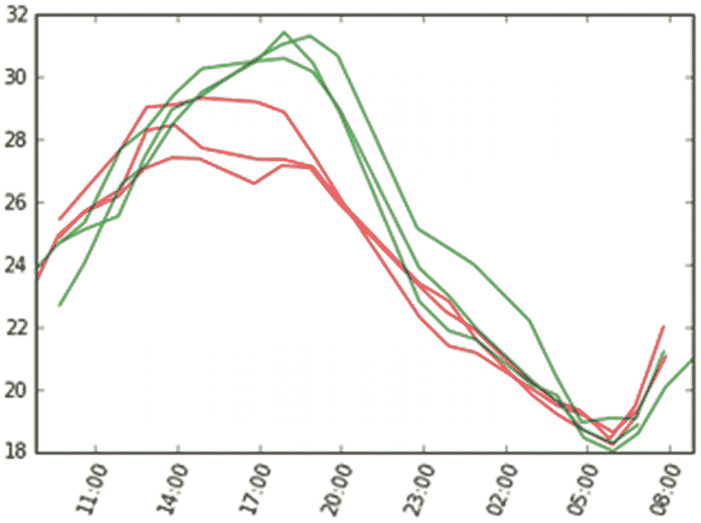

一张折线图显示，温度在起初上升至下午 5 点后呈下降趋势。峰值温度接近 32 度，并在早上 5 点降至最低。共有 6 条线分成 2 组，每组线条的趋势几乎相似。

图 10-10 六个不同城市的温度趋势（红色代表离海最近的城市；绿色代表离海最远的城市）

查看图 10-10，结果似乎很有希望。事实上，离海最近的三个城市的最高温度远低于离海最远的城市，而最低温度似乎差异不大。

为了深入探讨这一方面，你可以收集所有十个城市的最高和最低温度，并显示一个折线图，将这些温度与它们离海的距离进行比较。

```
首先表示最高温度。

```python
dist = [df_ravenna['dist'][0],
df_cesena['dist'][0],
df_faenza['dist'][0],
df_ferrara['dist'][0],
df_bologna['dist'][0],
df_mantova['dist'][0],
df_piacenza['dist'][0],
df_milano['dist'][0],
df_asti['dist'][0],
df_torino['dist'][0]
]temp_max = [df_ravenna['temp'].max(),
df_cesena['temp'].max(),
df_faenza['temp'].max(),
df_ferrara['temp'].max(),
df_bologna['temp'].max(),
df_mantova['temp'].max(),
df_piacenza['temp'].max(),
df_milano['temp'].max(),
df_asti['temp'].max(),
df_torino['temp'].max()
]
temp_min = [df_ravenna['temp'].min(),
df_cesena['temp'].min(),
df_faenza['temp'].min(),
df_ferrara['temp'].min(),
df_bologna['temp'].min(),
df_mantova['temp'].min(),
df_piacenza['temp'].min(),
df_milano['temp'].min(),
df_asti['temp'].min(),
df_torino['temp'].min()
]
```

```python
plt.plot(dist,temp_max,'ro')
```

结果如图 10-11 所示。

## 趋势分析：温度与距海距离的关系

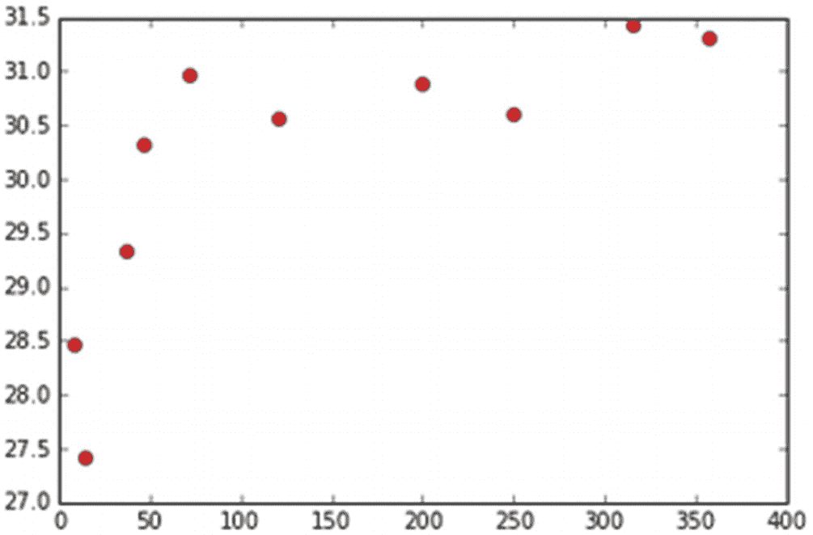

散点图显示了温度随距海距离（0 至 400 公里）增加而上升的趋势。在距海 0 至 50 公里的范围内，温度保持最低，随后随着距离增加而上升并波动。

**图 10-11：最高温度与距海距离的关系趋势**

如图 10-11 所示，你可以验证“海洋的存在以某种方式影响气象参数”这一假设是正确的（至少在白天是这样☺）。

此外，你可以看到海洋的影响迅速减弱，大约在 60-70 公里后，最高温度达到一个平台期。

一个有趣的想法是用两条通过线性回归得到的直线来表示这两种不同的趋势。为此，你可以使用`scikit-learn`库提供的`SVR`方法。

如果你还没有安装`scikit-learn`库，请现在安装。如果你使用 Anaconda，可以通过 Anaconda Navigator，从虚拟环境中的可用包列表中选择它来安装（见图 10-12），或者通过 CMD.exe 提示符控制台输入以下命令：


Anaconda 导航器截图显示了环境选项下的设置。它高亮了版本 3 的选项，该选项引导至一个包含名称和描述的表格。表格中高亮了名称`101 scikit learn`。

**图 10-12：使用 Anaconda Navigator 安装`scikit-learn`库**

```cmd
conda install scikit-learn
```

此时，你可以通过在 Notebook 的单元格中插入以下代码来继续示例：

```python
x = np.array(dist)
y = np.array(temp_max)
x1 = x[x <= 50]
x1 = x1.reshape((x1.size, 1))
y1 = y[x <= 50]
x2 = x[x > 50]
x2 = x2.reshape((x2.size, 1))
y2 = y[x > 50]
from sklearn.svm import SVR
svr_lin1 = SVR(kernel='linear', C=1e3)
svr_lin2 = SVR(kernel='linear', C=1e3)
svr_lin1.fit(x1, y1)
svr_lin2.fit(x2, y2)
xp1 = np.arange(10, 100, 10).reshape((9, 1))
xp2 = np.arange(50, 400, 50).reshape((7, 1))
yp1 = svr_lin1.predict(xp1)
yp2 = svr_lin2.predict(xp2)
plt.plot(xp1, yp1, c='r', label='Strong sea effect')
plt.plot(xp2, yp2, c='b', label='Light sea effect')
plt.axis((0, 400, 27, 32))
plt.scatter(x, y, c='k', label='data')
```

这段代码将生成图 10-13 所示的图表。

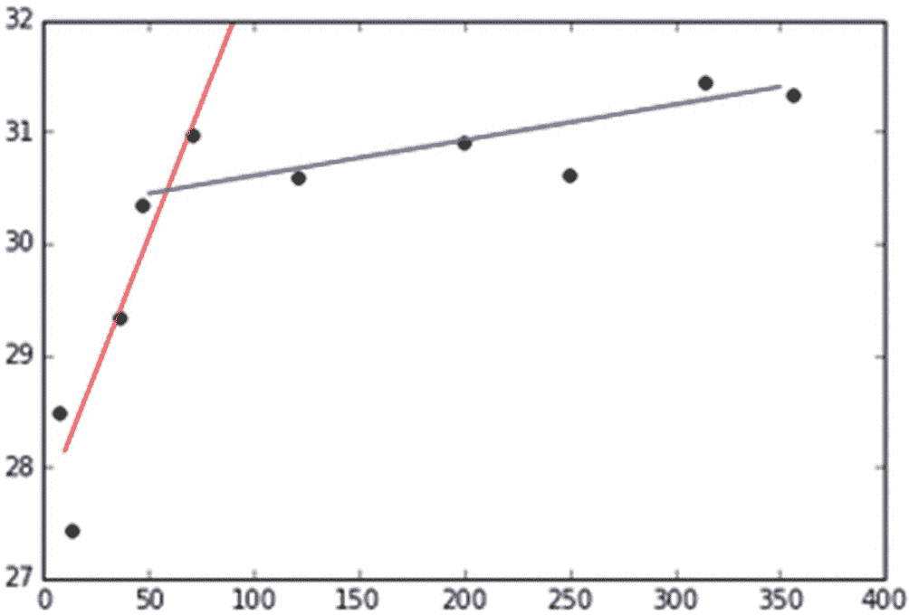

带线条的散点图显示了温度随距海距离的变化趋势。它表示在距海距离从 0 到 100 公里时温度急剧上升，之后略有下降并在 400 公里范围内波动。

**图 10-13：最高温度与距海距离的关系所描述的两个趋势**

如你所见，前 60 公里内温度上升非常迅速，从 28 度上升到 31 度。之后（如果有的话）温度上升非常平缓。这两个趋势由两条具有以下表达式的直线描述：

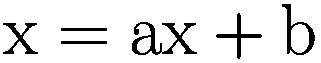

其中`a`是斜率，`b`是截距。

```python
print(svr_lin1.coef_)
print(svr_lin1.intercept_)
print(svr_lin2.coef_)
print(svr_lin2.intercept_)
Out [ ]:
[[-0.04794118]]
[ 27.65617647]
[[-0.00317797]]
[ 30.2854661]
```

你可以将两条直线的交点视为海洋施加影响的区域与海洋不施加影响（或影响较弱）的区域之间的分界点。

```python
from scipy.optimize import fsolve
def line1(x):
    a1 = svr_lin1.coef_[0][0]
    b1 = svr_lin1.intercept_[0]
    return a1 * x + b1
def line2(x):
    a2 = svr_lin2.coef_[0][0]
    b2 = svr_lin2.intercept_[0]
    return a2 * x + b2
def findIntersection(fun1, fun2, x0):
    return fsolve(lambda x: fun1(x) - fun2(x), x0)
result = findIntersection(line1, line2, 0.0)
print("[x, y] = [ %d , %d ]" % (result, line1(result)))
x = np.linspace(0, 300, 31)
plt.plot(x, line1(x), x, line2(x), result, line1(result), 'ro')
```

执行代码，你可以找到交点如下：

```
Out [ ]:
[x, y] = [ 58, 30 ]
```

该点在图 10-14 所示的图表中呈现。

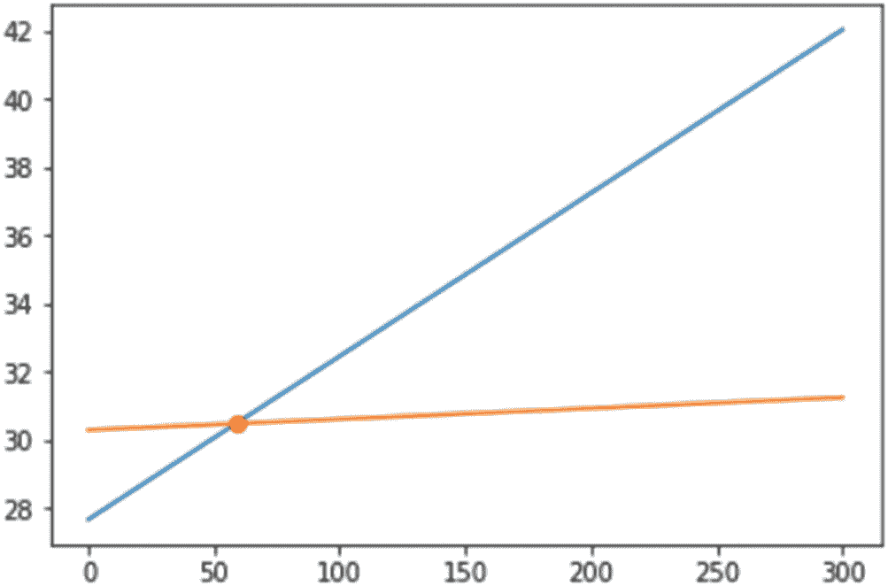

线图显示了温度随距离的变化情况。它表示两条相交直线，并高亮了交点，该点大约在(58, 30)处。

**图 10-14：通过线性回归得到的两条直线的交点**

你可以说海洋效应消失的平均距离是 58 公里。

现在你可以分析最低温度。

```python
plt.axis((0, 400, 15, 25))
plt.plot(dist, temp_min, 'bo')
```

执行此操作，你将获得图 10-15 所示的图表。

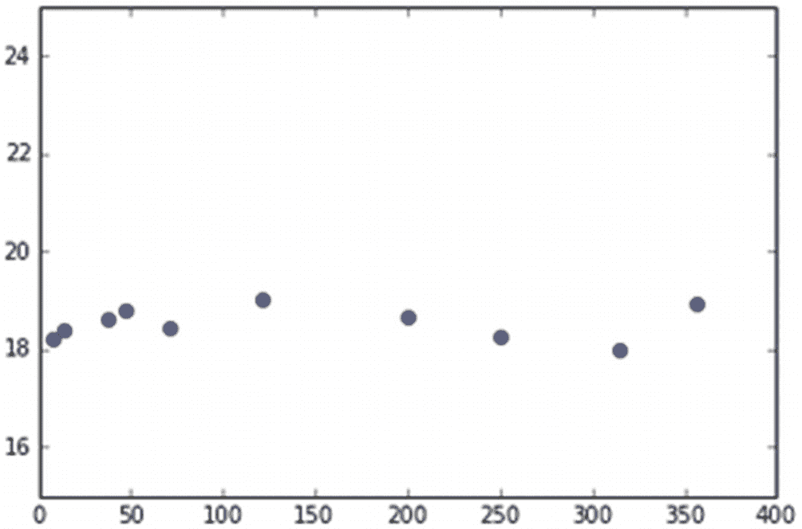

散点图显示了温度最初呈线性趋势，后来波动并上升。温度起始值约为 18，并大多保持在 18 附近。当距离从 300 公里上升到 350 公里时，温度达到峰值。

**图 10-15：最低温度似乎与距海距离无关**

在这种情况下，非常明显地，海洋对夜间（或者说大约早上六点）记录的最低温度没有影响。如果我没记错，小时候我被教导说海洋可以缓解寒冷的气温，或者说海洋会释放白天吸收的热量。但这里的情况似乎并非如此。这个案例追踪的是意大利夏季的情况；如果能看看这个假设在冬季或其他地方是否成立，将非常有趣。

十个数据框中包含的另一个气象测量值是湿度。即使对于这个测量值，你也可以观察距离最近的三座城市和最远的三座城市在一天之中的湿度趋势。
```

# 湿度与风数据可视化分析

本节代码将创建图10-16所示的图表。

```python
y1 = df_ravenna['humidity']
x1 = df_ravenna['day']
y2 = df_faenza['humidity']
x2 = df_faenza['day']
y3 = df_cesena['humidity']
x3 = df_cesena['day']
y4 = df_milano['humidity']
x4 = df_milano['day']
y5 = df_asti['humidity']
x5 = df_asti['day']
y6 = df_torino['humidity']
x6 = df_torino['day']
fig, ax = plt.subplots()
plt.xticks(rotation=70)
hours = mdates.DateFormatter('%H:%M')
ax.xaxis.set_major_formatter(hours)
plt.plot(x1, y1, 'r', x2, y2, 'r', x3, y3, 'r')
plt.plot(x4, y4, 'g', x5, y5, 'g', x6, y6, 'g')
```

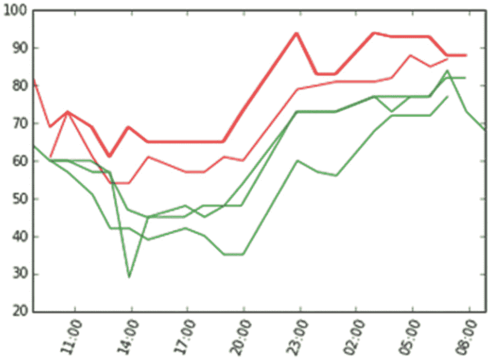

**图 10-16：距海最近的三座城市（红色）和最远的三座城市（绿色）的日间湿度变化趋势**

线图显示了一天中不同时间的湿度上升趋势。共有6条线，分为两种不同的颜色。离海较近的城市湿度更高。大多数城市的湿度在下午2点左右最低，早上6点左右达到峰值。数值为近似值。

乍一看，离海最近的城市似乎比最远的城市湿度更高，并且这种湿度差异（约20%）贯穿全天。你可以通过报告相对于距海距离的最高和最低湿度来看看这是否仍然成立。

```python
hum_max = [df_ravenna['humidity'].max(),
    df_cesena['humidity'].max(),
    df_faenza['humidity'].max(),
    df_ferrara['humidity'].max(),
    df_bologna['humidity'].max(),
    df_mantova['humidity'].max(),
    df_piacenza['humidity'].max(),
    df_milano['humidity'].max(),
    df_asti['humidity'].max(),
    df_torino['humidity'].max()
]
plt.plot(dist,hum_max,'bo')
```

**图 10-17** – 最高湿度随距海距离变化的趋势

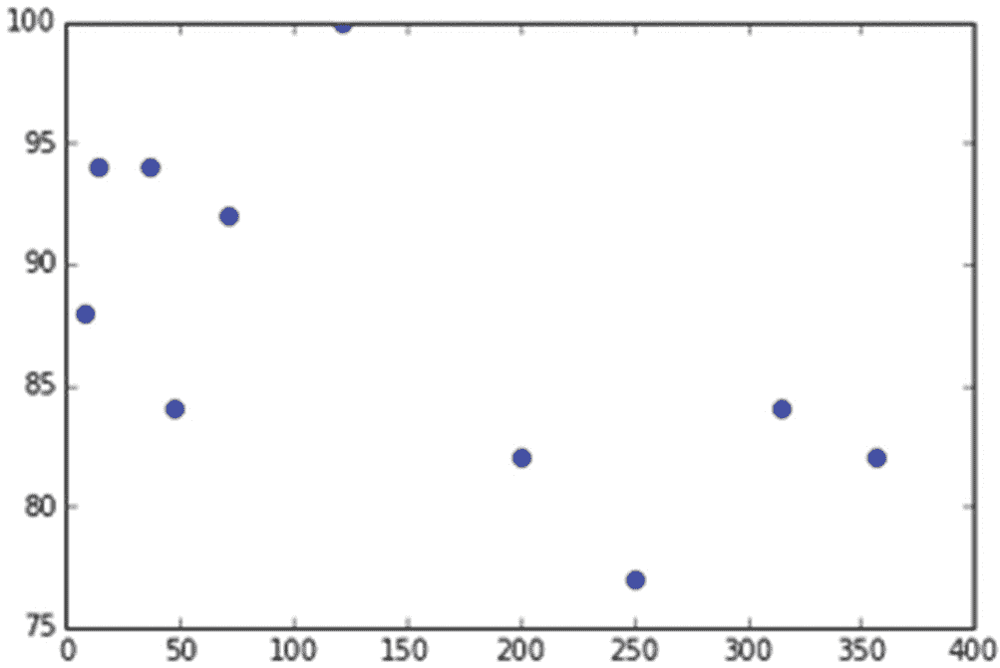

图10-17中的图表展示了十个城市的最高湿度与其距海距离的关系。散点图显示，湿度随距海距离的增加呈下降趋势。当距离从0增加到250时，湿度值从95下降到76。当距离在300到350之间时，湿度值上升并保持在80到85之间。数值均为近似值。

```python
hum_min = [df_ravenna['humidity'].min(),
    df_cesena['humidity'].min(),
    df_faenza['humidity'].min(),
    df_ferrara['humidity'].min(),
    df_bologna['humidity'].min(),
    df_mantova['humidity'].min(),
    df_piacenza['humidity'].min(),
    df_milano['humidity'].min(),
    df_asti['humidity'].min(),
    df_torino['humidity'].min()
]
plt.plot(dist,hum_min,'bo')
```

**图 10-18** – 最低湿度随距海距离变化的趋势

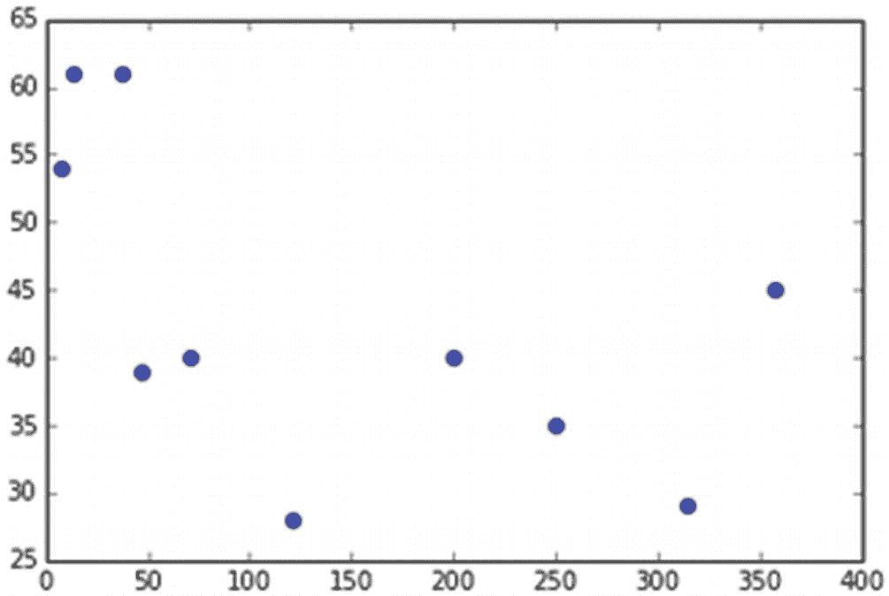

图10-18中的图表展示了十个城市的最低湿度与其距海距离的关系。散点图显示，湿度随距海距离的变化呈波动趋势。当距离从0增加到300时，湿度值从61下降到28。当距离在350到400之间时，湿度值上升并保持在45左右。数值均为近似值。

观察图10-17和图10-18，你无疑会发现，无论是最高湿度还是最低湿度，靠近海边的城市湿度都更高。然而，在我看来，目前还无法断定存在线性关系或其他某种可以绘制出曲线的关系。在此案例中，收集到的数据点（十个）太少，不足以突显趋势。

## 玫瑰风图

在每个城市收集的各种气象数据中，包含了与风相关的数据：
*   风向（度数）
*   风速

如果你分析这个数据框，你会注意到风速与风向和一天中的时间有关。例如，每次测量都显示了风吹的方向（见图10-19）。

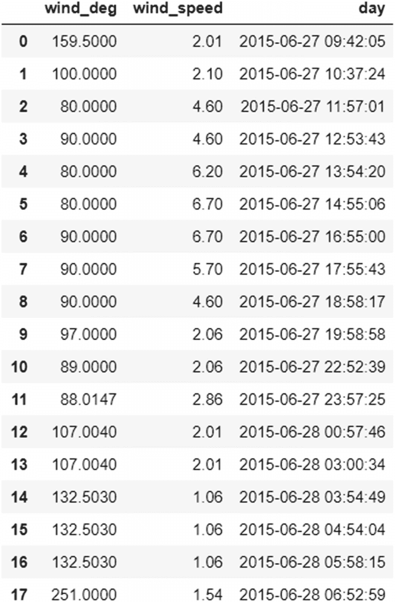

**图 10-19** – 数据框中包含的风数据

一个表格展示了2015年6月27日至28日期间18个不同时间点的风向度数和风速数据。

为了更好地分析此类数据，需要对其进行可视化。在这种情况下，笛卡尔坐标系下的线性图表并非最佳方法。

如果使用单个数据框中的点绘制经典散点图：

```python
plt.plot(df_ravenna['wind_deg'],df_ravenna['wind_speed'],'ro')
```

你会得到如图10-20所示的图表，这显然信息量不大。

**图 10-20** – 表示360度分布的散点图

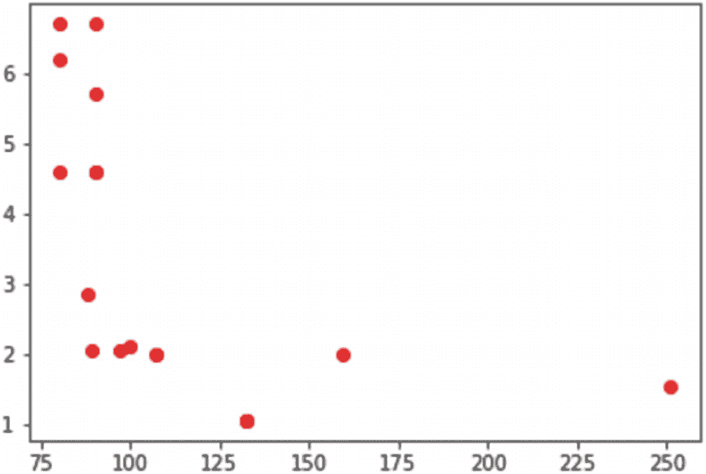

一个散点图表示360度范围内点的分布。y轴数值范围从1到6，而x轴范围从75到250。图形初始下降陡峭，随后波动并向末端延伸。

要表示360度范围内的点分布，最好使用另一种可视化类型：*极坐标图*。你在第8章已经见过这种图表。

首先需要创建一个直方图，将数据分布到360度区间内，该区间被分成八个区间（bin），每个区间为45度。

```python
hist, bins = np.histogram(df_ravenna['wind_deg'],8,[0,360])
print(hist)
print(bins)
```

返回的值是每个区间内的出现次数，由一个名为 `hist` 的数组表示：

```
Out [ ]:
[ 0  5 11  1  0  1  0  0]
```

以及一个名为 `bins` 的数组，它定义了360度范围内每个区间的边界。

```
Out [ ]:
[   0.   45.   90.  135.  180.  225.  270.  315.  360.]
```

这些数组将有助于正确定义待绘制的极坐标图。为此，你需要利用第8章中的部分代码来创建一个函数。这个函数名为 `showRoseWind()`，它需要三个不同的参数：`values` 是包含要显示值的数组，此处为 `hist` 数组；`city_name` 是一个字符串，包含要显示为图表标题的城市名称；`max_value` 是一个整数，用于设定显示蓝色的最大值。

定义此类函数有助于避免多次重复编写相同的代码，并能生成更具模块化的代码，使你能够专注于函数内特定操作相关的概念。

```python
def showRoseWind(values,city_name,max_value):
    N = 8
    theta = np.arange(0.,2 * np.pi, 2 * np.pi / N)
    radii = np.array(values)
    plt.axes([0.025, 0.025, 0.95, 0.95], polar=True)
    colors = [(1-x/max_value, 1-x/max_value, 0.75) for x in radii]
    plt.bar(theta +np.pi/8, radii, width=(2*np.pi/N), bottom=0.0, color=colors)
    plt.title(city_name,x=0.2, fontsize=20)
```

一个发生变化的方面是颜色映射。在这种情况下，扇区颜色越接近蓝色，其代表的值越大。

定义好函数后，你就可以使用它：

```python
showRoseWind(hist,'Ravenna',max(hist))
```

执行这段代码，你将获得一个如图10-21所示的极坐标图。

### 极坐标图

**图 10-21**

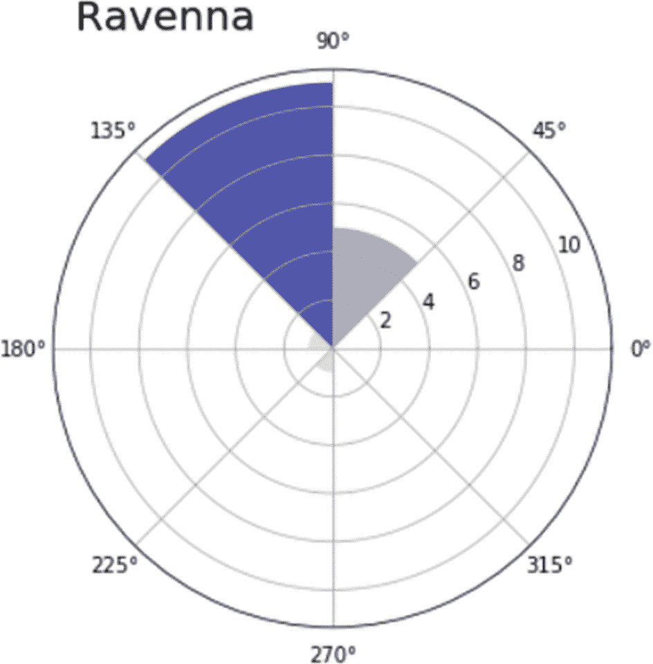

极坐标图展示了 Ravenna 在0到360度范围内值的分布情况。图中存在5个同心圆，从内向外分别对应值2、4、6、8和10。90度到135度之间的区域被着色。极坐标图表示360度范围内值的分布。

如图 10-20 所示，有一个 360 度的范围被划分为八个区域，每个区域为 45 度（即区间），在径向上表示值的刻度。在这八个区域中，每个区域都用一个可变长度的切片来表示，该长度精确对应相应的值。切片在径向上延伸得越长，表示的值就越大。为了提高图表的可读性，引入了一个颜色标度，该标度与切片的延伸程度相对应。切片越宽，颜色越趋向于深蓝色。

此极坐标图提供了关于风向将如何在径向上分布的信息。在此案例中，一天中的大部分时间风纯粹地向西南/西方向吹。

一旦定义了`showRoseWind`函数，就可以很容易地观察十个样本城市中任何一个城市的风况。

```python
hist, bin = np.histogram(df_ferrara['wind_deg'],8,[0,360])
print(hist)
showRoseWind(hist,'Ferrara', 15.0)
Out [ ]:
[7 2 3 3 3 2 0 0]
```

## 图 10-22 展示了这十个城市的极坐标图

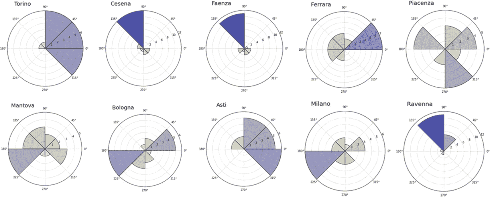

一组 10 个极坐标图展示了 Torino、Cesena、Faenza、Ferrara、Piacenza、Mantova、Bologna、Asti、Milano 和 Ravenna 等城市的风向。每张图表以较深的色调突出显示不同的角度区域。

**图 10-22** 极坐标图显示风向分布

## 计算风速的平均分布

另一个与风速相关的量也可以表示为 360 度上的分布。

现在定义一个名为`RoseWind_Speed`的特性，它将允许计算 360 度所划分的八个区间中每个区间的平均风速。

```python
def RoseWind_Speed(df_city):
    degs = np.arange(45,361,45)
    tmp =  []
    for deg in degs:
        tmp.append(df_city[(df_city['wind_deg']>(deg-46)) & (df_city['wind_deg']<deg)]['wind_speed'].mean())
    return np.nan_to_num(tmp)
```

此函数返回一个包含八个平均风速的 NumPy 数组。该数组将用作`showRoseWind_Speed()`函数的第一个参数，该函数是之前用于绘制极坐标图的`showRoseWind()`函数的改进版本。

```python
def showRoseWind_Speed(speeds,city_name):
    N = 8
    theta = np.arange(0,2 * np.pi, 2 * np.pi / N)
    radii = np.array(speeds)
    plt.axes([0.025, 0.025, 0.95, 0.95], polar=True)
    colors = [(1-x/10.0, 1-x/10.0, 0.75) for x in radii]
    bars = plt.bar(theta+np.pi/8, radii, width=(2*np.pi/N), bottom=0.0, color=colors)
    plt.title(city_name,x=0.2, fontsize=20)
    showRoseWind_Speed(RoseWind_Speed(df_ravenna),'Ravenna')
```

## 图 10-23 展示了风速分布在 360 度范围内对应的 RoseWind 图

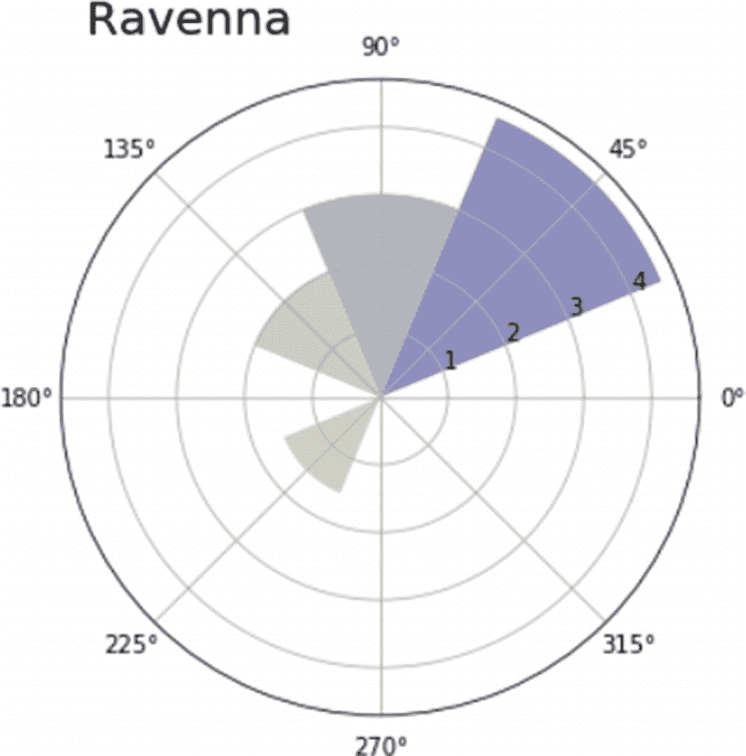

一张 Ravenna 的极坐标图，表示从 0 到 360 度、间隔为 45 度的角度分布。图中存在 4 个从内到外值为 1 到 4 的同心圆。0 到 90 度之间的区域以较深的色调着色，而其他区域则颜色较浅。

**图 10-23** 此极坐标图表示 360 度内风速的分布

在完成所有这些工作后，可以借助 pandas 库的`to_csv()`函数将数据框保存为 CSV 文件。

```python
df_ferrara.to_csv('ferrara.csv')
df_milano.to_csv('milano.csv')
df_mantova.to_csv('mantova.csv')
df_ravenna.to_csv('ravenna.csv')
df_torino.to_csv('torino.csv')
df_asti.to_csv('asti.csv')
df_bologna.to_csv('bologna.csv')
df_piacenza.to_csv('piacenza.csv')
df_cesena.to_csv('cesena.csv')
df_faenza.to_csv('faenza.csv')
```

## 结论

本章的主要目的是展示如何从原始数据中获取信息。部分信息可能不会得出重要结论，而其他信息则将导致假设得到证实，从而增加知识储备。这些都是数据分析取得成功的案例。

在下一章中，你将看到另一个与从开放数据源获取的真实数据相关的案例。你还将了解如何使用 D3 JavaScript 库进一步增强数据的图形化表示。这个库虽然不是 Python 原生库，但可以很容易地集成到 Python 中。