# 11. 在 IPython Notebook 中嵌入 JavaScript D3 库

在本章中，你将学习如何通过在 Jupyter Notebook 中包含 JavaScript D3 库来扩展图形表示的能力。该库具有巨大的图形潜力，并允许你构建即使是`matplotlib`库也无法表示的图形表示。

在讲解各种示例的过程中，你将看到如何利用 Jupyter Notebook 强大的集成能力，在 Python 环境中实现 JavaScript 代码。你还将了解使用 pandas 数据框中包含的数据以及基于 JavaScript 代码的表示的不同方式。

## 人口统计数据开放数据源

在本章中，你将使用人口统计数据作为执行分析的数据集。本章以美国人口普查局网站（[www.​census.​gov](http://www.census.gov)）作为人口统计数据的数据源（见图 11-1）。


一张屏幕截图展示了美国人口普查局的主页。页面顶部菜单栏包含合作伙伴、研究人员、教育工作者、调查受访者、新闻、北美行业分类系统代码、招聘、联系方式和帮助等标签页。右上角有一个搜索栏。

图 11-1

这是美国人口普查局的主页

美国人口普查局隶属于美国商务部，正式负责收集美国人口统计数据并发布相关统计报告。其网站提供大量 CSV 格式的数据文件，正如你在前几章所见，这些文件可以轻松以 pandas `DataFrame` 的形式导入。

为完成本章目标，你需要获取美国各州及县的人口估算数据。该网站上有一系列数据集可供研究使用，链接为 [www2.​census.​gov/​programs-surveys/​popest/​datasets/](http://www2.census.gov/programs-surveys/popest/datasets/)。在可用数据集中，请寻找最新的数据集并下载到你的计算机上。本示例使用名为`co-est2022-alldata.csv`的 CSV 文件。

现在，打开 Jupyter Notebook，在第一个单元格中导入此类分析所需的所有库。

```python
import numpy as np
import pandas as pd
import matplotlib.pyplot as plt
```

你可以开始在 Notebook 中从 Census.gov 导入数据。你需要直接以 pandas `DataFrame` 的形式上传`co-est2022-alldata.csv`文件。`pd.read_csv()`函数会将 CSV 文件中的表格数据转换为 pandas `DataFrame`，并将其命名为`pop2022`。通过使用`dtype`选项，你可以强制将某些可能被解释为数字的字段解释为字符串。

```python
pop2022 = pd.read_csv('co-est2022-alldata.csv', encoding='latin-1', dtype={'STATE': 'str', 'COUNTY': 'str'})
```

一旦将数据获取并收集到`pop2022` `DataFrame`中，你只需输入以下代码即可查看数据结构：

```python
pop2022
```

你将得到如图 11-2 所示的图像。

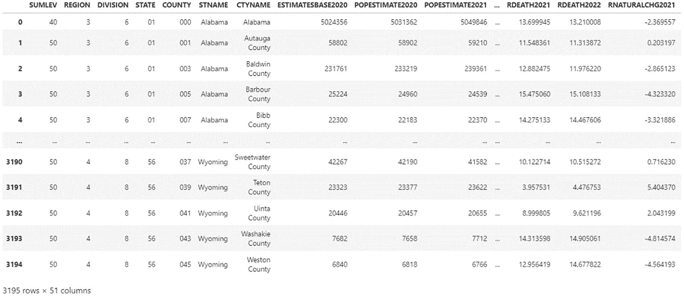

一张表格展示了 `Sumlev`、`Region`、`Division`、`State`、`County`、`ST name`、`CTY name`、估算基数、2020 年和 2021 年人口估算、2021 年和 2022 年死亡人数、以及 2021 年自然增长数。

图 11-2

`pop2022` `DataFrame`包含 2020、2021 和 2022 年的所有人口统计数据

仔细分析数据性质后，你可以看到它们如何在 `DataFrame` 内部组织。`SUMLEV` 列包含数据的地理级别；例如，40 表示州级别，50 表示单个县级别的数据。

`REGION`、`DIVISION`、`STATE` 和 `COUNTY` 列包含美国领土划分的所有区域的分层细分。`STNAME` 和 `CTYNAME` 分别表示州和县的名称。以下列包含人口数据。`POPESTIMATE2020` 是包含 2020 年人口估算的列，其后依次是 2021 年和 2022 年的数据。

你将使用这些人口估算值作为本章讨论示例中要表示的数据。

`pop2022` `DataFrame`包含大量你不感兴趣的列和行，因此明智的做法是消除不必要的信息。首先，你关心的是与整个州相关的人口值，因此可以仅提取`SUMLEV`等于 40 的行。将这些数据收集到`pop2022_by_state` `DataFrame`中。

```python
pop2022_by_state = pop2022[pop2022.SUMLEV == 40]
pop2022_by_state
```

你将得到一个如图 11-3 所示的 `DataFrame`。

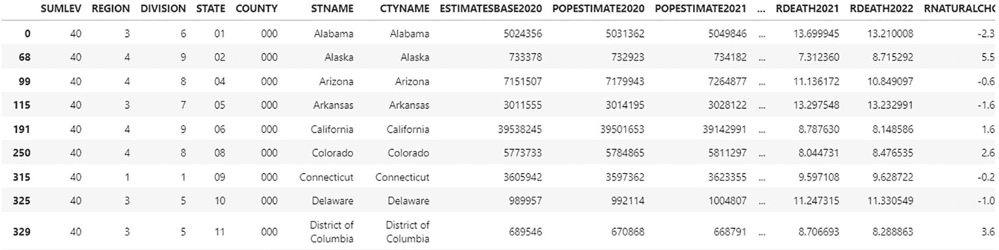

一张表格展示了 `Sumlev`、`Region`、`Division`、`State`、`County`、`ST name`、`CTY name`、2020 年估算基数、2020 年和 2021 年人口估算、2021 年和 2022 年死亡人数、以及 2021 年自然增长数。

图 11-3

`pop2022_by_state` `DataFrame`包含与各州相关的所有人口统计数据

刚刚获得的 `DataFrame` 仍然包含太多包含不必要信息的列。鉴于列数众多，与其使用`drop()`函数删除它们，不如进行提取操作更为方便。

```python
states = pop2022_by_state[['STNAME', 'POPESTIMATE2020', 'POPESTIMATE2021', 'POPESTIMATE2022']]
```

现在你已掌握基本信息，可以开始进行图形化表示。例如，你可以确定美国人口最多的五个州。

```python
states.sort_values(['POPESTIMATE2022'], ascending=False)[:5]
```

按降序列出它们，你将得到如图 11-4 所示的 `DataFrame`。

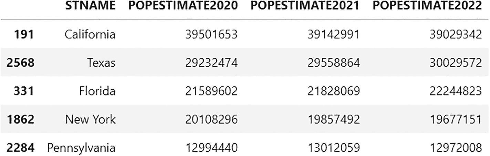

一张表格展示了 California、Texas、New York 和 Pennsylvania 2020、2021 和 2022 年的人口估算详情。

图 11-4

美国人口最多的五个州

例如，你可以使用条形图以降序表示人口最多的五个州。使用`matplotlib`可以轻松完成此工作，但在本章中，你将利用这个简单的表示方法来了解如何使用 JavaScript D3 库创建相同的表示。

## JavaScript 的 D3 库

D3 是一个 JavaScript 库，允许直接检查与操作 DOM 对象（HTML5），但它专门用于数据可视化，并且在这一领域表现出色。事实上，D3 这个名称来源于“数据驱动文档”中包含的三个字母 D。D3 完全由迈克·博斯托克开发。

事实证明，得益于其所基于的技术——JavaScript、SVG 和 CSS，这个库非常通用且功能强大。D3 将强大的可视化组件与数据驱动的 DOM 操作方法相结合。通过这种方式，D3 充分利用了现代浏览器的能力。

考虑到即便是 Jupyter Notebook 也是网页对象，并使用与当前浏览器相同的基础技术，尽管它是一个 JavaScript 库，但在 Notebook 中使用它的想法并不像初看上去那么离谱。

对于那些不熟悉 JavaScript D3 库并想了解更多相关信息的人，我建议阅读另一本书，即 F. Nelli 所著的 *《使用 D3 创建网页图表》*（Apress, 2014 年）。

事实上，Jupyter Notebook 拥有一个名为`%%javascript`的神奇函数，可以将 JavaScript 代码集成到 Python 代码中。

但是，JavaScript 代码与 Python 类似，也需要你导入一些库。这些库可以在线获取，并且每次执行时都需要加载。在 HTML 中，导入库的过程有一个特定的结构：

```html
<script src="https://d3js.org/d3.v3.min.js"></script>
```

这是一个 HTML 标签。要在 Jupyter Notebook 中执行导入，你应该使用以下不同的结构：

```javascript
%%javascript
require.config({
    paths: {
        d3: '//cdnjs.cloudflare.com/ajax/libs/d3/3.5.5/d3.min'
    }
});
```

使用`require.config()`，你可以导入所有必要的 JavaScript 库。

此外，如果你熟悉 HTML 代码，你肯定知道如果需要增强 HTML 页面的可视化能力，就需要定义 CSS 样式。相应地，在 Jupyter Notebook 中，你也可以定义一组 CSS 样式。为此，你可以借助属于`IPython.core.display`模块的`HTML()`函数来编写 HTML 代码。因此，请按如下方式进行适当的 CSS 定义：

```python
from IPython.display import display, Javascript, HTML
display(HTML("""
<style>
.bar {
fill: steelblue;
}
.bar:hover{
fill: brown;
}
.axis {
font: 10px sans-serif;
}
.axis path,
.axis line {
fill: none;
stroke: #000;
}
.x.axis path {
display: none;
}
</style>
<div id="chart_d3"></div>
"""))
```

在上述代码的底部，请注意 `<div>` HTML 标签被标识为 `chart_d3`。这个标签标识了图表将要呈现的位置。

现在，你需要使用 D3 库提供的函数来编写 JavaScript 代码。使用`Jinja2`库提供的`Template`对象，你可以定义动态的 JavaScript 代码，在其中你可以根据 pandas 数据帧中包含的值来替换文本。

如果你的系统尚未安装`Jinja2`库，你可以随时使用 Anaconda 进行安装。

```bash
conda install jinja2
```

或者使用这个命令：

```bash
pip install jinja2
```

安装完这个库后，你就可以定义模板了。

```python
import jinja2
myTemplate = jinja2.Template("""
require(["d3"], function(d3){
var data = []

data.push({ 'state': '{{ row[1] }}', 'population': '{{ row[4] }}'  });

d3.select("#chart_d3 svg").remove()
var margin = {top: 20, right: 20, bottom: 30, left: 40},
width = 800 - margin.left - margin.right,
height = 400 - margin.top - margin.bottom;
var x = d3.scale.ordinal()
.rangeRoundBands([0, width], .25);
var y = d3.scale.linear()
.range([height, 0]);
var xAxis = d3.svg.axis()
.scale(x)
.orient("bottom");
var yAxis = d3.svg.axis()
.scale(y)
.orient("left")
.ticks(10)
.tickFormat(d3.format('.1s'));
var svg = d3.select("#chart_d3").append("svg")
.attr("width", width + margin.left + margin.right)
.attr("height", height + margin.top + margin.bottom)
.append("g")
.attr("transform", "translate(" + margin.left + "," + margin.top + ")");
x.domain(data.map(function(d) { return d.state; }));
y.domain([0, d3.max(data, function(d) { return d.population; })]);
svg.append("g")
.attr("class", "x axis")
.attr("transform", "translate(0," + height + ")")
.call(xAxis);
svg.append("g")
.attr("class", "y axis")
.call(yAxis)
.append("text")
.attr("transform", "rotate(-90)")
.attr("y", 6)
.attr("dy", ".71em")
.style("text-anchor", "end")
.text("Population");
svg.selectAll(".bar")
.data(data)
.enter().append("rect")
.attr("class", "bar")
.attr("x", function(d) { return x(d.state); })
.attr("width", x.rangeBand())
.attr("y", function(d) { return y(d.population); })
.attr("height", function(d) { return height - y(d.population); });
});
""");
```

还没结束。现在是时候启动你刚刚定义的 D3 图表的呈现了。你还需要编写命令，将包含在 pandas 数据帧中的数据传递给模板，以便它们可以直接集成到之前编写的 JavaScript 代码中。JavaScript 代码（或者更确切地说，刚刚定义的模板）的呈现是通过调用`render()`函数来执行的。

```python
display(Javascript(myTemplate.render(
data=states.sort_values(['POPESTIMATE2022'], ascending=False)[:10].itertuples()
)))
```

条形图将出现在之前放置了 `<div>` 的框架中，如图 11-5 所示，该图显示了 2022 年的所有人口估计值。

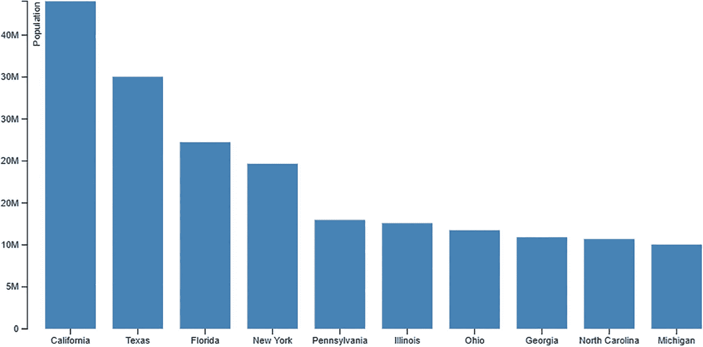

一张条形图按以下顺序表示人口递减顺序：加利福尼亚州、得克萨斯州、佛罗里达州、纽约州、宾夕法尼亚州、伊利诺伊州、俄亥俄州、佐治亚州、北卡罗来纳州和密歇根州。加利福尼亚州人口最多，超过 4000 万。

`图 11-5` 以相对于 2022 年的条形图表示的美国人口最多的五个州

### 绘制分组条形图

到目前为止，你很大程度上依赖于巴托那篇精彩文章中所描述的内容。然而，你所提取的数据类型展示了美国过去四年人口估计值的趋势。更实用的数据可视化图表是展示每个州的人口随时间变化的趋势。

为此，一个不错的选择是使用分组条形图，其中每个组代表人口最多的五个州之一，每个组将有四个条形，分别代表某一年的人口。

此时，你可以在你的 Jupyter Notebook 中修改之前的代码或编写新的代码。

```python
display(HTML("""
<style>
.bar2020 {
fill: steelblue;
}
.bar2021 {
fill: red;
}
.bar2022 {
fill: yellow;
}
.axis {
font: 10px sans-serif;
}
.axis path,
.axis line {
fill: none;
stroke: #000;
}
.x.axis path {
display: none;
}
</style>
"""))
```

你还需要修改模板，添加对应于 2020 年和 2021 年的另外三组数据。这些年份将在分组条形图上用不同的颜色表示。

# D3 可视化与等值线地图

## 使用 Jinja2 模板生成 D3 图表

以下是使用 `jinja2` 模板生成 D3 柱形图的 Python 代码。模板中定义了用于在浏览器中执行的 JavaScript 代码。

```python
import jinja2
myTemplate = jinja2.Template("""
require(["d3"], function(d3){
var data = []
var data2 = []
var data3 = []

data.push ({ 'state': '{{ row[1] }}', 'population': '{{ row[2] }}'  });
data2.push({ 'state': '{{ row[1] }}', 'population': '{{ row[3] }}'  });
data3.push({ 'state': '{{ row[1] }}', 'population': '{{ row[4] }}'  });

d3.select("#chart_d3 svg").remove()
var margin = {top: 20, right: 20, bottom: 30, left: 40},
width = 800 - margin.left - margin.right,
height = 400 - margin.top - margin.bottom;
var x = d3.scale.ordinal()
.rangeRoundBands([0, width], .25);
var y = d3.scale.linear()
.range([height, 0]);
var xAxis = d3.svg.axis()
.scale(x)
.orient("bottom");
var yAxis = d3.svg.axis()
.scale(y)
.orient("left")
.ticks(10)
.tickFormat(d3.format('.1s'));
var svg = d3.select("#chart_d3").append("svg")
.attr("width", width + margin.left + margin.right)
.attr("height", height + margin.top + margin.bottom)
.append("g")
.attr("transform", "translate(" + margin.left + "," + margin.top + ")");
x.domain(data.map(function(d) { return d.state; }));
y.domain([0, d3.max(data, function(d) { return d.population; })]);
svg.append("g")
.attr("class", "x axis")
.attr("transform", "translate(0," + height + ")")
.call(xAxis);
svg.append("g")
.attr("class", "y axis")
.call(yAxis)
.append("text")
.attr("transform", "rotate(-90)")
.attr("y", 6)
.attr("dy", ".71em")
.style("text-anchor", "end")
.text("Population");
svg.selectAll(".bar2020")
.data(data)
.enter().append("rect")
.attr("class", "bar2020")
.attr("x", function(d) { return x(d.state); })
.attr("width", x.rangeBand()/4)
.attr("y", function(d) { return y(d.population); })
.attr("height", function(d) { return height - y(d.population); });
svg.selectAll(".bar2021")
.data(data2)
.enter().append("rect")
.attr("class", "bar2021")
.attr("x", function(d) { return (x(d.state)+x.rangeBand()/3); })
.attr("width", x.rangeBand()/3)
.attr("y", function(d) { return y(d.population); })
.attr("height", function(d) { return height - y(d.population); });
svg.selectAll(".bar2022")
.data(data3)
.enter().append("rect")
.attr("class", "bar2022")
.attr("x", function(d) { return (x(d.state)+2*x.rangeBand()/3); })
.attr("width", x.rangeBand()/3)
.attr("y", function(d) { return y(d.population); })
.attr("height", function(d) { return height - y(d.population); });
});
""");
```

现在需要从数据框传递给模板的数据系列有四个，因此你不仅需要刷新数据，还需要刷新刚才对代码所做的更改，所以你需要重新运行 `render()` 函数的代码。

```python
display(Javascript(myTemplate.render(
data=states.sort_values(['POPESTIMATE2022'], ascending=False)[:5].itertuples()
)))
```

当你再次启动 `render()` 函数后，就会得到如图 11-6 所示的图表。

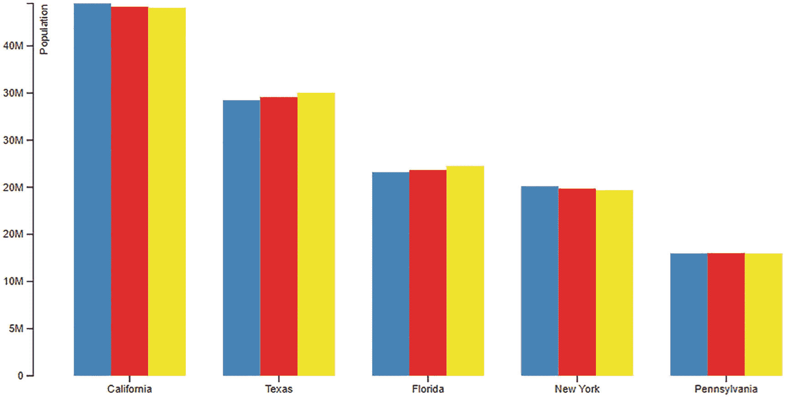

*一张簇状柱形图，按降序展示了加利福尼亚州、得克萨斯州、佛罗里达州、纽约州和宾夕法尼亚州的人口数量。每个州包含三根柱形，分别代表 2020 年、2021 年和 2022 年的人口数量。*

**图 11-6** 一张簇状柱形图，展示了 2020 年至 2022 年间人口最多的五个州的人口数量

## 等值线地图

在前面的章节中，你了解了如何使用 JavaScript 代码和 D3 库来表示柱形图。其实，用`matplotlib`也能轻松实现这些效果，甚至可能以更好的方式实现。前面代码的目的仅仅是出于教学目的。

而更值得探讨的是如何使用更复杂的视图，这些是`matplotlib`无法实现的。本节将阐述 D3 库所提供的真正潜力。*等值线地图*是非常复杂的表示类型。

等值线地图是一种地理表示方式，其中陆地被划分为不同颜色的区域。颜色以及区域之间的边界本身就是数据的表示方式。

这种表示方式对于展示基于人口或经济信息进行数据分析的结果非常有用，对于与地理分布相关的数据也是如此。

等值线地图的表示基于一种名为`TopoJSON`的特殊文件。这种文件包含了表示等值线地图所需的所有内部信息，例如美国地图（见图 11-7）。

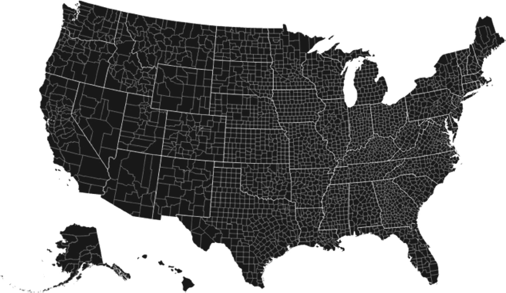

*一张美利坚合众国的等值线地图，用不同图案突出显示了各个地区。*

**图 11-7** 美国领土的等值线地图表示，未关联每个县或州的具体数值

寻找此类材料的一个好链接是美国地图集 TopoJSON（[`https://github.com/mbostock/us-atlas`](https://github.com/mbostock/us-atlas)），但网上也有大量相关文献可用。

这种表示方式不仅可行，而且可以自定义。借助 D3 库，你可以根据数据框中特定列的值来关联地理区域。

首先，从一个已在互联网上存在的例子开始，该例子来自 D3 库（[`http://bl.ocks.org/mbostock/4060606`](http://bl.ocks.org/mbostock/4060606)），但它是用 HTML 完全开发的。因此，现在你将学习如何将一个 HTML 格式的 D3 示例适配到 IPython Notebook 中。

如果你查看该示例网页上显示的代码，会发现有三个必需的 JavaScript 库。这一次，除了 D3 库之外，你还需要导入`queue`和`TopoJSON`库。

你需要像前面章节那样使用`require.config()`。

# 数据可视化：等值区域图

## 代码配置与展示

相关的 CSS 部分再次展示如下，全部包含在 `HTML()` 函数中。

```python
from IPython.display import display, Javascript, HTML
display(HTML("""
.counties {
fill: none;
}
.states {
fill: none;
stroke: #fff;
stroke-linejoin: round;
}
.q0-9 { fill:rgb(247,251,255); }
.q1-9 { fill:rgb(222,235,247); }
.q2-9 { fill:rgb(198,219,239); }
.q3-9 { fill:rgb(158,202,225); }
.q4-9 { fill:rgb(107,174,214); }
.q5-9 { fill:rgb(66,146,198); }
.q6-9 { fill:rgb(33,113,181); }
.q7-9 { fill:rgb(8,81,156); }
.q8-9 { fill:rgb(8,48,107); }
"""))
```

以下是新的模板，它模仿了 Bostock 示例中显示的代码，并做了一些修改：

```python
import jinja2
choropleth = jinja2.Template("""
require(["d3","queue","topojson"], function(d3,queue,topojson){
d3.select("#choropleth svg").remove()
var width = 960,
height = 600;
var rateById = d3.map();
var quantize = d3.scale.quantize()
.domain([0, .15])
.range(d3.range(9).map(function(i) { return "q" + i + "-9"; }));
var projection = d3.geo.albersUsa()
.scale(1280)
.translate([width / 2, height / 2]);
var path = d3.geo.path()
.projection(projection);
//row to modify
var svg = d3.select("#choropleth").append("svg")
.attr("width", width)
.attr("height", height);
queue()
.defer(d3.json, "us.json")
.defer(d3.tsv, "unemployment.tsv", function(d) { rateById.set(d.id, +d.rate); })
.await(ready);
function ready(error, us) {
if (error) throw error;
svg.append("g")
.attr("class", "counties")
.selectAll("path")
.data(topojson.feature(us, us.objects.counties).features)
.enter().append("path")
.attr("class", function(d) { return quantize(rateById.get(d.id)); })
.attr("d", path);
svg.append("path")
.datum(topojson.mesh(us, us.objects.states, function(a, b) { return a !== b; }))
.attr("class", "states")
.attr("d", path);
}
});
""");
```

现在你启动这个表示，这次不为模板提供任何值，因为所有值都已包含在 `us.json` 和 `unemployment.tsv` 文件中（你可以在本书的源代码中找到它们）。

```python
display(Javascript(choropleth.render()))
```

结果与 Bostock 示例中显示的结果完全相同（请参见图 11-8）。

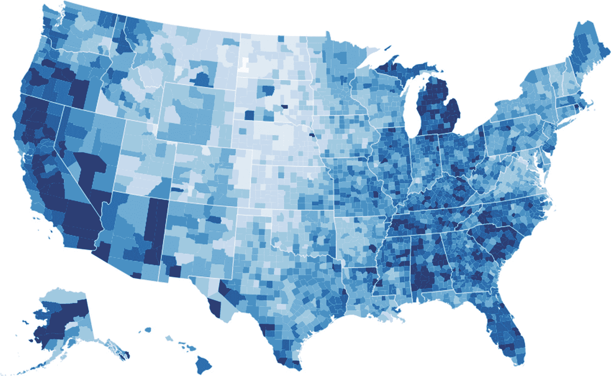

一张美国全域的等值区域图，以不同颜色深浅突出显示各区域。

**图 11-8** 基于 TSV 文件中的值对各县进行着色的美国等值区域图

## 美国人口等值区域图

既然你已经了解了如何从美国人口普查局提取人口统计数据，并且能够创建等值区域图，那么你可以将这两者结合起来，绘制一张显示人口数值的等值区域图。县的人口越多，其蓝色就越深。在人口水平非常低的县，色调会趋近于白色。

在本章的第一部分，你使用 `pop2022` 数据框提取了州层面的信息。这是通过选择 `SUMLEV` 值等于 40 的数据框行来完成的。在本示例中，你需要的是每个县的人口数值。因此，你需要从 `pop2022` 中仅提取 `SUMLEV` 为 50 的行，以创建一个新的数据框。你必须选择级别为 50 的行。

```python
pop2022_by_county = pop2022[pop2022.SUMLEV == 50]
pop2022_by_county
```

你将获得一个包含美国所有县的数据框，如图 11-9 所示。

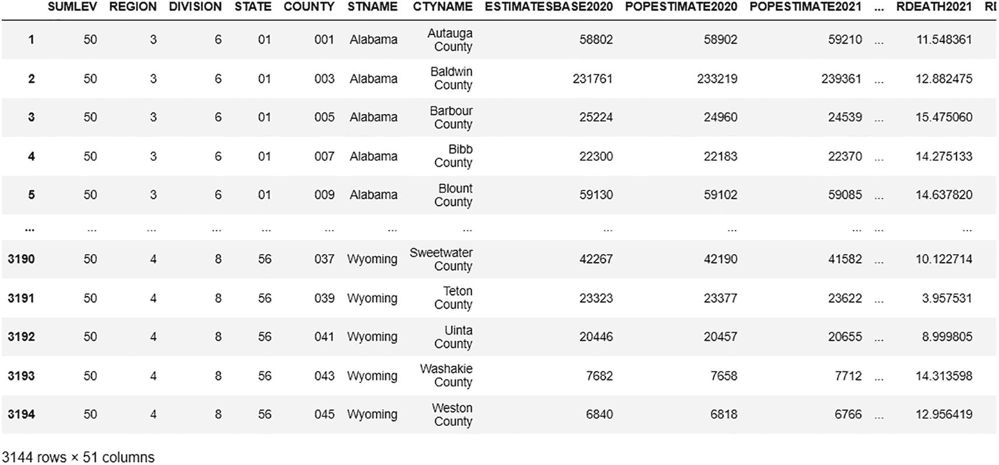

一个表格展示了 Sumlev、region、division、state、county、S T name、C T Y name、estimates base 2020、p o p estimate 2020 和 2021，以及 R death 2021 的详细信息。它列出了阿拉巴马州和怀俄明州各县的数据。

**图 11-9** `pop2022_by_county` 数据框包含了美国所有县的全部人口统计数据

你必须使用自己的数据来代替之前使用的 TSV 文件。在该 TSV 文件中，存储着对应各个县的 ID 编号。你可以利用网络上的一个文件来确定这些 ID 对应的县名。你可以下载该文件并将其转换为一个数据框。

```python
USJSONnames = pd.read_table('us-county-names.tsv')
USJSONnames
```

借助这个文件，你可以看到各县对应的代码（参见图 11-10）。

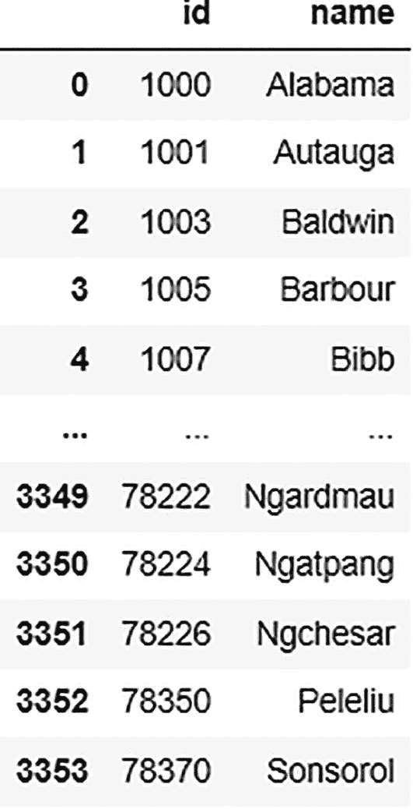

一个表格显示了阿拉巴马州、奥陶加县、鲍德温县、巴伯县、比伯县、雅浦州的恩加尔德毛、恩加特邦、恩切萨尔、佩莱利乌和松索罗尔的 ID。

**图 11-10** TSV 文件中包含的各县代码

例如，以鲍德温县为例：

```python
USJSONnames[USJSONnames['name'] == 'Baldwin']
```

你会发现实际上有两个同名的县，但它们由两个不同的标识符区分（图 11-11）。

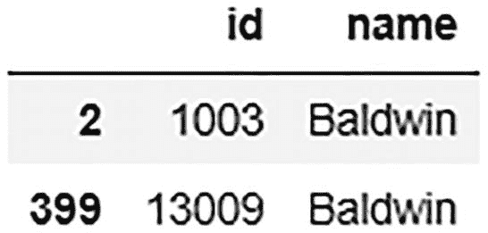

一个表格显示鲍德温有两个 ID。一个是 1003，另一个是 13009。

**图 11-11** 存在两个鲍德温县

你得到了一个表格，发现有两个县和两个不同的代码。现在，你在从 `census.gov` 数据源获取数据的数据框中看到了这一点（参见图 11-12）。

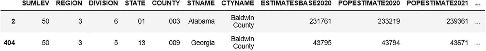

一个表格展示了阿拉巴马州和佐治亚州鲍德温县的 Sumlev、region、division、state、county、S T name、C T Y name、estimates base 2020、p o p estimate 2020 和 2021 的详细信息。

**图 11-12** TSV 文件中的 ID 代码对应于 `STATE` 和 `COUNTY` 列中值的组合

```python
pop2022_by_county[pop2022_by_county['CTYNAME'] == 'Baldwin County']
```

你可以识别出这是一种匹配。`TOPOJSON` 中包含的 ID 与 `STATE` 和 `COUNTY` 列中的数字组合后相匹配，但需要移除代码开头的 `0`。因此，现在你可以从 `counties` 数据框中重建所有必要的数据，以复制 TSV 格式的等值区域图示例。文件将保存为 `population.csv`。

# 第十一章 数据可视化


```
counties = pop2022_by_county[['STATE','COUNTY','POPESTIMATE2022']]
counties.is_copy = False
counties['id'] = counties['STATE'].str.lstrip('0') + "" + counties['COUNTY']
del counties['STATE']
del counties['COUNTY']
counties.columns = ['pop','id']
counties = counties[['id','pop']]
counties.to_csv('population.csv')
```

现在，你重写 `HTML()` 函数的内容，指定一个新的 `<div>` 标签，其 ID 为 `choropleth2`。

```
from IPython.display import display, Javascript, HTML
display(HTML("""

.counties {
fill: none;
}
.states {
fill: none;
stroke: #fff;
stroke-linejoin: round;
}
.q0-9 { fill:rgb(247,251,255); }
.q1-9 { fill:rgb(222,235,247); }
.q2-9 { fill:rgb(198,219,239); }
.q3-9 { fill:rgb(158,202,225); }
.q4-9 { fill:rgb(107,174,214); }
.q5-9 { fill:rgb(66,146,198); }
.q6-9 { fill:rgb(33,113,181); }
.q7-9 { fill:rgb(8,81,156); }
.q8-9 { fill:rgb(8,48,107); }

"""))
```

你还需要定义一个新的 `Template` 对象。

```
choropleth2 = jinja2.Template("""
require(["d3","queue","topojson"], function(d3,queue,topojson){
var data = []
d3.select("#choropleth2 svg").remove()
var width = 960,
height = 600;
var rateById = d3.map();
var quantize = d3.scale.quantize()
.domain([0, 1000000])
.range(d3.range(9).map(function(i) { return "q" + i + "-9"; }));
var projection = d3.geo.albersUsa()
.scale(1280)
.translate([width / 2, height / 2]);
var path = d3.geo.path()
.projection(projection);
var svg = d3.select("#choropleth2").append("svg")
.attr("width", width)
.attr("height", height);
queue()
.defer(d3.json, "us.json")
.defer(d3.csv,"population.csv", function(d) { rateById.set(d.id, +d.pop); })
.await(ready);
function ready(error, us) {
if (error) throw error;
svg.append("g")
.attr("class", "counties")
.selectAll("path")
.data(topojson.feature(us, us.objects.counties).features)
.enter().append("path")
.attr("class", function(d) { return quantize(rateById.get(d.id)); })
.attr("d", path);
svg.append("path")
.datum(topojson.mesh(us, us.objects.states, function(a, b) { return a !== b; }))
.attr("class", "states")
.attr("d", path);
}
});
""");
```

最后，你可以执行 `render()` 函数来获取图表。

```
display(Javascript(choropleth2.render()))
```

等值区域图将显示各县根据其人口数不同而颜色各异，如图 11-13 所示。

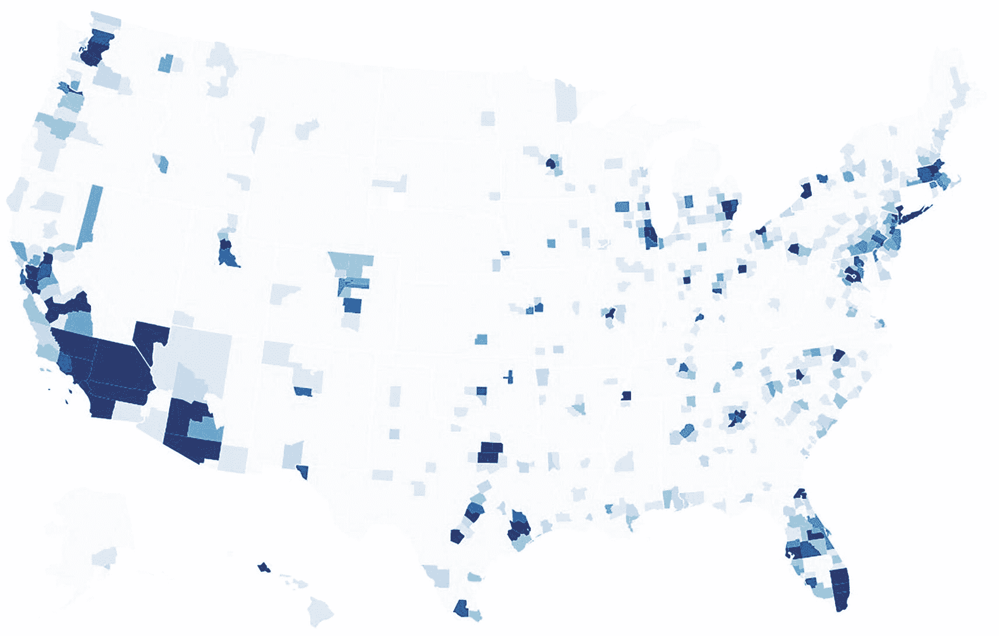

### 美国人口统计地图

一幅美国人口统计地图根据人口密度，以不同颜色深浅突出显示各区域。

**图 11-13** 一幅显示所有县人口密度的美国人口统计地图

## 本章小结

在本章中，你学习了如何使用名为 `D3` 的 JavaScript 库进一步扩展数据显示能力。人口统计地图仅是用于表示数据的众多高级图形示例之一。这也是观察 Jupyter Notebook 实际应用的一个非常好的方法。世界并非只围绕 Python 转，但 Python 能为你的工作提供额外的能力。

在下一章中，你将学习如何将数据分析应用于图像。你还将看到构建一个能识别手写数字的模型是多么容易。
