# 14. 使用 OpenCV 进行图像分析与计算机视觉

在前面的章节中，数据分析完全集中在数值数据和表格化数据上，而在上一章中，你了解了如何处理和分析文本形式的数据。本书以介绍数据分析的最后一个方面——图像分析——作为恰当的收尾。本章将介绍计算机视觉和人脸识别等主题。你将看到深度学习技术是如何成为这类分析的基础的。此外，还将介绍另一个名为 `openCV` 的库，它一直是图像分析的参考标准。

## 图像分析与计算机视觉

在本书中，你已经看到分析的目的在于从被研究的系统中提取新信息、提炼新概念与特征。你之前用数字和文本数据完成了这一过程，而图像同样可以做到。这一分析分支被称为图像分析，其基础是应用于图像的计算技术（称为图像滤波器），你将在后续章节中了解这些技术。

近年来，尤其是得益于深度学习的发展，图像分析在解决此前无法实现的问题上取得了巨大突破，由此催生了一门名为计算机视觉的新学科。

在第 9 章中，你学习了人工智能——这是处理纯粹“人类相关”问题的计算分支。计算机视觉正是其中的一部分，因为其目标是复制人脑感知图像的方式。

事实上，“看见”不仅仅是获取二维图像，更重要的是对该区域内容的解读。捕获的图像会被分解并加工成逐渐抽象的表示层次（轮廓、图形、物体和文字），从而能被人类思维所识别。

同样地，计算机视觉旨在处理二维图像并从中提取相同的表示层次。这是通过多种操作实现的，这些操作可分类如下：
*   检测：检测图像中的形状、物体或其他研究对象（例如，寻找汽车）
*   识别：将识别出的对象归入通用类别（例如，按品牌和类型细分汽车）
*   辨识：识别出前一类别中的某个具体实例（例如，找到我的车）

## OpenCV 与 Python

OpenCV（开源计算机视觉库）是一个用 C++ 编写的、专用于计算机视觉和图像分析的库（[`https://opencv.org/`](https://opencv.org/)）。这个由 Gary Bradsky 设计的强大库最初是 Intel 的一个项目，首个版本于 2000 年发布。随着时间的推移，它以开源许可证形式发布，并逐渐普及，目前已达到 4.8 版本（2023 年 6 月）。目前，OpenCV 支持众多与计算机视觉和机器学习相关的算法，并且功能与日俱增。

它的实用性和广泛传播恰恰源于其竞争对手：`matlab`。实际上，需要处理图像分析的人有两种选择：购买 `matlab` 软件包，或者编译并安装开源版本的 OpenCV。显而易见，许多人选择了第二种方案。

## OpenCV 与深度学习

计算机视觉与深度学习之间有着密切的联系。由于 2017 年是深度学习发展的关键一年（阅读我在 [`www.meccanismocomplesso.org/en/2017-the-year-of-deep-learning-frameworks/`](http://www.meccanismocomplesso.org/en/2017-the-year-of-deep-learning-frameworks/) 发表的相关文章），OpenCV 3.3 新版本的发布增强了该库的功能，引入了许多深度学习及神经网络的新特性。实际上，该库有一个名为 `dnn`（深度神经网络）的模块专门负责这一领域。该模块专门为与多种深度学习框架（包括 Caffe2、TensorFlow 和 PyTorch）配合使用而开发（关于这些框架的信息，请参见第 9 章）。

## 安装 OpenCV

你可以通过官方网站 ([`https://opencv.org/releases/`](https://opencv.org/releases/)) 在许多操作系统（Windows、iOS 和 Android）上安装 OpenCV 软件包。

如果你使用 Anaconda 作为分发介质，我推荐采用此方法。安装过程非常简单且干净。

```
conda install opencv
```

遗憾的是，对于 Linux 系统，没有官方的 PyPI 包（即通过 `pip` 安装）可用。需要手动安装，其过程可能因使用的发行版和版本而异。互联网上有许多相关流程，有些或多或少是可行的。

## 图像处理与分析初步

本节旨在让你熟悉 `opencv` 库。首先，你将学习如何加载和显示图像。接着，你将对其进行一些简单操作，如两幅图像的相加、相减，并查看图像融合的示例。所有这些操作都非常有用，因为它们构成许多其他图像分析操作的基础。

### 开始之前

安装好 `opencv` 库后，你可以在 Jupyter QtConsole 或 Jupyter Notebook 中打开一个 IPython 会话。

在开始编程之前，你需要导入 `openCV` 库。

```
import numpy as np
import cv2
```

### 加载并显示图像

首先，主要因为 OpenCV 处理的是图片，所以了解如何在 Python 程序中加载图像、进行操作处理，并最终查看结果就显得至关重要。

你需要做的第一件事是使用 `openCV` 库读取包含图像的文件。你可以使用 `imread()` 方法来完成此操作。此方法读取 JPG 等压缩格式的文件，并将其转换为由对应色阶和位置的数值矩阵组成的数据结构。

> 注意：你可以在本书的源代码中找到这些图像和文件。

```
img = cv2.imread('italy2018.jpg')
```

如果你对更多细节感兴趣，可以直接查看图像的内容。你会看到一个数组的数组，每个数组对应图像的一个特定位置，并且每个位置都由 0 到 255 之间的数字特征化。

实际上，如果你查看图像第一个元素的内容，会得到以下结果。

```
img[0]
Out [ ]:
array([[38, 43, 11],
       [37, 42, 10],
       [36, 41,  9],
       ...,
       [24, 37, 15],
       [22, 36, 12],
       [23, 36, 12]], dtype=uint8)
```

继续编写代码，你现在使用 `matplotlib` 库来显示加载到 `img` 变量中的图像。首先，从 `matplotlib` 库中导入绘图所需的内容：

```
from matplotlib import pyplot as plt
```

现在，你可以使用 `pyplot` 的 `imshow()` 方法来显示已加载的图像。由于 OpenCV 中默认的颜色格式是 BGR（蓝、绿、红），因此通过 `cv2.COLOR_BGR2RGB` 指定转换为 RGB 格式非常重要。此外，由于 `pyplot` 是为绘图而设置的，你需要移除显示的坐标轴和刻度，因此通过设置 `plt.axis` 为 `off` 来禁用它们。

```
plt.axis('off')
plt.imshow(cv2.cvtColor(img, cv2.COLOR_BGR2RGB))
plt.show()
```

执行此命令时，将打开一个新窗口并显示图 14-1 中的图像。


一张照片显示意大利国家队的一群队员正在操场上慢跑，他们穿着队服。

**图 14-1** 意大利国家足球队训练时的照片

### 处理图像

现在你已经学会了如何查看文件系统中的现有图像，可以进入下一步：通过对图像执行操作来处理图像，并将结果保存到新文件中。

继续之前的示例，你将使用相同的代码。不过这次，你将执行一个简单的图像处理，例如，分解三个 RGB 通道。然后，你将交换这些通道以形成一幅新图像。这幅新图像的所有颜色都将改变。

加载图像后，将其分解为三个 RGB 通道。你可以使用 `split()` 方法轻松做到这一点。

```
b,r,g = cv2.split(img)
```

现在重新组合这三个通道，但需要改变顺序，例如交换红色通道和绿色通道。你可以使用 `merge()` 方法轻松地重新组合通道。

```
img2 = cv2.merge((b,g,r))
```

新图像存储在 `img2` 变量中。在一个新窗口中，将其与原始图像一同显示。

```
plt.axis('off')
plt.imshow(cv2.cvtColor(img2, cv2.COLOR_BGR2RGB))
plt.show()
```

运行程序后，会出现一个显示颜色已改变的新窗口（如图 14-2 所示）。

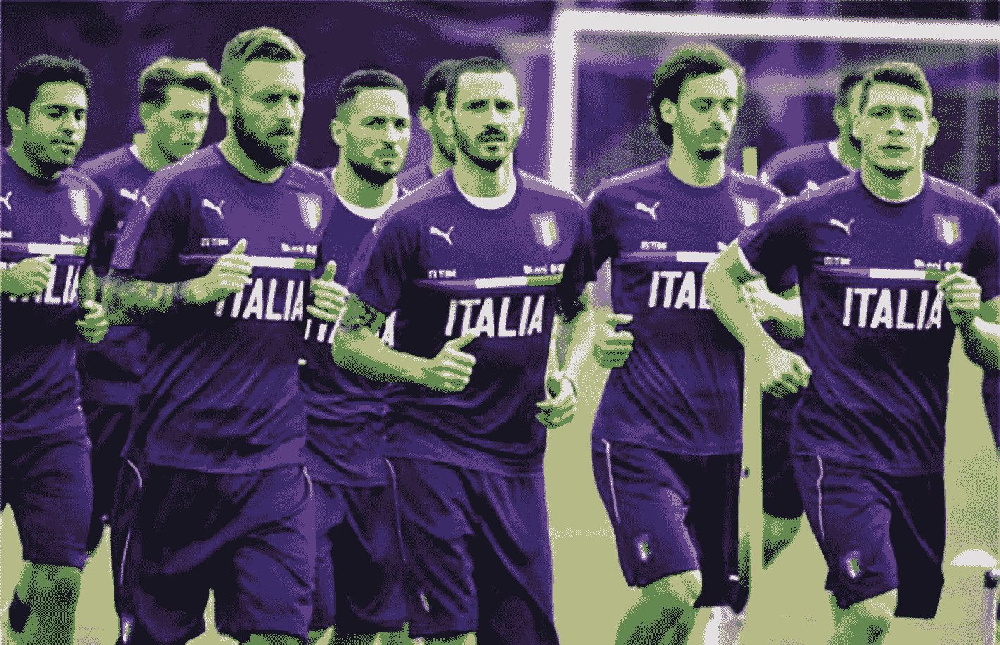
一张经过处理的照片，描绘了意大利国家队的一群男子在操场上慢跑。照片的颜色已从 BGR 转换为 RGB。

**图 14-2** 处理后的图像颜色已改变

### 保存新图像

最后，你需要通过文件系统保存新图像。在程序末尾，添加一个 `imwrite()` 方法，并指定要保存的新文件名，文件也可以有其他格式，例如 PNG。

```
cv2.imwrite('italy2018altered.png', img2)
Out [ ]:
True
```

执行此命令后，你会注意到工作区中出现了一个新的 `italy2018altered.png` 文件。

## 图像基本运算

# 图像加法与混合

最基本的运算是两幅图像的加法。使用 `openCV` 库，此操作非常简单，你可以通过 `cv2.add()` 函数来实现。得到的结果将是两幅图像的组合。但请记住，要进行加法运算的两幅图像必须具有相同的尺寸。在本例中，两幅图像都是 512x331 像素。

你需要做的第一件事是加载另一幅尺寸相同的图像，在本例中是 `soccer.jpg`（你可以在源代码中找到它）。

```python
img2 = cv2.imread('soccer.jpg')
plt.axis('off')
plt.imshow(img2)
plt.show()
```

执行代码后，你将得到图 14-3 所示的图像。


一张足球躺在操场上的照片。

**图 14-3** 一张尺寸相同（512x331 像素）的新图像

现在，使用 `add()` 函数将两幅图像相加。

```python
img3 = cv2.add(img, img2)
plt.axis('off')
plt.imshow(cv2.cvtColor(img3, cv2.COLOR_BGR2RGB))
plt.show()
```

执行此代码后，你将得到两幅图像的组合（如图 14-4 所示）。遗憾的是，效果并不理想。

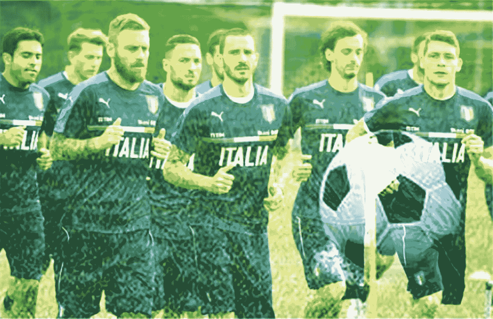

一幅两幅照片组合的插图，描绘了意大利国家队男子在操场上慢跑以及一个足球。

**图 14-4** 通过将两幅图像相加得到的新图像

结果并非你所期望。实际上是白色占主导，这是对每个像素分别计算 RGB 三个值简单算术和的结果。实际上，你知道 RGB 三个分量各取值 0 到 255。因此，如果某个像素值的总和大于 255（这很有可能），该值仍将为 255。因此，简单的图像加法并不会产生两幅图像融合的效果，而是逐渐向白色偏移。稍后你将学习如何将两幅图像相加，以创建一幅融合了两幅图像各一半的新图像（这不是算术和）。

你可以通过相减两幅图像来做同样的事情。此操作可以使用 `cv2.subtract()` 函数执行。这次你预期会得到一幅越来越偏向黑色的图像。将 `cv2.add()` 函数替换为以下内容。

```python
img3 = cv2.subtract(img, img2)
plt.axis('off')
plt.imshow(cv2.cvtColor(img3, cv2.COLOR_BGR2RGB))
plt.show()
```

运行程序后，你将得到一幅暗得多的图像（尽管你可能看不太清），如图 14-5 所示。

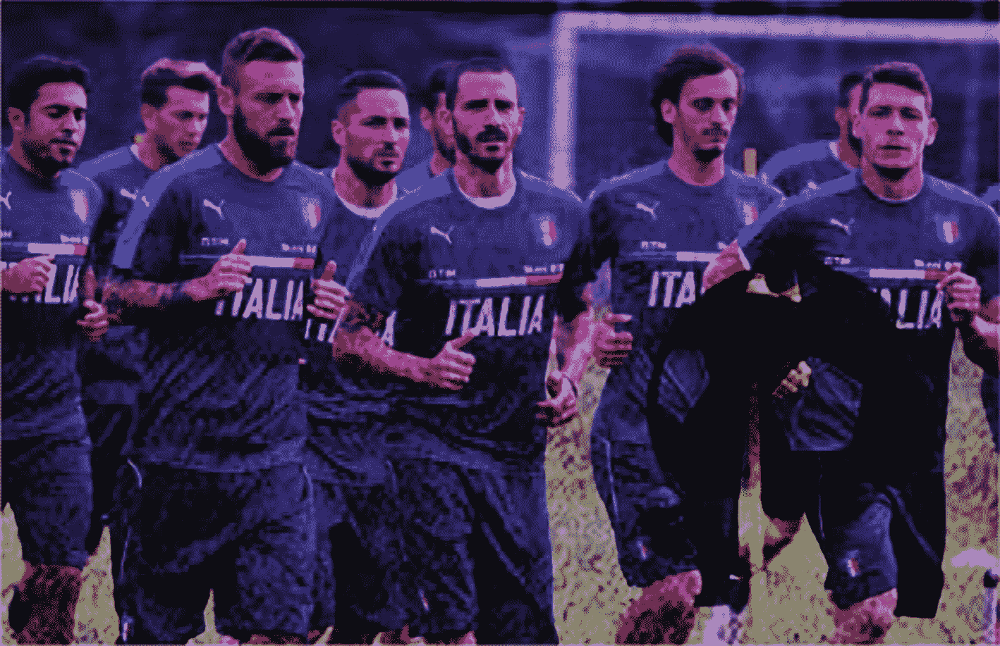

一幅照片描绘了将足球从意大利国家队男子慢跑和足球的组合照片中移除后的效果。足球的轮廓以暗色调呈现。

**图 14-5** 从一幅图像中减去另一幅图像得到的新图像

请注意，如果反过来，从第二幅图像中减去第一幅图像，效果会更差。

```python
img3 = cv2.subtract(img2, img)
plt.axis('off')
plt.imshow(cv2.cvtColor(img3, cv2.COLOR_BGR2RGB))
plt.show()
```

你会得到一幅发黑的图像，如图 14-6 所示。

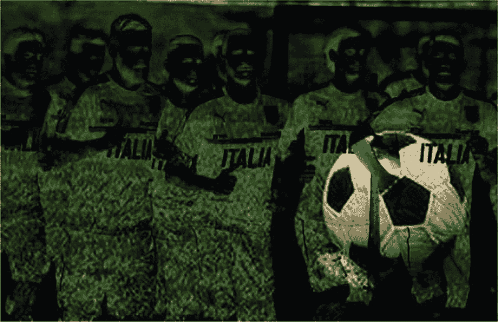

一幅照片描绘了将球员群体从意大利国家队男子慢跑和足球的组合照片中移除后的效果。球员的轮廓以暗色调呈现。

**图 14-6** 从一幅图像中减去另一幅图像得到的新图像

然而，这有助于我们了解运算子的顺序对结果很重要。

更具体地说，你已经看到，用 `opencv` 库创建的图像不过是一个数组的数组，它完全符合 NumPy 的规则。因此，你可以使用 NumPy 提供的矩阵间运算，例如矩阵加法。但要注意，结果肯定是不一样的。

```python
img = img1 + img2
```

实际上，`cv2.add()` 和 `cv2.subtract()` 函数会将值保持在 0 到 255 之间，无论运算子的值是多少。如果和超过 255，结果会以不同的方式解释，从而产生非常奇怪的色彩效果（可能是取 255 的模）。当减法产生负值时也是如此；结果将为 0。算术运算不具备此特性。

不过，你可以直接尝试一下。

```python
img3 = img + img2
plt.axis('off')
plt.imshow(cv2.cvtColor(img3, cv2.COLOR_BGR2RGB))
plt.show()
```

执行此代码后，你会得到一幅色彩对比非常强烈的图像（即超过 255 的那些点），如图 14-7 所示。

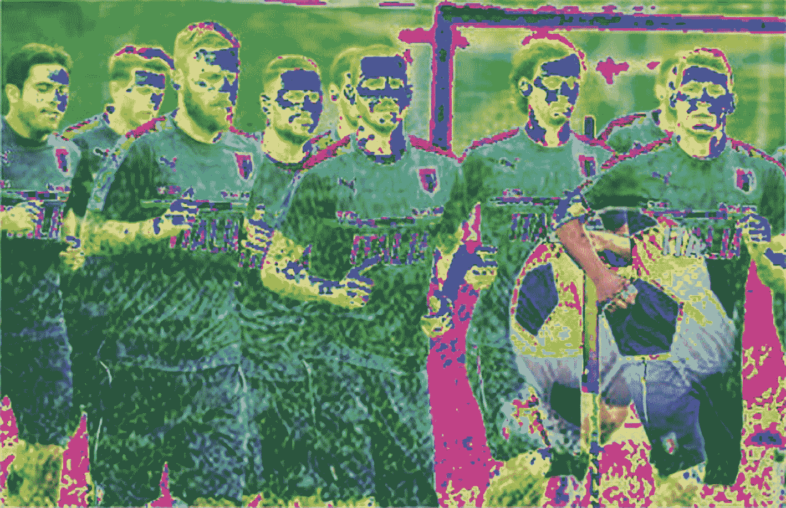

一幅插图表示将意大利国家队男子慢跑和足球的两张照片相加，结果产生了高色彩对比度的 RGB 色调。

**图 14-7** 将两幅图像作为两个 NumPy 矩阵相加得到的图像

# 图像混合

在前面的例子中，你看到两幅图像的相加或相减并不会产生介于两者之间的中间图像，而是使颜色向白色或黑色改变。正确的操作称为*混合*。也就是说，你可以想象将两幅图像叠加在一起，一幅放在上面，并使其逐渐变得越来越透明。通过逐渐调整透明度，你得到两幅图像的混合，从而创建一幅位于中间的新图像。混合操作并非简单的加法；其公式对应以下方程。

`img = α · img1 + (1 – α) · img2`，其中 `0 ≥ α ≥ 1`

从这个方程可以看出，两幅图像有两个数值系数，取值范围在 0 到 1 之间。随着 `α` 参数的增长，你会从第一幅图像平滑过渡到第二幅图像。`opencv` 库通过 `cv2.addWeighted()` 函数提供了混合操作。

因此，如果你想在两幅源图像之间创建一幅中间图像，可以使用以下代码。

```python
img3 = cv2.addWeighted(img, 0.3, img2, 0.7, 0)
plt.axis('off')
plt.imshow(cv2.cvtColor(img3, cv2.COLOR_BGR2RGB))
plt.show()
```

结果将是一幅类似于图 14-8 所示的图像。

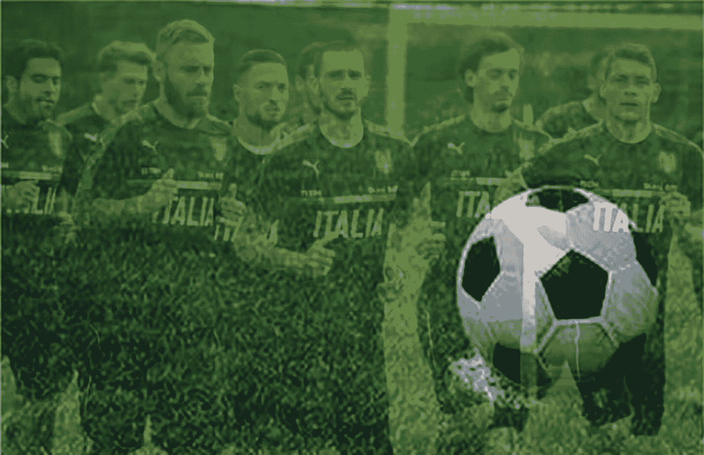

一幅插图表示将意大利国家队男子慢跑和足球的两张照片进行混合，呈现出透明叠加的效果。

**图 14-8** 通过图像混合得到的新图像

# 图像分析

上一节示例的目的是理解图像不过是 NumPy 数组。因此，这些数值矩阵是可以被处理的。所以，你可以实现许多数学函数来处理这些矩阵中的数值，从而获得新图像。这些通过运算得到的新图像，将用于提供新的信息。

这就是*图像分析*的基本概念。从原始图像（矩阵）到结果图像（矩阵）所进行的数学运算被称为*图像滤镜*（见图 14-9）。要理解这个过程，你肯定接触过照片编辑应用（如 Photoshop）。无论如何，你肯定见过可以应用到照片上的滤镜。这些滤镜实质上就是*算法*（一系列数学运算），用于修改原始图像矩阵中的数值。

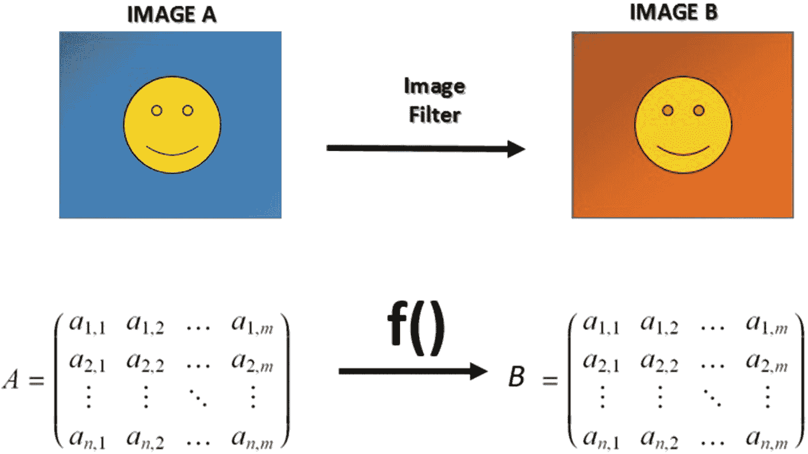

两幅插图。A，图像 A 显示一个方框内的笑脸符号。通过应用图像滤镜生成图像 B，它是图像 A 的彩色版本。B，通过 F 括号表示从 A 到 B 的矩阵变化。矩阵有 m 列和 n 行。

图 14-9 图像分析基础的图像滤镜示意图

# 边缘检测与图像梯度分析

在前面的章节中，你学习了一些对图像分析有用的基本操作。在本节中，你将从一个真实的图像分析案例开始，即*边缘检测*。

## 边缘检测

在分析图像时，尤其是在计算机视觉领域，基本操作之一是理解图像的内容，例如物体和人。首先需要理解图像中可能呈现的形式。要理解所呈现的几何形状，就必须识别出将物体与背景或其他物体区分开来的轮廓。这正是边缘检测的任务。

在边缘检测领域，已经开发了大量算法和技术，它们利用不同的原理来确定物体的轮廓。其中许多技术基于颜色梯度的原理，并利用图像梯度分析过程。

## 图像梯度理论

在可应用于图像的各种操作中，有图像的*卷积*运算，即应用特定的滤镜来编辑图像，以获取信息或其他用途。你已经知道，图像被表示为一个大的数值矩阵，其中每个像素的颜色由矩阵中 0 到 255 之间的数字表示。卷积过程通过应用数学运算（*图像滤镜*）处理所有这些数值，并在一个相同尺寸的新矩阵中生成新的数值。

其中一种运算是*导数*。简单来说，导数是能够计算数值变化速率（在空间、时间等方面）的数学运算。导数在图像情况下为何重要？因为它与颜色变化有关，这种变化称为*梯度*。能够计算颜色的梯度是检测图像边缘的绝佳工具。事实上，你的眼睛之所以能区分图像中图形的轮廓，正是由于颜色之间的跳跃。此外，你的眼睛能够通过从亮到暗的各种颜色深浅（即梯度）来感知深度。

由此可见，测量图像中的梯度对于检测图像边缘至关重要。这可以通过对图像执行一个简单的运算（即滤镜）来完成。

为了从数学角度更好地理解这一点，请看图 14-10。

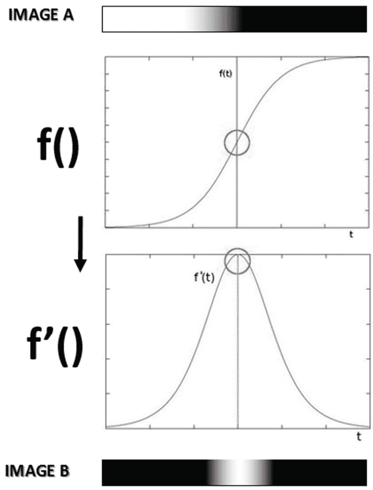

图像 A 和 B 的两个水平渐变块及其各自的图表。在图像 A 中，块的右侧有一个较暗的区域，而在图像 B 中，左右角都有暗区。在图表 A 中，线条呈上升趋势，而在图表 B 中，线条呈钟形趋势。

图 14-10 图像梯度理论示意图

如图 14-10 所示，边缘无非是一种色调到另一种色调的快速过渡。为简化起见，0 代表黑色，1 代表白色。所有灰色阴影都是 0 到 1 之间的浮点值。如果将所有对应的梯度值绘制成图表，就会得到函数`f()`。如图所示，存在一个从 0 到 1 的突变，这指示了边缘。函数`f()`的导数产生函数`f'()`。可以看到，色调的最大变化会导致数值接近 1。因此，在颜色转换时，你会得到一个图像，其中白色将指示边缘。

## 使用图像梯度分析进行边缘检测的实践示例

进入实践部分，你将使用两张专门为测试轮廓分析而创建的图像，因为它们包含几个重要特征。

第一张图像（如图 14-11 所示）由黑白两色构成的两个箭头组成，对应文件`blackandwhite.jpg`。在这张图像中，颜色对比非常强烈，并且箭头的轮廓具有所有可能的朝向（水平、垂直和对角线）。这张测试图像将评估边缘检测在黑白色调系统中的效果。

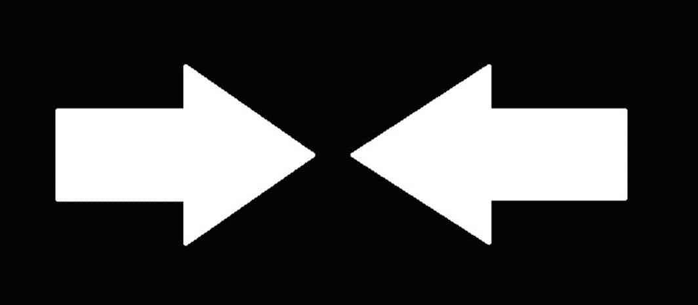

一幅深色背景上两个颜色较浅、相互指向的箭头的插图。

图 14-11 代表两个箭头的黑白图像

第二张图像`gradients.jpg`展示了不同的灰色渐变，当这些渐变彼此相邻放置时，会形成矩形，其边缘包含了所有可能的渐变和色调组合（如图 14-12 所示）。这张图像是评估系统真实边缘检测能力的一个良好测试。

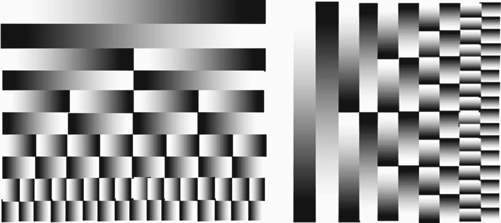

两幅水平与垂直方向的两组灰色渐变图案彼此相邻排列的插图，每组有十行十列，形成一个方块。

图 14-12 一组彼此相邻放置的灰色渐变

现在你可以开始编写边缘检测所需的代码。你将使用`matplotlib`在同一窗口中显示不同的图像。在此测试中，你将使用 OpenCV 提供的两种不同类型的图像滤镜：`sobel`和`laplacian`。实际上，它们的名称对应于对矩阵（图像）执行的数学运算的名称。`openCV`库提供了`cv2.Sobel()`和`cv2.Laplacian()`来应用这两种计算。

首先，从分析应用于`blackandwhite.jpg`图像的边缘检测开始。

```python
from matplotlib import pyplot as plt
img = cv2.imread('blackandwhite.jpg',0)
laplacian = cv2.Laplacian(img, cv2.CV_64F)
sobelx = cv2.Sobel(img,cv2.CV_64F,1,0,ksize=5)
sobely = cv2.Sobel(img,cv2.CV_64F,0,1,ksize=5)
plt.subplot(2,2,1),plt.imshow(img,cmap = 'gray')
plt.title('Original'), plt.xticks([]), plt.yticks([])
plt.subplot(2,2,2),plt.imshow(laplacian,cmap = 'gray')
plt.title('Laplacian'), plt.xticks([]), plt.yticks([])
plt.subplot(2,2,3),plt.imshow(sobelx,cmap = 'gray')
plt.title('Sobel Y'), plt.xticks([]), plt.yticks([])
plt.subplot(2,2,4),plt.imshow(sobely,cmap = 'gray')
plt.title('Sobel Y'), plt.xticks([]), plt.yticks([])
plt.show()
```

当你运行这段代码时，你会得到一个包含四个方框的窗口（如图 14-13 所示）。第一个方框是原始的黑白图像，而其他三个方框是三种滤波器应用于该图像后的结果。


4 张插图。A，原始图像，两个较浅色的箭头在深色背景上相对。B，拉普拉斯算子，箭头区域在灰色背景上被突出显示。C 和 D，Sobel X 和 Y，箭头的部分边缘在灰色背景上被检测到。

图 14-13 对 `blackandwhite.jpg` 图像应用边缘检测的结果

关于 Sobel 滤波器，即使仅限于水平或垂直方向，边缘检测也是完美的。对角线在两种情况下都可见，因为它们同时具有水平和垂直分量，但 Sobel X 中的水平边缘和 Sobel Y 中的垂直边缘无论如何都无法被检测到。通过组合两个滤波器（两个导数的计算）得到拉普拉斯滤波器，边缘的确定是全向的，但会损失一些分辨率。实际上，你可以看到对应边缘的波纹更加柔和。灰度着色对于检测边缘和梯度非常有用，但如果你只对检测边缘感兴趣，则必须在`cv2.CV_8U`中设置输出图像文件。

因此，你可以在之前代码的滤波器函数中将输出数据类型从`cv2.CV_64F`更改为`cv2.CV_8U`。如下所示，替换传递给两个图像滤波器的参数。

```python
laplacian = cv2.Laplacian(img, cv2.CV_8U)
sobelx = cv2.Sobel(img,cv2.CV_8U,1,0,ksize=5)
sobely = cv2.Sobel(img,cv2.CV_8U,0,1,ksize=5)
```

运行代码，你将得到类似的结果（如图 14-14 所示），但这次只有黑白两种颜色，边缘在黑色背景上以白色显示。


4 张深色背景上的插图。A，原始图像，两个较浅色的箭头相对。B，拉普拉斯算子，箭头区域被突出显示。C 和 D，Sobel X 和 Y，检测到箭头的部分边缘。

图 14-14 对 `blackandwhite.jpg` 图像应用边缘检测的结果

如果你仔细观察 Sobel 滤波器 X 和 Y 的面板，你会立刻注意到有些不对劲。缺失的边缘在哪里？在图 14-15 中留意这个问题。


4 张深色背景上的插图。A，原始图像，两个较浅色的箭头相对。B，拉普拉斯算子，箭头区域被突出显示。C 和 D，Sobel X 和 Y，检测到箭头的部分边缘。缺失的部分被圈出并标有问号。

图 14-15 `blackandwhite.jpg` 图像中缺失的边缘

实际上，转换数据时出现了问题。用`cv2.CV_64F`值在灰度中报告的梯度，在从黑色变为白色时由正值（正斜率）表示。然而，在从白色变为黑色时，它们由负值（负斜率）表示。在从`cv2.CV_64F`转换到`cv2.CV_8U`的过程中，所有负斜率都被归零，从而导致与这些边缘相关的信息丢失。当程序显示图像时，从白色到黑色的边缘不会显示出来。为了克服这个问题，你应该在滤波器输出中保持`cv2.CV_64F`格式的数据（而不是`cv2.CV_8U`），然后计算绝对值，最后再转换为`cv2.CV_8U`。

对代码进行以下修改：

```python
laplacian64 = cv2.Laplacian(img, cv2.CV_64F)
sobelx64 = cv2.Sobel(img,cv2.CV_64F,1,0,ksize=5)
sobely64 = cv2.Sobel(img,cv2.CV_64F,0,1,ksize=5)
laplacian = np.uint8(np.absolute(laplacian64))
sobelx = np.uint8(np.absolute(sobelx64))
sobely = np.uint8(np.absolute(sobely64))
plt.subplot(2,2,1),plt.imshow(img,cmap = 'gray')
plt.title('Original'), plt.xticks([]), plt.yticks([])
plt.subplot(2,2,2),plt.imshow(laplacian,cmap = 'gray')
plt.title('Laplacian'), plt.xticks([]), plt.yticks([])
plt.subplot(2,2,3),plt.imshow(sobelx,cmap = 'gray')
plt.title('Sobel Y'), plt.xticks([]), plt.yticks([])
plt.subplot(2,2,4),plt.imshow(sobely,cmap = 'gray')
plt.title('Sobel Y'), plt.xticks([]), plt.yticks([])
plt.show()
```

现在，如果你执行它，你将得到正确的表示，即箭头边缘在黑色背景上以白色显示（如图 14-16 所示）。正如你所看到的，`Sobel X` 和 `Sobel Y` 中没有出现边缘，因为它们与检测方向（水平和垂直）平行。

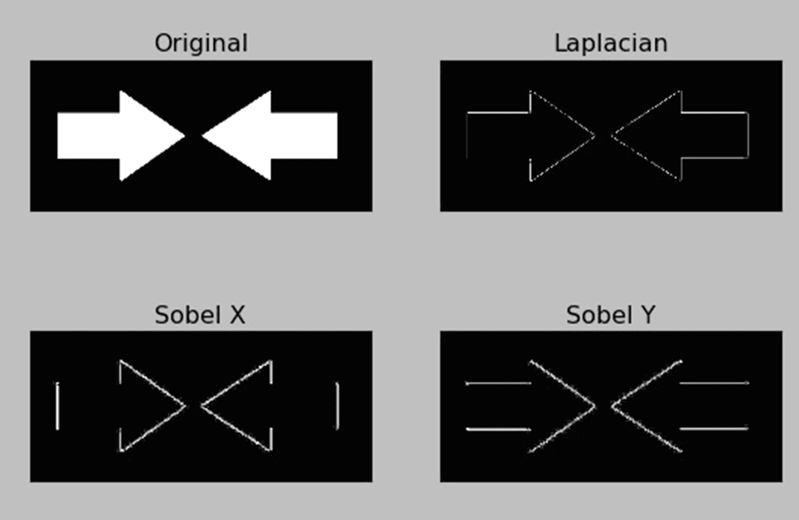

4 张深色背景上的插图。A，原始图像，两个较浅色的箭头相对。B，拉普拉斯算子，箭头区域被突出显示。C 和 D，`Sobel X` 和 Y，检测到箭头的整个边缘。

**图 14-16** 对 `blackandwhite.jpg` 图像应用边缘检测的结果

除了边缘之外，你还会发现拉普拉斯和 `Sobel` 滤波器也可以检测灰度梯度的级别。将你所学的应用到 `gradient.jpg` 图像上。你需要对之前的代码做一些修改，只保留一个图像（拉普拉斯）可见。

```python
from matplotlib import pyplot as plt
img = cv2.imread('gradients.jpg',0)
laplacian = cv2.Laplacian(img, cv2.CV_64F)
sobelx = cv2.Sobel(img,cv2.CV_64F,1,0,ksize=5)
sobely = cv2.Sobel(img,cv2.CV_64F,0,1,ksize=5)
laplacian64 = cv2.Laplacian(img, cv2.CV_64F)
sobelx64 = cv2.Sobel(img,cv2.CV_64F,1,0,ksize=5)
sobely64 = cv2.Sobel(img,cv2.CV_64F,0,1,ksize=5)
laplacian = np.uint8(np.absolute(laplacian64))
sobelx = np.uint8(np.absolute(sobelx64))
sobely = np.uint8(np.absolute(sobely64))
plt.imshow(laplacian,cmap = 'gray')
plt.title('Laplacian'), plt.xticks([]), plt.yticks([])
plt.show()
```

通过执行这段代码，你将获得一张在黑色背景上显示白色边缘的图像（如图 14-17 所示）。

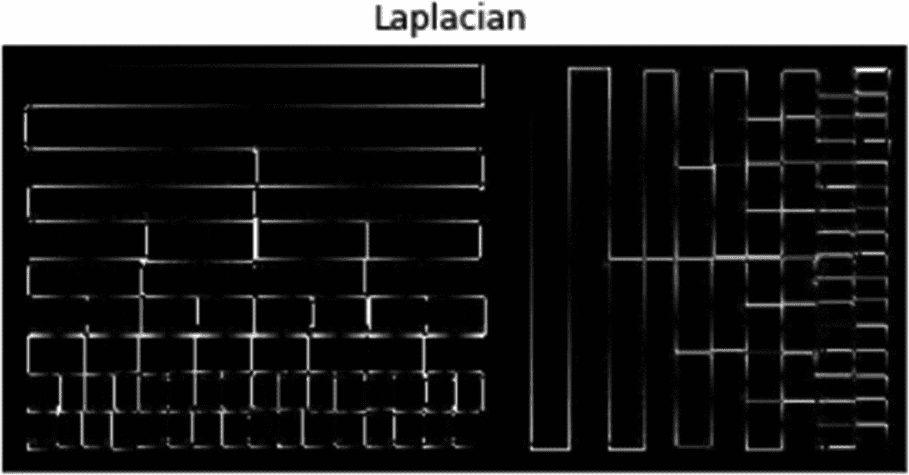

2 张插图，显示了并排的水平方向和垂直方向的两组渐变图案。它在深色背景上描绘了部分白色边缘。

**图 14-17** 对 `gradients.jpg` 图像应用边缘检测的结果

## 一个深度学习示例：人脸检测

在本章的最后部分，你将注意力转移到另一个在计算机视觉中被高度研究和应用的案例：人脸检测。这比边缘检测复杂得多，并且基于识别图像中的人脸。鉴于问题的复杂性，人脸检测使用了深度学习。事实上，这项技术的基础是专门设计用于识别照片中不同主体（包括人脸）的神经网络。物体检测技术的工作原理也非常相似。这个例子对于充分理解计算机视觉的核心——解释照片中存在的主体——非常有用。

在这个例子中，你将使用一个已经训练好的神经网络。事实上，为此类问题训练一个神经网络可能是一项复杂的操作，需要大量的时间和资源。幸运的是，网络上已经有一些经过训练的神经网络可以执行这类操作。对于这个测试，你将使用一个使用 `Caffe2` 框架开发的模型（更多信息请参见第 9 章）。

当您希望在 `OpenCV` 环境中使用 `Caffe` 模型的深度神经网络模块时，需要以下两类文件：

- 一个 `prototxt` 文件，用于定义模型架构（即各层本身）。您将使用从网络下载的 `deploy.prototxt.txt` 文件（[`github.com/opencv/opencv/blob/master/samples/dnn/face_detector/deploy.prototxt`](https://github.com/opencv/opencv/blob/master/samples/dnn/face_detector/deploy.prototxt)）。
- 一个 `caffemodel` 文件，其中包含深度神经网络中各实际层的权重。该文件最为关键，因为它包含了该神经网络为执行特定任务而进行的所有“学习”。针对您的需求，可在此处获取一个 `caffemodel` 文件：[`github.com/opencv/opencv_3rdparty/tree/dnn_samples_face_detector_20170830`](https://github.com/opencv/opencv_3rdparty/tree/dnn_samples_face_detector_20170830)。

**注意：** 您也可以在本节源代码中找到这些文件。

现在您已拥有所需的一切，首先上传神经网络模型及所有学习相关信息。`opencv` 库支持多种深度学习框架，并内置了许多辅助功能。特别地（正如本章开头所述），`OpenCV` 拥有 `dnn` 模块，专门负责此类操作。

要加载已学习的神经网络，您可以使用 `dnn.readNetFromCaffe()` 函数。

```python
net = cv2.dnn.readNetFromCaffe('deploy.prototxt.txt', 'res10_300x300_ssd_iter_140000.caffemodel')
```

作为测试图像，您可以使用意大利国家队球员的照片 `italy2018.jpg`。这张图片是一个绝佳示例，因为其中包含许多人脸。

```python
image = cv2.imread('italy2018.jpg')
(h, w) = image.shape[:2]
```

另一个名为 `dnn.blobFromImage()` 的函数负责对图像进行预处理，以适应神经网络的需求。例如，将图像调整为 300x300 像素，以便使用针对该尺寸图像训练好的 `caffemodel` 文件。

```python
blob = cv2.dnn.blobFromImage(cv2.resize(image, (300, 300)), 1.0, (300, 300), (104.0, 177.0, 123.0))
```

然后定义一个置信度阈值，其推荐值为 0.5。

```python
confidence_threshold = 0.5
```

最后执行人脸检测测试。

```python
net.setInput(blob)
detections = net.forward()
for i in range(0, detections.shape[2]):
    confidence = detections[0, 0, i, 2]
    if confidence > confidence_threshold:
        box = detections[0, 0, i, 3:7] * np.array([w, h, w, h])
        (startX, startY, endX, endY) = box.astype("int")
        text = "{:.2f}%".format(confidence * 100)
        y = startY - 10 if startY - 10 > 10 else startY + 10
        cv2.rectangle(image, (startX, startY), (endX, endY),(0, 0, 255), 2)
        cv2.putText(image, text, (startX, y), cv2.FONT_HERSHEY_SIMPLEX, 0.45, (0, 0, 255), 2)
plt.axis('off')
plt.imshow(cv2.cvtColor(image, cv2.COLOR_BGR2RGB))
plt.show()
```

执行代码后，将弹出一个窗口，显示人脸检测的处理结果（如图 14-18 所示）。结果令人难以置信，因为所有球员的面部均被检测到。您可以看到每张人脸被红色方框圈出，并在图像中以置信度百分比高亮显示。根据测试开始时指定的 `confidence_threshold` 参数，所有置信度百分比均大于 50%。

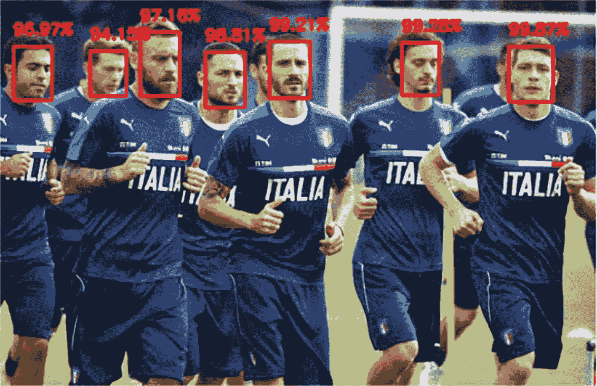

一张照片展示了意大利国家队队员在操场慢跑的场景。每位球员的面部均被边界框识别，并标注了置信度百分比。

**图 14-18** 国家队足球运动员的面部均已准确识别。

## 结论

在本章中，你看到了构成图像分析（尤其是计算机视觉）基础的一些简单技术示例。实际中，你了解了图像如何通过滤镜进行处理，以及如何利用边缘检测构建一些复杂的技术。你还看到了计算机视觉如何通过使用深度学习神经网络来识别图像中的人脸（即人脸检测）。

希望本章能成为你深入探索该主题的良好起点。如果你有兴趣，可以在我的网站 [`https://meccanismocomplesso.org`](https://meccanismocomplesso.org) 找到关于此主题的深入信息。