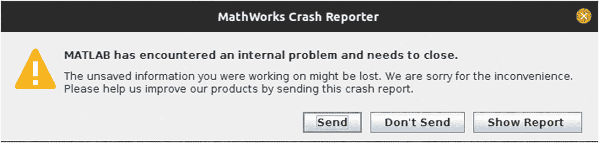

# 1. 引言

MATLAB 令人惊叹——但你早已知道这一点。只需几行代码，你就能加载数据、以无数种方式操作它、查看它并提取其深层含义。MATLAB 也是一个极佳的沙盒，用于原型设计算法、探索数值实验、模拟现象、处理测试结果以及生成报告。

此外，`MATLAB` 的文档和教程——无论是内置的、托管在 The MathWorks 网站上的，还是 YouTube 上可找到的——都很全面且质量上乘。

然而，文档不足且未被充分认识的 `MATLAB` `py` 模块，正是创作本书的动机。`py` 模块在 `MATLAB` 和 `Python` 之间提供了一个二进制接口。这意义重大——它为 `MATLAB` 打开了一扇门，通往数十万个用于机器学习、人工智能、数据挖掘、数据库访问、天文计算、地理信息服务、Web 服务、高性能计算以及无数其他领域的开源 `Python` 包。

更棒的是，通过 `MATLAB` 的 `py` 调用 `Python` 的强大功能对个人免费提供，对企业也成本低廉（参见第 1.2 节）。不过有一个警告：要使用 `py`，你必须同时了解 `Python`。本书旨在成为你学习 `Python` 并充分利用 `MATLAB` 与 `Python` 交互能力的指南。当将其视为 `MATLAB` 扩展时，可以毫不夸张地说：

`Python` 是所有 `MATLAB` 工具箱中最强大的一个。

# 1.1 通过 MATLAB 等价对应学习 Python

作为 MATLAB 开发者，你在学习 Python 时已具备先发优势，因为这两种语言之间存在许多共通之处。本书采用类似“罗塞塔石碑”的方法，将 MATLAB 和 Python 代码并列呈现。MATLAB 代码显示在左侧，而 Python 代码（通常以 `ipython` 交互会话形式呈现）则位于右侧：

| **MATLAB:** | **Python:**
| --- | --- |
| `>> format long e>> x = [2.3 3.3];>> y = [-4 5.0];>> x*y'7.300000000000001e+00>> whosName Size Bytes Classx    1x2  16    doubley    1x2  16    double` | `In :import numpy as npIn : x = np.array([2.3, 3.3])In : y = np.array([-4, 5.0])In : x.dot(y)Out: 7.300000000000001In : whosVar Type     Data/Infox   ndarray  2: float64, 16 bytesy   ndarray  2: float64, 16 bytes` |

为保持示例简洁，我对它们进行了精简编辑；实际上，两个 `whos` 命令返回的结果都包含比展示部分更多的列。此外，MATLAB 中的 `ans` = 行也在全书各处被省略了。

同样有帮助的是，Python 的数值与科学计算模块与 MATLAB 的对应模块之间共享了许多函数名称。表 1-1 展示了其中的一小部分。Python 函数的前缀 `np`、`npr`、`plt` 和 `sci` 分别通过以下 Python 语句定义：`import numpy as np`、`import numpy.random as npr`、`import matplotlib.pyplot as plt` 和 `import scipy.interpolate as sci`。

**表 1-1** MATLAB 和 Python 共有的部分函数名称

| 类别 | MATLAB | Python | 说明 |
| --- | --- | --- | --- |
| 创建 | `meshgrid()` | `np.meshgrid()` | 创建一对坐标数组 |
|  | `logspace()` | `np.logspace()` | 指数分布序列 |
|  | `linspace()` | `np.linspace()` | 均匀分布序列 |
|  | `ones()` | `np.ones()` | 创建全 1 数组 |
|  | `zeros()` | `np.zeros()` | 创建全 0 数组 |
|  | `rand()` | `npr.rand()` | 创建随机数组 |
| 运算 | `all()` | `np.all()` | 若所有项均为真则返回真 |
|  | `angle()` | `np.angle()` | 复数的幅角 |
|  | `any()` | `np.any()` | 若任一项为真则返回真 |
|  | `ceil()` | `np.ceil()` | 向上取整函数 |
|  | `cross()` | `np.cross()` | 叉积 |
|  | `cumprod()` | `np.cumprod()` | 累积乘积 |
|  | `cumsum()` | `np.cumsum()` | 累积求和 |
|  | `diag()` | `np.diag()` | 创建对角矩阵或提取对角元素 |
|  | `tril()` | `np.tril()` | 提取下三角元素 |
|  | `triu()` | `np.triu()` | 提取上三角元素 |
|  | `floor()` | `np.floor()` | 向下取整函数 |
|  | `histogram()` | `np.histogram()` | 从坐标向量创建直方图矩阵 |
| 插值 | `polyfit()` | `np.polyfit()` | 对数据进行多项式拟合 |
|  | `griddata()` | `sci.griddata()` | 二维插值 |
| 绘图 | `plot()` | `plt.plot()` | 创建折线图 |
|  | `imshow()` | `plt.imshow()` | 以图形方式显示数组 |
|  | `contourf()` | `plt.contourf()` | 显示填充等值线 |
|  | `spy()` | `plt.spy()` | 显示稀疏模式 |

尽管这些相似之处令人鼓舞，但这两种语言在根本上仍存在差异，这些差异在第 4 章中会表现得最为明显。

## 1.2 Python 真的免费吗？

Python 及其最重要模块的源代码在开源许可下可免费获取。然而，将数百万行免费源代码转变为一套稳健的、能在您所在组织的 Windows、Linux 和 macOS 计算机上实现安全包管理的 Python 安装，其间存在着天壤之别。

至少有两家公司——Anaconda 和 ActiveState——提供获得许可的 Python 发行版，用于解决复杂的安装、捆绑、部署、包管理和安全审查问题。两家公司均允许个人免费使用其发行版，但针对商业部署则需收费。

大型组织可以通过构建自己的发行版来绕过 Anaconda 或 ActiveState 的许可发行版，但这需要相当的专业知识，并会增加相应的人力成本。除了要在多种架构上编译 Python 以及流行模块所需的数百个库依赖项之外，还需要一个经验丰富的团队来维护组织的私有模块仓库，并持续更新和扫描模块以保障安全。

从这个意义上说，任何超出小型组织规模的 Python 部署都绝对*不是*免费的。这种情况并非 Python 所独有。任何在组织内广泛部署的流行开源软件包，都应通过安装跟踪、安全审查、版本管理等方式进行管理。这同样适用于 Node 及其包管理器 `npm`、Ruby 及其 Gems、Rust 和 crates、Perl 和 CPAN、R 和 CRAN 等。

如果 Python 成本高昂，为什么不坚持使用 MATLAB 呢？主要有四个原因：（1）Python 如此流行，以至于大型组织可能已经拥有 Anaconda 或 ActiveState 的许可证，这与 MATLAB 及其用户的需求无关；（2）Anaconda 和 ActiveState 提供的 Python 许可费用远低于 MATLAB 许可证；（3）与 MATLAB 的工具箱不同，额外的 Python 模块不会增加成本；（4）Python 实例不受许可证服务器或许可证文件的约束——一旦公司从 Anaconda 或 ActiveState 购买了许可证，覆盖范围内的开发者后续使用 Python 便不受限制。最后一点极大地减少了在独立网络上部署、以及在家或旅途中使用的后勤麻烦。

## 1.3 工具箱呢？

MATLAB 的全部功能是通过大量按领域划分且单独销售的工具箱来实现的。然而，本书中的示例仅使用核心 MATLAB 产品。

尽管如此，许多原本只能通过众多工具箱（即地图、曲线拟合、数据库、并行计算、符号数学、统计、优化、控制、信号处理）获得的解决方案，都可以通过调用 Python 函数在 MATLAB 中实现。举一个简单的例子，加权最小二乘函数存在于 MATLAB 的曲线拟合工具箱中。但如果您没有曲线拟合工具箱，您可以在 MATLAB 中通过调用 `statsmodels` 模块中的 Python 函数 `WLS()` 来计算加权最小二乘（详见第 11.​7.​1 节）。

# 1.4 为什么 Python 不会取代 MATLAB

偶尔会有人问我，Python 是否会取代 MATLAB。对于某些任务，答案是肯定的，它确实可以。然而，当问题变得更为专业化时，你会发现 MATLAB 为解决这些问题而设计的工具箱没有可信的竞争对手。控制系统工程师会理所当然地坚持使用一款或多款控制工具箱；从事嵌入式硬件工作的工程师需要 `Coder` 和 `Fixed-Point Designer`；飞机设计师则可以通过 `Aerospace Blockset` 探索大型的设计权衡空间。

即使在存在 Python 替代方案的情况下，调用工具箱函数也比维护一个混合的 `Python/MATLAB` 代码库、保持 `Python` 安装与 `MATLAB` 更新同步、以及编写带有别扭函数调用和类型转换的更难阅读的代码要简单和清晰得多。从长远来看，通过避免将 `Python` 添加到 `MATLAB` 工作流程中的复杂性，使用工具箱甚至可能成本更低。利弊权衡会因用例、个人、项目和组织的不同而有所差异。

本书中将不再提及 `Simulink`，因为它自成一派；目前没有任何 `Python` 项目具备与其相近的功能^(²)。

当你需要方便、彻底且快速地解决那些最特定和最专业的工程问题时，`MathWorks` 的产品是无价的。`Python` 可以在 `MATLAB` 和 `Simulink` 旁边扮演辅助角色，但不会取代它们。

话虽如此，一旦你精通了 `Python`，你会发现对 `MATLAB` 的需求会减少。这与其说是对 `MATLAB` 的批评，不如说是对 `Python` 的认可。`Python` 作为一种通用语言，在许多 `MATLAB` 不太擅长的领域表现卓越。让 `Python` 来处理那些“唾手可得”的任务，比如从一组 `NetCDF4` 文件中聚合数据、扫描目录查找包含名为“2017 inventory”选项卡的 `Excel` 文件、以及将纯文本数据重新格式化为一组 `JSON` 记录。

奇怪的是，对于最庞大、计算量最大的任务，`Python` 也可能会是更好的选择。与 `MATLAB` 不同，`Python` 的并行处理模块（如 `Dask`）不受许可证限制，因此你可以在尽可能多的处理器上运行。

同时掌握 `Python` 和 `MATLAB` 可以扩展你解决问题的选择范围。无论这意味着仅用 `Python` 还是用 `MATLAB/Python` 混合方案来解决新问题，你所能调用的能力都将远超仅使用 `MATLAB`。

## 1.5 内容概览

本书旨在实现多个目标：一本 `Python` 教程；一本 `MATLAB/Python` 等效表达式、函数和程序的集合；一本用 `Python` 解决计算问题的参考手册；以及一本 `MATLAB` 调用 `Python` 的示例手册。你应该从哪里开始呢？

所有读者，即使是 `Python` 专家，也应该从第 2 章“安装”开始。它描述了如何创建运行本书示例所需的、对 `MATLAB` 友好的虚拟环境。

不熟悉 `Python` 的 `MATLAB` 开发者可以通过阅读并实践第 3 章和第 4 章“语言基础”和“数据容器”中的示例来快速上手。一旦你对 `Python` 的基础知识感到熟悉，就可以跳到你感兴趣的部分。

第 5 章“日期和时间”涵盖了测量、读取、写入和偏移日期与时间对象的细节。

第 6 章“从 MATLAB 调用 Python 函数”是本书的核心开始部分。它涵盖了 `MATLAB` 的 `py` 模块的基础知识，展示了如何在 `MATLAB` 内部扩展 `Python` 搜索路径，描述了 `MATLAB` 中 `Python` 原生变量的细微差别以及如何将它们转换为 `MATLAB` 原生变量，并展示了两种语言交互的其他机制。

第 7 章“输入与输出”涵盖了数值计算中常见的文本和二进制文件的读写：纯文本、`JSON`、`YAML`、`XML`、`CSV`、`Excel`、原始二进制、`HDF5`、`netCDF`。关于网络 I/O 的部分展示了如何在 `Python` 和 `MATLAB` 中编写 `TCP/IP` 客户端和服务器。本章中首次出现了简单的 `MATLAB` 调用 `Python` 的示例（让 `MATLAB` 读取 `YAML` 和 `.ini` 文件）。

除了读写文件，程序有时还需要读取目录内容、搜索文件、获取文件元数据（如大小和修改时间）以及删除目录。这些操作将在第 8 章“与文件系统交互”中介绍。

`Python` 和 `MATLAB` 偶尔需要运行外部可执行程序、检查环境变量以及监控计算机负载。第 9 章“与操作系统和外部可执行程序交互”展示了如何在两种语言中完成这些操作。

第 10 章“面向对象编程”展示了如何在 `MATLAB` 和 `Python` 中定义和实例化类。

第 11 章“NumPy 和 SciPy”占据了本书近四分之一的篇幅。它涵盖了 `NumPy` 的 `ndarray`（最接近 `MATLAB` 矩阵的 `Python` 对象），以及许多执行数组操作、线性代数和插值的函数。`SciPy` 是一个基于 `NumPy` 构建的科学计算包，提供了额外的功能，如稀疏矩阵、优化、曲线拟合和微分方程求解器。

数据可视化包含在第 12 章“绘图”中。除了点图、线图和等高线图的基础知识外，还描述了如何在地图上叠加数据。

`Python` 的 `Pandas` 模块在 `MathWorks` 将表格添加到 `MATLAB` 之前的五年就已出现。第 13 章“表格和数据框架”展示了 `Pandas` 数据框架的基础知识以及如何使用 `MATLAB` 表格执行等效操作。

第 14 章“高性能计算”探讨了让 `Python` 运行得更快的方法——如果你愿意用 `Python` 实现缓慢的 `MATLAB` 函数，更快的 `Python` 可能意味着更快的 `MATLAB` 程序。本章给出了使用 `Cython`、`Pythran`、`f2py` 和 `Numba` 在单台计算机上加速 `Python` 运行的例子，以及使用 `dask` 在集群上运行 `Python` 的例子。你会看到，无论 `Python` 程序在哪里被加速，只要让 `MATLAB` 调用更快的 `Python` 函数，类似的 `MATLAB` 程序也能得到同样程度的加速。

`MATLAB` 和 `Python` 都有一些尖锐的边角，可能给新开发者带来困扰。第 15 章“语言陷阱”涵盖了这两种语言需要注意的方面。

附录 A 列出了本书中所有 `MATLAB` 调用 `Python` 的示例，而附录 B-E 则包含了因篇幅过长而无法放入正文的源代码列表。本书的所有源代码都可以在本书的 `Github` 仓库中找到：[`https://github.com/Apress/python-for-matlab-development`](https://github.com/Apress/python-for-matlab-development)。

## 1.6 我已经会 Python 了。如何在 MATLAB 中调用 Python 函数？

首先，按照第 `2.5.1` 节所述，创建一个对 `MATLAB` 友好的虚拟环境 `matpy`。然后直接跳到第 `6` 章“从 MATLAB 调用 Python 函数”。有关 `MATLAB` 调用 `Python` 的示例列表，请参考附录 A；这些示例可以帮助指导你自己的代码开发。

# 1.7 配方失效！MATLAB 崩溃了！（以及应对方法）

MATLAB 和 Python（特别是 Anaconda 发行版）会在你的计算机上占据很大空间。除了其他文件外，每个软件都附带超过一千个共享库。其中一些库是两者共有的（例如 ARPACK、BLAS、HDF5、英特尔数学核心函数库、JPEG、LAPACK、Qt、Xerces-C），但这些共有库往往版本不同且不兼容。

这是一个问题。如果你在 MATLAB 中通过其 `py` 模块调用一个 Python 函数，而该函数加载了一个 Python 和 MATLAB 共有的共享库，那么加载的是 MATLAB 的版本还是 Python 的版本？答案取决于包括环境变量在内的几个因素。如果你的环境设置不当，函数调用可能会调用不兼容的库例程，导致函数调用失败，或者 MATLAB 崩溃。

我能够设计出的对 MATLAB 最友好的环境是第 2.​5.​1 节中描述的 `matpy` 虚拟环境。`matpy` 无法阻止所有 MATLAB 崩溃。一个例子是将 Python 的 `matplotlib` 模块加载到 MATLAB 中，然后使用 `matplotlib` 的默认 Qt 后端绘制图形。一旦调用绘图命令，MATLAB 就会崩溃：

```
>> plt = py.importlib.import_module('matplotlib.pyplot');
>> plt.plot()
```



解决方法是配置一个不同的 `matplotlib` 后端：Linux 和 macOS 上使用 `TkAgg`，Windows 上使用 `WXAgg`；详细内容见第 12.​4.​5 节。

计算机上的软件是不断变化的。操作系统更新、安全补丁、MATLAB 版本变更和 Python 模块更新都可能影响混合 MATLAB/Python 程序在 `matpy` 环境中的运行方式。

如果本书中的某个示例无法运行或导致 MATLAB 崩溃，请在本书的 GitHub 页面 [`https://github.com/Apress/python-for-matlab-development`](https://github.com/Apress/python-for-matlab-development) 上提交一个问题，并描述你的环境配置。

理想情况下，我将能够发布一个可行的解决方案。但这并非总是可能，因为我可能无法复现你的问题或匹配你的操作系统和 MATLAB 版本组合。但至少，你遇到的问题会得到更广泛的曝光——并可能获得众包解决方案。

脚注 1


