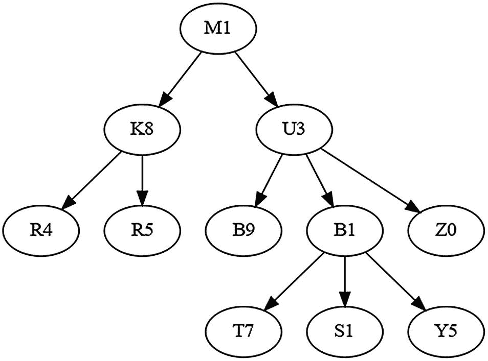
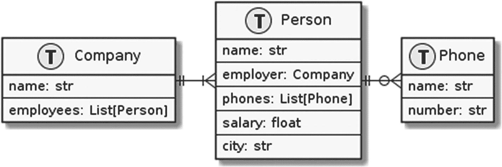

# 多行语句：需要反斜杠
T = '' + link_text + \
    ''
```


# 异常处理

MATLAB 和 Python 在处理异常时采用了不同的方法。MATLAB 将所有异常捕获到一个异常对象中，而 Python 则允许区分异常类型，类似于 C++ 或 Java。

举个例子，我们通过调用一个未定义的函数 `zyx()` 来制造一个错误：

| MATLAB: | Python: |
| --- | --- |
| `>> zyx(7)``error: 'zyx' undefined``near line 1 column 1` | `In : zyx(7)``---------------------``NameError` `Traceback``----> 1 zyx(7)` |

MATLAB 打印一条通用的错误消息，但 Python 会识别出错误类型，在本例中是 `NameError`，我们可以在后续的错误处理代码中使用它。两种语言使用异常处理程序捕获上述代码的方式如下：

| MATLAB: | Python: |
| --- | --- |
| `try``zyx(7)``catch` `EO``fprintf('error: %s', ...`          `EO.message)``end` | `try``zyx(7)``except NameError as` `err:``print(f'Name Err: err')``except``:``errmsg = sys.exc_info()[1]``print(f'Other Err:` **{**`errmsg`**}**`')` |

MATLAB 的 `catch EO` 行创建了一个新变量，即异常对象 `EO`，它具有诸如正式消息名称 `EO.identifier`、解释错误的文本字符串 `EO.message` 以及触发错误的位置 `EO.stack` 等属性。

另一方面，Python 的 `except NameError` 行指定异常块中的代码仅适用于类型为 `NameError` 的错误——任何其他类型的错误都会级联到下一个 `except` 块（如果存在）。在我们的例子中，第二个 `except` 未绑定到任何特定类型的错误类，因此它将捕获所有其他错误。错误消息可以在调用不太直观的 `sys.exc_info()` 函数返回的第二个值中找到。

Python 的 `try/except` 块支持两个可选关键字：`else` 和 `finally`。`else` 开始一个代码块，该代码块仅在未捕获到异常时执行；而 `finally` 开始一个代码块，无论异常状态如何，该代码块始终执行。`finally` 的一个常见用途是运行清理代码，例如删除由 `try` 块中的代码创建的临时文件。

Python:

```
try:
    code_that_might_fail()
except IOError as err:
    print(f'File I/O error: err')
else:
    print(f'ran successfully!')
finally:
    remove_temp_files()
```

# 模块与包

Python 模块是一个单一的源代码 `.py` 文件或二进制共享对象，通常包含一个或多个函数和/或类。Python 包是按特定目录结构组织的模块集合。从概念上讲，Python 模块和包类似于 MATLAB 工具箱，因为它们通常包含用于解决特定类型问题的函数。例如，Python 的 Cartopy 模块和 MATLAB 的 Mapping Toolbox 都是在地图上显示数据。然而，Python 模块和包中的代码保留在模块的命名空间中，而 MATLAB 工具箱函数会立即占据全局命名空间。例如，如果我只有核心 MATLAB 产品，那么如果某个程序使用 `batch` 作为变量名，则不会有问题。但是，如果我购买并安装了并行计算工具箱，我的变量就会与该工具箱添加的 `batch` 函数发生冲突。

## 命名空间

命名空间是程序中作用域内所有变量和函数名称的集合。例如，NumPy 模块有一个余弦函数，它可以同时处理标量和数组。要使用此函数，我们首先需要加载或者说 *导入*（*import*）NumPy 模块，使用 `import numpy`，然后通过其完整名称 `numpy.cos()` 来引用余弦函数。这种额外的导入模块步骤在许多 MATLAB 程序员看来很繁琐。相比之下，当人们安装 MATLAB 工具箱时，该工具箱中的所有函数立即可用。虽然这看起来很便捷，但也可能引入问题，因为常见的函数名，例如 `open()`，可能来自核心 MATLAB 库，也可能来自任何定义了相同函数的工具箱。Python 使用命名空间消除了关于函数来源的歧义。

模块或模块中的函数可以通过三种不同的方式加载到 Python 会话中。

### `import X`，或 `import X as Y`

加载模块最常见的方式就是直接 `import` 整个模块。这些导入语句出现在许多 Python 程序的开头：

```
import sys
import os
import re
```

按顺序，它们分别是：系统模块，包含命令行参数 (`sys.argv`) 和模块搜索路径（第 3.14.3 节，`sys.path`）等内容；操作系统模块，拥有环境变量设置 (`os.environ`) 以及重命名 (`os.rename()`) 和删除 (`os.delete()`) 文件的命令；以及正则表达式模块，用于在字符串中查找文本模式 (`re.search()`)。这三个模块都是标准模块，包含在每个 Python 安装中。

`import` 的一个变体是附带别名（通常是一个缩写）进行导入，以减少函数名周围的文本量。最常见的例子可能就是导入 NumPy 模块，这样它的函数就可以仅用 `np` 来引用：

```
import numpy as np
```

NumPy 不是一个标准模块，但它包含在 Anaconda 和 Enthought 发行版中。它是目前 Python 中几乎所有科学和数值能力的基础引擎。NumPy 拥有超过 600 个函数，用于各种类型的数值分析：线性代数、统计学、曲线拟合、三角函数、插值、随机数生成以及扩展数值类型，如四精度实数和复数。

本书将有相当大的一部分内容介绍 NumPy 及其功能。

### `from X import Y`

有时，你只需要从某个模块中访问单个函数。可以使用 `from module import function` 的表示法来挑选函数。一个常见的用途是从同名的模块中提取 `glob()` 函数（该函数使用模式匹配捕获文件和/或目录名），或者从 `datetime()` 模块中提取 `datetime()` 和 `timedelta()` 函数：

```
from glob import glob
from datetime import datetime, timedelta
```

然后可以直接调用导入的函数，无需它们的父模块名称。

### `from X import Y as Z`

最不常见的导入方法同时使用了选择性函数导入和缩写：

```
from numpy.random import multivariate_normal as mnorm
```

### 一种反模式：`from X import *`

请避免这样做！通配符 `*` 表示应该从模块 `X` 导入所有内容，而无需模块前缀。如果对 NumPy 这样做，即编写 `from numpy import *`，这尤其成问题，因为 NumPy 中与标准库函数共享名称的函数，如 `abs()`、`max()`、`min()` 等将加载失败，导致你只剩下一些对数值数组不起作用的基本函数。

除了隐藏你可能需要的函数之外，`import *` 还会导致命名空间膨胀（或污染），而这正是困扰 MATLAB 的问题。


### `def main()`

当 Python 程序导入一个模块时，即使它只是使用 `from X import Y` 语法挑选了个别函数，Python 也会在继续执行程序的下一行之前，运行整个模块文件。如果你想重用旧程序中的函数，这可能会引发问题，因为一旦你从那个旧程序导入，Python 就会运行它。

有一个简单的解决方案可以避免意外的代码执行：只需将程序的主要部分——入口点及其后的代码——包装在一个函数（通常称为 `main()`）中。这样，当该文件被另一个程序导入时，主要部分就不会执行任何操作。

这引出了下一个问题：当你将文件作为程序调用（即不是作为从另一个程序的导入，而是作为一个独立的可执行文件）时，如何让 `main()` 运行？解决方案是在程序文件的末尾添加以下代码行：

```python
if __name__ == "__main__":
main()
```

这告诉 Python 解释器，如果文件本身在运行（而非被导入），它应该调用 `main()`。为了不拘泥于常规，我通常将这两行合并，因此我的程序末尾是：

```python
if __name__ == "__main__": main()
```

### 模块搜索路径

与 MATLAB 类似，Python 可以使用位于任意目录的文件中定义的函数和类，只要告诉程序要搜索哪些目录即可。两种语言在处理搜索目录的方式上相似：它们都能返回目录列表（MATLAB 使用函数 `path`，返回一个由冒号分隔的字符数组，而 Python 则将目录存储在一个列表 `sys.path` 中）；两者都有扩展该列表的函数；并且都识别一个环境变量，该变量可以被设置以包含额外的目录。表 3-3 展示了 MATLAB 和 Python 中用于扩展搜索路径的类似结构。

**表 3-3** 控制模块搜索路径

|                                                                      | MATLAB          | Python               |
| -------------------------------------------------------------------- | --------------- | -------------------- |
| 展示搜索目录的函数（MATLAB）和包含搜索目录的变量（Python）            | `path`          | `sys.path`           |
| 添加一个目录                                                          | `addpath`       | `sys.path.append()`  |
| 环境变量                                                              | `MATLABPATH`    | `PYTHONPATH`         |

| MATLAB                                                        | Python                                                                 |
| ------------------------------------------------------------- | ---------------------------------------------------------------------- |
| `addpath '../mfiles'`<br>`addpath '/path/to/proj'`                     | `import sys`<br>`sys.path.append('../pyfiles')`<br>`sys.path.append('/path/to/proj')` |

一个示例会话如下所示。Python 模块有一个属性 `.__path__`，它包含加载该模块的目录名称：

```python
In : import numpy as np
In : np.__path__
Out: ['/usr/local/anaconda3/2020.07/lib/python3.8/site-packages/']
```

在大型项目中，如果开发者同时处理同一模块的多个版本，这可以成为一个有用的故障排查辅助工具。MATLAB 中的 `which` 命令只有在函数名在搜索路径中唯一时，才能解析到文件路径。

### 安装新模块

截至 2021 年 10 月，在 Python 包索引（PyPI）网站 [`https://pypi.org`](https://pypi.org) 上可以找到超过 333,000 个免费可用的 Python 模块。可以将 PyPI 视为 Python 版的 MATLAB 文件交换中心，但无需像文件交换中心那样需要用 MATLAB 账户进行身份验证。与文件交换中心一样，PyPI 上的代码质量差异很大。任何 PyPI 包都可以通过命令 `pip install` *X* 轻松安装在联网的计算机上，其中 *X* 是所需模块的名称。

不过，如果你使用的是推荐的 Anaconda Python 发行版，更好的选择是使用 `conda` 包管理器进行安装，它会在 Anaconda 精心策划的仓库中搜索模块和包：

```python
conda install X
```

`conda` 拥有比 `pip` 更复杂的依赖项解析器，并且其包在安全性问题上的审查更为严格。一旦计算出依赖项的一致集合，`conda` 会建议降级和/或升级现有模块——甚至包括 Python 本身——以满足你的请求。

`conda` 的一个缺点是 Anaconda 仓库比 PyPI 小得多，因此可能找不到你想要安装的模块。Anaconda 仓库还有第二层，称为“conda-forge”，这是一个托管在 github.com 上的社区贡献集合，用来补充官方的 Anaconda 集合。你可以通过以下方式配置 `conda` 同时查找 conda-forge：

```python
conda config --add channels conda-forge
conda config --set channel_priority strict
```

### 模块依赖冲突与虚拟环境

解决数百个相互依赖的模块和包之间的依赖关系是一项异常复杂的任务，`conda` 有时也无法应对。更糟糕的是，用户有时会手动安装，或者除了 `conda` 之外还使用 `pip` 安装模块，导致安装出现不兼容的依赖关系。结果，整个 Python 安装可能被损坏，从而被迫完全重装。

最干净的解决方案是将与特定任务相关的一组模块安装到一个 conda 环境中，如第 2.5 节所述。

脚注 1 2 3

# 数据容器

MATLAB 和 Python 拥有许多强大的数据容器。MATLAB 的主要容器是 矩阵、元胞数组和结构体，而 Python 的支柱是列表、字典，以及（针对本书目标读者而言）NumPy 数组。Python 领域中第四个关键容器是 Pandas 数据帧，它与 MATLAB 的表格最为相似。表格和数据帧将在第 13 章介绍。MATLAB 和 Python 容器的大致等价关系参见表 4-1。

MATLAB 和 Python 数据容器之间的异同值得研究，因为了解容器的工作原理对于设计和实现高效算法至关重要。接下来的几节将介绍两种语言中最重要的容器。

**表 4-1** MATLAB 和 Python 中的数据容器

| MATLAB      | Python 等价物                    | 章节                               |
| ----------- | -------------------------------- | ---------------------------------- |
| 矩阵        | NumPy ndarrays（或简称“arrays”） | 4.1, 11                            |
| 元胞数组    | 列表                             | 4.3                                |
| 结构体      | 字典；属性；数据类               | 4.6, 4.7                           |
| 表格        | Pandas 数据帧                    | 13                                 |

NumPy 数组将在第 11 章中详细讨论，并频繁出现在其他大多数章节中。在此，我们仅对 NumPy 模块及其主要容器——n 维数组（也称为 `ndarray`）——做一个简要介绍。


## 4.1 NumPy 数组

Python 及其标准发行版中的核心模块，对数值计算几乎未提供任何支持。为此，我们需要 NumPy，这个数值计算模块几乎是每一个由 Python 驱动的科学和数值项目的核心。NumPy 数组在第 11.​1 节有详细介绍；这里，我们仅通过一个预览来介绍它们。

导入 NumPy 的标准方法是：

```python
import numpy as np
```

随后，所有与 NumPy 相关的函数都可以通过在其前面加上`np`来调用。有人可能会想使用“导入所有”的选项，即：

```python
from numpy import *
```

但是，正如第 3.​14.​1.​4 节所提到的，这可能会以微妙的方式破坏你的代码。

以下是一个基本示例，用以说明一个简单的线性代数问题在 NumPy 中与在 MATLAB 中的对比：

| MATLAB: | Python: |
| --- | --- |
| `>> A = [1 2; 3 4]`<br>`A =` <br>` 1 2`<br>` 3 4`<br>`>> b = ones(2,1)`<br>`b =` <br>` 1`<br>` 1`<br>`>> x = A\b`<br>`x =` <br>` -1`<br>` 1` | `In : A = np.array([[1,2],[3,4]])`<br>`In : A`<br>`Out: array([[1,2],`<br>`[3,4]])`<br>`In : b = np.ones((2,))`<br>`In : b`<br>`Out: array([1.,1.])`<br>`In : x = np.linalg.solve(A,b)`<br>`In : x`<br>`Out: array([-1.,1.])` |

MATLAB 和 ipython 都有一个`whos`命令，用于列出变量的名称、类型和大小：

MATLAB:

```
>> whos
Variables in the current scope:
Attr  Name   Size         Bytes   Class
====  ====   ====         =====   =====
A      2x2               32    double
B      2x1               16    double
x      2x1               16    double
Total is 8 elements using 64 bytes
```

Python:

```
In : whos
Variable     Type      Data/Info

A            ndarray   2x2: 4 elems, type `int64`, 32 bytes
b            ndarray   2: 2 elems, type `float64`, 16 bytes
x            ndarray   2: 2 elems, type `float64`, 16 bytes
```

请注意，Python 中的`A`是一个整数数组。`np.array()`函数会根据传入的值推断数据类型，这些值都是整数。而`np.ones()`函数默认创建双精度浮点数。如果我们希望使用浮点值，需要将其中至少一个值改为看起来像浮点数的形式：

```
In : a = np.array([[1.,2],[3,4]])
In : whos
Variable  Type     Data/Info

a         ndarray  2x2: 4 elems, type `float64`, 32 bytes
In : a
Out:
array([[1., 2.],
       [3., 4.]])
```

或者，我们可以通过可选参数`dtype`明确告诉`array()`数据类型应该是什么。这个示例创建了一个四倍精度复数^(⁹)数组：

```
In : a = np.array([[1,2],[3,4]], dtype=np.complex256)
In : a
Out:
array([[1.+0.j, 2.+0.j],
       [3.+0.j, 4.+0.j]], dtype=complex256)
```

本书的大部分内容将围绕 NumPy 数组及其操作展开。不过，现在我们将把注意力转向其他数据容器。

## 4.2 字符串

Python 和 MATLAB 都广泛支持创建、修改和测试字符串。两者也都有一种不同的数据类型，称为*字节数组*，它通常被认为是与字符串相同的东西。但它们有所不同：字节数组（在 MATLAB 中称为字符向量）是一个字节序列，而字符串是一个文本字符序列——并且一个文本字符可能需要多个字节来表示。ASCII 字符串与字节数组是一一对应的，但存储例如越南语字符的 Unicode 字符串则不会这样。

### 4.2.1 字符串、字符数组和字节数组

虽然两种语言有相似的字符串概念，但它们在其更简单的形式——字符数组（MATLAB）和字节数组（Python）——所包含的内容及其方式上有所不同。MATLAB 的`char`数组本质上是原始字符串，其中每个字符存储在两个字节中。Python 的字节数组是一个`uint8`值的集合，如果字节值落入可打印 ASCII 字符的范围内，它看起来就像字符串。MATLAB 字符串实际上是一个 1x1 的单元数组，其中包含一个 1xN 的`char`数组。你有时会看到 MATLAB 字符串通过`{1}`索引，因为这种结构会返回底层的`char`数组——这对于子字符串的数字索引很方便。

以下示例展示了如何创建字符串、字符数组和字节数组。MATLAB 使用单引号表示字符数组，使用双引号表示字符串。在 Python 中，单引号和双引号是可以互换的（当然必须正确配对）。它使用特殊的`b"`符号来表示字节数组。

| MATLAB: | Python: |
| --- | --- |
| `>> x = 'byte array';`<br>`>> y = "a string";`<br>`>> class(x)`<br>`    'char'`<br>`>> class(y)`<br>`    'string'` | `In : x = b'byte array'`<br>`In : y = 'a string'`<br>`In : type(x)`<br>`Out: bytes`<br>`In : type(y)`<br>`Out: str` |

两种语言都有函数或方法用于在类型之间进行转换：

| MATLAB: | Python: |
| --- | --- |
| `>> x = 'byte array';`<br>`>> y = "a string";`<br>`>> x_str = string(x);`<br>`>> b_arr = char(y);` | `In : x = b'byte array'`<br>`In : y = 'a string'`<br>`In : x_str = x.decode()`<br>`In : b_arr = y.encode()` |

各个字符的数值可以通过将其转换为数值类型来获取，例如在 MATLAB 中转换为`uint16`或`double`，或者在 Python 中遍历字节：

| MATLAB: | Python: |
| --- | --- |
| `>> x = 'byte array';`<br>`>> uint16(x)`<br>`98  121  116  101  32`<br>`97  114  114  97  121` | `In : x = b'byte array'`<br>`In : [_ for _ in x]`<br>`Out: [98, 121, 116, 101, 32,`<br>`97, 114, 114, 97, 121]` |

Python 中一个常见的错误是`TypeError: a bytes-like object is required, not 'str'`。当尝试使用字节数组执行将在下一节介绍的字符串操作时，就会发生这种情况。简单的解决方法是在字节数组上应用`.decode()`方法，将其转换为字符串。

### 4.2.2 字符串操作

Python 字符串，像 Python 中的所有数据容器和函数一样，都是对象。它们的属性和方法可以在 ipython 中通过在一个字符串变量后加上句点，然后按 *<TAB>* 键来交互查询：

Python:

```
In : a = 'abc'
In : a.
In : a.
capitalize()  isalpha()       ljust()        split()
casefold()    isascii()       lower()        splitlines()
center()      isdecimal()     lstrip()       startswith()
count()       isdigit()       maketrans()    strip()
encode()      isidentifier()  partition()    swapcase()
endswith()    islower()       replace()      title()
expandtabs()  isnumeric()     rfind()        translate()
find()        isprintable()   rindex()       upper()
format()      isspace()       rjust()        zfill()
format_map()  istitle()       rpartition()
index()       isupper()       rsplit()
isalnum()     join()          rstrip()
```

MATLAB 通过其`methods`和`methodsview`命令具有类似的功能，但这些命令应用于数据类型（或 MATLAB 术语中的“类”）而不是变量：

MATLAB:

```
>> a = "abc";
>> class(a)
'string'
>> methods string
Methods for class string:
append   endsWith       extractBetween  join    pad            splitlines
cellstr  eq             ge              le      plus           startsWith
char     erase          gt              lower   replace        strip
compose  eraseBetween   insertAfter     lt      replaceBetween strlength
contains extract        insertBefore    matches reverse        upper
count    extractAfter   ismissing       ne      sort
double   extractBefore  issorted        or      split
```

常见的字符串操作将在以下小节中详细描述。


#### 4.2.2.1 字符串长度

如上所述，MATLAB 字符串是一个 1x1 的元胞数组，其内部包含一个 1xN 的 `char` 数组。对字符串应用 `length()` 只会返回该元胞数组的列数——其结果始终为 1。要获取字符串长度，必须使用专门的字符串函数 `strlength()`，或者通过 `{1}` 索引获取底层的 `char` 数组后，再对其调用 `length()`：

| MATLAB: | Python: |
| --- | --- |
| `>> str = "string length";`<br>`>> length(str{1})`<br>`ans = 13` | `In : str = "string length"`<br>`In : len(str)`<br>`Out: 13` |

#### 4.2.2.2 追加字符串

在 MATLAB 和 Python 中，使用加法运算符 `+` 来拼接字符串：

| MATLAB: | Python: |
| --- | --- |
| `>> A = "cats";`<br>`>> B = "dogs";`<br>`>> C = A + " " + B;`<br>`>> C`<br>`"cats dogs"` | `In : A = "cats"`<br>`In : B = "dogs"`<br>`In : C = A + " " + B`<br>`In : C`<br>`Out: 'cats dogs'` |

请记住，在 MATLAB 中字符串字面量必须使用双引号。使用字符数组（单引号括起来的字符串）将无法得到预期结果：

| MATLAB: | Python: |
| --- | --- |
| `>> 'a'+'b'`<br>`195` | `In : 'a'+'b'`<br>`Out: 'ab'` |

#### 4.2.2.3 重复字符串

Python 中的乘法运算符 `*` 可用于创建字符串的多个副本。乘数必须是非负整数。

| MATLAB: | Python: |
| --- | --- |
| `>> A = "#.";`<br>`>> repmat(A,1,5)`<br>`ans = '#.#.#.#.#.'` | `In : A = "#."`<br>`In : A * 5`<br>`Out: '#.#.#.#.#.'` |

#### 4.2.2.4 转换为大写或小写

两种语言都使用同名的函数进行大小写转换。这两个函数都会返回一个新的字符串，而不会修改原字符串。

| MATLAB: | Python: |
| --- | |
| `>> A = "The String";`<br>`>> upper(A)`<br>`ans = 'THE STRING'`<br>`>> lower(A)`<br>`ans = 'the string'` | `In : A = "The String"`<br>`In : A.upper()`<br>`Out: 'THE STRING'`<br>`In : A.lower()`<br>`Out: 'the string'` |

#### 4.2.2.5 替换字符

与 `.upper()` 和 `.lower()` 类似，Python 的 `.replace()` 方法和 MATLAB 的 `replace()` 函数都会返回一个新字符串；它们不会改变正在操作的变量的内容。要修改变量 `A`，必须将替换函数调用的返回值显式地赋值给该变量：

| MATLAB: | Python: |
| --- | --- |
| `>> A = "the fox box";`<br>`>> replace(A,'ox','it')`<br>`"the fit bit"`<br>`>> A`<br>`"the fox box"`<br>`>> A = replace(A,'ox','it')`<br>`"the fit bit"` | `In : A = "the fox box"`<br>`In : A.replace('ox','it')`<br>`Out: 'the fit bit'`<br>`In : A`<br>`Out: 'the fox box'`<br>`In : A = A.replace('ox','it')`<br>`In : A`<br>`Out: 'the fit bit'` |

#### 4.2.2.6 方法链

解析文本通常需要多个清理操作：移除逗号、用空格替换不需要的文本、将所有内容转换为小写等等。在 Python 中，可以将多个操作进行*链式*调用，即一个方法调用后紧跟着另一个方法调用。

假设我们要从一个包含其他无关文本的日志文件中提取时间戳以及 x、y 坐标。输入的某一行可能如下所示：

```
1588350589.176445772 x: 36.67, y: -67.3
```

提取数字的方法有多种（值得注意的是使用正则表达式，这部分将在第 4.2.6 节中介绍）；一种简单的方法是将 `"x:"`、`"y:"` 和 `","` 替换为空格或空字符串。与 Python 的方法链等效的操作，在 MATLAB 中是一组笨拙的嵌套函数调用：

**MATLAB:**

```
>> line = "1588350589.176445772 x: 36.67, y: -67.3";
>> line = split(replace(replace(replace(line,'x:',''),'y:',''),',',' '))
3×1 字符串数组
"1588350589.176445772"
"36.67"
"-67.3"
```

**Python:**

```
In : line = '1588350589.176445772 x: 36.67, y: -67.3'
In : line = line.replace('x:','').replace('y:','').replace(',',' ').split()
Out: ['1588350589.176445772','36.67','-67.3']
```

`.split()` 方法将在第 4.2.4 节中介绍。

### 4.2.3 格式化字符串

MATLAB 和 Python 都可以使用 C 语言风格的格式来格式化字符串：

**MATLAB:**

```
>> str = sprintf('[%-5s] [%6.3f] [%02d]','hi',pi,4);
>> str
'[hi] [3.142] [04]'
```

**Python:**

```
In : str = '[%-5s] [%6.3f] [%02d]'%('hi', np.pi,4)
In : str
Out: '[hi] [3.142] [04]'
```

Python 还额外支持一种称为 *f-strings* 的便捷特性，它允许将变量和表达式直接嵌入到格式字符串中，而不是在末尾作为参数提供。请注意格式字符串前的 `f"` 前缀：

**Python:**

```
In : h, q = 'hi', 4
In : str = f'[{h:<5s}] [{np.pi:6.3f}] [{q:02d}]'
In : str
Out: '[hi] [3.142] [04]'
```

字符串格式 `<5s` 中的 `<` 符号表示“左对齐”。这些格式指示符是可选的。如果不使用它们，输出结果为：

**Python:**

```
In : h, q = 'hi', 4
In : str = f'[{h}] [{np.pi}] [{q}]'
In : str
Out: '[hi] [3.141592653589793] [4]'
```

### 4.2.4 将字符串分割为单词

在读取输入数据时，一个常用的操作是将一个字符串，按照空白符、逗号或其他字符，分割成一个由单词组成的数组。Python 的 `.split()` 方法，与 MATLAB 的 `strsplit()` 函数一样，默认会按空白符分割字符串；传入一个参数则会按该字符或子字符串进行分割。

分割操作的输出结果在 MATLAB 中是一个元胞数组，在 Python 中是一个列表。这些容器将在第 4.3 节中详细描述。

**MATLAB:**

```
>> str = "Nature's first green is gold";
>> strsplit(str)
1×5 字符串数组
"Nature's"  "first"  "green"  "is"  "gold"
>> strsplit(str, 'e')
1×3 字符串数组
"Natur"  "'s first gr"  "n is gold"
```

**Python:**

```
In : str = "Nature's first green is gold"
In : str.split()
Out: ["Nature's", 'first', 'green', 'is', 'gold']
In : str.split('e')
Out: ['Natur', "'s first gr", '', 'n is gold']
```

处理逗号分隔值（`.csv`）文件是一项非常普遍的任务，以至于 MATLAB 和 Python 都有专门的方法来处理。第 7 章有一整节专门讲解如何处理 `.csv` 文件。

### 4.2.5 字符串测试

在处理数值数据时，MATLAB 的表示法通常比 Python 更简洁。但在处理字符串时，情况恰恰相反。

#### 4.2.5.1 测试相等性

| MATLAB: | Python: |
| --- | --- |
| `>> str = "string equality";`<br>`>> strcmp(str{1}(1:6), "string")`<br>`ans = 1`<br>`>> str{1}(end-1:end)`<br>`ans = ty`<br>`>> strcmp(str{1}(end-1:end),"tY")`<br>`ans = 0` | `In : str = "string equality"`<br>`In : str[:6] == "string"`<br>`Out: True`<br>`In : str[-2:]`<br>`Out: 'ty'`<br>`In : str[-2:] == "tY"`<br>`Out: False` |

#### 4.2.5.2 检查尾部字符

假设你想获取一个目录下所有 `.csv` 文件的名称（这将在第 8.1 节中介绍）。很简单，你只需要检查每个文件名的最后四个字符是否为“.csv”，对吧？没错——前提是字符串至少有四个字符可供检查。方便的是，两种语言都支持检查字符串是否以给定的字符串开头或结尾的方法：

| MATLAB: | Python: |
| --- | --- |
| `>> fname = "a.csv";`<br>`>> endsWith(fname,".csv")`<br>`1` | `In : fname = "a.csv";`<br>`In : fname.endswith('.csv')`<br>`Out: True` |

#### 4.2.5.3 检查起始字符

| MATLAB: | Python: |
| --- | --- |
| `>> fname = "a.csv";`<br>`>> startsWith(fname,"a")`<br>`1` | `In : fname = "a.csv"`<br>`In : fname.startswith('a.')`<br>`Out: True` |

#### 4.2.5.4 检查给定字符是否出现在字符串中？

Python 的 `in` 运算符允许我们测试一个子串是否存在于某个字符串中，这类似于 MATLAB 中的 `contains()` 函数：

| MATLAB: | Python: |
| --- | --- |
| `>> str = 'cat or dog or bird';`<br>`>> contains(str,'or')`<br>`ans = 1`<br>`>> contains(str,'and')`<br>`ans = 0` | `In : str = 'cat or dog or bird'`<br>`In : 'or' in str`<br>`Out: True`<br>`In : 'and' in str`<br>`Out: False` |


### 4.2.6 使用正则表达式进行字符串搜索与替换

正则表达式（简称 regex）是一种用于处理字符串模式的工具，主要有三种用途：

1.  检查文本是否包含所需模式
2.  从字符串中提取文本模式（如果存在）以备后续使用
3.  将匹配某个模式的文本替换为新文本

Python 拥有完整的、兼容 Perl 的正则表达式引擎，而 MATLAB 仅实现了 Perl 正则表达式元字符的一个子集。两者在调用模式搜索和提取结果的基础机制上也存在差异。

#### 4.2.6.1 字符串是否匹配某个正则表达式？

在第一个示例中，我们使用正则表达式来检查一个字符串是否包含由空格分隔的两个整数，随后紧跟 "dog" 或 "cat"：

MATLAB：

```
>> Y = "7x U 12 14 cat?";
>> out = regexp(Y,"\s(\d+\s+){2}(cat|dog)");
>> if out ; fprintf('matched\n'); end matched
>> N = "7x U 12 14 mouse!";
>> out = regexp(N,"\s(\d+\s+){2}(cat|dog)");
>> if out ; fprintf('matched\n'); end
>>
```

Python：

```
In : import re
In : Y = "7x U 12 14 cat?"
In : out = re.search(r"\s(\d+\s+) {2}(cat|dog)", Y)
In : if out: print("matched!")
matched!
In : N = "7x U 12 14 mouse!";
In : out = re.search(r"\s(\d+\s+) {2}(cat|dog)", N)
In : if out: print("matched!")
In :
```

#### 4.2.6.2 匹配正则表达式并捕获子串

可以通过将感兴趣的部分用括号括起来，来捕获正则表达式的部分内容供后续使用。MATLAB 的 `regexp()` 函数中的 `'token'` 参数会以字符串元胞数组的形式返回匹配的部分。在 Python 中，`re.search()` 返回的对象具有 `.group()` 方法，该方法返回匹配的部分，以及 `.groups()` 方法，该方法返回所有这些匹配项组成的元组。

MATLAB 和 Python 之间的一个重要区别是，Python 可以返回嵌套捕获的结果——即来自嵌套括号表达式的结果——但 MATLAB 不能。在下面的示例中，我们将在输入中查找数字形式的年-月-日模式：

MATLAB：

```
>> str = "1door 1\. 2019-03-04 14.55 L22-";
>> m = regexp(str,'(\d{4}(\-\d\d){2})','tokens')
1×1 cell array
{["2019-03-04"]}
```

Python：

```
In : import re
In : str = "1door 1\. 2019-03-04 14.55 L22-"
In : m = re.search(r'(\d {4}(\-\d\d){2})',str)
In : m.group(1)
2019-03-04
In : m.group(2)

```

内部的括号，受 "2x" 乘数限定，保存了乘数模式的最后一次匹配结果，因此只返回 `-04`，而不是 `-03-04`。

#### 4.2.6.3 用不同的文本替换匹配正则表达式的文本

在这个示例中，我们将把 "cat" 或 "dog" 替换为 "fish"，后面紧跟其前面的整数副本。Python 正则表达式中的符号 `\g<1>` 是第一个分组模式的反向引用，即第一个括号中捕获的正则表达式内容。

MATLAB 2020b 不支持反向引用，因此需要额外步骤来首先捕获 "cat" 或 "dog" 之前的整数：

MATLAB：

```
>> Y = "7x U 12 14 cat?";
>> m = regexp(Y,"(\d+)\s+(cat|dog)",'tokens'); % m{1}{1} = '14'
>> regexprep(Y,"\d+\s+(cat|dog)",sprintf('%s fish %s', m{1}{1}, m{1}{1}))
"7x U 12 fish 14?"
```

Python：

```
In : import re
In : Y = "7x U 12 14 cat?"
In : re.sub(r"(\d+)\s+(cat|dog)", 'fish \g', Y)
Out: '7x U 12 14 fish 14?'
```

### 4.2.7 字符串模板

字符串模板对于批量生成主要部分是固定文本的副本非常有用。例如，简单的 HTML 文档（我们将在第 7.​17.​2 节看到一个示例），以及在执行参数扫描时（每个文件中只有一个值发生变化）为其他程序创建输入文件。

标准库中的 Python `strings` 模块有一个 `Template()` 函数，该函数返回一个模板对象，可以通过调用该对象的 `_substitute()` 方法来替换其中的条目。例如：

Python：

```
In : import string
In : T = string.Template("""alpha = ${Alpha}
...: thickness = ${layer_mm}
...: E = 10.0e6
...: nu = 0.33
...: """)
In : t_new = T.substitute(Alpha=.125, layer_mm=0.11)
In : print(t_new)
alpha = 0.125
thickness = 0.11
E = 10.0e6
nu = 0.33
```

我不知道 MATLAB 有文本模板机制。

Jinja2^((10)) 模板引擎比 Python 标准库的 `string.Template()` 功能强大得多。它提供带有循环、条件表达式、带继承的模板层次结构、宏、过滤器、Python 代码执行的文本生成，并支持包含文件。

## 4.3 Python 列表与 MATLAB 元胞数组

Python 列表包含一系列任意标量值和/或容器。列表通过方括号创建，格式为 `[` *元素*[1], *元素*[2], … `]`，因此表面上看类似于 MATLAB 数组。然而，与 MATLAB 数组不同，列表可以包含不同的数据类型。因此，Python 列表最类似于 MATLAB 的元胞数组。

所有 Python 变量（以及函数和类）都是对象，它们具有与之关联的函数或方法。我们可以通过使用 `ipython` 的交互式帮助来查看列表可用的方法：

Python：

```
In : a.
a.append   a.copy   a.extend   a.insert   a.remove   a.sort
a.clear    a.count  a.index    a.pop      a.reverse
```

在这些方法的名称后添加问号，可以找到关于任何方法的更多帮助：

Python：

```
In : a.append?
Signature: a.append(object, /)
Docstring: Append object to the end of the list.
Type:      builtin_function_or_method
```

为了完整起见，以下是适用于 MATLAB 元胞数组的方法：

MATLAB：

```
>> methods cell
Methods for class cell:
cellismemberlegacy  ismatrix  issortedrows  reshape  transpose
ctranspose          ismember  isvector      setdiff  union
display             isrow     maxk          setxor   unique
intersect           isscalar  mink          sort
iscolumn            issorted  permute       strcat
```

以下部分展示了如何操作 Python 列表以及 MATLAB 中等价的元胞数组。

### 4.3.1 初始化空列表

在 MATLAB 中，可以使用 `cell()` 函数分配一个给定大小的空元胞数组。如果只提供一个数字参数 *N*，它将返回一个 *N* x *N* 的空元胞集合——这并非总是期望的结果。要简单地生成 *N* 个空元胞，我们需要提供第二个维度为 1。

在 Python 中，我们可以通过将单个元素的列表乘以所需计数来预分配一个包含 `None` 值的列表：

| MATLAB： | Python： |
| --- | --- |
| `>> a = cell(1,3)``{0×0 double} {0×0 double} {0×0 double}` | `In : a = [ None] * 3``In : a``Out: [None, None, None]` |

### 4.3.2 创建包含给定值的列表

| MATLAB： | Python： |
| --- | --- |
| `>> a = {1,2.2,'a string'}``a =``1×3 cell array``{[1]} {[2.2000]}``{'a string'}` | `In : a= [1,2.2,'a string']``In : a``Out: [1,2.2,'a string']` |

两种语言中还存在其他将其他容器转换为列表的方法。MATLAB 有 `cell()`、`mat2cell()` 和 `num2cell()`，而在 Python 中可以使用 `list()` 函数或编写列表推导式（在第 4.3.14 节中描述）。

### 4.3.3 获取列表长度

| MATLAB： | Python： |
| --- | --- |
| `>> size(a)``1     3``>> n_items = size(a,2)``3` | `In : len(a)``Out: 3``In : n_items = len(a)``In : n_items``Out: 3` |


### 4.3.4 对列表元素进行索引

Python 的列表索引（与稍后我们会看到的 NumPy 数组类似）使用方括号，而 MATLAB 则允许使用圆括号和花括号。使用圆括号索引 MATLAB 元胞数组会返回索引到的容器（回想一下，MATLAB 坚持即使是标量变量也是矩阵），而使用花括号则会给出索引容器内的元素。使用 `()` 和 `{}` 进行索引的区别最好通过一个例子来说明：

| MATLAB: | Python: |
| --- | --- |
| `>> a(3)` `1×1 cell array` `{'a string'}` `>> a{3}` `'a string'` | `In : a[2]` `Out: 'a string'` |

与第 4.2.5.1 节中演示的字符串索引一样，Python 通过使用负索引可以轻松地从列表末尾引用列表项；索引 `-1` 表示“列表中的最后一项”，索引 `-2` 表示“倒数第二项”，以此类推。MATLAB 不允许使用负索引，但其 `end` 关键字可以引用最后一项：

| MATLAB: | Python: |
| --- | --- |
| `>> a{` `end` `}` `'a string'` | `In : a[-1]` `Out: 'a string'` |

负索引有一个缺点，即它可能会掩盖潜在的 bug。假设你编写的代码只使用零或正索引访问列表项。如果代码存在逻辑错误，导致索引可能变为负数，那么代码不会像 MATLAB 那样因索引错误而崩溃，而是会继续运行——并产生错误的结果。

尝试访问超出列表大小的正索引或负索引会引发错误：

| MATLAB: | Python: |
| --- | --- |
| `>> a = {1, 2.2, 'a string'};` `>> a{4}` `Index exceeds the number of` `array elements (3).` `>> a{-4}` `Array indices must be positive` `integers or logical values.` | `In : a = [1, 2.2, 'a string']` `In : a[3]` `IndexError` `Traceback` `----> 1 a[3]` `IndexError: list index out of range` `In : a[-3]` `Out: 1` `In : a[-4]` `IndexError` `Traceback` `----> 1 a[-4]` `IndexError: list index out of range` |

### 4.3.5 提取一个范围内的项

MATLAB 和 Python 都允许使用冒号 `:` 来表示一个连续的索引范围，或使用两个冒号来表示带步长的范围，从而连续地或按步长提取一个范围内的项。我们需要一个更长的列表来演示这一点：

| MATLAB: | Python: |
| --- | --- |
| `>> a = num2cell(100:106)` `a =` `1×7 cell array` `Columns 1 through 7` `{[100]} {[101]} {[102]}` `{[103]} {[104]} {[105]}` `{[106]}` | `In : a = list(range(100,107))` `In : a` `Out: [100, 101, 102, 103,` `104, 105, 106]` |

注意，在 MATLAB 中，`a = {100:106}` 会产生一个包含单个项（一个包含七个值的矩阵）的元胞数组，这不是我们想要的：

MATLAB:

```
>> a = {100:106}
a =
1×1 cell array
{1×7 double}
>> a{1}
100 101 102 103 104
105 106
```

为了强调 MATLAB 元胞数组和 Python 列表可以包含不同的数据类型，我们将一个项改为浮点数，另一个项改为字符串：

| MATLAB: | Python: |
| --- | --- |
| `>> a{2} = -0.1;` `>> a{7} = 'cell'` `a =` `1×7 cell array` `Columns 1 through 7` `{[100]} {[-0.1000]} {[102]}` `{[103]} {[104]} {[105]}` `{'cell'}` | `In : a[1] = -0.1` `In : a[6] = 'list'` `In : a` `Out: [100, -0.1, 102, 103,` `104, 105, 'list']` |

元胞数组和列表分片的访问方式类似，如下例所示。

**提取前三个项**

Python 的范围操作符与 MATLAB 的略有不同。在 Python 中，如果起始索引为 0，则可以省略；结束索引的值不包含在返回的列表中。换句话说，`[:3]` 返回列表项 0、1 和 2。

这里，我们展示了同时使用花括号和圆括号作为下标的 MATLAB 元胞数组。

| MATLAB: | Python: |
| --- | --- |
| `>> a{1:3}` `100` `-0.1000` `102` `>> a(1:3)` `1×3 cell array` `{[100]} {[-0.100]} {[102]}` | `In : a[:3]` `Out: [100, -0.1, 102]` |

**提取最后四个项：**

| MATLAB: | Python: |
| --- | --- |
| `>> a{` `end` `-3:` `end` `}` `103` `104` `105` `'cell'` | `In : a[-4:]` `Out: [103, 104, 105, 'list']` |

**提取每第三项，从第二项开始：**

| MATLAB: | Python: |
| --- | --- |
| `>> a(2:3:` `end` `)` `1×2 cell array` `{[-0.100]}     {[104]}` | `In : a[1::3]` `Out: [-0.1, 104]` |

### 4.3.6 警告——Python 索引范围不会进行越界检查！

尽管单个列表索引如果超出列表边界会引发 `IndexError`，但索引*范围*没有此类检查。

在 Python 中，超出边界的索引范围仅仅返回一个空列表；它们不会引发错误。

考虑这个例子：

```
In : a = [1, 2.2, 'a string']
Out: a[27636]
IndexError Traceback
----> 1 a[27636]
IndexError: list index out of range
```

这不奇怪：在一个只有三个项的列表中索引第 27,636 项会报错。不过，这里有一个不愉快的意外：

```
In : a[27636:-524385732]
Out: []
```

没有报错！这是怎么回事？当列表被一个超出索引边界的单个值索引时，Python 会引发错误，但对于超出边界的索引*范围*却会静默接受。未经检查的索引范围为代码错误悄悄通过提供了大量机会。它将检查起始和结束索引值的责任交给了开发者。

不过，允许范围边界违规也有便捷的应用。一个简单的例子是将字符串截断到指定长度。在 MATLAB 中，必须确保截断长度小于或等于字符串长度。Python 则不关心字符串是否短于截断长度：

| MATLAB: | Python: |
| --- | --- |
| `>> S = "abcdefghijklm";` `>> n_chop = 6;` `>> extractBetween(S,1,n_chop)` `"abcdef"` `>> S = "abc";` `>> extractBetween(S,1,n_chop)` `Error using extractBetween` `Numeric value exceeds the number` `of characters in element 1.` | `In : S = "abcdefghijklm"` `In : n_chop = 6` `In : S[:n_chop]` `Out: 'abcdef'` `In : S = "abc"` `In : S[:n_chop]` `Out: 'abc'` |

另一个例子是将一个集合分成大小均匀的几组，而无需处理不均匀分割时的剩余部分。这里，我们将数字 1 到 20 分成三个大小均匀的组：

Python:

```
n_items = 20
n_groups = 3
set_size = int(np.ceil(n_items/n_groups))
L = list(range(1,n_items+1))
for i in range(n_groups):
    print(L[i*set_size:(i+1)*set_size])
```

显然，20 不能被 3 整除，但我们无需关心这个细节；输出的各组拥有期望的成员数：7、7 和 6：

Python:

```
[ 1,  2,  3,  4,  5,  6,  7]
[ 8,  9, 10, 11, 12, 13, 14]
[15, 16, 17, 18, 19, 20]
```

如果数组边界被检查，最后一次迭代就会引发错误，因为打印语句试图访问一个不存在的第 21 个元素。相反，Python 只是为缺失的元素返回空值。

使用 MATLAB 代码，通过在每次迭代中限制结束索引，可以产生等效的输出：

MATLAB:

```
n_items = 20;
n_groups = 3;
set_size = ceil(n_items/n_groups);
L = 1:n_items;
for i = 1:n_groups
    end_index = min(n_items, i*set_size); % prevent array bounds violation
    L((i-1)*set_size+1:end_index)
end
```


### 4.3.7 追加一个元素

向 MATLAB 的元胞数组添加元素只需引入一个新索引即可。新索引可以是任意整数值，不必是元胞数组中最后一个索引的递增。如果索引之间存在空隙，跳过的项会被创建并用空矩阵填充。

在 Python 中，通过列表的 `.append()` 或 `.extend()` 方法向列表添加元素，其中 `.append()` 添加单个元素，而 `.extend()` 用于将第二个列表连接到第一个列表。不能通过下标添加新的列表条目。

| MATLAB: | Python: |
| --- | --- |
| `>> a{8} = 3.14`*% 等价于*`>> a(8) = {3.14}``a =``1×8 cell array``Columns 1 through 8``{[100]} {[101]} {[102]}``{[103]} {[104]} {[105]}``{[106]} {[3.1400]}` | `In : a.append(3.14)``In : a``Out: [100, -0.1, 102, 103,``104, 105, 'list', 3.14]` |

下面的示例直接向 MATLAB 元胞数组的第十个位置添加一个条目，尽管当前它只有八个元素。第九个位置会自动填充一个空矩阵。在 Python 中无法进行同样的操作。要将条目放入第十个位置，我们必须先用某些内容填充第九个位置。这里，我们使用 `None`，Python 中表示空值的表达式：

| MATLAB: | Python: |
| --- | --- |
| `>> a{10} = 2.71``a =``1×10 cell array``Columns 1 through 10``{[100]} {[101]} {[102]}``{[103]} {[104]} {[105]}``{[106]} {[3.1400]}``{0x0 double} {[2.7100]}` | `In : a.append(``None``)``In : a``Out: [100, -0.1, 102, 103,``104, 105, 'list', 3.14,``None``]``In : a.append(2.71)``In : a``Out: [100, -0.1, 102, 103,``104, 105, 'list', 3.14,``None``, 2.71]` |

### 4.3.8 追加另一个列表

Python 列表的 `.extend()` 方法将一个列表的内容追加到另一个列表中。MATLAB 有一个 `horzcat()` 函数可以实现相同的功能：

| MATLAB: | Python: |
| --- | --- |
| `>> a = {1, 'two'};``>> b = {3, 4.4, 5};``>> c = horzcat(a,b)``c =``1x5 cell array``Columns 1 through 5``{[1]} {'two'} {[3]}``{[4.4000]} {[5]}` | `In : a = [1, 'two']``In : b = [3, 4.4, 5]``In : a.extend(b)``In : a``Out: [1, 'two', 3, 4.4, 5]` |

另外，Python 列表可以使用 `+` 运算符进行扩展：

```
In : a = [1, 'two']
In : b = [3, 4.4, 5]
In : a + b
Out: [1, 'two', 3, 4.4, 5]
```

并且列表条目可以使用 `*` 运算符进行复制：

```
In : a = [1, 'two']
In : a*3
Out: [1, 'two', 1, 'two', 1, 'two']
```

### 4.3.9 预分配一个空列表

有时候，创建一个列表并非通过追加元素，而是通过将元素非顺序插入到一个预先定义好大小（但为空）的列表中更为方便。在 MATLAB 中，可以通过调用带有所需维度的 `cell()` 来实现。在 Python 中，将所需的初始值放入一个单元素列表，然后将此列表乘以所需的大小。Python 示例展示了两种初始化方式，一种使用 `None`，另一种使用空列表：

| MATLAB: | Python: |
| --- | --- |
| `>> a = cell(4,1)``a =``{``[1,1] = [](0x0)``[2,1] = [](0x0)``[3,1] = [](0x0)``[4,1] = [](0x0)``}``>> a{3} = -7.2``a =``{``[1,1] = [](0x0)``[2,1] = [](0x0)``[3,1] = -7.2000``[4,1] = [](0x0)``}` | `In : a = 4*[``None``]``In : a``Out: [``None``,` `None``,` `None``,` `None``]``In : a[2] = -7.2``In : a``Out: [``None``,` `None``, -7.2,` `None``]``In : a = 4*[[]]``In : a``Out: [[], [], [], []]``In : a[2] = -7.2``In : a``Out: [[], [], -7.2, []]` |

请注意，向 MATLAB 的 `cell()` 传递了两个维度。如果我们调用 `cell(4)` 而不是 `cell(4,1)`，结果将是一个 4 × 4 的元胞数组。

### 4.3.10 插入到列表的开头（或任何其他位置）

Python 列表有一个 `.insert()` 方法，允许在任意所需索引处插入一个新元素。该方法接受两个参数：插入后对象应占用的索引，以及要插入的对象。所有其他现有列表项会向右移动一个位置。因此，向列表开头插入一个元素使用的是 `.insert(0, item)`。但请注意，当列表变大时，在除末尾之外的任何位置添加列表项都会变得代价高昂。

| MATLAB: | Python: |
| --- | --- |
| `>> a``{[100]} {[-0.100]} {[102]} {[103]}``{[104]} {[105]} {'list'}``>> a = horzcat('new',a)``{'new'} {[100]} {[-0.100]} {[102]}``{[103]} {[104]} {[105]} {'list'}` | `In : a``Out: [100, -0.1, 102, 103,``104, 105, 'list']``In : a.insert(0, 'new')``In : a``Out: ['new', 100, -0.1, 102,``103, 104, 105, 'list']` |

### 4.3.11 嵌套容器的索引

在 MATLAB 中，嵌套元胞数组内的条目使用花括号和圆括号进行索引；花括号索引进入元胞数组，圆括号索引进入元胞内的元素。

Python 的索引更加直接，因为括号被普遍使用：

| MATLAB: | Python: |
| --- | --- |
| `>> a = {1, {'inner', 'cell'},``-3.3}``a =``1x3 cell array`   `{[1]} {1×2 cell} {[-3.3000]}``>> a{2}``1x2 cell array``{'inner'} {'cell'}``>> a{2}(1)``1x1 cell array``{'inner'}` | `In : a = [1, ['inner', 'list'],``-3.3]``In : a``Out: [1, ['inner', 'list'], -3.3]``In : a[1]``Out: ['inner', 'list']``In : a[1][0]``Out: 'inner'` |

### 4.3.12 成员测试：列表中是否存在某个元素？

我们在本节开头看到 `ismember()` 函数适用于 MATLAB 元胞数组。不过，在 MATLAB 2020b 中，我使用 `ismember()` 处理混合类型数据时并未成功。（如果所有条目都是数值型，可以将元胞数组转换为矩阵，然后使用 `find()` 函数。）相反，我使用下面这个小函数来检查元胞数组中是否存在某个元素：

MATLAB:

```
function [found_it] = cell_has(C, value)
found_it = 0;
for i = 1:length(C)
if C{i} == value
found_it = 1;
break
end
end
end
```

相比之下，Python 使用 `in` 运算符使得列表、集合和字典键的成员测试变得简单：

| MATLAB: | Python: |
| --- | --- |
| `>> a = {'hi', 102, 3.3};``>> cell_has(a, 102)``1``>> cell_has(a, 27)``0` | `In : a = ['hi', 102, 3.3]``In : 102` `in` `a``Out:` `True``In : 27` `in` `a``Out:` `False` |

短暂回到 MATLAB 的 `ismember()`，检查 102 是否在 `a` 中的六次尝试都会产生相同的错误：

MATLAB:

```
>> a = {'hi', 102, 3.3};
>> ismember(a, 102)
>> ismember(a, '102')
>> ismember(a, {102})
>> ismember(a, {'102'})
>> ismember(a, {[102]})
>> ismember(a, {['102']})
Error using cell/ismember
Input A of class cell and input B of class cell must be
cell arrays of character vectors, unless one is a
character vector .
```

### 4.3.13 查找元素的索引

MATLAB 使用 `find()` 函数在数值型元胞数组中定位一个值。Python 的等价方法是 `.index()` 方法——它还有一个额外的好处，即可以处理混合数据类型，而不仅仅是数值。这里，我们找出值 `102` 的索引：

| MATLAB: | Python: |
| --- | --- |
| `>> a = num2cell(100:106)``a =``1×7 cell array``Columns 1 through 7``{[100]} {[101]} {[102]}``{[103]} {[104]} {[105]}``{[106]}``>> find([a{:}] == 102)``3` | `In : a = list(range(100,107))``In : a``Out: [100, 101, 102, 103,``104, 105, 106]``In : a.index(102)``Out: 2` |

如果我们查找一个不存在的元素，Python 会引发 `ValueError` 异常：

| MATLAB: | Python: |
| --- | --- |
| `>> find([a{:}] == 27)` | `In : a.index(27)``ValueError``: 27` `is not in` `list` |

奇怪的是，如果元胞数组包含不同的数据类型**并且**尝试查找一个非数值项，MATLAB 的 `find()` 会失败。Python 没有这样的问题：

| MATLAB: | Python: |
| --- | --- |
| `>> a{7} = 'string';``>> a``a =``1×7 cell array``Columns 1 through 7`    `{[100]} {[101]} {[102]}`    `{[103]} {[104]} {[105]}`    `{'string'}``>> find([a{:}] == 102)`    `3``>> find([a{:}] == 'string')``Matrix dimensions must agree.` | `In : a[6] = 'string'``In : a``Out: [100, 101, 102, 103,``104, 105, 'string']``In : a.index(102)``Out: 2``In : a.index('string')``Out: 6` |


### 4.3.14 对所有项应用操作（列表推导式）

Python 的*列表推导式*与 MATLAB 的 `cellfun()` 和 `arrayfun()` 函数非常相似，用于对数组中的每个元素应用一个操作。此示例返回每个条目的立方值：

| MATLAB： | Python： |
| --- | --- |
| `>> a = {0.3, 0.4, 0.5};``>> cellfun(@(x)(x.ˆ3),a)``0.0270 0.0640 0.1250` | `In : a = [0.3, 0.4, 0.5]``In : [x**3` `for` `x` `in` `a]``Out: [0.027, 0.064, 0.125]` |

通用记法为

```
LHS = [ operator(x) for x in List ]
```

其中 `x` 是一个任意变量名，`List` 是你要操作的列表名称。左侧变量 `LHS` 将包含一个新列表，该列表包含将运算符应用于原始列表中的元素后的结果。展开为 `for` 循环后，上述推导式将如下所示：

```
LHS = []
for x in List:
LHS.append( operator(x) )
```

不过，列表推导式的运行速度比 `for` 循环更快。此示例创建一个字符串，显示列表中每个元素，并添加 `"0x"` 前缀：

| MATLAB： | Python： |
| --- | --- |
| `>> a = {100, 101, 102,``...``103, 'string'};``>> cellfun(@(y) "0x" +` `...``string(y), a)``1×5 string array``"0x100" "0x101" "0x102"``"0x103" "0xstring"` | `In : a = [100, 101, 102,``103, 'string']``In : [f'0x``{``str(y)``}``'` `for` `y` `in` `a]``Out: ['0x100', '0x101', '0x102',``'0x103', '0xstring']` |

### 4.3.15 基于条件选择项的子集

列表推导式可以与布尔表达式配对使用来创建过滤器。其记法为

```
[ operator(x) for x in List if condition(x) ]
```

这里，我们提取首字母大写的条目。与 MATLAB 字符串一样，Python 字符串可以通过数字索引来访问单个字符或子串。这样，我们可以通过 `x[0]` 获取第一个字符，并对其应用字符串方法 `.isupper()` 来测试它是否是大写。因此，如果迭代器字符串 `x` 的第一个字符是大写，则下面的 `x[0].isupper()` 返回 `True`，否则返回 `False`。在 MATLAB 中有几种可能的解决方案，但每种都需要多个步骤。以下解决方案创建一个索引数组，用于标识满足条件的项：

| MATLAB： | Python： |
| --- | --- |
| `>> a = {'Select','a','Subset',``...``'of','Items','Based',``...``'on','a','Condition'}``>> i = isstrprop(cellfun(@(x)``...``x(1), a), 'upper');``>> a(i)``{'Select'} {'Subset'} {'Items'}``{'Based'} {'Condition'}` | `In : a = ['Select', 'a', 'Subset',``'of', 'Items', 'Based',``'on', 'a', 'Condition']``In : [x` `for` `x` `in` `a` `if` `x[0].isupper()]``Out: ['Select', 'Subset', 'Items',``'Based', 'Condition']` |

### 4.3.16 某个项出现的次数是多少？

Python 列表有一个 `.count()` 方法，它返回给定参数出现的次数。

| MATLAB： | Python： |
| --- | --- |
| `>> a = {'To',2,'To','To','u'};``>> sum(cellfun(@(x) string(x)``...``== 'To', a))``3``>> sum(cellfun(@(x) string(x)``...``== 'From', a))``0` | `In : a = ['To',2,'To','To','u']``In : a.count('To')``Out: 3``In : a.count('From')``Out: 0` |

### 4.3.17 移除第一项或最后一项（或任意中间项）

Python 列表支持 `.pop()` 方法，该方法返回数组中的最后一项，并从列表中删除该项。如果给 `.pop()` 一个索引 `n`，它将返回并删除第 n 项；因此 `.pop(0)` 会删除列表中的第一项。在 MATLAB 中可以通过索引切片实现相同的结果。

| MATLAB： | Python： |
| --- | --- |
| `>> a = {21, 22, 23, 24, 25};``>> b = a(``end``);``>> a = a(1:``end``-1)``{[21]} {[22]} {[23]} {[24]}``>> b``{[25]}``>> a = {21, 22, 23, 24, 25};``>> a(1)``{[21]}``>> a = a(2:``end``)``{[22]} {[23]} {[24]} {[25]}` | `In : a = [21, 22, 23, 24, 25]``In : b = a.pop()``In : a``Out: [21, 22, 23, 24]``In : b``Out: 25``In : a = [21, 22, 23, 24, 25]``In : a.pop(0)``Out: 21``In : a``Out: [22, 23, 24, 25]` |

然而，当需要从中间移除一个项时，MATLAB 的切片方法会变得笨拙：

| MATLAB： | Python： |
| --- | --- |
| `>> a = {21,22,23,24,25};``>> i = 3;``>> a(1)``{[23]}``>> a = horzcat(a(1:i-1),a(i+1:``end``))``{[21]} {[22]} {[24]} {[25]}` | `In : a = [21,22,23,24,25]``In : i = 2``In : a.pop(i)``Out: 23``In : a``Out: [21, 22, 24, 25]` |

### 4.3.18 按值移除项

如果知道要从列表中移除的项的索引，前面描述的 `.pop(index)` 方法效果很好。但如果只知道要移除的项的值呢？这种情况下，`.remove()` 方法很有用。请注意，只会移除匹配值的第一个出现项。如果请求的值不存在，则会引发 `ValueError` 异常。

MATLAB 的解决方案使用一个索引数组来存储匹配值的位置。对索引数组 `i` 取反，对应于不匹配值的位置。与 Python 的 `.remove()` 方法不同，MATLAB 不在乎是否找不到某个值。在这种情况下，它只会返回一个没有命中项的索引数组。

| MATLAB： | Python： |
| --- | --- |
| `>> a = {22,21,'a',22,21};``>> i = cellfun(@(x) x == 22, a);``>> a = a(˜i)``{[21]} {'a'} {[21]}``>> i = cellfun(@(x) x == -4, a);``>> a = a(˜i)``{[21]} {'a'} {[21]}` | `In : a = [22,21,'a',22,21]``In : a.remove(22)``In : a``Out: [21, 'a', 22, 21]``In : a.remove(22)``Out: [21, 'a', 21]``In : a.remove(-4)``-----------------------------``ValueError``----> 1 a.remove(-4)``ValueError``: list.remove(x):``x` `not in` `list` |

### 4.3.19 合并多个列表

有时，需要将不同列表中的相关数据项分组为单独的成对（或更一般地，*n* 元组）项。例如，假设你有一个字母列表 `'A'`、`'B'`、`'C'`……以及这些字母对应的 ASCII 值列表 `65`、`66`、`67`……，并且你想要将这两个列表合并成一个新的由字母和 ASCII 值对组成的列表 `[('A', 65), ('B', 66), ...]`。MATLAB 允许通过堆叠现有单元格来创建一个新的元胞数组，而 Python 有一个函数 `zip()` 用于合并列表。（想象一下将两片布料啮合在一起的拉链。）

`zip()` 返回一个指向合并后列表的生成器，而非合并后的列表本身。生成器（第 3.​9 节）非常适合迭代，但它们不允许随机索引，如下面的 `TypeError` 所示。如果你需要的是完整的列表而不是生成器，请在生成器上调用 `list()`：

| MATLAB： | Python： |
| --- | --- |
| `>> Letter = {'A','B','C'}``Letter =``{`  `[1,1] = A``[1,2] = B``[1,3] = C``}``>> ASCII = {65,66,67}``ASCII =``{``[1,1] = 65``[1,2] = 66``[1,3] = 67``}``>> both={Letter;ASCII}``both =``{``[1,1] =``{``[1,1] = A``[1,2] = B``[1,3] = C``}``[2,1] =``{``[1,1] = 65``[1,2] = 66``[1,3] = 67``}``}``>> both{2}{3}``ans = 67` | `In : Letter = ['A','B','C']``In : Letter``Out: ['A', 'B', 'C']``In : ASCII = [65, 66, 67]``In : ASCII``Out: [65, 66, 67]``In : both = zip(Letter,ASCII)``In : both``Out: <zip at 0x7fc4500c4050>``In : list(both)``Out: [('A', 65), ('B', 66),``('C', 67)]``In : both[2][1]``------------------------------``TypeError` `Traceback``----> 1 both[2][1]``TypeError``: 'zip' object` `is``not``subscriptable``In : both = list(both)``In : both[2][1]``Out: 67` |

`zip()` 经常出现在需要同步遍历多个列表的 `for` 循环中：

Python：

```
In : X = [0.21, 0.96, 0.26, 0.34, 0.90, 0.82]
In : Y = [-1.36, -1.88, -1.20, -1.10, -1.16, -1.27]
In : Z = [4.89, 4.08, 4.82, 4.62, 4.43, 4.93]
In : for x,y,z in zip(X,Y,Z):
...:     print(f'{x:6.3f} {y:6.3f} {z:6.3f}')
0.210   -1.360   4.890
0.960   -1.880   4.080
0.260   -1.200   4.820
0.340   -1.100   4.620
0.900   -1.160   4.430
0.820   -1.270   4.930
```


### 4.3.20 取消合并组合列表

上一节展示了如何合并大小相同的列表。令人惊讶的是，将组合列表拆分为多个单独列表的相反操作也通过 `zip()` 完成。区别在于，要取消合并，`zip()` 的参数前需要加一个星号。在 MATLAB 中，必须使用切片操作逐一提取子元胞数组。使用上一节中的同一个变量 `both`

| MATLAB: | Python: |
| --- | --- |
| `>> a = both{1,:}``a =``{``[1,1] = A``[1,2] = B``[1,3] = C``}``>> b = both{2,:}``b =``{``[1,1] = 65``[1,2] = 66``[1,3] = 67``}` | `In : a, b = zip(*both)``In : a``Out: ['A', 'B', 'C']``In : b``Out: [65, 66, 67]` |

给列表或数值数组加上星号前缀，如前面的 `*both`，意味着“展开各项”。换句话说，如果 `x = [9, 'b']`，那么 `x` 是一个单独的项——一个列表。而 `*x` 则表示两个独立的项：`9` 和 `'b'`。可以认为星号移除了外层容器。

### 4.3.21 排序列表

可以使用 `sorted()` 函数获取排序后的列表，也可以使用列表的 `.sort()` 方法在原地排序列表。排序只对同类类型有意义，因此 MATLAB 中的对应操作很直接：将元胞数组转换为矩阵并对矩阵元素进行排序：

| MATLAB: | Python: |
| --- | --- |
| `a = {31, -127, 28, 45}``{[31]} {[-127]} {[28]} {[45]}``>> sort(cell2mat(a))``-127    28    31   45` | `In : a = [31, -127, 28, 45]``In : sorted(a)``Out: [-127, 28, 31, 45]``In : a``Out: [31, -127, 28, 45]``In : a.sort()``In : a``Out: [-127, 28, 31, 45]` |

Python 的 `sorted()` 和 `.sort()` 都接受两个可选参数：`key`，用于自定义排序操作；以及 `reverse`，一个布尔值，可以反转排序顺序。这里，我们按每个项的绝对值进行排序，然后再反转排序：

```
In : sorted(a, key=lambda x : abs(x))
Out: [28, 31, 45, -127]
In : sorted(a, reverse=True)
Out: [45, 31, 28, -127]
In : sorted(a, key=lambda x : abs(x), reverse=True)
Out: [-127, 45, 31, 28]
```

### 4.3.22 反转列表

最后，Python 列表的顺序可以通过 `reversed()` 函数或列表的 `.reverse()` 方法进行翻转；使用 `.reverse()` 方法会原地修改列表。MATLAB 可以通过 `fliplr(x)` 或 `flip(x,2)` 反转向量或元胞数组 `x` 的元素。

与 `sorted()` 不同，`reversed()` 返回一个*迭代器*——一种每次返回一个值的函数——因此要在 REPL 中看到实际反转后的项，我们还需要调用 `list()`：

| MATLAB: | Python: |
| --- | --- |
| `>> a``{[31]} {[-127]} {[28]} {[45]}``>> fliplr(a)``{[45]} {[28]} {[-127]} {[31]}` | `In : a``Out: [31, -127, 28, 45]``In : reversed(a)``Out: <list_reverseiterator>``In : list(reversed(a))``Out: [45, 28, -127, 31]``In : a``Out: [31, -127, 28, 45]``In : a.reverse()``In : a``Out: [45, 28, -127, 31]` |

## 4.4 Python 元组

Python 元组与 Python 列表非常相似——两者都可以包含一组项，并且可以通过数字索引访问。主要区别在于，由标量变量组成的元组在创建后是不可更改的^(¹¹)；可以将元组视为具有多个值的常量。这种不可变性使元组比列表和集合具有关键优势，因为它允许元组充当字典的键。元组作为字典键的使用将在第 4.6.5 节中探讨。

然而，并非所有元组都是“可哈希的”（意味着它们可以作为字典键）。包含列表、字典或 NumPy 数组变量的元组可能会发生变化，因为元组只存储对这些变量的引用；底层列表/字典/数组中的值仍然可以改变。一个元组仅当其所有成员项都是可哈希的时才是可哈希的——这排除了包含对其内容可能发生变化的容器的引用的元组。

MATLAB 没有类似的“冻结集合”数据容器。

元组通过将变量赋给逗号分隔的项或调用带有可迭代对象的 `tuple()` 函数来创建。即使是单个项后跟一个逗号也构成一个元组：

Python:

```
In : S = 3,
In : type(S)
Out: tuple
In : len(S)
Out: 1
In : T = 3, -8.5, 'cat'
In : type(T)
Out: tuple
In : len(T)
Out: 3
In : T[1]
Out: -8.5
In : U = tuple(range(10,14))
In : U
Out: (10, 11, 12, 13)
```

注意

多余的逗号会创建元组！这可能会导致在错误创建元组的位置下游很远的地方出现神秘错误。例如，假设你编写了一个计算数值的函数，但该函数以 `return X,` 结尾，而不是预期的 `return X`。稍后，另一个函数将此返回值乘以 4。如果 `X` 是 1.1，第一个函数返回元组 `(1.1,)`。第二个函数将其乘以 4，得到 `(1.1, 1.1, 1.1, 1.1)` 而不是 `4.4`。这个错误的值会继续传播，直到对元组尝试非法操作（例如除法）为止。

元组通常用圆括号括起来。当将元组作为参数传递给函数或在一行中分配多个元组时，这实际上是强制性的：

Python:

```
In : T, V = (3, -8.5, 'cat'), ('grey', 'dog')
In : T
Out: (3, -8.5, 'cat')
In : V
Out: ('grey', 'dog')
```

许多 NumPy 数组创建函数——例如，`np.ones()`，之前在第 4.1 节中以 `np.ones((2,))` 的形式调用过——期望第一个参数是一个定义数组维度的元组。双重圆括号常常让新的 Python 程序员感到困惑。需要圆括号来将维度（它是一个变量）与后续参数分开：

Python:

```
In : import numpy as np
In : np.ones((3,5), np.uint16)
Out:
array([[1, 1, 1, 1, 1],
[1, 1, 1, 1, 1],
[1, 1, 1, 1, 1]], dtype=uint16)
```


## 4.5 Python 集合与 MATLAB 集合运算

MATLAB 和 Python 都可以执行集合运算——并集、交集等——但只有 Python 专门提供了用于存储集合的数据容器。集合通过花括号创建，或对可迭代对象调用 `set()` 函数来创建：

Python:

```
In : x = { 'CA', 'IL' }
In : type(x)
Out: set
In : y = set([44, 55, 'sixty'])
In : type(y)
Out: set
```

集合中的成员是唯一的。对含有重复元素的列表调用 `set()`，再将集合转换回列表，是一种常见的去重方法。MATLAB 的 `unique()` 函数功能类似：

| MATLAB: | Python: |
| --- | --- |
| `>> Fib = [ 0 1 1 2 3 5];` `>> unique(Fib)` `0   1   2   3   5` | `In : Fib = [ 0, 1, 1, 2, 3, 5]` `In : set(Fib)` `Out: {0, 1, 2, 3, 5}` |

集合成员可以迭代，但不能按数字索引访问。如果需要索引元素，可以将集合转换为列表。但要注意，集合不维护顺序；对集合进行迭代或将集合转换为列表时，元素的排列顺序是任意的。

Python:

```
In : a = {54, 43, 32, 23}
In : a[1]
TypeError: 'set' object is not subscriptable
In : for x in a:
...:     print(x)

In : L = list(a)
In : L[2]
Out: 54
```

成员测试在 MATLAB 和 Python 中表现形式不同。MATLAB 的 `ismember()` 函数接收两个数组^((12))作为输入，返回一个与第一个数组大小相同的由 0 和 1 组成的数组，指示第一个数组中的对应元素是否出现在第二个数组中。要检查第一个变量的所有元素是否都存在于第二个变量中，需要额外调用 `all()` 函数。Python 使用 `in` 运算符检查单个成员是否存在。（虽然 `in` 也可用于测试列表中的成员关系，但性能为 `O(N)`；而对于集合则仅为 `O(1)`。）对于组群成员关系检查，可以调用 `.issuperset()` 方法：

| MATLAB: | Python: |
| --- | --- |
| `>> a = [54 43 32 23];` `>> ismember(43, a)` `1` `>> ismember(44, a)` `0` `>> all(ismember([32, 43], a))` `1` | `In : a = {54, 43, 32, 23}` `In : 43 in a` `Out: True` `In : 44 in a` `Out: False` `In : a.issuperset({32, 43})` `Out: True` |

表 4-2 总结了 MATLAB 和 Python 中的集合运算。

**表 4-2** 集合运算

| 操作 | MATLAB | Python | 说明 |
| --- | --- | --- | --- |
| 并集 | `union(A,B)` | `A \| B` | `A` 和 `B` 的所有成员 |
| 交集 | `intersect(A,B)` | `A & B` | 同时属于 `A` 和 `B` 的成员 |
| 差集 | `setdiff(A,B)` | `A – B` | 从 `A` 中移除属于 `B` 的成员后，`A` 中剩余的成员 |
| 对称差集 | `setxor(A,B)` | `A ^ B` | 仅属于 `A` 或仅属于 `B` 的成员 |
| 子集测试 | `all(ismember(A,B))` | `A.issubset(B)` | 如果 `A` 的所有成员都在 `B` 中，则为 True |
| 超集测试 | `all(ismember(B,A))` | `A.issuperset(B)` | 如果 `B` 的所有成员都在 `A` 中，则为 True |
| 不相交测试 | `~any(ismember(A,B))` | `A.isdisjoint(B)` | 如果 `A` 和 `B` 没有共同成员，则为 True |

## 4.6 Python 字典与 MATLAB 映射

字典（在 Perl 中也称为关联数组或哈希；在 JavaScript 中称为哈希或映射；在 C++、Java 和 MATLAB 中称为映射）允许在两个数据集之间建立关系，这两个数据集被称为*键*和*值*。从符号上看，字典看起来像列表，但可以使用任意标量（例如字符串）进行索引，而不仅仅是整数。除了为开发者提供便利之外，字典性能也很出色。无论是向字典中插入新的键值对，还是从字典中检索值，平均操作复杂度都是 `O(1)`。

奇怪的是，尽管功能强大，MATLAB 程序员却很少使用其 `Map` 数据容器。

字典最好通过示例来解释。假设我们需要查找一个国家的首都。我们可以将国家到首都的对应关系存储在这样的字典中：

Python:

```
capital = {}  # 将 capital 定义为一个空字典
capital['USA']      =  'Washington D.C.'
capital['Germany']  =  'Berlin'
capital['Japan']    =  'Tokyo'
capital['France']   =  'Paris'
```

然后，要查找一个国家的首都，只需使用国家名称作为字典的下标即可：

Python:

```
In : country = 'Japan'
In : print(f'The capital of {country} is {capital[country]}.')
The capital of Japan is Tokyo.
```

在存储关系方面，字典优于列表，不仅因为键/值绑定，还因为它允许更快速的数据查找。想象一下，将国家/城市数据存储在列表中，并且必须根据国家返回城市。即使列表是按国家名称排序的，最快的搜索复杂度也是 `O(log2)`，无法与字典查找平均 `O(1)` 的速度相媲美。

### 4.6.1 遍历键

使用 `for key in dict:` 循环结构遍历字典的键：

```
In : for country in capital:
...:   city = capital[country]
...:   print(f'{country:10s} -> {city}')
...:
USA         -> Washington D.C.
Germany     -> Berlin
Japan       -> Tokyo
France      -> Paris
```

Python（从 3.6 版本开始）按照键插入的顺序遍历字典的键，这与 JavaScript 中的 `Map` 相同。相比之下，C++ 中的 `std::map` 则按照键的排序顺序进行遍历。（在 3.6 版本之前，Python 字典的行为更像 Perl 和 JavaScript 的哈希，其键的返回顺序可能是任意的。）

### 4.6.2 测试键是否存在

使用 `for ... in` 结构可以按插入顺序遍历字典中的所有键。如果你从其他来源获取了一个键，可以使用 `test_key in dict_name` 结构来测试该键是否存在于字典中：

```
In : 'USA' in capital
Out: True
In : 'America' in capital
Out: False
```

使用不存在的键索引字典会引发 `KeyError`：

```
In [26]: print(capital['America'])

KeyError             Traceback (most recent call last)
----> 1 print(capital['America'])
KeyError: 'America'
Out: False
```

由于字典在 Python 中广泛使用，`KeyError` 往往是 Python 程序员最常见的错误消息之一。

#### 4.6.2.1 `get()` 和 `.setdefault()`

大多数填充字典的算法都需要单独处理键不存在和键存在的情况。因此，为了避免 `KeyError`，我们经常编写如下代码：

```
if key in Dict:
    perform_a_task(Dict[key])
else:
    Dict[key] = 'new data'
```

Python 提供了两个选项来简化字典查找。第一个是 `.get()` 方法，如果给定键存在，则返回字典的对应值；如果不存在，则返回 `None`——而不会抛出 `KeyError`。回到我们的首都字典：

```
In : capital['USA']
Out: 'Washington D.C.'
In : capital.get('USA')
Out: 'Washington D.C.'
In : capital.get('America')
In : capital.get('America') is None
Out: True
```

现在我们的四行代码缩减为：

```
perform_a_task(Dict.get(key))
```

但是 `perform_a_task()` 函数需要额外负责检查 `None` 输入并做出相应处理。

`.setdefault()` 与 `.get()` 类似，它根据给定的键返回字典的值。但如果键不存在，`.setdefault()` 会使用给定的默认值创建该键。这对于创建计数器来说非常方便。^((13)) 例如，假设你想要统计字符串 `'Use setdefault to initialize a new dict keys.'` 中每个字符出现的频率。我们将使用 `list()` 方法将字符串拆分为单个字符，并使用字典 `Count` 存储每个字母出现的次数：

```
In : sentence = 'Use setdefault to initialize a new dict keys.'
In : Counter = {}
In : for character in list(sentence):
...:     Counter.setdefault(character, 0) # 如果字符存在则不操作
...:     Counter[character] += 1
In : Counter
Out:
{'U': 1, 's': 3, 'e': 6, ' ': 7, 't': 5,
 'd': 2, 'f': 1, 'a': 3, 'u': 1, 'l': 2,
 'o': 1, 'i': 5, 'n': 2, 'z': 1, 'w': 1,
 'c': 1, 'k': 1, 'y': 1, '.': 1}
```


#### 4.6.2.2 键冲突

键的*冲突*指的是向字典中插入一个键值对，但该字典中已存在该键的条目。如果发生这种情况，第二个值会替换原有的值：

```
In : D = { 'a' : 10, 'b' : 11, 'c' : 12 }
In : D['a'] = -5  # 与已有键 'a' 冲突
In : D
Out: {'a': -5, 'b': 11, 'c': 12}
```

某些应用，例如计票，有严格的要求，即一个条目只能出现一次。在这种情况下，必须在允许插入之前测试键是否不存在：

```
In : voted = {}
In : for name in ['George W', 'John A', 'Tom J', 'James M', 'John A']:
...:   if name not in voted: # 则可以插入
...:       voted[name] = True
...:       print(f'OK: {name}')
...:   else:
...:       print(f'错误: {name} 已经投过票！')
OK: George W
OK: John A
OK: Tom J
OK: James M
错误: John A 已经投过票！
```

### 4.6.3 遍历键，按键排序

插入顺序并不总是遍历字典时所需的顺序。通常，人们可能希望根据其键或值的升序或降序排序顺序来遍历字典。在这种情况下，我们必须使用 `sorted()` 函数（并可选择向其传递所需的比较运算符）。

在此示例中，我们按键的字母顺序（即国家名称）对国家-首都字典进行排序：

```
In : for country in sorted(capital):
...:         city = capital[country]
...:         print(f'{country:10s} -> {city}')
...:
France     -> Paris
Germany    -> Berlin
Japan      -> Tokyo
USA        -> Washington D.C.
```

如第 4.3.21 节所述，`sorted()` 接受两个可选的关键字参数：`reverse`（布尔值）和 `key`（被赋值为一个称为 *lambda* 的内联函数）。该 lambda 将字典的键作为其参数，并返回一个用于确定排序顺序的值。首先，我们使用 `reverse` 来反转字母排序顺序：

```
In : for country in sorted(capital, reverse=True):
...:         city = capital[country]
...:         print(f'{country:10s} -> {city}')
...:
USA        -> Washington D.C.
Japan      -> Tokyo
Germany    -> Berlin
France     -> Paris
```

接下来，我们将使用 `key` 来提供一个内联函数，该函数通过国家名称的长度（从最短到最长）来确定排序顺序：

```
In : for country in sorted(capital, key=lambda X: len(X)):
...:        city = capital[country]
...:        print(f'{country:10s} -> {city}')
...:
USA      -> Washington D.C.
Japan    -> Tokyo
France   -> Paris
Germany  -> Berlin
```

表达式 `key=lambda X: len(X)` 需要进一步澄清。字母 `X` 是一个任意变量，代表函数的参数，它将是字典的键，例如 `'France'`。lambda 的返回值 `len(X)` 是字典键的长度，当 `X` 为 `'France'` 时，长度为 5。在我们的例子中，lambda 函数将导致 `sorted()` 返回从最短长度（`'USA'` 为 3）到最长长度（`'Germany'` 为 7）的字典键。

### 4.6.4 遍历键，按值排序

Lambda 函数同样可以轻松地控制基于字典值（即城市名称）而不是仅基于键的排序。如果我们想根据城市名称的字母顺序进行遍历，只需使用一个返回城市名称字符串的 lambda 函数：

```
In : for country in sorted(capital, key=lambda X: capital[X]):
...:       city = capital[country]
...:       print(f'{country:10s} -> {city}')
...:
Germany   -> Berlin
France    -> Paris
Japan     -> Tokyo
USA       -> Washington D.C.
```

如果我们想按城市名称长度的逆序排序，我们可以这样做：

```
In : for country in sorted(capital, key=lambda X: len(capital[X]), reverse=True):
...:        city = capital[country]
...:        print(f'{country:10s} -> {city}')
...:
USA       -> Washington D.C.
Germany   -> Berlin
Japan     -> Tokyo
France    -> Paris
```

#### 4.6.4.1 次级排序

在前面的结果中，`'Tokyo'` 和 `'Paris'` 都有五个字符。我们应该如何处理平局？如果我们想在主排序出现值相等时执行额外的排序，我们需要一个次级排序。

次级排序利用了 Python 排序是*稳定*的这一事实。这意味着如果有两条记录 `R` 和 `S` 具有相同的键，并且 `R` 在原始列表中出现于 `S` 之前，那么 `R` 在排序后的列表中也将在 `S` 之前。换句话说，无论向字典中添加或删除多少新条目，较早的城市排序总会使 `'Tokyo'` 出现在 `'Paris'` 之前。要实现次级排序，我们逆向操作：首先按次要条件对字典进行排序，然后按主要条件对该结果进行排序。在主要条件出现平局的地方，值相等的项将保持它们进入排序时的顺序，也就是说，它们已经按次要条件排序好了。

以下是实际效果。首先，我们将创建一个按城市名称字母值排序的键列表（即国家名称）：

```
In : countries_sorted_by_capital = sorted(capital, key=lambda X: capital[X])
In : countries_sorted_by_capital
Out: ['Germany', 'France', 'Japan', 'USA']
```

`countries_sorted_by_capital` 唯一重要的特性是 `'France'` 出现在 `'Japan'` 之前，因为这些国家的首都字符数相同，并且 `'France'` 的首都 `'Paris'` 在字母顺序上出现在 `'Japan'` 的首都 `'Tokyo'` 之前。其他国家的顺序无关紧要。

现在，我们按主要标准（城市名称的长度）对次级排序结果 `countries_sorted_by_capital` 进行排序：

```
In : countries_sorted_by_capital = sorted(capital, key=lambda X: capital[X])
In : for country in sorted(countries_sorted_by_capital,
...:             key=lambda X: len(capital[X]), reverse=True):
...:     city = capital[country]
...:     print(f'{country:10s} -> {city}')
...:
USA        -> Washington D.C.
Germany    -> Berlin
France     -> Paris
Japan      -> Tokyo
```

最后，我们按照所需的顺序得到了结果：城市名称长度的逆序，并且在城市名称长度相等时按字母顺序排列。

三级及更高级别的排序原理相同：先按最次要的因素排序，然后逐步逆向操作回最主要的因素。

### 4.6.5 元组作为键

到目前为止的所有字典示例都使用了标量键。从某种意义上说，元组是多值标量，也可以用作字典键。这为涉及多个输入的数据关系提供了简单的解决方案。

例如，如果您想跟踪传感器上的坏点，可以从 *i, j* 坐标创建一个元组，并用坐标元组作为索引来索引您的字典：

```
bad_pixel_coords = [ (432,66), (553,17), (846,295) ]
defective_pixel = {}
for ij in bad_pixels: # 例如，ij = 553,17
defective_pixel[ ij ] = True
```

定义如下：

```
defective_pixel[ 432, 66 ] = True
defective_pixel[ 553, 17 ] = True
defective_pixel[ 846,295 ] = True
```

您可以将相同的信息存储在双层字典中，但编码会更混乱，遍历速度也会更慢。

### 4.6.6 列表值

字典值不限于标量；它们可以是任何 Python 容器，包括其他字典。列表的字典是一种流行的组合。除此之外，这些可以存储树状结构——父节点是字典键，其列表项是子节点。例如，这棵树



可以用这个列表的字典来表示：

```
tree = {}
tree['M1'] = ['K8', 'U3']
tree['U3'] = ['B9', 'B1', 'Z0']
tree['K8'] = ['R4', 'R5']
tree['B1'] = ['T7', 'S1', 'Y5']
```


## 4.7 结构化数据

MATLAB 允许用户即时创建结构化变量。Python 有几种实现相同功能的方法，尽管不如 MATLAB 那么简洁。较为简易的方法有使用从 `collections` 模块导入的 `namedtuple` 类，以及从 `types` 模块导入的 `SimpleNamespace` 类。最强大的方法是使用数据类。这些数据类可以包含对数据进行操作的自定义方法，并且可以包含类似于 SQL 数据库中连接表的关系。

### 4.7.1 方法 1：`namedtuple`

顾名思义，`namedtuple` 是元组的一种类型，这意味着其值在初始赋值后无法更改。它非常适合只读的结构化变量。在下面的示例中，虽然 MATLAB 和 Python 结构包含相同的数据，但 MATLAB 的值可以更改：

| MATLAB: | Python: |
| --- | --- |
| `>> Pos.x = 354.8;`<br>`>> Pos.y = -28.7;`<br>`>> Pos.z = 1.4572e+5;`<br>`>> Pos`<br>`Pos =`<br>`struct with fields:`<br>`x: 354.8000`<br>`y: -28.7000`<br>`z: 1.4572e+05` | `In :` `from collections import namedtuple`<br>`In : Pt = namedtuple('Coord', ['x', 'y', 'z'])`<br>`In : a = Pt(354.8, -28.7, 14570.0)`<br>`In : a`<br>`Out: Coord(x=354.8, y=-28.7, z=14570.0)`<br>`In : a.y = 0`<br>`AttributeError         Traceback`<br>`----> 1 a.y = 0`<br>`AttributeError: can't set attribute` |

### 4.7.2 方法 2：`SimpleNamespace`

`SimpleNamespace` 是比 `namedtuple` 更通用的结构化数据容器，因为它的值可以被更改。这里的 MATLAB 代码片段与前面相同。

| MATLAB: | Python: |
| --- | --- |
| `>> Pos.x = 354.8;`<br>`>> Pos.y = -28.7;`<br>`>> Pos.z = 1.4572e+5;` | `In :` `from types import SimpleNamespace`<br>`In : Pos = SimpleNamespace()`<br>`In : Pos.x = 354.8`<br>`In : Pos.y = -28.7`<br>`In : Pos.z = 1.457e+4`<br>`In : Pos`<br>`Out: namespace(x=354.8, y=-28.7, z=14570.0)` |

可以使用 `hasattr()` 函数检查结构化变量中是否存在某个字段名，这直接类似于 MATLAB 的 `isfield()` 函数。

要在 MATLAB 中遍历字段，可以使用 `fieldnames()` 函数。Python 中也可以实现相同的功能，但表示法不太直观。在 Python 中，必须访问结构化变量的底层字典：

| MATLAB: | Python: |
| --- | --- |
| `>> isfield(Pos, 'x')`<br>`1`<br>`>> isfield(Pos, 'w')`<br>`0`<br>`fields = fieldnames(Pos);`<br>`for i = 1:length(fields)`<br>`F = fields{i};`<br>`val = Pos.(F);`<br>`fprintf(' Pos.%s = %.1f\n', F, val);`<br>`end`<br>`Pos.x = 354.8`<br>`Pos.y = -28.7`<br>`Pos.z = 145720.0` | `In : hasattr(Pos, 'x')`<br>`Out: True`<br>`In  : hasattr(Pos, 'w')`<br>`Out : False`<br>`In  :` `for F in Pos.__dict__:`<br>`...:    val = Pos.__dict__[F]`<br>`...:    print(f' Pos.{F} = {val}')`<br>`...:`<br>`Pos.x = 354.8`<br>`Pos.y = -28.7`<br>`Pos.z = 14570.0` |

### 4.7.3 方法 3：类

常规的 Python 类（将在第 10 章中更详细地介绍）也可以作为数据容器，尽管它们需要更多的代码来设置。为完整起见，下面展示如何定义一个常规类来存储结构化数据：

| MATLAB: | Python: |
| --- | --- |
| `classdef Position`<br>`properties`<br>`x {double}`<br>`y {double}`<br>`z {double}`<br>`end`<br>`methods`<br>`function obj = Position(x,y,z)`<br>`obj.x = x;`<br>`obj.y = y;`<br>`obj.z = z;`<br>`end`<br>`end`<br>`end`<br>`>> Pos = Position(354.8, -28.7, 1.457e+4)`<br>`Pos = Position with properties:`<br>`x = 354.8000`<br>`y = -28.7000`<br>`z = 14570` | `In : class Position:`<br>`...:    def __init__(self, X, Y, Z)`<br>`...:        self.x = X`<br>`...:        self.y = Y`<br>`...:        self.z = Z`<br>`In : Pos = Position(354.8, -28.7, 1.457e+4)`<br>`In : Pos.x, Pos.y, Pos.z`<br>`Out: (354.8, -28.7, 14570.0)` |

与 `SimpleNamespace` 一样——实际上任何 Python 对象都是如此——可以使用 `hasattr()` 检查属性的存在性，并通过访问对象的底层 `__dict__` 字典进行遍历。参见 4.7.2 节的示例。

使用类作为数据容器的优势在于，可以添加方法来对数据值进行增值计算。不过，正如我们将在下一节看到的，数据类融合了简洁定义数据结构的符号以及定义对值进行操作的方法的能力。因此，对于存储结构化数据来说，数据类比传统类更好的选择。

### 4.7.4 方法 4：数据类

Python 3.7 中引入的数据类允许创建可以包含自定义方法的结构化变量。本质上，它是一种便利机制，用于定义一个类，并自动生成 `__init__()` 构造函数、生成数据字符串表示的 `__str__()` 以及其他几个方法的底层代码。数据类中的项具有关联的类型，但正如类型注解（3.8.5 节）一样，默认情况下 Python 不会强制执行类型违规。

不过，可以通过 Pydantic 模块（4.7.4.5 节）添加类型强制检查，以实现类似于在 MATLAB 类中定义可选变量属性的功能（10.1 节）。MATLAB 类与 Python 类（包括其数据类）之间的另一个区别是，MATLAB 可以显式定义私有方法，而 Python 不能（这将在 10.1.1 节中更详细地介绍）。

我们将从之前示例的数据类版本开始。这里的 MATLAB `Position` 类与上面定义的相同。

| MATLAB: | Python: |
| --- | --- |
| `>> Pos = Position(354.8, -28.7, 1.457e+4)` | `In :` `from dataclasses import dataclass`<br>`In : @dataclass`<br>`In : class Position:`<br>`...:    x: float`<br>`...:    y: float`<br>`...:    z: float`<br>`In : Pos = Position(354.8, -28.7, 1.457e+4)`<br>`In : Pos.x, Pos.y, Pos.z`<br>`Out: (354.8, -28.7, 14570.0)` |

这里没什么激动人心的；真正的乐趣始于我们向数据类添加方法。我们将首先添加一个计算点到原点距离的函数：

Python:

```
from dataclasses import dataclass
import numpy as np

@dataclass
class Position:
    x: float
    y: float
    z: float
    
    def mag(self):
        return np.sqrt(self.x**2 + self.y**2 + self.z**2)
```

现在，在定义一个点之后，我们可以通过调用 `mag()` 来计算其距离：

Python:

```
In : Pos = Position(354.8, -28.7, 1.457e+4)
In : Pos.mag()
Out: 14574.347557609568
```


#### 4.7.4.1 字段值

或者，我们可以在数据类首次创建点时，通过计算模长并将其保存为另一个内部变量来实现。这通过定义 `_post_init_()` 方法以及一个在创建类时不提供值的附加属性来完成：

```
from dataclasses import dataclass, field
import numpy as np

@dataclass
class Position:
    x: float
    y: float
    z: float
    R: float = field(init=False)
    
    def __post_init__(self):
        self.R = self.mag()
    
    def mag(self):
        return np.sqrt(self.x**2 + self.y**2 + self.z**2)
```

点对象的属性 `R`（形式上称为*字段值*，因为它依赖于其他值）在我们创建点时被定义：

```
In : Pos = Position(354.8, -28.7, 1.457e+4)
In : Pos.R
Out: 14574.347557609568
```

当初始值更改时，字段值不会自动重新计算。例如，更改 `Pos.z` 的值不会导致 `Pos.R` 更新，除非显式调用 `Pos.mag()`。要实现这种更改，类变量需要包含一个 *setter* 方法，该方法更新变量，然后调用 `.mag()`：

```
from dataclasses import dataclass, field
import numpy as np

@dataclass
class Position:
    x: float
    y: float
    z: float
    R: float = field(init=False)
    
    def __post_init__(self):
        self.R = self.mag()
    
    def mag(self):
        return np.sqrt(self.x**2 + self.y**2 + self.z**2)
    
    def set(self, x=None, y=None, z=None):
        if x is not None:
            self.x = x
        if y is not None:
            self.y = y
        if z is not None:
            self.z = z
        self.R = self.mag()
```

通过调用 `.set()` 而不是直接修改变量，我们将获得所需的行为：

```
In : Pos = Position(354.8, -28.7, 1.457e+4)
In : Pos.R
Out: 14574.347557609568
In : Pos.set(x=-1, z=0)
In : Pos.R
Out: 28.717416318325018
```

#### 4.7.4.2 依赖数据类之间的关系

当数据类被嵌套时，即它们包含的类型本身也是数据类的变量时，数据类的实用性变得更加明显。为了更全面地探索嵌套数据类，我们将使用 Python 的 `faker`^(¹⁴) 模块（在附录 B 中有更详细的解释）来生成人名、电话号码和公司名称。这些将分别存储在数据类 `Person`、`Phone` 和 `Company` 中。

每个人可以拥有一个或多个手机，并在一个公司工作；一个公司可以有一个或多个员工。如果数据存储在 SQL 数据库中，实体关系将类似于下图：



在生成数据之前，我们需要探讨两个更重要的数据类属性：(1) 动态修改数据类属性的能力，以及 (2) 像任何可变对象^(¹⁵) 一样，数据类的赋值是通过引用进行的（参见第 4.8 节）。

#### 4.7.4.3 数据类的动态修改

第 4.7.4.2 节中的实体关系图显示，`Company` 包含一个 `Person` 列表作为其员工，而 `Person` 拥有一个 `Company` 作为其雇主。Python 不允许数据类的前向声明，因此这带来了一个先有鸡还是先有蛋的问题：我们先定义哪个，`Person` 还是 `Company`？无论哪种方式，我们都会遇到未定义数据类的错误。

幸运的是，Python 的可变性为这个困境提供了一个简单的解决方案：我们可以先定义任意一个数据类，只需为前向声明使用一个占位符。这个占位符可以在之后被替换。

```
from dataclasses import dataclass, field
from typing import List

@dataclass
class Phone:
    type: str
    number: str

@dataclass
class Person:
    name: str
    #   employer: Company
    employer: None  # 占位符，将在下面被覆盖
    salary: float
    phones: List[Phone]
    city: str

@dataclass
class Company:
    name: str
    #   employees: List[Person] = field(init=False) # 抛出 AttributeError
    employees: list = field(default_factory=list)
```

我们将使用 `faker` 模块来用逼真的字符串填充姓名、城市和公司名称。以下是一个简短演示：

```
In : from faker import Faker
In : fake = Faker()
In : fake.name()
Out: 'Tammy Bennett'
In : fake.city()
Out: 'East Jacobchester'
In : fake.company()
Out: 'Lopez-Baker'
```

然后我们可以创建一个人员条目，创建一个公司，并将该人员作为员工添加到公司中：

```
from faker import Faker
from random import random

fake = Faker()
company = None  # 前向引用；尚不知道
salary  = 10 + 100*random()
phones  = [ Phone( 'mobile', fake.phone_number()),
            Phone( 'office', fake.phone_number()), ]
p_1 = Person(fake.name(), company, salary, phones, fake.city())
employees = []
c_1 = Company(fake.company(), employees)
