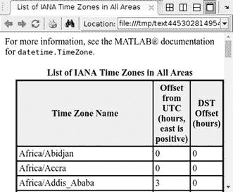

# 使人员 p_1 成为公司 c_1 的员工
p_1.employer = c_1  # 解析更早的前向引用
c_1.employees.append(p_1)
```

样本值如下所示：

```
In : p_1
Out: Person(name='Chuck Brown',
            employer=Company(name='Williams, Munoz and Green',
                            employees=[...]),
            salary=103.28236642597916,
            phones=[Phone(type='mobile', number='533.476.6020'),
                    Phone(type='office', number='629-596-5652x63457')],
            city='Lauramouth')

In : c_1
Out: Company(name='Williams, Munoz and Green',
             employees=[Person(name='Chuck Brown', employer=...,
                              salary=103.28236642597916,
                              phones=[Phone(type='mobile', number='533.476.6020'),
                                      Phone(type='office', number='629-596-5652x63457')],
                              city='Lauramouth')])
```

注意人员雇主详情和公司员工之间的循环引用。

#### 4.7.4.4 遍历链接的数据类

第 4.7.4.3 节中创建的 `p_1` 和 `c_1` 对象是相互链接的：该人员是该公司的员工，而该公司的员工列表包含该人员。如前所述，对象只存储彼此的内存引用，而不是数据的副本。除了节省内存外，对一个对象的任何更改都会立即反映在所有链接的对象中——员工的办公室电话号码更改，雇主也能看到。

相互链接的数据类对象可以看作是内存中的关系型数据库，其中每个数据类是一个表，每个对象是一个行条目，相互链接的引用是外键。与 SQL 一样，可以快速关联跨链接数据类的信息。可以轻松准备公司电话簿：

```
for person in c_1.employees:
    for phone in person.phones:
        if phone.type == 'office':
            print(f'{person.name} {phone.number}')
```


#### 4.7.4.5 使用 Pydantic 进行类型验证

在 4.7.4 节开始时定义的`Position`数据类声明了三个坐标`x`、`y`和`z`的类型为`float`（一个 64 位浮点数）。如果我们用一个字符串为这些值之一创建一个`Position`，会发生什么？

Python:

```
In : a = Position("banana", 3.4, -5.1)
In :
```

它被毫无怨言地接受了！这是个坏消息。只有当这个虚假值出现在计算中时，问题才会显现：

Python:

```
In : a.mag()

TypeError                        Traceback (most recent call last)
 in 
----> 1 a.mag()
 in mag(self)
7    z: float
8    def mag(self):
----> 9        return np.sqrt(self.x**2 + self.y**2 + self.z**2)
TypeError: unsupported operand type(s) for ** or pow() : 'str' and 'int'
```

通常，你希望在输入错误数据时立刻发现问题，而不是在将来某个不可预知的使用数据时才暴露。

Pydantic 模块定义了一种强制类型检查的数据类。我们的`Position`类在使用 Pydantic 创建时如下所示：

Python:

```
from pydantic import BaseModel
class Position(BaseModel):
x: float
y: float
z: float
def mag(self):
return np.sqrt(self.x**2 + self.y**2 + self.z**2)
```

现在，错误会在对象创建时抛出，而不是在使用类型错误的数据时：

Python:

```
In : good = Position(x=22.1, y=3.4, z=-5.1)
In : bad = Position(x = "banana", y=3.4, z=-5.1)
---> bad = Position(x = "banana", y=3.4, z=-5.1)
in pydantic.main.BaseModel.__init__()
ValidationError: 1 validation error for Position
x
value is not a valid float (type=type_error.float)
```

### 4.7.5 枚举

枚举（Enums）是具有描述性名称的相关常量的集合，旨在使代码更清晰。例如，一个求解各种类型偏微分方程的程序可能将其分类为椭圆型、双曲型或抛物型。我们可以创建一个使用这些确切名称的枚举，而不是为这些方程类型分配数值或字符串常量：

| MATLAB: | Python: |
| --- | --- |
| `classdef` `EqType``enumeration``Elliptic, ...``Hyperbolic, ...``Parabolic``end``end` | `import enum``class EqType``(enum.Enum):``Elliptic = 1``Hyperbolic = 2``Parabolic = 3` |

然后像这样使用枚举项：

| MATLAB: | Python: |
| --- | --- |
| `if` `b*b == a*c``eType = EqType.Elliptic;``else if` `b*b > a*c`  `eType = EqType.Hyperbolic;``else`  `eType = EqType.Parabolic;``end``if` `(eType == EqType.Parabolic)`  `parsolv(coeff,`  `...``)` | `if` `b*b == a*c:``eType = EqType.Elliptic``else if` `b*b > a*c:``eType = EqType.Hyperbolic``else``:``eType = EqType.Parabolic``if` `eType == EqType.Parabolic:``parsolv(coeff, ...)` |

Python 的枚举是可迭代的，这意味着我们可以遍历它们。此外，每个枚举项的字符串和整数表示可以通过该项的`.name`和`.value`属性找到。

MATLAB 不提供遍历枚举项的方法。

Python:

```
In : for x in EqType:
...: print(x, x.name, x.value)
EqType.Elliptic Elliptic 1
EqType.Hyperbolic Hyperbolic 2
EqType.Parabolic Parabolic 3
```

## 4.8 警告：对于非标量，"`=`" 复制的是引用！

MATLAB 数据容器与 Python 的一个关键区别在于，MATLAB 中的赋值`b = a`会完整复制`a`的内容并将其放入新变量`b`中。在 Python 中，这只对标量成立。如果`a`是一个列表、字典、NumPy 数组或任何其他高级数据容器，Python 只会将`a`的*引用*复制到`b`中。换句话说，`a`和`b`将指向同一个内存地址；`a`和`b`成为指向同一底层数据的两个名称。另一种说法是，`b = a`使`b`成为`a`的*别名*。反过来，对`a`所做的更改也会表现为对`b`的更改。

不用说，复制引用而非整个数据结构会给不知情的人带来巨大的困扰。看似简单的计算会报告错误的结果，数据似乎被损坏，结果不可重复，等等。

要复制 MATLAB 的`=`行为，并创建一个包含`a`中所有内容副本的新变量`b`，必须导入`copy`模块并显式调用其专有方法之一，即`copy.copy()`或`copy.deepcopy()`。

以下是对该问题的简要演示。`id()`函数报告对象的**内存地址**：

```
In : a = [1, 2]
In : b = a
In : id(a), id(b)
Out: (139806965581896, 139806965581896)
In : b[0] = 999999
In : b
Out: [999999, 2]
In : a
Out: [999999, 2]
```

创建一个内容与`a`重复的变量`b`应如下操作：

```
In : from copy import copy
In : a = [1, 2]
In : b = copy(a)
In : id(a), id(b)
Out: (139806060352840, 139806059562504)
In : b[0] = 999999
In : b
Out: [999999, 2]
In : a
Out: [1, 2]
```

对于包含其他数据容器的数据容器，需要使用`copy`模块中的`deepcopy()`函数。

脚注 1 2 3 4 5 6 7

# 5. 日期和时间

时间数据在计算工作中频繁出现。来自传感器的测量记录、经济结果、股票价格、时间步进数值模拟等，如果没有伴随的时间值，都是无用的。在本章中，我们将介绍 Python 的`datetime`模块，它提供了与 MATLAB 同名数据类型类似的功能。

## 5.1 时间

Python 的`time`模块具有返回当前时间（本地时区或 UTC）、测量 CPU 时间或经过的时间，以及休眠所需时间的功能。

### 5.1.1 当前时间

Python 的`time.time()`函数返回与 MATLAB 中`posixtime(datetime())`相同的值，即当前时间的双精度表示，以 Unix 纪元秒为单位，自 1970 年 1 月 1 日午夜起持续递增的秒数（忽略闰秒），精度为微秒。除此之外，它在 Python 中还用于计算代码段的运行时间。

`time.strftime()`函数根据所需格式返回当前时间：

| MATLAB: | Python: |
| --- | --- |
| `>> format long e``>> posixtime(datetime())``1.572210959845713e+09``>> t = datetime;``>> datestr(t,'yyyy-mm-dd HH:MM:ss')``'2019-10-27 14:25:26'` | `In : import time``In : time.time()``Out: 1572210959.845713``In : time.strftime('%Y-%m-%d %H:%M:%S')``Out: '2019-10-27 14:25:26'` |


### 5.1.2 时间字符串格式

`strftime()` 的格式参数包含 1989 年 C 标准库中同名函数所接受的所有参数，以及一些额外参数。在某些情况下，输出结果取决于计算机的区域设置。这可以通过在 Linux 和 macOS 的终端中执行命令 `locale`，或在 Windows 的命令提示符中执行命令 `systeminfo`（查看输出中的“系统区域设置”）来揭示。表 5-1 中的示例使用了来自 Python 项目文档的 `en_US` 和 `de_DE` 区域设置。

如果支持该格式，则给出 `datestr()` 函数对应的 MATLAB 等效格式字符串。

**表 5-1** `strftime()` 和 `strptime()` 格式代码

| Python 指令 | 含义 | 示例 | `datestr()` 中的 MATLAB 等效项 |
| --- | --- | --- | --- |
| `%a` | 缩写的工作日名称 | Sun, Mon (en_US) So, Mo (de_DE) | `ddd` |
| `%A` | 完整的工作日名称 | Sunday (en_US) Sonntag (de_DE) | `dddd` |
| `%w` | 表示星期几的整数 | Python: 0 (周日) … 6 MATLAB: 1 (周日) … 7 | `e` |
| `%d` | 两位数的月份中的日期 | 01, …, 31 | `dd` |
| `%b` | 缩写的月份名称 | Jan, Dec (en_US) Jan, Dez (de_DE) | `MMM` |
| `%B` | 完整的月份名称 | January (en_US) Januar (de_DE) | `MMMM` |
| `%m` | 两位数的月份 | 01, …, 12 | `MM` |
| `%y` | 两位数的年份 | 99, 00, …, 19 | `yy` |
| `%Y` | 四位数的年份 | 1999, 2000, …, 2019 | `yyyy` 或 `u` |
| `%H` | 两位数的小时，0–23 | 00, …, 23 | `HH` |
| `%I` | 两位数的小时，0–11 | 00, …, 11 | `HH PM` (输出包含 `PM`) |
| `%p` | AM 或 PM | AM, PM (en_US) am, pm (de_DE) | `AM` 或 `PM` |
| `%M` | 两位数的分钟 | 00, …, 59 | `mm` |
| `%S` | 两位数的秒 | 00, …, 59 | `ss` |
| `%f` | 六位数的微秒 | 000000, …, 999999 | `S .. SSSSSSSSS` (十分之一秒到纳秒) |
| `%z` | UTC 偏移 ±HHMM[SS[.ffffff]] | +0000, –0900015 | `Z` |
| `%j` | 三位数的一年中的第几天 | 001, …, 366 | `DDD` |
| `%U` | 两位数的年份中的第几周（星期日为一周开始） | 00, …, 53 | 不可用 |
| `%W` | 两位数的年份中的第几周（星期一为一周开始） | 00, …, 53 | 不可用 |
| `%c` | 区域设置特定的日期和时间 | Sun Oct 27 16:57:47 2019 (en US) | `datetime()` 默认 |
| `%x` | 区域设置特定的日期 | 10/27/19 (en_US) 27.10.2019 (de_DE) | 不可用 |
| `%X` | 区域设置特定的时间 | 17:00:53 (en_US) 17:00:53 (de_DE) | 不可用 |
| `%%` | 字面量 % | % | % |

### 5.1.3 tic, toc；%timeit

MATLAB 的 `tic` 和 `toc` 计算嵌套它们之间的命令所消耗的 CPU 时间。Python 中的 `time.time()` 可以做同样的事情，但需要更多输入：

| MATLAB: | Python: |
| --- | --- |
| `>> N = 1000;` `>> tic` `>> a = eig(rand(N))` `>> toc` `Elapsed time: 1.57437 seconds.` | `In :` `import time; import numpy as np` `In : N = 1000` `In : tic = time.time()` `In : a = np.linalg.eig(np.random.rand(N,N))` `In : time.time() - tic` `Out: 1.2564113140106201` |

在 Python 程序中，使用 `time.time()` 的差值很有用，但在 ipython 中进行交互式操作时，使用其“魔法”命令 `%timeit` 来测量命令执行所需时间会更方便：

Python:

```
In : %timeit np.linalg.eig(np.random.rand(1000,1000))
1.2 s ± 18.5 ms per loop (mean ± std. dev. of 7 runs, 1 loop each)
```

`%timeit` 会多次运行该命令（上述示例中为七次）并返回所有运行的平均时间。

## 5.2 日期

Python 有三个用于处理日期的标准模块，各自具有不同的功能：

- `datetime` 是适用范围最广的模块，也是本节讨论的重点。它有许多函数可以简化日期计算和执行转换。
- `date` 可以说是 `datetime` 的一个子集，在仅处理日期而不涉及一天内的时间时非常有用。
- `calendar` 具有确定年份是否为闰年、给定日期是星期几以及一个月中天数的函数。

### 5.2.1 `datetime` 对象与字符串的相互转换

`datetime` 模块与 `time` 模块一样，使用 `strftime()` 函数以所需格式打印日期：

| MATLAB: | Python: |
| --- | --- |
| `>> now = datetime()` `28-Oct-2019 21:16:36` `>> datetime(now,'Format',...` `'u-MM-dd hh:mm')` `2019-10-28 21:16` | `In :` `from datetime import` `datetime` `In : datetime.now()` `Out: datetime(2019, 10, 28, 21,` `16, 36, 225635)` `In : datetime.now().strftime(` `'%Y-%m-%d %H:%M')` `Out: '2019-10-28 21:16'` |

`datetime` 和 `time` 都有一个同名的函数 `strptime()`，它执行相反的操作：接收一个包含日期的字符串和另一个描述格式的字符串，然后返回一个 Python 变量，该变量随后可用于执行日期计算。

方便的是，`strptime()` 使用与 `strftime()` 相同的格式指令（表 5-1）从字符串中解析日期，而 `strftime()` 则使用这些指令以所需格式打印日期。从字符串“Aug 12 04:05:51 2006”创建 `datetime` 对象的方法如下：

| MATLAB: | Python: |
| --- | --- |
| `>> S ='Aug 12 04:05:51 2006';` `>> dt=datetime(S,'InputFormat',...` `'MMM dd HH:mm:SS yyyy')` `dt =` `datetime` `12-Aug-2006 04:05:00` | `In :` `from datetime import` `datetime` `In : S = 'Aug 12 04:05:51 2006'` `In : dt = datetime.strptime(S,` `...:       '%b %d %H:%M:%S %Y')` `In : dt` `Out: datetime.datetime(` `2006, 8, 12, 4, 5, 51)` |

### 5.2.2 时间增量

`datetime` 模块函数 `timedelta()` 创建的时间偏移量，其工作方式类似于 MATLAB 中的 `duration` 对象。此示例打印一周的火星太阳日（持续时间为 24 小时 39 分 35.244 秒），从 1986 年 6 月 28 日中午开始：

| MATLAB: | Python: |
| --- | --- |
| `Mars_day = duration(...` `24,39,35.244)` `Start = datetime(...` `1986,6,28,12,0,0)` `for` `i = 0:6` `Start + i*Mars_day` `end` `28-Jun-1986 12:00:00` `29-Jun-1986 12:39:35` `30-Jun-1986 13:19:10` `01-Jul-1986 13:58:45` `02-Jul-1986 14:38:20` `03-Jul-1986 15:17:56` `04-Jul-1986 15:57:31` | `from datetime import` `datetime, timedelta` `Mars_day = timedelta(hours=24,` `minutes=39, seconds=35.244)` `Start = datetime(1986,6,28,12)` `for` `i` `in` `range(7):` `print(Start + i*Mars_day)` `1986-06-28 12:00:00` `1986-06-29 12:39:35.244000` `1986-06-30 13:19:10.488000` `1986-07-01 13:58:45.732000` `1986-07-02 14:38:20.976000` `1986-07-03 15:17:56.220000` `1986-07-04 15:57:31.464000` |

`timedelta` 对象有一个方法 `.total_seconds()`，它返回该增量所表示的秒数。两个 `datetime` 对象的差是一个 `timedelta`，因此我们可以轻松确定两个日期之间经过了多少时间：

| MATLAB: | Python: |
| --- | --- |
| `Jul4 = '1976-07-04 12:00';` `Aug1 = '1976-08-01 18:00';` `J=datetime(Jul4,'InputFormat',...` `'yyyy-MM-dd HH:mm')` `A=datetime(Aug1,'InputFormat',...` `'yyyy-MM-dd HH:mm')` `duration(A-J,'Format','s')` `2.4408e+06 sec` | `from datetime import` `datetime as DT` `Jul4 = '1976-07-04 12:00'` `Aug1 = '1976-08-01 18:00'` `J = DT.strptime(Jul4, '%Y-%m-%d %H:%M')` `A = DT.strptime(Aug1, '%Y-%m-%d %H:%M')` `(A - J).total_seconds()` `Out: 2440800.0` |

MATLAB 和 Python 还允许计算时间增量的比率。此示例打印一个地球年中的火星天数：

| MATLAB: | Python: |
| --- | --- |
| `>> Mars_day = duration(...` `24,39,35.244);` `>> duration(years(1))/Mars_day` `355.47` | `In : Mars_day = timedelta(hours=24,` `...:     minutes=39, seconds=35.244)` `In : timedelta(days=365.24)/Mars_day` `Out: 355.4677472922519` |


## 5.3 时区

默认情况下，Python 和 MATLAB 中的 `Datetime` 对象都不包含时区信息；它们仅反映主机的日期和时间。

通过在调用 `datetime()`、`datetime.now()` 或 `datetime.fromtimestamp()` 函数时填充可选的 `tzinfo` 或 `tz` 关键字，可以使 Python `datetime` 对象包含时区信息。可以创建 `tzinfo` 对象的两个 Python 模块是 `pytz` 和 `dateutil.tz`。（Python 3.9 引入了 `zoneinfo` 模块，在第 5.5 节中讨论。本书使用的 MATLAB 2020b 版本发布于 Python 3.9 之前，因此不支持该模块。）尽管 `pytz` 功能更多，但来自 `dateutil.tz` 的时区在处理边缘情况（例如计算跨越夏令时/标准时间转换的时间差）时能产生更准确的结果 [1]。

在本节中，我们使用 `pytz` 的唯一目的是列出所有已知的时区字符串——类似于 MATLAB 的 `timezones` 命令——这是 `dateutil.tz` 所不能做到的：

| MATLAB: | Python: |
| --- | --- |
| `>> timezones` | `In :` `import pytz` `In : pytz.all_timezones` `Out:` `['Africa/Abidjan',` `'Africa/Accra',` `'Africa/Addis_Ababa',` `'Africa/Algiers',` `...` `'US/Pacific',` `'US/Samoa',` `'UTC',` `'Universal',` `'W-SU',` `'WET',` `'Zulu']` |

MATLAB 表中的时区名称与 `pytz.all_timezones` 返回的名称相匹配。

有了前文列表中获取的有效时区名称，我们就可以创建一个包含时区信息的 `datetime` 对象。请注意，`datetime` 的输出会标识操作系统从中获取时区信息的文件（此示例中为 `'/usr/share/zoneinfo/America/Los_Angeles'`）：

| MATLAB: | Python: |
| --- | --- |
| `>> T = datetime(2020,2,14,...` `13,30,25,'TimeZone',...` `'America/Los_Angeles')` `T =` `14-Feb-2020 13:30:25` `>> T.TimeZone` `'America/Los_Angeles'` `>> datetime(T,'Format',...` `'yyyy-MM-dd''T'...` `'HH:mm:ss''.''SSSSSS')` `2020-02-14T13:30:25.000000` `>> datetime(T,'Format','Z')` `-0800` | `In :` `from datetime import` `datetime` `In :` `from dateutil import` `tz` `In : LA_tz = tz.gettz('America/Los_Angeles')` `In : T = datetime(2020,2,14,13,30,25,` `...:     tzinfo=LA_tz)` `In : T` `Out: datetime.datetime(2020,2,14,13,30,25,` `tzinfo=tzfile(` `'/usr/share/zoneinfo/America/Los_Angeles'))` `In : T.isoformat()` `Out: '2020-02-14T13:30:25-08:00'` `In : T.utcoffset()` `Out: datetime.timedelta(days=-1,seconds=57600)` |

将包含时区信息的 `datetime` 对象显示为任何其他所需时区很容易：

| MATLAB: | Python: |
| --- | --- |
| `>> datetime(T,'TimeZone',...` `'Asia/Tokyo')` `15-Feb-2020 06:30:25` | `In : Tokyo_tz = tz.gettz('Asia/Tokyo')` `In : T.astimezone(Tokyo_tz)` `Out: datetime.datetime(2020,2,15,6,30,25,` `tzinfo=tzfile(` `'/usr/share/zoneinfo/Asia/Tokyo'))` |

### 5.3.1 协调世界时与本地时间

协调世界时（UTC），也称为祖鲁时间或格林威治标准时间，是记录覆盖广阔地理区域的事件的首选时区。MATLAB 和 Python 有几个显式处理协调世界时而非单个计算机本地时间的函数。

矛盾的是，返回协调世界时的 `datetime` 函数，即 `datetime.utcnow()` 和 `datetime.utcfromtimestamp()`，并没有设置 `tzinfo`，因此它们返回的是不含时区信息的对象。换句话说，日、时、分等的数值是正确的，但底层没有元数据表明这是协调世界时时区。如果后续日期计算的计算精度很重要，那么正确方式是在函数名中不包含 `utc`，并显式地传入 `tz=dateutil.tz.UTC` [2]：

Python:

```
In : import time
In : from datetime import datetime
In : from dateutil import tz
In : datetime.now()  # 本地时间（洛杉矶）
Out: datetime.datetime(2019, 11, 9, 18, 20, 57, 118448)
