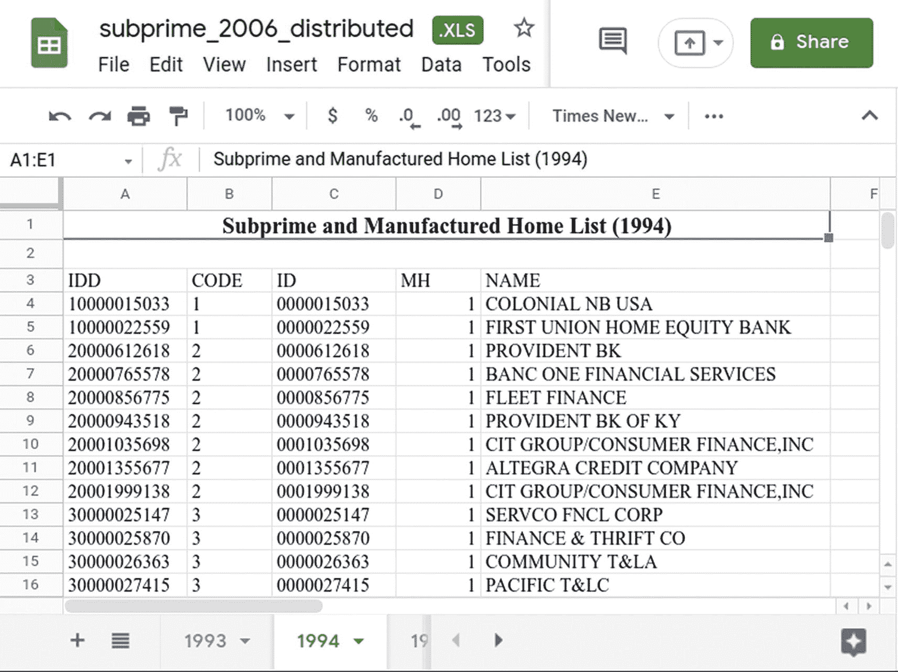
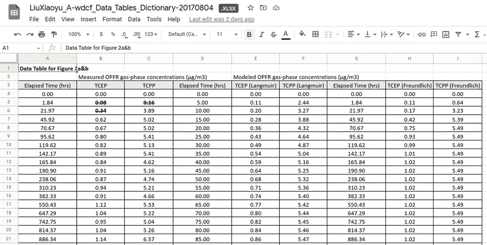

# file: code/matlab_py/bridge_ini_w.py
import configparser
def config():
return configparser.ConfigParser()
def add_section(config, section, data):
config[section] = data
return config
def write(config, ini_file):
with open(ini_file, 'w') as fh:
config.write(fh)
```

以下是 MATLAB 代码，用于填充变量并将其发送到我们的桥接模块进行写入：

MATLAB:
```
% file: code/matlab_py/write_ini.m
ini_w = py.importlib.import_module('bridge_ini_w');
d.pos  = [0.5 -0.3];
d.vel  = [2.7  3.8];
d.name = "point B";
a.CA.county = "LA";
a.CA.zip = 91234;
a.population = 1e7;
config = ini_w.config();
config = ini_w.add_section(config, 'DEFAULT', d);
config = ini_w.add_section(config, 'States', a);
ini_w.write(config, 'out.ini');
```

写入的文件内容如下：

ini:
```
[DEFAULT]
pos = array('d', [0.5, -0.3])
vel = array('d', [2.7, 3.8])
name = point B
[States]
ca = {'county': 'LA', 'zip': 91234.0}
population = 10000000.0
```

## 7.6 二进制文件

基于文本的数据适用于小数据集或供人阅读的数据。然而，随着数据量的增长，读写它们所需的空间和额外时间会变得难以承受。在这些情况下，我们可以通过使用二进制文件来节省存储空间并加快输入/输出操作。

与文本文件一样，我们将从示例开始，展示如何读写通用的二进制文件，然后转向流行的预定义二进制格式，例如 Excel、HDF5、NetCDF4、SQLite 和 MATLAB 自身的 `.mat` 格式。

后续章节 11.​1.​9 中的第 11 章将专门讨论 NumPy 数组的读写。

在 Python 中，通过向 `open()` 函数传递第二个参数 `'rb'`（代表“read binary”，即“读二进制”）来以二进制读取模式打开文件。在 MATLAB 中也是如此，只不过使用的是 `fopen()` 而不是 `open()`。文件打开后，我们可以通过文件句柄的 `.read()` 方法读取所需数量的字节（或整个文件的内容）到字节数组中；使用 `.seek()` 定位到文件内的特定偏移量；使用 `.tell()` 确定当前在文件中的位置。

大多数情况下，读取字节只是完成了一半工作。另一半工作涉及将字节块转换为更高级别的数据类型，如整数、浮点数、字符串等。

标准 Python 模块 `struct` 提供了两个函数 `unpack()` 和 `pack()`，用于将字节转换为其他数据类型，反之亦然。`unpack()` 和 `pack()` 接收一个格式字符串作为输入参数，该字符串描述了所期望数据的数量和类型。我们将首先编写一个包含从 1 到 1,000,000 的整数值的二进制文件，然后再读取该文件。

| MATLAB: | Python: |
| --- | --- |
| `x = 1:1000000; % double``fh = fopen('data.bin', 'wb');``fwrite(fh,x,'uint32');``fclose(fh);` | `import numpy as np``from struct import` `pack``n = 1_000_000``x = np.arange(1,n+1)` *# int64*`raw = pack(f'``{``n``}``I', *x)``with` `open('data.bin', 'wb')` `as` `fh:``fh.write(raw)` |

关于 Python 版本的一些说明：

1.  数字常量中的下划线（`n = 1_000_000`）会被忽略。它们可以作为“语法糖”，使大数值更易于阅读。

2.  传递给 `pack()` 的参数 `*x` 表示展开数组的各个元素；`pack()` 需要的是单独的标量值，即 `1, 2, 3, ...`，而不是一个数组 `x`（“星号”符号在章节 4.​3.​20 中讨论）。

3.  对于纯数值的二进制文件，并不一定需要使用 `struct.pack()`；NumPy 数组具有 `.tofile()` 方法，可以自动完成此操作。下面这几行代码生成的文件与之前使用 `pack()` 的代码相同：

Python:
```
import numpy as np
n = 1_000_000
x = np.arange(1,n+1) # int64
x.astype(np.uint32).tofile('data.bin')
```

在下面的例子中，我们将读取一个大文件到一个名为 `raw` 的字节元组中，然后从这个元组创建一个名为 `Ints` 的新数组，其中包含四字节无符号整数。因此，文件的大小应该是四字节的倍数。

| MATLAB: | Python: |
| --- | --- |
| `fh = fopen('data.bin', 'rb');``raw = uint8(fread(fh));``fclose(fh);``Ints = typecast(raw(:),'uint32');` | `from struct import` `unpack``with` `open('data.bin', 'rb')` `as` `fh:``raw = fh.read()``n_ints = len(raw) // 4``Ints = unpack(f'<``{``n_ints``}``I', raw)` |

**注意**

单一数据类型的数值二进制文件可以通过调用 NumPy 的 `fromfile()` 函数加载（参考章节 11.​1.​10.​5）。

传递给 `unpack()` 的格式字符串包含三个部分：`<` 表示小端序数据（这是可选的；如果省略，数据将根据运行代码的操作系统的字节序加载）；要返回的无符号整数个数；以及所需的格式——`I` 表示“无符号四字节整数”。表 7-1 显示了 `struct` 的字母代码及其含义。

**表 7-1** `struct` 格式字符

| 格式 | C 类型 | Python 类型 | 字节数 |
| --- | --- | --- | --- |
| `x` | 填充字节 | 无值 | 1 |
| `c` | char | bytes | 1 |
| `b` | signed char | 整数 | 1 |
| `B` | unsigned char | 整数 | 1 |
| `?` | _Bool | bool | 1 |
| `h` | short | 整数 | 2 |
| `H` | unsigned short | 整数 | 2 |
| `i` | int | 整数 | 4 |
| `I` | unsigned int | 整数 | 4 |
| `l` | long | 整数 | 4 |
| `L` | unsigned long | 整数 | 4 |
| `q` | long long | 整数 | 8 |
| `Q` | unsigned long long | 整数 | 8 |
| `n` | ssize_t | 原生整数 | *可变* |
| `N` | Size_t | 无符号原生整数 | *可变* |
| `e` | short float | 浮点数 | 2 |
| `f` | float | 浮点数 | 4 |
| `d` | double | 浮点数 | 8 |
| `s` | char[] | bytes | 1 |
| `p` | char[] | bytes | 1 |

在 Python 中写入二进制文件涉及以“写入二进制”模式 `'wb'` 打开文件，然后将一个或多个字节传递给文件句柄的 `.write()` 方法。我们可以使用 `struct` 的 `pack()` 函数从简单的 Python 数据类型创建字节。以下代码写入一个二进制文件，其中包含一个短头部，后跟一个双精度浮点数数组。头部包含一个已签名 32 位整数形式的双精度浮点数计数，接着是 20 个描述数据的字符，最后是双精度浮点数本身。

| MATLAB: | Python: |
| --- | --- |
| `fh = fopen('data2.bin', 'wb');``N = 50;``info = "test data";``padded = sprintf('``%-20s``',info);``x = 0:N-1;``fh = fopen('data2.bin', 'wb');``fwrite(fh,N,'integer*4');``fwrite(fh,padded,'char');``fwrite(fh,x,'double');``fclose(fh);` | `import numpy as np``from struct import` `pack``N = 50``info = "test data"``x = np.arange(N, dtype=np.double)``with` `open('data2.bin', 'wb')` `as` `fh:``fh.write(pack('1i', N))``fh.write(pack('20s', info.encode()))``fh.write(pack(f'``{``N``}``d', *x))` |

两种实现生成的 `data2.bin` 二进制文件中的数值部分将是相同的。然而，字符串部分有所不同，因为 Python 用零填充空余部分，而 MATLAB 的 `sprintf()` 使用空格填充。

Python 符号 `*x`（来自 `fh.write(pack(f'Nd', *x))`）可能看起来不直观。回想一下章节 4.​3.​20 的内容，列表或数组前的星号基本上表示“此容器中的所有项”；`x` 是一个单独的项，但 `*x` 表示 `x` 中所有 50 个单独的元素，这正是 `pack()` 所需要的。


## 7.7 Excel `.xls, .xlsx`

原生 Excel 文件格式 `.xls`（2007 版之前的 Excel）和 `.xlsx` 的流行程度或许仅次于 `.csv` 文件。虽然使用 Excel 应用程序本身查看和操作这些文件最为便捷，但许多编程语言（包括 MATLAB 和 Python）都提供了相应的文件读取和写入库。

MATLAB 的 `sheetnames()` 和 `readtable()` 函数最接近的对应是 Pandas 模块中的 `ExcelFile()` 和 `read_excel()` 函数。Pandas 本身是一个庞大的主题，将在第 13 章中更全面地介绍。此处，我仅使用与读取和写入 Excel 文件相关的部分。Pandas 的 Excel 函数是对两个底层 Python 模块的封装：`xlrd`（用于 `.xls` 文件）和 `openpyxl`（用于 `.xlsx` 文件）。所有这些都包含在 Anaconda 发行版中。

### 7.7.1 读取 `.xls` 和 `.xlsx` 文件

Excel 文件的读取通过两个文件进行演示。`subprime_2006_distributed.xls` 包含了 1993 年至 2006 年间提供次级贷款的美国金融机构名称，其中每年的数据都存放在一个以该年份命名的工作表（一个选项卡）中。在 Google 表格中，它看起来像这样：



`LiuXiaoyu A-wdcf_Data_Tables_Dictionary-20170804.xlsx` 比 `.xls` 文件更复杂，因为它在单个工作表中包含了多个表格。这个电子表格伴随一篇期刊论文《测量和模拟有机磷酸酯阻燃剂在不透水表面上的表面吸附动力学》发布，并来自美国环境保护署网站。它看起来像这样：



接下来将展示电子表格的常见读取操作。

#### 7.7.1.1 获取工作表名称

除了获取工作表名称外，我们还将识别标题为 “1994” 的工作表的索引。在 MATLAB 中，需要这个索引来从特定工作表提取数据。在 Python 中则不需要，因为可以通过标题直接选择单个工作表。

| MATLAB: | Python: |
| --- | --- |
| `>> F = 'subprime_2006_distributed.xls';`<br>`>> tabs = sheetnames(F)`<br>  `13×1 string array`<br>    `"1993"`<br>    `"1994"`<br>       `:`<br>    `"2005"`<br>`>> find(tabs == "1994")`<br>     `2` | `In :` `import pandas as pd`<br>`In : F = 'subprime_2006_distributed.xls';`<br>`In : tabs = pd.ExcelFile(F)`<br>`In : tabs.sheet_names`<br>`Out[16]:`<br>`['1993',`<br>`'1994',`<br>`:`<br>`'2005']` |

#### 7.7.1.2 获取工作表大小

| MATLAB: | Python: |
| --- | --- |
| `>> [nRows, nCols] = size(T)`<br>`nRows =`    `85`<br>`nCols =`     `5` | `In : nRows, nCols = T.shape`<br>`In : nRows, nCols`<br>`(85, 5)` |

#### 7.7.1.3 提取行

此处，我们从 `.xls` 文件的 “1994” 选项卡中提取第九行。行索引可能比较棘手，因为 MATLAB 和 Pandas 都会尝试推断合理的列名以及到实际数据起始位置的正确偏移量。MATLAB 能够识别此文件中交错的标题，并从第 4 行开始加载数据；因此，第九行出现在行索引 6 处。Pandas 无法自动识别这一点，因此我们传递一个可选参数 `header=2`，告诉它从第三行（索引从 0 开始）获取列名。

| MATLAB: | Python: |
| --- | --- |
| `>> F = 'subprime_2006_distributed.xls';`<br>`>> tabs = sheetnames(F);`<br>`>> i = find(tabs == "1994");`<br>`>> T = readtable(F,'Sheet',i);`<br>`>> Tc = table2cell(T);`<br>`>> Tc(6,:)`<br>  `1×5 cell array`<br>`{'20000943518'} {'2'} {[943518]} {[1]}`    `{'PROVIDENT BK OF KY'}` | `In :` `import pandas as pd`<br>`In : F = 'subprime_2006_distributed.xls';`<br>`In : T = pd.read_excel(F, \`<br>`sheet_name='1994',header=2)`<br>`In : T.values[5,:]`<br>`Out:`<br>`array(['20000943518', 2.0, 943518, 1.0,`<br>`'PROVIDENT BK OF KY          '],`<br>`dtype=object)` |

可以通过将 5（在 Python 中）或 6（在 MATLAB 中）替换为一个范围（例如，5:8）来选择更多行。

变量 `T` 在 MATLAB 中是一个表格（table），在 Python 中是一个数据框（dataframe）。表格和数据框具有强大的功能，将在第 13 章中探讨，但当你只需要电子表格中的数值而不需要过滤、排序、合并等操作时，它们就显得大材小用了。因此，在 MATLAB 中我们将表格转换为更简单的容器，在 Python 中则通过其 `.values` 属性访问数据框。MATLAB 表格可以使用一个 `table2*` 函数转换为矩阵、元胞数组或结构体变量。`table2cell()` 对于上述数据中字符串和数字的混合体是一个合理的选择。

#### 7.7.1.4 提取列

列子集的操作与行子集类似；只需要对表格变量使用不同的索引即可。此处，我们将提取 C 列和 D 列的值。以下会话延续了前面的行示例。

| MATLAB: | Python: |
| --- | --- |
| `>> table2array(T(:,3:4))`<br>`1.503300000e+04 1.000000000e+00`<br>`2.255900000e+04 1.000000000e+00`<br>`6.126180000e+05 1.000000000e+00`<br>`7.655780000e+05 1.000000000e+00`<br>`8.567750000e+05 1.000000000e+00`                `:` | `In : T.values[:,2:4]`<br>`array([[15033, 1.0],`<br>`[22559, 1.0],`<br>`[612618, 1.0],`<br>`[765578, 1.0],`<br>`[856775, 1.0]],`<br>:` |

#### 7.7.1.5 提取矩形区域

`.xlsx` 文件处理起来更具挑战性，因为每个工作表中都包含多个表格。我们不能依赖 MATLAB 或 Pandas 来理解数据结构；相反，我们需要自行确定要提取的行和列的特定区域。示例中的文件名缩写为 `LiuXiaoyu_A.xlsx` 以适应格式要求。我们将从工作表 “`Data Table (Figs 2a&b&c&d)`” 的 D、E、F 列中提取所有数值。首先，我们了解一下如果不指定行或列边界，自动加载器会加载哪些内容：

| MATLAB: | Python: |
| --- | --- |
| `>> F = 'LiuXiaoyu_A.xlsx';`<br>`>> tabs = sheetnames(F);`<br>`>> sheet = 'Data Table (Figs 2a&b&c&d)';`<br>`>> i = find(tabs == sheet);`<br>`>> T = readtable(F,'Sheet',i);`<br>`>> size(T)`       `301  19` | `In :` `import pandas as pd`<br>`In : F = 'LiuXiaoyu_A.xlsx';`<br>`In : sheet = 'Data Table (Figs 2a&b&c&d)'`<br>`In : T = pd.read_excel(F, \`<br>`sheet_name=sheet,header=2)`<br>`In : T.shape`<br>`Out: (301, 19)` |

毫不意外，两者都无法识别此处的多个表格；它们都只返回一个由所有较小表格的最后一行和最后一列限定的单一表格。要选择一个区域，MATLAB 使用 `'Range'` 可选参数来限制行和列。Pandas 使用关键字参数 `usecols` 选择列，并结合 `skiprows` 和 `nrows` 选择行范围。

| MATLAB: | Python: |
| --- | --- |
| `>> F = 'LiuXiaoyu_A.xlsx';`<br>`>> tabs = sheetnames(F);`<br>`>> sheet = 'Data Table (Figs 2a&b&c&d)';`<br>`>> i = find(tabs == sheet);`<br>`>> T = readtable(F,'Sheet',i,`<br>`...`                 `'Range','D4:F304');`<br>`>> Tc = table2array(T);`<br>`>> Tc(300:`<br>`end`,1:2)`<br>   `1.4950e+03   3.9029e-02`<br>   `1.5000e+03   3.5008e-02` | `In :` `import pandas as pd`<br>`In : F = 'LiuXiaoyu_A.xlsx';`<br>`In : sheet = 'Data Table (Figs 2a&b&c&d)'`<br>`In : T = pd.read_excel(F, sheet_`<br>                   `name=sheet,\`<br>`usecols='D:F',skiprows=2)`<br>`In : T.values[299:,:2]`<br>`Out:`<br>`array([[1.49500000e+03,  3.90288541e-02],`<br>`[1.50000000e+03,  3.50079764e-02]])` |

注意，我们不需要告诉 Pandas 要读取多少行——它会在没有更多数据时自动停止。MATLAB 的矩形区域选择则不那么方便，因为我们必须知道结束行的行号。


### 7.7.2 编写 `.xlsx` 文件

Pandas 编写 `.xlsx` 文件的能力与读取它一样简单——只要你的数据存在于 Pandas 数据帧中即可。同样地，MATLAB 的 `writetable()` 可以直接将表格写入 `.xlsx` 文件。针对表格 `T` 和数据帧 `df`，操作如下所示：

| MATLAB: | Python: |
| --- | --- |
| `writetable(T,'file.xlsx','Sheet','tab name');` | `df.to_excel('file.xlsx', sheet_name='tab name')` |

如果你的工作流程不使用 Pandas，则必须先将其数据插入一个或多个数据帧中，然后才能使用 Pandas 的 `.to_excel()` 方法。这可能会得不偿失。如果你还没有数据帧，更简单的方法是直接使用 `openpyxl` 模块。`openpyxl` 的写入功能非常强大，因为它可以访问字体大小、颜色、单元格合并以及许多其他自定义功能，而 MATLAB 本身只能通过 COM 在 Windows 上实现这些功能。^((23)) (当然，MATLAB 可以在 Python 的帮助下编写一个精心制作的 `.xlsx` 文件。第 7.8 节展示了以下由 MATLAB 调用 `openpyxl` 实现的示例。)

以下示例展示了 `openpyxl` 设置字体样式和单元格颜色、合并单元格以及插入公式的能力：

Python:

```
