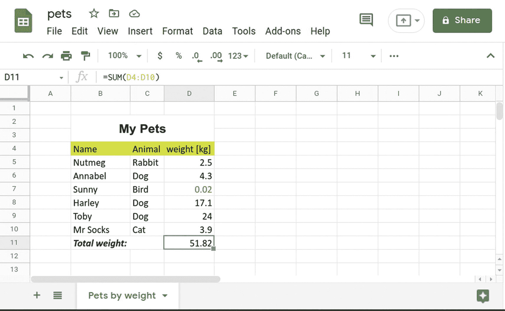

# 对所有重量求和的公式
sheet[f'D{row+1}'] = f"=SUM(D4:D{row})"
row += 1
sheet.merge_cells(f'B{row}:C{row}')
sheet[f'B{row}'] = 'Total weight:'
sheet[f'B{row}'].font = ft_italics
book.save("pets.xlsx")
```

图 7-1 显示了 `pets.xlsx` 在 Google Sheets 中的外观。



图 7-1

使用 `openpyxl` 设置字体样式、单元格颜色和单元格合并

## 7.8 方案 7-5：编写一个 `.xlsx` 文件

虽然 MATLAB 可以自行编写 Excel `.xlsx` 文件，但对单元格元素的精细控制只能在 Windows 上通过 COM 完成。要在任何平台上，无需 COM 实现相同程度的控制，可以从 MATLAB 中调用 Python 的 `openpyxl` 模块。这里，我们重复第 7.7.1.2 节的纯 Python 解决方案来创建 `pets.xlsx` 文件。

需要一个带有允许单元格赋值函数的小型桥接模块。

Python:

```
