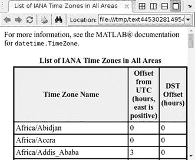

# 5. 日期和时间

时间数据在计算工作中频繁出现。来自传感器的测量记录、经济结果、股票价格、时间步进数值模拟等，如果没有伴随的时间值，都是无用的。在本章中，我们将介绍 Python 的`datetime`模块，它提供了与 MATLAB 同名数据类型类似的功能。

## 5.1 时间

Python 的`time`模块具有返回当前时间（本地时区或 UTC）、测量 CPU 时间或经过的时间，以及休眠所需时间的功能。

### 5.1.1 当前时间

Python 的`time.time()`函数返回与 MATLAB 中`posixtime(datetime())`相同的值，即当前时间的双精度表示，以 Unix 纪元秒为单位，自 1970 年 1 月 1 日午夜起持续递增的秒数（忽略闰秒），精度为微秒。除此之外，它在 Python 中还用于计算代码段的运行时间。

`time.strftime()`函数根据所需格式返回当前时间：

| MATLAB: | Python: |
| --- | --- |
| `>> format long e` `>> posixtime(datetime())` `1.572210959845713e+09` `>> t = datetime;` `>> datestr(t,'yyyy-mm-dd HH:MM:ss')` `'2019-10-27 14:25:26'` | `In : import time` `In : time.time()` `Out: 1572210959.845713` `In : time.strftime('%Y-%m-%d %H:%M:%S')` `Out: '2019-10-27 14:25:26'` |

### 5.1.2 时间字符串格式

`strftime()` 的格式参数包含 1989 年 C 标准库中同名函数所接受的所有参数，以及一些额外参数。在某些情况下，输出结果取决于计算机的区域设置。这可以通过在 Linux 和 macOS 的终端中执行命令 `locale`，或在 Windows 的命令提示符中执行命令 `systeminfo`（查看输出中的“系统区域设置”）来揭示。表 5-1 中的示例使用了来自 Python 项目文档的 `en_US` 和 `de_DE` 区域设置。

如果支持该格式，则给出 `datestr()` 函数对应的 MATLAB 等效格式字符串。

**表 5-1** `strftime()` 和 `strptime()` 格式代码

| Python 指令 | 含义 | 示例 | `datestr()` 中的 MATLAB 等效项 |
| --- | --- | --- | --- |
| `%a` | 缩写的工作日名称 | Sun, Mon (en_US) So, Mo (de_DE) | `ddd` |
| `%A` | 完整的工作日名称 | Sunday (en_US) Sonntag (de_DE) | `dddd` |
| `%w` | 表示星期几的整数 | Python: 0 (周日) … 6 MATLAB: 1 (周日) … 7 | `e` |
| `%d` | 两位数的月份中的日期 | 01, …, 31 | `dd` |
| `%b` | 缩写的月份名称 | Jan, Dec (en_US) Jan, Dez (de_DE) | `MMM` |
| `%B` | 完整的月份名称 | January (en_US) Januar (de_DE) | `MMMM` |
| `%m` | 两位数的月份 | 01, …, 12 | `MM` |
| `%y` | 两位数的年份 | 99, 00, …, 19 | `yy` |
| `%Y` | 四位数的年份 | 1999, 2000, …, 2019 | `yyyy` 或 `u` |
| `%H` | 两位数的小时，0–23 | 00, …, 23 | `HH` |
| `%I` | 两位数的小时，0–11 | 00, …, 11 | `HH PM` (输出包含 `PM`) |
| `%p` | AM 或 PM | AM, PM (en_US) am, pm (de_DE) | `AM` 或 `PM` |
| `%M` | 两位数的分钟 | 00, …, 59 | `mm` |
| `%S` | 两位数的秒 | 00, …, 59 | `ss` |
| `%f` | 六位数的微秒 | 000000, …, 999999 | `S .. SSSSSSSSS` (十分之一秒到纳秒) |
| `%z` | UTC 偏移 ±HHMM[SS[.ffffff]] | +0000, –0900015 | `Z` |
| `%j` | 三位数的一年中的第几天 | 001, …, 366 | `DDD` |
| `%U` | 两位数的年份中的第几周（星期日为一周开始） | 00, …, 53 | 不可用 |
| `%W` | 两位数的年份中的第几周（星期一为一周开始） | 00, …, 53 | 不可用 |
| `%c` | 区域设置特定的日期和时间 | Sun Oct 27 16:57:47 2019 (en US) | `datetime()` 默认 |
| `%x` | 区域设置特定的日期 | 10/27/19 (en_US) 27.10.2019 (de_DE) | 不可用 |
| `%X` | 区域设置特定的时间 | 17:00:53 (en_US) 17:00:53 (de_DE) | 不可用 |
| `%%` | 字面量 % | % | % |

### 5.1.3 tic, toc；%timeit

MATLAB 的 `tic` 和 `toc` 计算嵌套它们之间的命令所消耗的 CPU 时间。Python 中的 `time.time()` 可以做同样的事情，但需要更多输入：

| MATLAB: | Python: |
| --- | --- |
| `>> N = 1000;` `>> tic` `>> a = eig(rand(N))` `>> toc` `Elapsed time: 1.57437 seconds.` | `In :` `import time; import numpy as np` `In : N = 1000` `In : tic = time.time()` `In : a = np.linalg.eig(np.random.rand(N,N))` `In : time.time() - tic` `Out: 1.2564113140106201` |

在 Python 程序中，使用 `time.time()` 的差值很有用，但在 ipython 中进行交互式操作时，使用其“魔法”命令 `%timeit` 来测量命令执行所需时间会更方便：

Python:

```
In : %timeit np.linalg.eig(np.random.rand(1000,1000))
```

1.2 s ± 18.5 ms per loop (mean ± std. dev. of 7 runs, 1 loop each)

# 5.2 日期

`%timeit` 会多次运行该命令（上述示例中为七次）并返回所有运行的平均时间。

Python 有三个用于处理日期的标准模块，各自具有不同的功能：

- `datetime` 是适用范围最广的模块，也是本节讨论的重点。它有许多函数可以简化日期计算和执行转换。
- `date` 可以说是 `datetime` 的一个子集，在仅处理日期而不涉及一天内的时间时非常有用。
- `calendar` 具有确定年份是否为闰年、给定日期是星期几以及一个月中天数的函数。

## 5.2.1 `datetime` 对象与字符串的相互转换

`datetime` 模块与 `time` 模块一样，使用 `strftime()` 函数以所需格式打印日期：

| MATLAB: | Python: |
| --- | --- |
| `>> now = datetime()` `28-Oct-2019 21:16:36` `>> datetime(now,'Format',...` `'u-MM-dd hh:mm')` `2019-10-28 21:16` | `In :` `from datetime import` `datetime` `In : datetime.now()` `Out: datetime(2019, 10, 28, 21,` `16, 36, 225635)` `In : datetime.now().strftime(` `'%Y-%m-%d %H:%M')` `Out: '2019-10-28 21:16'` |

`datetime` 和 `time` 都有一个同名的函数 `strptime()`，它执行相反的操作：接收一个包含日期的字符串和另一个描述格式的字符串，然后返回一个 Python 变量，该变量随后可用于执行日期计算。

方便的是，`strptime()` 使用与 `strftime()` 相同的格式指令（表 5-1）从字符串中解析日期，而 `strftime()` 则使用这些指令以所需格式打印日期。从字符串“Aug 12 04:05:51 2006”创建 `datetime` 对象的方法如下：

| MATLAB: | Python: |
| --- | --- |
| `>> S ='Aug 12 04:05:51 2006';` `>> dt=datetime(S,'InputFormat',...` `'MMM dd HH:mm:SS yyyy')` `dt =` `datetime` `12-Aug-2006 04:05:00` | `In :` `from datetime import` `datetime` `In : S = 'Aug 12 04:05:51 2006'` `In : dt = datetime.strptime(S,` `...:       '%b %d %H:%M:%S %Y')` `In : dt` `Out: datetime.datetime(` `2006, 8, 12, 4, 5, 51)` |

## 5.2.2 时间增量

`datetime` 模块函数 `timedelta()` 创建的时间偏移量，其工作方式类似于 MATLAB 中的 `duration` 对象。此示例打印一周的火星太阳日（持续时间为 24 小时 39 分 35.244 秒），从 1986 年 6 月 28 日中午开始：

| MATLAB: | Python: |
| --- | --- |
| `Mars_day = duration(...` `24,39,35.244)` `Start = datetime(...` `1986,6,28,12,0,0)` `for` `i = 0:6` `Start + i*Mars_day` `end` `28-Jun-1986 12:00:00` `29-Jun-1986 12:39:35` `30-Jun-1986 13:19:10` `01-Jul-1986 13:58:45` `02-Jul-1986 14:38:20` `03-Jul-1986 15:17:56` `04-Jul-1986 15:57:31` | `from datetime import` `datetime, timedelta` `Mars_day = timedelta(hours=24,` `minutes=39, seconds=35.244)` `Start = datetime(1986,6,28,12)` `for` `i` `in` `range(7):` `print(Start + i*Mars_day)` `1986-06-28 12:00:00` `1986-06-29 12:39:35.244000` `1986-06-30 13:19:10.488000` `1986-07-01 13:58:45.732000` `1986-07-02 14:38:20.976000` `1986-07-03 15:17:56.220000` `1986-07-04 15:57:31.464000` |

`timedelta` 对象有一个方法 `.total_seconds()`，它返回该增量所表示的秒数。两个 `datetime` 对象的差是一个 `timedelta`，因此我们可以轻松确定两个日期之间经过了多少时间：

| MATLAB: | Python: |
| --- | --- |
| `Jul4 = '1976-07-04 12:00';` `Aug1 = '1976-08-01 18:00';` `J=datetime(Jul4,'InputFormat',...` `'yyyy-MM-dd HH:mm')` `A=datetime(Aug1,'InputFormat',...` `'yyyy-MM-dd HH:mm')` `duration(A-J,'Format','s')` `2.4408e+06 sec` | `from datetime import` `datetime as DT` `Jul4 = '1976-07-04 12:00'` `Aug1 = '1976-08-01 18:00'` `J = DT.strptime(Jul4, '%Y-%m-%d %H:%M')` `A = DT.strptime(Aug1, '%Y-%m-%d %H:%M')` `(A - J).total_seconds()` `Out: 2440800.0` |

MATLAB 和 Python 还允许计算时间增量的比率。此示例打印一个地球年中的火星天数：

| MATLAB: | Python: |
| --- | --- |
| `>> Mars_day = duration(...` `24,39,35.244);` `>> duration(years(1))/Mars_day` `355.47` | `In : Mars_day = timedelta(hours=24,` `...:     minutes=39, seconds=35.244)` `In : timedelta(days=365.24)/Mars_day` `Out: 355.4677472922519` |

# 5.3 时区

默认情况下，Python 和 MATLAB 中的 `Datetime` 对象都不包含时区信息；它们仅反映主机的日期和时间。

通过在调用 `datetime()`、`datetime.now()` 或 `datetime.fromtimestamp()` 函数时填充可选的 `tzinfo` 或 `tz` 关键字，可以使 Python `datetime` 对象包含时区信息。可以创建 `tzinfo` 对象的两个 Python 模块是 `pytz` 和 `dateutil.tz`。（Python 3.9 引入了 `zoneinfo` 模块，在第 5.5 节中讨论。本书使用的 MATLAB 2020b 版本发布于 Python 3.9 之前，因此不支持该模块。）尽管 `pytz` 功能更多，但来自 `dateutil.tz` 的时区在处理边缘情况（例如计算跨越夏令时/标准时间转换的时间差）时能产生更准确的结果 [1]。

在本节中，我们使用 `pytz` 的唯一目的是列出所有已知的时区字符串——类似于 MATLAB 的 `timezones` 命令——这是 `dateutil.tz` 所不能做到的：

| MATLAB: | Python: |
| --- | --- |
| `>> timezones` | `In :` `import pytz` `In : pytz.all_timezones` `Out:` `['Africa/Abidjan',` `'Africa/Accra',` `'Africa/Addis_Ababa',` `'Africa/Algiers',` `...` `'US/Pacific',` `'US/Samoa',` `'UTC',` `'Universal',` `'W-SU',` `'WET',` `'Zulu']` |

MATLAB 表中的时区名称与 `pytz.all_timezones` 返回的名称相匹配。

有了前文列表中获取的有效时区名称，我们就可以创建一个包含时区信息的 `datetime` 对象。请注意，`datetime` 的输出会标识操作系统从中获取时区信息的文件（此示例中为 `'/usr/share/zoneinfo/America/Los_Angeles'`）：

| MATLAB: | Python: |
| --- | --- |
| `>> T = datetime(2020,2,14,...` `13,30,25,'TimeZone',...` `'America/Los_Angeles')` `T =` `14-Feb-2020 13:30:25` `>> T.TimeZone` `'America/Los_Angeles'` `>> datetime(T,'Format',...` `'yyyy-MM-dd''T'...` `'HH:mm:ss''.''SSSSSS')` `2020-02-14T13:30:25.000000` `>> datetime(T,'Format','Z')` `-0800` | `In :` `from datetime import` `datetime` `In :` `from dateutil import` `tz` `In : LA_tz = tz.gettz('America/Los_Angeles')` `In : T = datetime(2020,2,14,13,30,25,` `...:     tzinfo=LA_tz)` `In : T` `Out: datetime.datetime(2020,2,14,13,30,25,` `tzinfo=tzfile(` `'/usr/share/zoneinfo/America/Los_Angeles'))` `In : T.isoformat()` `Out: '2020-02-14T13:30:25-08:00'` `In : T.utcoffset()` `Out: datetime.timedelta(days=-1,seconds=57600)` |

将包含时区信息的 `datetime` 对象显示为任何其他所需时区很容易：

| MATLAB: | Python: |
| --- | --- |
| `>> datetime(T,'TimeZone',...` `'Asia/Tokyo')` `15-Feb-2020 06:30:25` | `In : Tokyo_tz = tz.gettz('Asia/Tokyo')` `In : T.astimezone(Tokyo_tz)` `Out: datetime.datetime(2020,2,15,6,30,25,` `tzinfo=tzfile(` `'/usr/share/zoneinfo/Asia/Tokyo'))` |

## 5.3.1 协调世界时与本地时间

协调世界时（UTC），也称为祖鲁时间或格林威治标准时间，是记录覆盖广阔地理区域的事件的首选时区。MATLAB 和 Python 有几个显式处理协调世界时而非单个计算机本地时间的函数。

矛盾的是，返回协调世界时的 `datetime` 函数，即 `datetime.utcnow()` 和 `datetime.utcfromtimestamp()`，并没有设置 `tzinfo`，因此它们返回的是不含时区信息的对象。换句话说，日、时、分等的数值是正确的，但底层没有元数据表明这是协调世界时时区。如果后续日期计算的计算精度很重要，那么正确方式是在函数名中不包含 `utc`，并显式地传入 `tz=dateutil.tz.UTC` [2]：

Python:

```

```
import time
from datetime import datetime
from dateutil import tz

datetime.now()  # 本地时间（洛杉矶）
```
```
datetime.datetime(2019, 11, 9, 18, 20, 57, 118448)
```

# 从当前时间创建协调世界时——但不关联时区！

```
In : datetime.utcnow()
Out: datetime.datetime(2019, 11, 10, 2, 20, 57, 118448)
```

# 从当前时间创建协调世界时的更好方法

在交互式环境中查看示例：

```python
In : datetime.now(tz=tz.UTC)

Out: datetime.datetime(2019, 11, 10, 2, 20, 57, 118448, tzinfo=tzutc())
```

```python
In : epoch_sec = time.time()

In : epoch_sec

Out: 1573352547.984918
```

```python
In : datetime.fromtimestamp(epoch_sec)

Out: datetime.datetime(2019, 11, 9, 18, 22, 27, 984918)
```

# 从纪元秒创建协调世界时的错误方法

输入：`datetime.utcfromtimestamp(epoch_sec)`

输出：`datetime.datetime(2019, 11, 10, 2, 22, 27, 984918)`

# 从纪元秒创建协调世界时的正确方法

`In : datetime.fromtimestamp(epoch_sec, tz=tz.UTC)`

`Out: datetime.datetime(2019, 11, 10, 2, 22, 27, 984918, tzinfo=tzutc())`

MATLAB 中的类似转换如下所示：

MATLAB:
```
>> a = datetime('now')  % 计算机处于洛杉矶时区

21-Nov-2023 11:28:52

>> a = datetime('now','TimeZone','America/Los_Angeles')

21-Nov-2023 11:28:52

>> a = datetime('now','TimeZone','UTC')

21-Nov-2023 18:28:52

>> epoch_sec = convertTo(a,'posixtime')

1.700591332042366e+09

>> datetime(epoch_sec,'convertfrom','posixtime')

21-Nov-2023 18:28:52
```

## 5.4 与 `datetime` 对象之间的时间转换

第 5.2.1 节展示了如何将 `datetime` 对象转换为字符串，以及如何将字符串解析为 `datetime` 对象。在本节中，我们将使用本地时间和协调世界时探讨与 `datetime` 对象之间额外的格式转换。示例使用了以下导入语句：

Python:
```
In : from datetime import datetime

In : import pytz

In : import time
```

### 5.4.1 Unix 纪元秒

Unix 纪元秒与时区无关，因此从包含时区的 `datetime` 对象进行转换可能会造成误导：

Python:
```
In : epoch_sec = time.time()

In : epoch_sec

Out: 1572630202.1339452

In : dtZ = datetime.datetime.utcfromtimestamp( epoch_sec )

In : dtL = datetime.datetime.fromtimestamp(    epoch_sec )

In : dtZ

Out: datetime.datetime(2019, 11, 1, 17, 43, 22, 133945)

In : dtL

Out: datetime.datetime(2019, 11, 1, 10, 43, 22, 133945)

In : recovered_epoch_secZ = dtZ.timestamp()

In : recovered_epoch_secL = dtL.timestamp()

In : recovered_epoch_secZ

Out: 1572655402.133945

In : recovered_epoch_secL

Out: 1572630202.133945
```

为了保持转换的一致性，Unix 纪元值必须转换回最初测量时的时区。

### 5.4.2 ISO 8601 时间字符串

符合 ISO 8601 标准的时间字符串可以有以下形式之一：

*   `2019-11-01T15:54:04`

*   `2019-11-01T15:54:04Z`

*   `2019-11-01T15:54:04+00:00`

尽管 `datetime` 模块包含一个 `.fromisoformat()` 函数，但奇怪的是，该函数不接受末尾的 "Z"（代表 "Zulu"，也称为协调世界时）；必须省略时区指示符，或者将其指定为数字偏移量。

此外，由于带有时区偏移量的 ISO 格式函数会显式设置时区，因此需要使用 `.astimezone()` 方法从包含时区信息的 `datetime` 对象显式计算本地时间变量：

Python:
```
In : dtZ = datetime.fromisoformat('2019-11-01T15:54:04+00:00')

In : TZ_LA = pytz.timezone("America/Los_Angeles")

In : dtL = dtZ.astimezone(TZ_LA)

In : dtZ

Out: datetime.datetime(2019, 11, 1, 15, 54, 4,
      tzinfo=datetime.timezone.utc)

In : dtL

Out: datetime.datetime(2019, 11, 1, 8, 54, 4,
      tzinfo=)

In : recovered_isoZ = dtZ.isoformat()

In : recovered_isoZ

Out: '2019-11-01T15:54:04+00:00'

In : recovered_isoL = dtL.isoformat()

In : recovered_isoL

Out: '2019-11-01T08:54:04-07:00'
```

### 5.4.3 儒略日；简化儒略日；GPS 时间

Anaconda 附带了一个名为 `astropy` 的模块，该模块拥有强大的与天文学相关的时间转换功能。这些功能包括儒略日、简化儒略日、FITS、UT1、TAI 和 GPS 参照系。

以下示例使用了美国/太平洋时区：

Python:
```
In : from astropy.time import Time

In : dt = datetime.fromisoformat('2019-11-03T05:29:04-07:00')

In : dt

Out: datetime.datetime(2019, 11, 3, 5, 29, 4,
      tzinfo=datetime.timezone(
        datetime.timedelta(days=-1, seconds=61200)))
```

# 从 datetime 转换为 MJD、JD、GPS：

```python
In : astropy_t = Time( dt )

In : astropy_t

Out: 

In : astropy_t.mjd

Out: 58790.52018518518

In : astropy_t.jd

Out: 2458791.020185185

In : astropy_t.gps

Out: 1256819362.0
```

# 从 MJD、JD、GPS 转换为 datetime

```
In : Time( 58790.52018518518, format='mjd').datetime

Out: datetime.datetime(2019, 11, 3, 12, 29, 4)

In : Time( 2458791.020185185 , format='jd').datetime

Out: datetime.datetime(2019, 11, 3, 12, 29, 3, 999995)

In : Time( 1256819362.0, format='gps').datetime

Out: datetime.datetime(2019, 11, 3, 12, 29, 41)
```

## 5.5 Python >= 3.9 中的 `zoneinfo`

`Python` 3.9（`MATLAB` 2020b 不支持该版本，参见第 2.7 节）引入了 `zoneinfo` 模块以改进时区支持。`zoneinfo` 的主要优势在于它对跨越夏令时转换的时间计算进行了严格处理。此外，与 `pytz` 类似，`zoneinfo` 包含一个列出所有已知时区名称的机制，因此无需仅仅为了访问 `pytz.all_timezones` 这个时区列表而导入 `pytz`。

### 5.5.1 列出可用的时区

`Python` 3.9：

```
In : import zoneinfo

In : zoneinfo.available_timezones()

Out:
{'Africa/Abidjan',
'Africa/Accra',
'Africa/Addis_Ababa',
'Africa/Algiers',
'Africa/Asmara',
'Africa/Asmera',
[...]
'UTC',
'Universal',
'W-SU',
'WET',
'Zulu',
'build/etc/localtime'}
```

### 5.5.2 跨越夏令时转换的日期递增

此示例演示了使用时区数据库中洛杉矶条目，正确处理标准时间到夏令时的转换：

`Python` 3.9：

```
import zoneinfo
from datetime import datetime, timedelta

LA_tz = zoneinfo.ZoneInfo("America/Los_Angeles")
Start = datetime(2022, 3, 9, 10, tzinfo=LA_tz)

for i in range(7):
    day = Start + timedelta(days=i)
    print(day, day.tzname())

2022-03-09 10:00:00-08:00 PST

2022-03-10 10:00:00-08:00 PST

2022-03-11 10:00:00-08:00 PST

2022-03-12 10:00:00-08:00 PST

2022-03-13 10:00:00-07:00 PDT

2022-03-14 10:00:00-07:00 PDT

2022-03-15 10:00:00-07:00 PDT
```


# 6. 从 MATLAB 调用 Python 函数

MathWorks 在 2014 年为 MATLAB 引入了 `py` 模块。此模块提供了 MATLAB 和 Python 之间的直接二进制接口，为两种语言开启了广阔的新可能性。除了能够调用任何 Python 函数外，MATLAB 的 `py` 模块还允许用户在 MATLAB 内部创建原生的 Python 对象。此类变量保留其完整的 Python 方法集——例如，在 MATLAB 中创建的原生 Python 字符串可以调用其全部 40 个方法，从 `.capitalize()` 到 `.zfill()`。

`py` 模块随每个新版本的 MATLAB 发布而不断改进。本书中的 MATLAB 代码示例使用的是 MATLAB 2020b，因此如果您使用的是较旧版本的 MATLAB，某些示例可能无法工作。

本章仅介绍在 MATLAB 中使用 `py` 的基本机制。附录 A 包含一系列“配方”，展示了完整的 MATLAB 程序，这些程序调用 Python 来解决核心 MATLAB 产品本身无法解决的问题。

## 6.1 配置 MATLAB 以识别 Python

在 MATLAB 中使用 `py` 的第一步是建立一个包含与 MATLAB 兼容的共享库的 Python 虚拟环境。第 2.​5.​1 节中描述的 `matpy` 环境经验证可在 Linux Ubuntu 20.04、Windows 10 和 macOS 11.6 上运行，均使用 MATLAB 2020b。

接下来，激活此环境，并从中调用 `matlab` 命令：

```
> conda activate matpy
> matlab
```

在 MATLAB 中，检查它是否已经识别 Python，如果没有，则更新配置以指向您的 Python 安装。`pyenv` 命令会告知 MATLAB 是否已配置为与 Python 交互。

```
>> pyenv
ans =
  PythonEnvironment with properties:
          Version: "3.8"
        Executable: "/usr/local/anaconda3/2020.07/bin/python"
           Library: "/usr/local/anaconda3/2020.07/lib/libpython3.8.so"
              Home: "/usr/local/anaconda3/2020.07"
           Status: NotLoaded
    ExecutionMode: InProcess
```

特别注意最后一项，“ExecutionMode: InProcess”。我们将在下一节看到的一个故障排除选项是将其更改为“OutOfProcess”。

如果 `pyenv` 命令返回空，则再次调用它并告知其 Python 可执行文件的路径，例如：

```
>> pyenv('Version','/usr/local/anaconda3/2020.07/bin/python')
```

在 Windows 上，通过打开 Anaconda Prompt 并输入 `where python.exe` 来查找 Python 解释器的路径：

```
(base) C:\Users\al> where python.exe
C:\ProgramData\Anaconda3\python.exe
C:\Users\al\AppData\Local\Microsoft\WindowsApps\python3.exe
```

请指定 Anaconda 版本的路径，而不是 Microsoft 的！Microsoft 的版本不附带 NumPy、SciPy 或您安装到 `matpy` 虚拟环境中的许多其他模块，因此如果您使用它，大多数示例都将失败。

**提示**

在 Windows 上使用 `pyenv` 或 `pyversion` 设置 Python 可执行文件路径时，MATLAB 可能会报错：

`使用 pyversion 时出错`

`路径参数未指定有效的可执行文件。`

解决此错误的一种方法是重新安装 Anaconda，这次选择“为所有用户安装”。

在 Linux 和 macOS 上，类似的命令是 `which python3`，在配置了 Anaconda Python 的终端中执行。

您的 MATLAB 版本将支持可用 Python 版本的一个子集；2020b 支持 Python 2.7、3.6、3.7 和 3.8。MATLAB 和 Python 必须运行在兼容的架构上，即都是 64 位或都是 32 位。

## 6.2 这种方法有效吗？

MATLAB/Python 混合环境可能因多种原因失效，其中大部分可追溯至共享库（或在 Windows 世界中称为 DLL）的冲突。MATLAB 和 Anaconda 的 Python 发行版都使用了英特尔数学核心库（MKL）、英特尔的 OpenMP 库以及 Qt 5 库等——但库的版本并不一定处于同一水平。MATLAB 或 Python 完全可能因为从对方的安装目录中调用了不兼容的库函数而崩溃。MathWorks 能够让这两个庞大而复杂的应用程序在大多数情况下和平共处，这堪称一项了不起的软件工程壮举。

在继续之前，请先验证 MATLAB 能否顺利加载 Python 模块。我们直接从一个有挑战性的命令开始：

```
>> py.importlib.import_module('numpy')
```

至少会出现四种不同的情况：

*   成功情况下会显示一长串 NumPy 模块的属性。如果你看到这个，请继续阅读下一节。
*   Python 错误：`ImportError`。
*   无法解析名称 `numpy`。
*   检测到段错误。

最后三种错误可能由以下原因导致：Python 安装版本与 MATLAB 不一致，或 MATLAB 无法访问该 Python 安装；Python 安装中没有安装 NumPy；或者你不在 `matpy` conda 环境中，并且遇到了 MATLAB 与 Python 之间的共享库冲突。

可能的解决方法是：

1)  通过以下命令将 `pyenv` 报告的 `ExecutionMode` 从默认的 `InProcess` 更改为 `OutOfProcess`：

```
>> pyenv("ExecutionMode","OutOfProcess")
```

2)  [仅限 Linux] 将 Python 动态库加载标志设置为 10：

```
>> py.sys.setdlopenflags(int32(10));
```

我在我的 Linux 电脑上的 `startup.m` 文件中设置了这一项。

3)  [Linux 或 macOS] 如果配置 `matpy` 后启动 MATLAB 的终端显示关于 OpenMP 库冲突的错误，请尝试将环境变量 `KMP_DUPLICATE_LIB_OK` 设置为 `TRUE`。这可以通过 MATLAB 中的 Python 环境变量视图来完成：

```
>> os = py.importlib.import_module('os');
>> os.environ.update(pyargs('KMP_DUPLICATE_LIB_OK','TRUE'))
```

我在我的 macOS 电脑上的 `startup.m` 文件中包含了上述两行。

有关创建和修改 `startup.m` 的详细信息，请参见第 6.4 节。

如果模块导入仍然失败，很可能是因为安装到 `matpy` 环境中的底层库与你的 MATLAB 版本不兼容。不过，目前还没有明确的方法来确定正确的版本。

## 6.3 导入（和重新加载）Python 模块

如第 3.14 节所述，任何 Python 源文件都可以作为 Python 模块导入。只有当文件位于 Python 搜索路径 `sys.path` 中（关于如何在 MATLAB 内向 Python 搜索路径添加目录，请参阅第 6.6 节），或者存在于当前目录中时，才能访问模块文件中的函数和类。一旦文件位于搜索路径上，就可以通过两种方式在 MATLAB 中访问 Python 模块中的函数和类：直接通过 `py` 或通过使用 `py.importlib.import_module()` 创建的别名。

例如，假设我们有一个 Python 文件（也称为模块）`integrate.py`，其中包含三个执行数值积分的函数：`rectangle()`、`trapezoid()` 和 `simpsons()`。我们可以使用以下任一方法调用 `trapezoid()` 函数：

* `直接通过 py`
* `通过模块导入`

```
>> area = py.integrate.trapezoid(Fn, a, b, delta)
```

```
>> Int = py.importlib.import_module('integrate')

>> area = Int.trapezoid(Fn, a, b, delta)
```

如果在导入 `integrate.py` 模块之后对其进行了代码更改，MATLAB 不会看到这些更改。我们需要显式地重新加载模块才能看到代码更新：

```
>> py.importlib.reload(Int);
```

`reload` 方法仅适用于通过 `py.importlib.import_module()` 导入的模块。通过 `py.modulename.functionname()` 访问的函数无法重新加载；唯一的办法是重新启动 MATLAB。

## 6.4 为 Python 工作配置 `startup.m`

如果 MATLAB 在 `userpath` 目录中找到 `startup.m` 文件，它会在每次会话开始时运行该文件中的命令。在我的 Linux 电脑上，这个路径是：

MATLAB:

```
>> userpath

'/home/al/Documents/MATLAB'
```

可以通过使用所需位置调用 `userpath` 来更改该位置，例如 `userpath('/home/al/mfiles')`。

`userpath` 也是 `path` 中的第一个目录，而 `path` 是 MATLAB 搜索 m 文件和编译扩展的目录集合。这个目录是存放包含您常用工具函数的 m 文件的理想位置。

为了优化您在 MATLAB 中使用 Python 的体验，请进行以下自定义设置：

* **Linux**：在您的 `startup.m` 文件中添加一行 `py.sys.setdlopenflags(int32(10));`

这将有助于解决 MATLAB 和 Python 常见的共享库加载冲突，并减少 MATLAB 崩溃的发生。

* **Windows**：找出与 `matpy` 虚拟环境关联的 Python 可执行文件的位置，然后在您的 `startup.m` 文件中添加一行，使用此路径调用 `pyversion()`。这可以分两步完成。首先，打开一个 Anaconda 提示符，然后输入：

```
(base) C:> conda activate matpy

(matpy) C:> where python.exe
```

您可能会看到多个路径；选择包含 `matpy` 的那个路径。然后，在 `startup.m` 中，添加类似以下内容：

* 将在第 6.5.7 节中提及并在附录 D 中列出的 `py2mat.m` 文件的副本或符号链接添加到您的 `userpath` 目录中。您将会在调用 Python 函数的 MATLAB 代码中频繁使用这个函数。

`提示` 一种跨平台编辑 `startup.m` 文件的方法是使用以下 MATLAB 命令：

`>> edit(fullfile(userpath,'startup.m'))`

（如果该文件不存在，系统将提示您是否创建；点击“是”。）

```
matpy_ path = 'C:/ProgramData/Anaconda3/envs/matpy/python.exe'; pyversion(matpy_path);

fprintf('Configured Python to %s\n', matpy_ path);
```

我基于 Linux 的 `startup.m` 文件如下所示：

MATLAB 2020b:

```
pyenv('Version','/usr/local/anaconda3/2020.07/envs/matpy/bin/python');

py.sys.setdlopenflags(int32(10)); % prevents crashes w/numpy

addpath '/home/al/book/code/matlab_py'

fprintf('Ran code in /home/al/Documents/MATLAB/startup.m\n')
```

在 macOS 上，我的 `startup.m` 是：

MATLAB 2020b:

```
fprintf('Running /Users/albert/Documents/MATLAB/startup.m'\n)

os = py.importlib.import_module('os');

os.environ.update(pyargs('KMP_DUPLICATE_LIB_OK','TRUE'))
```

## 6.5 在 MATLAB 中创建 Python 变量并调用 Python 函数

我们在第 4 章中看到，Python 和 MATLAB 的数据容器——列表、元胞数组、结构体、字典、数值数组——虽然相似，但并没有直接的一一对应关系。在这里，我们将提供具体的示例，展示如何在 MATLAB 中创建原生 Python 数据容器，如何将 MATLAB 数据传递给 Python 函数，以及如何将原生 Python 变量转换回原生 MATLAB 变量。

目前，以下提到的所有 Python 文件都应位于 MATLAB 的工作目录中。稍后在第 6.6 节中，我们将展示如何更新 MATLAB 内部的 Python 搜索路径，以便 MATLAB 能够找到您放在其他位置的 Python 代码。

### 6.5.1 标量

原生 Python 的浮点数、整数和字符串可以使用 MATLAB 函数 `py.float()`、`py.int()` 和 `py.str()` 创建。尽管名称如此，`py.float()` 和 `py.int()` 实际创建的是 64 位 Python 浮点值和 64 位 Python 整数。

MATLAB 2020b:

```
>> x = py.float(4.5)

x =

Python float with properties:

imag: 0

real: 4.5000

4.5

>> i = py.int(-22)

i =

Python int with properties:

denominator: [1x1 py.int]

imag: [1x1 py.int]

numerator: [1x1 py.int]

real: [1x1 py.int]

>> s = py.str("native Python string")

s =

Python str with no properties.

native Python string
```

# MATLAB与Python数据类型交互

MATLAB 2020b 未实现 `py.complex()`，但第 6.5.4 节展示了 `py.numpy.complex()` 的用法。无论哪种情况，复数（以及双精度浮点数）都可以在 MATLAB 与 Python 之间原生传输，因此这种转换都是多余的。

在 MATLAB 中调用 Python 函数时，无需显式转换为 Python 标量，这些转换会自动进行。以下示例中，我们在 MATLAB 中创建一个 32 位整数、一个双精度浮点数、一个复数和一个字符串，并将它们直接传递给 Python 函数。该 Python 函数将修改后的值返回给 MATLAB。在 Python 内部，`return n, x, c, s` 表示“返回一个包含四个值的元组”。在接收端，MATLAB 将此元组视为一个包含四个元素的元胞数组——变量 `RV`（“返回值”）。

请注意，虽然输入的是 32 位整数，但默认的 Python 整数是 64 位的，因此我们在 MATLAB 端通过变量的 `.64bit` 属性获取返回值。其他整数类型（如无符号 16 位整数）在第 6.5.4 节中介绍。在其他三个返回值中，只有字符串需要转换回原生 MATLAB 类型；双精度浮点数和复数标量可以无缝穿越 MATLAB/Python 的界线。

| MATLAB 2020b | Python |
| --- | --- |
| `>> n = int32(10);`<br>`>> x = 3.1415;`<br>`>> c = 5.5 - 6.6i;`<br>`>> s = "in matlab";`<br>`>> RV = py.xfer.modify_scalars(n,x,c,s);`<br>`>> pn = RV{1}.int64;`<br>`>> px = RV{2};` % 双精度：1 对 1<br>`>> pc = RV{3};` % 复数：1 对 1<br>`>> ps = string(RV{4});`<br>`>> pn,px,pc,ps`<br>`pn =`<br>`int64`<br>`15`<br>`px =`<br>`   15.7075`<br>`pc =`<br>`  27.5000 -33.0000i`<br>`ps =`<br>`    "IN MATLAB"` | # 文件：`xfer.py`<br>`def` `modify_scalars(n,x,c,s):`<br>`    n += 5`<br>`    x *= 5`<br>`    c *= 5`<br>`    s = s.upper()`<br>`    return` `n,x,c,s` |

### 6.5.2 列表与元胞数组

在第 4.3 节中，我们展示了 Python 列表类似于 MATLAB 元胞数组。通过将元胞数组传递给 `py.list()` 即可创建原生 Python 列表。可以使用任何 Python 列表方法对该列表进行修改：

MATLAB 2020b：

```
>> L = py.list({42, "alpha", 2j})

L =

Python list with no properties.

[42.0, 'alpha', 2j]

>> L.pop()

ans =

0.0000 + 2.0000i

>> L

L =

Python list with no properties.

[42.0, 'alpha']

>> L.append(6.022e+23)

>> L

L =

Python list with no properties.

[42.0, 'alpha', 6.022e+23]
```

与标量类似，在调用 Python 函数时，MATLAB 会自动将元胞数组转换为原生 Python 变量。但 Python 函数会将 MATLAB 元胞数组接收为 Python 元组（第 4.4 节）。如果要修改元组中的元素，必须将其转换为列表（或字典，或数组，如果可能的话）。最后，当 Python 函数向 MATLAB 返回一个列表时，可以通过返回对象的 `.cell` 属性访问底层的元胞数组：

| MATLAB 2020b | Python |
| --- | --- |
| `>> ca = {'a', int32(20), -9.8}`<br>`>> ca =`<br>`1x3 元胞数组`<br>`      {'a'}    {[20]}    {[-9.8000]}`<br>`>> RV = py.xfer.modify_list(ca);`<br>`>> CA = RV.cell`<br>`CA =`<br>`1x4 元胞数组`<br>`   {1x7 py.str}  {[-9.8000]}`<br>`     {1x1 py.int}  {1x1 py.str}` | # 来自文件 `xfer.py`<br>`def` `modify_list(ca):`<br>`    # ca 以元组形式传入`<br>`    L = list(ca)`<br>`    L.append('flipped')`<br>`    L.reverse()`<br>`    return` `L` |

除了 `-9.8` 之外，`CA` 元胞数组的所有元素都是原生 Python 对象——这对 MATLAB 工作几乎毫无用处；需要进一步转换。我们在第 6.5.7 节中介绍了一个通用的 Python 转 MATLAB 数据转换函数 `py2mat()`。届时，我们将重新审视此示例，并展示如何将 `CA` 的所有元素转换为 MATLAB 原生类型。

### 6.5.3 元组

Python 元组（第 4.4 节）可以通过将 MATLAB 数组传递给 `py.tuple()` 函数在 MATLAB 中创建。仅当调用的 Python 函数明确期望元组参数时才需要这样做——而在许多情况下，MATLAB 数组就能满足这一要求。例如，回想一下 NumPy 的函数 `np.ones()`，它接受一个描述矩阵维度的元组作为其第一个参数：

Python：

```python
In : np.ones( (3,5) )

Out:
array([[1., 1., 1., 1., 1.],
       [1., 1., 1., 1., 1.],
       [1., 1., 1., 1., 1.]])
```

要在 MATLAB 中创建相同的矩阵，我们可以像这样显式传入一个元组：

MATLAB：

```
>> py.numpy.ones(py.tuple([int64(3),int64(5)]))

Python ndarray:

1    1    1    1    1

1    1    1    1    1

1    1    1    1    1
```

（另外请记住，NumPy 只接受整数作为矩阵维度参数。由于 MATLAB 默认的数值常量是双精度浮点数，我们必须先将 3 和 5 显式转换为 64 位整数。）

不过，`np.ones()` 的接口相当宽容，传入数组而不是显式元组也同样有效：

MATLAB：

```
>> py.numpy.ones( [int64(3),int64(5)] )

Python ndarray:

1    1    1    1    1

1    1    1    1    1

1    1    1    1    1
```

### 6.5.4 数值数组

与标量和元胞数组不同，MATLAB 数值数组不能直接传递给 Python 函数。它们必须先在 MATLAB 中使用`py.numpy.array()`转换为 NumPy 数组（第 11.1 节）。

类似地，Python 返回的 NumPy 数组（`ndarrays`）也需要转换为原生 MATLAB 变量后才能用于计算。虽然上一节提到的`py2mat()`可以执行此转换，但这里我们将详细介绍这种转换的具体实现方式。

Python `ndarray` 到 MATLAB 数组的转换取决于数组类型：Python 双精度数组使用`double()`转换为 MATLAB 数组，无符号 8 位整数使用`uint8()`转换，以此类推。以下示例使用单精度浮点数。第一个 MATLAB 命令创建一个 2 x 2 矩阵；第二个命令从该 MATLAB 数组创建一个等效的 NumPy 数组，然后在第三个命令中将其传递给 Python 的`modify_arr()`函数；最后一个命令将`modify_arr()`返回的 NumPy 数组转换回 MATLAB 数组：

| MATLAB 2020b: | Python: |
| --- | --- |
| `>> A = single([2.2 3.3; 4.4 -1])`<br>`A =`<br>`2x2 single 矩阵`<br>`2.2000    3.3000`<br>`4.4000   -1.0000`<br>`>> py_A = py.numpy.array(A)`<br>`py_A =`<br>`Python ndarray:`<br>`2.2000    3.3000`<br>`4.4000   -1.0000`<br>`>> RV = py.xfer.modify_arr(py_A)`<br>`RV =`<br>`Python ndarray:`<br>`2.4200    3.6300`<br>`4.8400   -1.1000`<br>`>> result = single(RV)`<br>`result =`<br>`2x2 single 矩阵`<br>`2.4200    3.6300`<br>`4.8400   -1.1000` | `# 来自文件 xfer.py`<br>`def modify_arr(A):`<br>`    return A * 1.1` |

MATLAB 有十种可以接受 NumPy 数组的类型函数：`single`、`double`、`int8`、`int16`、`int32`、`int64`、`uint8`、`uint16`、`uint32`、`uint64`。缺少的是单精度和双精度复数转换函数；截至 MATLAB 2020b，`py.numpy.array()`函数不接受复数数组。复数数组必须拆分为实部和虚部才能跨越语言界限。

在 MATLAB 中，也可以使用第 11.1.3 节中描述的 NumPy 函数创建具有显式数值类型的 Python 原生标量常量，例如：

MATLAB 2020b:

```matlab
>> a = py.numpy.uint32(4)
Python uint32:
>> b = py.numpy.float16(44.55)
Python float16，具有属性：
base: [1x1 py.NoneType]
data: [1x1 py.memoryview]
dtype: [1x1 py.numpy.dtype]
flags: [1x1 py.numpy.flagsobj]
flat: [1x1 py.numpy.flatiter]
imag: [1x1 py.numpy.float16]
itemsize: [1x1 py.int]
nbytes: [1x1 py.int]
ndim: [1x1 py.int]
real: [1x1 py.numpy.float16]
shape: [1x0 py.tuple]
size: [1x1 py.int]
strides: [1x0 py.tuple]
44.56
>> c = py.numpy.complex(-3,4)
-3.0000 + 4.0000i
```

### 6.5.5 字典与结构体

MATLAB 的原生键/值数据类型`containers.Map`似乎是 Python 字典的理想对应物，但地图并不受支持：

MATLAB 2020b:

```matlab
>> m = containers.Map({'x','y'},[3.4 5])
m =
Map，具有属性：
Count: 2
KeyType: char
ValueType: double
>> py.dict(m)
使用 py.dict 时出错
不支持将 MATLAB 的 'containers.Map' 转换为 Python。
```

相反，Python 字典与 MATLAB `struct`相关联。传递给 Python 函数的 MATLAB `struct`在 Python 中被视为字典。在 Python 中对字典所做的更改，在 MATLAB 中会体现为对结构体的更改。

另一方向则灵活性较低。只有当字典键是有效的 MATLAB 变量名时，Python 函数返回的字典才能转换为 MATLAB 结构化变量（使用 MATLAB 的`struct()`函数）。这意味着键必须是字符串，以字母开头，后跟一个或多个字母、数字和/或下划线。

| MATLAB 2020b: | Python: |
| --- | --- |
| `>> x.a = 1;`<br>`>> x.b = -1;`<br>`>> x.c = 0.5;`<br>`>> x`<br>`x =`<br>`struct，包含字段`<br>`:`<br>`    a: 1`<br>`    b: -1`<br>`    c: 0.5000`<br>`>> pyx = py.xfer.modify_dict(x)`<br>`pyx =`<br>`Python dict，无属性。`<br>`    {'a': 1.0, 'b': -1.0,`<br>`     'c': 0.5, 'new': 6.1}`<br>`>> xnew = struct(pyx)`<br>`xnew =`<br>`struct，包含字段:`<br>`      a: 1`<br>`      b: -1`<br>`      c: 0.5000`<br>`    new: 6.1000` | `# 来自文件 xfer.py`<br>`def modify_dict(d):`<br>`    d['new'] = 6.1`<br>`    return d` |

以下演示了在 MATLAB 中创建、检查和更新 Python 字典的方法：

### 创建一个空字典：

MATLAB 2020b:

```matlab
>> a = py.dict()
a =
Python dict，无属性。
{}
```

### 创建一个带有初始值的字典：

MATLAB 2020b:

```matlab
>> a = py.dict(pyargs('x', 3.4, 'y', 5))
a =
Python dict，无属性。
{'x': 3.4, 'y': 5.0}
```

一个限制是，`pyargs()`的奇数参数（即字典键）只能是字符串。当然，Python 字典可以有整数键以及其他多种类型，但在 MATLAB 中将此类键添加到 Python 字典违反了键必须是有效 MATLAB 变量的规则。整数 7 在 Python 中可以是字典键，但显然不是 MATLAB 中允许的变量名。

### 显示所有键：

MATLAB 2020b:

```matlab
>> py.list(a.keys())
ans =
Python list，无属性。
['x', 'z']
```

### 遍历键：

MATLAB 2020b:

```matlab
>> for x = cell(py.list(a.keys()))
    string(x)
end
ans =
"x"
ans =
"y"
```

### 使用键检索值：

MATLAB 2020b:

```matlab
>> value = a.get('x')
value =
3.4000
```

### 添加或更改键/值对：

MATLAB 2020b:

```matlab
>> a.update(pyargs('z', -10))
>> a
a =
Python dict，无属性。
{'x': 3.4, 'y': 5.0, 'z': -10.0}
```

### 移除键/值对：

MATLAB 2020b:

```matlab
>> a.pop('y')
ans =
>> a
a =
Python dict，无属性。
{'x': 3.4, 'z': -10.0}
```

### 6.5.6 关键字参数

关键字参数（第 3.8.3 节）可以在 MATLAB 中使用`pyargs()`传递给 Python 函数。在 Python 中看起来像这样的函数调用

```python
Fn(a, B="blue", C=1.0)
```

在 MATLAB 中会像这样：

```matlab
Fn(a, pyargs('B', "blue", 'C', 1.0))
```

```
以下示例调用 NumPy 的 `np.linspace()` 函数，使用关键字参数指定要返回的数值数量和数据类型。同时给出了 Python 和 MATLAB 的版本：

Python:
```python
In : np.linspace(4, 5, num=6, dtype=np.float32)

Out: array([4\. , 4.2, 4.4, 4.6, 4.8, 5\. ], dtype=float32)
```

MATLAB:
```matlab
>> py.numpy.linspace(4, 5, pyargs('num', int64(6), 'dtype', py.numpy.float32))

Python ndarray :

4.0000   4.2000   4.4000   4.6000   4.8000   5.0000
```

### 6.5.7 Python 与 MATLAB 变量转换器

附录 D 列出了 `py2mat()` 和 `mat2py()`，这些 MATLAB 函数能够在可能的情况下，将 MATLAB 中的 Python 变量转换为原生 MATLAB 变量，反之亦然。这种转换可能是必要的，用于将 MATLAB 数据传递给 Python 函数，然后将 Python 函数返回的数据转换回原生 MATLAB 变量。这些函数也可以在本书的 Github 仓库中找到，地址为 [`https://github.com/Apress/python-for-matlab-development`](https://github.com/Apress/python-for-matlab-development)。

### 6.5.8 遍历生成器

MATLAB 无法使用简单的 `for` 循环遍历生成器。相反，必须在 `while` 循环中显式调用 Python 的 `next()` 函数。例如，以下这个 Python 生成器：

Python:
```python
#!/usr/bin/env python3
```

# file: `code/matlab_py/gen_demo.py`

```python
def gen():
    for i in [10, 20, 30, 40, 50]:
        yield i
```

在 MATLAB 中可以通过以下方式遍历：

MATLAB:
```matlab
% code/matlab_py/traverse_gen.m
G = py.importlib.import_module('gen_demo');
fn = G.gen();
while true
    try
        i = py.next(fn);
        fprintf('got i=%d\n', i);
    catch EO
        if strcmp(EO.message, "Python Error: StopIteration")
            break
        else
            fprintf(EO.message)
        end
    end
end
```

如果在返回最后一个元素后调用 Python 的 `next()`，它会引发 `StopIteration` 异常。MATLAB 代码通过检查此异常来干净地退出 `while` 循环。如果捕获到其他错误，则会打印其消息。

补充说明：Python 的 `range()` 函数并非生成器。相反，它是一个“惰性求值”函数，因此在 MATLAB 中*可以*用 `for` 循环遍历。关键在于 `range()` 具有类似列表的行为，这在 MATLAB 中会转化为类似元胞数组的行为。这意味着迭代变量 `i` 的值必须通过 `i{1}` 进行解引用：

MATLAB:
```matlab
for i = py.range(int64(5))
    fprintf('i = %d\n', int64(i{1}))
end
% 输出：
i = 0
i = 1
i = 2
i = 3
i = 4
```

### 6.5.9 遍历 `zip()`

如果使用 `py.list()` 显式扩展对 `py.zip()` 的调用，则可以在 MATLAB 中使用常规的 `for` 循环遍历压缩的 Python 列表。使用 `x` 作为迭代变量，迭代项对通过 `x{1}{1}` 和 `x{1}{2}` 进行索引：

MATLAB 2020b:
```matlab
>> for x = py.list(py.zip({1,2,3},{'a','b','c'}))
fprintf('i=%2d S=%s\n', x{1}{1}, x{1}{2})
end
i= 1  S=a
i= 2  S=b
i= 3  S=c
```

## 6.6 在 MATLAB 中修改 Python 搜索路径

我们在第 3.14.3 节中看到，Python 列表 `sys.path` 包含模块搜索路径，即 Python 扫描以查找代码的目录集合。可以在 Python 代码中使用 `sys.path.append()` 扩充 Python 搜索路径，就像可以使用 `addpath` 扩展 MATLAB 的路径一样。在 MATLAB 中扩展 Python 的搜索路径则不那么直观。尽管 MATLAB 中的 Python 列表可以使用 `.append()` 方法，但作为模块参数（如 `sys.path`）访问的列表却不能。换句话说，`sys` 模块在其众多成员函数和参数中包含列表 `sys.path`，但无法从 MATLAB 中使用 `sys.path.append()`。

MATLAB (2020b):
```matlab
>> a = py.list([1,2])
a =
  Python list，无属性。
  [1.0, 2.0]
>> a.append(3)
>> a
a =
  Python list，无属性。
  [1.0, 2.0, 3.0]
>> import py.sys.path
>> py.sys.path.append('/my/new/directory')
无法解析名称 py.sys.path.append 。
```

### 6.6.1 使用别名扩展 `sys.path`

关于 `.append()` 无法更新作为模块参数访问的列表，有一个有趣的变通方法：`.append()` 在此类列表的别名上可以正常工作。回想第 4.8 节，Python 中的列表赋值（如 `newlist = oldlist`）仅创建 `oldlist` 的别名；`newlist` 和 `oldlist` 指向同一数据，对其中任何一个的更改都会反映在两者中。

我们可以利用这一行为，通过对 `sys.path` 的别名使用 `.append()` 来扩展 `sys.path`：

MATLAB (2020b):
```matlab
>> py.sys.path
>> py.sys.path
  Python list，无属性。
  ['/path/dir/one', '/path/dir/two', '']
>> sys_path_alias = py.sys.path
>> sys_path_alias.append('/another/directory')
>> py.sys.path
  ['/path/dir/one', '/path/dir/two', '', '/another/directory']
```

### 6.6.2 使用 `insert()` 扩展 `sys.path`

MATLAB 的 `insert()` 函数也可以修改 Python 列表。（旁注：`insert()` 是一个奇怪的函数。它没有内置的帮助文档（至少在 MATLAB 2020b 中如此），在线文档将其显示为用于向 SQLite、MongoDB 和其他数据库添加数据的函数。更说明问题的是，它的签名与 Python 列表的 `.insert()` 方法匹配——包括要求将显式整数作为索引参数。显而易见的结论是，`insert()` 是 Python 列表 `.insert()` 方法的直接接口。）

以下示例演示了如何将目录添加到 Python 的 `sys.path` 列表的开头，以及如何将目录追加到其末尾：

MATLAB (2020b):
```matlab
>> insert(py.sys.path, int64(0), '/new/directory/start/of/sys/path')
>> nDirs = length(py.sys.path);
>> insert(py.sys.path, int64(nDirs), '/new/directory/end/of/sys/path')
```

### 6.6.3 使用 `append()` 扩展 `sys.path`

还有一种替代方法可以达到相同的结果，即使用 Python `list` 模块中的 Python `append()` 函数。不幸的是，MATLAB 无法像 Python 的 `from list import append` 那样从模块中挑选单个函数，因此我们从 `list` 导入*所有内容*。之后，我们将能够访问 `append()` 并调用它来更新 `py.sys.path`：

MATLAB (2020b):
```matlab
>> py.sys.path
  Python list，无属性。
  ['', '/usr/local/anaconda3/2020.07/lib/python38.zip',
   '/usr/local/anaconda3/2020.07/lib/python3.8',
   '/usr/local/anaconda3/2020.07/lib/python3.8/lib-dynload',
   '/usr/local/anaconda3/2020.07/lib/python3.8/site-packages']
>> import py.list.*
>> import py.sys.path
>> append(py.sys.path, '/my/new/directory')
>> py.sys.path
  Python list，无属性。
  ['', '/usr/local/anaconda3/2020.07/lib/python38.zip',
   '/usr/local/anaconda3/2020.07/lib/python3.8',
   '/usr/local/anaconda3/2020.07/lib/python3.8/lib-dynload',
   '/usr/local/anaconda3/2020.07/lib/python3.8/site-packages',
   '/my/new/directory']
```

有人可能认为可以直接从 `py.list` 调用 `append()` 函数，但那样也会失败：

MATLAB (2020b):
```matlab
>> py.list.append(py.sys.path, '/my/new/directory')
类 py.list 没有名为 'append' 的常量属性或静态方法。
```

需要注意的一点是，MATLAB 中的 `import py.list.*` 命令将 12 个新函数引入到我们的命名空间：

Python:
```python
import sys
# ... (导入 `list` 模块的所有内容后可用的函数列表)
```

## 函数列表

`append()` `copy()` `extend()` `insert()` `pop()` `reverse()`
`clear()` `count()` `index()` `mro()` `remove()` `sort()`

在这 12 个函数中，除了 `mro()` 和 `pop()` 之外，其余都是现有的 MATLAB 命令。幸运的是，MATLAB 能很好地处理函数重载。当给定 MATLAB 原生变量时，MATLAB 会调用自己的 `sort()`、`append()` 和其他函数。当这些函数被赋予 Python 变量时，MATLAB 会转而调用 Python 版本。

## 6.7 Python 桥接模块

从 MATLAB 调用 Python 函数可能因以下几个原因而失败：可能存在导致 MATLAB 崩溃的动态库加载冲突，或者从 MATLAB 可见的 Python 对象具有在 MATLAB 中无法看到的属性或方法。

这两种情况的解决方法是编写*桥接模块*，将有问题接口替换为 MATLAB 可以处理的接口。一个例子是 Python `statsmodels` 模块中加权最小二乘函数 `WLS()` 返回的对象；MATLAB 无法访问该对象的 `.predict()` 方法（第 11.​8 节）。为了解决这个问题，我们需要一个小的 Python 模块，它带有一个从 MATLAB 接收输入、调用 `WLS()` 和解的 `.predict()` 方法，然后将结果返回到 MATLAB 可以访问的字典中。

在后续的实践指南中出现了许多桥接模块的示例。

## 6.8 调试被 MATLAB 调用的 Python 代码

调试混合 MATLAB/Python 代码可能是一项挑战，因为 MATLAB 调试器无法单步执行 Python 代码。要了解 Python 代码内部情况，唯一的方法是在代码中插入 `print` 语句进行检测。尽管如此，这也不总是有效；有时，Python 中的 `print` 输出不会显示在 MATLAB 的控制台中。如果你的代码遇到这种情况，就需要将调试语句写入文件。下面是一个示例：

Python:

```python
with open('/path/to/log_file.txt', 'a') as LOG:
    LOG.write(f'in function abc(), XYZ = {XYZ}\n')
```

该文件以追加模式（`'a'`）打开，以累积多次写入。另请注意，我们必须使用文件句柄的 `.write()` 方法，而不是 `print()` 函数。

通过装饰器或 Python 自带的 `trace` 模块，可以在一定程度上自动化日志记录，但这两种方法都比定制的 `print` 语句有缺点。装饰器会包装整个函数，因此无法提供其所作用函数内部工作的细节。`trace` 模块则有相反的问题：它会报告运行的每一行代码——这可能是需要费力翻阅的海量输出——但无法显示沿途变量的值。

尽管如此，当从 MATLAB 调用的 Python 函数完全失控时，`trace` 可以提供有用的线索。以下代码展示了如何使用 `trace` 来跟踪计算 Mandelbrot 序列项的函数执行过程（我们将在第 14 章再次看到这个示例）：

Python:

```python
# code/matlab_py/trace_MB.py
import trace
import numpy as np

tracer = trace.Trace(count=0)

def nIter(c, imax):
    z = complex(0, 0)
    for i in range(imax):
        z = z*z + c
        if abs(z) > 2:
            break
    return np.uint8(i)

def MB(Re, Im, imax):
    nR = len(Im)
    nC = len(Re)
    img = np.zeros((nR, nC),
                   dtype=np.uint8)
    for i in range(nR):
        for j in range(nC):
            c = complex(Re[j],Im[i])
            img[i,j] = nIter(c,imax)
    return img

def do_work(N, imax):
    nR, nC = N, N
    Re = np.linspace(-0.7440, -0.7433, nC)
    Im = np.linspace( 0.1315, 0.1322, nR)
    img = MB(Re, Im, imax)
    return img

def trace_do_work(N, imax):
    img = tracer.runfunc(do_work, N, imax)
    return img
```

第 7–31 行是未经修改的函数。通过导入 `trace` 模块（第 2 行）并调用 `trace_do_work()` 函数（第 33–35 行）来启用跟踪，该函数是常规入口点函数 `do_work()` 的一个包装器。首先，我们通过直接调用 `do_work()` 来进行一次常规的、未跟踪的运行：

MATLAB:

```matlab
>> Im = @py.importlib.import_module;
>> MB = Im('trace_MB')
>> MB.do_work(int64(5), int64(255))
    65    60    60    61    64
    83   203   158    64    65
   254   131   156   205    89
    37    41    42    69   129
    35    37    38    39    40
```

现在，我们调用包装函数 `trace_do_work()`。它会生成海量输出，因此在调用之前，请启用 MATLAB 的 `diary` 模式，将 STDOUT 保存到文件中。此处仅显示数千行输出中的一小部分：

MATLAB:

```matlab
>> diary
>> MB.trace_do_work(int64(5), int64(255))
MB.trace_do_work(int64(5), int64(255))
--- modulename: pyio, funcname: do_work
MB.py(28): nR, nC = N, N
MB.py(29): Re = np.linspace(-0.7440, -0.7433, nC)
--- modulename: function_base, funcname: _linspace_dispatcher
function_base.py(20):     return (start, stop)
--- modulename: function_base, funcname: linspace
function_base.py(113):    num = operator.index(num)
:
MB.py(10): for i in range(imax):
MB.py(11):   z = z*z + c
MB.py(12):   if abs(z) > 2:
MB.py(10): for i in range(imax):
MB.py(11):   z = z*z + c
MB.py(12):   if abs(z) > 2:
:
MB.py(10): for i in range(imax):
MB.py(11):   z = z*z + c
MB.py(12):   if abs(z) > 2:
MB.py(13):     break
MB.py(14): return np.uint8(i)
MB.py(22):   for j in range(nC):
MB.py(21): for i in range(nR):
MB.py(25): return img
MB.py(32):   return img
:
    65    60    60    61    64
    83   203   158    64    65
   254   131   156   205    89
    37    41    42    69   129
    35    37    38    39    40
>> diary off
```

## 6.9 从 MATLAB 调用 Python 代码的步骤总结

从 MATLAB 调用 Python 函数比调用原生 MATLAB 函数需要付出更多努力。以下步骤总结了这一过程：

1.  如果你要在 MATLAB 中调用多个函数或操作多个原生 Python 变量，请首先为要从 MATLAB 调用的代码片段实现一个纯 Python 测试平台。纯 Python 解决方案将作为参考，可以提供中间值并大大简化故障排除。
2.  在为你所用版本的 MATLAB 和 Python 正确配置的虚拟环境中，从命令行启动 MATLAB（第 2.​5.​1 节）。
3.  如果包含你代码的目录在你的工作目录下不可见，请扩展 Python 搜索路径以包含该目录（第 6.6 节）。
4.  导入你想要调用的 Python 模块（第 6.3 节）。
5.  必要时，将输入参数从 MATLAB 原生变量转换为 Python 原生变量，然后传递给 Python 函数（第 6.5 节）。标量和字符串通常无需转换，但 Python 函数期望整数参数的情况除外。MATLAB 中的数值标量默认为双精度浮点类型，因此需要使用 `int32()` 或 `int64()` 将其转换为整数。`mat2py()` 函数（附录 D）可以简化此类转换。
6.  调用所需的 Python 函数。
7.  将 Python 函数返回的对象转换为 MATLAB 原生变量，可以通过调用内建的 MATLAB 函数（如 `struct()`），或者使用通用的 `py2mat()` 函数（附录 D）。
8.  如果返回的对象不包含你需要的方法或属性，请编写一个桥接模块，其中包含显式调用未向 MATLAB 暴露的方法或获取其属性的函数。

后续章节中出现的从 MATLAB 调用 Python 的 recipes，对于简单情况会使用这些步骤的子集，而对于较困难的情况则会使用全部步骤。

## 6.10 从 Python 调用 MATLAB

MathWorks 也支持从 Python 调用 MATLAB。这是通过一个 Python 模块 `matlab.engine` 实现的，用户可以将其选择性地添加到特定的 Python 安装中。

### 6.10.1 安装 `matlab.engine`

要安装适用于 Python 的 MATLAB Engine API，首先通过列出你可用的环境来确定你想要添加此模块的 Python 环境。在 Windows 上，使用 Anaconda Prompt，可能如下所示：

Windows:

```
(base) C:\Users\al> conda env list
```

conda 环境列表如下：

- `base        * C:\ProgramData\Anaconda3`
- `matpy         C:\ProgramData\Anaconda3\envs\matpy`

接下来，启动 MATLAB，并通过向 `pyversion()` 函数提供所需环境的 Python 可执行文件路径，明确告知 MATLAB 你要安装该模块的环境。对于前面列出的 `matpy` 虚拟环境示例，命令如下：

MATLAB:

```matlab
>> pyversion('C:\ProgramData\Anaconda3\envs\matpy\python.exe')
```

然后从 MATLAB 中安装该模块：

MATLAB:

```matlab
>> cd (fullfile(matlabroot,'extern','engines','python'))
>> system('python setup.py install')
```

上述两条 MATLAB 命令与操作系统无关，可在 Windows、macOS 和 Linux 上运行。

### 6.10.2 在新的 MATLAB 会话中调用函数

通过其引擎 API（`Engine API`）实现 MATLAB 的 Python 接口与 MATLAB 的 `py` 模块有所不同，因为 `matlab.engine` 需要启动一个 MATLAB 会话或连接到一个现有会话。相比之下，从 MATLAB 到 Python 的 `py` 接口是通过调用 Python 库函数来工作的；不需要运行中的 Python 会话。这里，我将介绍如何启动一个新的 MATLAB 会话；连接到现有会话将在下一节中介绍。

可以通过调用 `start_matlab()` 创建一个新的 MATLAB 会话。该函数返回一个引擎实例的句柄，通过该句柄可以调用所有其他 MATLAB 函数：

Python:

```python
In : import numpy as np

In : import matlab.engine

In : eng = matlab.engine.start_matlab()

In : eng.magic(3)

Out: matlab.double([[8.0,1.0,6.0],[3.0,5.0,7.0],[4.0,9.0,2.0]])

In : np.array(eng.magic(3))

Out:
array([[8., 1., 6.],
       [3., 5., 7.],
       [4., 9., 2.]])
```

正如从 MATLAB 调用的 Python 函数返回原生的 Python 变量一样，从 Python 调用的 MATLAB 函数返回原生的 MATLAB 变量。像数值数组这样的容器只需像之前那样调用 `np.array()` 即可轻松转换为 NumPy 数组。

### 6.10.3 在现有的 MATLAB 会话中调用函数

如果你在同一台计算机上已经有一个正在运行的 MATLAB 会话，你可以通过直接连接到现有会话来节省相当大的会话启动开销。为此，你首先需要让你的现有会话可共享：

MATLAB:

```matlab
>> matlab.engine.shareEngine
```

接下来，在 Python 中，使用 `find_matlab()` 检查引擎是否能找到任何 MATLAB 会话。如果恰好找到一个引擎，Python 可以通过调用无参数的 `connect_matlab()` 来连接到它。如果找到多个会话，请将目标会话的名称作为参数提供给 `connect_matlab()`：

Python:

```python
In : import matlab.engine

In : matlab.engine.find_matlab()

Out: ('MATLAB_3000634',)

In : eng = matlab.engine.connect_matlab()

In : np.array(eng.magic(6)).astype(np.int)

Out:
array([[35,  1,  6, 26, 19, 24],
       [ 3, 32,  7, 21, 23, 25],
       [31,  9,  2, 22, 27, 20],
       [ 8, 28, 33, 17, 10, 15],
       [30,  5, 34, 12, 14, 16],
       [ 4, 36, 29, 13, 18, 11]])
```

在已连接的 Python 会话中，可以通过字典 `eng.workspace` 查看 MATLAB 会话中的变量：

| MATLAB: | Python: |
| --- | --- |
| `>> z = [ pi exp(1) ];` | `In : import matlab.engine`<br>`In : eng = matlab.engine.connect_matlab()`<br>`In : eng.workspace['z']`<br>`Out: matlab.double([[3.141592653589793, 2.7182818284590455]])` |

不幸的是，`eng.workspace` 缺乏真正的字典功能。截至 MATLAB 2020b，无法调用 `len(eng.workspace)` 来统计已知变量的数量，无法使用 `for var in eng.workspace:` 遍历变量，也无法通过 `eng.workspace.keys()` 访问变量名。

`eng.workspace` 接口是双向的。在 Python 中创建的值将出现在 MATLAB 工作区中：

Python:

```python
In : import matlab.engine

In : eng = matlab.engine.connect_matlab()

In : eng.workspace['a_dict'] = { 'Mo' : 'Monday', 'Tu' : 'Tuesday' }
```

MATLAB:

```matlab
>> a_dict

struct with fields:

       Mo: 'Monday'
       Tu: 'Tuesday'
```

## 6.11 MATLAB/Python 交互的其他机制

没有 `py` 模块的旧版 MATLAB 与 Python 进行数据交换的途径不太方便。这些途径包括读写 `.mat`、JSON、XML 或纯文本文件，或通过网络连接发送和接收数据。对 Python 函数的 MATLAB 调用必须通过系统调用来实现（第 9.2 节），以调用实现这些函数的独立 Python 程序。

### 6.11.1 系统调用和文件 I/O

直接从 MATLAB 调用 Python 函数既方便又高效，但这并不是两种语言交互的唯一方式。没有 `py` 模块的旧版 MATLAB 显然无法使用这种方法，即使是新版的 MATLAB 在调用加载冲突共享库的 Python 函数时也可能崩溃。

在这些情况下，可以采用更原始的方法，即使用系统调用并通过文件交换数据。在第 9.2 节中，我们将使用 MATLAB 的 `system()` 函数运行其他可执行文件。这个简单的示例展示了 MATLAB 如何运行 MATLAB 工作目录中的 Python 程序 `compute_stuff.py`：

MATLAB:

```matlab
>> [status,result] = system('./compute_stuff.py');
```

`result` 包含 `compute_stuff.py` 生成的 STDOUT 和 STDERR 的合并行，而整数 `status` 包含程序的退出代码——零表示成功，任何非零值意味着程序要么无法运行，要么以错误结束。

少量数据可以通过命令行、环境变量或返回的 `result` 从 MATLAB 传递给 Python。随着数据量或解析复杂度的增长，基于文件或网络的数据交换变得更具吸引力。最符合 MATLAB 习惯的文件格式当然是 `.mat` 文件；从 Python 读写这些文件将在第 7.14 节中介绍。

### 6.11.1.1 JSON

`.mat` 文件只是 MATLAB 和 Python 共有的几种格式之一。其他格式包括 HDF5、NetCDF4、XML 和 JSON。前两种已在第 7.9 和 7.10 节中介绍。XML 虽然极其灵活，但也相应地非常繁琐，因为必须费力地定义所有条目。相比之下，JSON（JavaScript 对象表示法）在 MATLAB 和 Python 中的函数会自动将复杂的数据结构序列化和反序列化为文本字符串。然后可以将这些字符串写入或读取文本文件，或通过网络连接发送和接收。尽管如此，XML 和 JSON 都是文本格式，因此对于大型数值数组来说会变得笨重。

### 6.11.1.2 通过 JSON 从 MATLAB 到 Python

MATLAB 函数 `jsonencode()` 将变量序列化为字符数组。我们将使用它将 `b` 写入文件，然后在 Python 中读取该文件，并使用 Python `json` 模块中的 `load()` 函数将文本转换回结构化变量：

| MATLAB （步骤 1）： | Python （步骤 2）： |
| --- | --- |
| `>> b{1}.pos = [.5; -.3];`<br>`>> b{1}.vel = [2.7,3.8];`<br>`>> b{2}{1}.u = [0; 3];`<br>`>> b{2}{1}.v = { 'a '; 'bc' };`<br>`>> b{2}{2} = 22;`<br>`>> jsonencode(b)`<br>`'[{"pos":[0.5,-0.3],`<br>`"vel":[2.7,3.8]},[{"u"`<br>`:[0,3],"v":["a ","bc"`<br>`]},22]]'`<br>`>> fh = fopen('b.json', 'w');`<br>`>> fprintf(fh, jsonencode(b));`<br>`>> fclose(fh);` | `In : import json`<br>`In : fh = open('b.json')`<br>`In : b = json.load(fh)`<br>`In : fh.close()`<br>`In : b`<br>`Out:`<br>`[ {'pos': [0.5, -0.3],`<br>`'vel': [2.7, 3.8]},`<br>`[{'u': [0, 3],`<br>`'v': ['a ', 'bc']},`<br>`22]]` |

### 6.11.1.3 通过 JSON 从 Python 到 MATLAB

反向操作同样有效：在 Python 中，我们可以先用 `json.dumps()` 创建 Python 变量的字符串序列化，然后将该字符串写入文件，或者通过调用 `json.dump()` 将两个步骤合并。在 MATLAB 端，我们将文件读入字符串，然后将该字符串传递给 `jsondecode()` 以将字符串反序列化为变量：

| Python （步骤 1）： | MATLAB （步骤 2）： |
| --- | --- |
| `In : b`<br>`Out:`<br>`[ {'pos': [0.5, -0.3],`<br>`'vel': [2.7, 3.8]},`<br>`[{'u': [0, 3],`<br>`'v': ['a ', 'bc']},`<br>`22]]`<br>`In : import json`<br>`In : json.dump('b.json', b)` | `>> fh = fopen('b.json');`<br>`>> L = fgetl(fh);`<br>`>> fclose(fh);`<br>`>> b{1}.pos`<br>`0.5000`<br>`-0.3000`<br>`>> b{1}.vel`<br>`2.7000 3.8000`<br>`>> b{2}{1}.u`<br>`0 3`<br>`>> b{2}{1}.v`<br>`{'a '} {'bc'}`<br>`>> b{2}{2}`<br>`22` |

### 6.11.2 TCP/IP 数据交换

第 7.17.3 节描述了 MATLAB/Python 网络通信。基于网络的数据交换比基于文件的数据交换需要更多的编码工作，但具有更高的 I/O 性能，并且不消耗文件存储空间。此外，通信程序必须同时运行，这使得启动和关闭变得复杂。

第 7.17.3.1 节至第 7.17.3.4 节中的代码示例以原生二进制格式发送整数和双精度浮点数数组。不过，将每个变量打包到二进制缓冲区以及从二进制缓冲区解包的过程十分繁琐。另一种方法是将一个或多个变量序列化为一种通用格式（例如 JSON）然后进行交换。


