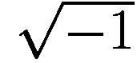

# 文件: code/os/machine_buster.py
import numpy as np
N = 200
while True:
print(f'N = {N}')
a = np.random.rand(N,N)
b = np.random.rand(N)
a.dot(b)
N += 200
```

脚注 1   2   3

# 10. 面向对象编程

`Python` 从核心上就是面向对象的。每个项目——变量、函数、运算符、异常、信号，甚至字符串字面量——都是一个对象。`MATLAB` 也支持面向对象编程，实际上比 `Python` 更为严谨，但灵活性也稍差。

两种语言都不强制要求定义类；基于常规过程的编程完全可行，甚至可能是大多数科学家和工程师的默认方式。然而，在 `Python` 中定义和使用类的便捷性，为刚接触面向对象的开发者尝试这种编程范式简化了路径。

对于初学者来说，对象是类的一个实例，就像变量是数据类型的一个实例一样。例如，在我们定义 `j` 为整数之前，整数类型的概念必须存在。当然，`MATLAB` 和 `Python` 预定义了许多有用的数据类型和容器。类可以被视为一种用户定义的容器，它可以包含函数，称为*方法*，这些方法对该容器中的数据进行操作。在使用对象之前，我们必须定义用来创建对象的*类*。


## 10.1 类

以下是一个定义圆形的简单类示例。它包含三个变量 `x`、`y` 和 `r`，用于定义圆心和半径，以及一个方法 `area()`，用于返回圆的面积。变量 `x`、`y`、`r` 被称为*实例*变量，因为从这个类创建的每个对象（即每个类实例）都会拥有自己独立的圆心和半径值。

除了实例变量，我们还将定义一个*类*变量 `MAX_R`，它由该类创建的所有对象共享。

Python 类需要一个名为 `__init__()` 的显式构造函数，其第一个参数始终是占位符 `self`。然后，可以使用点号表示法在类中创建任意命名的属性。最常见的情况是，通过 `self.x = x` 这样的代码行，将构造函数的调用参数赋值给类属性。

| MATLAB: | Python: |
| --- | --- |
| `% code/OO/Circle.m` `classdef` `Circle` `properties (Constant)` `MAX_R = 20;` `end` `properties` `x {mustBeNumeric}` `y {mustBeNumeric}` `r {mustBeNumeric}` `end` `methods` `function obj = Circle(x,y,r)` `obj.x = x;` `obj.y = y;` `obj.r = r;` `obj.perim = 2*r*pi;` `end` `function [A] = area(obj)` `A = pi*obj.r²;` `end` `end` `end` | `import numpy as np` `class Circle:` `MAX_R= 20` `def` `__init__(self, x,y,r):` `self.x = x` `self.y = y` `self.r = r` `if` `self.r > circle.MAX_R:` `print('too big')` `self.r = circle.MAX_R` `self.R = r` `def` `area(self):` `return` `np.pi*self.r**2` |

定义了 `Circle` 类之后，我们将创建对象 `a` 和 `b`，它们是 `Circle` 的实例：

| MATLAB: | Python: |
| --- | --- |
| `>> a = Circle(0,0,10);` `>> b = Circle(1,2,4);` `>> b.y` `2` `>> a.area()` `314.1592` | `In : a = Circle(0,0,10)` `In : b = Circle(1,2,4)` `In : b.y` `Out: 2` `In : a.area()` `Out: 314.1592` |

从类创建对象（例如 `a = Circle(0,0,10)`）这一操作，会调用该类的*构造函数*方法——在 MATLAB 中是与类同名的函数，在 Python 中是 `__init__()` 函数——并将提供的参数传递给它。

### 10.1.1 私有与公有

大多数面向对象语言通过将属性和方法指定为公有或私有来严格控制对它们的访问权限。前者可以被其他对象访问，而后者只能被对象自身的成员查看和更新。

MATLAB 有实现访问控制的机制，但 Python 在这方面要宽松得多，它依赖命名约定来表明开发者的意图。简而言之，Python 中以双下划线为前缀的类属性会通过*名称修饰*进行隐藏，使其看起来像是私有的。名称修饰仅仅是在变量内部添加类名作为前缀，因此一个执着的用户仍然能够访问到这些数据。以下示例展示了 `Circle` 类的一个变体，它定义了一个额外的属性 `perim`，作为一个存储圆周长的私有变量。

| MATLAB: | Python: |
| --- | --- |
| `% file: code/OO/Circle.m` `classdef` `Circle` `properties (Constant)` `MAX_R = 20;` `end` `properties (Access = private)` `perim` `end` `properties` `x {mustBeNumeric}` `y {mustBeNumeric}` `r {mustBeNumeric}` `end` `methods` `function` `obj = Circle(x,y,r)` `obj.x = x;` `obj.y = y;` `obj.r = r;` `obj.perim = 2*r*pi;` `end` `function [A] = area(obj)` `A = pi*obj.r²;` `end` `end` `end` | `# file: code/OO/circle.py` `import numpy as np` `class Circle:` `MAX_R= 20` `def` `__init__(self, x,y,r):` `self.x = x` `self.y = y` `self.R = r` `self.__perim = 2*r*np.pi;` `def` `area(self):` `return` `np.pi*self.r**2` |

### 10.1.2 自定义打印函数

在 MATLAB 中，可以通过重载 `disp()` 函数来更改类的打印表示形式；在 Python 中，则可以通过定义自定义的 `__str__()` 方法来实现。以下函数可以添加到前面的 `Circle` 类中，用于以紧凑格式打印圆的属性。请注意，`__str__()` 返回的是一个字符串，而不是直接调用打印函数。

| MATLAB: | Python: |
| --- | --- |
| `function` `disp(obj)` `fprintf('X: %5.2f Y: %5.2f ', ...` `obj.x, obj.y);` `fprintf('R: %5.2f\n', obj.r);` `end` | `def` `__str__(self):` `return` `f'X: {self.x:5.2f} ' \` `f'Y: {self.y:5.2f} ' \` `f'R: {self.R:5.2f}'` |

我们自定义的输出结果如下所示：

| MATLAB: | Python: |
| --- | --- |
| `>> c = Circle(.4,6.6, 3.14);` `>> disp(c)` `X: 0.40 Y: 6.60 R: 3.14` | `In : c = Circle(.4,6.6, 3.14)` `In : print(c)` `X: 0.40 Y: 6.60 R: 3.14` |

### 10.1.3 自定义异常

随着代码库的增长，其可能失败的方式也会增多。异常处理器有助于管理故障模式，而自定义异常可以增强异常处理器的功能，与通用错误相比，它能产生更具揭示性且更特定于应用程序的错误状态。在 MATLAB 和 Python 中都很容易添加自定义异常。以下示例实现了一个简单的电动汽车模拟器，当汽车电池电量耗尽时，会抛出 `BatteryEmptyError` 异常。该异常在 MATLAB 的 2–4 行和 Python 的 3–4 行中定义。

MATLAB:

```
1   % code/OO/ecar_sim.m
2   errID = 'ecar_sim:NotNumeric';
3   msg = 'BatteryEmptyError';
4   BatteryEmptyError = MException(errID,msg);
5   charge = 80.0; % kWhr
6   d_rate = 0.002;
7   while true
8       km   =  50*rand();
9       kmph = 20 + 120*rand();
10       discharge = d_rate*km*(20 + abs(kmph - 80))¹.4;
11       charge = charge - discharge;
12       if charge < 0
13           throw(BatteryEmptyError)
14       end
15       fprintf(' %4.1f km at %6.2f km/hr remaining: %5.2f kWhr\n',...
16             km, kmph, charge);
17   end
```

Python:

```
1   # code/OO/ecar_sim.py
2   import numpy as np
3   class BatteryEmptyError(Exception):
4       pass
5   charge = 80.0 # kWhr
6   d_rate = 0.002
7   while True:
8       km   =  50*np.random.rand()
9       kmph = 20 + 120*np.random.rand()
10       discharge = d_rate*km*(20 + np.abs(kmph - 80))**1.4
11       charge -= discharge
12       if charge < 0:
13           raise BatteryEmptyError
14       print(f' {km:4.1f} km at {kmph:6.2f} km/hr '
15             f'remaining: {charge:5.2f} kWhr')
```

两个程序的输出看起来类似；Python 的输出为：

```
21.0 km at  98.29 km/hr remaining: 73.09 kWhr
2.9 km at  20.97 km/hr remaining: 70.45 kWhr
21.8 km at  73.85 km/hr remaining: 66.25 kWhr
10.9 km at  76.34 km/hr remaining: 64.43 kWhr
5.7 km at 124.71 km/hr remaining: 60.50 kWhr
40.9 km at  21.33 km/hr remaining: 23.66 kWhr
Traceback (most recent call last):
File "code/OO/ecar_sim.py", line 13, in  raise BatteryEmptyError
BatteryEmptyError
```

使用汽车模拟器的下游代码可以像下面这样在 Python 中使用错误处理器：

Python:

```
try:
run_ecar_sim()
except BatteryEmptyError:
print(f'Ran out of juice, recharge')
bring_service_truck()
```

## 10.2 性能影响

面向对象编程可能会抑制计算性能，因为它破坏了数据的局部性；数值分散在各个对象中，而不是在紧凑的数组中彼此邻近。这会导致在 Python 和 MATLAB 中都无法进行向量化。

然而，在演示这点之前，我们首先需要详细讲解数值数组、向量化和计算性能。第 11 章将对此进行详细讨论。具体来说，第 11.1.17 节给出了一个计算问题用面向对象方法和不用面向对象方法解决的示例。剧透：面向对象方法慢得多。


# NumPy 和 SciPy

NumPy 是 Python 中用于数值计算的基础模块。其核心数据结构——NumPy N 维数组，可视为 MATLAB 矩阵的 Python 等价物。SciPy 则是在 NumPy 基础上构建的一系列模块集合，用于解决聚类、微分方程、图像处理、插值、线性代数、线性规划、优化、稀疏矩阵、统计及符号数学等领域的广泛计算问题。NumPy 与 SciPy 共同覆盖了核心 MATLAB 产品及其众多工具箱的功能。

本章将演示如何创建、操作、子集化、聚合及序列化 NumPy 数组，并概述 NumPy 与 SciPy 提供的广泛功能。文中全程会与 MATLAB 的等价用法进行对比。

## NumPy 数组

NumPy 数组，更正式地称为 `numpy.ndarray`（即“N 维数组”），功能上等价于 MATLAB 矩阵。两者都用于存储单一（通常为数值）数据类型，都支持对值进行向量化操作，并都配有大量高性能的数学、科学和统计函数库。

要在程序或交互式计算环境中使用 NumPy 数组和函数，必须显式导入 NumPy 模块。最常见的做法是：

```
import numpy as np
```

因此，前缀 `np.` 在本书中将代表 NumPy 模块。

### NumPy 数组值的格式化

后续章节中我们会看到大量数字，因此能够控制它们的显示样式十分有用。MATLAB 的 `format` 命令提供了一系列实用的显示风格。NumPy 则提供了更多功能：它不仅能够控制数字格式，还能控制行宽，并在数组超过指定大小时提供摘要选项。

MATLAB:

```
>> a = reshape(1:6, 3,2)/pi/14326
2.2219e-05   8.8876e-05
4.4438e-05   1.1110e-04
6.6657e-05   1.3331e-04
```

Python:

```
In : a = np.arange(1,7).reshape(2,3).T/np.pi/14326
In : a
Out:
array([[2.22190344e-05, 8.88761374e-05],
[4.44380687e-05, 1.11095172e-04],
[6.66571031e-05, 1.33314206e-04]])
```

MATLAB:

```
>> format long e
>> a
2.221903435598148e-05     8.887613742392592e-05
4.443806871196296e-05     1.110951717799074e-04
6.665710306794443e-05     1.333142061358889e-04
```

Python:

```
In : np.set_printoptions(precision=20)
In : a
Out:
array([[2.2219034355981481e-05, 8.8876137423925925e-05],
[4.4438068711962962e-05, 1.1109517177990740e-04],
[6.6657103067944433e-05, 1.3331420613588887e-04]])
```

有时在 MATLAB 中，你可能会不小心输入一个大型数组的名称，或者输入一个产生海量数值且末尾没有分号的表达式，结果会导致屏幕上滚动显示大量数据。NumPy 则更为宽容，它会只打印数组的开头和结尾部分：

MATLAB:

```
>> a = reshape(1:1000000, 1000, 1000)
... entire matrix printed ...
```

Python:

```
In : a = np.arange(1000000).reshape(1000,1000)
In : a
Out:
array([[     0,      1,      2, ...,    997,    998,    999],
[  1000,   1001,   1002, ...,   1997,   1998,   1999],
[  2000,   2001,   2002, ...,   2997,   2998,   2999],
...,
[997000, 997001, 997002, ..., 997997, 997998, 997999],
[998000, 998001, 998002, ..., 998997, 998998, 998999],
[999000, 999001, 999002, ..., 999997, 999998, 999999]])
In : np.set_printoptions(linewidth=40,edgeitems=2)
In : a
Out:
array([[     0,      1, ...,    998,
999],
[  1000,   1001, ...,   1998,
1999],
...,
[998000, 998001, ..., 998998,
998999],
[999000, 999001, ..., 999998,
999999]])
```

如果你有幸拥有一个大显示器，在仔细检查数据时，将 `linewidth=200`（或类似数值）会非常有帮助。

### NumPy 数组与 MATLAB 矩阵的差异

接下来的五个小节将解释 NumPy 数组与 MATLAB 矩阵之间的主要差异。

#### 由数值字面量构成的 MATLAB 矩阵默认为双精度

相比之下，NumPy 数组的类型是从输入值推断出来的。除非其中一个值包含小数点或指数，否则 NumPy 会创建一个 64 位整数的数组：

| MATLAB: | Python: |
| --- | --- |
| `>> a = [1 2 3];``>> class(a)` `'double'``>> a = [1 2. 3];``>> class(a)` `'double'` | `In : a = np.array([1, 2, 3])``In : a.dtype``Out: dtype('int64')``In : a = np.array([1, 2., 3])``In : a.dtype``Out: dtype('float64')` |

#### MATLAB 矩阵至少有两个维度

相比之下，NumPy 数组可以只有一个维度。

| MATLAB: | Python: |
| --- | --- |
| `>> a = [1 2 3]``>> size(a)` `1 3``>> ndims(a)` `2` | `In : a = np.array([1, 2, 3])``In : a.shape``Out: (3,)``In : a.ndim``Out: 1` |

在上例中，MATLAB 中的 `a` 是一个 1×3 的矩阵，而 Python 中的 `a` 只有三个元素。因此，MATLAB 可以区分行向量和列向量，这对于某些线性代数表达式非常有用。

一维 NumPy 数组没有垂直或水平排列的概念；因此，它们的行或列倾向性取决于上下文。可以显式地添加第二个维度来传达与 MATLAB 向量相同的行或列含义；这个过程将在第 11.1.12 节中解释。

#### MATLAB 数值标量是 1×1 矩阵

NumPy 标量与 NumPy 数组不同；标量只有一个值。

| MATLAB: | Python: |
| --- | --- |
| `>> a = 2.7183;``>> size(a)` `1 1``>> ndims(a)` `2` | `In : a = 2.7183``In : a.shape``AttributeError Traceback``----> 1 a.shape``AttributeError: 'float' object has no attribute 'shape'` |

#### NumPy 数组是行优先存储

默认情况下，NumPy 数组在内部使用行优先存储，而 MATLAB 数组是列优先存储。换句话说，如果数字 1 到 12 在内存中作为连续值存储，那么它们作为一个 3×4 矩阵时看起来会是这样：

| MATLAB: | Python: |
| --- | --- |
| `>> a = 1:12``a =` `1 2 3 4 5 6 7 8 9 10 11 12``>> reshape(a, [3,4])` `1 4 7 10` `2 5 8 11` `3 6 9 12` | `In : a = np.arange(1, 13)``In : a``Out: array([ 1, 2, 3, 4, 5, 6,` `7, 8, 9, 10, 11, 12])``In : a.reshape(3,4)``array([[ 1, 2, 3, 4],` `[ 5, 6, 7, 8],` `[ 9, 10, 11, 12]])` |

NumPy 可以通过向 `numpy.array()` 函数传递可选参数 `order='F'`（Fortran 顺序）来创建列优先数组。

Python:

```
In : a = np.arange(1, 13)
In : a
Out: array([ 1, 2, 3,  4,  5,  6,
7, 8, 9, 10, 11, 12])
In : a.reshape(3,4, order='F')
array([[ 1,  4,  7, 10],
[ 2,  5,  8, 11],
[ 3,  6,  9, 12]])
```


#### 11.1.2.5 NumPy 数组必须显式调整大小才能添加元素

MATLAB 矩阵只需引用新索引即可扩展，但 NumPy 数组的大小在创建后是固定的。可以使用垂直或水平堆叠函数 `np.vstack()` 或 `np.hstack()` 从现有数组中添加行或列来创建新的 NumPy 数组。或者，也可以调用 `np.resize()` 函数在任何维度添加所需数量的元素。相比之下，MATLAB 只需在左手边的矩阵中引用一个新索引，即可追加行或列。以下示例演示了如何使用 `.resize()` 方法向现有的 2×2 矩阵追加一行：

| MATLAB: | Python: |
| --- | --- |
| `>> a = [1 2; 3 4]``a =`    `1  2`    `3  4``>> a(3,:) = [5 6]``a =`    `1  2`    `3  4`    `5  6` | `In : a = np.array([[1,2], [3,4]])``In : a``Out: array([[1, 2]`            `[3, 4]])``In : a.resize( (3,2) )``In : a[2,] = [5, 6]``In : a``Out: array([[1, 2],`            `[3, 4],`            `[5, 6]])` |

虽然 MATLAB 的矩阵增长能力很方便，但会带来性能损失。预分配 MATLAB 矩阵要快得多，例如，先创建一个零矩阵，然后用值填充现有的行或列，而不是从一个空矩阵开始并在循环中增长。如果事先知道矩阵的最终大小，预分配是可行的，但情况并非总是如此。从文件中读取值可能需要两次遍历文件，一次了解最终大小，第二次填充矩阵条目，或者退而求其次采用增长矩阵的方式。

### 11.1.3 NumPy 数据类型

表 11-1 列出了 `np.ndarray` 的可能类型及其对应的 MATLAB 类型。

表 11-1

NumPy 数据类型

| MATLAB 类型 | NumPy 类型 | 备注 |
| --- | --- | --- |
| `logical` | `np.bool` | 8 位布尔值 |
| `uint8` | `np.ubyte` | 8 位无符号整数 |
| `uint8` | `np.uint8` | 8 位无符号整数 |
| `int8` | `np.int8` | 8 位有符号整数 |
| `uint16` | `np.uint16` | 16 位无符号整数 |
| `int16` | `np.int16` | 16 位有符号整数 |
| `uint32` | `np.uint32` | 32 位无符号整数 |
| `int32` | `np.int32` | 32 位有符号整数 |
| `uint64` | `np.uint64` | 64 位无符号整数 |
| `int64` | `np.int`, `np.int64` | 64 位有符号整数 |
| `uint64` | `np.uint` | 64 位无符号整数 |
| *不可用* | `np.float16` | 16 位（短）浮点数 |
| `single` | `np.float32` | 32 位浮点数 |
| `double` | `np.float64` | 64 位浮点数 |
| `double` | `np.float` | 64 位浮点数 |
| *不可用* | `np.float128` | 128 位（四精度）浮点数^(³⁴) |
| `complex` | `np.complex` | 一对 64 位浮点数 |
| `single`^(³⁵) | `np.complex64` | 一对 32 位浮点数 |
| `double`^(³⁶) | `np.complex128` | 一对 64 位浮点数 |
| *不可用* | `np.complex256` | 一对 128 位浮点数^(³⁷) |
| `char` | `np.str` | 固定长度字符串 |
| `datetime` | `datetime.datetime` | 日期时间对象 |

### 11.1.4 标量和数组的类型转换

MATLAB 的类型转换机制很直接：如果你有一个标量或数组属于某种数据类型（默认情况下值为双精度），只需在变量前面加上类型名称即可。

虽然 NumPy 对标量的类型转换表示法与 MATLAB 一致，但 NumPy 对数组使用不同的表示法进行类型转换。必须编写 `X.astype(np.uint8)` 才能将数组 `X` 转换为 `np.uint8`：

| MATLAB: | Python: |
| --- | --- |
| `>> p = 4.32;``>> uint8(p)` `4``>> p = [4.32 1.23];``>> uint8(p)`   `4  1` | `In : p = 4.32``In : np.uint8(p)``Out: 4``In : p = np.array([4.32, 1.23])``In : p.astype(np.uint8)``Out: array([4, 1], dtype=uint8)` |

MATLAB 和 NumPy 都支持“类似”类型转换的版本，即使用现有数组的类型创建新数组：

| MATLAB: | Python: |
| --- | --- |
| `>> p = [4.32 1.23];``>> q = uint8([0 0]);``>> cast(p,'like',q)``1×2 uint8 行向量`   `4   1` | `In : p = np.array([4.32, 1.23])``In : q = np.zeros((1,2),dtype=np.uint8)``In : p.astype(q.dtype)``Out: array([4, 1], dtype=uint8)` |

`np.zeros()` 和 `np.zeros_like()` 在第 11.1.6 节中描述。

### 11.1.5 十六进制、二进制和十进制表示

某些数值数据（特别是整数）的内容，在不同进制下表示时可能会显现其特性。尤其是位掩码操作，当其值以二进制形式显示时更容易理解。

#### 11.1.5.1 十进制转二进制

| MATLAB: | Python: |
| --- | --- |
| `>> dec = 1234;``>> dec2bin(dec)`   `10011010010` | `In : dec = 1234``In : np.binary_repr(dec)``Out: '10011010010'` |

#### 11.1.5.2 二进制转十进制

| MATLAB: | Python: |
| --- | --- |
| `>> bin2dec('10011010010')``1234` | `In : np.int('10011010010', 2)``Out: 1234` |

#### 11.1.5.3 十进制转十六进制

MATLAB 的 `dec2hex()` 函数返回一个表示所提供整数的十六进制字符串。NumPy 缺少专门用于此转换的函数；相反，可以使用 `%x` 和 `%X` 格式字符串。它们在 MATLAB 和 Python 中的工作方式相同：`%x` 生成小写十六进制，而 `%X` 生成大写。此外，字段宽度前的零会导致结果字符串用零填充。这比 `dec2hex()` 对输出提供了更多控制。

| MATLAB: | Python: |
| --- | --- |
| `>> dec2hex(8765)` `223D``>> sprintf('%x', 8765)` `223d``>> sprintf('%X', 8765)` `223D``>> sprintf('%06X', 8765)` `00223D` | `In : '``%x``' % 8765``Out: '223d'``In : '``%X``' % 8765``Out: '223D'``In : '``%06X``' % 8765``Out: '00223D'` |

#### 11.1.5.4 十六进制转十进制

| MATLAB: | Python: |
| --- | --- |
| `>> hex2dec('223D')``8765` | `In : np.int('223D', 16)``Out: 8765` |

### 11.1.6 创建数组

NumPy 数组可以通过多种方式创建。标准的构造函数是 `np.array()` 函数，它接受一个列表以及数据类型（默认 `np.float64`）和存储方案（默认为行主序）的可选设置。在这里，我们看到了两种语言中基本矩阵的创建方式：

| MATLAB: | Python: |
| --- | --- |
| `>> a = [9 8 7; 6 5 4]``a =`   `9   8   7`   `6   5   4` | `In : a = np.array([[9, 8, 7],[6, 5, 4]])``In : a``array([[9, 8, 7],`       `[6, 5, 4]])` |

#### 11.1.6.1 零矩阵

数组分配或初始化通常通过创建一个具有所需形状和类型的零填充数组来完成。NumPy 有两个函数 `np.zeros()` 和 `np.zeros_like()` 用于此目的。`np.zeros_like()` 函数很有趣，因为它不是将数组大小作为参数，而是接受一个现有矩阵，然后返回一个与该给定数组大小和类型相同的零填充数组。另一个创建数组的选项是 `np.empty()`，它创建一个数组但不初始化其内容。

MATLAB 的 `zeros()` 函数支持 `'like'` 选项，但在 2020b 版本中它未返回正确结果：

| MATLAB 2020b: | Python: |
| --- | --- |
| `>> a = zeros(2,3)`   `0   0   0`   `0   0   0``>> b = [2; 4]`     `2`     `4``>> c = zeros('like',b)`     `0` | `In : a = np.zeros((2,3))``In : a``Out: array([[0, 0, 0],`       `[0, 0, 0]])``In : b = np.array([[2], [4]])``In : b``Out: array([[2],`       `[4]])``In : c = np.zeros_like(b)``In : c``Out: array([[0],`       `[0]])` |

#### 11.1.6.2 一矩阵

全一数组是另一个有用的初始化器。其结果有时会被缩放以产生填充相同值的数组，尽管有一个专门的函数 `np.full()` 正是为此目的而存在；其用法将在第 11.1.6.3 节中说明。与 `np.zeros_like()` 类似，`np.ones()` 有一个配套函数 `np.ones_like()`：

| MATLAB: | Python: |
| --- | --- |
| `>> a = ones(3,1)`   `1`   `1`   `1` | `In : a = np.ones((3,1))``In : a``Out: array([[1],`            `[1],`            `[1]])` |


#### 11.1.6.3 非数值（NaNs）

MATLAB 的 `nan()` 函数用于创建全为 NaN（*非数值*）的矩阵。NumPy 有一个更通用的矩阵初始化函数 `np.full()`，可以用指定值初始化数组：

| MATLAB: | Python: |
| --- | --- |
| `>> nan(2,3)`   `NaN   NaN   NaN`   `NaN   NaN   NaN` | `In : np.full((2,3), np.NaN)` `array([[nan, nan, nan],`       `[nan, nan, nan]])` |

#### 11.1.6.4 范围

Python 中有两种方式创建连续数字的范围。第一种是使用标准 `range()` 函数，第二种是使用 NumPy 的 `np.arange()` 函数，后者因返回 NumPy 数组而更适合数值计算。两者的调用参数相同，但可能让 MATLAB 程序员困惑的是，二者的输出都不包含终值。这在非单位步长时尤其令人头疼：

| MATLAB: | Python: |
| --- | --- |
| `>> b = -8:-4` `b =` `-8  -7  -6  -5  -4` `>> b = -8:1.5:-4` `b =`   `-8.00 -6.50 -5.00` | `In : b = np.arange(-8,-3)` `In : b` `Out: array([-8, -7, -6, -5, -4])` `In : b = np.arange(-8,-4,1.5)` `In : b` `Out: array([-8. , -6.5, -5. ])` |

#### 11.1.6.5 单位矩阵

单位矩阵分别使用 `eye()` 和 `np.eye()` 创建：

| MATLAB: | Python: |
| --- | --- |
| `>> eye(3)`   `1   0   0`   `0   1   0`   `0   0   1` | `In : a = np.eye(3)` `array([[1., 0., 0.],`       `[0., 1., 0.],`       `[0., 0., 1.]])` |

#### 11.1.6.6 对角矩阵

对角矩阵可以通过向 `diag()` 和 `np.diag()` 传入一维向量创建。此外，当传入二维数组时，这些函数会返回矩阵的对角线：

| MATLAB: | Python: |
| --- | --- |
| `>> diag([9 8 7])`   `9   0   0`   `0   8   0`   `0   0   7` `>> diag(eye(2))`   `1`   `1` | `In : np.diag([9,8,7])` `array([[9, 0, 0],`       `[0, 8, 0],`       `[0, 0, 7]])` `In : np.diag(np.eye(2))` `Out: array([1., 1.])` |

#### 11.1.6.7 上三角与下三角矩阵

在 MATLAB 中使用 `triu()` 和 `tril()` 生成上下三角矩阵，在 NumPy 中使用 `np.triu()` 和 `np.tril()`。这四个函数都支持可选的对角线偏移参数。

我们在 11.1 节开头提到，MATLAB 矩阵是列主序的，而 NumPy 数组默认是行主序的。因此，下例中 MATLAB 定义的 `A` 需要进行转置，才能与 NumPy 的 `A` 保持相同的数值模式。我们将使用 `A` 来探索上下三角矩阵提取：

| MATLAB: | Python: |
| --- | --- |
| `>> A = reshape(5:16, 4,3)'` `A =`    `5    6    7    8`    `9   10   11   12`   `13   14   15   16` `>> triu(A)`    `5    6    7    8`    `0   10   11   12`    `0    0   15   16` `>> triu(A,1)`    `0    6    7    8`    `0    0   11   12`    `0    0    0   16` `>> tril(A)`    `5    0    0    0`    `9   10    0    0`   `13   14   15    0` `>> tril(A,-1)`    `0    0    0    0`    `9    0    0    0`   `13   14    0    0` | `In : A = np.arange(5,17).reshape(3,4)` `In : A` `array([[ 5,  6,  7,  8],`       `[ 9, 10, 11, 12],`       `[13, 14, 15, 16]])` `In : np.triu(A)` `array([[ 5,  6,  7,  8],`       `[ 0, 10, 11, 12],`       `[ 0,  0, 15, 16]])` `In : np.triu(A,1)` `array([[ 0,  6,  7,  8],`       `[ 0,  0, 11, 12],`       `[ 0,  0,  0, 16]])` `In : np.tril(A)` `array([[ 5,  0,  0,  0],`       `[ 9, 10,  0,  0],`       `[13, 14, 15,  0]])` `In : np.tril(A,-1)` `array([[ 0,  0,  0,  0],`       `[ 9,  0,  0,  0],`       `[13, 14,  0,  0]])` |

#### 11.1.6.8 随机数

伪随机数组可以通过多种分布函数创建，在 ipython 会话中通过 Tab 补全 `np.random` 即可看到：

```
In : np.random.
absolute_import        mtrand                  RandomState
beta()                 multinomial()           ranf()
binomial()             multivariate_normal()   rayleigh()
bytes()                negative_binomial()     sample()
chisquare()            noncentral_chisquare()  seed()
choice()               noncentral_f()          set_state()
dirichlet()            normal()                shuffle()
division               np                      standard_cauchy()
exponential()          operator                standard_exponential()
f()                    pareto()                standard_gamma()
gamma()                permutation()           standard_normal()
geometric()            poisson()               standard_t()
get_state()            power()                 test
gumbel()               print_function          triangular()
hypergeometric()       rand()                  uniform()
laplace()              randint()               vonmises()
Lock()                 randn()                 wald()
logistic()             random()                warnings
lognormal()            random_integers()       weibull()
logseries()            random_sample()         zipf()
```

`np.random.rand()` 生成均匀随机分布，类似于 MATLAB 的 `rand()` 函数：

| MATLAB: | Python: |
| --- | --- |
| `>> rand(2)`   `0.095692   0.232535`   `0.813753   0.892878` `>> rand(3,2)`   `0.456106   0.908961`   `0.274357   0.755147`   `0.113177   0.900217` | `In : np.random.rand(2,2)` `array([[0.59219917, 0.62549076],` `[0.21467385, 0.70801235]])` `In : np.random.rand(3,2)` `array([[0.664537, 0.219990],` `[0.974484, 0.251934],` `[0.827411, 0.063566]])` |

#### 11.1.6.9 等间距分布（linspace）

| MATLAB: | Python: |
| --- | --- |
| `>> linspace(21,23,5)` `21.0 21.5 22.0 22.5 23.0` | `In : np.linspace(21,23,5)` `Out: array([21., 21.5, 22., 22.5, 23. ])` |

#### 11.1.6.10 对数等间距分布（logspace）

| MATLAB: | Python: |
| --- | --- |
| `>> logspace(0.1, 1, 3)`    `1.2589    3.5481   10.0000` | `In : np.logspace(0.1, 1, 3)` `Out: array([ 1.25892541, 3.54813389, 10. ])` |

#### 11.1.6.11 水平与垂直堆叠

在通过堆叠现有矩阵的项来创建新矩阵方面，MATLAB 相比 NumPy 有便捷性优势；MATLAB 矩阵名只需在方括号内并排放置。相比之下，NumPy 需要调用特殊函数 `np.hstack()` 和 `np.vstack()`。新数组 `d` 和 `e` 通过水平与垂直堆叠 `a`、`b` 和 `c` 创建：

| MATLAB: | Python: |
| --- | --- |
| `>> a = [1; 2]`     `1`     `2` `>> b = [0; -3]`     `0`    `-3` `>> c = [-1; 0]`    `-1`     `0` `>> d = [a b c]`     `1     0    -1`     `2    -3     0` `>> e = [a;b;c]`     `1`     `2`     `0`    `-3`    `-1`     `0` | `In : a = np.array([[1],[2]])` `In : a` `array([[1],`       `[2]])` `In : b = np.array([[0],[-3]])` `In : b` `array([[ 0],`       `[-3]])` `In : c = np.array([[-1],[0]])` `In : c` `array([[-1],` `[ 0]])` `In : d = np.hstack([a,b,c])` `In : d` `array([[ 1,  0, -1],`       `[ 2, -3,  0]])` `In : e = np.vstack([a,b,c])` `In : e` `array([[ 1],`       `[ 2],`       `[ 0],`       `[-3],`       `[-1],`       `[ 0]])` |

#### 11.1.6.12 网格网格（Meshgrid）

MATLAB 的 `meshgrid()` 及其 NumPy 同名函数 `np.meshgrid()` 用于在规则网格上创建坐标对。这些坐标对常被用作映射二维数据进行可视化或插值的基础。

| MATLAB: | Python: |
| --- | --- |
| `>> [y,x] = meshgrid([1 2 3],`                  `[3.5 3.6])` `y =`   `1   2   3`   `1   2   3` `x =`   `3.5000   3.5000   3.5000`   `3.6000   3.6000   3.6000` | `In : y,x = np.meshgrid([1,2,3],`                     `[3.5,3.6])` `In : y` `array([[1, 2, 3],`       `[1, 2, 3]])` `In : x` `array([[3.5, 3.5, 3.5],`       `[3.6, 3.6, 3.6]])` |


#### 11.1.6.13 矩阵膨胀

`scipy.ndimage` 模块提供了一个 `zoom()` 函数，可用于通过插值来膨胀矩阵。（插值将在第 11.4 节中介绍。）当然，在 MATLAB 中也能实现相同的结果，但需要更多的操作。以下示例将行数增加 3 倍，列数增加 2 倍：

| MATLAB: | Python: |
| --- | --- |
| `>> a = [4 -4; 4 0]`     `4    -4`     `4     0``>> nY = 2*3; nX = 2*2;``>> Xs = linspace(0,1,nX);``>> Ys = linspace(0,1,nY);``>> [Xq,Yq] = meshgrid(Xs, Ys);``>> interp2(X,Y,a,Xq,Yq)``4.0000  1.3333 -1.3333 -4.0000``4.0000  1.6000 -0.8000 -3.2000``4.0000  1.8667 -0.2667 -2.4000``4.0000  2.1333  0.2667 -1.6000``4.0000  2.4000  0.8000 -0.8000``4.0000  2.6667  1.3333       0` | `In :` `from scipy.ndimage import` `zoom``In : a = np.array([[4.0, -4], [4, 0]])``In : a``array([[ 4., -4.],`       `[ 4.,  0.]])``In : zoom(a, [3, 2], order=1)``array([[ 4\. , 1.3333, -1.3333, -4.  ],`       `[ 4\. , 1.6   , -0.8   , -3.2 ],`       `[ 4\. , 1.8667, -0.2667, -2.4 ],`       `[ 4\. , 2.1333,  0.2667, -1.6 ],`       `[ 4\. , 2.4   ,  0.8   , -0.8 ],`       `[ 4\. , 2.6667,  1.3333,  0.  ]])` |

#### 11.1.6.14 测试矩阵

算法开发通常始于测试数据，如果不可行，则使用具有指定属性的随机数据。本章介绍的数组创建方法可以有趣地组合起来，生成具有有助于探索算法鲁棒性、错误处理或测试各种逻辑分支等属性的数据。下面，我们将探讨其中一些方法。

**注意**

本节中的 MATLAB 和 Python 矩阵均通过随机数生成器生成，因此它们将互不匹配。

**-5 到 +5 之间的整数**

| MATLAB: | Python: |
| --- | --- |
| `>> floor(10*rand(4,4) - 5)`  `-5  -3   4  -4`  `-4   4   1   4`  `-3   0  -1   3`   `3  -3   0  -4` | `In : np.random.randint(-5,6,size=(4,4))``array([[-3,  5,  4,  5],`       `[ 0, -1,  1,  3],`       `[ 0,  3,  1, -2],`       `[-1, -1,  5, -5]])` |

**按列优先顺序排列的 4 × 3 整型数组**

| MATLAB: | Python: |
| --- | --- |
| `>> reshape(1:12, 4,3)`    `1    5    9`    `2    6   10`    `3    7   11`    `4    8   12` | `In : np.arange(1,13).reshape(3,4).T``array([[ 1,  5,  9],`       `[ 2,  6, 10],`       `[ 3,  7, 11],`       `[ 4,  8, 12]])` |

**按行优先顺序排列的 4 × 3 整型数组**

| MATLAB: | Python: |
| --- | --- |
| `>> reshape(1:12, 3,4)'`    `1    2    3`    `4    5    6`    `7    8    9`   `10   11   12` | `In : np.arange(1,13).reshape(4,3)``array([[ 1,  2,  3],`       `[ 4,  5,  6],`       `[ 7,  8,  9],`       `[10, 11, 12]])` |

**4 × 3 浮点型数组，一半是 NaN**

| MATLAB: | Python: |
| --- | --- |
| `>> a = 100*rand(4,3);``>> a(a < 50) = nan``a =`   `69.082      NaN      NaN`      `NaN   73.604      NaN`      `NaN   63.711      NaN`   `51.612   76.674   63.956` | `In : a = 100*np.random.rand(4,3)``In : a[a < 50] = np.NaN``In : a``array([[60.551, 99.574, 78.620],`       `[   nan, 66.137, 64.343],`       `[52.505,    nan,    nan],`       `[96.109, 56.539,    nan]])` |

**注意**

MATLAB 和 Python 生成不同的随机矩阵。前面的两个矩阵并非为了匹配。

### 11.1.7 复标量与复数组

MATLAB 和 NumPy 在创建复标量和复数组时采用了略微不同的方法。MATLAB 将 `i` 和 `j` 都视为 ，但 NumPy 只识别 `j`。两者也都支持接受实部和虚部参数的 `complex()` 函数：

| MATLAB: | Python: |
| --- | --- |
| `>> 1+2i`   `1.0000 + 2.0000i``>> 3 - 4j`   `3.0000 - 4.0000i``>> complex(5,6)`   `5.0000 + 6.0000i` | `In : 1+2i`    `1+2i``SyntaxError``: invalid syntax``In : 3 - 4j``Out: (3-4j)``In : complex(5,6)``Out: (5+6j)` |

奇怪的是，无论是默认的 Python `complex()` 函数还是 NumPy 版本的 `np.complex()` 函数，都不接受数组参数。因此，要在 NumPy 中从实部和虚部数组创建复数数值数组，必须将包含虚部的数组乘以复数单位值 `1j`：

| MATLAB: | Python: |
| --- | --- |
| `>> N = ones(2,3);``>> complex(N, -5*N)` `1.00-5.00i 1.00-5.00i 1.00-5.00i` `1.00-5.00i 1.00-5.00i 1.00-5.00i` | `In : N = np.ones((2,3))``In : N - 5*N*(1j)``array([[1.-5.j, 1.-5.j, 1.-5.j],`       `[1.-5.j, 1.-5.j, 1.-5.j]])` |

一旦我们有了一个复数变量，就可以类似地提取其实部和虚部：

| MATLAB: | Python: |
| --- | --- |
| `>> z = complex([2.2;3.3],...`               `[-4.4;5.5])`   `2.2000 - 4.4000i`   `3.3000 + 5.5000i``>> real(z)`    `2.2000`    `3.3000``>> imag(z)`   `-4.4000`    `5.5000` | `In : z=np.array([[2.2],[3.3]]) + (1j)*\``...:   np.array([[-4.4],[5.5]])``In : z``array([[2.2-4.4j],`       `[3.3+5.5j]])``In : z.real``array([[2.2],`       `[3.3]])``In : z.imag``array([[-4.4],`       `[ 5.5]])` |

### 11.1.8 线性索引

MATLAB 矩阵允许*线性索引*，即可以使用单个标量索引来访问多维数组的元素。该标量索引是从数组开头到目标元素的偏移量，按列步进（或者更一般地说，最左侧维度的索引递增最快）。

使用 NumPy 数组的 `.take()` 或 `.item()` 方法可以实现相同的功能。但请记住，(1) NumPy 数组是行优先的，因此访问相同元素需要不同的偏移量，以及 (2) `.take()` 的参数是基于零索引的。

在此示例中，我们从同一个数组中提取第 12 个元素——但得到了不同的结果，因为 MATLAB 按列计数，而 Python 按行计数。

| MATLAB: | Python: |
| --- | --- |
| `>> a = [11 14 17 20 23;`        `12 15 18 21 24;`        `13 16 19 22 25];``>> a(12)`  `22` | `In : a = np.array(``[[11, 14, 17, 20, 23],``[12, 15, 18, 21, 24],``[13, 16, 19, 22, 25]])``In : a.take(11)``Out: 16` |

两种语言都有便捷函数，可以根据原始数组的形状返回与线性索引对应的行索引和列索引：

| MATLAB: | Python: |
| --- | --- |
| `>> [r,c]=ind2sub([3,5],12)``r =  3``c =  4``>> sub2ind([3,5],3,4)`  `12` | `In : np.unravel_index(11,(3,5))``Out: (2, 1)``In : np.ravel_multi_index((2,1),(3,5))``Out: 11` |

`sub2ind()` 和 `np.ravel_multi_index()` 根据目标元素的索引，给出多维数组中的线性偏移量。

`.take()` 方法还接受索引列表和一个可选参数，用于指定提取元素的维度。这在 MATLAB 中提取 NumPy 数组的行或列时非常有用，因为 MATLAB 语法不允许使用括号索引 NumPy 数组。

以下示例展示了如何使用 `.take()` 和 `axis` 关键字参数提取 `a` 的第一行和第三列：

Python:

```
In : a
Out:
array([[11, 14, 17, 20, 23],
[12, 15, 18, 21, 24],
[13, 16, 19, 22, 25]])
In : a.take(0,axis=0)
Out: array([11, 14, 17, 20, 23])
In : a.take(2,axis=1)
Out: array([17, 18, 19])
```

此技术的实际应用出现在第 12.​7 节，其中在 MATLAB 内部从二维 NumPy 颜色映射数组中提取一维 RGBA 值的 NumPy 数组；其代码行如下：

```
color = colors.take(col_ind + int64(4)*color_row);
```

### 11.1.9 从文本文件读写数组

第 7.​1 和 7.​6 节介绍了通用数据的文本和二进制 I/O。此处，我们将专门针对数值数组与文本文件之间的 I/O 进行探讨。


好的，作为高级文档工程师和翻译员，我将严格遵循您提供的注意事项和示例格式，将给定的英文文本翻译成中文。


#### 11.1.9.1 从文本文件读取数组

在两种语言中，都可以通过多种方式从文本文件中读取数值，但最简单的方法是使用 MATLAB 的 `load()` 函数和 NumPy 的 `np.loadtxt()`。以下示例演示了如何读取包含以下 3×2 矩阵的文本文件 `a.txt`：

```
-3.2  4.3
1.e-5 2.9
6.6  -9.2
```

MATLAB 和 Python 的加载函数都允许文件包含注释标记——即井号后面的任何文本——并且两者都会跳过空行。

| MATLAB: | Python: |
| --- | --- |
| `>> a = load('a.txt')` `a =` `-3.2000e+00   4.3000e+00` `1.0000e-05   2.9000e+00` `6.6000e+00  -9.2000e+00` | `In : a = np.loadtxt('a.txt')` `In : a` `array([[-3.2e+00,  4.3e+00],` `[ 1.0e-05,  2.9e+00],` `[ 6.6e+00, -9.2e+00]])` |

（有关从逗号分隔值文件读取数据，请参见第 7.1.5 节。）

#### 11.1.9.2 将数组写入文本文件

将数值数据写入文本文件也有多种方法，但简便方法仍然是使用单个函数调用——MATLAB 中的 `save()` 和 Python 中的 `np.savetxt()`。我们将使用从上一节的 `a.txt` 文件加载的同一个 `a` 矩阵：

| MATLAB: | Python: |
| --- | --- |
| `>> save("aM.txt","a","-ascii")` | `In : np.savetxt('aP.txt', a)` |

这将产生以下文件：

来自 MATLAB 的 `aM.txt`：

```
-3.20000000e+00 4.30000000e+00
1.00000000e-05 2.90000000e+00
6.60000000e+00 -9.20000000e+00
```

来自 Python 的 `aP.txt`：

```
-3.200000000000000178e+00 4.299999999999999822e+00
1.000000000000000082e-05 2.899999999999999911e+00
6.599999999999999645e+00 -9.199999999999999289e+00
```

`np.savetxt()` 的格式可以通过可选的 `fmt` 关键字参数进行配置：

```
In : np.savetxt('aP.txt', a, fmt='% 10.3f')
In : cat aP.txt
-3.200      4.300
0.000      2.900
6.600     -9.200
```

### 11.1.10 从/向二进制文件读取/写入数组

与文本文件的输入/输出相比，对数组进行二进制文件的输入/输出速度更快，并且几乎总是更节省空间。二进制 I/O 可以仅使用数组中数值数据的原始字节，也可以使用原始字节加上存储数组维度和数据类型的附加元数据。在这里，我们将介绍带元数据和不带元数据读取/写入的四种组合，并描述如何管理小端/大端字节转换。

#### 11.1.10.1 从二进制文件读取原始数组

这可以通过在 MATLAB 中以读取二进制模式打开文件，或使用 NumPy 的 `np.fromfile()` 函数来完成。以下示例演示了如何读取一个包含 64,800 个单精度浮点数（例如，表示以 1° 经纬度间隔分布的海面温度）的二进制文件，使用本机字节序。

| MATLAB: | Python: |
| --- | --- |
| `>> fh = fopen('f64800.bin');` `>> sst = fread(fh, [360 ...` `180], 'single');` `>> fclose(fh);` | `In : sst = np.fromfile('f64800.bin',` `dtype=np.float32)` `In : sst = sst.reshape(360,180)` |

给定同一个二进制文件，Python 和 MATLAB 将加载相同的一维数组元素。然而，如果将这些元素加载到二维或更高维度的数组中，两种语言在行主序和列主序上的差异意味着元素的排列顺序会不同。在前面的例子中，为了使 MATLAB 中的 `sst(i+1,j+1)` 等于 Python 中的 `sst[i,j]`，MATLAB 的 `sst` 必须像这样加载：

MATLAB:

```
>> fh = fopen('f64800.bin');
>> sst = fread(fh, 360*180, 'single');
>> fclose(fh);
>> sst = reshape(sst,180,360)';
```

#### 11.1.10.2 将原始数组写入二进制文件

数值数组可以轻松地写入二进制文件。这里，我们将写入上一个示例中使用的海面温度样本文件：

| MATLAB: | Python: |
| --- | --- |
| `>> sst = single(rand(360,180))` `>> fh = fopen('f64800.bin','w');` `>> fwrite(fh,sst,'single');` `>> fclose(fh);` | `In : sst = np.random.rand(360,` `180).astype(np.float32)` `In : sst.tofile('f64800.bin')` |

#### 11.1.10.3 将数组与元数据一起写入二进制文件

这创建了以后使用更方便的文件，因为数据类型和维度也一并存储了。缺点是这种文件格式对于其他应用程序来说更难处理。不带参数的 MATLAB 的 `save()` 会将一个或多个数组（或其他数据结构）写入二进制文件。保存的文件采用 `.mat` 格式，包含 MATLAB 特定的头部信息，因此不仅包含数组字节的纯数值表示。

NumPy 有一对类似的函数，`np.save()` 和 `np.savez()`，它们将一个或多个数组保存为 `.npy` 或 `.npz` 格式的文件。与 `.mat` 文件类似，`.npy`/`.npz` 文件包含关于数组形状和类型的附加元数据。遗憾的是，默认情况下不会捕获数组本身的名称；要将此信息添加到 `.npz` 文件中，必须使用 `array=name` 这种特殊的表示法来调用 `np.savez()`——在我们的例子中，就是 `X=X` 和 `Y=Y`。如果我们省略这一点，该函数会将我们的数组存储为名为 `arr_0`, `arr_1` 等的名称。

| MATLAB: | Python: |
| --- | --- |
| `>> X=reshape([-4:4], 3,3)'` `X =` `-4  -3  -2` `-1   0   1` `2   3   4` `>> Y = [pi e]` `Y =` `3.1416   2.7183` `>> save 'XY.mat'  X Y` | `In : X = np.arange(-4,5).reshape(3,3)` `In : X` `array([[-4, -3, -2],` `[-1,  0,  1],` `[ 2,  3,  4]])` `In : Y = np.array([np.pi, np.e])` `In : Y` `Out: array([3.14159265, 2.71828183])` `In : np.savez('XY.npz', X=X, Y=Y)` |

使用 `np.save()` 或 `np.savez()` 保存 NumPy 数组比使用 `pickle` 模块（第 7.13 节）更高效，并且在不同的 Python 版本间更具可移植性。

在第 11.1.10.4 节中，我们将看到 `XY.mat` 和 `XY.npz` 可以分别使用 MATLAB 的 `load()` 函数和 NumPy 的 `np.loadz()` 函数加载。

在重新加载这些数组之前，我们将再写入一对二进制文件，这次只保存数值数据的字节。当为后续用其他语言（C、C++、Java、Fortran 等）编写的代码导入数据时，这非常有用，因为这些语言不理解 `.mat` 或 `.npz` 格式。数组的纯二进制表示也使得 MATLAB 能够读取由 Python 写入二进制文件的数组（尽管反之则没有必要，因为 Python 通过 SciPy 模块可以读取 `.mat` 文件，参见第 7.14 节）。

MATLAB 中的原生二进制写入需要采用第 7.6 节中所示的写入技术。不过，NumPy 数组有一个方法 `.tofile()`，正是为此目的而设。在这两种情况下，我们预期数组 `X` 生成的二进制文件都将有 9 个元素 × 每个元素 8 字节 = 72 字节。

| **MATLAB:** | **Python:** |
| --- | --- |
| `>> fh = fopen('Xm.bin','wb');` `>> fwrite(fh, X, 'double');` `>> fclose(fh);` `>> ls -l X?.bin` `-rw-rw-r-- 1 al al 72 Nov 15 15:27 Xm.bin` `-rw-rw-r-- 1 al al 72 Nov 15 15:28 Xp.bin` | `In : X.tofile('Xp.bin')` |

虽然两个文件都是 72 字节，但正如我们将在下一节看到的，它们的内容却大相径庭（剧透：MATLAB 的数组按列写入，而 Python 的按行写入；MATLAB 的数组是 double 类型，而 Python 的是 64 位整数）。


好的，作为一名高级文档工程师和翻译员，我将严格遵循您提供的注意事项和示例格式，完成以下英文文本的翻译工作。


#### 11.1.10.4 从二进制文件读取数组

与 `save` 和 `np.save()` / `np.savez()` 互补的函数，正如人们所料，是 `load()` 和 `np.load()`（它读取 `.npy` 和 `.npz` 文件）。两种语言都通过单个函数调用来读取各自的文件，但 MATLAB 方便地直接将其返回到现有的命名空间中，而 Python 则将结果返回到一个以保存名称为键的字典中。如果我们调用 `np.savez()` 时没有使用 `X=X`, `Y=Y` 参数，那么 `data` 字典就必须使用默认名称作为键，即 `X` 对应 `data['arr_0']`，`Y` 对应 `data['arr_1']`。

| MATLAB: | Python: |
| --- | --- |
| `>> load XY  % .mat 是隐含的``>> X``X =`  `-4  -3  -2`  `-1   0   1`   `2   3   4``>>Y``Y =`   `3.1416   2.7183` | `In : data = np.load('XY.npz')``In : data['X']``array([[-4, -3, -2],`       `[-1,  0,  1],`       `[ 2,  3,  4]])``In : data['Y']``Out: array([3.14159265, 2.71828183])` |

接下来，我们将查看在上一节中写入的原始二进制文件 `Xm.bin` 和 `Xp.bin`。由于这些文件仅包含数值数据的字节，因此任何能够读取二进制文件并将数据映射到数值数组的编程语言都可以读取它们。然而，缺少元数据意味着我们需要*先验*知道维度数量、每个维度的大小以及数据类型。

如第 7.6 节所做的那样，我们将使用通用的读取函数以二进制模式打开文件，然后使用 `struct` 模块将字节重新转换为我们的数值数据类型。我们还需要知道：

*   Python 写入的文件 `Xp.bin` 包含 64 位（8 字节）有符号整数（当 `start`、`end` 和 `increments` 为整数时，`np.arange()` 的默认数据类型）。
*   MATLAB 写入的文件 `Xm.bin` 包含 64 位（8 字节）浮点数（所有数字的 MATLAB 默认值）。
*   64 位有符号整数和 64 位浮点数的 `struct` 格式字符分别是 `q` 和 `d`（表 7-1）。
*   两个文件都包含大小为 3 × 3 的二维数组。

我们将在 Python 和 MATLAB 中读取每个文件：

Python:
```
In : import struct
