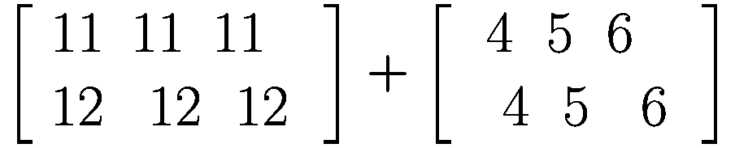
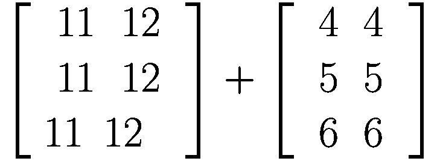
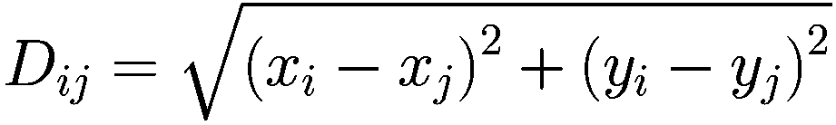
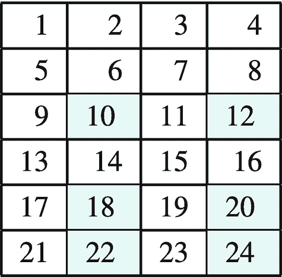

# MATLAB 写入的文件

In : with open('Xm.bin', 'rb') as fh:

...:     raw = fh.read()

...:     n_terms  = len(raw) // 8

...:     Flts = struct.unpack(f'{n_terms}d', raw)

In : X = np.array(Flts).reshape(3,3)

array([[-4., -1.,  2.],

[-3.,  0.,  3.],

[-2.,  1.,  4.]])

```

我们遇到了第一个意外——Python 加载的是 MATLAB 数据的转置。这是因为 MATLAB 的数组内部按列主序存储，而 NumPy 数组默认按行主序存储。

读取文件的 MATLAB 代码如下所示。如果我们忘记了 Python 的值是整数而不是双精度浮点数，就会出现第二个意外：

```matlab
>> fh = fopen('Xm.bin', 'rb');
>> X = fread(fh, 'double');
>> fclose(fh);
>> reshape(X, 3,3)
ans =
    -4    -3    -2
    -1     0     1
     2     3     4

>> fh = fopen('Xp.bin', 'rb');
>> X = fread(fh, 'double');
>> fclose(fh);
>> reshape(X, 3,3)
ans =
  9.9e-323*       NaN       NaN    0.1000
       NaN         0    0.1500
       NaN    0.0500    0.2000

>> fh = fopen('Xp.bin', 'rb');
>> X = fread(fh, 'int64');
>> fclose(fh);
>> reshape(X, 3,3)
ans =
    -4    -1     2
    -3     0     3
    -2     1     4
```

### 11.1.10.5 字节序转换

在不同架构的计算机之间传输数值数据时，有时需要进行小端到大端或大端到小端的字节序转换。NumPy 可以轻松确定和操作字的字节序格式。MATLAB 允许更改数组的字节序，但无法确定其当前的字节序。

NumPy 数组有一个属性 `.dtype`，它存储数据类型，例如 `np.float16` 或 `np.complex256`。数据类型本身是一个 NumPy 对象，具有一个有趣的特性，即可以从数据类型的 `.str` 表示中确定字节序——如果它以 `>` 开头，则为大端序；以 `<` 开头，则为小端序：

```python
In : a = np.array([1234, 5678], dtype=np.int32)

In : a.dtype
Out: dtype('int32')

In : a.dtype.str
Out: '<i4'
```

可以直接在 NumPy 中进行 I/O 的字节序转换，只需为 `np.tofile()` 或 `np.fromfile()` 提供显式的 `dtype` 即可。重新审视第 11.1.10.2 节的海面温度示例，这次显式地写入和读取一个大端序文件，如下所示：

```python
In : sst = np.random.rand(360, 180).astype(np.float32)

In : sst.tofile('f64800.bin', dtype='>f4')

In : sst_copy = np.fromfile('f64800.bin', dtype='>f4')
```

MATLAB 变量没有指示其字节序的元数据。但是，可以使用 `swapbytes()` 更改字节序。NumPy 的 `.byteswap()` 方法执行相同的操作：

| MATLAB: | Python: |
| --- | --- |
| ```matlab
>> a = int32([1234 5678]);
>> b = swapbytes(a)

  1×2 int32 行向量

   -771489792    773193728

>> dec2hex(a)
  2×4 字符数组

    '04D2'
    '162E'

>> dec2hex(b)
  2×8 字符数组

    'D2040000'
    '2E160000'
``` | ```python
In : a = np.array([1234, 5678],
              dtype=np.int32)
In : b = a.byteswap()
In : b
Out: array([-771489792,  773193728],
           dtype=int32)
In : hex(a[0]),hex(a[1])
Out: ('0x4d2', '0x162e')
In : hex(b[0]), hex(b[1])
Out: ('-0x2dfc0000', '0x2e160000')
``` |

Python 的 `hex()` 函数处理有符号数字的方式与 MATLAB 的 `dec2hex()` 不同，但我们至少可以从整数表示中看出执行的是相同的操作。

### 11.1.11 基本数组操作

#### 11.1.11.1 加法、减法

数组加法和减法在 MATLAB 和 NumPy 中工作方式相同：如果数组维度匹配，则逐项相加或相减。如果数组维度不同，则会尝试*广播*或通过扩展数组大小直到它们匹配来执行外循环加法或减法（广播在 11.1.13 节中有更详细的解释）：

| MATLAB: | Python: |
| --- | --- |
| ```matlab
>> a = [2, -3]
a =
   2  -3
>> b = [7; 8; 9]
b =
   7
   8
   9
>> a+b
    9    4
   10    5
   11    6
``` | ```python
In : a = np.array([[2,-3]])
In : a
Out: array([[ 2, -3]])
In : b = np.array([[7],[8],[9]])
In : b
array([[7],
       [8],
       [9]])
In : a+b
array([[ 9,  4],
       [10,  5],
       [11,  6]])
``` |

#### 11.1.11.2 逐元素运算

NumPy 的数组运算默认是逐元素进行的。换句话说，使用 `*`、`/` 和 `**` 进行的乘法、除法和乘方运算会产生逐元素的结果。MATLAB 的等效运算在逐元素运算符前有一个 `.`（`.*`、`./` 和 `.^`）。

| MATLAB: | Python: |
| --- | --- |
| ```matlab
>> a = [2  7;  3 8;  4 9];
>> b = [5 -6; -1 2; -3 4];
>> a.^2
    4   49
    9   64
   16   81
>> a.*b
   10  -42
   -3   16
  -12   36
``` | ```python
In : a = np.array([[2,7],[3,8],[4,9]])
In : a**2
array([[ 4, 49],
       [ 9, 64],
       [16, 81]])
In : a*b
array([[ 10, -42],
       [ -3,  16],
       [-12,  36]])
``` |

#### 11.1.11.3 位运算

对单个位进行运算的操作通常仅适用于无符号整数——在 NumPy 和 MATLAB 中，分别为 `np.uint`*n* 和 `uint`*n*，其中 *n* = 8、16、32 或 64。表 11-2 展示了 MATLAB 和 Python 的位运算。

**表 11-2：位运算**

| 运算 | MATLAB | Python |
| --- | --- | --- |
| 将 `x` 的位左移 `y` 次 | `bitshift(x,y)` | `x << y` |
| 将 `x` 的位右移 `y` 次 | `bitshift(x,-y)` | `x >> y` |
| `x` 与 `y` 按位与 | `bitand(x,y)` | `x & y` |
| `x` 或 `y` 按位或 | `bitor(x,y)` | `x \| y` |
| `x` 异或 `y` | `bitxor(x,y)` | `x ^ y` |
| 翻转 `x` 的位 | `bitcmp(x)` | `~ x` |

#### 11.1.11.4 转置与共轭转置运算

数组转置在 MATLAB 和 NumPy 之间略有不同。在 MATLAB 中，矩阵后的撇号返回转置（如果矩阵是实数矩阵）或复共轭转置（即 Hermite 转置，如果矩阵是复数矩阵）。在 Python 中，`.T` 方法对于实数和复数数组都返回（纯结构上的）转置。要获得共轭转置，必须首先调用 `.conj()` 方法获得复共轭，然后再调用 `.T`：

| MATLAB | Python |
| --- | --- |
| ```matlab
>> a = [1 2; 3 4]
a =
     1     2
     3     4
>> a'
ans =
     1     3
     2     4
>> a = a + j*eye(2)
a =
   1.0000 + 1.0000i   2.0000 + 0.0000i
   3.0000 + 0.0000i   4.0000 + 1.0000i
>> a'
ans =
   1.0000 - 1.0000i   3.0000 - 0.0000i
   2.0000 - 0.0000i   4.0000 - 1.0000i
``` | ```python
In : a = np.array([[1,2],[3,4]])
In : a
array([[1, 2],
       [3, 4]])
In : a.T
array([[1, 3],
       [2, 4]])
In : a = a + 1j*np.eye(2)
In : a
array([[1.+1.j, 2.+0.j],
       [3.+0.j, 4.+1.j]])
In : a.T
array([[1.+1.j, 3.+0.j],
       [2.+0.j, 4.+1.j]])
In : a.conj().T
array([[1.-1.j, 3.-0.j],
       [2.-0.j, 4.-1.j]])
``` |

#### 11.1.11.5 数组乘法

数组乘法在 MATLAB 中使用 `*` 运算符，而在 Python 中使用不太直观的 `@` 运算符。或者，也可以使用 `np.dot()` 来执行矩阵乘法：

| MATLAB | Python |
| --- | --- |
| ```matlab
>> a = [2 7; 3 8; 4 9]
a =
     2     7
     3     8
     4     9
>> b = [ 1 5]
b =
     1     5
>> a*b
    37
    43
    49
``` | ```python
In : a = np.array([[2,7],[3,8],[4,9]])
In : a
array([[2, 7],
       [3, 8],
       [4, 9]])
In : b = np.array([1,5])
In : b
Out: array([1, 5])
In : a@b
Out: array([37, 43, 49])
In : np.dot(a,b)
Out: array([37, 43, 49])
``` |

MATLAB 将所有数值（无论是标量、一维向量还是多维矩阵）视为至少具有两个维度；MATLAB 将前面的向量视为有三行一列。在 NumPy 中，一维数组只有一个维度；“行”和“列”的概念不适用。

> **警告**：Python 中的 `*` 运算符执行的是逐元素数组乘积，类似于 MATLAB 中的 `.*`。在将 MATLAB 表达式翻译为 Python 时，这可能成为错误的来源。

### 11.1.12 增加维度

当行向量和列向量之间的区别很重要时，MATLAB 的“所有变量至少有两个维度”这一特性非常有用。举个简单的例子，考虑向量积 *v*^(*T*)*v* 和 *vv*^(*T*)。第一个产生标量，第二个给出一个维度与 *v* 相同的方阵。MATLAB 可以将这些乘积表示为 `v'*v` 和 `v*v'`。

相比之下，一维 NumPy 数组没有行或列方向的概念；`v.T@v` 和 `v@v.T`（或 `v.T.dot(v)` 和 `v.dot(v.T)`）都返回 *v*^(*T*) *v*。我们需要一个额外的维度来计算外积。

一维 NumPy 数组可以通过以下三种方式之一获得第二个（或更高）维度：

- 通过显式重塑它
- 通过将其传递给 `np.atleast_2d()`
- 通过使用 `np.newaxis` 或 `None` 作为额外的下标对其进行索引


在以下示例中，我们使用`np.array([1, 2, 3])`创建一维数组`v`，并展示三种将其转换为二维数组的方法。

### 方法一：使用`reshape()`

```
In : v = np.array([1, 2, 3])

In : v.reshape(1,3)       # 行
Out: array([[1, 2, 3]])

In : v.reshape(3,1)       # 列
Out: array([[1],
            [2],
            [3]])
```

### 方法二：使用`np.atleast_2d()`

```
In : v = np.array([1, 2, 3])

In : np.atleast_2d(v)     # 行
Out: array([[1, 2, 3]])

In : np.atleast_2d(v).T  # 列
Out: array([[1],
            [2],
            [3]])
```

### 方法三：使用`np.newaxis`或`None`

```
In : v = np.array([1, 2, 3])

In : v[np.newaxis,:]     # 行
Out: array([[1, 2, 3]])

In : v[:,None]           # 列
Out: array([[1],
            [2],
            [3]])
```


使用 `np.newaxis` 作为新索引的最后一种方法在广播数组时频繁出现，这将在下一节中讨论。顾名思义，`np.newaxis` 在指定位置创建了一个大小为 1 的新维度。在前面的示例中，将一维数组 `v` 索引为 `v[np.newaxis, :, np.newaxis]` 会产生一个维度为 `1 × 3 × 1` 的三维数组。

### 11.1.13 数组广播

MATLAB 和 Python 中的*广播*指的是通过复制现有行或列（或子矩阵）来隐式扩展数组维度，以满足数值运算规则。具体来说，如果数组的尾随维度为 1 或与计算中其他数组的尾随维度匹配，则可以将该数组广播到所需形状；不匹配的维度会被简单地复制以将数组扩展到正确大小。`np.newaxis` 通常作为最后一个维度扮演重要角色，因为其大小为 1，因此可以与其他数组的最后一个维度配对。

广播最好通过示例来解释。在下文中，通过两种不同的方式将向量 `(11, 12)` 和 `(4, 5, 6)` 相加，首先将它们扩展到 `2 x 3` 矩阵：



然后扩展到 `3 × 2` 矩阵：



以下代码展示了 MATLAB 和 NumPy 在尝试对不等大小的数组求和时给出的错误，以及当数组被修改以满足广播规则后的成功结果：

| MATLAB | Python |
| --- | --- |
| `>> a = [11 12];`<br>`>> b = [4 5 6];`<br>`>> a + b`<br>`错误: 运算符 +: 参数`<br>`形状不一致 (op1 是`<br>`1x2, op2 是 1x3)`<br>`>> a' + b`<br>`15   16   17`<br>`16   17   18`<br>`>> a + b'`<br>`15   16`<br>`16   17`<br>`17   18` | `In : a = np.array([11,12])`<br>`In : b = np.array([4, 5, 6])`<br>`In : a + b`<br>**ValueError**: 操作数无法与形状 `(2,) (3,)` 一起广播<br>`In : a[:,np.newaxis] + b`<br>`array([[15, 16, 17],`<br>`[16, 17, 18]])`<br>`In : a + b[:,np.newaxis]`<br>`array([[15, 16],`<br>`[16, 17],`<br>`[17, 18]])` |

#### 11.1.13.1 广播需要更多内存

广播——无论是在 MATLAB 还是 Python 中——通常在计算上是高效的，因为它消除了编写显式循环的需要。然而，随着更多维度的复制，广播可能会成为巨大的内存和 CPU 消耗。假设您有由 4k 相机捕获的 1000 帧图像，其中每帧有 `4096 x 2160` 个 `uint32` 类型的像素，并且您需要将每帧的像素乘以一个滤波器矩阵。如果您使用广播，首先会创建一个包含 1000 个滤波器副本的临时数组，然后才进行乘法运算。

编写一个循环来迭代每一帧可能会更慢，但可以避免内存不足的错误。

#### 11.1.13.2 广播示例 1：向量归一化

在此示例中，我们有一个 `5×3` 的数组，其中存储了五个三维向量。我们希望将每个向量除以其模长，使其成为单位向量。该计算可以通过编写循环遍历每个向量来完成，但广播机制允许我们跳过循环，实现更高效的解决方案。我们首先计算向量的模长：

| MATLAB: | Python: |
| --- | --- |
| `>> V = [-7.72 -2.84 -7.55; ...`<br>`        0.79  4.42  6.10; ...`<br>`       -9.99  4.24  9.29; ...`<br>`        5.84  7.65  0.20; ...`<br>`       -6.85  3.73  7.56];`<br>`>> mag = vecnorm(V');` | `In : V = np.array(` <br>`        [[-7.72, -2.84, -7.55],`<br>`         [ 0.79,  4.42,  6.10],`<br>`         [-9.99,  4.24,  9.29],`<br>`         [ 5.84,  7.65,  0.20],`<br>`         [-6.85,  3.73,  7.56]])`<br>`In : mag = np.linalg.norm(V, axis=1)` |

MATLAB 能自动计算出正确的广播扩展，但 NumPy 必须指定要添加的维度；直接执行 `V / mag` 会引发错误，提示“operands could not be broadcast together with shapes (5,3) (5,)”。

| MATLAB: | Python: |
| --- | --- |
| `>> V = V./mag';`<br>`>> V`<br>`  -0.6914   -0.2544   -0.6762`<br>`   0.1043    0.5835    0.8054`<br>`  -0.6993    0.2968    0.6503`<br>`   0.6067    0.7947    0.0208`<br>`  -0.6306    0.3434    0.6960` | `In : V = V / mag[:, np.newaxis]`<br>`In : V`<br>`array([[-0.6914, -0.2544, -0.6762],`<br>`       [ 0.1043,  0.5835,  0.8053],`<br>`       [-0.6993,  0.2968,  0.6504],`<br>`       [ 0.6067,  0.7947,  0.0208],`<br>`       [-0.6306,  0.3434,  0.6960]])` |

#### 11.1.13.3 广播示例 2：距离矩阵

第 11.12.2 节展示了如何利用模拟退火这一随机优化技术解决旅行商问题。TSP 的代价函数是路径中相邻城市间距离的总和。城市位置保持不变，因此我们可以通过预先计算所有城市间的距离来加速 TSP 求解器的内循环。

假设我们的城市位置可以用笛卡尔坐标 (`x`, `y`) 在二维网格上描述。表 11-3 显示了将在以下示例中使用的四个城市的位置。

**表 11-3** 笛卡尔网格上的城市位置

|   | city[0] | city[1] | city[2] | city[3] |
| --- | --- | --- | --- | --- |
| `x` | 56.2 | 27.7 | 96.1 | 51.7 |
| `y` | 9.7 | 71.0 | 51.9 | 65.1 |

我们希望计算所有城市对 `i` 和 `j` 的 `4×4` 距离矩阵：



矩阵 `D[ij]` 是对称的，且对角线元素为零。我们首先利用广播计算 `x` 坐标差的 `4×4` 矩阵，即 `x[i] − x[j]`：

| MATLAB: | Python: |
| --- | --- |
| `>> x = [56.2 27.7 96.1 51.7]`<br>`x =`<br>`  56.200 27.700 96.100 51.700`<br>`>> x'`<br>`   56.200`<br>`   27.700`<br>`   96.100`<br>`   51.700`<br>`>> x' - x`<br>`    0.00  28.50 -39.90   4.50`<br>`  -28.50   0.00 -68.40 -24.00`<br>`   39.90  68.40   0.00  44.40`<br>`   -4.50  24.00 -44.40   0.00` | `In : x = np.array([56.2, 27.7, 96.1, 51.7])`<br>`Out: x`<br>`array([56.2, 27.7, 96.1, 51.7])`<br>`In : x[:, np.newaxis]`<br>`array([[56.2],`<br>`       [27.7],`<br>`       [96.1],`<br>`       [51.7]])`<br>`In : x[:, np.newaxis] - x`<br>`array([[  0\. ,  28.5, -39.9,   4.5],`<br>`       [-28.5,   0\. , -68.4, -24\. ],`<br>`       [ 39.9,  68.4,   0\. ,  44.4],`<br>`       [ -4.5,  24\. , -44.4,   0\. ]])` |

对各项进行平方计算 `(x[i] − x[j])²` 也很直接：

| MATLAB: | Python: |
| --- | --- |
| `>> (x' - x).²`<br>`    0.00  812.25 1592.01   20.25`<br>`  812.25    0.00 4678.56  576.00`<br>` 1592.01 4678.56    0.00 1971.36`<br>`   20.25  576.00 1971.36    0.00` | `In : (x[:, np.newaxis] - x)**2`<br>`array([[   0\.  ,  812.25, 1592.01,   20.25],`<br>`       [ 812.25,    0\.  , 4678.56,  576\.  ],`<br>`       [1592.01, 4678.56,    0\.  , 1971.36],`<br>`       [  20.25,  576\.  , 1971.36,    0\.  ]])` |

将广播同样应用于 `y` 坐标的差值，我们就可以用一行代码计算距离矩阵：

| MATLAB: | Python: |
| --- | --- |
| `>> y = [9.7 71.0 51.9 65.1];`<br>`>> D = sqrt((x'-x).² + (y'-y).²)`<br>`D =`<br>`   0.0000 67.6013 58.0762 55.5824`<br>`  67.6013  0.0000 71.0166 24.7145`<br>`  58.0762 71.0166  0.0000 46.3206`<br>`  55.5824 24.7145 46.3206  0.0000` | `In : y = np.array([9.7, 71.0, 51.9, 65.1])`<br>`In : D = np.sqrt((x[:, np.newaxis] - x)**2 + ...`<br>`         (y[:, np.newaxis] - y)**2)`<br>`array([[ 0\.    , 67.6013, 58.0762, 55.5824],`<br>`       [67.6013,  0\.    , 71.0166, 24.7145],`<br>`       [58.0762, 71.0166,  0\.    , 46.3206],`<br>`       [55.5824, 24.7145, 46.3206,  0\.    ]])` |

### 11.1.14 索引掩码

MATLAB 和 Python 允许根据索引掩码的值来识别和操作数组项。除了用作过滤器外，索引掩码还有助于编写向量化代码，因此是实现高性能的强大工具。

以下示例展示了数学运算仅在掩码为非零或逻辑值 `true`（MATLAB）或 `True`（Python）的索引位置执行。

| MATLAB: | Python: |
| --- | --- |
| `>> a = reshape(0:8, 3,3)'`<br>`a =`<br>`     0     1     2`<br>`     3     4     5`<br>`     6     7     8`<br>`>> mask=false(3,3);`<br>`>> mask(2:end,2:end) = true;`<br>`>> mask`<br>`  3×3 logical array`<br>`   0   0   0`<br>`   0   1   1`<br>`   0   1   1`<br>`>> a(mask)'`<br>`   4   7   5   8`<br>`>> a(mask) = -a(mask)`<br>`     0     1     2`<br>`     3    -4    -5`<br>`     6    -7    -8` | `In : a = np.arange(9).reshape(3,3)`<br>`In : a`<br>`array([[0, 1, 2],`<br>`       [3, 4, 5],`<br>`       [6, 7, 8]])`<br>`In : mask = np.zeros((3,3), dtype=np.bool)`<br>`In : mask[1:,1:] = True`<br>`In : mask`<br>`array([[False, False, False],`<br>`       [False,  True,  True],`<br>`       [False,  True,  True]])`<br>`In : a[mask]`<br>`Out: array([4, 5, 7, 8])`<br>`In : a[mask] *= -1`<br>`In : a`<br>`array([[ 0,  1,  2],`<br>`       [ 3, -4, -5],`<br>`       [ 6, -7, -8]])` |

#### 11.1.14.1 创建索引掩码

通过将布尔表达式应用于数组可以创建索引掩码。在这方面，MATLAB 和 Python 的主要区别在于 AND 和 OR 运算符的实现方式。MATLAB 使用 `&` 和 `|`，而 NumPy 使用 `*` 和 `+`：

| MATLAB: | Python: |
| --- | --- |
| `>> a = -2:2`<br>`a =`<br>`  -2  -1   0   1   2`<br>`>> -1 < a`<br>`   0   0   1   1   1`<br>`>> a < 2`<br>`   1   1   1   1   0`<br>`>> (-1 < a) & (a < 2)`<br>`   0   0   1   1   0`<br>`>> abs(a) > 1`<br>`   1   0   0   0   1`<br>`>> (-1 < a) | (abs(a) > 1)`<br>`   1   0   1   1   1` | `In : a = np.arange(-2,3)`<br>`In : a`<br>`Out: array([-2, -1,  0,  1,  2])`<br>`In : -1 < a`<br>`Out: array([False, False,  True,  True,  True])`<br>`In : a < 2`<br>`Out: array([ True,  True,  True,  True, False])`<br>`In : (-1 < a) * (a < 2)`<br>`Out: array([False, False,  True,  True, False])`<br>`In : np.abs(a) > 1`<br>`Out: array([ True, False, False, False,  True])`<br>`In : (-1 < a) + (np.abs(a) > 1)`<br>`Out: array([ True, False,  True,  True,  True])` |

#### 11.1.14.2 使用索引掩码

一旦我们有了索引掩码，就可以对形状相似的数组的项执行操作，只要掩码的值为 `True`（Python）或 `1`（MATLAB）。例如，考虑一个经度数组，其值范围从 –180 到 +180 度，需要将其传递给一个期望经度在 0 到 360 度之间的函数。经度是循环的，因为经度 `λ` 等同于 `λ` + 360 度，或 `λ` + `2*π` 弧度。为了满足函数所需的输入范围，我们只需将 360 度添加到任何负经度上，这个任务非常适合索引数组：

| MATLAB: | Python: |
| --- | --- |
| `>> Lon = [40 -40 60 -120];`<br>`>> mask = Lon < 0;`<br>`>> Lon(mask)=Lon(mask)+360`<br>`Lon =`<br>`    40   320    60   240` | `In : Lon = np.array([40, -40, 60, -120])`<br>`In : mask = Lon < 0`<br>`In : Lon[mask] += 360`<br>`In : Lon`<br>`Out: array([ 40, 320,  60, 240])` |

掩码变量本身无需显式保存；定义掩码的布尔表达式可以直接用作数组下标：

| MATLAB: | Python: |
| --- | --- |
| `>> Lon = [40 -40 60 -120];`<br>`>> Lon(Lon<0)=Lon(Lon<0)+360`<br>`Lon =`<br>`    40   320    60   240` | `In : Lon = np.array([40, -40, 60, -120])`<br>`In : Lon[Lon < 0] += 360`<br>`In : Lon`<br>`Out: array([ 40, 320,  60, 240])` |

### 11.1.15 提取和更新子矩阵

在 MATLAB 和 Python 中，可以使用行和列切片或索引矩阵轻松访问和更新数组的子矩阵。这里，我们创建一个 `6 × 4` 矩阵，提取右下角的 `2 × 3` 项，然后将右下角的 `3 × 4` 项减去 20：

| MATLAB: | Python: |
| --- | --- |
| `>> a = reshape([1:24], 4,6)'`<br>`a =`<br>`    1    2    3    4`<br>`    5    6    7    8`<br>`    9   10   11   12`<br>`   13   14   15   16`<br>`   17   18   19   20`<br>`   21   22   23   24`<br>`>> a(4:5,2:4)`<br>`   14   15   16`<br>`   18   19   20`<br>`>> a(4:5,2:4)=a(4:5,2:4)-20`<br>`a =`<br>`    1    2    3    4`<br>`    5    6    7    8`<br>`    9   10   11   12`<br>`   13   -6   -5   -4`<br>`   17   -2   -1    0`<br>`   21   22   23   24` | `In : a = np.arange(1,25).reshape(6,4)`<br>`In : a`<br>`array([[ 1,  2,  3,  4],`<br>`       [ 5,  6,  7,  8],`<br>`       [ 9, 10, 11, 12],`<br>`       [13, 14, 15, 16],`<br>`       [17, 18, 19, 20],`<br>`       [21, 22, 23, 24]])`<br>`In : a[3:5,1:4]`<br>`array([[14, 15, 16],`<br>`       [18, 19, 20]])`<br>`In : a[3:5,1:4] -= 20`<br>`In : a`<br>`array([[ 1,  2,  3,  4],`<br>`       [ 5,  6,  7,  8],`<br>`       [ 9, 10, 11, 12],`<br>`       [13, -6, -5, -4],`<br>`       [17, -2, -1,  0],`<br>`       [21, 22, 23, 24]])` |

MATLAB 可以轻松地使用任意索引数组而非索引切片来定义我们的子矩阵。然而，NumPy 使得这一过程比应有的更复杂，因为它一次只允许一个维度被数组索引。假设我们想要提取由第三、五、六行和第二、四列组成的 `3 × 2` 子矩阵：



MATLAB 方便地允许我们使用 `a(I,J)` 定义子矩阵，其中 `I` 和 `J` 是我们的行和列的数组。然而，NumPy（截至 v1.20.2）在这里令人失望，因为 `a[I,J]` 会引发 `IndexError`。为了实现与 MATLAB 相同的提取，需要使用特殊的访问器函数 `np.ix_()`：

| MATLAB: | Python: |
| --- | --- |
| `>> a = reshape([1:24], 4,6)'`<br>`a =`<br>`    1    2    3    4`<br>`    5    6    7    8`<br>`    9   10   11   12`<br>`   13   14   15   16`<br>`   17   18   19   20`<br>`   21   22   23   24`<br>`>> I = [3 5 6];`<br>`>> J = [2  4];`<br>`>> a(I,J)`<br>`   10   12`<br>`   18   20`<br>`   22   24` | `In : a = np.arange(1,25).reshape(6,4)`<br>`In : a`<br>`array([[ 1,  2,  3,  4],`<br>`       [ 5,  6,  7,  8],`<br>`       [ 9, 10, 11, 12],`<br>`       [13, 14, 15, 16],`<br>`       [17, 18, 19, 20],`<br>`       [21, 22, 23, 24]])`<br>`In : I = [2, 4, 5]`<br>`In : J = [1, 3]`<br>`In : a[np.ix_(I,J)]`<br>`array([[10, 12],`<br>`       [18, 20],`<br>`       [22, 24]])` |

或者，我们可以使用索引链（第 3.4.5 节）配合一对单维索引数组：

**Python:**

```python
# 代码示例
```

`a[I,J]`

```
Traceback (most recent call last):
  ...
IndexError: shape mismatch: indexing arrays could not be broadcast
together with shapes (3,) (2,)
```

`a[I,:]`

```
array([[ 9, 10, 11, 12],
       [17, 18, 19, 20],
       [21, 22, 23, 24]])
```

`a[:,J]`

```
array([[ 2,  4],
       [ 6,  8],
       [10, 12],
       [14, 16],
       [18, 20],
       [22, 24]])
```

`a[I][:,J]`

```
array([[10, 12],
       [18, 20],
       [22, 24]])
```

不过，符号 `a[I][:,J]` 不够直观，不建议使用。

### 11.1.16 查找感兴趣的项

NumPy 和 MATLAB 都有用于在数组中定位满足所需属性的项的函数。以下各节将使用以下二维数组来演示在有 NaN 和无 NaN 的情况下在数组中搜索项。（NaN 用于大气科学等领域表示未知值，例如，卫星地形图像可能使用 NaN 来表示被云层遮挡的地面像素。）

在每个示例中，我们都需要找到满足属性的值以及这些值的索引。

| MATLAB: | Python: |
| --- | --- |
| `>> X = [0.22, -.47; ...`<br>`        0.97, -.31; ...`<br>`        0.32, 0.05];`<br>`>> Z = [0.22, -.47; ...`<br>`        0.97, -.31; ...`<br>`        nan , 0.05];` | `In : X = np.array(`<br>`       [[0.22, -.47,],`<br>`        [0.97, -.31,],`<br>`        [0.32, 0.05,]])`<br>`In : Z = np.array(`<br>`       [[0.22  , -.47,],`<br>`        [0.97  , -.31,],`<br>`        [np.NaN, 0.05,]])` |

#### 11.1.16.1 查找最小项

MATLAB 和 NumPy 的 `min()` 和 `max()` 函数的工作方式类似，除了处理 NaN 时——在 NumPy 中，如果预计要处理包含 NaN 的数组，必须显式调用一个能感知 NaN 的函数。此示例使用前一节中的 `X` 和 `Z`：

| MATLAB: | Python: |
| --- | --- |
| `>> min(X,[],'all')`<br>`-0.47000`<br>`>> min(Z,[],'all')`<br>`-0.47000` | `In : np.min(X)`<br>`Out: -0.47`<br>`In : np.min(Z)`<br>`Out: nan`<br>`In : np.nanmin(Z)`<br>`Out: -0.47` |

Python 的另一个不便之处在于，`np.argmin()` 返回的最小值的索引是一个*线性*索引，与 MATLAB 不同，对于具有两个或更多维度的数组，需要使用 `.take()` 方法。或者，可以将线性索引和数组的维度传递给 `np.unravel_index()`，以获取对应线性索引的行和列（以及更高维度，如果需要）的索引。

| MATLAB: | Python: |
| --- | --- |
| `>> [Rval, Rind] = min(X)`<br>`Rval =`<br>`0.22000  -0.47000`<br>`Rind =`<br>`1   1`<br>`>> [Cval, Cind] = min(Rval)`<br>`Cval = -0.47000`<br>`Cind =  2`<br>`>> R = Rind(Cind); C = Cind;`<br>`>> R, C`<br>`R =  1`<br>`C =  2`<br>`>> X(R,C)`<br>`-0.47000` | `In : lin_i = np.argmin(X)`<br>`In : lin_i`<br>`Out: 1`<br>`In : X.take(lin_i)`<br>`Out: -0.47`<br>`In : R, C = np.unravel_index(lin_i, X.shape)`<br>`In : R, C`<br>`Out: (0, 1)`<br>`In : X[R,C]`<br>`Out: -0.47` |

相同的过程在 MATLAB 中适用于包含 NaN 的 `Z` 数组。然而在 Python 中，必须调用 `np.nanargmin(Z)` 才能得到 –0.47。调用 `np.argmin(Z)` 会导致得到线性索引 4，对应于 NaN 项，而不是 1。

MATLAB 和 Python 在查找最小值方面的一个共同点是，如果矩阵中有多个相同的最小值，两种语言都会返回第一次出现的位置。

#### 11.1.16.2 查找最大项

毫不奇怪，查找最大项索引的过程与查找最小项完全相同，只是所有函数调用中将 `min` 替换为 `max`：

| MATLAB: | Python: |
| --- | --- |
| `>> [Rval, Rind] = max(X);`<br>`>> [Cval, Cind] = max(Rval);`<br>`>> R = Rind(Cind); C = Cind;`<br>`>> R, C`<br>`R =  2`<br>`C =  1`<br>`>> X(R,C)`<br>`ns =  0.97000` | `In : lin_i = np.argmax(X)`<br>`In : X.take(lin_i)`<br>`Out: 0.97`<br>`In : R, C = np.unravel_index(lin_i, X.shape)`<br>`In : R, C`<br>`Out: (1, 0)`<br>`In : X[R,C]`<br>`Out: 0.97` |

Python 中对 `argmax()` 的调用也可以写成 `X` 数组上的方法调用；`lin_i = X.argmax()` 等价于 `lin_i = np.argmax(X)`。

以下是根据您的要求翻译的中文版本，格式严格遵循注意事项，未遗漏任何内容，也未重复输出原文。

#### 11.1.16.3 查找最接近给定值的项

通过获取数组所有项与目标值之间的最小差值位置，可以找到最接近该值的项。以下示例查找最接近 –0.5 的项的索引：

| MATLAB: | Python: |
| --- | --- |
| `>> delta = abs(X - (-0.5));` `>> [Rval, Rind] = min(delta);` `>> [Cval, Cind] = min(Rval);` `>> R = Rind(Cind); C = Cind;` `>> R, C` `R = 1` `C = 2` `>> X(R,C)` `-0.47000` | `In : delta = np.abs(X - (-0.5))` `In : lin_i = delta.argmin()` `In : R, C = np.unravel_index(lin_i, X.shape)` `In : R, C` `Out: (0, 1)` `In : X[R, C]` `Out: -0.47` |

再次强调，在 Python 中对包含 NaN 的数组 `Z` 进行类似的搜索时，需要使用 `nanargmin()` 代替 `argmin()`。而上面展示的 MATLAB 代码既能处理 `X` 也能处理 `Z`。

#### 11.1.16.4 在已排序的一维数组中查找最接近给定值的项

搜索最接近给定值的项的一种特殊情况是：待搜索的数组是一维且已排序的。排序后的数据允许使用二分搜索快速定位目标项。一个典型应用场景是处理按时间顺序累积的数据；后续分析通常需要知道在给定时间 `T` 附近记录了哪些数据。

MATLAB 有一个未正式文档记载（且不能保证在未来版本中存在）的二分搜索功能，奇怪地通过 `builtin('_ismemberhelper',A,S)` 调用^((39))。但它只适用于精确匹配，不适用于最近邻匹配。在这种情况下，其性能并不优于第 11.1.16.3 节中 *O*(*N*) 复杂度的 `min()` 方法。

Python 的解决方案是所有 NumPy 数组可用的 `.searchsorted()` 方法。它执行 *O*(*log**2*) 复杂度的二分搜索，以找到目标元素应插入的位置来保持排序顺序。

| MATLAB: | Python: |
| --- | --- |
| `X = 1000:1700;` `for t = [1234.4, 1245.6]` `delta = abs(X - t);` `[val, ind] = min(delta);` `fprintf('%.2f\n', X(ind))` `end` `1234.00` `1246.00` | `In : A = np.arange(1000.0, 1701.0)` `In : t = [1234.5, 1245.6]` `In : ind = A.searchsorted(t)` `In : ind` `Out: array([235, 246])` `In : A[ind]` `Out: array([1235., 1246.])` |

#### 11.1.16.5 查找满足条件的项的索引

可以使用 NumPy 的 `argwhere()` 函数查找满足条件的项的位置，该函数返回一个包含那些匹配项索引的数组。MATLAB 的 `find()` 函数功能相同，但它返回的是数组的线性索引，而不是 Python 返回的索引集合（例如，二维数组的 (`i`,`j`) 对）。

以下示例演示如何获取绝对值小于 0.3 的项的索引：

| MATLAB: | Python: |
| --- | --- |
| `>> ind = find(abs(X) < .3)` `1` `6` | `In : ind = np.argwhere(np.abs(X)<.3)` `In : ind` `array([[0, 0],` `[2, 1]])` |

MATLAB 的 `find()` 返回的值可以直接用于数组下标索引，但 Python 的 `np.argwhere()` 却不行。必须先在每个索引对上调用 `tuple()` 函数：

| MATLAB: | Python: |
| --- | --- |
| `>> X(ind)` `0.220000` `0.050000` | `In : X[ind]` `array([[[ 0.22, -0.47],` `# 不是` `[ 0.22, -0.47]],` `# 我们` `[[ 0.32,  0.05],` `# 想要` `[ 0.97, -0.31]]])` `# 的结果！` `In : X[tuple(ind[0])]` `Out: 0.22` `In : X[tuple(ind[1])]` `Out: 0.05` |

第 11.1.14.1 节展示了更复杂的数组条件，包含数值的 AND 和 OR 运算。

### 11.1.17 面向对象编程与计算性能

前一章的第 10.2 节提到面向对象编程可能对计算性能产生负面影响。为了演示这一点，我们将创建模拟球在矩形封闭区域内弹跳的仿真程序。一个仿真将使用常规的基于过程的编程方法，所有数据存储在数组中，而另一个则使用面向对象技术。该仿真有两个计算密集型部分：确定球之间的碰撞，以及更新发生碰撞的球对的速度向量。这里，我们将只实现仿真的碰撞检测部分。

如果我们将球的坐标和半径存储在常规数组中，就能充分利用向量化特性，在 MATLAB 和 Python 中轻松以 60 Hz 的频率计算一千个球之间的碰撞。两种语言都充分利用广播机制来计算碰撞矩阵，该矩阵是一个 `N` x `N` 的对称布尔矩阵，在包含 `N` 个球的仿真中，如果球 `i` 和球 `j` 接触，则在索引 (`i`, `j`) 和 (`j`, `i`) 处为 1（MATLAB）或 `True`（Python）。

MATLAB:
```

```

# collision_matrix 函数

文件: `code/OO/collision_matrix.m`

```
function coll = collision_matrix(x, y, R)
    dx = x - x';
    dy = y - y';
    sep = sqrt(dx.² + dy.²);
    sum_r = R + R';
    coll = sep < sum_r;
end
```

# run_sim 函数

文件: `code/OO/run_sim.m`

```
function res = run_sim(N, n_iter)
    fprintf('n balls=%d\n', N)
    for i = 1:n_iter
        box_x = 10.;
        box_y = 6.;
        r_min = 0.1;
        r_max = 0.3;
        x = r_max + (box_x - 2 * r_max) * rand(N, 1);
        y = r_max + (box_y - 2 * r_max) * rand(N, 1);
        R = 0.1 + 0.8 * rand(N, 1);
        tic
        coll = collision_matrix(x, y, R);
        n_coll = (sum(sum(coll)) - N) / 2;
        fprintf('n coll=%d Hz = %.2f\n', n_coll, 1 / toc)
    end
end
```

# Python 脚本

```
#!/usr/bin/env python3
```