# file: code/OO/Ball.py

```python
import numpy as np

from numpy.random import rand

import time

class Ball:

    def __init__(self, x, y, r):

        self.x = x

        self.y = y

        self.r = r

    def collides_with(self, other):

        dx = self.x - other.x

        dy = self.y - other.y

        sep = np.sqrt(dx**2 + dy**2)

        sum_r = self.r + other.r

        return sep < sum_r

def run_oo_sim(N, n_iter):

    box_x, box_y = 10., 6.

    r_min, r_max = 0.1, 0.3

    print(f'n balls={N}')

    for i in range(n_iter):

        balls = []

        for j in range(N):

            x = r_max + (box_x-2*r_max)*rand()

            y = r_max + (box_y-2*r_max)*rand()

            R = 0.1 + 0.8*rand()

            balls.append(Ball(x, y, R))

        coll = np.eye(N, dtype=np.bool)

        T_s = time.time()

        for j in range(N):

            for k in range(j+1, N):

                coll[j, k] = balls[j].collides_with(balls[k])

                coll[k, j] = coll[j, k]

        n_coll = (np.sum(coll) - N)//2

        print(f'n coll={n_coll} Hz = '

              f'{1/(time.time()-T_s):.2f}')

def main():

    run_oo_sim(1000, 10)

if __name__ == "__main__":
    main()
```

除了代码量更多之外，面向对象的解决方案比向量化方案慢得多；其更新频率低于 1 Hz，而向量化方案的频率约为 60 Hz。

| MATLAB: | Python: |
| --- | --- |
| ``` >> run_oo_sim(1000, 10) n balls=1000 n coll=29788 Hz = 0.77 n coll=29959 Hz = 0.84 n coll=29236 Hz = 0.85 n coll=29422 Hz = 0.85 n coll=30776 Hz = 0.85 n coll=29626 Hz = 0.86 n coll=30527 Hz = 0.83 n coll=28534 Hz = 0.85 n coll=29844 Hz = 0.85 n coll=30211 Hz = 0.85 ``` | ``` In : run_oo_sim(1000, 10) n balls=1000 n coll=28442 Hz = 0.96 n coll=28054 Hz = 0.97 n coll=29002 Hz = 0.96 n coll=29128 Hz = 0.97 n coll=28722 Hz = 0.91 n coll=30064 Hz = 0.93 n coll=29300 Hz = 0.94 n coll=28034 Hz = 0.93 n coll=28609 Hz = 0.93 n coll=30782 Hz = 0.94 ``` |

## 11.2 线性代数

MATLAB 和 Python（通过 `NumPy` 和 `SciPy`）在线性代数方面提供了相似的功能和计算性能。主要有三个区别：

*   MATLAB 用于线性代数记法的运算符比 `NumPy` 或 `SciPy` 的更简洁。
*   MATLAB 拥有一套统一的线性代数函数，而 Python 的函数分布在 `NumPy` 和 `SciPy` 中，这两个库在名称相同的线性代数子模块 `numpy.linalg` 和 `scipy.linalg` 中存在功能重叠。通常，`SciPy` 提供的线性代数功能比 `NumPy` 更丰富。
*   MATLAB 的函数适用于稠密矩阵和稀疏矩阵。在 `NumPy` 和 `SciPy` 中，必须使用名称不同的函数来操作稀疏矩阵。Python 的稀疏矩阵功能将在第 11.3 节讨论。

### 11.2.1 线性方程组

#### 11.2.1.1 *Ax* = *b*

具有方阵 A 的线性方程可以在两种语言中这样求解：

| MATLAB: | Python: |
| --- | --- |
| ``` >> A = [1,2,-3; ... 4,-5,6; ... -7,8,9]; >> b = [-1,0; 0,1; 1,0]; >> x = A\b x = -0.375000 0.175000 -0.250000 0.050000 0.041667 0.091667 ``` | ``` In : import numpy as np In : A = np.array([[1,2,-3], [4,-5,6], [-7,8,9]]) In : b = np.array([[-1,0], [ 0,1], [ 1,0]]) In : x = np.linalg.solve(A,b) In : x array([[-0.375 , 0.175 ], [-0.25 , 0.05 ], [ 0.04166667, 0.09166667]]) ``` |

若仅需获取满秩矩阵的 *LU* 因子以便后续进行前代和回代，可以使用 `SciPy` 版本的 `linalg` 模块：

| MATLAB: | Python: |
| --- | --- |
| ``` >> A = [1,2,-3; ... 4,-5,6; ... -7,8,9]; >> [L, U, P] = lu(A) L = 1.00000 0.00000 0.00000 -0.14286 1.00000 0.00000 -0.57143 -0.13636 1.00000 U = -7.00000 8.00000 9.00000 0.00000 3.14286 -1.71429 0.00000 0.00000 10.90909 P = 置换矩阵 0 0 1 1 0 0 0 1 0 ``` | ``` In : import scipy.linalg as spla In : A = np.array([[1,2,-3], [4,-5,6], [-7,8,9]]) In : LU, P = spla.lu_factor(A) In : LU, P (array([[-7. , 8. , 9. ], [-0.14285714, 3.14285714, -1.71428571], [-0.57142857, -0.13636364, 10.90909091]]), array([2, 2, 2], dtype=int32)) ``` |

其他选项包括对称矩阵的 Cholesky（`scipy.linalg.cholesky`、`scipy.linalg.cholesky_banded()`）和 LDL（`scipy.linalg.ldl()`）分解。然后使用 `lu_solve()`（或针对 Cholesky 因子使用 `cho_solve()`）进行前代和回代：

| MATLAB: | Python: |
| --- | --- |
| ``` >> b = [1; 3; 5]; >> x = U\(L\(P*b)) 9.750000000000000e-01 8.500000000000000e-01 5.583333333333333e-01 ``` | ``` In : b = np.array([1,3,5]) In : x = spla.lu_solve( (LU, P), b ) In : x Out: array([0.975 , 0.85 , 0.55833333]) ``` |

### 11.2.2 奇异值分解

`NumPy` 和 `SciPy` 具有名称相同的 SVD 函数：`numpy.linalg.svd()` 和 `scipy.linalg.svd()`。`SciPy` 版本通过可选地检查 Inf 和 NaN 值（使用 `check_finite=True`）并提供可供选择的 LAPACK 例程（默认是 `lapack_driver='gesdd'`，而 `lapack_driver='gesvd'` 选择与 MATLAB 相同的例程）来提供稍多一些的功能。

| MATLAB: | Python: |
| --- | --- |
| ``` >> A = [9 8 7; 5 4 3; ... -1 2 -1; -5 5 0]; >> [U,S,V] = svd(A,0) U = -8.9152e-01 4.7790e-02 2.0140e-01 -4.5163e-01 -1.9355e-02 -3.8250e-01 2.1957e-03 2.9513e-01 -8.6635e-01 3.4816e-02 9.5407e-01 2.5014e-01 S = 1.5615e+01 0 0 0 7.3818e+00 0 0 0 1.2919e+00 V = -6.6973e-01 -6.4105e-01 -3.7485e-01 -5.6100e-01 7.6749e-01 -3.1021e-01 -4.8656e-01 -2.5282e-03 8.7365e-01 ``` | ``` In : A = np.array([[9,8,7],[5,4,3], ...: [-1,2,-1],[-5,5,0.]]) In : U, S, V = np.linalg.svd(A, ...: full_matrices= ...: False) In : U array([[-0.89152435, 0.04778986, 0.20140207], [-0.45162746, -0.01935495, -0.38250147], [ 0.00219575, 0.29512661, -0.86634739], [ 0.0348158 , 0.95406593, 0.25014403]]) In : S array([15.61537691, 7.38180298, 1.29189342]) In : V array([[-0.66973287, -0.56100049, -0.48655557], [-0.64105237, 0.76749298, -0.00252817], [-0.37484629, -0.3102144 , 0.87364597]]) ``` |

MATLAB 和 Python 在 `U` 和 `S` 上的结果一致，但 `V` 是转置的。这里，我们通过从原始矩阵中减去重构的 `A` 来计算解的误差：

| MATLAB: | Python: |
| --- | --- |
| ``` >> A - U*S*V' 7.1054e-15 1.7764e-15 4.4409e-15 2.6645e-15 1.7764e-15 1.3323e-15 2.2204e-16 1.5543e-15 -1.1102e-16 8.8818e-16 6.2172e-15 1.1657e-15 ``` | ``` In : A - U@np.diag(S)@V array( [[ 7.10542736e-15, 1.77635684e-15, 4.44089210e-15], [ 2.66453526e-15, 1.77635684e-15, 1.33226763e-15], [ 2.22044605e-16, 1.55431223e-15,-1.11022302e-16], [ 8.88178420e-16, 6.21724894e-15, 1.12317600e-15]]) ``` |

### 11.2.3 特征值问题

MATLAB 的重载函数能力对于求解特征值问题非常有吸引力，因为仅需两个函数 `eig()` 和 `eigs()`，就能处理所有情况——仅求特征值、求特征值和特征向量、简单形式、广义形式、对称或非对称输入、全解或部分解。相比之下，NumPy 和 SciPy 合起来有近十几个函数（其中一些名称完全相同）来覆盖这些情况。表格 11-4 展示了与 MATLAB 相比，Python 中特征值求解能力的分散情况。“非对称”列是指函数处理非对称矩阵的能力。该列中没有标记的函数仅适用于实对称或复厄尔米特矩阵。专门的 Python 函数 `eigvals_banded()` 和 `eigh_tridiagonal()` 未包含在内。

| MATLAB: | Python: |
| --- | --- |
| ```>> n = 3;>> ones = ones(n);>> off  = 2*tril(ones,-2);>> A = (n+2)*eye(n) - ones + offA =    4    -1    -1    -1     4    -1    1    -1     4>> [v,d] = eig(A)v =   -0.5774    0.0000    0.7071   -0.5774    0.7071    0.7071    0.5774   -0.7071   -0.0000d =    4.0000         0         0         0    5.0000         0         0         0    3.0000>> A*v - v*d   1.0e-14 *   -0.0444    0.0020         0   -0.2220    0.2665    0.1776    0.2220   -0.2665   -0.1228``` | ```In :import numpy as npIn : n = 3In : ones = np.ones((n,n))In : off  = 2*np.tril(ones,-2)In : A = (n+2)*np.eye(n) - ones + offIn : AOut:array([[ 4., -1., -1.],       [-1.,  4., -1.],       [ 1., -1.,  4.]])In : [d,v] = np.linalg.eig(A)In : vOut: array(      [[ 2.22045e-15,  5.77350e-01,  7.07107e-01],       [ 7.07107e-01,  5.77350e-01,  7.07107e-01],       [-7.07107e-01, -5.77350e-01,    4.44089e-16]])In : dOut: array([5., 4., 3.])In : A@v - v@np.diag(d)Out: array(      [[-5.55111e-16, -4.44089e-16,  4.44089e-16],       [ 4.88498e-15,  3.10862e-15,  2.22046e-15],       [-1.77636e-15,  -8.88178e-16, -4.44089e-16]])``` |

**表 11-4** MATLAB、NumPy 和 SciPy 特征值求解器的能力

| | 稠密 | 稀疏 | *Ax* = *λx* | *Ax* = *λBx* | 非对称 | 全解 | 部分解 |
| --- | --- | --- | --- | --- | --- | --- | --- |
| MATLAB | | | | | | | |
| `eig` | • | • | • | • | • | • | |
| `eigs` | • | • | • | • | • | | • |
| `numpy.linalg` | | | | | | | |
| `eig` | • | | • | | • | • | |
| `eigh` | • | | • | | | • | |
| `eigvals` | • | | • | | • | • | |
| `eigvalsh` | • | | • | | | • | |
| `scipy.linalg` | • | | | | • | • | |
| `eig` | • | | • | • | • | • | |
| `eigh` | • | | • | • | | • | |
| `eigvals` | • | | • | • | • | • | |
| `eigvalsh` | • | | • | • | | • | |
| `scipy.sparse.linalg` | | | | | | | |
| `eig` | | • | • | • | • | | • |
| `eigsh` | | • | • | • | | | • |

除了 Python 的功能分散之外，其解决方案、计算性能和精度与 MATLAB 相当。

## 11.3 稀疏矩阵

稀疏矩阵是许多数值分析领域的核心，包括计算流体动力学、有限元分析、网络理论计算以及用于机器学习和人工智能的神经网络计算。SciPy 的 `sparse` 模块为 Python 提供了稀疏矩阵功能。在底层，`sparse` 使用 C 和 Fortran 库 SuperLU 和 ARPACK 来求解方程组和特征值问题。

SciPy 的稀疏矩阵功能很好，但不如 MATLAB 方便。MATLAB 有两个优势：其稀疏矩阵与语言集成度更高，并且有一种既高效又灵活的单一稀疏存储方案。SciPy 提供了许多稀疏矩阵操作，但其稀疏矩阵可能只能用于 NumPy 函数的一个子集。此外，在 SciPy 中创建稀疏矩阵之前，必须决定使用七种（！）存储格式中的哪一种。每种存储格式都有不同的索引能力和计算性能。然而，格式之间的转换很容易。

### 11.3.1 使用 COO、CSC、CSR 创建稀疏矩阵

可以通过将稠密矩阵传递给任何稀疏创建函数，从稠密矩阵创建稀疏矩阵。此示例使用了压缩行存储函数 `csr_matrix()`：

| MATLAB: | Python: |
| --- | --- |
| ```>> x = [1 2 0; 0 3 0; 0 4 5]x =    1     2     0    0     3     0    0     4     5>> y = sparse(x)y =   (1,1)        1   (1,2)        2   (2,2)        3   (3,2)        4   (3,3)        5``` | ```import scipy.sparse as spIn : x = np.array([[1, 2, 0],                [0, 3, 0],[0, 4, 5]])In : xarray([[1, 2, 0],       [0, 3, 0],       [0, 4, 5]])In : y = sp.csr_matrix(x)In : print(y)Out      (0, 0)        1      (0, 1)        2      (1, 1)        3      (2, 1)        4      (2, 2)        5``` |

从稠密矩阵转换通常只用于测试稀疏算法，因为只有相对较小的稀疏矩阵才能通过这种方式创建。更典型的情况是，从头开始构建一个稀疏矩阵。最直接的方法是使用 SciPy 的“坐标”格式，也称为 “COO”。其创建方法很高效，并且与 MATLAB 非常相似——向构造函数提供行、列和值的线性数组。例如，定义以下矩阵的代码

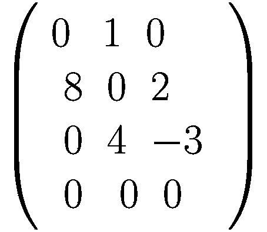

如下所示：

| MATLAB: | Python: |
| --- | --- |

好的，高级文档工程师，已根据您的要求和示例对文本进行排版。

### 11.3.1.1 重复的 COO 索引

MATLAB 的 `sparse()` 函数会对索引重复的项求和。换句话说，如果索引项 `(i, j)` 在输入索引数组中出现了三次，并在值数组中对应值 `V[1]`、`V[2]` 和 `V[3]`，那么 MATLAB 矩阵在 `(i, j)` 处的值将是 `V[1] + V[2] + V[3]`。所有 SciPy 矩阵创建函数也具有相同的行为，尽管求和可能是隐式的——三个重复项被分开存储，但对稀疏矩阵的所有数学运算都产生与求和相同的结果。为了演示这一点，我们将创建稀疏矩阵

$$ \left(\begin{array}{cc}1&amp; 3\\ {}0&amp; 4\end{array}\right) $$

通过重复最后一行和最后一列的索引两次，第一次值为 10，第二次值为 -6。此示例省略了尾部维度参数，因为输入数组 `I` 和 `J` 中最大的行和列索引足以定义维度。

| MATLAB: | Python: |
| --- | --- |
| `>> I = [1 1 2 2 ];`<br>`>> J = [1 2 2 2 ];`<br>`>> V = [1 3 10 -6 ];`<br>`>> A = sparse(I,J,V)` `A =` `Compressed Column Sparse` (rows = 2, cols = 2, nnz = 3 [75%])`(1, 1) ->  1`  `(1, 2) ->  3`  `(2, 2) ->  4` | `In :` `import scipy.sparse as sp` `In : I = [0, 0, 1, 1]` `In : J = [0, 1, 1, 1]` `In : V = [1, 3, 10, -6]` `In : A = sp.coo_matrix((V,(I,J)))` `In : A` `<2x2 sparse matrix of type`<br>`'<class 'numpy.int64'>'` with 4 stored elements in` `COOrdinate format>` `In : print(A)` `(0, 0)        1` `(0, 1)        3` `(1, 1)       10` `(1, 1)       -6` |

尽管 Python 分别存储了重复的索引值，但矩阵计算表明它使用了最后一行的汇总值 4。

| MATLAB: | Python: |
| --- | --- |
| `>> A * [1; 1]`<br>`4`<br>`4` | `In : A.dot([1,1])`<br>`Out: array([4, 4], dtype=int64)` |

Python 中的重复索引项可以通过稀疏矩阵对象的 `.sum_duplicates()` 方法显式求和：

```python
In : print(A)
(0, 0)        1
(0, 1)        3
(1, 1)        10
(1, 1)        -6
In : A.sum_duplicates()
In : print(A)
(0, 0)        1
(0, 1)        3
(1, 1)        4
```

### 11.3.1.2 提取索引和值

COO 稀疏矩阵的索引和值存储为对象属性 `.row`、`.col` 和 `.data`。这些对应于 MATLAB 的 `find()` 函数在稀疏矩阵上的输出。使用第 11.3.1.1 节中的 `A`：

| MATLAB: | Python: |
| --- | --- |
| `>> [I J V] = find(A);`<br>`>> I'` `1 1 2`<br>`>> J'` `1 2 2`<br>`> V'` `1 3 4` | `In : A.sum_duplicates()`<br>`In : A.row`<br>`Out: array([0, 0, 1], dtype=int32)`<br>`In : A.col`<br>`Out: array([0, 1, 1], dtype=int32)`<br>`In : A.data`<br>`Out: array([1, 3, 4])` |

如果没有调用 `.sum_duplicates()`，索引和值属性将显示重复项。

只有 COO 矩阵具有 `.row` 和 `.col` 属性。然而，通过矩阵的 `.tocoo()` 方法从其他格式转换为 COO 代价很小。有关其他格式可用组件的完整列表，请参见第 11.3.5.2 节。

### 11.3.1.3 压缩行、列存储

压缩稀疏行（CSR）和压缩稀疏列（CSC）存储方案允许更快速的矩阵操作，例如因式分解和乘法。尽管它们的创建函数 `csr_matrix()` 和 `csc_matrix()` 可以接受与 `coo_matrix()` 相同的参数，但通常更快的方法是使用 `coo_matrix()` 创建矩阵，然后使用矩阵的 `.tocsr()` 或 `.tocsc()` 方法将其转换为 CSR 或 CSC 格式。重复的索引在这些转换过程中会被求和。

虽然 `csr_matrix()` 和 `csc_matrix()` 可以接受显式的行和列索引数组，但可以直接提供 CSR 和 CSC 内部表示原生的更紧凑索引和索引指针数组。对于 `csr_matrix()`，这意味着提供一个列索引数组（上例中的 `J`）和一个包含每行项计数的指针数组。指针数组 `indptr` 的定义使得第 `i` 行的索引存储在 `J[indptr[i]:indptr[i + 1]]` 中，对应的值存储在 `data[indptr[i]:indptr[i + 1]]` 中。这些输入重复了前面的示例：

```python
In : J = np.array([1,0,2,1,2])  # column indices
In : V = np.array([1,8,2,4,-3]) # matrix data values
In : indptr = np.array([0, 1, 3, 5, 5])
In : A = sp.csr_matrix((V, J, indptr), shape=(4, 3))
In : A.todense()
```

`indptr` 数组需要进一步澄清——我们如何得到 `[0, 1, 3, 5, 5]`？一种理解方式是差值 `indptr[i + 1] - indptr[i]` 是第 `i` 行的项数，而 `indptr` 中的每个项包含其之前的项的总和。表 11-5 显示了捕获稀疏矩阵索引 `(0, 1)`、`(1, 0)`、`(1, 2)`、`(2, 1)` 和 `(2, 2)` 所需的索引数组 `J` 的内容。

**表 11-5** 每行的 `indptr` 值

| 行   |     |     | 列索引    |

|------|-----|-----|-----------|

| `0`  | `J[ indptr[0]:indptr[1] ]` | `J[0:1]` | `[1]`     |

| `1`  | `J[ indptr[1]:indptr[2] ]` | `J[1:3]` | `[0,2]`   |

| `2`  | `J[ indptr[2]:indptr[3] ]` | `J[3:5]` | `[1,2]`   |

| `3`  | `J[ indptr[3]:indptr[4] ]` | `J[5:5]` | `[]`      |

要将行索引数组（在我们的例子中是 `I = [1,0,2,1,2]`）转换为索引指针，我们可以利用 `collections` 模块中的数据容器 `Counter`。`Counter` 接受一个可迭代对象（如列表或数组）并返回一个字典，其键是可迭代对象中的唯一条目，值是这些条目出现的次数。如果字典使用不存在的键进行索引，它不会引发 `KeyError`，而是简单地返回零。

Python:

```
In : I
Out: array([0, 1, 1, 2, 2])
In : from collections import Counter
In : n_terms_this_row = Counter(I)
In : indptr = [0]
In : for i in range(nRows):
...:     indptr.append( indptr[-1] + n_terms_this_row[i])
In : indptr
Out: [0, 1, 3, 5, 5]
```

`csc_matrix()` 的索引指针输入的工作方式与 `csc_matrix()` 相同，只是提供了显式的行索引和指向列索引的指针，而不是反过来。

## 11.3.2 使用 LIL 和 DOK 创建稀疏矩阵

上一节的三种存储格式（坐标格式、压缩行格式和压缩列格式）要求预先明确给出每一行的行索引、列索引和值。除了计算位置和值然后从中创建稀疏矩阵，还可以逐步构建稀疏矩阵。此外，许多工程应用（尤其是有限元分析）会从许多较小的子矩阵生成稀疏矩阵。最终得到的稀疏矩阵在相邻的行和列中包含非零项的小块。

SciPy 提供了三种存储格式：列表列表（LIL）、键字典（DOK）和分块压缩行（BSR），它们能够高效地对此类结构化稀疏矩阵进行增量式组装、访问和操作。

在这里，我们将重新创建矩阵

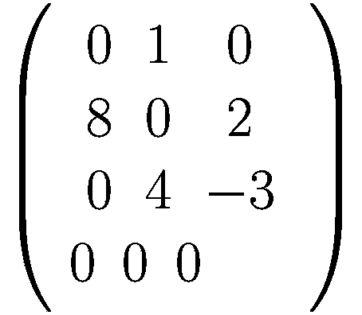

使用标量插入的方式处理第一行的 1 和第一列的 8，然后通过块插入的方式将子矩阵

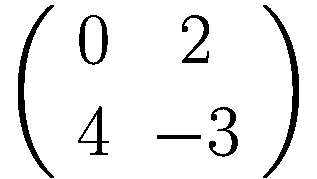

放置到第二、三行和第二、三列。

此示例使用了 LIL 构造器：

| MATLAB: | Python: |

| --- | --- |

| `.``>> A = sparse(4,3)``>> A(1,2) = 1;``>> A(2,1) = 8;``>> A(2:3,2:3) = [0 2;4 -3];``>> A``A =``Compressed Column Sparse` `(rows = 4, cols = 3,` `nnz = 5 [42%])` `(2, 1) ->  8` `(1, 2) ->  1` `(3, 2) ->  4` `(2, 3) ->  2` `(3, 3) -> -3` | `import scipy.sparse as sp``A = sp.lil_matrix( (4,3) )``A[0,1] = 1``A[1,0] = 8``A[1:3,1:3] = np.array([[0, 2],``[4,-3]])``In : print(A)``(0, 1)        1.0``(1, 0)        8.0``(1, 2)        2.0``(2, 1)        4.0``(2, 2)       -3.0` |

键字典（DOK）构造器在功能上与 LIL 构造器相同。以下代码的唯一区别在于调用的是 `dok_matrix()` 而非 `lil_matrix()`：

| MATLAB: | Python: |

| --- | --- |

| `.``>> A = sparse(4,3)``>> A(1,2) = 1;``>> A(2,1) = 8;``>> A(2:3,2:3) = [0 2;4 -3];``>> A``A =``Compressed Column Sparse` `(rows = 4, cols = 3,` `nnz = 5 [42%])` `(2, 1) ->  8` `(1, 2) ->  1` `(3, 2) ->  4` `(2, 3) ->  2` `(3, 3) -> -3` | `import scipy.sparse as sp``A = sp.dok_matrix( (4,3) )``A[0,1] = 1``A[1,0] = 8``A[1:3,1:3] = np.array([[0, 2],``[4,-3]])``In : print(A)``(0, 1)        1.0``(1, 0)        8.0``(1, 2)        2.0``(2, 1)        4.0``(2, 2)        -3.0` |

除了直接插入项之外，MATLAB 和 SciPy 的 LIL 和 DOK 稀疏矩阵还允许对块进行求和，并在必要时更新稀疏结构：

| MATLAB: | Python: |

| --- | --- |

| `>> A(2:3,2:3) = ...` `A(2:3,2:3) + [0 2;4 -3];` | `A = sp.dok_matrix( (4,3) )``A[1:3,1:3] += np.array([[0, 2],``[4,-3]])` |

## 11.3.3 使用 BSR 和 DIA 创建稀疏矩阵

剩余的两种稀疏格式，即分块压缩行（BSR）和对角线（DIA），比前面五种更特殊，因此使用频率较低。

顾名思义，分块压缩行格式存储一组稠密子矩阵。不过它也有缺点：子矩阵的大小必须相同，并且不支持直接索引。BSR 构造器函数 `bsr_matrix()` 接受一个数据块的 3D 数组作为输入，以及包含块列索引的 1D 数组，以及指向每一行列索引的指针。此示例从四个 2 x 2 矩阵创建了一个 8 x 6 的稀疏矩阵——该稀疏矩阵随后有四个块行和三个块列：

Python:

```
In : V = np.array([[[1,1],[1,1]],
...:               [[2,2],[2,2]],
...:               [[3,3],[3,3]],
...:               [[4,4],[4,4]]])
In : J = np.array([1, 2, 0, 2])  # 列索引
In : indptr = np.array([0, 1, 2, 2, 4])
In : A = sp.bsr_matrix((V, J, indptr), shape=(8, 6))
In : A.todense()
matrix([[0, 0, 1, 1, 0, 0],
[0, 0, 1, 1, 0, 0],
[0, 0, 0, 0, 2, 2],
[0, 0, 0, 0, 2, 2],
[0, 0, 0, 0, 0, 0],
[0, 0, 0, 0, 0, 0],
[3, 3, 0, 0, 4, 4],
[3, 3, 0, 0, 4, 4]])
```

`indptr` 数组是根据块行索引（在此示例中为 `I = [0,1,3,3]`）计算得出的，其创建方式与 `csr_matrix()` 的 `indptr` 相同（请参考第 11.3.1 节）。

对角线存储格式 DIA 非常适合采用有限差分网格上迭代求解的计算流体动力学问题。`dia_matrix()` 构造器类似于 MATLAB 的 `spdiags()` 函数：

MATLAB:

### 11.3.3 DIA 稀疏矩阵

```matlab
>> data = [-2 -4 -6 -8 -10 -12 -14;
10 11 12 13  14  15  16;
-1 -3 -5 -7  -9 -11 -13]' ;
>> offsets = [2 0 -1];
>> A = spdiags(data, offsets, 7,7);
>> full(A)
10    0   -6    0    0    0    0
-1   11    0   -8    0    0    0
0   -3   12    0  -10    0    0
0    0   -5   13    0  -12    0
0    0    0   -7   14    0  -14
0    0    0    0   -9   15    0
0    0    0    0    0  -11   16
```

Python:

```python
In : data = np.array([[-2,-4,-6,-8,-10,-12,-14],
...:                  [10,11,12,13, 14, 15, 16],
...:                  [-1,-3,-5,-7, -9,-11,-13]])
In : offsets = np.array([2,0,-1])
In : A = sp.dia_matrix((data, offsets), shape=(7,7))
In : A.todense()
matrix([[ 10,   0,  -6,   0,   0,   0,   0],
        [ -1,  11,   0,  -8,   0,   0,   0],
        [  0,  -3,  12,   0, -10,   0,   0],
        [  0,   0,  -5,  13,   0, -12,   0],
        [  0,   0,   0,  -7,  14,   0, -14],
        [  0,   0,   0,   0,  -9,  15,   0],
        [  0,   0,   0,   0,   0, -11,  16]])
```

请注意，在 MATLAB 和 Python 中，`data` 中的项会被丢弃，以适应远离对角线时尺寸的减小。在我们的例子中，`-2` 和 `-4` 不会出现在对角线以上，而 `-13` 不会出现在对角线以下。

与 BSR 一样，DIA 稀疏矩阵不能被下标索引。

### 11.3.4 测试矩阵

第 11.1.6.14 节给出了一些稠密测试矩阵的示例；这里，我们针对稀疏矩阵做同样的事情。与稠密随机矩阵一样，MATLAB 的稀疏随机矩阵不会与 Python 的稀疏矩阵匹配。

#### 11.3.4.1 密度为 40% 的随机稀疏 4 × 3 数组

| MATLAB: | Python: |
| :--- | :--- |
| `>> A = sprand(4,3,.4);`<br>`>> full(A)`<br>`   0.000  0.000  0.000`<br>`   0.617  0.000  0.349`<br>`   0.000  0.000  0.000`<br>`   0.881  0.165  0.335` | `In : A = sp.rand(4, 3, density=0.4, format='dok')`<br>`In : A.todense()`<br>`matrix([[0.688, 0.401, 0.   ],`<br>`        [0.   , 0.   , 0.   ],`<br>`        [0.337, 0.   , 0.   ],`<br>`        [0.   , 0.023, 0.   ]])` |

#### 11.3.4.2 通过 `I`, `J`, `V` 生成随机稀疏矩阵

这里，我们还将使用 MATLAB 的 `spy()` 函数和 Python 的 `matplotlib` 来查看稀疏矩阵的结构：

| MATLAB: | Python: |
| :--- | :--- |
| `nR = 50;`<br>`nC = 50;`<br>`nNZ = 10*nC;`<br>`I = ceil(nR*rand(nNZ,1));`<br>`J = ceil(nC*rand(nNZ,1));`<br>`V = ceil(nC*rand(nNZ,1));`<br>`A = sparse(I,J,V);`<br>`spy(A)`<br>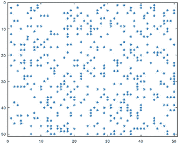 | `import scipy.sparse as sp`<br>`import numpy as np`<br>`import matplotlib.pyplot as plt`<br>`nR = 50`<br>`nC = 50`<br>`nNZ = 10*nC` *# 非零元素数量*<br>`I = np.random.randint(0, nR, size=(nNZ,))`<br>`J = np.random.randint(0, nC, size=(nNZ,))`<br>`V = np.random.randint(0, nC, size=(nNZ,))`<br>`A = sp.coo_matrix((V,(I,J)),shape=(nR,nC))`<br>`plt.spy(A)`<br>`plt.show()`<br>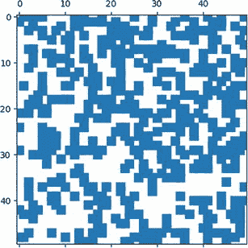 |

#### 11.3.4.3 箭头矩阵

| MATLAB: | Python: |
| :--- | :--- |
| `>> A = speye(4);`<br>`>> A(1,:) = 1;`<br>`>> A(:,1) = 1;`<br>`>> full(A)`<br>`   1   1   1   1`<br>`   1   1   0   0`<br>`   1   0   1   0`<br>`   1   0   0   1` | `In : A = sp.identity(4).todok()`<br>`In : A[0,:] = 1`<br>`In : A[:,0] = 1`<br>`In : A.todense()`<br>`matrix([[1., 1., 1., 1.],`<br>`        [1., 1., 0., 0.],`<br>`        [1., 0., 1., 0.],`<br>`        [1., 0., 0., 1.]])` |

### 11.3.5 稀疏矩阵的输入/输出（I/O）

MATLAB 的 `save` 和 `load` 命令可以轻松地将稀疏矩阵写入 `.mat` 文件并将其读回。与 NumPy 对应项不同，SciPy 稀疏矩阵缺乏用于文件输入和输出的内置方法。具有讽刺意味的是，SciPy 的 `savemat()` 和 `loadmat()` 函数支持从 MATLAB `.mat` 文件读取稀疏矩阵和向其写入稀疏矩阵。

#### 11.3.5.1 写入 MATLAB `.mat` 文件

此方法也适用于在 MATLAB 和 Python 之间传递稀疏矩阵。

#### 11.3.5.2 将组件部分写成 NumPy 数组

稀疏矩阵的组成部分——数据值以及行索引和列索引——是 NumPy 数组，因此我们可以使用 NumPy 的 `savez()` 和 `loadz()` 函数高效地读写它们。这里需要注意，项目名称因存储格式而异，因此在访问其组件之前，必须知道稀疏矩阵的格式（存储在其 `.format` 属性中）：

*   COO: `A.data`, `A.row`, `A.col`
*   CSR: `A.data`, `A.indices`, `A.indptr`
*   CSC: `A.data`, `A.indices`, `A.indptr`
*   LIL: `A.data`, `A.rows`（包含行和列索引）
*   BSR: `A.data`, `A.indices`, `A.indptr`
*   DIA: `A.data`, `A.offsets`

`DOK` 的独特之处在于其组件存储在字典中，而不是 NumPy 数组中。其条目可以通过 `A.keys()` 和 `A.values()` 检索。`DOK` 矩阵可以转换为其他格式以保存为 NumPy 数组，或者按照下一节所述写入 pickle 文件。

加载组件后，必须通过调用适当的构造函数重新生成矩阵。对于 COO 矩阵，过程如下：

Python：

```python
# 假设已加载 data, row, col 为 NumPy 数组
A = sp.coo_matrix((data, (row, col)), shape=(...))
```

# 11.3 稀疏矩阵

#### 11.3.5.3 写入 Python Pickle 对象

SciPy 稀疏矩阵是常规的 Python 变量，因此可以写入 pickle 文件（参考第 7.13 节）：

**Python：**

```python
In : import pickle
In : import scipy.sparse as sp
In : A = sp.rand(4, 3, 0.4, format='csr')
In : A.todense()
Out: matrix([[0.   , 0.   , 0.899],
             [0.   , 0.054, 0.   ],
             [0.   , 0.   , 0.   ],
             [0.   , 0.625, 0.603]])
In : with open('A.pkl', 'wb') as f:
In :     pickle.dump(A, f, 4) # protocol v 4
In : !ls -l A.pkl
In : -rw-rw-r-- 1 al al 457 May 29 14:15 A.pkl
In : A = None
In : with open('A.pkl', 'rb') as f:
In :     A = pickle.load(f)
In : A.todense()
Out: matrix([[0.   , 0.   , 0.899],
             [0.   , 0.054, 0.   ],
             [0.   , 0.   , 0.   ],
             [0.   , 0.625, 0.603]])
```

#### 11.3.6 线性代数

SciPy 的稀疏矩阵线性代数函数位于`scipy.sparse.linalg`模块中，该模块必须独立于`scipy.sparse`本身导入。

作为一个代表性矩阵，我们将使用来自美国国家标准与技术研究所 Matrix Market 的基于有限元的对称稀疏矩阵`fidap037`。可以使用`scipy.io`的`mmread()`函数将其加载到 Python，并使用`mmread.m`加载到 MATLAB。`SciPy`的`mmread()`返回坐标形式（COO）的稀疏矩阵。如果要对矩阵进行因式分解，则需要将其转换为诸如`CSC`之类的形式。

以下代码将文件加载到稀疏变量`K`中，并定义一个行数相等且有两列的矩阵`b`，其中第一列的所有值均为 +1，另一列的值为 –1。

| MATLAB: | Python: |
| --- | --- |
| `>> K = mmread('fidap037.mtx');`<br>`>> [nR,nC] = size(K);`<br>`>> b = ones(nR,2);`<br>`>> b(:,2) = -1;` | `from scipy.io import mmread`<br>`import scipy.sparse as sp`<br>`import scipy.sparse.linalg as spla`<br>`K = mmread('fidap037.mtx')` `# COO format`<br>`K = K.tocsc()` `# for factorization later`<br>`nR,nC = K.shape`<br>`b = np.ones((nR,2))`<br>`b[:,1] = -1` |

### 矩阵摘要

以下命令打印维度和非零项的数量，并显示稀疏模式。其他矩阵摘要功能因两个系统而异。MATLAB 有一个估计条件数的函数，但没有估计范数的函数，而 SciPy 则相反。这些值的 Matrix Market 值为 2.26e+02 和 1.5e+03。

| MATLAB: | Python: |
| --- | --- |
| `>> size(K)`<br>     `3565    3565`<br>`>> nnz(K)`<br>    `67591`<br>`>> spy(K)`<br>`>> condest(K)`<br>  `226.3745` | `In : K.shape`<br>`Out: (3565, 3565)`<br>`In : K.nnz`<br>`Out: 67591`<br>`In : import matplotlib.pyplot as plt`<br>`In : plt.spy(K,markersize=1)`<br>`In : plt.show()`<br>`In : spla.norm(K)`<br>`Out: 1472.080010077052` |

**图 11-2** Python

**图 11-1** MATLAB

### 矩阵-向量乘积

与使用`@`进行矩阵乘法的 NumPy 数组不同，SciPy 稀疏矩阵可以使用`*`。`.dot()`方法也适用于稀疏矩阵。仅显示乘积的 3565 行的一部分：

| MATLAB: | Python: |
| --- | --- |
| `>> Kb = K*b;`<br>`>> Kb(191:195,:)`<br>    `1.0000   -1.0000`<br>   `13.4848  -13.4848`<br>   `52.3418  -52.3418`<br>    `1.0000   -1.0000`<br>   `27.2083  -27.2083` | `In : Kb = K*b`<br>`In : Kb[190:195,:]`<br>`Out:`<br>`array([[  1.        ,  -1.        ],`<br>`       [ 13.48478231, -13.48478231],`<br>`       [ 52.3417648 , -52.3417648 ],`<br>`       [  1.        ,  -1.        ],`<br>`       [ 27.20825099, -27.20825099]])` |

### 线性方程组的解

MATLAB 的反斜杠运算符适用于稠密矩阵和稀疏矩阵。`SciPy`使用`spsolve()`求解 *Kx* = *b* 中的 *x*，并使用`splu()`将 *K* 分解为下三角矩阵和上三角矩阵（一起存储为 *LU*），然后使用`LU.solve(b)`求解：

| MATLAB: | Python: |
| --- | --- |

# 标准特征值问题的求解

如表格 11-4 所示，MATLAB 的 `eigs()` 函数通过多种参数控制的选项处理所有形式的稀疏特征值问题。SciPy 提供了两个函数 `eigs()` 和 `eigsh()` 分别处理非对称和对称输入。这两个函数都支持使用位移-反转变换参数 `sigma` 来搜索目标特征值区域附近的解，并且都支持提取指定数量的特征对。

以下示例求解方程 `Kx = λx`，目标是找到对称矩阵 `K` 的最接近位移 `σ = -1` 的十个特征值和特征向量。该问题极具挑战性，因为矩阵存在 1651 个重复的特征值 1.0（通过计算 Sturm 数获知，详见后文）。在位移 `-1` 附近，MATLAB 和 Python 均无法保证返回的特征值是完整的。尽管 MATLAB 返回了七个特征值 1.0（而 Python 返回了六个），但理想情况下两者都应返回十个值为 1.0 的特征值。

| MATLAB: | Python: |
| :--- | :--- |
| `>> [vec,val] = eigs(K,10,-1);` <br> `> format long e` <br> `>> diag(val)` <br> `9.999999999999947e-01` <br> `9.999999999999947e-01` <br> `9.999999999999956e-01` <br> `9.999999999999969e-01` <br> `9.999999999999978e-01` <br> `1.000000000000000e+00` <br> `1.000000000000000e+00` <br> `2.319122761249388e+00` <br> `2.390762542515986e+00` <br> `2.500701541757246e+00` | `In : val,vec = spla.eigsh(K,k=10,sigma=-1)` <br> `In : val` <br> `Out:` <br> `array([1.        ,` <br> `1.        ,` <br> `1.        ,` <br> `1.        ,` <br> `1.        ,` <br> `1.        ,` <br> `2.31912276,` <br> `2.39076254,` <br> `2.50070154,` <br> `2.63542116])` |

## Sturm 序列数

MATLAB 和 Python 的稀疏特征值求解器均无法判断请求的解的数量是否完整，即：如果在位移 `σ` 附近请求了 `n` 个解，返回的 `n` 个特征值是否是最接近 `σ` 的？或者是否有遗漏？对于广义特征值问题 `Kx = λMx`，Sturm 序列数消除了这一疑问。该数值是 `K - σM` 的 LU 分解中，对角线上的负值个数，它等于小于 `σ` 的特征值的数量。

以下代码计算了我们的 `K` 在 `σ[1] = 0.99` 和 `σ[2] = 1.01` 处的 Sturm 序列数。由于我们求解的是标准特征值问题 `Kx = λx`，因此此处的 `M` 就是单位矩阵：

| MATLAB: | Python: |
| :--- | :--- |
| `>> sigma = 0.99;` <br> `>> [L,U] = lu(K-sigma*eye(nR));` <br> `>> dU = diag(U);` <br> `>> sum(dU < 0)` <br> `0` <br> `>> sigma = 1.01;` <br> `>> [L,U] = lu(K - sigma*eye(nR));` <br> `>> dU = diag(U);` <br> `>> sum(dU < 0)` <br> `1651` | `In : sigma = 0.99` <br> `In : LU = spla.splu(K - sigma*sp.eye(nR))` <br> `In : dU = LU.U.diagonal()` <br> `In : np.sum(dU < 0)` <br> `Out:    0` <br> `In : sigma = 1.01` <br> `In : LU = spla.splu(K - sigma*sp.eye(nR))` <br> `In : dU = LU.U.diagonal()` <br> `In : np.sum(dU < 0)` <br> `Out: 1651` |

因此，我们知道 `Kx = λx` 在 0.99 和 1.01 之间有 1651 个特征值。

## 广义特征值问题的求解

广义特征值问题 `Kx = λMx` 常见于结构振动和屈曲问题等场景。MATLAB 和 SciPy 的稀疏特征值求解器都接受第二个矩阵来求解这类问题。我们创建了一个对角线元素从 1 到 3565 线性分布的对角矩阵 `M` 来配合我们的 `K`。

尽管 SciPy 返回的特征值已排序，但无论是 SciPy 还是 MATLAB 的 `eigs()` 都不保证返回顺序。为了简化比较，此处明确对 MATLAB 的输出进行了排序。

| MATLAB: | Python: |
| :--- | :--- |

### 11.3.7 稀疏格式与功能总结及建议

表格 11-6 总结了 SciPy 的稀疏矩阵格式及其功能。

**表 11-6 SciPy 稀疏存储方案比较**

| | 创建 | 支持下标访问 | 更改稀疏结构 | 矩阵-向量乘积 | 线性代数 |
| --- | --- | --- | --- | --- | --- |
| MATLAB | 快 | 是 | 是 | 快 | 是 |
| COO | 快 | 否 | 否 | 中等 | 否 |
| CSC/CSR_Indices_ | 快 | 是 | 是 | 快 | 是 |
| CSC/CSR_Subscripting_ | 非常慢 | 是 | 是 | 快 | 是 |
| LIL | 慢 | 是 | 快 | 快 | 是 |
| DOK | 非常慢 | 是 | 是 | 快 | 是 |
| BSR | 中等 | 否 | 否 | 快 | 是 |
| DIA | 非常快 | 否 | 否 | 快 | 是 |

性能测试表明，七种格式中的两种（`DOK` 和 `BSR`）可以从 SciPy 中移除而不会影响功能。`LIL` 可以完成 `DOK` 能做的一切，且速度更快；而 `BSR` 虽然专为分块矩阵设计，但既慢又不灵活。

在 Python 中使用稀疏矩阵最高效的方式是：使用索引数组创建 `COO`、`CSC` 或 `CSR` 矩阵。`COO` 矩阵的创建速度略快于 `CSC` 或 `CSR`，但 `COO` 矩阵不支持下标访问，也不能用于除矩阵乘法之外的线性代数运算。不过，将 `COO` 矩阵转换为 `CSC` 或 `CSR` 的速度很快。

如果性能是关键考量，应避免通过下标进行增量创建（即使用 `A[i,j] += v`）。格式间的转换成本较低，通常不到创建矩阵所需工作量的 1%。因此，如果需要大量下标更新，一种有效的策略是：将 `COO` / `CSR` / `CSC` 矩阵转换为 `LIL`（后者能以最快速度执行下标更新），执行下标更新，然后再转换回 `CSC` 或 `CSR`。

人们不禁要问，这些格式切换能否被抽象化，以提供像 MATLAB 那样单一、无缝的稀疏矩阵体验。

## 11.4 插值

数值数据通常需要以与原始记录不同的间隔进行重采样。这对于现场测量、测试设备等采集的观测数据尤其常见。

虽然 NumPy 和 SciPy 都提供了插值函数，但 SciPy 的功能更为强大。

### 11.4.1 一维插值

下图展示了区间 [0, 1] 上的五个点。我们将演示线性和样条插值方法来估算已知点之间的值。在第一个点之前和最后一个点之后进行外推时，最好使用曲线拟合方法，例如线性回归（第 11.5.1 节）。

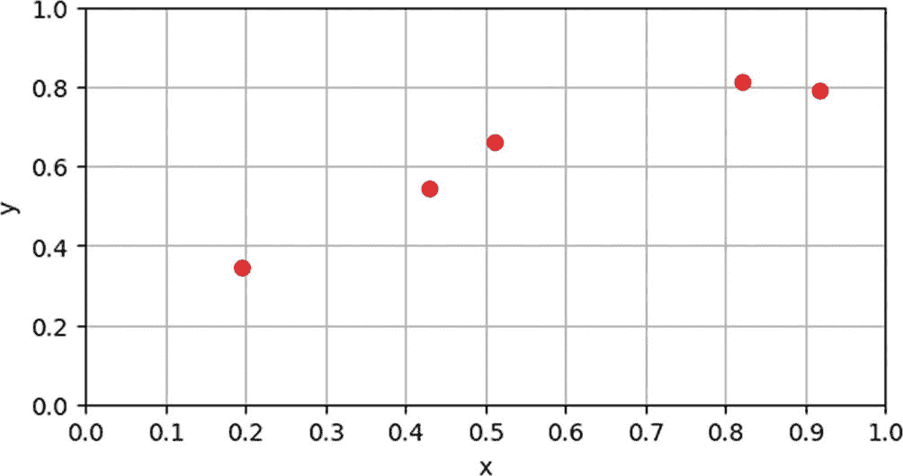

#### 11.4.1.1 一维线性插值

一维线性插值可以使用 NumPy 的 `np.interp()` 完成。它接受三个输入参数：我们希望计算对应 `y` 值的 `x` 值数组，然后是已知的 `x` 和 `y` 集合：

```
In : x_known = np.array([0.194, 0.429, 0.512, 0.821, 0.917])
In : y_known = np.array([0.347, 0.543, 0.661, 0.811, 0.793])
In : x_desired = np.linspace(0, 1, num=21)
In : x_desired
array([0\.  , 0.05, 0.1 , 0.15, 0.2 ,
0.25, 0.3 , 0.35, 0.4 , 0.45,
0.5 , 0.55, 0.6 , 0.65, 0.7 ,
0.75, 0.8 , 0.85, 0.9 , 0.95, 1.])
In : y_desired = np.interp(x_desired, x_known, y_known)
```

插值得到的点（`x_desired`，`y_desired`）在下图中以蓝色加号表示：

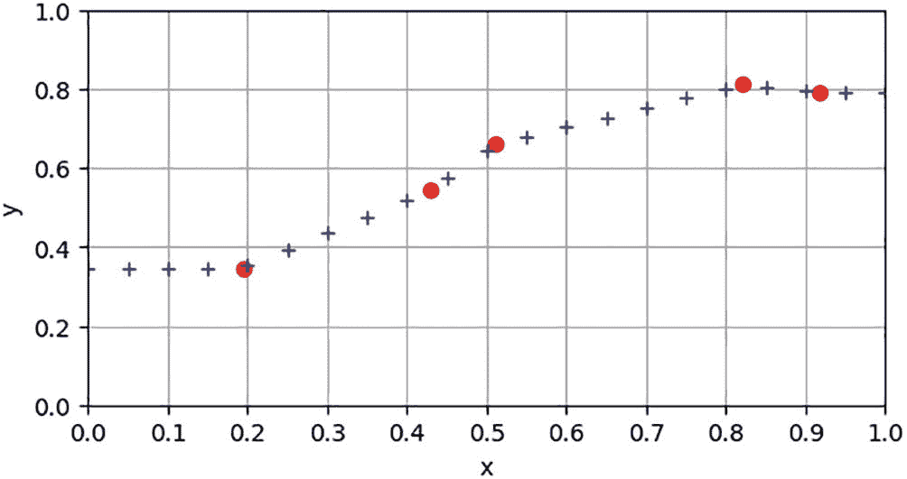

外推得到的值仅仅是第一个和最后一个已知点的复制。可以通过 `np.interp()` 的可选关键字参数 `left=` 和 `right=` 将其更改为其他值（例如 `np.NaN`）。

#### 11.4.1.1 一维样条插值

一维样条插值需要使用 SciPy 的 `scipy.interpolate` 模块中的 `interp1d()` 函数。与 `np.interp()` 接受三个参数不同，`interp1d()` 仅将已知的 *x* 和 *y* 值作为输入，同时包含可选关键字参数 `kind`（用于描述插值方法，选项见表 11-7）、`bounds_error` 和 `fill_value`。其中 `bounds_error` 和 `fill_value` 这两个可选参数很重要，因为与 `np.interp()` 不同，`interp1d()` 不会对超出第一个点之前或最后一个点之后的值进行外推。默认情况下，`bounds_error` 为 `True`，这意味着尝试外推会导致代码抛出 `ValueError` 异常。我们可以通过将 `bounds_error` 设置为 `False` 来避免此异常，但此时我们需要在 `x_desired` 超出 `x_known` 范围时提供要使用的值，这就是 `fill_value` 的作用。一种常用的越界结果是 `np.NaN`，它可以告知后续处理程序插值器在对应的 *x* 值处执行失败。当然，这些后续处理程序必须能够处理 `np.NaN` 值。方便的是，包含 `np.NaN` 值的点不会在绘图中显示。

**表 11-7** `scipy.interpolate.interp1d()` 中 *kind* 参数的选项

| `kind` | 说明 |
| --- | --- |
| `'linear'` | 线性；与 `np.interp()` 相同 |
| `'nearest'` | 最近邻 |
| `'zero'` | 零阶样条 |
| `'slinear'` | 一阶样条 |
| `'quadratic'` | 二阶样条 |
| `'cubic'` | 三阶样条 |
| `'previous'` | 前一个点的值 |
| `'next'` | 下一个点的值 |

`interp1d()` 的返回值是一个新函数，该函数仅接受所需 *x* 值的数组作为唯一参数。该函数的返回值是给定 *x* 对应的 *y* 数组。下面的代码使用了与 11.4.1.1 节相同的 `x_known`、`y_known` 和 `x_desired`。

```
In : from scipy.interpolate import interp1d
In : new_fn = interp1d(x_known, y_known,
kind='cubic', bounds_error=False,
fill_value=np.NaN)
In : y_desired = new_fn(x_desired)
```

这将生成

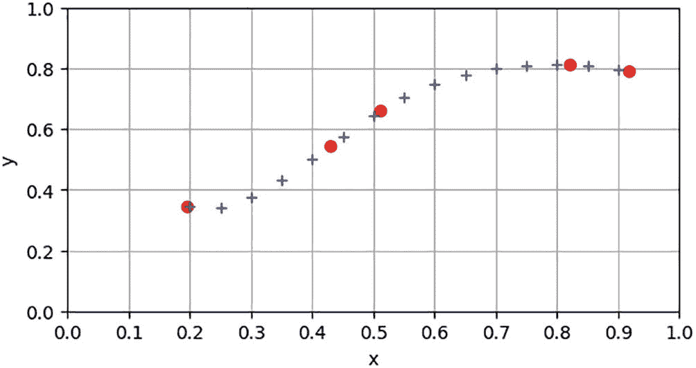

### 11.4.2 二维插值

二维插值是地理信息系统（GIS）、制图和遥感领域的常见任务。与一维插值类似，二维插值获取已知位置的值，并返回相邻位置（通常是规则间隔的网格）的估计值。规则网格上的值非常适合以热力图、等高线图或地图叠加层的形式进行可视化。

作为一个简单示例，让我们考察函数 `f(x, y) = x + 2(cos 7x + sin 5y) + 3y sin 6x`，其定义域为边界为 −0.6 < `x` < 1 和 −1 < `y` < 0.4 的矩形区域。`f(x, y)` 的等高线图如下所示：

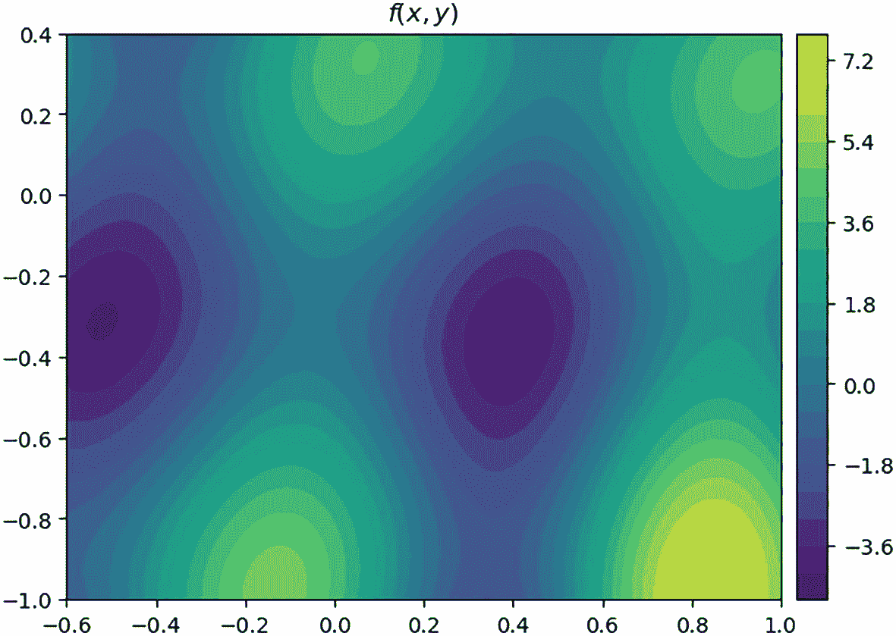

为了测试我们的二维插值方法，我们将从螺旋线区域中选取 114 个点对 `f(x, y)` 进行子采样，这些点由以下 `x` 和 `y` 值定义（布尔索引掩码如 `in_range` 在 11.1.14 节中解释）：

```
K = 0.005
t = np.linspace(0,800,num=1100)
Spiral = np.array([K*t*np.cos(t)+1,
K*t*np.sin(t)-1])
in_range = (-0.6 < Spiral[0,:]) * (Spiral[0,:] < 1.0) * \
(-1.0 < Spiral[1,:]) * (Spiral[1,:] < 0.4)
x = Spiral[0,in_range]
y = Spiral[1,in_range]
```

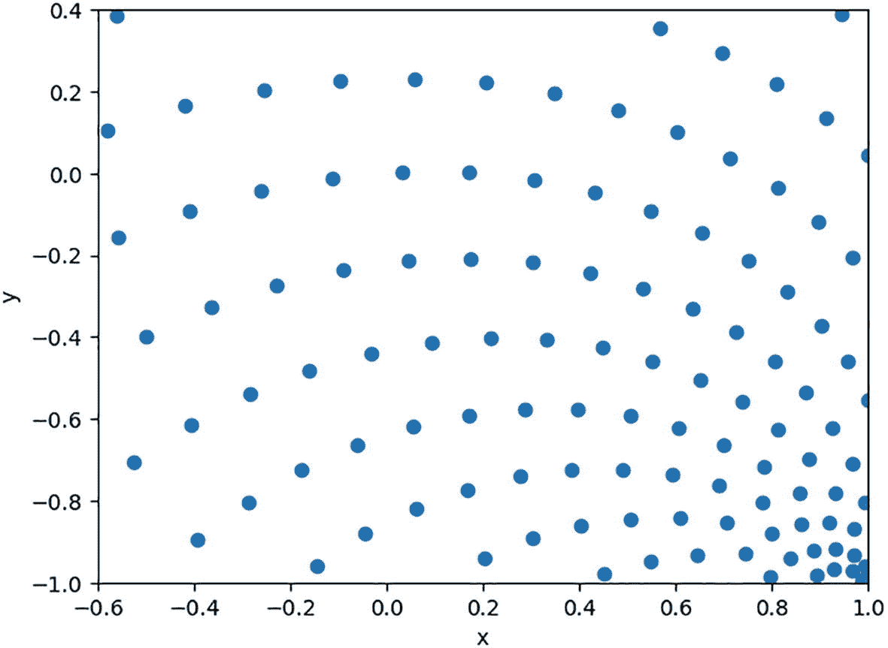

MATLAB 和 Python 都使用名为 `griddata()` 的函数来对不规则间隔的数据执行二维插值，将其映射到规则网格上；Python 中的该函数位于 SciPy 的 `scipy.interpolate` 模块中。`griddata()` 的输入参数是我们已知数据值的点的坐标、数据值本身，然后是一对二维数组，其中包含我们期望函数进行插值的 X 和 Y 坐标。X 和 Y 数组通常包含由 `mgrid[]` 或 `np.meshgrid()`（稍后解释）返回的规则间隔网格上的坐标；不过，也可以使用任意排列的点。在插值计算中，索引相差 1 的点被认为在拓扑上是相邻的。

我们希望结果分布在规则网格上，因此首先需要为该网格创建坐标值。在 Python 中可以通过两种方式实现。第一种方法使用 NumPy 的 `meshgrid()` 函数：

| MATLAB: | Python: |
| --- | --- |
| ```matlab
>> nX = 3; nY = 4;
>> format short
>> [X, Y] = meshgrid(...
    linspace(-.6,  1,nX),...
    linspace(-1 ,-.4,nY))
X =
   -0.6000    0.2000    1.0000
   -0.6000    0.2000    1.0000
   -0.6000    0.2000    1.0000
   -0.6000    0.2000    1.0000
Y =
   -1.0000   -1.0000   -1.0000
   -0.8000   -0.8000   -0.8000
   -0.6000   -0.6000   -0.6000
   -0.4000   -0.4000   -0.4000
``` | ```python
In : nX, nY = 3, 4
In : X, Y = np.meshgrid(
...:     np.linspace(-.6,  1,nX),
...:     np.linspace(-1 ,-.4,nY))
In : X
array([[-0.6,  0.2,  1\. ],
       [-0.6,  0.2,  1\. ],
       [-0.6,  0.2,  1\. ],
       [-0.6,  0.2,  1\. ]])
In : Y
array([[-1\. , -1\. , -1\. ],
       [-0.8, -0.8, -0.8],
       [-0.6, -0.6, -0.6],
       [-0.4, -0.4, -0.4]])
``` |

第二种方法使用 NumPy 的 `mgrid` 对象（注意不是函数！），通过虚步长范围进行索引。普通的列表和 NumPy 索引范围只允许整数值，但 `mgrid` 索引范围可以包含浮点型的起始值、结束值和增量值。另一个特点是，*x* 和 *y* 的位置与 `np.meshgrid()` 相比是相反的：

## 11.4.2 使用 `griddata()` 进行二维插值

| MATLAB: | Python: |
| --- | --- |
| ```matlab
>> nX = 3; nY = 4;
>> format short
>> [X, Y] = meshgrid(...
    linspace(-.6,  1,nX),...
    linspace(-1 ,-.4,nY))
X =
   -0.6000    0.2000    1.0000
   -0.6000    0.2000    1.0000
   -0.6000    0.2000    1.0000
   -0.6000    0.2000    1.0000
Y =
   -1.0000   -1.0000   -1.0000
   -0.8000   -0.8000   -0.8000
   -0.6000   -0.6000   -0.6000
   -0.4000   -0.4000   -0.4000
``` | ```python
In : nX, nY = 3, 4
In : Y, X = np.mgrid[-1.0:-0.4:nY*1j,
...:                 -0.6: 1.0:nX*1j]
In : X
array([[-0.6,  0.2,  1\. ],
       [-0.6,  0.2,  1\. ],
       [-0.6,  0.2,  1\. ],
       [-0.6,  0.2,  1\. ]])
In : Y
array([[-1\. , -1\. , -1\. ],
       [-0.8, -0.8, -0.8],
       [-0.6, -0.6, -0.6],
       [-0.4, -0.4, -0.4]])
``` |

现在我们拥有了二维插值所需的所有输入：114 个已知函数值点的坐标，以及我们想要获取插值结果的一个规则网格的坐标。默认情况下，`griddata()` 执行线性插值，但也可以进行三次插值和最近邻插值。我们将在 200 × 200 的网格上评估这三种方法：

| MATLAB: | Python: |
| --- | --- |

# 网格数据与二维插值

| `code/griddata/spiral_interp.m` | `# code/griddata/spiral_interp.py` |
| :--- | :--- |
| ```matlab<br>K = 0.005;<br>% subsample f(x,y) at 114 points<br>t = linspace(0,800,1100);<br>X = [K*t.*cos(t)+1; K*t.*sin(t)-1];<br>in_range = (-0.6 < X(1,:)) & ...<br>            (X(1,:) < 1.0) & ...<br>            (-1.0 < X(2,:)) & ...<br>            (X(2,:) < 0.4);<br>x_known = X(1,in_range);<br>y_known = X(2,in_range);<br>F_known = f(x_known, y_known);<br>% make a 200 x 200 regular grid<br>nX = 200; nY = 200;<br>[X, Y] = meshgrid(...<br>    linspace(-.6,  1,nX),...<br>    linspace(-1 ,-.4,nY));<br>% interpolate  to the regular grid<br>F_near   = griddata(...<br>    x_known, y_known, ...<br>    F_known, X,Y, 'nearest');<br>F_linear = griddata(...<br>    x_known, y_known,...<br>    F_known, X,Y, 'linear');<br>F_cubic  = griddata(...<br>    x_known, y_known,...<br>    F_known, X,Y, 'cubic');<br>function [S] = f(x,y)<br>    S = x + 2*(cos(7*x) + ...<br>            sin(5*y)) + 3*y.*sin(6*x);<br>end<br>``` | ```python<br>import numpy as np<br>from scipy.interpolate import<br>    griddata<br>def f(x,y):<br>    return x + 2*(np.cos(7*x)+<br>        np.sin(5*y)) + 3*y*np.sin(6*x)<br>K = 0.005<br># subsample f(x,y) at 114 points<br>t = np.linspace(0,800,num=1100)<br>X = np.array([K*t*np.cos(t)+1,<br>               K*t*np.sin(t)-1])<br>in_range = (-0.6 < X[0,:]) * \<br>           (X[0,:] < 1.0) * \<br>           (-1.0 < X[1,:]) * \<br>           (X[1,:] < 0.4)<br>x_known = X[0,in_range]<br>y_known = X[1,in_range]<br>F_known = f(x_known, y_known)<br># make a 200 x 200 regular grid<br>nX, nY = 200, 200<br>Y, X = np.mgrid[-1.0:-0.4:nY*1j,<br>                -0.6: 1.0:nX*1j]<br># interpolate to the regular grid<br>F_near   = griddata(<br>    (x_known, y_known),<br>    F_known, (X,Y), method="nearest")<br>F_linear = griddata(<br>    (x_known, y_known),<br>    F_known, (X,Y),method='linear')<br>F_cubic  = griddata(<br>    (x_known, y_known),<br>    F_known, (X,Y),method='cubic')<br>``` |

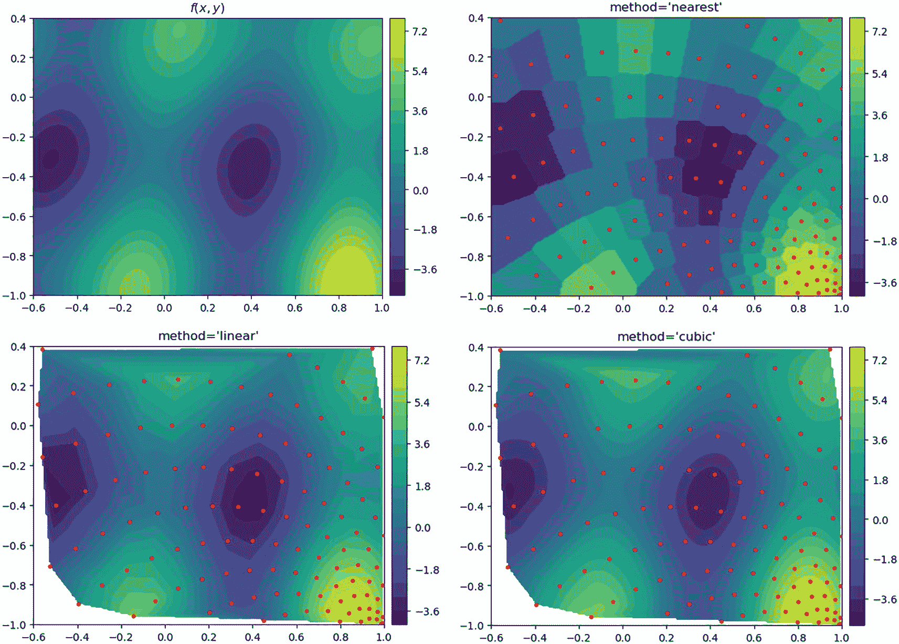

哪种插值方法最好？和许多问题一样，答案是“视情况而定”。三次方法最能保真地捕捉原始函数的梯度，尤其是在已知数据点集中的区域。然而，三次和线性方法都未能捕捉到上边缘的局部峰值。

这种失败是由`griddata()`的线性和三次插值方法在已知数据点上使用`Delaunay 三角剖分`导致的。三角剖分会在已知点周围用一个凸包填充元素，凸包内部的任何所需点都将从其边界元素获得插值。上边缘和左边缘的点被狭窄的薄片元素连接起来，这些元素无益地将距离很远的点关联起来。

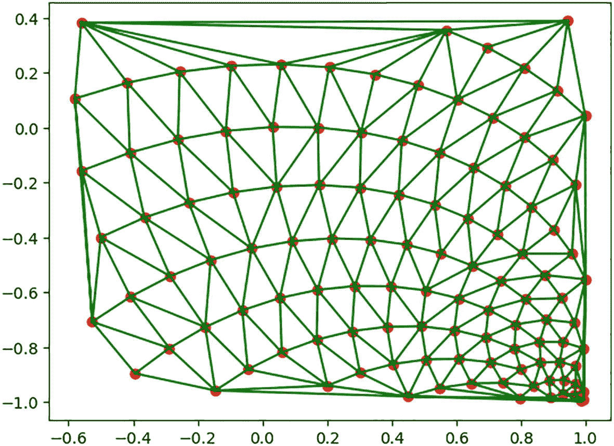

### 11.4.3 网格上的二维插值

一种简化但仍然常见的二维插值形式是，获取粗网格上的等间距值，并将这些值插值到更细的网格上。在图像处理中，这种插值被称为**图像缩放**，因为更细的网格比原始网格拥有更多的数据点（或像素）。

前一节讨论的MATLAB中的`interp2`和Python的`griddata`都可以用于此任务。但是，这两种方法都需要额外的参数来定义插值点的位置。Python的`scipy.ndimage`模块提供了一种更简单的方法。它的`zoom()`函数只需要两个参数：输入数组和放大（或缩小）量。默认情况下，`zoom()`执行三次样条插值，但样条阶数可以在 0 到 5 之间设置。以下示例将一个 3 x 5 矩阵的值插值以填充一个 10 x 12 的矩阵。

第二个参数描述每个维度应放大的倍数。我们希望有 10 行而不是 3 行，12 列而不是 5 列，因此缩放参数是`[10/3, 12/5]`：

**Python:**

```python
from scipy.ndimage import zoom
In : a = np.array([[0, 0, 0, 5, 6],
                    [0, 0, 0, 5, 6],
                    [4, 4, 5, 6, 8]])
In : b = zoom(a, [10/3, 12/5])
In : b.shape
Out: (10, 12)
In : b
Out: array([[ 0,  0,  0,  0,  0,  0,  1,  3,  5,  6,  6,  6],
            [ 0,  0,  0,  0, -1, -1,  1,  3,  5,  6,  6,  6],
            [ 0,  0,  0,  0, -1, -1,  0,  2,  5,  6,  6,  6],
            [ 0,  0,  0, -1, -1, -1,  0,  2,  4,  6,  6,  6],
            [ 0,  0,  0,  0, -1, -1,  0,  2,  5,  6,  6,  6],
            [ 0,  0,  0,  0,  0,  0,  1,  3,  5,  6,  6,  6],
            [ 1,  2,  2,  1,  1,  2,  2,  4,  5,  6,  7,  7],
            [ 3,  3,  3,  3,  3,  3,  4,  4,  5,  6,  7,  7],
            [ 4,  4,  4,  4,  4,  4,  5,  5,  6,  7,  7,  8],
            [ 4,  4,  4,  4,  4,  5,  5,  5,  6,  7,  8,  8]])
```

如果缩放参数是单个值，则两个维度都会按相同因子增加。

负值是三次样条在拟合跨越 0/5 边界的阶跃函数时产生的伪影。通过设置`order=1`可以执行双线性插值：

**Python:**

```python
from scipy.ndimage import zoom
In : a = np.array([[0, 0, 0, 5, 6],
                    [0, 0, 0, 5, 6],
                    [4, 4, 5, 6, 8]])
In : b = zoom(a, [10/3, 12/5], order=1)
In : b
Out: array([[0, 0, 0, 0, 0, 0, 1, 3, 5, 5, 6, 6],
            [0, 0, 0, 0, 0, 0, 1, 3, 5, 5, 6, 6],
            [0, 0, 0, 0, 0, 0, 1, 3, 5, 5, 6, 6],
            [0, 0, 0, 0, 0, 0, 1, 3, 5, 5, 6, 6],
            [0, 0, 0, 0, 0, 0, 1, 3, 5, 5, 6, 6],
            [0, 0, 0, 0, 0, 1, 1, 3, 5, 5, 6, 6],
            [1, 1, 1, 1, 1, 2, 2, 4, 5, 6, 6, 7],
            [2, 2, 2, 2, 2, 3, 3, 4, 5, 6, 7, 7],
            [3, 3, 3, 3, 3, 4, 4, 5, 6, 6, 7, 8],
            [4, 4, 4, 4, 4, 5, 5, 6, 6, 7, 7, 8]])
```

## 11.5 曲线拟合

### 11.5.1 线性回归

线性回归用于寻找一条最佳拟合一组数据点的直线的斜率和垂直截距。“最佳拟合”定义为使误差平方和（即各点到直线的距离之和）最小的那条直线。求解线性回归问题的动机通常分为两类：一是仅需要最佳拟合直线的斜率和截距，二是需要包含误差残差、偏度、峰度以及其他众多特征值的综合解。

在本节中，我们将重点关注其简单形式。包含加权最小二乘法的综合解将在第 11.7 节中介绍。

MATLAB 和 Python 都可以通过将多项式次数设置为 1，利用其各自的 `polyfit()`（通用多项式拟合求解器）函数来解决线性回归问题。虽然这两个函数返回的解相同，但 Python 函数返回的是垂直截距和斜率，而 MATLAB 函数返回的顺序则相反：

| MATLAB: | Python: |
| --- | --- |
| `>> Pts = [7.312 15.878;` `7.657 16.308;` `7.934 16.690;` `7.962 16.902;` `8.614 17.013;` `8.623 17.766];` `>> polyfit(Pts(:,1),Pts(:,2),1)` `1.1346   7.6638` | `from numpy.polynomial.polynomial` `\` `import polyfit` `In : Pts = np.array([` `[ 7.312, 15.878],` `[ 7.657, 16.308],` `[ 7.934, 16.690],` `[ 7.962, 16.902],` `[ 8.614, 17.013],` `[ 8.623, 17.766]])` `In : b, m = polyfit(Pts[:,0],Pts[:,1],1)` `In : m, b` `Out: (1.134557, 7.663752)` |

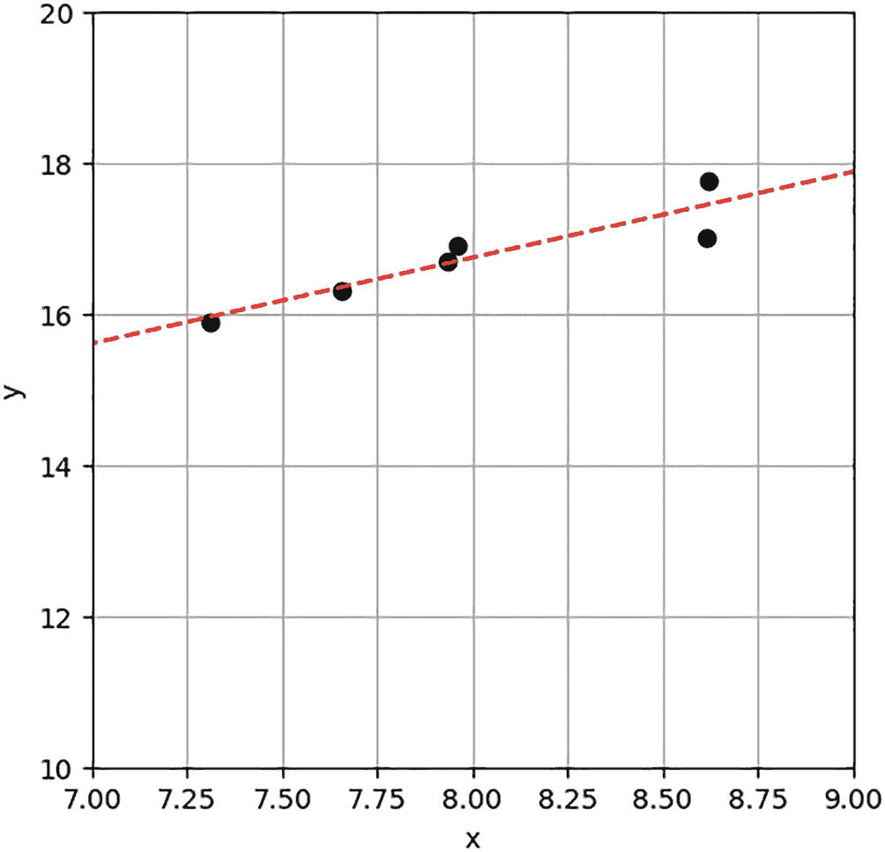

### 11.5.2 拟合高阶多项式

上一节中展示的 `polyfit()` 函数当然也可用于寻找次数大于 1 的最佳拟合多项式的系数。在这里，我们计算一个最佳拟合另一组数据点的三次多项式的系数。请注意，在此情况下，这些点并未按 X 坐标的升序排列——点的顺序是无关紧要的。

该解包含四个值：`a[3]`、`a[2]`、`a[1]` 和 `a[0]`，它们是对该组数据点进行最佳拟合的下列三次多项式的系数

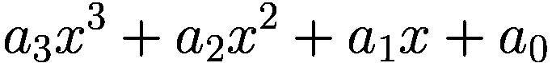

除了返回系数的顺序相反（MATLAB 返回 `a[0]`、`a[1]`、`a[2]` 和 `a[3]`，而 Python 返回 `a[3]`、`a[2]`、`a[1]` 和 `a[0]`）之外，数值是匹配的。

| MATLAB: | Python: |
| --- | --- |
| `Pts = [-0.938  16.875;` `0.326  21.290;` `1.787  22.317;` `2.968  28.767;` `4.038  10.210;` `5.358 -53.774];` `>> polyfit(Pts(:,1),Pts(:,2),3)` `-1.356 4.306 2.967 15.960` | `from numpy.polynomial.polynomial` `\` `import polyfit` `In : Pts = np.array([` `[ -0.938,  16.875],` `[  0.326,  21.290],` `[  1.787,  22.317],` `[  2.968,  28.767],` `[  4.038,  10.210],` `[  5.358, -53.774]])` `In : polyfit(Pts[:,0],Pts[:,1],3)` `Out: array([15.960, 2.967,` `4.306, -1.356])` |

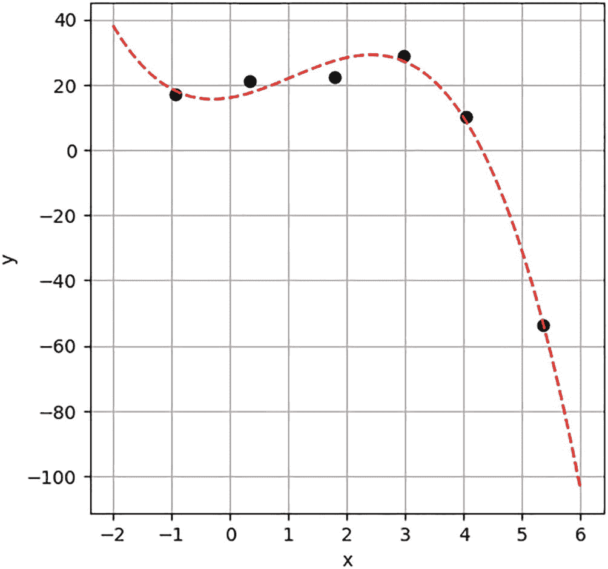

### 11.5.3 拟合模型

现实世界中的数据集很少能完美拟合线性或多项式模型，至少在很宽的范围内是这样。更常见的分布（至少在物理现象中）是高斯分布、正弦分布、指数或对数衰减或增长分布——或者这些分布的组合。

`scipy.optimize` 模块提供了许多可用于将模型拟合到数据的函数。在这里，我们将研究其中的两个：`curve_fit()` 和 `differential_evolution()`。MATLAB 拥有强大的曲线拟合工具箱，但对于较简单的曲线，通用优化函数 `fminsearch()` 通常也很有效。

`scipy.optimize.curve_fit()` 旨在寻找能够最佳拟合数据集的连续平滑模型（例如曲线方程）的参数。当模型是单调的（例如，图 11-3 中所示的对数增长）时，它表现良好。

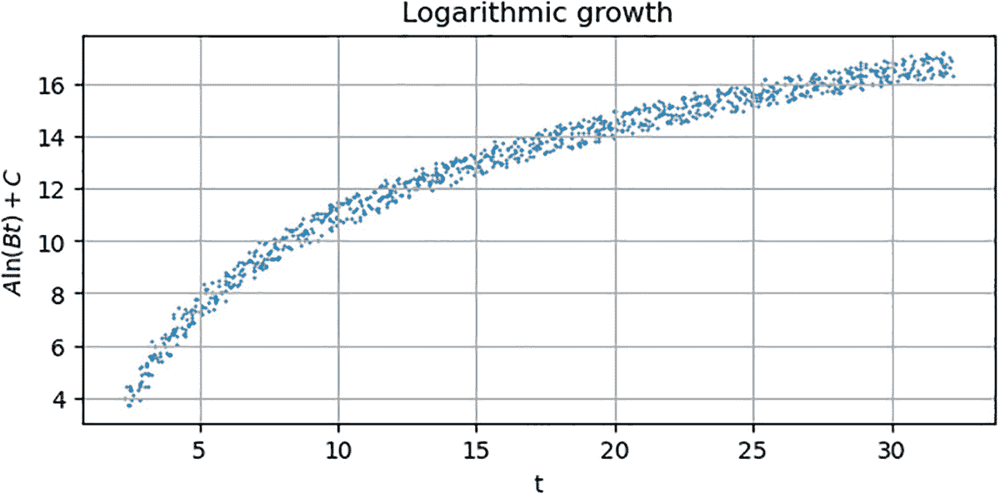

图 11-3

对数增长数据

对于变化更大的数据，例如来自欠阻尼系统的正弦衰减数据点分布（如图 11-4 所示），`scipy.optimize.curve_fit()` 函数和 MATLAB 的 `fminsearch()` 函数表现欠佳。

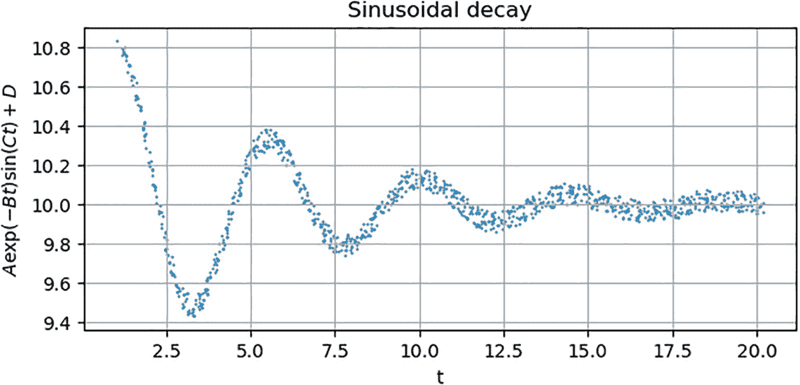

图 11-4

正弦衰减数据

对于这类数据，我们需要一种更稳健的方法。一个可选方案是差分进化算法 [3]，该算法在 `scipy.optimize.differential_evolution()` 中实现。它对目标函数中的局部最小值不太敏感，并且通常能在广泛的输入域内找到极好的解。该算法的 MATLAB 实现可在 FileExchange^(⁴³) 上找到。

#### 11.5.3.1 案例 1：对数增长

图 11-3 中的数据点是使用函数

`f(t) = A ln Bt + C`

生成的，其中 `A = 5`, `B = 14`, `C = -13.7`，然后以随机值的形式添加噪声：

| MATLAB: | Python: |
| --- | --- |
| `% code/optim/log_test_data.py` `A = 5; B = 14; C = -13.7;` `Fn = @(t,A,B,C)(A*log(B*t) + C);` `rand('seed',234567);` `n_pts = 1000;` `t = 2 + linspace(.2,30,n_pts)+...` `.3*rand(1,n_pts);` `y_true = Fn(t, A, B, C);` `y_meas = y_true + 0.2*A*(0.5 -...` `rand(1,n_pts));` `t_meas = t  + 0.1*A*(0.5 -...` `rand(1,n_pts));` | `#!/usr/bin/env python3` `# code/optim/log_test_data.py` `import numpy as np` `A, B, C = 5, 14, -13.7` `def` `Fn(t, A, B, C):`     `return` `A*np.log(B*t) + C` `np.random.seed(234567)` `n_pts = 1000` `t = 2 + np.linspace(.2,30,n_pts)+\` `.3*np.random.rand(n_pts)` `y_true = Fn(t, A, B, C)` `y_meas = y_true + 0.2*A*(0.5 -` `np.random.rand(n_pts))` `t_meas = t  + 0.1*A*(0.5 -` `np.random.rand(n_pts))` |

我们的任务是仅使用含噪声的数据点和模型方程 `f(t) = A ln Bt + C` 来确定 `A`、`B` 和 `C` 的值。在开始之前，我们需要一种方法来评估给定的一组 `A`、`B` 和 `C` 值对我们的模型的拟合程度。一个合理的选择是 `R²` 判定系数。

#### 11.5.3.2 用于评估解的 `R²`

将含噪声的数据叠加在具有解参数模型方程的曲线上形成一张图，这将为我们提供关于解好坏的主观感受。虽然图表很有用，但对“拟合优度”的数值估计也同样有价值。在 Python 方面，我们将使用 `sklearn.metrics`（机器学习）模块中的 `r2_score()` 函数。它返回已知值与估计值之间的 `R²` 判定系数；1.0 代表极好的一致性，0.0（或更糟的负分）则意味着一致性极差。MATLAB 的统计与机器学习工具箱具有计算 `R²` 的函数。相关实现也可以在 FileExchange^(⁴⁴) 上找到。

好的，作为高级文档工程师和翻译员，我将严格按照您提供的注意事项和示例，将给定的英文文本翻译成中文。

#### 11.5.3.3 使用 `curve_fit()` 拟合对数增长

`curve_fit()` 函数只有三个必需参数：模型函数（`Fn()`）、自变量（`t_meas`）和因变量（`y_meas`）。它返回两个变量：`popt`（参数的最优值）和 `pcov`（最优值的估计协方差）。

用 MATLAB 编写解决方案需要更多的工作。除了模型函数外，我们还需要定义一个误差函数，该函数采用平方差之和的形式，并且本身是从另一个匿名函数中调用的。更困难的是需要为 `A`、`B` 和 `C` 估算初始值。

| MATLAB:                                                                                     | Python:                                                                                                                      |
| ------------------------------------------------------------------------------------------- | ---------------------------------------------------------------------------------------------------------------------------- |
| `% code/optim/log_test_data_full.m`<br>`A = 5; B = 14; C = -13.7;`<br>`Fn = @(t,A,B,C)(A*log(B*t) + C);`<br>`rand('seed',234567);`<br>`n_pts = 1000;`<br>`t = 2 + linspace(.2,30,n_pts)+...`<br>`        `.3*rand(1,n_pts);`<br>`y_true = Fn(t, A, B, C);`<br>`y_meas = y_true + 0.2*A*(0.5 -...`<br>`        `rand(1,n_pts));`<br>`t_meas = t  + 0.1*A*(0.5 -...`<br>`        `rand(1,n_pts));`<br>`opt_Fn = @(x)sum_sq(x,t_meas,y_meas);`<br>`popt = fminsearch(opt_Fn,[1 1 1])`<br>`function` `ss = sum_sq(x,t,ydata)`<br>`  A = x(1); B = x(2); C = x(3);`<br>`  ss = sum((ydata - A*log(B*t) + C).²);`<br>`end` | `In : run log_test_data.py`<br>`In :`<br>`from scipy.optimize import`<br>`curve_fit`<br>`In :`<br>`from sklearn.metrics import`<br>`r2_score`<br>`In : popt, pcov = curve_fit(Fn,t_meas,y_meas)`<br>`In : popt`<br>`Out: array([  5.00663437,`<br>`12.05087493,`<br>`-12.99449958])`<br>`In : r2_score(y_meas, y_curve_fit)`<br>`Out: 0.9920846142243493` |

MATLAB 的结果并不理想，而且对初始猜测很敏感：

**MATLAB:**

```
>> log_test_data_full
>> popt = fminsearch(opt_Fn,[1 1 1])
popt =
    4.9880    0.5889   -2.1631
>> popt = fminsearch(opt_Fn,[1 10 -10])
popt =
    4.9881   11.9819   12.8655
```

Python 的 *R*² 得分为 0.99，非常出色。我们对 `A` = 5.007、`B` = 12.05 和 `C` = –12.99 的估计值与真实值 5、14 和 –13.7 相当接近；更令人印象深刻的是，生成的曲线与实际曲线非常接近，以至于难以区分：

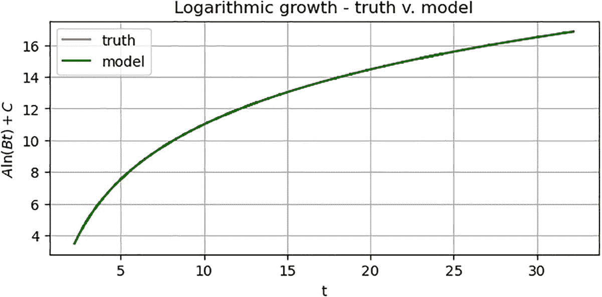

### 11.5.3.4 案例 2：正弦衰减

更复杂的模型需要对 `curve_fit()` 的选项进行更多调整，例如参数边界、初始值、不确定性估计和雅可比矩阵。相反，我们将切换到更稳健（但计算成本更高）的 `differential_evolution()` 函数。

我们将应用这个欠阻尼系统模型：

*f*(*t*) = *Ae*^(−*Bt*) sin *Ct* + *D* （11.1）

来估算最适合图 11-4 中数据点的 *A*、*B*、*C* 和 *D* 的值。该图中的数据点是使用以下代码生成的。它从已知的 A…D 值开始，然后在模型函数中添加随机值形式的噪声。

**Python:**

```
# code/optim/sin_decay_test_data.py
import numpy as np
A, B, C, D = 1, .2, 1.4, 10
def Fn(t, A, B, C, D):
    return A*np.exp(-B*t)*\
           np.sin(C*t) + D
np.random.seed(234567)
n_pts = 1000
t = np.linspace(1,20,n_pts) + .3*np.random.rand(n_pts)
y_true = Fn(t, A, B, C, D)
y_meas = y_true + .11*(0.5 - np.random.rand(n_pts))
```

### 11.5.3.5 使用 `curve_fit()` 拟合正弦衰减

将我们的带噪数据和模型函数发送给 `curve_fit()` 会得到一个不令人满意的结果。

**Python:**

```
In : from scipy.optimize import curve_fit
In : from sklearn.metrics import r2_score
run sin_decay_test_data.py # set t, y_meas, y_true
In : popt, pcov = curve_fit(Fn,t,y_meas)
In : y_curve_fit = Fn(t, *popt)
In : popt
Out: [99.999 3.843 5.886 9.995]
In : r2_score(y_meas, y_curve_fit)
Out: 0.033069669065311835
```

*R*² 得分为 0.03，这意味着我们的解决方案毫无价值。下一节图 11-5 中的绿色曲线直观地展示了其糟糕程度。

### 11.5.3.6 使用 `differential_evolution()` 拟合正弦衰减

与 `curve_fit()` 不同，`scipy.optimize.differential_evolution()` 要求提供参数的上限和下限。我们将提供较宽的范围，以展示该方法惊人的稳健性：

`0.01 <= A <= 100`

`-10 <= B <= 10`

`0.01 <= C <= 10`

`-100 <= D <= 100`

**Python:**

```
In : from scipy.optimize import differential_evolution
In : from sklearn.metrics import r2_score
In : def func(parameters, *data):
...:     A, B, C, D = parameters
...:     Fn, t, Y = data
...:     return np.linalg.norm(Fn(t,A,B,C,D)-Y)
In : bounds = ([0.01, 100],
...:           [ -10,  10],
...:           [0.01,  10],
...:           [-100, 100])
run sin_decay_test_data.py # set t, y_meas, y_true
In : args = (Fn, t, y_meas)
In : DE_result = differential_evolution(func, bounds, args=args)
In : DE_result
     fun: 1.0028485230670718
     jac: array([ 1.15463195e-06, -2.70894418e-06,  9.99200722e-07, -3.79696274e-06])
message: 'Optimization terminated successfully.'
    nfev: 3430
     nit: 55
 success: True
       x: array([1.00574221, 0.1992207 , 1.40038483, 9.99905623])
In : y_DE_fit = Fn(t, *DE_result.x)
In : r2_score(y_true, y_DE_fit)
Out: 0.9998993756587
```

这次 *R*² 得分接近 1.0，表明拟合效果极佳。图 11-5 展示了 `curve_fit()` 和 `differential_evolution()` 对此问题的解决方案。

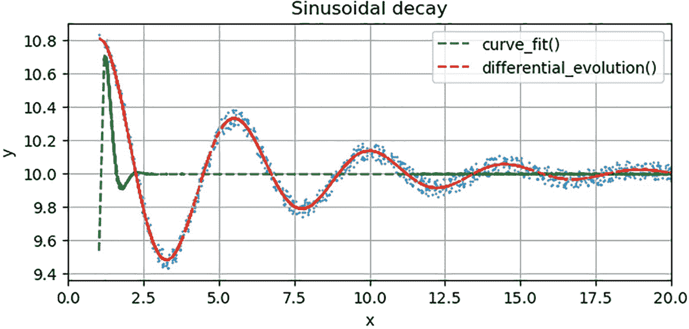

**图 11-5** – 使用曲线拟合和微分进化建模的正弦衰减。

无需尝试使用 MATLAB 的 `fminsearch()` 来解决这个更具挑战性的问题，第 11.6 节中的方法展示了如何使用 SciPy 的 `differential_evolution()` 在 MATLAB 中解决曲线拟合问题。当然，如果你可以使用 FileExchange 实现的 `differential_evolution()`，那么它将比使用 Python 更方便。毋庸置疑，曲线拟合工具箱是更好的选择。

# 11.6 方案 11-1：使用 `differential_evolution()` 进行曲线拟合

曲线拟合工具箱是确定数据最佳拟合曲线方程的首选工具包。在没有该工具箱的情况下，来自 SciPy `optimize` 模块的 `differential_evolution()` 函数是比 MATLAB 核心产品的 `fminsearch` 更强大的替代方案。此处，我们演示如何将 Python 实现的 `differential_evolution()` 与 MATLAB 结合使用，以寻找衰减正弦函数的系数 `A`、`B`、`C` 和 `D`，这与仅使用 Python 在章节 11.5.3.6 中所做的操作相同。

该方案揭示了 MATLAB 的 `py` 模块的一个限制：作为参数传递给 Python 函数的 MATLAB 函数无法从 Python 调用。这阻止了我们直接从 MATLAB 调用诸如 `differential_evolution()` 之类的优化器，因为它们的第一个参数是要最小化或最大化的函数。

至少有两种可能的解决方案：(1) 用 Python 编写代价函数，并完全在 Python 桥接模块中执行优化，或 (2) 通过 `matlab.engine` 模块从 Python 调用 MATLAB 的代价函数（章节 6.10）。第二种方法更强大，因为它应该能够处理任何 MATLAB 函数。然而在实践中，通过 Python 对 `matlab.engine` 对象的调用经常失败，并出现 MATLAB 错误：“无法连接到 matlab.engine：无法连接到 MATLAB 会话。” 因此，此处仅演示第一种方法。

当在 Python 中评估代价函数时，MATLAB 部分仅将数据点传递给一个 Python 桥接模块，该模块包含代价函数和对优化器的调用。然后，桥接模块中的一个函数将最佳拟合系数返回给 MATLAB。

Python：

```python
# code/optim/bridge_de.py
import numpy as np
from scipy.optimize import differential_evolution
def Fn(t, A, B, C, D):
    return A*np.exp(-B*t)*np.sin(C*t) + D
def func(parameters, *data):
    A, B, C, D = parameters
    Fn, t, Y = data
    return np.linalg.norm(Fn(t,A,B,C,D)-Y)
def compute_ABCD(bounds, t, y_meas):
    args = (Fn, t, y_meas)
    DE_result = differential_evolution(func, bounds, args=args)
    soln = { 'success' : DE_result.success,
             'message' : DE_result.message,
             'x' : DE_result.x,
    }
    if DE_result.success:
        y_DE_fit = Fn(t, *DE_result.x)
    else:
        y_DE_fit = []
    soln['y_fit'] = y_DE_fit
    return soln
```

以下 MATLAB 驱动程序将参数边界和测试数据发送给 Python 的 `compute_ABCD()` 函数，该函数返回一个包含解的字典（如果找到解的话）：

MATLAB：

```matlab
% code/optim/fit_decaying_sine.m
Im = @py.importlib.import_module;
optim = Im('bridge_de');
np = Im('numpy');
sk = Im('sklearn.metrics');
A = 1; B = .2; C = 1.4; D = 10;
rng(234567);
n_pts = 1000;
t = linspace(1,20,n_pts) + .3*rand(1,n_pts);
y_true = Fn(t, A, B, C, D);
y_meas = y_true + .11*(0.5 - rand(1,n_pts));
bounds = py.tuple({[0.01, 100], ...
                   [ -10,  10], ...
                   [0.01,  10], ...
                   [-100, 100]});
solution = optim.compute_ABCD(bounds, np.array(t), np.array(y_meas));
if solution.get('success')
    R2 = sk.r2_score(np.array(y_true), np.array(solution.get('y_fit')));
    ABCD = py2mat(solution.get('x'));
    fprintf('A=%.6f, B=%.6f, C=%.6f, D=%.6f\n', ABCD)
    fprintf('score = %f\n', R2)
else
    fprintf('Failed: %s\n', solution.get('message'))
end
function [x] = Fn(t, A, B, C, D)
    x = A*exp(-B*t).*sin(C*t) + D;
end
```

来自 MATLAB 的解与章节 11.5.3.6 的 Python 解相匹配：

MATLAB：

```matlab
>> fit_decaying_sine
A=1.005742, B=0.199221, C=1.400385, D=9.999056
score = 0.999899
```

# 11.7 回归

### 11.7.1 普通最小二乘法

Python 模块 `statsmodels` 拥有自己具有统计特色的线性回归（或称最小二乘法）求解器，其返回的结果比章节 11.5.1 中描述的 NumPy 的 `polyfit()` 函数更丰富。主要的函数是用于普通最小二乘法的 `OLS()` 和用于加权最小二乘法的 `WLS()`。

以下示例生成点对 (`x`, `y`)，这些点粗略地近似于给定斜率 `m` 和垂直截距 `b` 的直线 `y = mx + b`。我们将调用 `OLS()` 和 `WLS()` 来查看我们恢复 `m` 和 `b` 的效果如何。

| MATLAB: | Python: |
| --- | --- |
| `% 创建随机 X,Y`<br>`m = 3.77;`<br>`b = -5.5;`<br>`nPts = 20;`<br>`X = -5 + 12*rand(nPts,1);`<br>`X = sort(X);`<br>`noise = 8*(rand(nPts,1)-.5);`<br>`Y = m*X + b + noise;`<br>`% 恢复 m 和 b`<br>`mb = polyfit(X,Y,1);`<br>`m_ls = mb(1);`<br>`b_ls = mb(2);`<br>`fprintf("ML : %f %f\n", ...`<br>`        ` `m_ls,b_ls)`<br>`Y_pred = m_ls*X + b_ls;`<br>`plot(X,Y,'g.')`<br>`hold on`<br>`plot(X,Y_pred,'r-')`<br>`grid`<br>`---------- 输出：`<br>`ML : 3.558505 -4.843925` | `import numpy as np`<br>`import statsmodels.api as stats`<br>`import matplotlib.pyplot as plt`<br>`# 创建随机 X,Y`<br>`m = 3.77` `# 真实斜率`<br>`b = -5.5` `# 真实截距`<br>`nPts = 20`<br>`X = -5 + 12*np.random.rand(nPts)`<br>`X.sort()`<br>`noise = 8*(np.random.rand(nPts)-.5)`<br>`Y = m*X + b + noise`<br>`% 恢复 m 和 b`<br>`Xb = stats.add_constant(X,0)`<br>`ols = stats.OLS(Y, Xb).fit()`<br>`m_ls, b_ls = ols.params`<br>`print(f'OLS {m_ls} {b_ls}')`<br>`Y_pred = ols.predict(Xb)`<br>`plt.plot(X,Y,'g.')`<br>`plt.plot(X,Y_pred,'r-')`<br>`plt.grid(True)`<br>`plt.show()`<br>`---------- 输出：`<br>`OLS 3.86476 -6.23757` |

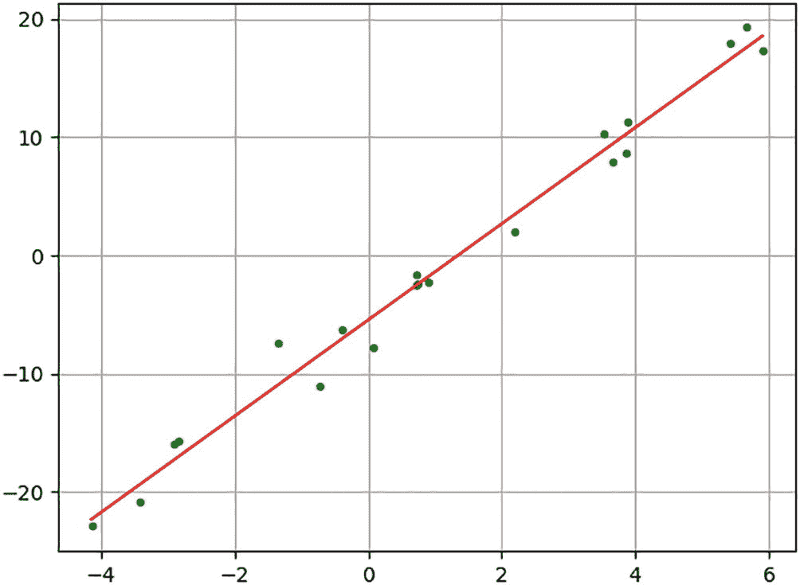

MATLAB 和 Python 的实现会看到不同的点对，因此我们不期望它们对 `m` 和 `b` 的各自解在小样本量下能够匹配。如果我们使用 1000 个点而不是 20 个点，Python 和 MATLAB 都将返回与真实值相差 1% 以内的结果。

前面 Python 示例中的 `ols` 对象具有许多方法和属性。以下文本是 `print(ols.summary())` 的输出：

OLS 回归结果
===========================================================================
因变量:                   y   R 平方:                       0.973
模型:                         OLS   调整后 R 平方:                  0.972
方法:              最小二乘法   F 统计量:                     653.9
日期:             2020 年 6 月 26 日, 星期五   F 统计量的概率 (Prob):           1.33e-15
时间:                     15:05:59   对数似然值:                -42.682
观测数:               20   赤池信息准则 (AIC):             89.36
残差自由度:                   18   贝叶斯信息准则 (BIC):             91.36
模型自由度:                        1
协方差类型:          非稳健
===========================================================================
系数   标准误        t 值     P>|t|     [0.025     0.975]

x1             3.8648      0.151    25.571     0.000      3.547     4.182
常数项         -6.2376      0.511   -12.214     0.000     -7.310    -5.165
===========================================================================
Omnibus 检验:                    0.521   德宾-沃森统计量:                2.171
Omnibus 检验概率:                  0.771   雅克-贝拉检验 (JB):             0.578
偏度:                           0.055   JB 检验概率:                     0.749
峰度:                       2.174   条件数 (Cond. No.):                     3.62
===========================================================================

### 11.7.2 加权最小二乘法

数据点的权重可能并不相同——设想一项使用了不同型号测试设备进行的测量活动。在计算所有点的总体属性时，使用更精确设备观测到的数值应被赋予更大的重要性。

MATLAB 可以使用曲线拟合工具箱中的 `fittype()` 和 `fit()` 函数，或统计与机器学习工具箱中的 `nlinfit()` 函数来执行加权最小二乘法拟合。Python 的 `statsmodule` 通过 `WLS()` 函数解决此类问题，该函数的输入与上一节中 `OLS()` 的输入相同，但多了一个用于指定权重的参数。

以下示例重复了普通最小二乘法示例，但权重从左到右线性分配给各数据点。在下图中，点的大小代表权重：

Python：

```python
#!/usr/bin/env python3
# code/statistics/wls.py
import numpy as np
import statsmodels.api as stats
import matplotlib.pyplot as plt
m = 3.77 # 真实斜率
b = -5.5 # 真实截距
nPts = 20
X = -5 + 12*np.random.rand(nPts)
X.sort()
W = X - np.min(X) + 1
noise = 8*(np.random.rand(nPts)-.5)
Y = m*X + b + noise
Xb = stats.add_constant(X,0)
wls = stats.WLS(Y, Xb, weight=W).fit()
m_ls, b_ls = wls.params
print(f'WLS {m_ls} {b_ls}')
Y_pred = wls.predict(Xb)
plt.scatter(X,Y, marker='o',s=5*W)
plt.plot(X,Y_pred,'r-')
plt.grid(True)
plt.title('加权最小二乘法')
plt.show()
```

这段代码会输出：

```
WLS 3.774306 -4.79019
```

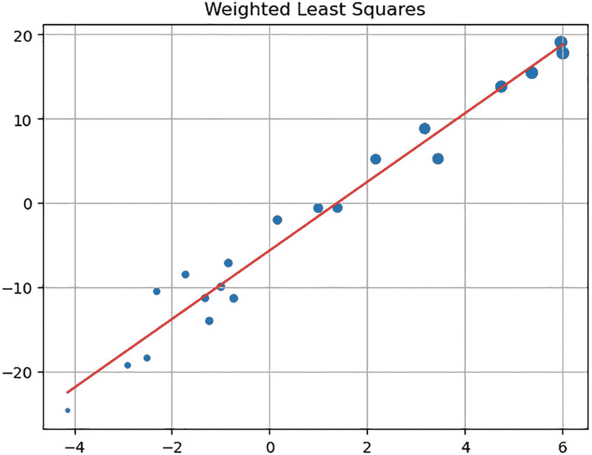

请按照第 11.8 节中的方法在 MATLAB 中求解加权最小二乘问题。

### 11.7.3 置信区间与预测区间

MATLAB 统计与机器学习工具箱中的 `coefCI()` 函数可以返回线性回归模型系数的置信区间。不过，绘制这些区间需要额外一些功夫。如果没有这个工具箱，可以使用 Seaborn Python 模块中的 `regplot()` 函数非常方便地绘制置信区间图。

以下代码重复了普通最小二乘问题的一部分，增加了噪声并添加了更多数据点：

Python：

```python
#!/usr/bin/env python3
# code/statistics/conf_interval.py
import numpy as np
import matplotlib.pyplot as plt
import seaborn as sns
m = 3.77 # 真实斜率
b = -5.5 # 真实截距
nPts = 80
X = -5 + 12*np.random.rand(nPts)
X.sort()
noise = 30*(np.random.rand(nPts) - 0.5)
Y = m*X + b + noise
sns.regplot(x=X, y=Y, marker='.')
plt.xlabel('X')
plt.ylabel('Y')
plt.grid()
plt.title('使用 seaborn.regplot() 绘制的置信区间')
plt.savefig('conf_interval.png', bbox_inches='tight',
pad_inches=0.1, transparent=True)
plt.show()
```

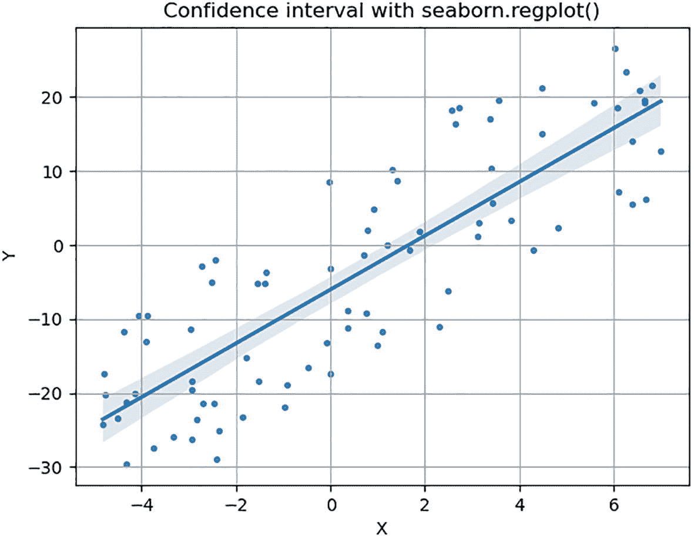

预测区间通常比置信区间更有用。可以使用 MATLAB 曲线拟合工具箱中的 `predint()` 函数，或 Python 中的 `predband()` 函数[1]来计算，如下所示：

Python：

## 11.8 方法 11-2：在 MATLAB 中进行加权最小二乘法

直接从 MATLAB 调用 Python 的加权最小二乘函数会得到令人失望的结果。以下是使用上一节示例问题的一次尝试：

MATLAB：

```matlab
m = 3.77; % 真实斜率
b = -5.5; % 真实截距
nPts = 20;
X = -5 + 12*rand(nPts,1);
X = sort(X);
W = X - min(X) + 1;
noise = 8*(rand(nPts,1)-.5);
Y  = py.numpy.array(m*X + b + noise);
Xb = py.statsmodels.api.add_constant(X,0);
wls = py.statsmodels.api.WLS(Y, Xb, pyargs('weight', W)).fit();
[m_ls, b_ls] = wls.params
```

程序在最后一行失败，并显示以下错误：

```
未识别类 'py.statsmodels.regression.linear_model.RegressionResultsWrapper' 的方法、属性或字段 'params'。
```

失败的原因是`py.statsmodels.api.WLS()`返回的`wls`对象缺少`.params`属性——以及许多其他属性和方法——因此尝试访问不存在的`.params`会抛出错误。

我们需要一个小的桥接模块，其中包含一个函数，该函数接收原始 MATLAB 输入（在本例中为`X`、`Y`和`W`数组），调用`statsmodels.api.WLS()`，然后以 MATLAB 能理解的形式返回所需的结果部分。换句话说，对`WLS()`的调用完全在 Python 中发生，无需穿越 MATLAB/Python 接口。整个模块仅用十行代码定义了一个函数：

Python：

```python
# 文件 bridge_WLS.py
import os
import sys
import statsmodels.api as stats
def slope_intercept(X, Y, W):
    if sys.platform == 'win32':
        os.environ['KMP_DUPLICATE_LIB_OK'] = 'TRUE'
    Xb = stats.add_constant(X,0)
    wls = stats.WLS(Y, Xb, weight=W).fit()
    m_ls, b_ls = wls.params
    Y_pred = wls.predict(Xb)
    if sys.platform == 'win32':
        del os.environ['KMP_DUPLICATE_LIB_OK']
    return { 'm' : m_ls,
             'b' : b_ls,
             'Y_predict' : Y_pred }
```

返回的字典由`py2mat()`转换成一个结构体，包含斜率(`.m`)、截距(`.b`)和预测 *y* 值数组(`.Y_predict`)。以下 MATLAB 代码正确地调用了 Python 的加权最小二乘法：

MATLAB：

```matlab
% code/matlab_py/weighted_LS.m
np  = py.importlib.import_module('numpy');
WLS = py.importlib.import_module('bridge_WLS');
m = 3.77; % 真实斜率
b = -5.5; % 真实截距
nPts = 20;
X = -5 + 12*rand(nPts,1);
X = sort(X);
W = X - min(X) + 1;
noise = 8*(rand(nPts,1)-.5);
Y  = np.array(m*X + b + noise);
X  = np.array(X);
W  = np.array(W);
mbY = WLS.slope_intercept(X,Y,W);
mbY = py2mat(mbY);
fprintf('斜率 = % .3f  截距 = % .3f\n', mbY.m, mbY.b)
scatter(X,Y,5*W,'b','filled')
hold on
plot(X,mbY.Y_predict,'r-')
grid on
saveas(gcf,'matlab_WLS.png')
```

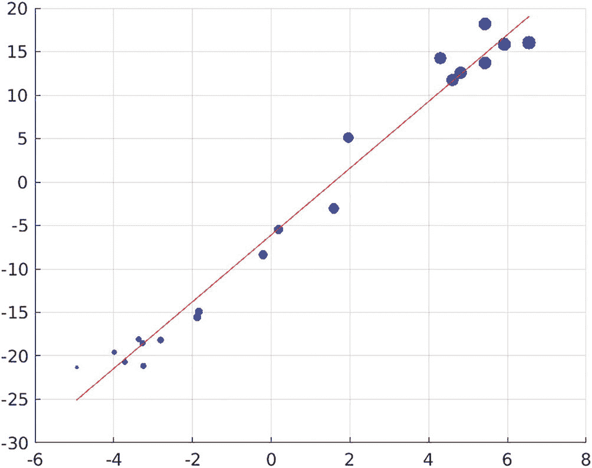

**注意**

此示例的 Python 和 MATLAB 代码会随机生成数据点，因此两张图上点的位置会有所不同。

## 11.9 方案 11-3：MATLAB 中的置信区间与预测区间

以下 MATLAB 程序重现了 11.7.3 节中展示的置信区间和预测区间图。唯一需要注意的是，`Seaborn`要求输入为 NumPy 数组，因此使用`mat2py()`工具将`X`和`Y`显式地从 MATLAB 原生变量转换为 Python 原生变量。

**置信区间：**

MATLAB：

```python
#!/usr/bin/env python3
# code/statistics/predict_interval.py
import numpy as np
import matplotlib.pyplot as plt
import scipy.stats
import statsmodels.api as stats
import seaborn as sns
def predband(x, xd, yd, p, func, conf=0.95):
    """
    来源：https://apmonitor.com/che263/index.php/Main/PythonRegressionStatistics
    x = 请求的点
    xd = x 数据
    yd = y 数据
    p = 传递给 func 的附加参数（位于 xd 之后）
    func = 函数名称
    """
    alpha = 1.0 - conf  # 显著性水平
    N = xd.size         # 数据样本量
    var_n = len(p)      # 参数个数
    # 自由度为 N-var_n 的 t 分布在 p=(1-alpha/2) 处的分位数
    q = scipy.stats.t.ppf(1.0 - alpha / 2.0, N - var_n)
    # 单次测量的标准差
    se = np.sqrt(1\. / (N - var_n) *
                 np.sum((yd - func(xd, *p)) ** 2))
    # 辅助定义
    sx = (x - xd.mean()) ** 2
    sxd = np.sum((xd - xd.mean()) ** 2)
    # 预测值（最佳拟合模型）
    yp = func(x, *p)
    # 预测带
    dy = q * se * np.sqrt(1.0+ (1.0/N) + (sx/sxd))
    # 上下预测带。
    lpb, upb = yp - dy, yp + dy
    return lpb, upb
def model_function(x, m, b):
    return m*x + b
m = 3.77 # 真实斜率
b = -5.5 # 真实截距
nPts = 80
X_even = np.linspace(-5, 7)
X = -5 + 12*np.random.rand(nPts)
X.sort()
noise = 30*(np.random.rand(nPts) - 0.5)
Y = m*X + b + noise
Xb = stats.add_constant(X,0)
ols = stats.OLS(Y, Xb).fit()
m_ls, b_ls = ols.params # 最佳拟合斜率、截距
lpb, upb = predband(X_even, X, Y, [m_ls, b_ls], model_function, conf=0.95)
sns.regplot(x=X, y=Y, marker='.')
plt.plot(X_even, lpb, 'k--',label='95% 预测带')
plt.plot(X_even, upb, 'k--')
plt.xlabel('X')
plt.ylabel('Y')
plt.grid()
plt.title('预测区间与置信区间')
plt.legend(loc='best')
plt.savefig('pred_interval.png', bbox_inches='tight',
            pad_inches=0.1, transparent=True)
plt.show()
```

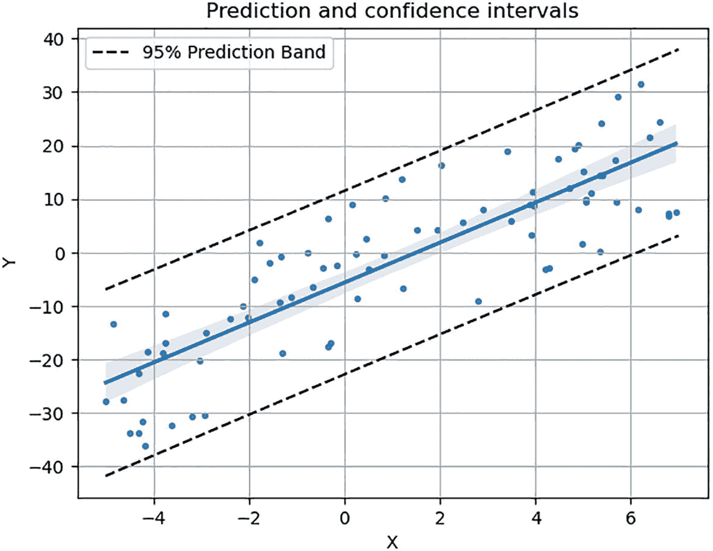

## 11.10 求根

### 11.10.1 单变量

SciPy 的`optimization`模块中的`root_scalar()`函数，相当于 MATLAB 的`fzero()`函数。`root_scalar()`提供了八种用于求解标量方程根的算法：`bisect`、`brentq`、`brenth`、`ridder`、`toms748`、`newton`、`secant`、`halley`。前五种方法需要自变量的边界，而`newton`、`secant`和`halley`方法则适用于无界域。可以提供起始猜测值或斜率函数等额外信息来加速收敛。如果未指定方法，求解器会根据给定的输入（是否指定了边界、是否提供了斜率函数等）自动选择最佳选项。

以下示例在区间 0 ≤ *x* ≤ 1 上求解 *f*(*x*) = 0 的 *x*，其中

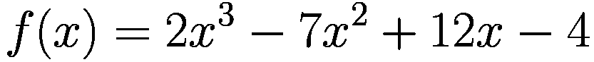

且未指定方法。`fzero()`没有定义边界的选项；相反，我们必须为解提供一个初始猜测值。`root_scalar()`返回一个包含解的对象（如果找到的话），该解位于其 `.root` 属性中：

| MATLAB: | Python: |

| --- | --- |

| `>> F = @(x)(2*x.³-7*x.²+12*x-4);`<br>`>> fzero(F, 0)`<br>     `4.265215061673047e-01` | `In :` `import numpy as np`<br>`In :` `import scipy.optimize as so`<br>`In :` `def F(x):`<br>`In :`   `return 2*x**3-7*x**2+12*x-4`<br>`In : x = np.linspace(-1,2, num=100)`<br>`In : f_zero = so.root_scalar(F,`<br>`...:           bracket=[0, 1])`<br>`In : f_zero`<br>`Out[14]:`<br>`converged: True`<br>`flag: 'converged'`<br>`function_calls: 9`<br>`iterations: 8`<br>`root: 0.42652150616730566`<br>`In : f_zero.root`<br>`Out: 0.42652150616730566` |

以下调用展示了如何指定特定方法来求解无边界 *x* 的问题。`secant`方法不需要斜率函数（`newton`和`halley`需要），但需要两个初始猜测值 *x*[0] 和 *x*[1]。同样，`fzero()`没有类似选项，因此我们将通过从一个远离真实解的猜测值开始，来展示其稳健性。

| MATLAB: | Python: |

| --- | --- |

| `>> F = @(x)(2*x.³-7*x.²+12*x-4);`<br>`>> fzero(F, 100)`<br>     `4.265215061673049e-01` | `In : f_zero = so.root_scalar(F, x0=100,`<br>`...:            x1=200, method="secant")`<br>`Out[25]:`<br>`converged: True`<br>`flag: 'converged'`<br>`function_calls: 25`<br>`iterations: 24`<br>`root: 0.4265215061673047` |

### 11.10.2 多变量

SciPy 更通用的多变量求根器是`scipy.optimize.root()`。与`scipy.optimize.root_scalar()`类似，你可以在多种求解方法中进行选择，并可选择性地提供雅可比矩阵函数。其用法通过求解一个平面、一个球面和一个椭球面之间的交点来演示：

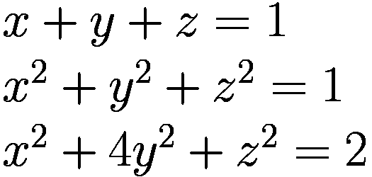

MATLAB 可以使用优化工具箱中的`fsolve()`来求解。或者，MATLAB 也可以使用`scipy.optimize.root()`来求解；这在[11.11](https://example.org/516169_1_En_11_Chapter.xhtml#Sec112)节的方案中进行了演示。

Python：

### 11.10.2.1 预测区间

以下程序从纯 Python 版本的预测区间示例中导入了`model_function()`和`predband()`：

MATLAB：

```matlab
% code/statistics/predict_interval.m
Im = @py.importlib.import_module;
plt   = Im('matplotlib.pyplot');
mpl   = Im('matplotlib');
sns   = Im('seaborn');
np    = Im('numpy');
%scipy_stats = Im('scipy.stats')
stats = Im('statsmodels.api');
JH    = Im('predict_interval');
if ispc
    mpl.use('WXAgg');
else
    mpl.use('TkAgg');
end
m = 3.77; % 真实斜率
b = -5.5; % 真实截距
nPts = 80;
X_even = linspace(-5, 7);
X = -5 + 12*rand(nPts,1);
X = sort(X);
noise = 30*(rand(nPts,1) - 0.5);
Y = m*X + b + noise;
X = mat2py(X);
Y = mat2py(Y);
Xb = stats.add_constant(X,0);
ols = stats.OLS(Y, Xb).fit();
[m_ls, b_ls] = ols.params % 最佳拟合斜率，y 轴截距
[lpb, upb] = JH.predband(X_even, X, Y, [m_ls, b_ls], ...
                         JH.model_function, pyargs('conf',0.95));
sns.regplot(pyargs('x',X,'y',Y,'marker','.'))
plt.plot(X_even, lpb, 'k--',pyargs('label','95% 预测带'))
plt.plot(X_even, upb, 'k--')
plt.xlabel('X')
plt.ylabel('Y')
plt.grid()
plt.title('预测区间与置信区间')
plt.legend(pyargs('loc=','best'))
plt.show()
```

#### 11.10.2.2 使用 `scipy.optimize.root()` 求交点

Python：

```python
import numpy as np
from scipy.optimize import root

def equations(x):
    x, y, z = x
    return [
        x + y + z - 1,
        x**2 + y**2 + z**2 - 1,
        x**2 + 4*y**2 + z**2 - 2
    ]

sol = root(equations, [0, 0, 0])
print(sol.x)
```

### 11.10.1.1 使用 `seaborn` 绘制置信区间

```matlab
% code/statistics/conf_interval.m
Im = @py.importlib.import_module;
plt   = Im('matplotlib.pyplot');
mpl   = Im('matplotlib');
sns   = Im('seaborn')
if ispc
    mpl.use('WXAgg')
else
    mpl.use('TkAgg')
end
m = 3.77; % 真实斜率
b = -5.5; % 真实截距
nPts = 80;
X = -5 + 12*rand(nPts,1);
X = sort(X);
noise = 30*rand(nPts,1) - 0.5;
Y = m*X + b + noise;
% seaborn 需要 Python 原生数组
X = mat2py(X);
Y = mat2py(Y);
sns.regplot(pyargs('x',X,'y',Y,'marker','.'))
plt.xlabel('X')
plt.ylabel('Y')
plt.grid()
plt.title('使用 seaborn.regplot() 绘制的置信区间')
plt.show()
```

```python
In : import scipy.optimize as so
In : def F(x):
...:   return x[0]+x[1]+ x[2]-1 - (x[0]**2+  x[1]**2+x[2]**2-1), \
...:       x[0]+x[1]+x[2]-1 - (x[0]**2+4*x[1]**2+x[2]**2-2), \
...:       (x[0]**2+x[1]**2+x[2]**2-1) - (x[0]**2+4*x[1]**2+x[2]**2-2)
In : so.root(F, [0,0,0])
fjac: array([[-0.21557015,  0.57423188,  0.78980203],
            [-0.78752535, -0.5804519 ,  0.20707345],
            [ 0.57735027, -0.57735027,  0.57735027]])
fun: array([-1.08435e-12,  1.44386e-11,  1.55230e-11])
message: 'The solution converged.'
nfev: 37
qtf: array([ 7.84383e-09, -6.23725e-09, -4.21542e-22])
r: array([-2.19228e+00, -1.97436e+00,  8.33239e-01,
           4.49321e-01, -2.26699e+00, -1.70549e-13])
status: 1
success: True
x: array([ 0.16314374,  0.57735027, -0.29406851])
```

选择一个远离解的起始点可能导致方法失败：

```python
In : so.root(F, [0,10,10])
fjac: array([[-7.06972124e-01, -7.07241361e-01, -2.69237135e-04],
            [ 4.08481434e-01, -4.08015101e-01, -8.16496537e-01],
            [-5.77350270e-01,  5.77350270e-01, -5.77350268e-01]])
fun: array([-180., -479., -299.])
message: 'The iteration is not making good progress, as measured by the
          improvement from the last ten iterations.'
nfev: 17
qtf: array([ 4.66104096e+02,  3.66045040e+02, -5.80555266e-07])
r: array([ 3.62141354e+01, -1.88545072e+04,  1.36198852e+03,
           7.18371924e+01,  1.06466345e-01,  1.09677462e-07])
status: 5
success: False
x: array([ 0., 10., 10.])
```

## 11.11 食谱 11-4：求解联立非线性方程组

第 11.10.2 节中的平面/球体/椭球体相交问题，可以在 MATLAB 中借助 SciPy 的多元求根器来求解。与曲线拟合食谱（第 11.6 节）类似，我们需要在 Python 中实现待求解的函数，因为 Python 无法求值作为参数传入的 MATLAB 函数。

以下是桥接模块。用于封装求解器调用的函数 `F_roots()`，在未提供初始点时，默认使用 `(0,0,0)` 作为起始点：

Python：

```python
# code/optim/bridge_nonlinear_roots.py
import scipy.optimize as so
def F(x):
    return x[0]+x[1]+ x[2]-1 - (x[0]**2+  x[1]**2+x[2]**2-1), \
           x[0]+x[1]+x[2]-1 - (x[0]**2+4*x[1]**2+x[2]**2-2),  \
           (x[0]**2+x[1]**2+x[2]**2-1) - (x[0]**2+4*x[1]**2+x[2]**2-2)
def F_roots(guess=[0,0,0]):
    return so.root(F, guess)
```

在 MATLAB 中调用它非常简单：

MATLAB：

```matlab
>> soln = py.bridge_nonlinear_roots.F_roots();
>> soln.get('success')

logical

>> soln.get('message')
Python str with no properties.
The solution converged.
>> py2mat(soln.get('x'))
1.631437374762493e-01  5.773502691851446e-01  -2.940685072817079e-01
```

再次调用，这次提供一个较差的起始点：

MATLAB：

```matlab
>> soln = py.bridge_nonlinear_roots.F_roots(pyargs('guess',{0,10,10}));
>> soln.get('success')

logical

>> soln.get('message')
Python str with no properties.
The iteration is not making good progress, as measured by the
improvement from the last ten iterations.
```

## 11.12 优化

SciPy 的 `scipy.optimize` 模块包含许多用于求解优化问题的函数。我们已在第 11.5.3 节中目睹了其最强大的全局优化器之一 `scipy.optimize.differential_evolution()` 的实际应用。在此，我们将探讨更广泛的问题类型，包括带线性与非线性约束的局部单变量及多变量优化、线性规划，以及路线规划等问题的组合优化。

### 11.12.1 线性规划

线性规划问题在工业工程、运筹学、物流及调度领域无处不在。MATLAB 的 Optimization Toolbox 和 SciPy 都提供了一个名为 `linprog()` 的函数，用于求解实数值的线性规划问题。更困难的混合整数线性规划问题需要 SciPy 中未包含的模块；针对此类问题，我们将求助于 PuLP，可通过 `conda install` 将其添加到 Anaconda 环境中。

以一个简单的代表性线性规划问题为例：假设你负责组建一间计算机服务器机房，以支持所在组织的各个工程与研究部门。有些部门的需求适中，而另一些则需要大量高性能服务器。各部门同意根据其使用的资源按成本回收结构付费；你的目标是找出该成本模型的公平参数。服务器属性及协商好的成本回收费率如表 11-8 所示。

表 11-8 计算机类别与属性

|        | 核心数 | 功率 [kW] | 体积 [ft³] | 成本回收 [$/hr] |
|--------|--------|-----------|------------|-----------------|
| 小型   | 4      | 50        | 10         | 0.10            |
| 中型   | 8      | 105       | 20         | 0.60            |
| 大型   | 12     | 192       | 40         | 0.96            |
| 超大型 | 48     | 391       | 40         | 2.83            |

你的决策归结为分别购买多少台小型、中型、大型和超大型服务器，以满足以下条件：

- 总功耗低于 30,000 kW。
- 容纳所有服务器所需的总空间小于 80,000 ft³。
- 计算核心总数超过 1000 个。
- 大型服务器的核心数量超过超大型服务器的核心数量。

目标函数是最大化成本回收：

`maximize  0.10 * S + 0.60 * M + 0.96 * L + 2.83 * H`

（其愿景是：各部门贡献越大，未来设施扩容的机会就越多），需满足以下约束：

```
50*S + 105*M + 192*L + 391*H ≤ 30000
10*S + 20*M + 40*L + 40*H ≤ 80000
4*S + 8*M + 12*L + 48*H ≥ 1000
12*L ≥ 48*H
```

由于 `S`、`H` 等变量的值只能取整数，因此这是一个整数线性规划问题。尽管如此，我们仍将观察 SciPy 的 `linprog()` 函数求出的实数解与 PuLP 的纯整数解之间的接近程度。

#### 11.12.1.1 SciPy `linprog()`

SciPy 的 `linprog()` 函数调用参数与优化工具箱版本几乎相同。输入包括待最小化函数的系数、描述不等式关系的系数矩阵、等式关系（如果有的话）以及上下界。不等式关系必须表示为左边是自变量、右边是常数值的小于不等式。大于关系可以通过改变两边的符号转换为小于关系。

因此，我们的问题转化为在以下约束条件下最小化 `-0.1S - 0.6M - 0.96L - 2.83H`：

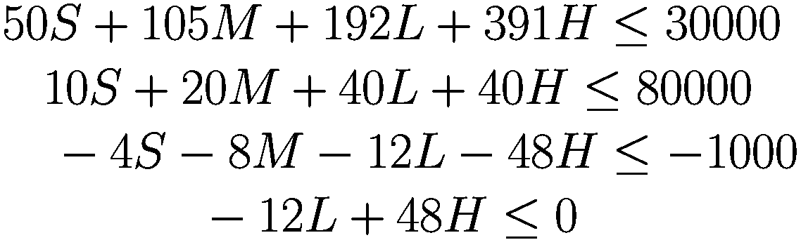

左侧系数定义矩阵 `A`，右侧项定义 `b`，成本函数的系数定义 `f`。最后一个约束是我们只寻求正解，因此变量 `UL_bounds` 中四个（下界，上界）元组的第一个值均为零。

Python 解决方案如下所示：

```python
from scipy.optimize import linprog
f = [ -0.1, -0.6, -0.96, -2.83])
A = [[ 50, 105, 192, 391],
    [ 10,  20,  40,  40],
    [ -4,  -8, -12, -48],
    [  0,   0, -12,  48]]
b  = [ 30000, 80000, -1000, 0]
UL_bounds = [ (0, None), (0, None),
              (0, None), (0, None) ]
sol = linprog(f,A,b,bounds=UL_bounds)
```

该函数返回一个对象（本例中为 `sol`），包含以下属性：

```python
In : print(sol)
con: array([], dtype=float64)
fun: -172.64883520249523
message: 'Optimization terminated successfully.'
nit: 13
slack: array([2.90929165e-08, 7.48231234e+04,
       1.48490078e+03, 1.47610990e-09])
status: 0
success: True
x: array([1.15833172e-10, 1.37570134e-08,
       1.03537532e+02, 2.58843831e+01])
In : print(sol.status)
Out: 0
In : print(sol.x)
array([1.15833172e-10, 1.37570134e-08,
       1.03537532e+02, 2.58843831e+01])
```

状态值为 0 表示成功收敛，自变量解在属性 `.x` 中。与解最接近的整数值是 `S` = 0、`M` = 0、`L` = 104、`H` = 26，对应的总计费值为每小时 172.42 美元。

如果你没有优化工具箱，仍然可以通过在 MATLAB 中调用 SciPy 的 `linprog()` 来求解该问题：

```matlab
f = [ -0.1; -0.6; -0.96; -2.83];
A = [ 50 105 192 391; ...
      10  20  40  40; ...
      -4  -8 -12 -48; ...
       0   0 -12  48 ];
b = [ 30000; 80000; -1000; 0];
UL_bounds = { py.tuple({0, py.None}), py.tuple({0, py.None}), ...
              py.tuple({0, py.None}), py.tuple({0, py.None}) };
opt = py.importlib.import_module('scipy.optimize');
sol = opt.linprog(f,A,b,pyargs('bounds',py.list(UL_bounds)))
```

运行上述代码可以得到正确解，但令人沮丧的是，在 MATLAB 中无法访问解的各个分量：

```
sol =
Python OptimizeResult with no properties.
con: array([], dtype=float64)
fun: -172.64883520249523
message: 'Optimization terminated successfully.'
nit: 13
slack: array([2.90929165e-08, 7.48231234e+04, 1.48490078e+03, 1.47599621e-09])
status: 0
success: True
x: array([1.15833172e-10, 1.37570134e-08, 1.03537532e+02, 2.58843831e+01])
>> y = sol.x
Unrecognized method, property, or field 'x' for class
'py.scipy.optimize.optimize.OptimizeResult'.
```

因此，我们需要再次编写一个小型 Python 桥接模块，其中包含一个能够提取并返回所需分量的函数。

| MATLAB: | Python: |
| --- | --- |
| `LP = py.importlib.import_module('bridge_linprog');`<br>`py.importlib.reload(LP);`<br>`f = [ -0.1; -0.6; -0.96; -2.83];`<br>`A = [ 50 105 192 391; 10 20 40 40; -4 -8 -12 -48; 0 0 -12 48 ];`<br>`b = [ 30000; 80000; -1000; 0];`<br>`UL_bounds = { py.tuple({0, py.None}), py.tuple({0, py.None}), py.tuple({0, py.None}), py.tuple({0, py.None}) };`<br>`py_sol = LP.solver(f,A,b,pyargs('bounds',py.list(UL_bounds)));`<br>`m_sol = py2mat(py_sol);` | ```python<br># 文件 bridge_linprog.py<br>from scipy.optimize import linprog<br><br>def solver(f,A,b,bounds=None):<br>    sol = linprog(f,A,b,bounds=bounds)<br>    return {<br>        'fun' : sol.fun,<br>        'message' : sol.message,<br>        'status' : sol.status,<br>        'success' : sol.success,<br>        'x' : sol.x<br>    }<br>``` |

现在，我们在桥接模块中捕获的五个分量可以在 MATLAB 中使用：

```
>> m_sol

struct with fields:

fun: -172.6488
message: "Optimization terminated successfully."
status: 0
success: 1
x: [1.1583e-10 1.3757e-08 103.5375 25.8844]
```

#### 11.12.1.2 PuLP

Python PuLP 模块有两个吸引人的方面：可以将变量定义为整数或实数，并且约束条件可以用比其他模块更自然的形式表达：

```python
import pulp

model = pulp.LpProblem("服务器机房", pulp.LpMaximize)

S = pulp.LpVariable('S', lowBound=0, cat='Integer')
M = pulp.LpVariable('M', lowBound=0, cat='Integer')
L = pulp.LpVariable('L', lowBound=0, cat='Integer')
H = pulp.LpVariable('H', lowBound=0, cat='Integer')
```