# 计算解

计算解并打印状态的代码如下：

```python
model.solve()
print(pulp.LpStatus[model.status])
```

结果是：

```
0 S,   30 M,   93 L,   23 H   计费 = 172.37
Optimal
```

## 模拟退火算法

模拟退火是一种基于金属在温度下降时晶体形成概念的随机全局优化方法。简而言之，该算法会对一个解进行随机猜测，然后在下一轮迭代中要么对该解进行扰动，要么生成一个全新猜测。决定是扰动解还是创建新猜测，取决于解的成本以及算法在“退火计划”中的进展程度。在初期，一个比前一个解更差的猜测也很可能会被接受，但随着迭代的进行和“温度”的下降，解的改进更有可能存活到下一轮。

通过 conda-forge 提供的 Python 模块 `simanneal`，为使用模拟退火解决优化问题提供了一个便捷框架。`simanneal` 要求用户提供以下内容：

*   一个继承自 `simanneal` 的 `Annealer` 类的类，该类需提供构造函数（`__init__()` 函数）、一个用于扰动现有解的 `move()` 函数，以及一个用于评估解的成本函数的 `energy()` 函数。
*   一个初始猜测解。
*   一个退火计划。

为了说明如何实现这三个要素，我们将通过简化 `simanneal` 文档中给出的旅行商问题（TSP）解法来求解该问题。

第 12–22 行定义了从 `Annealer` 派生的类。我们问题的成本函数在第 20 行使用 `energy()` 方法定义。`.state` 属性是我们希望优化的变量集合——在我们的案例中，它是一个定义路径的城市索引列表。对我们来说，一个解的成本是路径中相邻城市间距离的总和。这里，我们访问 `.distance_matrix` 属性，这是一个城市间距离的查找表；它是一个 *N* x *N* 矩阵，其中索引 (*i*, *j*) 处的值表示城市 *i* 和 *j* 之间的距离。距离矩阵在类的构造函数第 13 行中填充。除了添加 `.distance_matrix` 作为属性外，构造函数完全是样板代码。最后，第 16 行的 `move()` 方法定义了如何对当前状态应用随机扰动，换句话说，就是如何随机改变我们的路径。

第 24 行的 `compute_distances()` 函数使用第 11.1.13 节中提到的 `broadcasting` 技术计算距离矩阵。

第 31–34 行定义了排列在 8 x 10 网格上的 80 个城市。这种布局的简单性使得识别最优解变得容易。

退火计划在第 42 行定义。参数 `tsp.auto(minutes=0.5)` 告诉模块估算计划参数，以便在大约 30 秒的运行时间内返回一个解。或者，你也可以自己控制参数：

```python
schedule = {
    'tmax' : 20000.0, # 起始温度
    'tmin' :     2.0, # 终止温度
    'steps' : 50000 , # 迭代次数
    'updates' : 100 , # 标准输出更新次数
}
tsp.set_schedule(schedule)
```

在实践中，自动估算器在便利性、解的质量以及对等待答案时间的预期之间提供了理想的平衡。如果你的解不够最优，只需增加允许退火器运行的时间（通过 `tsp.auto()` 的 `minutes` 参数）。

```python
1   import numpy as np
2   import random
3   from simanneal import Annealer
4   import matplotlib.pyplot as plt
6   def plot_route(route, coordinates, fname):
7       circuit = [_ for _ in route] + [ route[0] ]
8       plt.plot(coordinates[circuit,0], coordinates[circuit,1])
9       plt.scatter(coordinates[:,0], coordinates[:,1], color='r')
10      plt.show()
12  class TravellingSalesmanProblem(Annealer):
13      def __init__(self, state, distance_matrix):
14          self.distance_matrix = distance_matrix # 在对象中存储距离
15          super(TravellingSalesmanProblem, self).__init__(state)
16      def move(self): # 交换路径中的两个城市；返回该距离变化
17          a, b = random.sample(range(len(self.state)), k=2)
18          self.state[a], self.state[b] = self.state[b], self.state[a]
19          return self.energy()
20      def energy(self): # 对于此问题，成本 = 路径距离
21          S = self.state
22          return sum([self.distance_matrix[S[i-1],S[i]] for i in range(len(S))])
24  def compute_distances( city_coord ): # 使用广播
25      X, Y = city_coord[:,0], city_coord[:,1]
26      dX = X[:,np.newaxis] - X[np.newaxis,:]
27      dY = Y[:,np.newaxis] - Y[np.newaxis,:]
28      return np.sqrt( dX**2 + dY**2 )
30  def main():
31      nR, nC = 8, 10
32      J, I = np.meshgrid(range(nR),range(nC))
33      city_coord = np.vstack( [I.ravel(), J.ravel()] ).T
34      distance_matrix = compute_distances( city_coord )
36      # 初始状态，一个随机排序的行程
37      starting_sequence = list(range(nR*nC))
38      random.shuffle(starting_sequence) # 原地修改 starting_sequence
39      plot_route(starting_sequence, city_coord, 'tsp_start')
41      tsp = TravellingSalesmanProblem(starting_sequence, distance_matrix)
42      tsp.set_schedule(tsp.auto(minutes=0.5))
43      tsp.copy_strategy = "slice" # state 是列表；slice 方法最快
44      state, e = tsp.anneal()     # 开始优化
46      print(f'路径距离 = {e:.2f}, 路径 = ',state)
47      plot_route(state, city_coord, 'tsp_solved')
48  if __name__ == '__main__': main()
```

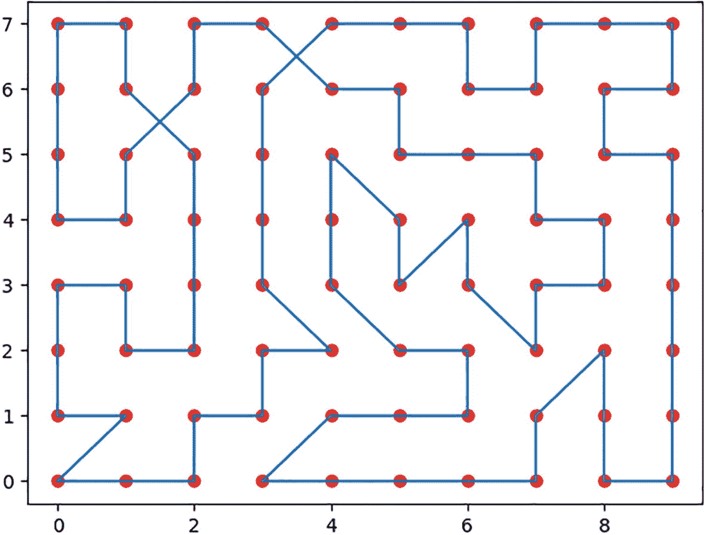

图 11-8：使用 `simanneal` 和 `tsp.auto(minutes=2.5)` 找到的 TSP 解

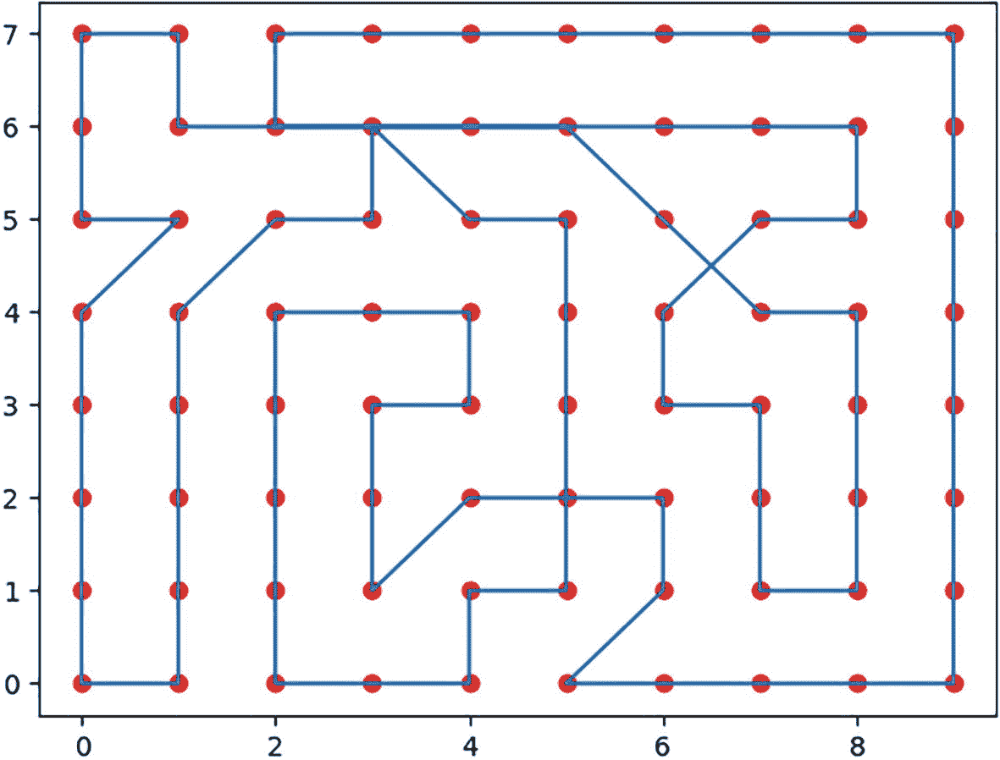

图 11-7：使用 `simanneal` 和 `tsp.auto(minutes=0.25)` 找到的 TSP 解

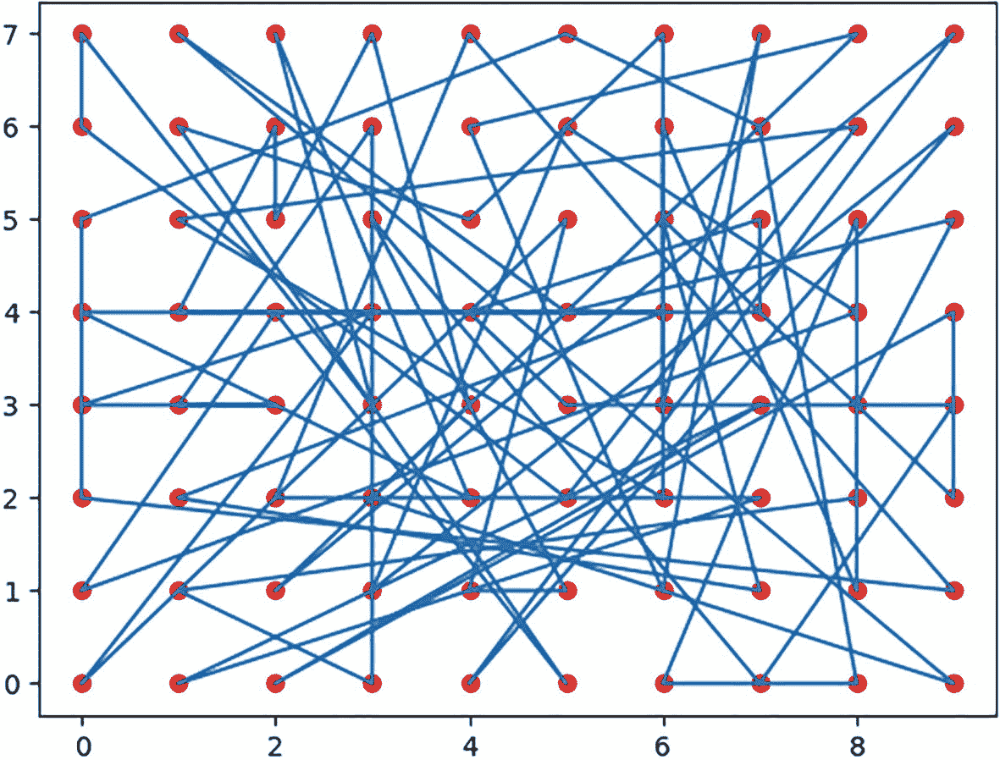

图 11-6：TSP 的初始随机猜测

## 11.13 微分方程

SciPy 的微分方程求解器集合与 MATLAB 的 `ode*()` 函数族旗鼓相当。不过它们的调用方法截然不同。MATLAB 的例程会返回完整的解（如果能找到的话），而 SciPy 返回的是一个迭代器，需要在循环中调用。

作为示例问题，我们将求解杜芬振荡方程：^(⁴⁶)

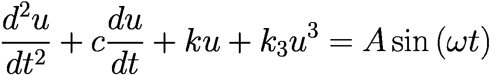

由于 MATLAB 和 Python 的求解器只处理一阶微分方程，这个二阶方程必须线性化为一对一阶方程：

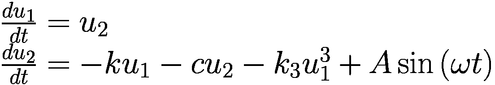

下面的 MATLAB^(⁴⁷) 和 Python 函数 `Duff()` 会返回一个包含两个值的数组，对应于这两个方程的右侧：

| MATLAB: | Python: |
| --- | --- |
| *% 文件: code/ode/duffing.m*<br>`Time = [0 40];`<br>`U_0   = [0; 0];`<br>`c = 0.1;`<br>`k = 0.7;`<br>`k3 = 1;`<br>`A = 44.5;`<br>`omega = 1.1;`<br>`options = odeset('RelTol',1e-7);`<br>`[t,u] = ode45(@(t,u)Duff(...`<br>`    t,u,k,c,k3,A,omega), ...`<br>`    Time,U_0,options);`<br>`figure`<br>`plot(u(:,1),u(:,2));`<br>`xlabel('Position');`<br>`ylabel('Velocity');`<br>`title('Duffing oscillator')`<br>`function` `u = Duff(t,u,k,c,k3,A,omega)`<br>  `u = [u(2); -k*u(1)-c*u(2)- ...`<br>`           k3*u(1)³+A*sin(omega*t)];`<br>`end` | *# 文件: code/ode/duffing.py*<br>`import numpy as np`<br>`from scipy.integrate import` `RK45`<br>`import matplotlib.pyplot as plt`<br>`def` `Duff(t,u,k=0.7,c=0.1,k3=1,`<br>`A=44.5,omega=1.1):`<br>`return` `[u[1], -k*u[0]-c*u[1] -`<br>`k3*u[0]**3+A*np.sin(omega*t)]`<br>`T0, Tn = 0, 40`<br>`U_0 = [0, 0]`<br>`t, u = [], []`<br>`sol = RK45(Duff, T0, U_0, Tn,`<br>`rtol=1e-7)`<br>`while` `sol.t < Tn:`<br>`    t.append(sol.t)`<br>`    u.append([sol.y[0], sol.y[1]])`<br>`    sol.step()`<br>`u = np.array(u)`<br>`plt.plot(u[:,0], u[:,1])`<br>`plt.xlabel('Position');`<br>`plt.ylabel('Velocity');`<br>`plt.title('Duffing oscillator');`<br>`plt.show()` |

左侧对 `ode45()` 的单行调用对应于 Python 中对 `RK45()` 的调用，随后跟一个 while 循环，循环中依次调用求解器对象的 `.step()` 方法。两个求解器都配置为返回相对精度为 10^(-7) 的解，但 MATLAB 需要 5093 次迭代，而 Python 只用了 1002 次。解在该相空间的图形显示出良好的一致性：

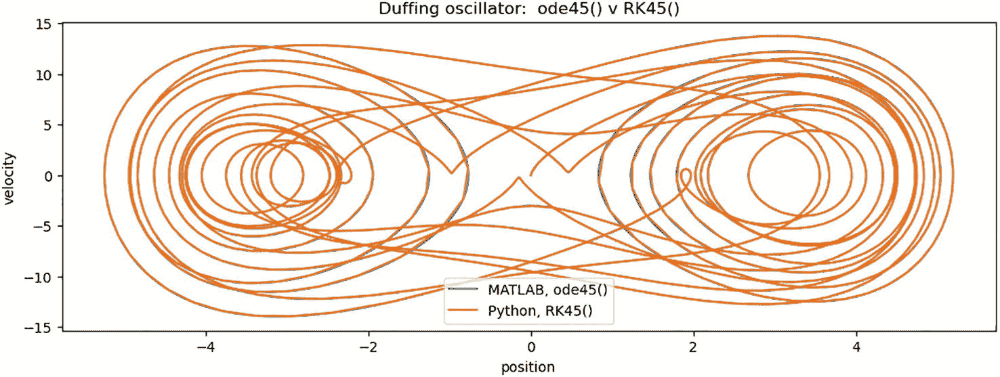

## 11.14 符号数学

Python 模块 SymPy 是一个计算机代数系统（CAS），可与 MATLAB 的符号工具箱相媲美。SymPy 是一个功能极其强大的 CAS，涵盖的主题包括微积分、微分几何、组合数学、数论、密码学、级数以及常微分和偏微分方程。除了符号化地计算结果外，它还可以将解表示为 LaTeX 格式，或表示为 Python、MATLAB 及其他多种语言的计算机代码，如表 11-9 所示。

表 11-9 SymPy 代码生成器

| 语言 | `sympy.printing` 函数 |
| --- | --- |
| C | `ccode()` |
| C++ | `cxxcode()` |
| Fortran | `fcode()` |
| GLSL | `glsl_code()` |
| JavaScript | `jscode()` |
| Julia | `julia_code()` |
| Maple | `maple_code()` |
| Mathematica | `mathematica_code()` |
| MATLAB | `octave_code()` |
| Python | `pycode()` |
| R | `rcode()` |
| Rust | `rust_code()` |

本节展示的示例仅是 SymPy 强大功能的冰山一角。

### 11.14.1 定义符号变量

SymPy 中的变量通过从 `sympy.abc` 模块导入来标识。例如，表达式 `from sympy.abc import x, y, phi` 将 `x`、`y` 和 `phi` 标识为要符号化处理的变量。

### 11.14.2 导数

使用 `sympy.diff()` 函数求导数。此示例展示了如何计算下式的导数：

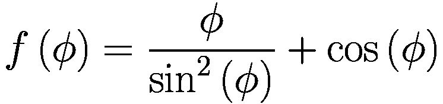

Python:
```

In : from sympy import cos, sin, diff

In : from sympy.abc import phi

In : from sympy.printing.latex import print_latex, octave_code

In : f = phi/sin(phi)**2 + cos(phi)

In : d = diff(f)

In : d.doit()

In : d.doit()

Out: -2*phi*cos(phi)/sin(phi)**3 - sin(phi) + sin(phi)**(-2)

In : print_latex(d)

- \frac{2 \phi \cos{\left(\phi \right)}}{\sin^{3}{\left(\phi \right)}} -

\sin{\left(\phi \right)} + \frac{1}{\sin^{2}{\left(\phi \right)}}

```

该导数的 LaTeX 输出渲染如下：

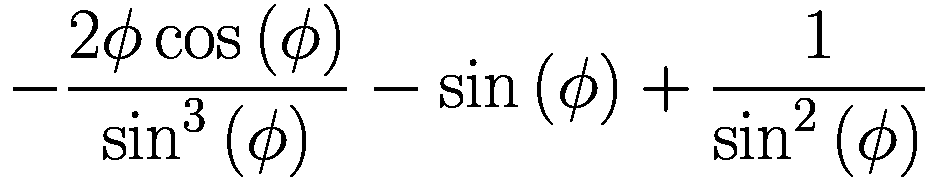

并且，可以像下面这样生成输入和输出函数的 MATLAB 代码：

Python:
```

In : print(octave_code(f))

phi./sin(phi).² + cos(phi)

In : print(octave_code(d))

-2*phi.*cos(phi)./sin(phi).³ - sin(phi) + sin(phi).^(-2)
```

### 11.14.3 积分

使用 `sympy.integrate()` 进行积分。例如，积分

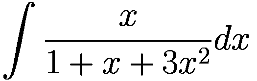

可以通过以下方式求得：

```python
In : from sympy import integrate

In : from sympy.abc import x

In : from sympy.printing.latex import print_latex

In : s = integrate(x/(1 + x + 3*x**2))

In : s.doit()

Out: log(x**2 + x/3 + 1/3)/6 - sqrt(11)*atan(6*sqrt(11)*x/11 + sqrt(11)/11)/33

In : print_latex(s)

\frac{\log{\left(x^{2} + \frac{x}{3} + \frac{1}{3} \right)}}{6} - \frac{\sqrt{11}

\operatorname{atan}{\left(\frac{6 \sqrt{11} x}{11} + \frac{\sqrt{11}}{11}

\right)}}{33}
```

结果如下所示：

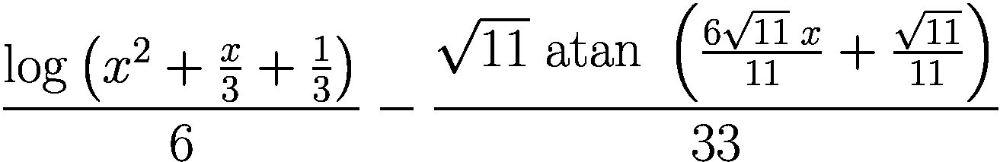

### 11.14.4 求解方程

方程组

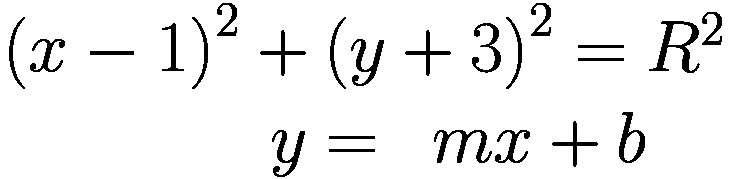

描述了一个圆和一条直线。以下代码求解用 `R`、`m` 和 `b` 表示的这些交点 `(x, y)`：

```python
In : from sympy import Eq

In : from sympy.solvers import solve

In : from sympy.abc import x,y,R,m,b

In : circle = (x-1)**2 + (y+3)**2 - R**2

In : line = m*x + b

In : solve(Eq(circle,line), (x,y))

Out: [(m/2 - sqrt(4*R**2 + 4*b + m**2 +

4*m - 4*y**2 - 24*y - 36)/2 + 1, y),

(m/2 + sqrt(4*R**2 + 4*b + m**2 +

4*m - 4*y**2 - 24*y - 36)/2 + 1, y)]
```

### 11.14.5 线性代数

#### 11.14.5.1 执行 的符号 LU 分解

矩阵

![$$ \left[\begin{array}{ccc}1&amp; 2&amp; -3\\ {}4&amp; -5&amp; 6\\ {}-7&amp; 8&amp; 9\end{array}\right] $$](images/516169_1_En_11_Chapter/516169_1_En_11_Chapter_TeX_Equu.png)

使用以下代码通过精确算术分解为下三角和上三角矩阵：

```python
In : from sympy import Matrix

In : A = Matrix([[1,2,-3],

[4,-5,6],

[-7,8,9]])

In : L, U, perm = \

...:    A.LUdecomposition()

In : L

Matrix([

[ 1,      0, 0],

[ 4,      1, 0],

[-7, -22/13, 1]])

In : U

Matrix([

[1,   2,     -3],

[0, -13,     18],

[0,   0, 240/13]])

In : perm

Out: []

In : L*U - A

Matrix([

[0, 0, 0],

[0, 0, 0],

[0, 0, 0]])
```

#### 11.14.5.2 符号求解 `A*x = b`

以下列三个方程和三个未知数为例

![$$ \left[\begin{array}{ccc}1&amp; 2&amp; -3\\ {}4&amp; -5&amp; 6\\ {}-7&amp; 8&amp; 9\end{array}\right]x=\left\{\begin{array}{c}1\\ {}-2\\ {}1\end{array}\right\} $$](images/516169_1_En_11_Chapter/516169_1_En_11_Chapter_TeX_Equv.png)

通过以下代码使用高斯-若尔当消元法对 `x` 进行符号求解：

```python
In : b = Matrix([1, -2, 1])

In : x, params = A.gauss_jordan_solve(b)

In : x

Matrix([

[ 1/20],

[ 3/10],

[-7/60]])

In : params

Out: Matrix(0, 1, [])
```

### 11.14.6 级数

SymPy 支持傅里叶级数、幂级数、级数求和以及级数展开。以下示例展示了如何找到闭式求和的结果

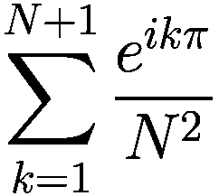

```python
In : from sympy import I, Sum, exp, pi

In : from sympy.abc import k, N

In : s = Sum( exp(I*k*pi)/N**2, (k, 1, N+1))

In : s.doit()

Out: (-(-1)**(N + 2)/2 - 1/2)/N**2
```

## 11.15 方案 11-5：在 MATLAB 中使用 SymPy

在定义符号变量以及 `i` 和 `π` 的 SymPy 特定常量后，可以在 MATLAB 中完成第 11.14.6 节中的级数求和。我们将所有 Python 变量加上前缀“`p`”，以避免与 MATLAB 内置变量发生名称冲突，尽管在本例中只有 `pi` 会导致冲突。

```matlab
>> pI = py.sympy.I;

>> pPi = py.sympy.pi;

>> pk = py.sympy.abc.k;

>> pN = py.sympy.abc.N;

>> s = py.sympy.Sum( py.sympy.exp(pI*pk*pPi)/pN², py.tuple({pk,1,pN+1}));

>> s.doit()

Python Mul with properties:

args: [1×2 py.tuple]

assumptions0: [1×1 py.dict]

canonical_variables: [1×1 py.dict]

expr_free_symbols: [1×1 py.set]

free_symbols: [1×1 py.set]

func: [1×1 py.sympy.core.assumptions.ManagedProperties]

is_algebraic: [1×1 py.NoneType]

:

is_rational: [1×1 py.NoneType]

is_real: [1×1 py.NoneType]

is_transcendental: [1×1 py.NoneType]

is_zero: [1×1 py.NoneType]

N**(-2.0)*(-(-1)**(N + 2.0)/2 - 0.5)
```

`s.doit()` 的输出是 MATLAB 中的一个 Python 变量；要获得包含求解结果的 MATLAB 字符串，我们只需访问 Python 求解结果的 `.char` 属性：

```matlab
>> s_soln = s.doit();

>> m_soln = s_soln.char;

>> m_soln

'N**(-2.0)*(-(-1)**(N + 2.0)/2 - 0.5)'
```

## 11.16 方案 11-6：计算拉普拉斯变换

MATLAB 符号工具箱中的 `laplace()` 函数可以计算拉普拉斯变换。SymPy 中的 `laplace_transform()` 函数也可以完成同样的功能。以下示例计算了以下函数的变换：

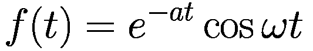

MATLAB 2020b:

```matlab
>> sympy = py.importlib.import_module('sympy');

>> s = sympy.symbols('s');

>> t = sympy.symbols('t');

>> a = sympy.symbols('a', pyargs('real','True', 'positive','True'));

>> omega = sympy.symbols('omega', pyargs('real','True'));

>> f = sympy.exp(-a*t)*sympy.cos(omega*t);

>> L = sympy.laplace_transform(f, t, s)

L =

Python tuple with no properties.

((a + s)/(omega**2 + (a + s)**2), -a, Eq(2*Abs(arg(omega)), 0))

>> latex = py.importlib.import_module('sympy.printing.latex');

>> latex.print_latex(L{1})

\frac{a + s}{\omega^{2} + \left(a + s\right)^{2}}
```

LaTex 输出渲染为：

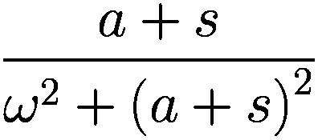

## 11.17 单位系统

Python 模块 `pint` 允许将单位分配给数字标量和数组，这与 MATLAB 符号工具箱中的类似功能非常相似。一旦为变量分配了单位，在计算中尝试混合维度不兼容的项（例如，将面积与温度相加）会引发 `DimensionalityError`。混合维度兼容但单位制不同的项（例如，将以米为单位的长度与以英寸为单位的长度相加）可以正确工作，因为会首先应用适当的缩放因子。

在 `pint` 和符号工具箱中，都必须首先初始化单位对象（在两种语言的以下示例中均使用 `u`）。后续变量可以通过将数值或变量乘以单位对象的众多属性之一来获得单位。在此，我们展示如何将 6061 铝合金^(⁴⁸)的弹性模量和密度从公制转换为美制单位。

Python:

```python
In : from pint import UnitRegistry

In : u = UnitRegistry()

In : E = 68.9 * u.GPa

In : rho = 2.70 * u.g/u.cm**3

In : E_us = E.to(u.psi)

In : rho_us = rho.to(u.lb/u.inch**3)

In : E_us

Out: 9993100.129611416 

In : rho_us

Out: 0.09754368840022593 
```

`pint` 和符号工具箱都支持数百种基本单位和导出单位；完整列表可在 [`https://github.com/hgrecco/pint/blob/master/pint/default_en.txt`](https://github.com/hgrecco/pint/blob/master/pint/default_en.txt) 和 [`www.mathworks.com/help/symbolic/units-list.html`](http://www.mathworks.com/help/symbolic/units-list.html) 找到。

单位可以分配给 NumPy 数组；对该数组的单个项或切片进行操作时，只能使用无单位变量或其他一致的单位变量。但是，无法创建包含混合单位的 NumPy 数组。这排除了在阵列的行或列具有不同单位类型的应用中使用 `pint` 的可能性。一个例子是同时包含线刚度和旋转刚度的有限元矩阵。

### 11.17.1 在 `pint` 中定义单位

可以轻松定义任意单位。在下一个示例中，定义了“美元”和“欧元”的货币单位。然后基于它们定义了每单位面积的价格，并将其应用于一个包含四个属性的房地产地块集合。最后，给出了每个集合以美元和欧元计的价格。注意，在计算 `cost` 向量时，`pint` 不会自动简化复合单位；我们必须显式地转换为美元或欧元：

Python:

```python
In : from pint import UnitRegistry

In : u = UnitRegistry()

In : u.define('dollar = 1 = USD')

In : u.define('euro = 1.31 * dollar = EU')

In : USD_per_ft2 = 2.1 * u.USD/u.foot**2

In : EU_per_m2 = USD_per_ft2.to(u.EU/u.meter**2)

In : EU_per_m2

Out: 17.2551 

In : a = np.arange(20).reshape(5,4) * u.acre

In : a

array([[ 0,  1,  2,  3],

[ 4,  5,  6,  7],

[ 8,  9, 10, 11],

[12, 13, 14, 15],

[16, 17, 18, 19]]) 

In : P = np.ones(4) * USD_per_ft2

In : P

Out: array([2.1, 2.1, 2.1, 2.1]) 

In : cost = a@P

In : cost

Out: array([ 12.6,  46.2,  79.8, 113.4, 147\. ])

In : cost.to(u.USD)

array([ 548858.19543059, 2012480.04991215, 3476101.90439371,

4939723.75887528, 6403345.61335684]) 

In : cost.to(u.euro)

array([ 418975.72170274, 1536244.31291004, 2653512.90411734,

3770781.49532464, 4888050.08653194]) 
```

`pint` 文档指出，为变量添加单位会导致使用这些变量执行计算时性能下降。每次 `pint` 检查单位时确实如此。但是，如果变量是 NumPy 数组，则此单位检查仅对整个数组执行一次，而不是对数组中的每个项执行。总的来说，性能受数值数组计算主导的程序，在使用单位时与不使用单位时运行速度大致相同。

## 11.18 食谱 11-7：在 MATLAB 中使用 `pint`

11.17 节的单位示例需稍作修改才能在 MATLAB 中使用。主要区别在于，不能通过点号访问注册表变量中的单位。相反，我们必须使用 `.Units()` 访问器函数。例如，“米”单位在 MATLAB 中必须引用为 `u.Unit('meter')`，而不能像在 Python 中那样直接写 `u.meter`。还需注意，矩阵 `a` 被定义为 4×5 矩阵的转置，以便获得与 Python 相同的行主序值。

MATLAB:

```matlab
>> u = py.pint.UnitRegistry;

>> u.define('dollar = 1 = USD');

>> u.define('euro = 1.31 * dollar = EU');

>> USD_per_ft2 = 2.1 * u.Unit('USD')/u.Unit('foot')²;

>> EU_per_m2 = USD_per_ft2.to(u.Unit('EU')/u.Unit('meter')²);

>> a = reshape(0:19, 4,5)';

>> b = py.numpy.array(a)*u.Unit('acre');

>> P = py.numpy.ones(int64(4)) * USD_per_ft2;

>> cost = b.dot(P)

cost =

Python Quantity with properties :

T: [1×1 py.pint.quantity.Quantity]

:

units: [1×1 py.pint.unit.Unit]

[12.6 46.2 79.8 113.4 147.0] acre * dollar / foot ** 2

>> cost.to(u.Unit('USD'))

Python Quantity with properties:

T: [1×1 py.pint.quantity.Quantity]
```

# 12. 绘图

MATLAB 因其可视化数值数据的便捷性而闻名。Python 也具备类似的能力，但在开始之前，必须从众多优秀的绘图模块中选择一个。其中佼佼者包括：

- Altair
- Bokeh
- matplotlib
- Plotly
- Seaborn

Altair 允许用相对较少的代码生成复杂的图形；Bokeh 和 Plotly 擅长创建交互式的 Web 图形；Seaborn 基于 matplotlib 构建，具有精致的视觉风格和快捷函数，能创建相对复杂的图形，尤其适用于统计工作。我选择了其中最古老的 matplotlib，原因如下：其命令和绘图范式与 MATLAB 最为相似；是 Cartopy（第 12.4 节）和 Pandas（第 13 章）的底层绘图包；并且可以随时添加 Seaborn 的增强功能。

## 12.1 点图与线图

除了额外的导入语句外，在 Python 中绘制抛物线的命令与在 MATLAB 中看起来相似。结果也几乎相同：

| MATLAB: | Python: |
| --- | --- |
| `x=-10:10;` `y= x .² - 36;` `plot(x,y)` | `import numpy as np` `import matplotlib.pyplot as plt` `x = np.arange(-10,11)` `y = x**2 – 36` `plt.plot(x,y)` `plt.show()` |

两者之间的一个显著区别是，默认情况下，MATLAB 会自动打开一个显示窗口来展示正在创建的图形，而 Python 除非显式调用 `plt.show()`，否则不会显示任何内容。MATLAB 的这种行为在交互式工作时很方便。但是，如果你运行一个包含长时间计算的 MATLAB m 文件，最终出现的绘图窗口可能会在你活跃于其他窗口时“劫持”你的鼠标点击。当你的代码在循环中创建图形，导致一连串窗口不断弹出时，这尤其令人厌烦。另一方面，如果你忘记最后的 `plt.show()`（或者如果你要写入图像文件而非显示，则忘记 `plt.savefig()`），Python 程序将不会显示图形。在 IPython 中交互式工作时也是如此。然而，像 PyCharm、Spyder 和 Jupyter notebook 这样的 IDE 和其他图形化 Python 工作环境，其工作方式与 MATLAB IDE 类似，会立即显示图形。

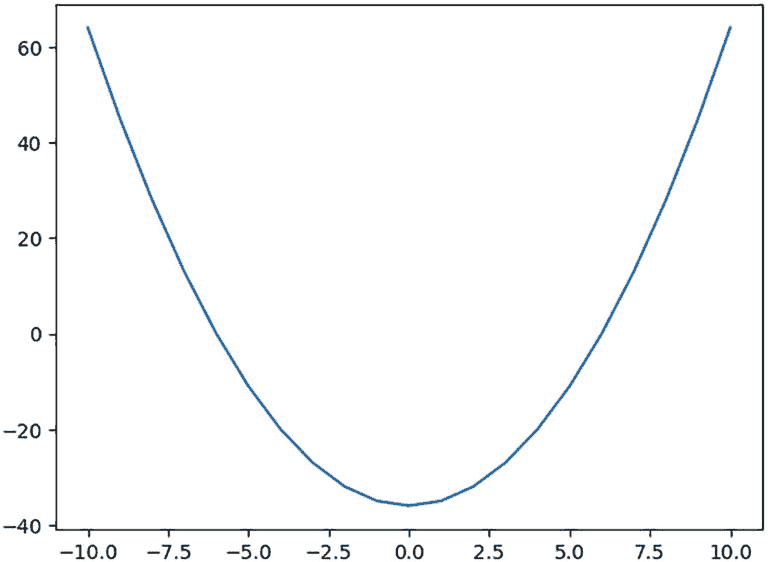

图 12-2 Python

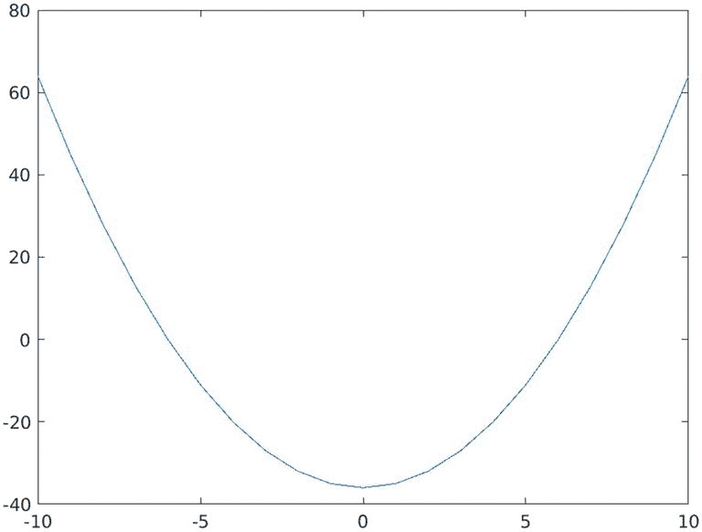

图 12-1 MATLAB

用于添加标题、坐标轴标签和图例的 `matplotlib` 命令与 MATLAB 中的对应命令非常相似。此外，对于简单的图形，我们只需直接引用 `matplotlib.pyplot`（通常导入为 `plt`）的命令即可：

| MATLAB: | Python: |
| --- | --- |
| `t=linspace(0,10*pi,300);` `decay = exp(-t/10);` `osc = decay .* sin(t);` `pts = -decay(1:10:end);` `plot(t,osc,'g')` `hold on` `plot(t,decay,'r')` `scatter(t(1:10:end),pts)` `grid on` `hold off` `title('衰减正弦波')` `xlabel('时间 [秒]')` `ylabel('exp(-t/10)*sin(t)')` `saveas(1,"decay.png")` | `import numpy as np` `import matplotlib.pyplot as plt` `t = np.linspace(0,10*np.pi,num=300)` `decay = np.exp(-t/10)` `osc = decay*np.sin(t)` `pts = -decay[::10]` `plt.plot(t,osc,'g')` `plt.plot(t,decay,'r')` `plt.scatter(t[::10],pts)` `plt.grid()` `plt.title('衰减正弦波')` `plt.xlabel('时间 [秒]')` `plt.ylabel('exp(-t/10)*sin(t)')` `plt.savefig('decay.png')` `plt.show()` `# 可选` |

### 12.1.1 将图形保存到文件

Matplotlib 用于将图形保存为 PNG、JPEG 等格式的函数是 `plt.savefig()`。它类似于 MATLAB 的 `saveas()`、`print()` 和 `exportgraphics()` 函数，但其优势在于支持 PNG 文件的透明背景——这对于插入 PowerPoint 演示文稿、Word 文档、网站、电子书和 PDF 来说是一个理想的特性。MATLAB 仅支持以 PDF 格式保存的图形具有透明度，而这个过程比写入 PNG 或 JPEG 文件要慢得多。

matplotlib 支持的图像文件格式可以通过 `plt.gcf().canvas.get_supported_filetypes()` 显示：

```python
In : plt.gcf().canvas.get_supported_filetypes()

Out:
```

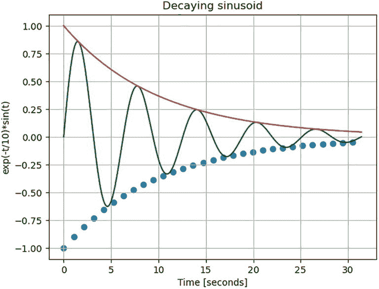

图 12-4 Python

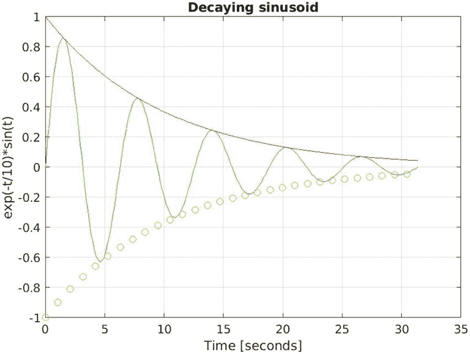

图 12-3 MATLAB

```python
{'ps': 'Postscript',
 'eps': '封装的 Postscript',
 'pdf': '便携式文档格式',
 'pgf': '用于 LaTeX 的 PGF 代码',
 'png': '便携式网络图形',
 'raw': '原始 RGBA 位图',
 'rgba': '原始 RGBA 位图',
 'svg': '可缩放矢量图形',
 'svgz': '可缩放矢量图形',
 'jpg': '联合图像专家组格式',
 'jpeg': '联合图像专家组格式',
 'tif': '标签图像文件格式',
 'tiff': '标签图像文件格式'}
```

本书中的大部分图像都是使用如下命令保存的：

```python
plt.savefig('plot.png', dpi=200, bbox_inches='tight',
            pad_inches=0.1, transparent=True)
```

> **提示**：如果你希望 Python 程序既在屏幕上显示图形，又将其保存到文件，请先调用`plt.savefig()`，再调用`plt.show()`；否则，图像文件将是空的。

### 12.1.2 每张图形中的多个子图

Matplotlib 的`subplots()`函数类似于 MATLAB 的`subplot()`，两者都将所需子图的行数和列数作为前两个参数。MATLAB 函数的第三个参数是要绘制的子图按行主序的偏移量，而 matplotlib 的函数则返回一个坐标轴句柄数组：

| MATLAB: | Python: |
| --- | --- |
| `t = -10*pi:0.1:10*pi;` `C = {{'blue' , 'red',},` `...` `{'green', 'black'}};` `figure` `i = 1;` `for` `r = 0:1` `for` `c = 0:1` `subplot(2, 2, i)` `i = i+1;` `k = 1 + (1.1*r + 1.5*c)/10;` `y = sin(t) + sin(k*t);` `plot(t,y,C{r+1}{c+1})` `xlabel('t')` `ylabel('y')` `title(sprintf(` `...` `'r=%d, c=%d',r,c))` `grid on` `end` `end` | `import numpy as np` `import matplotlib.pyplot as plt` `t = np.arange(-10*np.pi, 10*np.pi, 0.1)` `C = [['blue' , 'red',],` `['green', 'black']]` `fig, ax = plt.subplots(nrows=2,` `ncols=2, constrained_layout=` `True` `)` `for` `r` `in` `[0, 1]:` `for` `c` `in` `[0, 1]:` `k = 1 + (1.1*r + 1.5*c)/10` `y = np.sin(t) + np.sin(k*t)` `ax[r,c].plot(t,y,color=C[r][c])` `ax[r,c].set_xlabel('t')` `ax[r,c].set_ylabel('y')` `ax[r,c].set_title(` `f'r=` `{r}`, c=` `{c}` `', fontsize=14)` `ax[r,c].grid(` `True` `)` `plt.show()` |

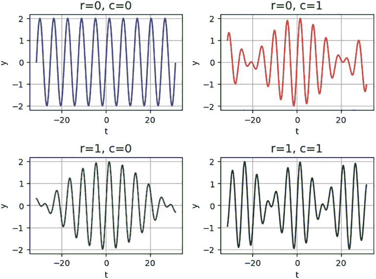

**图 12-6** Python

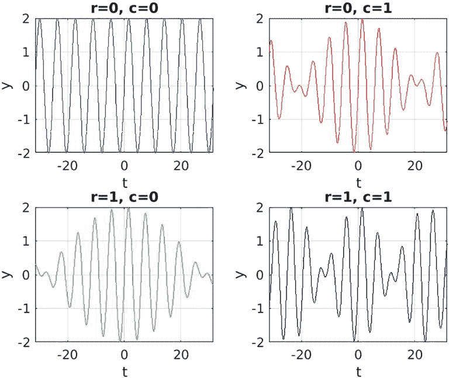

**图 12-5** MATLAB

### 12.1.3 X 轴上的日期和时间

X 轴上的日期和时间标注可能很棘手，因为它们占用了太多空间。MATLAB 和 Python 的 matplotlib 都允许精细控制日期字符串格式以及旋转轴标签以防止重叠。MATLAB 的时间标记对齐到中午，而 matplotlib 的对齐到午夜。

| MATLAB: | Python: |
| --- | --- |
| `t = .1:.01:.8;` `y = sin(3./t).*sin(5./(1-t));` `S = 30*24*60*60*t + 1620000000;` `dates = arrayfun(@(x) datetime(` `...` `x,'ConvertFrom','posix'), S);` `scatter(dates,y,'v','filled')` `grid()` `xtickformat('yyyy-MM-dd hh:mm')` `xtickangle(30)` | `import numpy as np` `import matplotlib.pyplot as plt` `import matplotlib.dates as mdates` `from datetime import` `datetime` `t = np.arange(.1, .8, .01)` `y = np.sin(3/t)*np.sin(5/(1-t))` `S = 30*24*60*60*t + 1620000000` `dates = [datetime.fromtimestamp(_)` `for` `_` `in` `S]` `fig, ax = plt.subplots()` `ax.scatter(dates,y,marker=11)` `plt.grid()` `ax.xaxis.set_major_formatter(` `mdates.DateFormatter('%Y-%m-` `%d` `%H:%S'))` `fig.autofmt_xdate()` |

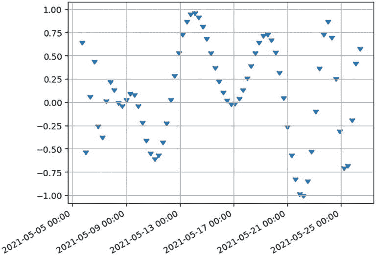

**图 12-8** Python

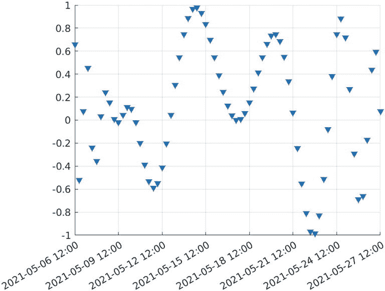

**图 12-7** MATLAB

### 12.1.4 双 Y 轴

相互竞争的单位系统，例如公制与美制，可以通过在左右垂直轴上标注不同的单位来同时显示。此示例显示了数种金属的弹性模量（通常称为杨氏模量）^(⁴⁹)，左侧单位为吉帕斯卡（GPa），右侧单位为兆磅每平方英寸（Mpsi）。这在 MATLAB 中使用`yyaxis left`和`yyaxis right`命令会稍微容易一些，这两个命令定义了后续命令操作的垂直轴。在 matplotlib 中，我们通过复制第一个垂直轴对象来创建一个新的垂直轴对象，然后用第二个单位系统的属性修改这个副本。

| MATLAB: | Python: |
| --- | --- |
| `*% file: code/plots/double_y_axis.m*` `yL = [68 108 112 116 193 200];` `yR = [9.86 15.7 16.2 16.8 28 29];` `yLmax = max(yL) * 1.1;` `materials = {'aluminum',` `...` `'zinc', 'bronze', 'titanium',` `...` `'iron', 'steel'};` `bar(yL)` `yyaxis left` `ylabel('GPa')` `ylim([0 yLmax])` `yyaxis right` `ylabel('Mpsi')` `ylim([0 yLmax/6.8965])` `xticklabels(materials)` `grid()` `title("Young's Modulus")` | `*# file: code/plots/double_y_axis.py*` `import numpy as np` `import matplotlib.pyplot as plt` `fig, ax = plt.subplots()` `yL = [68, 108, 112, 116, 193, 200]` `yR = [9.86, 15.7, 16.2, 16.8, 28, 29]` `yLmax = np.max(yL) * 1.1` `materials = ['aluminum', 'zinc',` `'bronze', 'titanium',` `'iron', 'steel']` `P = ax.bar(materials, yL)` `ax.set_ylabel('GPa')` `ax2 = ax.twinx()` `ax2.set_ylabel('Mpsi')` `ax.set_ylim(ymax=yLmax)` `ax2.set_ylim(ymax=yLmax/6.8965)` `ax.grid(` `True` `)` `ax.set_axisbelow(` `True` `)` `plt.title("Young's Modulus")` `plt.show()` |

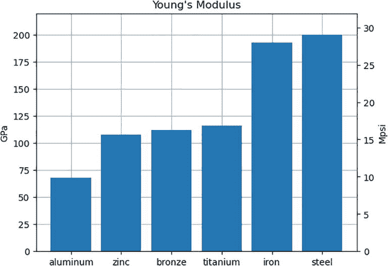

**图 12-10** Python

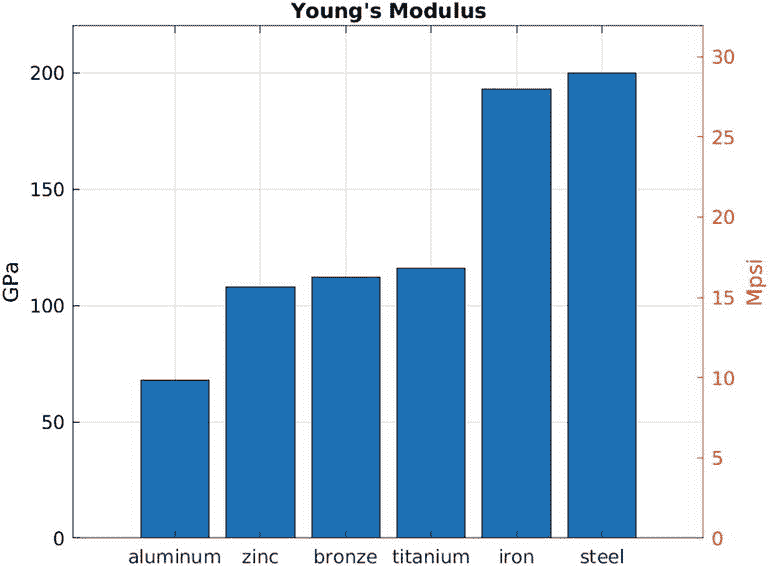

**图 12-9** MATLAB

### 12.1.5 直方图

以下示例显示了正态分布和瑞利分布的直方图。生成这些分布的 MATLAB 函数`normrnd()`和`raylrnd()`位于统计和机器学习工具箱中。我没有该工具箱的访问权限，因此在 MATLAB 中我将调用 NumPy 的等效函数。通过在 MATLAB 和 Python 中使用相同的随机数源，我还可以初始化相同的种子，从而在两种语言中生成相同的分布。

| MATLAB: | Python: |
| --- | --- |
| `*% file: code/plots/hist_demo.m*` `Im = @py.importlib.import_module;` `rnd = Im('numpy.random');` `N = int64(10000);` `rnd.seed(int64(123));` `w1 = rnd.rayleigh(int64(3), N);` `w1 = py2mat(w1);` `w2 = rnd.normal(int64(8),` `...` `int64(3), N);` `w2 = py2mat(w2)` `;` `bins = linspace(-5, 20, 80);` `h1 = histogram(w1,bins);` `set(h1,'FaceAlpha',0.5,` `...` `'EdgeAlpha',0.0);` `hold on` `h2 = histogram(w2,bins);` `set(h2,'FaceAlpha',0.5,` `...` `'EdgeAlpha',0.0);` `legend('Rayleigh','Normal');` `grid on` | `*# file: code/plots/hist_demo.py*` `import numpy as np` `import matplotlib.pyplot as plt` `N = 10000` `np.random.seed(123)` `w1 = np.random.rayleigh(3, N)` `w2 = np.random.normal(8, 3, N)` `bins = np.linspace(-5, 20, 80)` `plt.hist(w1, bins, alpha=0.5,` `label="Rayleigh")` `plt.hist(w2, bins, alpha=0.5,` `label="Normal")` `plt.legend(loc='upper right')` `plt.ylim([0, 700])` `plt.grid(` `True` `)` `plt.show()` |

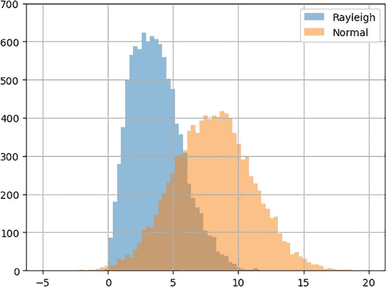

**图 12-12** Python

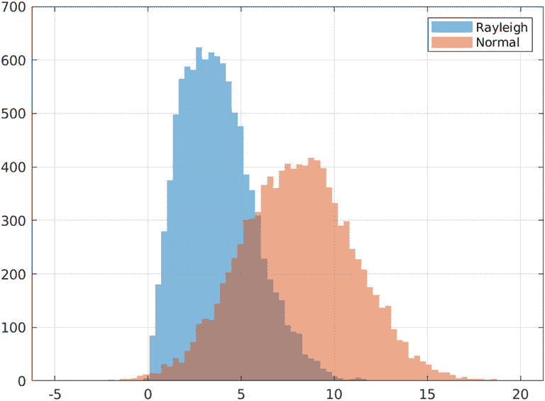

**图 12-11** MATLAB

### 12.1.6 堆叠图

堆叠图（或沙堆图）可以使用 MATLAB 中的`area()`和 matplotlib 中的`stackplot()`创建。（MATLAB 有一个`stackedplot()`函数，但其目的是创建共享一个 x 轴的多个垂直对齐的图。）

| MATLAB: | Python: |
| --- | --- |
| `*% file: code/plots/stack_demo.m*` `t = linspace(0, 20, 100);` `w = [0.11, 0.25, 0.17, 0.32];` `L = {};` `y = zeros(length(t),length(w));` `for i = 1:length(w)` `F = w(i);` `y(:,i) = cos(F*t).² + F;` `L{i} = sprintf(` `...` `'\\omega = %.2f', F);` `end` `area(t, y)` `legend(L);` `xlabel('\omega')` `grid on` | `*# file: code/plots/stack_demo.py*` `import numpy as np` `import matplotlib.pyplot as plt` `t = np.linspace(0, 20, 100)` `w = [0.11, 0.25, 0.17, 0.32]` `L = [f'$\omega$ =` `{_:.2f}` `'` `for` `_` `in` `w]` `y = np.zeros((len(w),len(t)))` `for` `i,F` `in` `enumerate(w):` `y[i,:] = np.cos(F*t)**2 + F` `fig, ax = plt.subplots()` `ax.stackplot(t, y, labels=L)` `ax.legend(loc='upper right')` `ax.set_xlabel('$\omega$')` `plt.grid()` `ax.set_axisbelow(` `True` `)` `plt.show()` |

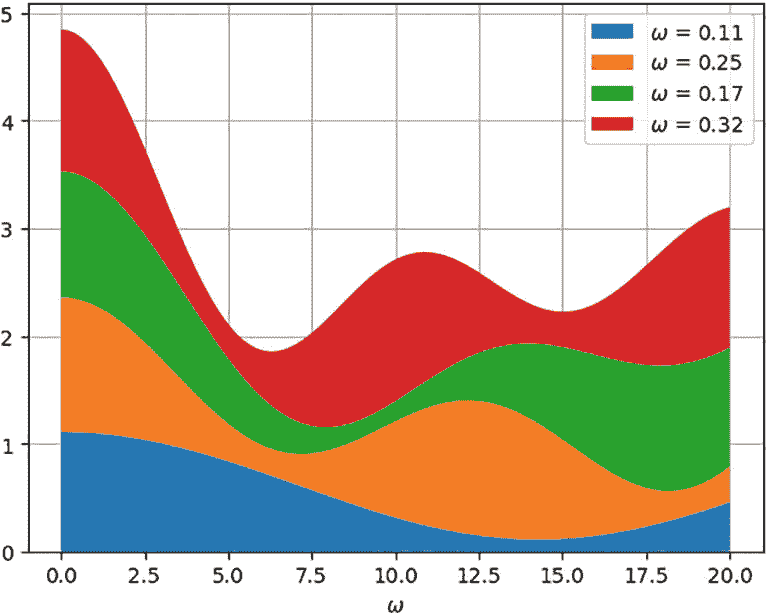

**图 12-14** Python

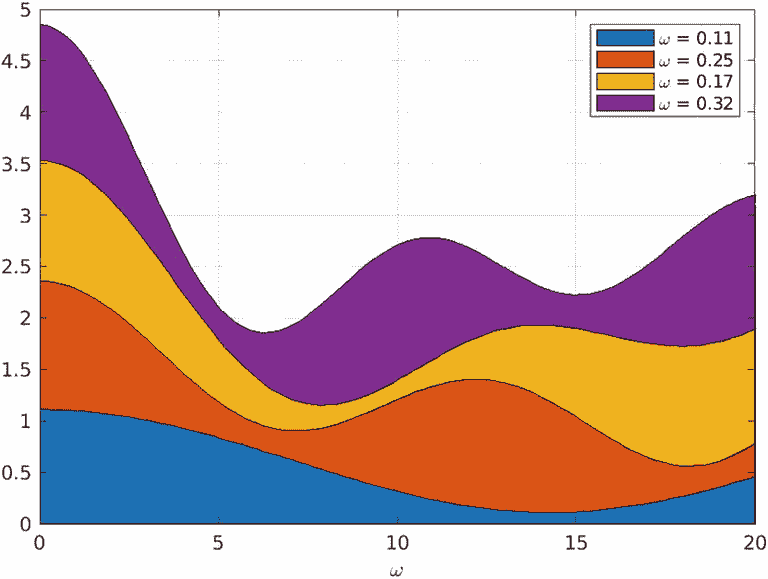

**图 12-13** MATLAB

## 12.2 面积图

### 12.2.1 `imshow()`

最简单的二维图是通过使用颜色映射为各个数组元素着色，直接渲染二维数值数组而成。MATLAB 和 matplotlib 都可以使用名为`imshow()`的函数将二维数组显示为图像。然而，MATLAB 的`imshow()`在显示数组时，每个数组元素会映射到一个屏幕像素；一个 5×5 的数组在大多数屏幕上会显示得非常微小。需要使用可选参数对`'InitialMagnification','fit'`来将小数组缩放到大小合适的图像。MATLAB 的`imagesc()`会将数组缩放到合适的大小，但它不提供像`imshow()`那样不同的插值方法。

第一个例子展示了 MATLAB 中的`imagesc()`和 matplotlib 中的`imshow()`对一个 16×16 数组的处理。（关于`np.newaxis`的回顾，请参见第 11.​1.​13 节。）matplotlib 方便地设置了 1:1 的纵横比：

| MATLAB: | Python: |
| --- | --- |
| `% file: code/plots/imshow_demo.m` `x = 0:0.2:pi;` `S = sin(x);` `z = S .* S';` `imagesc(z)` `colorbar` | `# file: code/plots/imshow1_demo.py` `import numpy as np` `import matplotlib.pyplot as plt` `x = np.arange(0,np.pi,0.2)` `S = np.sin(x)` `z = S[:,np.newaxis] * S[np.newaxis,:]` `hz = plt.imshow(z)` `plt.colorbar(hz)` |

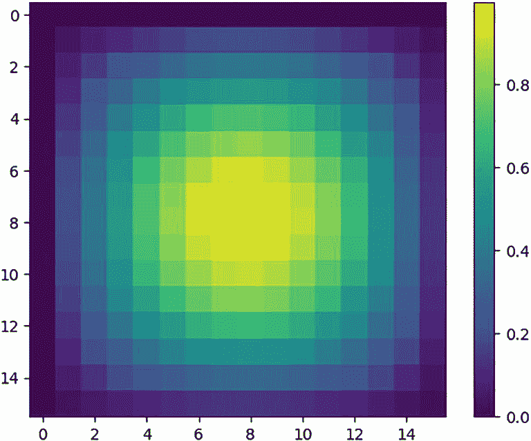

图 12-16 Python

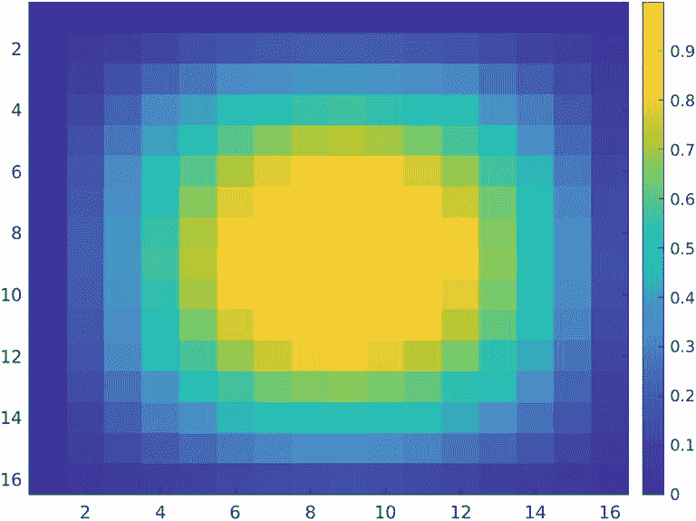

图 12-15 MATLAB

下一个例子在 MATLAB 和 matplotlib 中都使用了带双线性插值的`imshow()`。如果没有显式的`colorbar`参数，MATLAB 图像将以灰度显示。

| MATLAB: | Python: |
| --- | --- |
| `% file: code/plots/imshow_demo.m` `x = 0:0.2:pi;` `S = sin(x);` `z = S .* S';` `imshow(z, 'Interpolation',` **...** `'bilinear','Colormap',` **...** `parula,` **...** `'InitialMagnification','fit')` `colorbar` | `# file: code/plots/imshow2_demo.py` `import numpy as np` `import matplotlib.pyplot as plt` `x = np.arange(0,np.pi,0.2)` `S = np.sin(x)` `z = S[:,np.newaxis] * S[np.newaxis,:]` `hz = plt.imshow(z,` `interpolation="bilinear")` `plt.colorbar(hz)` |

然而，在 Python 中进行更专业的绘图需要用户获取独立的图形和坐标轴对象的句柄。请注意在以下等高线示例中，函数名前的不同前缀`plt.`、`ax.`和`fig.`：

| MATLAB: | Python: |
| --- | --- |
| `N = 500;` `rN = 1:N` `;` `[J, I] = meshgrid(rN, rN);` `x = -10 + 20*J/N;` `y = -10 + 20*I/N;` `z = cos(2*x/3).*sin(y/3)./` `...` `(100 + x.ˆ2+y.ˆ2);` `contourf(z)` `daspect([1 1 1])` `colorbar()` `title('Filled Contour')` `saveas(1,"m_contourf.png")` | `import numpy as np` `import matplotlib.pyplot as plt` `N = 500; rN = range(N)` `J, I = np.meshgrid(rN, rN)` `x = -10 + 20*J/N` `y = -10 + 20*I/N` `fig, ax = plt.subplots()` `ax.set_aspect('equal')` `z = np.cos(2*x/3)*np.sin(y/3)/(` `100 + x**2+y**2)` `cf = ax.contourf(z)` `fig.colorbar(cf)` `ax.set_title('Filled Contour')` `plt.savefig('contourf.png')` |

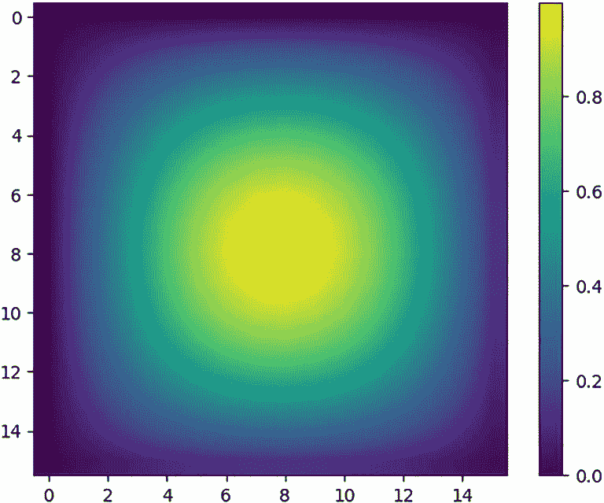

图 12-18 Python

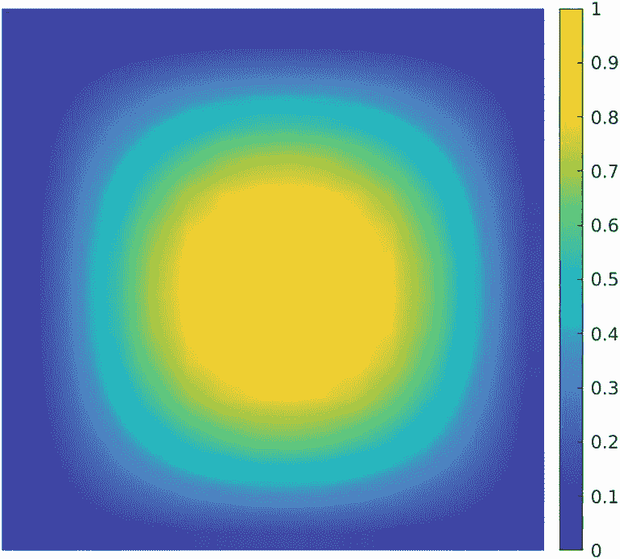

图 12-17 MATLAB

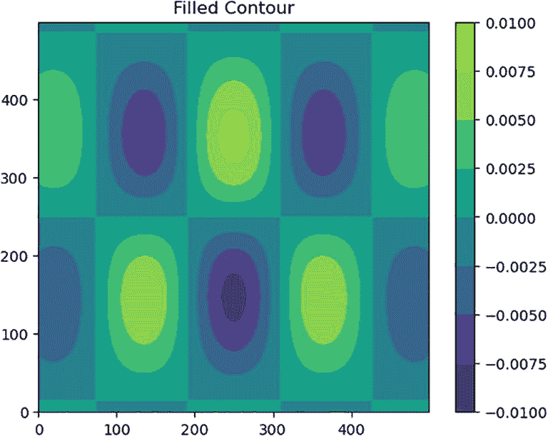

图 12-20 Python

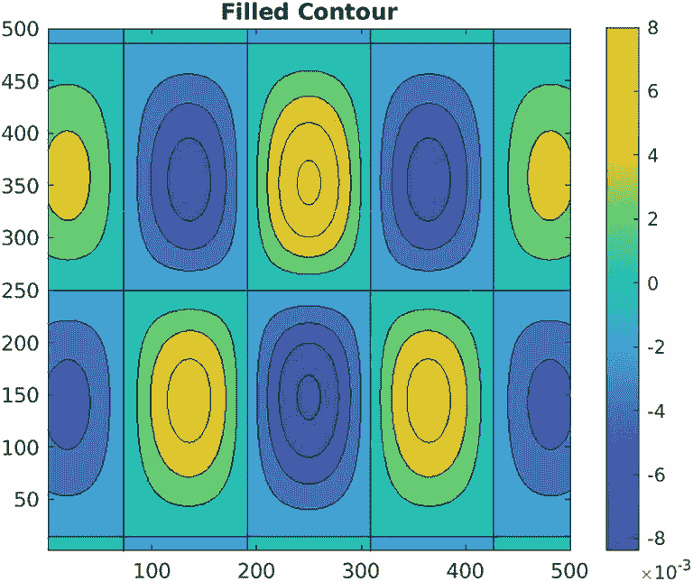

图 12-19 MATLAB

## 12.3 动画

Matplotlib 可以像 MATLAB 一样制作动画。然而，除非动画很简单，否则避免使用全局变量可能是一个挑战。我们将从一个简单的程序开始，该程序绘制一个宽度随每一帧变化的椭圆。所有操作都封装在一个函数中，不需要全局变量。

动画的关键要素是`A_values`（第 23 行`FuncAnimation()`的第三个参数）和第 18 行的`update()`函数。`A_values`是一个系数向量，用于缩放椭圆的宽度；其值从 0.9 下降到 0.1，然后又回到 0.9。每次调用`update()`时，会取出`A_values`中的下一个系数，并重新绘制椭圆的图像。

Python：

```python
# 代码示例（原始文本中未提供具体代码，保持此结构）
```


# file: `code/plots/circle_ellipse.py`

```python
import numpy as np
import matplotlib.pyplot as plt
from matplotlib.animation import FuncAnimation

def circle_to_ellipse():
    fig, ax = plt.subplots()
    T = np.linspace(0, 2*np.pi, 200)
    x = np.cos(T)
    y = np.sin(T)
    curve, = plt.plot(x,y,'b')
    A_values = np.hstack([np.linspace(0.1, 0.9, 100),
                          np.linspace(0.9, 0.1, 100)])
    def init():
        ax.set_xlim(-1, 1)
        ax.set_ylim(-1, 1)
        ax.set_aspect('equal')
        return curve,
    def update(A):
        x = A*np.cos(T)
        y = np.sin(T)
        curve, = plt.plot(x,y,'b')
        return curve,
    ani = FuncAnimation(fig, update, A_values,
                        interval=20, # 毫秒
                        init_func=init, blit=True)
    plt.show()

circle_to_ellipse()
```

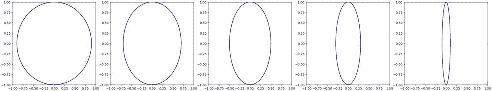

第二个动画示例展示了一个在抛物面碗中弹跳的球。它要复杂得多，并且使用`全局变量`来存储球的运动轨迹。

Python：

```
```
