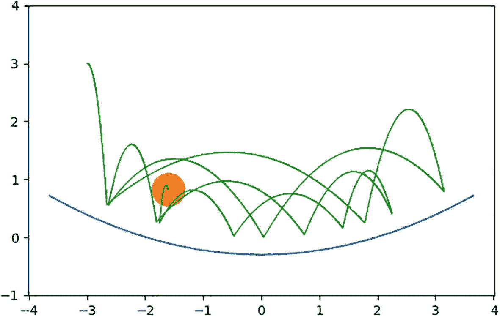
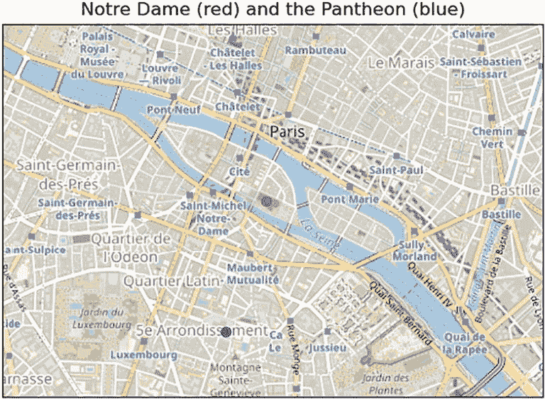
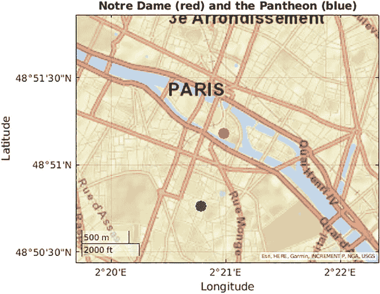
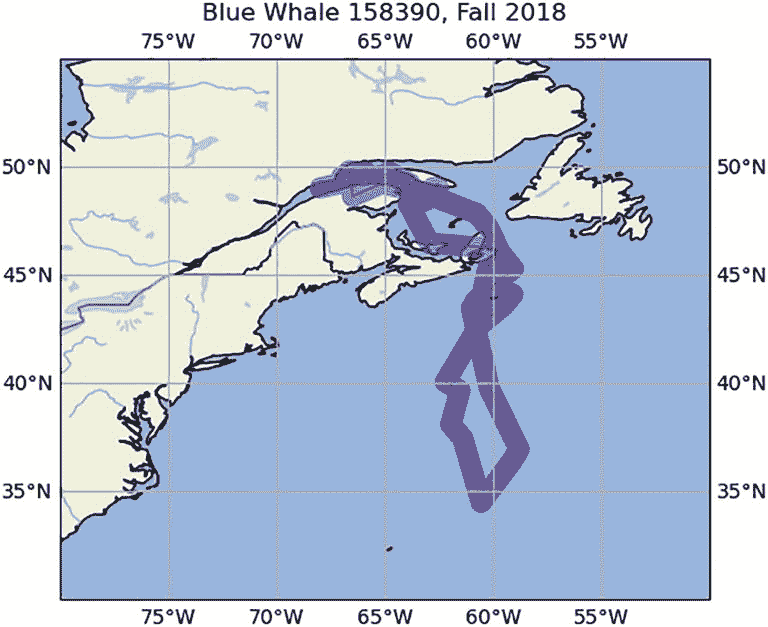
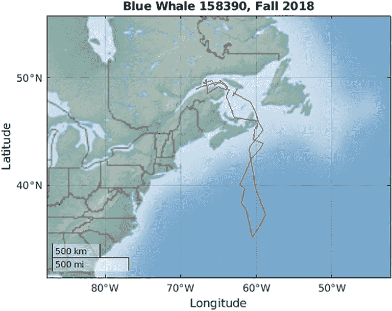

# 偏移量为球的半径；这是球心似乎发生弹跳的地方

`den = 1/np.sqrt(1 + (2*A*X)**2)`

`centerline = np.zeros((nX,2))`

`centerline[:,0] = X + 2*A*ball_radius*X*den`

`centerline[:,1] = A*X**2 - ball_radius*den`

```python
for i in range(1,n_iter):

    pos[i], vel = timestep(pos[i-1],vel)

return bowl, centerline, pos, vel
```

```python
def init(bowl, centerline):
    global point, trace
    fig, ax = plt.subplots()
    plt.plot(bowl[:,0],bowl[:,1],':')
    plt.plot(centerline[:,0],centerline[:,1])
    plt.ylim([-1,4])
    ax.set_aspect('equal')
    point, = ax.plot([], [], 'o', markersize=25)
    trace, = ax.plot([], [], ',-', lw=1)
    return fig
```

```python
def animate(i):
    global history_x, history_y
    if i == 0:
        history_x.clear()
        history_y.clear()
    history_x.append(pos[i,0])
    history_y.append(pos[i,1])
    point.set_data(pos[i,0], pos[i,1])
    trace.set_data(history_x, history_y)
    return point, trace
```

```python
bowl, centerline, pos, vel = run_simulation()
fig = init(bowl, centerline)
ani = animation.FuncAnimation(
    fig, animate, n_iter, interval=dt*1000, blit=True)
plt.show()
```



## 12.4 使用 Cartopy 在地图上绘图

由英国气象局开发的 Python `Cartopy` 模块，提供了大量与 `matplotlib` 配合使用的地图变换和投影函数。其功能丰富程度堪比 MATLAB 的地图工具箱。多个 `Cartopy` 子模块会使用基于网络的地图瓦片服务，因此制作带有影像增强的图表时需要互联网连接。

与所有绘图包一样，开始使用 `Cartopy` 的最简单方式是查看其示例画廊^(⁵⁰)并修改可用的示例。

我们将从 `Cartopy` 中的点和线数据绘图开始探索地图绘图，同时也会介绍 MATLAB 的 `geo*` 函数系列。不过，在 MATLAB 中绘制更复杂的地理叠加图需要地图工具箱。另一种选择是从 MATLAB 调用 `Cartopy`；我们将通过两个具体示例演示这一方法：在全球地图上叠加海面温度（第 12.6 节）以及绘制一张根据小麦产量着色的南美洲国家地图（第 12.7 节）。

### 12.4.1 点

MATLAB 的 `geo*` 函数既支持下一章将介绍的表格，也支持常规矩阵变量。本示例展示了如何在巴黎高分辨率地图上叠加两个点，MATLAB 使用表格，而 Python 使用标量变量。红点位于巴黎圣母院，蓝点位于先贤祠。

**提示**

使用 Google 地球^(⁵¹)查找地图的经纬度范围（调用 `ax.set_extent()` 时使用）。

| MATLAB: | Python: |
| --- | --- |
| `% code/plots/paris_pt.m`<br>`T = table([48.853;48.846],` `...`<br>`[2.3497;2.3464],` `...`<br>`'VariableNames',` `...`<br>`{'Lat','Lon'},` `...`<br>`'RowNames', {'Notre Dame',` `'Pantheon'});`<br>`C = [1 0 0; 0 0 1];`<br>`geoscatter(T.Lat, T.Lon,124,` `...`<br>`C, 'Filled')`<br>`geolimits([48.8425 48.8625],` `...`<br>`[2.3283 2.3722])`<br>`geobasemap streets`<br>`title("Notre Dame (red) and " +` `...`<br>`"the Pantheon (blue)")` | `#!/usr/bin/env python3`<br>`# code/plots/cartopy_pt.py`<br>`import matplotlib.pyplot as plt`<br>`import numpy as np`<br>`import cartopy.crs as ccrs`<br>`from cartopy.io.img_tiles import OSM`<br>`imagery = OSM()`<br>`PC = ccrs.PlateCarree()`<br>`fig = plt.figure()`<br>`ax = fig.add_subplot(1, 1, 1,`<br>`projection=imagery.crs)`<br>`ax.set_extent([2.3283, 2.3722,`<br>`48.8425, 48.8625],`<br>`crs=PC)`<br>`ax.add_image(imagery, 14)`<br>`ax.plot(2.3497, 48.853, transform=PC,`<br>`marker="o", color="red",`<br>`markersize=6)`<br>`ax.plot(2.3464, 48.846, transform=PC,`<br>`marker="o", color="blue",`<br>`markersize=6)`<br>`ax.set_title('Notre Dame (red) and '`<br>`'the Pantheon (blue)')`<br>`plt.savefig('Paris.png')`<br>`plt.show()` |



图 12-22 Python



图 12-21 MATLAB

一个常见的错误与从互联网下载地图瓦片有关：

```
网上可以找到许多解释和解决方案，
但针对 Cartopy 获取地图瓦片的特定情况，
我发现最可靠的解决方案是直接修改 Cartopy 的源代码，
使用 `requests` 模块
代替 `urllib`。
详情见第 12.4.4 节。
```

### 12.4.2 线

在本示例中，我们绘制一头名为“蓝鲸 158390”的鲸鱼在 2018 年 9 月 21 日至 2018 年 11 月 18 日期间的移动路径。位置数据^(⁵²)必然存在较大的误差范围，因为其中一个数据点位于北纬 48.64328°、西经 66.47227°，在加拿大新不伦瑞克省的一片内陆约 60 公里的田野中。这大致相当于赤道处约 0.5° 的纬度或经度。在 Python 中，我们将利用这一信息，用蓝色叠加一个宽 0.5° 的区域，表示鲸鱼路径的误差范围。MATLAB 代码虽然极其简洁优雅，但无法控制 `geoplot()` 绘制线条的宽度，因此其图形缺少这一功能。

此示例还展示了如何向 `Cartopy` 地图添加额外细节——经纬度网格线、国界、河流。

`whale_data()` 返回的经纬度数值位于 `data/plots/whale_path.txt` 文件中。

| MATLAB: | Python: |
| --- | --- |
| `% code/plots/whale.m`<br>`P = importdata('whale_path.txt');`<br>`geoplot(P(:,2), P(:,1),'r')`<br>`geolimits([30 55], [-80 -50])`<br>`geobasemap colorterrain`<br>`title("Blue Whale 158390, " + ...`<br>`"Fall 2018")` | `#!/usr/bin/env python3`<br>`# code/plots/cartopy_whale.py`<br>`import numpy as np`<br>`import shapely.geometry as sgeom`<br>`import cartopy.crs as ccrs`<br>`import cartopy.feature as cfeature`<br>`import matplotlib.pyplot as plt`<br>`fig = plt.figure()`<br>`PC = ccrs.PlateCarree()`<br>`ax = fig.add_subplot(1, 1, 1, projection=PC)`<br>`ax.coastlines(resolution='50m')`<br>`ax.set_extent([-80, -50, 30, 55], crs=PC)`<br>`ax.add_feature(cfeature.LAND)`<br>`ax.add_feature(cfeature.OCEAN)`<br>`ax.add_feature(cfeature.COASTLINE)`<br>`ax.add_feature(cfeature.BORDERS, linestyle='-')`<br>`ax.add_feature(cfeature.LAKES.with_scale('50m'),`<br>`alpha=0.5)`<br>`ax.add_feature(cfeature.RIVERS.with_scale('50m'))`<br>`plt.title('Blue Whale 158390, Fall 2018')`<br>`path = np.loadtxt('whale_path.txt')`<br>`track = sgeom.LineString(path)`<br>`error = track.buffer(.5) # degrees`<br>`ax.gridlines(draw_labels=True)`<br>`ax.add_geometries([error], ccrs.PlateCarree(),`<br>`facecolor='#1F18F4', alpha=.5)`<br>`ax.add_geometries([track], ccrs.PlateCarree(),`<br>`facecolor="none", edgecolor="r")`<br>`plt.savefig('whale.png', bbox_inches="tight",`<br>`pad_inches=0, transparent=True)`<br>`plt.show()` |



图 12-24 Python



图 12-23 MATLAB

如果你的 MATLAB 图表需要 `geoplot()` 无法提供的对地理线条的精细控制，请参阅配方 12.5，其中展示了如何从 MATLAB 重现右侧的 `Cartopy` 图表。

### 12.4.3 区域

在地图上叠加的大部分数据覆盖的是区域，而不是点或线。这类数据不胜枚举：地球科学数据，如陆地和海面温度、地表类型、植被指数和降雨量；商业数据，如农业产量和国内生产总值；政治数据，如投票结果、政党归属和冲突区域。

在 MATLAB 中，用于在地图上叠加区域数据的原生选项是地图工具箱和免费提供的气候数据工具箱。^(⁵³) 在 Python 中，我们将继续使用 `Cartopy`。

#### 12.4.3.1 海面温度

我们的第一个示例使用一对投影显示全球海面温度。通过使用来自 NASA 地球观测^(⁵⁴) 数据库的自定义地球背景图像——此处为植被指数——增强了图表效果。为此，请将植被指数图像文件 `earth_veg_index.jpeg` 及随附的 JSON 元数据保存到一个目录中，然后将环境变量 `CARTOPY_USER_BACKGROUNDS` 设置为该目录。^(⁵⁵)

海面温度 (SST) 数据来自 NOAA 的每日 AVHRR 卫星数据集。^(⁵⁶) 每天的数据存储在一个 NetCDF 文件（第 7.​10 节）中，该文件包含在 0.5° 经纬度网格上的海面温度。第一行和第一列对应纬度 –89.875° 和经度 0.125°；赤道由第 359 行和第 360 行（使用从零开始的索引）跨越，而国际日期变更线由第 719 列和第 720 列跨越。

**Python:**

```python
#!/usr/bin/env python3

# code/plots/cartopy_sst.py

import os

import numpy as np

import matplotlib.pyplot as plt

from netCDF4 import Dataset

import cartopy.crs as ccrs

from mpl_toolkits.axes_grid1 import make_axes_locatable

os.environ["CARTOPY_USER_BACKGROUNDS"] = "cartopy/background"

File = 'oisst-avhrr-v02r01.20190101.nc'

rg = Dataset(File, 'r')

lat = rg["lat"][:]

lon = rg["lon"][:]

sst_ds = rg["sst"][0][0]

sst = sst_ds.data

mask = sst_ds.mask

sst[mask] = np.NaN

fig = plt.figure()

Ortho = ccrs.Orthographic(-10, 15)

PC = ccrs.PlateCarree()

ax = fig.add_subplot(1, 1, 1, projection=Ortho)
```