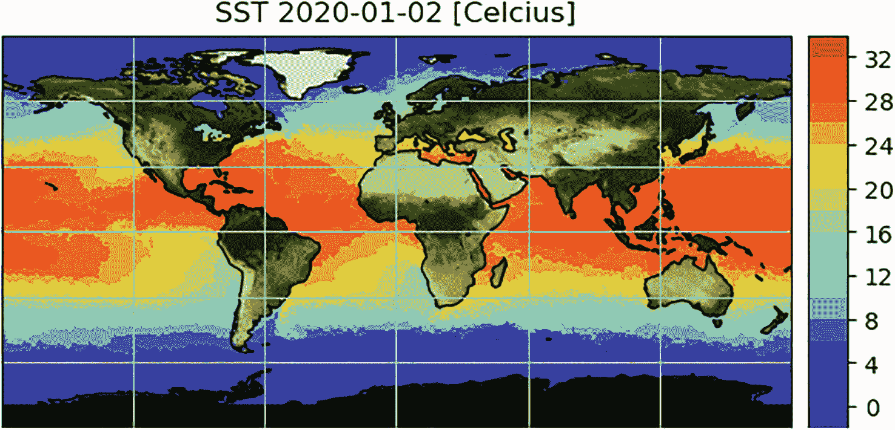
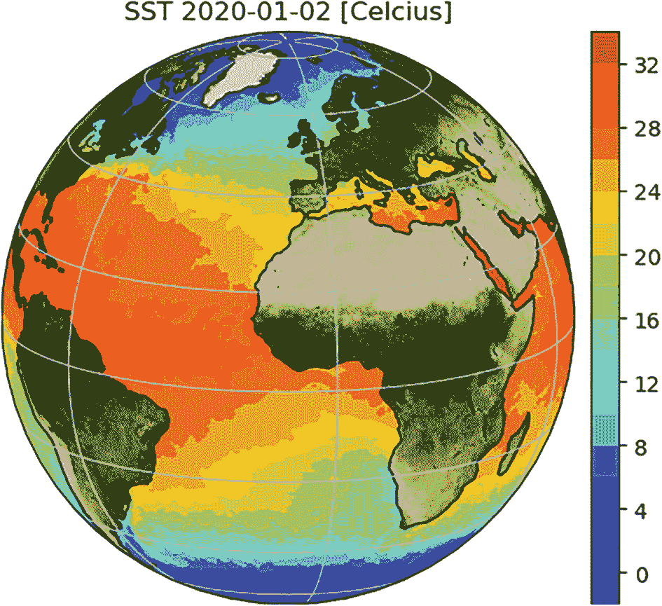
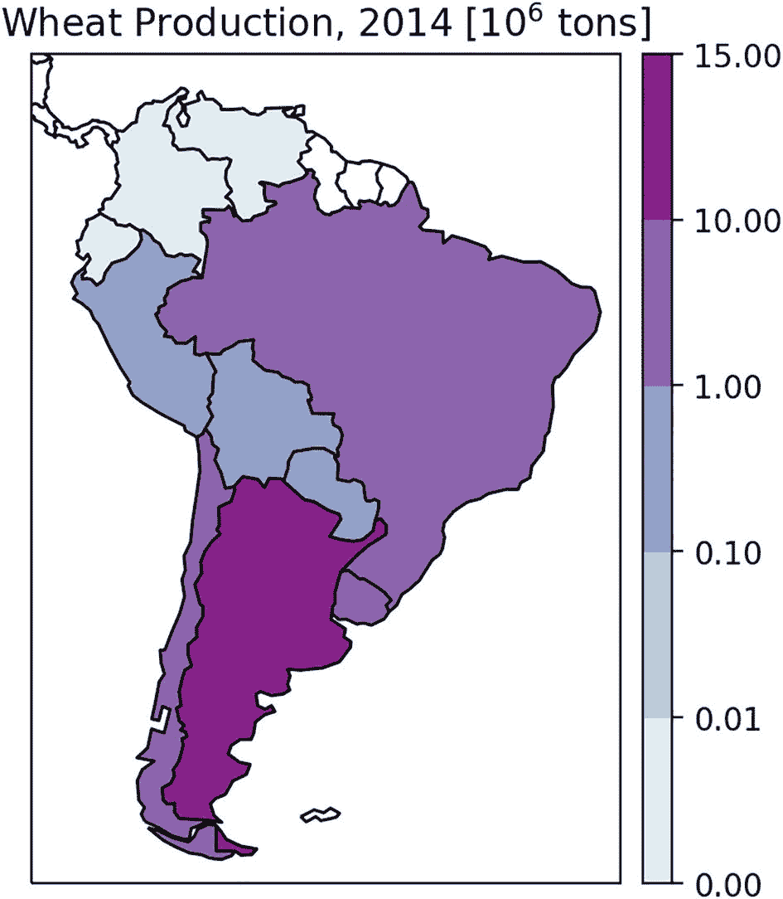

# ax = fig.add_subplot(1, 1, 1, projection=PC)
ax.coastlines()
ax.set_global()
ax.gridlines()
h = ax.contourf(lon, lat, sst, levels=20,
                vmin=-2, vmax=35, transform=PC, cmap='jet')

divider = make_axes_locatable(ax)
ax_cb = divider.new_horizontal(size="5%", pad=0.1,
                               axes_class=plt.Axes)
fig.add_axes(ax_cb)
plt.colorbar(h, cax=ax_cb)

ax.background_img(name='VI', resolution='low')
ax.set_title('SST 2020-01-02 [Celcius]')
plt.savefig('sst_globe.png', bbox_inches='tight',
            pad_inches=0, transparent=True)
plt.show()
```



有许多投影可供选择。可以通过将 `PlateCarree` 投影替换为以下代码，生成一个中心位于西经 10°、北纬 15°的正交投影：

Python:

```python
Ortho = ccrs.Orthographic(-10, 15)
ax = fig.add_subplot(1, 1, 1, projection=Ortho)
```



在 MATLAB 中使用 12.6 节中的方法创建此图。

#### 12.4.3.2 南美小麦产量（2014 年）

第二个示例展示受国家边界限定的数据。我们的数据集将使用 2014 年南美洲的小麦产量数据⁵⁷。目标是根据每个国家的产量值对其进行着色。

虽然 `Cartopy` 自带海岸线数据库，但它不包含国家或州界。理想情况下，我们希望能写出类似 `plot(region(country='Canada'), 'grey')` 或 `plot(region(zipcode=90210), 'orange')` 的语句，但目前还不具备这种功能。（剧透：第 13.12 节中介绍的 `GeoPandas` 可以实现这一点。）

因此，我们将通过从 `Natural Earth` 项目下载形状文件及相关元数据，自行创建国家边界数据库。“低分辨率”文件⁵⁸包含 `Cartopy` 可读取的文件，这些文件含有国家边界、多种语言的国家名称、所属大洲名称、经济状况、人口及 GDP 估算值等信息。但获取数据、读取并以便于使用的形式存储这些数据的任务需要由我们完成。

以下 Python 代码要求将文件 `ne_110m_admin_0_countries.zip` 解压到一个名为 `nat_earth` 的子目录中。我们将使用 `Cartopy` 的形状读取器加载国家形状和元数据，并据此构建一个字典 `shp`，以英文国家名称为键，边界几何形状为对应的值。为了增加趣味性，我们再构建第二个字典 `rec`，用于存储每个国家的元数据。

Python:

```python
In : from cartopy.io.shapereader import Reader
In : shp = {} # 按名称索引的国家形状
In : rec = {} # 按名称索引的国家元数据
In : Countries = Reader('nat_earth/ne_110m_admin_0_countries')
In : for geom, meta in zip(Countries.geometries(), Countries.records()):
...:     name = meta.attributes['NAME_EN']
...:     shp[name] = geom
...:     rec[name] = meta
```

探索这些字典会发现一些有趣的信息：

Python:

```python
In : sorted( shp.keys() )
Out: shp.keys()
['阿富汗',
 '阿尔巴尼亚',
 '阿尔及利亚',
 '安哥拉',
 '南极洲',
 '阿根廷',
 ...
 '越南',
 '西撒哈拉',
 '也门',
 '赞比亚',
 '津巴布韦',
 '斯威士兰']

In : rec['越南']
Out[9]: ,
{'featurecla': '行政 0 级国家', 'scalerank': 1, 'LABELRANK': 2,
 'SOVEREIGNT': '越南', 'POSTAL': 'VN', 'MAPCOLOR7': 5, 'MAPCOLOR8': 6,
 'POP_EST': 96160163, 'POP_RANK': 16, 'GDP_MD_EST': 594900.0,
 'POP_YEAR': 2017, 'LASTCENSUS': 2009, 'GDP_YEAR': 2016,
 ...

In [12]: rec['越南'].attributes['POP_EST']
Out[12]: 96160163
```


更重要的是，`matplotlib` + `Cartopy` 的组合能够理解从 shape 文件生成的多边形区域，从而可以用所需的颜色为各个国家着色。但地理政治边界构成的多边形有一个微妙的特性：有些边界是单个多边形，而其他边界（例如印度尼西亚的群岛）则包含多个不相交的多边形。用于添加由多边形边界定义的区域的 `matplotlib` `add_geometries()` 函数，期望其第一个参数是一个多边形列表。因此，我们必须首先检查一个国家的地形是单个多边形还是多边形列表；如果是单个，则必须将传递给 `add_geometries()` 的参数扩展为一个包含单个元素的列表。以下清单中的第 42 行展示了如何适当处理这些情况：

```
Python:

1   #!/usr/local/anaconda3/2020.07/bin/python
2   # code/plots/cartopy_wheat.py
3   import numpy as np
4   import cartopy.crs as ccrs
5   import cartopy.feature as cfeature
6   from cartopy.io.shapereader import Reader
7   from shapely.geometry.polygon import Polygon
8   import matplotlib.pyplot as plt
9   from matplotlib.colors import from_levels_and_colors
10   from mpl_toolkits.axes_grid1 import make_axes_locatable

12   wheat_tons = {
13       'Argentina' : 13_930_078 ,
14       'Brazil' : 6_261_895 ,
15       'Chile' : 1_358_128 ,
16       'Uruguay' : 1_076_000 ,
17       'Paraguay' : 840_000 ,
18       'Bolivia' : 263_076 ,
19       'Peru' : 214_533 ,
20       'Colombia' : 9_718 ,
21       'Ecuador' : 6_584 ,
22       'Venezuela' : 161 , }

24   Countries = Reader('nat_earth/ne_110m_admin_0_countries')
25   shp = {} # country shape indexed by name
26   for geom, meta in zip(Countries.geometries(),
27                         Countries.records()):
28       name = meta.attributes['NAME_EN']
29       shp[name] = geom

31   PC = ccrs.PlateCarree()
32   fig, ax = plt.subplots(1, 1, subplot_kw=dict(projection=PC))
33   ax.set_extent([-85, -33, # lon
34                  -55, 14]) # lat

36   ton_intervals = np.array([0, 10_000, 100_000, 1_000_000, 10_000_000, 15_000_000,])
37   fraction_interval = np.linspace(0.12, 1, num=len(ton_intervals))
38   colors = plt.cm.BuPu(fraction_interval[:-1])

40   for ctry in wheat_tons:
41      color = colors[np.searchsorted(ton_intervals, wheat_tons[ctry]) - 1]
42      shape = [shp[ctry]] if isinstance(shp[ctry], Polygon) else shp[ctry]
43      ax.add_geometries(shape, crs=PC, facecolor=color)

45   ax.add_feature(cfeature.BORDERS)
46   ax.add_feature(cfeature.COASTLINE)
47   ax.set_title('Wheat Production, 2014 [10$ˆ6$ tons]')

49   # colorbar
50   divider = make_axes_locatable(ax)
51   ax_cb = divider.new_horizontal(size="5%", pad=0.1, axes_class=plt.Axes)
52   fig.add_axes(ax_cb)
53   cmap, norm = from_levels_and_colors(ton_intervals/1.0e+6, colors)
54   sm = plt.cm.ScalarMappable(cmap=cmap, norm=norm)
55   plt.colorbar(sm, cax=ax_cb)

57   plt.show()
58   #plt.savefig('SA_wheat_2014.png', dpi=200,
59   # bbox_inches='tight', pad_inches=0, transparent=True)
```



使用第 12.7 节中的配方在 MATLAB 中创建此绘图。

### 12.4.4 MATLAB 与 Cartopy

不过，从 MATLAB 使用 Cartopy 存在一个重大挑战。当 Cartopy（0.18.0 版，截至 2021 年 7 月为最新版本）尝试从地图服务下载影像图块时，会与 MATLAB 产生异常交互。可能会发生以下两种情况之一：要么出现此错误

```
或者生成的绘图根本缺少背景图像。
```

有一个变通方法，但需要修改 Cartopy 的文件 `cartopy/io/img_tiles.py`，使其使用 `requests` 模块而不是 Python 标准库中的 `urllib.request` 来下载图块。第一步是找到包含 `img_tiles.py` 的目录或文件夹。这可以在 `ipython` 中通过导入 `cartopy.io` 然后检查其 `__path__` 属性来完成。在我的 Linux 计算机上，此目录是

```
ipython:

In : import cartopy.io
In : cartopy.io.__path__
Out: ['/usr/local/anaconda3/2020.07/envs/matpy/lib/python3.8/site-packages/cartopy/io']
```

> **注意**：如果你在多个虚拟环境中安装了 Cartopy，则需要在你计划从中启动 MATLAB 的每个环境中编辑 `img_tiles.py`。

接下来，编辑 `img_tiles.py`，使其包含对 `requests` 的导入（右侧的第 41 行），并将对 `urlopen()`、`six.BytesIO()` 和 `fh.close()` 的调用（左侧的第 190–193 行）替换为右侧突出显示的行。（实际行号会因你安装的 Cartopy 版本而异。）

| `img_tiles.py` 原始版本： | `img_tiles.py` 修复版本： |
| --- | --- |
| `39` `import numpy as np`  `40`  `import six`  `41` `42`  `import cartopy` `43`  `import cartopy.crs as ccrs` `188` `url = self._image_url(tile)` `189`  `try:` `190`    `request = Request(url, headers={` `"User-Agent": self.user_agent})` `191`    `fh = urlopen(request)` `192`    `im_data = six.BytesIO(fh.read())` `193`    `fh.close()` `194`    `img = Image.open(im_data)` | `39`  `import numpy as np` `40`  `import six` `41` `import requests` `42` `43`  `import cartopy` `44`  `import cartopy.crs as ccrs` `189` `url = self._image_url(tile)` `190`  `try:` `191` `request = requests.get(url,` `stream=True)` `192` `request.raw.decode content = True` `193` `img = Image.open(request.raw)` |

用于自动执行此补丁的实用程序 `patch_cartopy.py` 的源代码清单见附录 E。

### 12.4.5 在 MATLAB 中避免使用 matplotlib 的 Qt 后段！

MATLAB 使用 Qt 库来渲染图形。虽然 `matplotlib` 可以使用六种不同的图形库，但其默认使用 Qt。这是一个问题！Anaconda 发行版附带的 Qt 库不太可能与 MATLAB 自带的 Qt 库匹配。因此，如果你在 MATLAB 中使用 `matplotlib` 的 `plt.show()` 命令，将会导致 MATLAB 崩溃。不过有一个简单的变通方法：只需将 `matplotlib` 配置为使用不同的后端即可。首先，我们查询 Python 安装以查看其当前使用的后端：

```
Python:

In : import matplotlib
In : matplotlib.get_backend()
Out: 'Qt5Agg'
```

`Qt5Agg` 在 MATLAB 中肯定是个问题。一个好的替代方案是 Linux 和 macOS 上的 `TkAgg` 后端，以及 Windows 上的 `WXAgg` 后端。例如，在 Python 中切换到 `TkAgg` 后端的方法如下：

```
Python:

import matplotlib
matplotlib.use('TkAgg')
```

在 MATLAB 中切换的方法如下：

```
MATLAB 2020b:

Im  = @py.importlib.import_module;
mpl = Im('matplotlib');
mpl.use('TkAgg')
```

## 12.5 配方 12-1：使用 Cartopy 在地图上绘制线条

第 12.4.2 节中鲸鱼轨迹在 MATLAB 中的等效代码如下所示：

```
MATLAB 2020b:

% file: code/matlab_py/cartopy_whale.m
Im = @py.importlib.import_module;
np     = Im('numpy');
sgeom  = Im('shapely.geometry');
ccrs   = Im('cartopy.crs');
cfeat  = Im('cartopy.feature');
plt    = Im('matplotlib.pyplot');
mpl    = Im('matplotlib');
if ispc
mpl.use('WXAgg')
else
mpl.use('TkAgg')
end
PC = ccrs.PlateCarree();
fig = plt.figure();
i1 = int64(1);
ax = fig.add_subplot(i1, i1, i1, pyargs('projection',PC));
ax.coastlines(pyargs('resolution','50m'));
ax.set_extent([-80 -50 30 55], pyargs('crs',PC));
ax.add_feature(cfeat.LAND);
ax.add_feature(cfeat.OCEAN);
ax.add_feature(cfeat.COASTLINE);
ax.add_feature(cfeat.BORDERS, pyargs('linestyle','-'));
ax.add_feature(cfeat.LAKES.with_scale('50m'), pyargs('alpha', 0.5));
ax.add_feature(cfeat.RIVERS.with_scale('50m'));
plt.title('Blue Whale 158390, Fall 2018');
path = load('whale_path.txt');
track = sgeom.LineString(np.array(path));
error = track.buffer(.5); % degrees
ax.gridlines(pyargs('draw_labels','True'));
ax.add_geometries({error}, PC, pyargs('facecolor','#1F18F4','alpha',.5));
ax.add_geometries({track}, PC, pyargs('facecolor','none','edgecolor','r'));
plt.savefig('whale.png', pyargs('bbox_inches','tight','pad_inches',0, ...
'transparent','True'));
plt.show()
```


## 12.6 方案 12-2：使用 Cartopy 在地球仪上叠加等高线

在章节 12.4.3.1 中制作的海面温度叠加图，可以使用 MATLAB 结合 Cartopy 来实现。

### MATLAB 2020b：

```
% code/matlab_py/cartopy_sst.m
Im = @py.importlib.import_module;
OS    = Im('os');
np    = Im('numpy');
plt   = Im('matplotlib.pyplot');
ccrs  = Im('cartopy.crs');
axes  = Im('mpl_toolkits.axes_grid1');
mpl   = Im('matplotlib');
if ispc
netcdf.inqLibVers; % avoid DLL conflict
mpl.use('WXAgg')
else
mpl.use('TkAgg')
end
nc   = Im('netCDF4');
i1 = int64(1);
OS.environ{'CARTOPY_USER_BACKGROUNDS'} = ...
'../plots/cartopy/background';
File = '../plots/oisst-avhrr-v02r01.20201001_preliminary.nc';
lat = ncread(File, 'lat');
lon = ncread(File, 'lon');
sst = ncread(File, 'sst')';
mask = isnan(sst);
fig = plt.figure();
Ortho = ccrs.Orthographic(-10, 15);
PC    = ccrs.PlateCarree();
ax = fig.add_subplot(i1, i1, i1,pyargs('projection',Ortho));
%            - or -
%ax = fig.add_subplot(i1, i1, i1, pyargs('projection',PC));
ax.coastlines();
ax.set_global();
ax.gridlines();
h = ax.contourf(lon, lat, sst,...
pyargs('levels',int64(20), 'vmin',-2,'vmax',35,...
'transform',PC,'cmap','jet'));
divider = axes.make_axes_locatable(ax);
ax_cb = divider.new_horizontal(...
pyargs('size','5%','pad',0.1,'axes_class',plt.Axes));
fig.add_axes(ax_cb);
plt.colorbar(h, pyargs('cax',ax_cb));
ax.background_img(pyargs('name',"VI",'resolution',"low"));
ax.set_title('SST 2020-01-02 [Celcius]');
plt.savefig('sst_globe.png', pyargs('bbox_inches','tight',...
'pad_inches',0,'transparent','True'));
plt.show()
```

## 12.7 方案 12-3：使用 Cartopy 按数值对地图区域进行着色

在章节 12.4.3.2 中制作的南美洲小麦产量地图，可以使用 MATLAB 结合 Cartopy 来实现。

### MATLAB 2020b：

```
Im = @py.importlib.import_module;
np     = Im('numpy');
ccrs   = Im('cartopy.crs');
cfeat  = Im('cartopy.feature');
shape  = Im('cartopy.io.shapereader');
poly   = Im('shapely.geometry.polygon');
plt    = Im('matplotlib.pyplot');
col    = Im('matplotlib.colors'); % from_levels_and_colors
axes   = Im('mpl_toolkits.axes_grid1'); % make_axes_locatable
mpl    = Im('matplotlib');
if ispc
mpl.use('WXAgg')
else
mpl.use('TkAgg')
end
i1 = int64(1);
wheat_tons.Argentina = 13930078;
wheat_tons.Brazil    = 6261895;
wheat_tons.Chile     = 1358128;
wheat_tons.Uruguay   = 1076000;
wheat_tons.Paraguay  = 840000;
wheat_tons.Bolivia   = 263076;
wheat_tons.Peru      = 214533;
wheat_tons.Colombia  = 9718;
wheat_tons.Ecuador   = 6584;
wheat_tons.Venezuela = 161;
Countries = shape.Reader('nat_earth/ne_110m_admin_0_countries.shp');
shp = py.dict(); % country shape indexed by name
for geom_meta = py.list(py.zip(...
Countries.geometries(), Countries.records()))
name = geom_meta{1}{2}.attributes.get('NAME_EN'); % {1}{2} = meta
shp.update(pyargs(name, geom_meta{1}{1})); % {1}{1} = geom
end
PC = ccrs.PlateCarree();
fig_ax = plt.subplots(i1, i1, pyargs('subplot_kw',...
py.dict(pyargs('projection',PC))));
fig = fig_ax{1};
ax  = fig_ax{2};
ax.set_extent([-85, -33, ... % lon
-55, 14]) % lat
ton_intervals = [0, 10000, 100000, 1000000, 10000000, 15000000];
fraction_interval = linspace(0.12, 1, length(ton_intervals));
colors = plt.cm.BuPu(fraction_interval(1:end-1));
col_ind = np.arange(4, pyargs('dtype',np.int64));
country_names = fieldnames(wheat_tons);
for i = 1:numel(country_names)
ctry = country_names{i};
w_tons = wheat_tons.(ctry);
color_row = np.searchsorted(ton_intervals, w_tons) - 1;
fprintf('%20s %10d tons, color=%d\n', ctry, w_tons, int32(color_row))
color = colors.take(col_ind + int64(4)*color_row);
if py.isinstance(shp.get(ctry), poly.Polygon)
shape = py.list({shp.get(ctry)});
else
shape = shp.get(ctry);
end
ax.add_geometries(shape, pyargs('crs',PC,'facecolor',color));
end
ax.add_feature(cfeat.BORDERS);
ax.add_feature(cfeat.COASTLINE);
ax.set_title('Wheat Production, 2014 [10$ˆ6$ tons]');
% colorbar
divider = axes.make_axes_locatable(ax);
ax_cb = divider.new_horizontal(pyargs('size',"5%",'pad',0.1,...
'axes_class',plt.Axes));
fig.add_axes(ax_cb);
cmap_norm = col.from_levels_and_colors(ton_intervals/1.0e+6, colors);
cmap = cmap_norm{1};
norm = cmap_norm{2};
sm = plt.cm.ScalarMappable(pyargs('cmap',cmap,'norm',norm));
plt.colorbar(sm, pyargs('cax',ax_cb));
plt.savefig('SA_wheat_2014.png', pyargs('bbox_inches','tight',...
'pad_inches',0,'transparent','True'));
plt.show()
```

## 12.8 使用 GeoPandas 在地图上绘图

下一章将介绍 MATLAB 表格和 Pandas 数据框。GeoPandas 是 Pandas 的扩展，它结合了 Cartopy、Pandas 和 Shapely（以及其它 Python 模块），使得地理数据的绘制变得非常简便。章节 13.​12 展示了如何按邮政编码绘制洛杉矶县房价地图。相比直接调用 Cartopy 函数，这种方法省力得多。

## 12.9 批量模式绘图

绘图生成通常是一种交互式体验，用户在图表绘制时通过显示器查看。而完全自动化的工作流程则完全无需显示器；图表可以直接写入 PNG 或其他图像格式，以便直接嵌入网站或文档。MATLAB 和 Python 都支持“无头”绘图生成，但方法不同。

MATLAB 的批量绘图方法依赖于`matlab`命令的命令行参数。下面的命令将运行章节 12.1.5 中的`hist_demo.m`脚本：

### MATLAB：

```
> matlab -nodesktop -nodisplay -nosplash -r "hist_demo;saveas(1,'hist.png');exit"
```

matplotlib 的批量绘图方法需要使用“Agg”后端，如代码第 4 行和第 5 行所示：

### Python：


```python
#!/usr/bin/env python3
