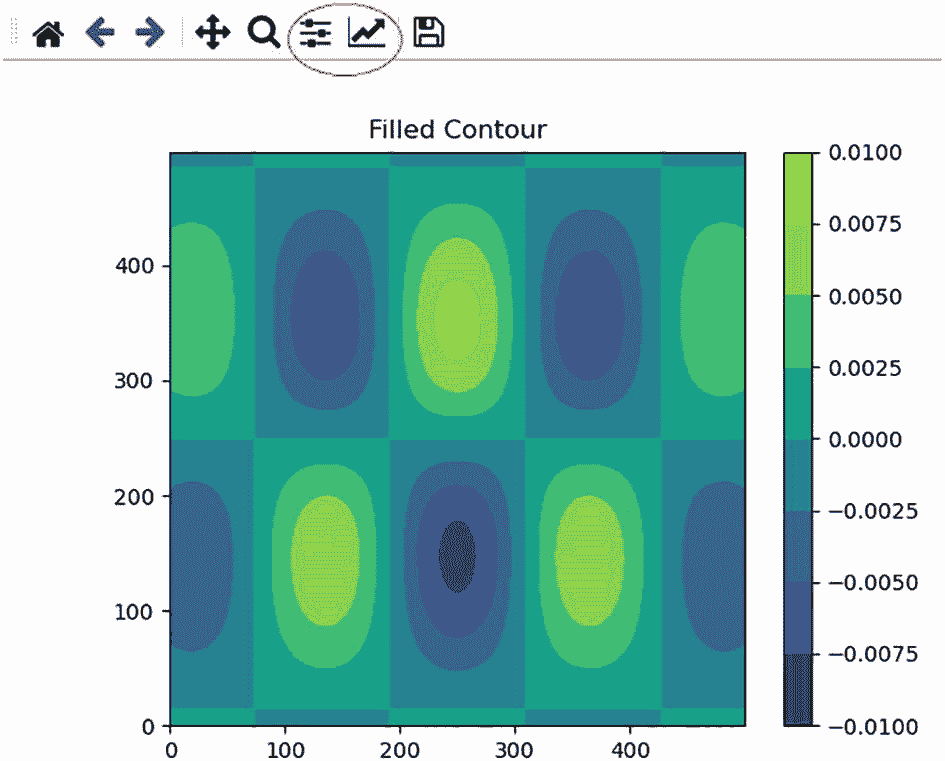
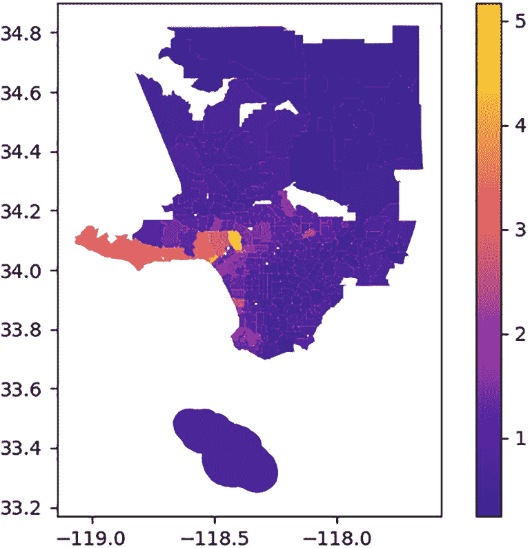

# file: `code/plots/hist_demo_Agg.py`

```python
import numpy as np

import matplotlib as mpl

mpl.use('Agg')

import matplotlib.pyplot as plt

N = 10000

np.random.seed(123)

w1 = np.random.rayleigh(3, N)

w2 = np.random.normal(8, 3, N)

bins = np.linspace(-5, 20, 80)

plt.hist(w1, bins, alpha=0.5, label='Rayleigh')

plt.hist(w2, bins, alpha=0.5, label='Normal')

plt.legend(loc='upper right')

plt.ylim([0, 700])

plt.grid(True)

plt.savefig('hist.png', bbox_inches='tight', pad_inches=0, transparent=True)
```

**提示**

在`ipython`会话中，你可以通过以下命令获取所有可用后端的列表：

```
In :   import matplotlib

In :   matplotlib.rcsetup.interactive_bk
```

# 12.10 交互式图表编辑

调整`matplotlib`图表以用于出版物，可能会变成一场关于字体、颜色、字形和坐标选择的令人抓狂的练习。MATLAB 在这方面具有优势，因为它的图表编辑器允许用户交互式地修改图表元素。`matplotlib`的`Qt5Agg`后端提供了一些交互式图表功能，可通过显示工具中的指定图标访问：



然而，因为`Qt5Agg`后端与 MATLAB 自身的 Qt5 库冲突，它并未包含在`matpy` conda 环境中。你需要退出该 conda 环境（`conda deactivate`）并返回“base”环境才能进行此类编辑。`pylustrator`⁵⁹是一个更高级的交互式编辑`matplotlib`图表的工具。其功能最好通过在其文档网站[`https://pylustrator.readthedocs.io/`](https://pylustrator.readthedocs.io/)上观看 YouTube 视频来了解。

## 13. 表格和数据框

Python 的 Pandas 模块[2]于 2008 年发布，比 MathWorks 在 R2013b 版本中将表格添加到 MATLAB 早了五年。自发布以来，Pandas 已成为数据科学家、金融分析师、统计学家和机器学习专家的核心工具。对 Pandas 的全面讨论远远超出了本书的范围；在此，我们展示 Pandas 数据框和 MATLAB 表格之间的功能相似性与符号差异。

逗号分隔值文件是表格和数据框的常见输入来源，因此我们从两个 CSV 文件开始：`pets.csv`和`pets_ns.csv`（“ns”代表“无空格”），其中包含一些动物的信息。这些文件有 11 行——1 行列名，后跟 10 行数据——它们仅存在空格差异：

| `pets_ns.csv` | `pets.csv` |
| --- | --- |
| `type,MF,weight,birthday`<br>`dog,M,9.82,2023-11-26`<br>`cat,F,4.31,2023-11-18`<br>`bunny,F,8.40,2023-11-23`<br>`bunny,M,4.65,2023-11-24`<br>`dog,F,9.82,2023-11-25`<br>`cat,M,5.57,2023-11-24`<br>`bunny,M,1.12,2023-11-17`<br>`cat,M,2.96,2023-11-21`<br>`cat,M,5.08,2023-11-21`<br>`bunny,F,1.53,2023-11-15` | `type  , MF, weight, birthday`<br>`dog   ,  M,  9.82 , 2023-11-26`<br>`cat   ,  F,  4.31 , 2023-11-18`<br>`bunny ,  F,  8.40 , 2023-11-23`<br>`bunny ,  M,  4.65 , 2023-11-24`<br>`dog   ,  F,  9.82 , 2023-11-25`<br>`cat   ,  M,  5.57 , 2023-11-24`<br>`bunny ,  M,  1.12 , 2023-11-17`<br>`cat   ,  M,  2.96 , 2023-11-21`<br>`cat   ,  M,  5.08 , 2023-11-21`<br>`bunny ,  F,  1.53 , 2023-11-15` |

尽管这两个文件包含相同的信息，但文件读取器的默认行为有所不同：

- Pandas 会忽略行数据的前导和尾随空格，但保留列标题中的空格。
- MATLAB 保留所有空格。
- Pandas 不会自动识别日期字段，因此会用字符串字面量填充第四列。
- MATLAB 能识别多种格式的日期和时间，并正确地将第四列的类型设置为`datetime`。

加载文件后通常需要额外的数据处理和清洗。数据科学中有一句格言：数据清洗通常需要的数据分析工作量的四倍。经常执行的数据清洗任务将在 13.3 节中介绍。

### 13.1 从文件加载表格

MATLAB 和 Pandas 可以从 CSV、Excel 和文本文件加载表格和数据框。Pandas 还可以读取 HDF5、HTML、JSON 和 Python pickle 文件，并通过 SQLAlchemy 从网站或数据库连接中拉取数据。以下命令展示了如何从我们的`pets.csv`文件创建 MATLAB 表格和 Pandas 数据框：

| MATLAB | Python |
| --- | --- |
| `>> tb = readtable('pets.csv');`<br>`>> tb`<br>`tb =`<br>`10×6 table`<br>`Var1   Var2  Var3 Var4 Var5   Var6`<br>`_______ _____  ____ ____ ____  _____`<br>`{'dog'  }{','}{'M,'}9.82{','}2023-11-26`<br>`{'cat'  }{','}{'F,'}4.31{','}2023-11-18`<br>`{'bunny'}{','}{'F,'} 8.4{','}2023-11-23`<br>`{'bunny'}{','}{'M,'}4.65{','}2023-11-24`<br>`{'dog'  }{','}{'F,'}9.82{','}2023-11-25`<br>`{'cat'  }{','}{'M,'}5.57{','}2023-11-24`<br>`{'bunny'}{','}{'M,'}1.12{','}2023-11-17`<br>`{'cat'  }{','}{'M,'}2.96{','}2023-11-21`<br>`{'cat'  }{','}{'M,'}5.08{','}2023-11-21`<br>`{'bunny'}{','}{'F,'}1.53{','}2023-11-15` | `In : import pandas as pd`<br>`In : df = pd.read_csv('pets.csv')`<br>`In : df`<br>`Out:`<br>`type   MF weight   birthday`<br>`0  dog     M   9.82 2023-11-26`<br>`1  cat     F   4.31 2023-11-18`<br>`2  bunny   F   8.40 2023-11-23`<br>`3  bunny   M   4.65 2023-11-24`<br>`4  dog     F   9.82 2023-11-25`<br>`5  cat     M   5.57 2023-11-24`<br>`6  bunny   M   1.12 2023-11-17`<br>`7  cat     M   2.96 2023-11-21`<br>`8  cat     M   5.08 2023-11-21`<br>`9  bunny   F   1.53 2023-11-15` |

MATLAB 的表格结果出乎意料；它返回了六列而不是四列，并且未能识别列名。有两种替代方案：要么使用像`pets_ns.csv`这样条目已去除空格的文件，要么通过`detectImportOptions`后跟`setvaropts`使用明确的、特定于列的格式选项。这里，我们将使用已去除空格的 CSV 文件：

| MATLAB | Python |
| --- | --- |
| `>> tb = readtable('pets_ns.csv');`<br>`>> tb`<br>`tb =`<br>`10×4 table`<br>`type      MF  weight  birthday`<br>`_________ _____ ______ __________`<br>`{'dog'  } {'M'}  9.82  2023-11-26`<br>`{'cat'  } {'F'}  4.31  2023-11-18`<br>`{'bunny'} {'F'}   8.4  2023-11-23`<br>`{'bunny'} {'M'}  4.65  2023-11-24`<br>`{'dog'  } {'F'}  9.82  2023-11-25`<br>`{'cat'  } {'M'}  5.57  2023-11-24`<br>`{'bunny'} {'M'}  1.12  2023-11-17`<br>`{'cat'  } {'M'}  2.96  2023-11-21`<br>`{'cat'  } {'M'}  5.08  2023-11-21`<br>`{'bunny'} {'F'}  1.53  2023-11-15` | `In : import pandas as pd`<br>`In : import numpy as np`<br>`In : df = pd.read_csv('pets_ns.csv')`<br>`In : df`<br>`Out:`<br>`type   MF weight   birthday`<br>`0  dog     M   9.82 2023-11-26`<br>`1  cat     F   4.31 2023-11-18`<br>`2  bunny   F   8.40 2023-11-23`<br>`3  bunny   M   4.65 2023-11-24`<br>`4  dog     F   9.82 2023-11-25`<br>`5  cat     M   5.57 2023-11-24`<br>`6  bunny   M   1.12 2023-11-17`<br>`7  cat     M   2.96 2023-11-21`<br>`8  cat     M   5.08 2023-11-21`<br>`9  bunny   F   1.53 2023-11-15` |

字符串和浮点类型是显而易见的，但`birthday`列的类型并不明确。让我们通过检查`birthday`第一行的数据类型来探究（表格和数据框的索引在 13.6.3 节中介绍）。`.iloc()`数据框属性允许我们根据（从零开始的）索引选择一行或多行，该属性将在 13.6 节中更详细地介绍。

| MATLAB | Python |
| --- | --- |
| `>> tb{1,'birthday'}`<br>`datetime`<br>`2023-11-26` | `In : df.iloc[0]['birthday']`<br>`Out: '2023-11-26'`<br>`In : type(df.iloc[0]['birthday'])`<br>`Out: str` |

MATLAB 的`birthday`列被识别为`datetime`类型，但 Python 中的则只是字符串——这并不理想。Pandas 的`read_csv()`函数有 48 个（！）可选关键字参数，其中两个用于处理日期：`parse_dates`接受一个列索引列表，将其解释为日期；`infer_datetime_format=True`则启用自动日期解析器。通过这样调用`read_csv()`，我们就能为`birthday`列获取一个时间感知的类型：

```python
In : df = pd.read_csv('pets_ns.csv', parse_dates=['birthday'], infer_datetime_format=True)
In : df.dtypes
Out:
type              object
MF                object
weight           float64
birthday         datetime64[ns]
dtype: object
```

# 13.2 表格摘要

In : `df` = `pd.read_csv`('pets_ns.csv', parse_dates=[3],
   ...:                   infer_datetime_format=True)

In : type(`df`['birthday'].loc[0])
Out: `pandas._libs.tslibs.timestamps.Timestamp`

```

目前，我们将仅使用`read_csv()`的默认参数来加载数据帧`df`，并将`birthday`条目保留为字符串。我们将在数据清洗部分（第 13.3.4 节）展示如何将这些字符串转换为时间感知对象。

大多数现实世界中的表格，其行数都远超页面所能容纳。MATLAB 和 Pandas 都提供了摘要函数，可以快速洞察表格内容。

## 13.2.1 表格大小、列名、列类型

表格尺寸的查询方式与数值数组相同：

| MATLAB: | Python: |
| ------- | ------- |
| `>> height(tb)` `10` `>> width(tb)` `4` `>> size(tb)` `10 4` | `In : len(df)` `Out: 10` `In : df.shape` `Out: (10, 4)` |

列名在 MATLAB 中存储为元胞数组，在 Pandas 中则存储为索引数组：

| MATLAB: | Python: |
| ------- | ------- |
| `>> tb.Properties.VariableNames` `1×4 cell array` `{'type'} {'MF'} {'weight'}` `{'birthday'}` | `In : df.columns` `Out: Index(['type', 'MF', 'weight',` `'birthday'], dtype="object")` |

列类型信息则稍显隐晦；最清晰的方法是遍历列并显式打印其类型。MATLAB 的列类型通过对每一列调用`class()`来揭示。Pandas 数据帧有一个类型属性`.dtypes`，其中包含列信息，但返回的类型通常只是`object`，这没什么帮助。因此，在 Pandas 中，我们同样显式地遍历列并报告第一行条目的类型：

| MATLAB: | Python: |
| ------- | ------- |
| `cols=tb.Properties.VariableNames;` `for C = cols` `fprintf('%-8s %s\n', ...` `C{1}, class(tb.(C{1})))` `end` `type cell` `MF cell` `weight double` `birthday datetime` | `In : df.dtypes` `Out:` `type object` `MF object` `weight float64` `birthday object` `dtype: object` `In : for C in df.columns:` `...: tp = type(df.iloc[0][C])` `...: print(f'{C:<8s} {tp}')` `type <class 'str'>` `MF <class 'str'>` `weight <class 'numpy.float64'>` `birthday <class 'str'>` |

## 13.2.2 `summary()`和`.info()/.describe()`

MATLAB 的`summary()`函数和 Pandas 数据帧的`.info()`方法提供有关每一列的信息：

| MATLAB: | Python: |
| ------- | ------- |
| `>> summary(tb)` `Variables:` `type: 10×1 cell array` `of character vectors` `MF: 10×1 cell array of` `character vectors` `weight: 10×1 double` `Values:` `Min 1.12` `Median 4.865` `Max 9.82` `birthday: 10×1 datetime` `Values:` `Min 2023-11-15` `Median 2023-11-22` `Max 2023-11-26` | `In : df.info()` `<class 'pandas.core.frame.DataFrame'>` `RangeIndex: 10 entries, 0 to 9` `Data columns (total 4 columns):` `# Column Non-Null Count Dtype` `- ------ -------------- -----` `0 type 10 non-null object` `1 MF 10 non-null object` `2 weight 10 non-null float64` `3 birthday 10 non-null object` `dtypes: float64(1), object(3)` `memory usage: 448.0+ bytes` |

Pandas 数据帧还有一个`.describe()`方法，用于给出数值列的数值分布：

Python:

```

In : `df`.describe()

Out:

`weight`

count  10.000000

mean    5.326000

std     3.147289

min     1.120000

25%     3.297500

50%     4.865000

75%     7.692500

max     9.820000

MATLAB 的摘要信息更为全面，因为它同时给出了日期和数值列的极值。

### 13.2.3 `groupsummary()` 和 `.value_counts()`

另一种典型的摘要操作是获取指定列中条目的唯一计数。这可以通过 MATLAB 的 `groupsummary()` 和 Pandas 中列的 `.value_counts()` 方法来完成。统计每种动物的计数如下：

| MATLAB: | Python: |
| ------- | ------- |
| ```matlab<br>>> groupsummary(tb,'type')<br>type GroupCount<br>_________ __________<br>{'bunny'} 4<br>{'cat' } 4<br>{'dog' } 2<br>``` | ```python<br>In : df['type'].value_counts()<br>Out:<br>cat 4<br>bunny 4<br>dog 2<br>``` |

### 13.2.4 `head()` 和 `tail()`

头部和尾部函数用于打印表格开头和结尾的指定行数：

| MATLAB: | Python: |
| ------- | ------- |
| ```matlab<br>>> head(tb,3)<br>type MF weight birthday<br>_________ _____ ______ __________<br>{'dog' } {'M'} 9.82 2023-11-26<br>{'cat' } {'F'} 4.31 2023-11-18<br>{'bunny'} {'F'} 8.4 2023-11-23<br>>> tail(tb,2)<br>type MF weight birthday<br>_________ _____ ______ __________<br>{'cat' } {'M'} 5.08 2023-11-21<br>{'bunny'} {'F'} 1.53 2023-11-15<br>``` | ```python<br>In : df.head(3)<br>Out:<br>type MF weight birthday<br>0 dog M 9.82 2023-11-26<br>1 cat F 4.31 2023-11-18<br>2 bunny F 8.40 2023-11-23<br>In : df.tail(2)<br>Out:<br>type MF weight birthday<br>8 cat M 5.08 2023-11-21<br>9 bunny F 1.53 2023-11-15<br>``` |

## 13.3 数据清洗

数据清洗指的是重命名、添加和删除列；编辑字符串以去除多余空格并统一拼写、连字符和大小写；更改数据类型；删除重复行或包含缺失值的行等操作。

### 13.3.1 重命名列

数据源可能没有合适或方便的列名。不过，重命名列很简单。数据帧的 `.rename()` 方法接受一个关键字参数 `columns` 的映射，该映射是*原名*: *新名*的对应关系。在 MATLAB 中，只需更新表格的 `Properties` 即可。本例将 `type` 重命名为 `species`，将 `weight` 重命名为 `kg`：

| MATLAB: | Python: |
| ------- | ------- |
| ```matlab<br>>> head(tb,1)<br>type MF weight birthday<br>_______ _____ ______ __________<br>{'dog'} {'M'} 9.82 2023-11-26<br>>> tb.Properties.VariableNames(...<br>[1 3]) = {'species' 'kg'};<br>>> head(tb,1)<br>species MF kg birthday<br>_______ _____ ____ __________<br>{'dog'} {'M'} 9.82 2023-11-26<br>``` | ```python<br>In : df.head(1)<br>Out:<br>type MF weight birthday<br>0 dog M 9.82 2023-11-26<br>In : df.rename(columns={<br>'type':'species',<br>'weight':'kg'}).head(1)<br>Out:<br>species MF kg birthday<br>0 dog M 9.82 2023-11-26<br>``` |

修改 `tb.Properties.VariableNames` 会导致 MATLAB 就地更改表格。这与 Pandas 的 `.rename()` 方法不同，后者除非同时设置了 `inplace=True` 选项，否则会返回一个新的数据帧。

### 13.3.2 更改列数据类型

涉及多列的操作通常只有在列具有一致的数据类型时才能执行。例如，如果某年的房价在一个列中以字符串形式存储，另一年的房价在另一个列中以浮点数形式存储，那么在字符串被转换为浮点数或整数之前，你将无法计算年份之间的差异。第 13.11 节中介绍的多表连接，除了要求共用列名外，也要求匹配的数据类型。

列类型可以在 Pandas 中使用 `.astype()` 方法更改，在 MATLAB 中使用传统的类型转换更改。此处，我们在 MATLAB 中将“男/女”列 `MF` 从元胞类型更改为字符串，在 Pandas 中将其从模糊的“object”类型更改为字符数组。

| MATLAB: | Python: |
| ------- | ------- |
| | |

### 13.3.3 修改列数据

Dataframe 的列有一个 `.apply()` 方法，该方法会对列中的每个值调用用户提供的函数。本示例定义了一个 `caps()` 函数，用于将字符串的首字母大写，然后将此函数应用于 `type` 列：

Python：

```
In : df['type'].head(5)

Out:
0      dog
1      cat
2    bunny
3    bunny
4      dog

Name: type, dtype: object

In : def caps(x):
...:    return x.capitalize()

In : df['type'].apply(caps).head(5)

Out:
0      Dog
1      Cat
2    Bunny
3    Bunny
4      Dog

Name: type, dtype: object
```

除非使用以下代码将 `type` 列重新赋值为 `.apply()` 的输出，否则该列不会被修改：

Python：

```
df['type'] = df['type'].apply(caps)
```

### 13.3.4 从字符串创建时间戳

只要字符串遵循常规的时间格式，就可以直接使用 Pandas 的 `to_datetime()` 函数进行字符串到时间的转换。

Python：

```
In : df.iloc[0]['birthday']
Out: '2023-11-26'

In : type(df.iloc[0]['birthday'])
Out: <class 'str'>

In : df['birthday'] = pd.to_datetime(df['birthday'])

In : df.iloc[0]['birthday']
Out: Timestamp('2023-11-26 00:00:00')

In : type(df.iloc[0]['birthday'])
Out: pandas._libs.tslibs.timestamps.Timestamp
```

## 13.4 以编程方式创建表格

表格和数据帧并非只能来自文件；它们也可以以编程方式创建。MATLAB 有一系列 `X2table()` 函数——`array2table()`、`cell2table()`、`struct2table()`——用于执行预期的转换。Pandas 的 `DataFrame()` 函数接受列表和字典，并返回一个数据帧。

`struct2table()` 和带字典参数的 `DataFrame()` 非常方便，因为结构属性名和字典键会成为列名：

| MATLAB： | Python： |
|---|---|
|```<br>``` >> x.year = [1867 1776 1810]';```<br>``` >> x.n_prov  = [9 50 31]';```<br>``` >> x.country = [{'Canada'},...```<br>```        {'USA'}, {'Mexico'}]';```<br>``` >> tb = struct2table(x)```<br>``` 3×3 table```<br>``` year n_prov  country```<br>``` ______ ______ __________```<br>``` 1867    9   {'Canada'}```<br>``` 1776   50   {'USA'   }```<br>``` 1810   31   {'Mexico'}``` |```<br>``` In : x = {```<br>``` ...:   'year' : [1867,1776,1810],```<br>``` ...:   'nprov' : [9,50,31],```<br>``` ...:   'country' : ['Canada',```<br>``` ...:       'USA', 'Mexico'] }```<br>``` In : df = pd.DataFrame(x)```<br>``` In : df```<br>``` Out:```<br>``` year  nprov country```<br>``` 0  1867      9  Canada```<br>``` 1  1776     50     USA```<br>``` 2  1810     31  Mexico``` |

## 13.5 对行进行排序

排序后表格的头部和尾部结果展示了极值。在这里，我们通过按体重排序来寻找最轻和最重的动物——当体重相同时，我们按生日进行二次排序。

关于日期和时间排序的补充说明：理想情况下，列应使用时间感知的数据类型来存储这些信息。但是，如果日期的格式是从最重要的时间条目到最不重要的时间条目，那么使用字符串也可以进行正确的时间顺序排序。我们的年-月-日字符串就是这种情况；按字典顺序排序等同于按时间顺序排序。

| MATLAB： | Python： |
|---|---|
|```<br>``` >> head(sortrows(tb,{'weight',...```<br>```                'birthday'}),2)```<br>```    type     MF   weight  birthday```<br>```  _________ _____ ______ __________```<br>```  {'bunny'} {'M'}  1.12  2023-11-17```<br>```  {'bunny'} {'F'}  1.53  2023-11-15```<br>``` >> tail(sortrows(tb,{'weight',...```<br>```                'birthday'}),2)```<br>``` type    MF   weight  birthday```<br>```  _______ _____ ______ __________```<br>```  {'dog'} {'F'}  9.82  2023-11-25```<br>```  {'dog'} {'M'}  9.82  2023-11-26``` |```<br>``` In : df.sort_values(by=['weight',```<br>``` ...:         'birthday']).head(2)```<br>``` Out:```<br>``` type MF  weight    birthday```<br>``` 6  bunny  M    1.12  2023-11-17```<br>``` 9  bunny  F    1.53  2023-11-15```<br>``` In : df.sort_values(by=['weight',```<br>``` ...:         'birthday']).tail(2)```<br>``` Out:```<br>``` type MF  weight    birthday```<br>``` 4  dog  F    9.82  2023-11-25```<br>``` 0  dog  M    9.82  2023-11-26``` |

## 13.6 表格子集

可以使用类似于 MATLAB 矩阵和 NumPy `ndarray` 的索引技术，通过行和列切片来引用表格的部分内容。与数值数组一样（第 11.1.15 节），MATLAB 中的表格索引比 Python 更便捷一些。MATLAB 接受任何整数数组作为表格索引，但 Pandas 需要特殊的属性 `.loc[]` 用于标签索引和逻辑索引，以及 `.iloc[]` 用于任意数值索引。`.loc[]` 和 `.iloc[]` 之间最大的区别在于，`.loc[]` 允许使用布尔表达式来过滤行（相比之下，`.iloc[]` 只接受数值索引），而 `.iloc[]` 允许选择行和列子集（`.loc[]` 仅对行起作用）。

### 13.6.1 所有行，选中列

可以通过在如下所示的索引表示法中指定这些列名，来创建仅包含体重和类型的新表格：

| MATLAB： | Python： |
|---|---|
|```<br>``` >> tb(:,{'weight','type'})```<br>```     weight      type```<br>```     ______    _________```<br>```     9.82     {'dog'  }```<br>```     4.31     {'cat'  }```<br>```     8.4      {'bunny'}```<br>```     4.65     {'bunny'}```<br>```     9.82     {'dog'  }```<br>```     5.57     {'cat'  }```<br>```     1.12     {'bunny'}```<br>```     2.96     {'cat'  }```<br>```     5.08     {'cat'  }```<br>```     1.53     {'bunny'}``` |```<br>``` In : df[['weight','type']]```<br>``` Out:```<br>``` weight   type```<br>``` 0    9.82    dog```<br>``` 1    4.31    cat```<br>``` 2    8.40  bunny```<br>``` 3    4.65  bunny```<br>``` 4    9.82    dog```<br>``` 5    5.57    cat```<br>``` 6    1.12  bunny```<br>``` 7    2.96    cat```<br>``` 8    5.08    cat```<br>``` 9    1.53  bunny``` |

### 13.6.2 所有列，选中行

使用以下索引可以创建包含所有列但仅包含选中行的新表格：

| MATLAB： | Python： |
|---|---|
|```<br>``` >> tb([2,3],:)```<br>```    type     MF   weight  birthday```<br>```  _________ _____ ______ __________```<br>```  {'cat'  } {'F'}  4.31  2023-11-18```<br>```  {'bunny'} {'F'}   8.4  2023-11-23``` |```<br>``` In : df.loc[[1,2]]```<br>``` Out:```<br>``` type  MF  weight    birthday```<br>``` 1    cat   F    4.31  2023-11-18```<br>``` 2  bunny   F    8.40  2023-11-23``` |

### 13.6.3 选中行，选中列

类似地，可以使用带步长范围或任意整数列表的行切片来定位行的子集。以下示例从第一行开始，每隔三行选取一行：

| MATLAB： | Python： |
|---|---|
|```<br>``` >> tb(1:3:end,{'weight','type'})```<br>```  weight   type```<br>```  ______ _________```<br>``` 9.82  {'dog'  }```<br>``` 4.65  {'bunny'}```<br>``` 1.12  {'bunny'}```<br>``` 1.53  {'bunny'}``` |```<br>``` In : df[::3][['weight', 'type']]```<br>``` Out:```<br>``` weight   type```<br>``` 0    9.82    dog```<br>``` 3    4.65  bunny```<br>``` 6    1.12  bunny```<br>``` 9    1.53  bunny``` |

选取数据帧的任意行需要使用 `.iloc[]` 属性：

| MATLAB： | Python： |
|---|---|
|```<br>``` > tb([1,6,2],{'weight','type'})```<br>```  weight  type```<br>```  ______ _______```<br>``` 9.82  {'dog'}```<br>``` 5.57  {'cat'}```<br>``` 4.31  {'cat'}``` |```<br>``` In : df[['weight','type']].iloc[[0,5,1]]```<br>``` Out:```<br>``` weight type```<br>``` 0    9.82  dog```<br>``` 5    5.57  cat```<br>``` 1    4.31  cat``` |

数据帧的一个独特特性是，行和列索引可以按任意顺序给出：

| Python： |
|---|
| ``` In : df.iloc[[0,5,1]][['weight','type']]``` |

### 13.6.4 按条件运算筛选行

除了数字索引外，MATLAB 表格和 Pandas 数据框的行还可以使用列上的布尔表达式进行索引。以下示例返回体重超过四个单位的雄性动物：

| MATLAB | Python |
| --- | --- |
| `>> tb((tb.weight > 4) & (cell2mat(tb.MF) == 'M'),:)`<br>`4×4 table`<br>`   type     MF   weight  birthday`<br>` _________ _____ ______ __________`<br>` {'dog'  } {'M'}  9.82  2023-11-26`<br>` {'bunny'} {'M'}  4.65  2023-11-24`<br>` {'cat'  } {'M'}  5.57  2023-11-24`<br>` {'cat'  } {'M'}  5.08  2023-11-21` | `In : df[(df.weight > 4) & (df.MF == 'M')]`<br>`Out:`<br>`   type MF  weight    birthday`<br>`0    dog  M    9.82  2023-11-26`<br>`3  bunny  M    4.65  2023-11-24`<br>`5    cat  M    5.57  2023-11-24`<br>`8    cat  M    5.08  2023-11-21` |

请注意，在 MATLAB 中，字符串值（如列 `MF`）必须转换为矩阵才能进行字符串相等性测试。

## 13.7 遍历行

与表格的交互通常涉及整列数据，但有时需要访问单个行。MATLAB 表的行使用大括号下标进行索引。Pandas 行可以使用 `.iloc[]` 访问器（第 13.6.3 节）进行数字索引，但在遍历整个表时，在 `for` 循环中调用数据框的 `.iterrows()` 生成器更方便。行中的列值可以通过数字或列名进行索引：

| MATLAB | Python |
| --- | --- |
| `>> for i = 1:height(tb)`<br>`   fprintf("%d %s %s\n",i,string(tb{i,1}),string(tb{i,'MF'}))`<br>`end`<br>`1 dog M`<br>`2 cat F`<br>`3 bunny F`<br>`4 bunny M`<br>`5 dog F`<br>`6 cat M`<br>`7 bunny M`<br>`8 cat M`<br>`9 cat M`<br>`10 bunny F` | `In : for i,row in df.iterrows():`<br>`...:   print(i,row[0],row['MF'])`<br>`0 dog M`<br>`1 cat F`<br>`2 bunny F`<br>`3 bunny M`<br>`4 dog F`<br>`5 cat M`<br>`6 bunny M`<br>`7 cat M`<br>`8 cat M`<br>`9 bunny F` |

## 13.8 数据透视表

数据透视表允许聚合共享共同值的数据。它们有助于回答诸如“按区域销售情况如何？”或“主队比客队得分多多少？”等问题。Pandas 有明确的函数——`pd.pivot_table()` 和 `pd.groupby()`——而 MATLAB 则根据所需聚合的复杂性依赖于不同的技术。

### 13.8.1 单级聚合

MATLAB 可以通过其通用的 `varfun()` 函数生成按单个变量分组的数据透视表，该函数的第三个参数是 `"GroupingVariables"`，第四个参数是要分组的列名。Pandas 的 `pd.pivot_table()` 函数（也可以作为数据框方法调用）使用关键字参数 `index` 接收要分组的列名列表。以下示例返回一个按类型统计动物数量的新表格或数据框，它重复了第 13.2.3 节中 `.value_counts()` 的结果：

| MATLAB | Python |
| --- | --- |
| `>> varfun(@length,tb,`<br>`     "GroupingVariables","type",`<br>`     "InputVariables","type")`<br>`   type    GroupCount length_type`<br>` _________ __________ ___________`<br>` {'bunny'}     4           4`<br>` {'cat'  }     4           4`<br>` {'dog'  }     2           2` | `In : pd.pivot_table(df, index=['type'], aggfunc="count")`<br>`Out:`<br>`      MF  birthday  weight`<br>`type`<br>`bunny   4         4       4`<br>`cat     4         4       4`<br>`dog     2         2       2` |

聚合函数在 MATLAB 中以函数句柄形式提供，在 Pandas 中则使用可选关键字参数 `aggfunc`。如果未提供此参数，Pandas 使用 `mean()`。

`varfun()` 和 `pd.pivot_table()` 返回一个新表格和数据框，可以对其进行切片、排序等操作。下一个示例使用方法形式的 `pivot_table()` 对雄性和雌性的体重求和：

| MATLAB | Python |
| --- | --- |
| `>> varfun(@sum,tb,`<br>`     "GroupingVariables","MF",`<br>`     "InputVariables","weight")`<br>`   MF   GroupCount sum_weight`<br>` _____ __________ __________`<br>` {'F'}     4        24.06`<br>` {'M'}     6         29.2` | `In : df.pivot_table(index=['MF'],`<br>`...:  values=['weight'],aggfunc='sum')`<br>`Out:`<br>`      weight`<br>`MF`<br>`F    24.06`<br>`M    29.20` |

Pandas 的 `.groupby()` 函数返回相同的结果，但这只是因为 `weight` 是 `df` 中唯一的数值列。如果还有其他数值列，也会返回它们的和。

```python
In : df.groupby(['MF']).sum()

Out:
      weight
MF
F    24.06
M    29.20
```

### 13.8.2 多级聚合

在 Pandas 中，只需在 `index=` 关键字参数中添加更多列，即可嵌套聚合到多个级别。尽管 `"GroupingVariables"` 是复数形式，但 MATLAB 的 `varfun()` 并非如此；它只允许按一列分组。MATLAB 中的多级数据透视表需要三步“拆分-应用-组合”方法，涉及多个中间变量。在这里，我们将通过按动物类型和性别分别进行聚合，更详细地了解动物体重：

| MATLAB | Python |
| --- | --- |
| `>> [Idx, MF, Type] = findgroups(tb.MF, tb.type);`<br>`>> sum_weight = splitapply(@sum, tb.weight, Idx);`<br>`>> table(MF, Type, sum_weight)`<br>` 6×3 table`<br>`  MF     Type    sum_weight`<br>` _____ _________ __________`<br>` {'F'} {'bunny'}    9.93`<br>` {'F'} {'cat'  }    4.31`<br>` {'F'} {'dog'  }    9.82`<br>` {'M'} {'bunny'}    5.77`<br>` {'M'} {'cat'  }   13.61`<br>` {'M'} {'dog'  }    9.82` | `In : pd.pivot_table(df, index=['MF','type'],`<br>`values=['weight'], aggfunc='sum')`<br>`Out:`<br>`           weight`<br>`MF type`<br>`F  bunny    9.93`<br>`   cat      4.31`<br>`   dog      9.82`<br>`M  bunny    5.77`<br>`   cat     13.61`<br>`   dog      9.82` |

### 13.9 添加列

从现有列数据派生的新列有助于后续的聚合和连接操作。可以通过在赋值语句中使用新列名对表格或数据框进行索引来简单地添加它们。例如，`tb.New = 4` 和 `df['New'] = 4` 在表格 `tb` 和数据框 `df` 的所有行中创建值为 4 的列 `New`。接下来，我们将添加一个新列 `wd`，其中包含每只动物生日的整数星期几。Pandas 的生日列需要是时间戳而不是字符串（第 13.3.4 节）。

一个复杂的问题是，MATLAB 的星期天值范围是星期日 = 1 到星期六 = 7，而 Python 的是星期一 = 0 到星期日 = 6。我们将使用 `(i + 1, 7) % 7 + 1`（其中 `i` 是 Python 的星期几值）将 Python 值映射为匹配 MATLAB 的值。

| MATLAB | Python |
| --- | --- |
| 待补充内容 | 待补充内容 |

```matlab
>> tb.wd = weekday(tb{:,'birthday'})
type     MF  weight  birthday  wd
_________ ____ ______ __________ __
{'dog'  } {'M'} 9.82  2023-11-26 1
{'cat'  } {'F'} 4.31  2023-11-18 7
{'bunny'} {'F'}  8.4  2023-11-23 5
{'bunny'} {'M'} 4.65  2023-11-24 6
{'dog'  } {'F'} 9.82  2023-11-25 7
{'cat'  } {'M'} 5.57  2023-11-24 6
{'bunny'} {'M'} 1.12  2023-11-17 6
{'cat'  } {'M'} 2.96  2023-11-21 3
{'cat'  } {'M'} 5.08  2023-11-21 3
{'bunny'} {'F'} 1.53  2023-11-15 4
```

```python
In : i = df['birthday'].dt.weekday
In : df['wd'] = ((i+1) % 7) + 1
In : df
type MF  weight   birthday  wd
0    dog  M    9.82 2023-11-26   1
1    cat  F    4.31 2023-11-18   7
2  bunny  F    8.40 2023-11-23   5
3  bunny  M    4.65 2023-11-24   6
4    dog  F    9.82 2023-11-25   7
5    cat  M    5.57 2023-11-24   6
6  bunny  M    1.12 2023-11-17   6
7    cat  M    2.96 2023-11-21   3
8    cat  M    5.08 2023-11-21   3
9  bunny  F    1.53 2023-11-15   4
```

如果我们通过数据透视表按星期几统计动物的出生数量，对结果按计数排序，然后取最后一项，就能看到大部分动物出生的星期几。选择 `MF` 作为求和“值”列是随意的；无论选择哪一列进行计数，得到的行数都是一样的：

| MATLAB | Python |
| --- | --- |
| `>> tail(sortrows(varfun(@length,...`<br>`tb,"GroupingVariables","wd",..."InputVariables","MF"),..."GroupCount"),1)`<br>`wd GroupCount length_MF`<br>`__ __________ _________`<br>`6      3          3` | `In : pd.pivot_table(df,index=['wd'],`<br>`values=['MF'],aggfunc='count'`<br>`).sort_values(by=['MF']).tail(1)`<br>`Out:`<br>`MF`<br>`wd`<br>`6    3` |

我们发现，有 3 只动物是在`wd` = 6（即星期五）出生的。

### 删除列

删除列和添加列一样简单。在 MATLAB 表中，可以通过将列重新赋值为空数组来删除它。在 Pandas 中，删除列的方式与删除字典条目相同。这里，我们删除上一节添加的星期列：

| MATLAB | Python |
| --- | --- |
| `>> head(tb,2)`<br>`type    MF   weight  birthday  wd`<br>`_______ _____ ______ __________ __`<br>`{'dog'} {'M'}  9.82  2023-11-26 1`<br>`{'cat'} {'F'}  4.31  2023-11-18 7`<br>`>> tb.wd = [];`<br>`>> head(tb,2)`<br>`type    MF   weight  birthday`<br>`_______ _____ ______ __________`<br>`{'dog'} {'M'}  9.82  2023-11-26`<br>`{'cat'} {'F'}  4.31  2023-11-18` | `In : df.head(2)`<br>`Out:`<br>`type MF  weight   birthday  wd`<br>`0  dog  M    9.82 2023-11-26   1`<br>`1  cat  F    4.31 2023-11-18   7`<br>`In : del df['wd']`<br>`In : df.head(2)`<br>`Out:`<br>`type MF  weight   birthday`<br>`0  dog  M    9.82 2023-11-26`<br>`1  cat  F    4.31 2023-11-18` |

在 MATLAB 中，可以通过 `.drop()` 方法和 `removevars()` 从数据框中删除多个列：

| MATLAB | Python |
| --- | --- |
| `>> head(tb,2)`<br>`type    MF   weight  birthday`<br>`_______ _____ ______ __________`<br>`{'dog'} {'M'}  9.82  2023-11-26`<br>`{'cat'} {'F'}  4.31  2023-11-18`<br>`>> head(removevars(tb,...`<br>`{'MF','weight'}),2)`<br>`type     birthday`<br>`_______  __________`<br>`{'dog'}  2023-11-26`<br>`{'cat'}  2023-11-18` | `In : df.head(2)`<br>`Out:`<br>`type MF  weight   birthday`<br>`0  dog  M    9.82 2023-11-26`<br>`1  cat  F    4.31 2023-11-18`<br>`In df.drop(columns=['MF','weight']).head(2)`<br>`Out:`<br>`type   birthday`<br>`0  dog   2023-11-26`<br>`1  cat   2023-11-18` |

在这两种情况下，都会返回一个新表；原始的 `tb` 和 `df` 保持不变。

### 跨表连接

复杂数据集可能跨越多个表。MATLAB 和 Pandas 支持连接操作，这些操作可以从与表中公共索引相关的数据中产生结果。连接有四种类型——内连接、全连接、左连接、右连接——它们是对两个集合进行交集、并集和差集运算的布尔等价物。内连接很常见，因为它们只返回两个表都有公共索引时的结果。

举一个简单的例子，假设我们需要喂养动物。我们将引入第二个表，其中包含每种动物类型单位食物的成本：

| MATLAB | Python |
| --- | --- |
| `>> food.type = {'dog','cat',...`<br>`'bunny'}';`<br>`>> food.price = [1.2 3.5 0.7]';`<br>`>> cost_tb = struct2table(food)`<br>`3×2 table`<br>`type       price`<br>`_________    _____`<br>`{'dog'  }     1.2`<br>`{'cat'  }     3.5`<br>`{'bunny'}     0.7` | `In : food = {`<br>`...:  'type' : ['dog','cat','bunny'],`<br>`...:  'price' : [ 1.2, 3.5, 0.7]}`<br>`In : cost_df = pd.DataFrame(food)`<br>`In : cost_df`<br>`Out:`<br>`type  price`<br>`0    dog    1.2`<br>`1    cat    3.5`<br>`2  bunny    0.7` |

我们可以通过在 `type` 列上连接两个表，创建一个包含所有动物条目以及各类型特定价格的新表。在 MATLAB 中使用 `join()`、`innerjoin()` 或 `outerjoin()` 进行连接，在 Pandas 中使用 `pd.merge()` 进行连接。`pd.merge()` 的默认连接类型是“inner”，可以通过 `how=` 关键字选项进行更改。

| MATLAB | Python |
| --- | --- |
| `>> J = innerjoin(tb,cost_tb, 'Keys',...`<br>`{'type'})`<br>`type     MF   weight  birthday  price`<br>`________ _____ ______ _________ ______`<br>`{'bunny'} {'F'}   8.4  2023-11-23  0.7`<br>`{'bunny'} {'M'}  4.65  2023-11-24  0.7`<br>`{'bunny'} {'M'}  1.12  2023-11-17  0.7`<br>`{'bunny'} {'F'}  1.53  2023-11-15  0.7`<br>`{'cat'  } {'F'}  4.31  2023-11-18  3.5`<br>`{'cat'  } {'M'}  5.57  2023-11-24  3.5`<br>`{'cat'  } {'M'}  2.96  2023-11-21  3.5`<br>`{'cat'  } {'M'}  5.08  2023-11-21  3.5`<br>`{'dog'  } {'M'}  9.82  2023-11-26  1.2`<br>`{'dog'  } {'F'}  9.82  2023-11-25  1.2` | `In : J = pd.merge(df,cost_df,on='type')`<br>`In : J`<br>`Out:`<br>`type MF weight   birthday price`<br>`0   dog  M   9.82 2023-11-26   1.2`<br>`1   dog  F   9.82 2023-11-25   1.2`<br>`2   cat  F   4.31 2023-11-18   3.5`<br>`3   cat  M   5.57 2023-11-24   3.5`<br>`4   cat  M   2.96 2023-11-21   3.5`<br>`5   cat  M   5.08 2023-11-21   3.5`<br>`6 bunny  F   8.40 2023-11-23   0.7`<br>`7 bunny  M   4.65 2023-11-24   0.7`<br>`8 bunny  M   1.12 2023-11-17   0.7`<br>`9 bunny  F   1.53 2023-11-15   0.7` |

这两个表是匹配的，尽管行出现的顺序不同。连接后的表 `J` 让我们可以计算喂养每只动物的成本。如果每只动物的食量等于其体重，那么成本为：

| MATLAB | Python |
| --- | --- |
| `>> J.weight .* J.price`<br>`ans=`<br>`5.8800`<br>`3.2550`<br>`0.7840`<br>`1.0710`<br>`15.0850`<br>`19.4950`<br>`10.3600`<br>`17.7800`<br>`11.7840`<br>`11.7840`<br>`>> sum(J.weight .* J.price)`<br>`ans=`<br>`97.2780` | `In : J.weight*J.price`<br>`Out:`<br>`0    11.784`<br>`1    11.784`<br>`2    15.085`<br>`3    19.495`<br>`4    10.360`<br>`5    17.780`<br>`6     5.880`<br>`7     3.255`<br>`8     0.784`<br>`9     1.071`<br>`dtype: float64`<br>`In : sum(J.weight*J.price)`<br>`Out: 97.27799999999999` |

按动物类型划分的成本明细如何？数据透视表可以给出答案，但首先我们需要另一个临时列来存储之前计算的每只动物成本。我们将这个新列命名为 `wxp`，代表“重量乘以价格”：

| MATLAB | Python |
| --- | --- |
| `>> J.wxp = J.weight .* J.price;`<br>`varfun(@sum,J,"GroupingVariables",...`<br>`"type","InputVariables","wxp")`<br>`3×3 table`<br>`type    GroupCt   sum_wxp`<br>`_________ _______ __________`<br>`{'bunny'} 4.e+00  1.0990e+01`<br>`{'cat'  } 4.e+00  6.2720e+01`<br>`{'dog'  } 2.e+00  2.3568e+01` | `In : J['wxp'] = J.weight*J.price`<br>`In : pd.pivot_table(J,index=['type'],`<br>`...:     values=['wxp'],aggfunc=sum)`<br>`Out:`<br>`wxp`<br>`type`<br>`bunny  10.990`<br>`cat    62.720`<br>`dog    23.568` |

### 13.12 GeoPandas

`GeoPandas`[1] 为 `Pandas` 增加了空间数据类型和空间操作功能。它可以让我们在空间维度上对 `Pandas` 数据框进行查询和聚合（例如，“房价如何随邮政编码和时间变化？”）、执行地理集合运算（例如，“飞机飞越了哪些国家？”），并通过数据叠加创建地图。本节中，我们将重点探讨最后这项功能。

`GeoPandas` 需要以 GeoJSON 文件或 shapefile 格式提供的地理数据。在第 12.4.3.2 节中，我们使用的是从 `Natural Earth` 项目下载的 shapefile。美国政府网站 `data.gov` 也是 shapefile 的来源之一；其中包含一个 500 MB 的压缩文件，里面是美国每个邮政编码区域的高分辨率轮廓图。⁶⁰

我的目标是制作一张洛杉矶县的地图，用颜色表示不同邮政编码区域的房价。`Zillow Research`⁶¹ 慷慨地提供了按邮政编码分组的房地产价格数据集。我从他们的门户网站下载了名为 `“ZVHI All Homes (SFR/Condo/Coop)”` 的数据集，这是一个 70 MB 的 CSV 文件。

将 CSV 文件加载到 `Pandas` 中很容易（第 13.1 节）。这里的新颖之处在于创建包含邮政编码边界地理数据的数据框。幸运的是，`GeoPandas` 加载 shapefile 就像加载 CSV 文件一样简单。美国邮政编码文件 `tl_2019_us_zcta510.zip` 解压后包含七个文件，其中最大的一个是 shapefile `tl_2019_us_zcta510.shp`。我们只需使用 `GeoPandas` 的 `read_file()` 函数读取它即可。以下是相关命令：


```python
import pandas as pd
import geopandas as gp

home_prices = pd.read_csv('Zip_zhvi_uc_sfrcondo_tier_0.33_0.67_sm_sa_mon.csv')
zipcode_geom = gp.read_file('tl_2019_us_zcta510.shp')
```

这两行命令创建了两个 `Pandas` 数据框：`home_prices`，包含 Zillow 按邮政编码分组的房价数据；以及 `zipcode_geom`，包含所有邮政编码区域的形状。它们的内容如下所示：

```python
home_prices
```

```
RegionID  SizeRank  RegionName  ... 2021-03-31 2021-04-30 2021-05-31
0         61639         0       10025  ...  1053436.0  1071606.0  1089141.0
1         84654         1       60657  ...   514068.0   515876.0   517752.0
2         61637         2       10023  ...  1096338.0  1100727.0  1104368.0
3         91982         3       77494  ...   370188.0   376591.0   383493.0
4         84616         4       60614  ...   656960.0   659558.0   661174.0
...         ...       ...         ...  ...        ...        ...        ...
30832     62532     34430       12345  ...   167810.0   170959.0   174757.0
30833     87060     34430       66045  ...   219054.0   224651.0   233820.0
30834     58379     34430        1470  ...   398219.0   402924.0   407785.0
30835     58117     35187         822  ...   168439.0   169986.0   173515.0
30836     58110     35187         801  ...    37344.0    36687.0    36030.0

[30837 rows x 314 columns]
```

```python
zipcode_geom
```

```
ZCTA5CE10  ...                                           geometry
0         43451  ...  POLYGON ((-83.70873 41.32733, -83.70815 41.327...
1         43452  ...  POLYGON ((-83.08698 41.53780, -83.08256 41.537...
2         43456  ...  MULTIPOLYGON (((-82.83558 41.71082, -82.83515 ...
3         43457  ...  POLYGON ((-83.49650 41.25371, -83.48382 41.253...
4         43458  ...  POLYGON ((-83.22229 41.53102, -83.22228 41.532...
...         ...  ...                                                ...
33139     84044  ...  POLYGON ((-112.26022 40.76909, -112.25333 40.7...
33140     84045  ...  MULTIPOLYGON (((-111.92421 40.17034, -111.9240...
33141     84046  ...  POLYGON ((-110.00072 40.99745, -110.00036 40.9...
33142     84047  ...  POLYGON ((-111.92141 40.62772, -111.92134 40.6...
33143     84049  ...  POLYGON ((-111.59394 40.57707, -111.59386 40.5...

[33144 rows x 10 columns]
```

我们只需要根据邮政编码将这两个数据框连接起来，然后对结果调用 `.plot()` 方法就能看到地图。不过，在连接之前需要对数据进行一些清洗；两个数据框的连接列必须使用相同的名称和数据类型。

```python
zipcode_geom.rename(columns={'ZCTA5CE10':'ZipCode'}, inplace=True)
home_prices.rename(columns={'RegionName':'ZipCode'}, inplace=True)
zipcode_geom['ZipCode'] = zipcode_geom['ZipCode'].astype(int)
```

我当时是怎么知道要将 `zipcode_geom['ZipCode']` 的数据类型改为整型的呢？起初我也不知道。我尝试仅重命名列后进行连接，然后得到了一个 `Pandas` 错误，提示连接失败，原因是类型不匹配：“`ValueError: You are trying to merge an object and int64 columns.`”

重命名并修正数据类型后，我就可以进行连接了，但生成的数据框包含了美国所有的邮政编码——对于我的需求来说太多了。我将首先将数据筛选为仅限洛杉矶县，并且只选取 2020 年和 2021 年五月份的数据：

```python
LA_prices = home_prices[
    home_prices['CountyName'] == 'Los Angeles County'][
    ['ZipCode','2020-05-31','2021-05-31']]
```

最后，我进行连接并创建图形：

```python
LA_price_map = zipcode_geom.merge(LA_prices,on='ZipCode')  # join
LA_price_map['2020-05-31'] /= 1.0e6  # change units to million dollars
LA_price_map.plot(column='2020-05-31',cmap='plasma',legend=True)
plt.show()
```



对于仅仅十几行代码来说，效果还不错。不过，还有改进空间。以下程序添加了标题、坐标轴标签、每个邮政编码的标识符，并放大了南湾地区：

Python:

```python
#!/usr/bin/env python3
```
