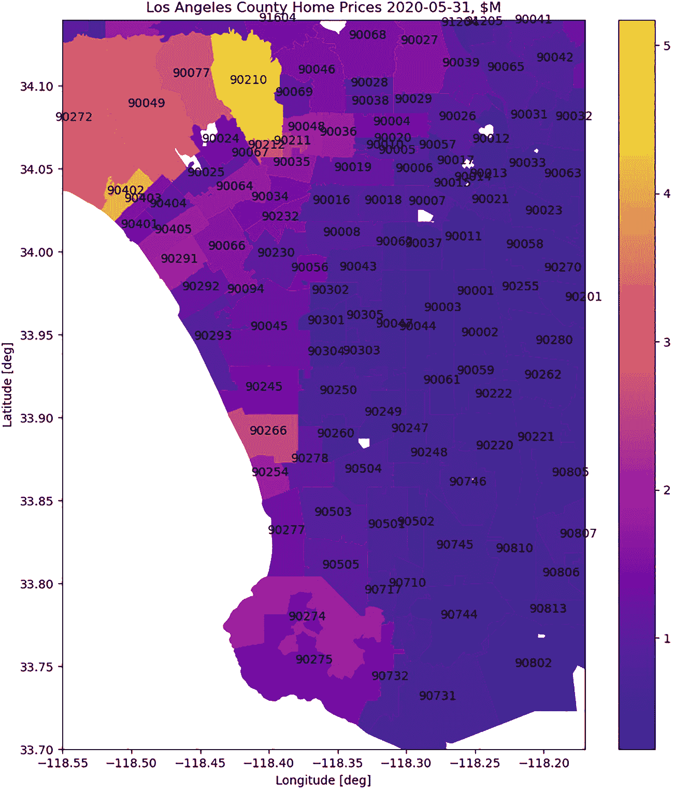

# 标注每个邮政编码
for i,row in LA_price_map.iterrows():
center = row['geometry'].centroid.xy
xy = center[0][0], center[1][0]
plt.annotate(text=row['ZipCode'], xy=xy,
horizontalalignment='center')
plt.savefig('LA_home_prices.png', bbox_inches=Bbox([[0.9,0.9],[9,13]]),
transparent=True)
plt.show()
```



## 13.13 指南 13-1：使用 GeoPandas 创建地图

在第 13.12 节中创建的洛杉矶县房价地图，同样可以在 MATLAB 中使用 `GeoPandas` 来生成。不过，MATLAB 不支持 `Pandas` 中通过方括号筛选数据框行和列的惯用方法（第 13.6 节），也不支持调用数据框的 `.iterrows()` 方法来遍历行。我们需要一个桥接模块来提供以下功能：

- 基于布尔运算筛选行
- 提取选定的列
- 重命名列
- 更改列数据类型
- 缩放列值
- 遍历行


# 排版后的文本

最后一项，即行迭代，出乎意料地具有挑战性。一个显而易见的解决方案是创建一个每次调用时返回新行的 Python 生成器，但 MATLAB 似乎无法与 Python 生成器一起工作。作为替代，我在桥接模块中实现了一个名为 `iterrows()` 的闭包。^(⁶²)

Python:

```python
