# 10. 面向对象编程

`Python` 从核心上就是面向对象的。每个项目——变量、函数、运算符、异常、信号，甚至字符串字面量——都是一个对象。`MATLAB` 也支持面向对象编程，实际上比 `Python` 更为严谨，但灵活性也稍差。

两种语言都不强制要求定义类；基于常规过程的编程完全可行，甚至可能是大多数科学家和工程师的默认方式。然而，在 `Python` 中定义和使用类的便捷性，为刚接触面向对象的开发者尝试这种编程范式简化了路径。

对于初学者来说，对象是类的一个实例，就像变量是数据类型的一个实例一样。例如，在我们定义 `j` 为整数之前，整数类型的概念必须存在。当然，`MATLAB` 和 `Python` 预定义了许多有用的数据类型和容器。类可以被视为一种用户定义的容器，它可以包含函数，称为*方法*，这些方法对该容器中的数据进行操作。在使用对象之前，我们必须定义用来创建对象的*类*。

## 10.1 类

以下是一个定义圆形的简单类示例。它包含三个变量 `x`、`y` 和 `r`，用于定义圆心和半径，以及一个方法 `area()`，用于返回圆的面积。变量 `x`、`y`、`r` 被称为*实例*变量，因为从这个类创建的每个对象（即每个类实例）都会拥有自己独立的圆心和半径值。

除了实例变量，我们还将定义一个*类*变量 `MAX_R`，它由该类创建的所有对象共享。

Python 类需要一个名为 `__init__()` 的显式构造函数，其第一个参数始终是占位符 `self`。然后，可以使用点号表示法在类中创建任意命名的属性。最常见的情况是，通过 `self.x = x` 这样的代码行，将构造函数的调用参数赋值给类属性。

| MATLAB: | Python: |
| --- | --- |
| `% code/OO/Circle.m` `classdef` `Circle` `properties (Constant)` `MAX_R = 20;` `end` `properties` `x {mustBeNumeric}` `y {mustBeNumeric}` `r {mustBeNumeric}` `end` `methods` `function obj = Circle(x,y,r)` `obj.x = x;` `obj.y = y;` `obj.r = r;` `obj.perim = 2*r*pi;` `end` `function [A] = area(obj)` `A = pi*obj.r²;` `end` `end` `end` | `import numpy as np` `class Circle:` `MAX_R= 20` `def` `__init__(self, x,y,r):` `self.x = x` `self.y = y` `self.r = r` `if` `self.r > circle.MAX_R:` `print('too big')` `self.r = circle.MAX_R` `self.R = r` `def` `area(self):` `return` `np.pi*self.r**2` |

定义了 `Circle` 类之后，我们将创建对象 `a` 和 `b`，它们是 `Circle` 的实例：

| MATLAB: | Python: |
| --- | --- |
| `>> a = Circle(0,0,10);` `>> b = Circle(1,2,4);` `>> b.y` `2` `>> a.area()` `314.1592` | `In : a = Circle(0,0,10)` `In : b = Circle(1,2,4)` `In : b.y` `Out: 2` `In : a.area()` `Out: 314.1592` |

从类创建对象（例如 `a = Circle(0,0,10)`）这一操作，会调用该类的*构造函数*方法——在 MATLAB 中是与类同名的函数，在 Python 中是 `__init__()` 函数——并将提供的参数传递给它。

### 10.1.1 私有与公有

大多数面向对象语言通过将属性和方法指定为公有或私有来严格控制对它们的访问权限。前者可以被其他对象访问，而后者只能被对象自身的成员查看和更新。

MATLAB 有实现访问控制的机制，但 Python 在这方面要宽松得多，它依赖命名约定来表明开发者的意图。简而言之，Python 中以双下划线为前缀的类属性会通过*名称修饰*进行隐藏，使其看起来像是私有的。名称修饰仅仅是在变量内部添加类名作为前缀，因此一个执着的用户仍然能够访问到这些数据。以下示例展示了 `Circle` 类的一个变体，它定义了一个额外的属性 `perim`，作为一个存储圆周长的私有变量。

| MATLAB: | Python: |
| --- | --- |
| `% file: code/OO/Circle.m` `classdef` `Circle` `properties (Constant)` `MAX_R = 20;` `end` `properties (Access = private)` `perim` `end` `properties` `x {mustBeNumeric}` `y {mustBeNumeric}` `r {mustBeNumeric}` `end` `methods` `function` `obj = Circle(x,y,r)` `obj.x = x;` `obj.y = y;` `obj.r = r;` `obj.perim = 2*r*pi;` `end` `function [A] = area(obj)` `A = pi*obj.r²;` `end` `end` `end` | `# file: code/OO/circle.py` `import numpy as np` `class Circle:` `MAX_R= 20` `def` `__init__(self, x,y,r):` `self.x = x` `self.y = y` `self.R = r` `self.__perim = 2*r*np.pi;` `def` `area(self):` `return` `np.pi*self.r**2` |

### 10.1.2 自定义打印函数

在 MATLAB 中，可以通过重载 `disp()` 函数来更改类的打印表示形式；在 Python 中，则可以通过定义自定义的 `__str__()` 方法来实现。以下函数可以添加到前面的 `Circle` 类中，用于以紧凑格式打印圆的属性。请注意，`__str__()` 返回的是一个字符串，而不是直接调用打印函数。

| MATLAB: | Python: |
| --- | --- |
| `function` `disp(obj)` `fprintf('X: %5.2f Y: %5.2f ', ...` `obj.x, obj.y);` `fprintf('R: %5.2f\n', obj.r);` `end` | `def` `__str__(self):` `return` `f'X: {self.x:5.2f} ' \` `f'Y: {self.y:5.2f} ' \` `f'R: {self.R:5.2f}'` |

我们自定义的输出结果如下所示：

| MATLAB: | Python: |
| --- | --- |
| `>> c = Circle(.4,6.6, 3.14);` `>> disp(c)` `X: 0.40 Y: 6.60 R: 3.14` | `In : c = Circle(.4,6.6, 3.14)` `In : print(c)` `X: 0.40 Y: 6.60 R: 3.14` |

### 10.1.3 自定义异常

随着代码库的增长，其可能失败的方式也会增多。异常处理器有助于管理故障模式，而自定义异常可以增强异常处理器的功能，与通用错误相比，它能产生更具揭示性且更特定于应用程序的错误状态。在 MATLAB 和 Python 中都很容易添加自定义异常。以下示例实现了一个简单的电动汽车模拟器，当汽车电池电量耗尽时，会抛出 `BatteryEmptyError` 异常。该异常在 MATLAB 的 2–4 行和 Python 的 3–4 行中定义。

MATLAB:

```matlab
1   % code/OO/ecar_sim.m
2   errID = 'ecar_sim:NotNumeric';
3   msg = 'BatteryEmptyError';
4   BatteryEmptyError = MException(errID,msg);
5   charge = 80.0; % kWhr
6   d_rate = 0.002;
7   while true
```

## 10.2 性能影响

面向对象编程可能会抑制计算性能，因为它破坏了数据的局部性；数值分散在各个对象中，而不是在紧凑的数组中彼此邻近。这会导致在 Python 和 MATLAB 中都无法进行向量化。

然而，在演示这点之前，我们首先需要详细讲解数值数组、向量化和计算性能。第 11 章将对此进行详细讨论。具体来说，第 11.1.17 节给出了一个计算问题用面向对象方法和不用面向对象方法解决的示例。剧透：面向对象方法慢得多。

# NumPy 和 SciPy

NumPy 是 Python 中用于数值计算的基础模块。其核心数据结构——NumPy N 维数组，可视为 MATLAB 矩阵的 Python 等价物。SciPy 则是在 NumPy 基础上构建的一系列模块集合，用于解决聚类、微分方程、图像处理、插值、线性代数、线性规划、优化、稀疏矩阵、统计及符号数学等领域的广泛计算问题。NumPy 与 SciPy 共同覆盖了核心 MATLAB 产品及其众多工具箱的功能。

本章将演示如何创建、操作、子集化、聚合及序列化 NumPy 数组，并概述 NumPy 与 SciPy 提供的广泛功能。文中全程会与 MATLAB 的等价用法进行对比。

## NumPy 数组

NumPy 数组，更正式地称为 `numpy.ndarray`（即“N 维数组”），功能上等价于 MATLAB 矩阵。两者都用于存储单一（通常为数值）数据类型，都支持对值进行向量化操作，并都配有大量高性能的数学、科学和统计函数库。

要在程序或交互式计算环境中使用 NumPy 数组和函数，必须显式导入 NumPy 模块。最常见的做法是：

```python
import numpy as np
```

因此，前缀 `np.` 在本书中将代表 NumPy 模块。

### NumPy 数组值的格式化

后续章节中我们会看到大量数字，因此能够控制它们的显示样式十分有用。MATLAB 的 `format` 命令提供了一系列实用的显示风格。NumPy 则提供了更多功能：它不仅能够控制数字格式，还能控制行宽，并在数组超过指定大小时提供摘要选项。

MATLAB:

```matlab
>> a = reshape(1:6, 3,2)/pi/14326
   2.2219e-05   8.8876e-05
   4.4438e-05   1.1110e-04
   6.6657e-05   1.3331e-04
```

Python:

```python
In : a = np.arange(1,7).reshape(2,3).T/np.pi/14326
In : a
Out:
array([[2.22190344e-05, 8.88761374e-05],
       [4.44380687e-05, 1.11095172e-04],
       [6.66571031e-05, 1.33314206e-04]])
```

MATLAB:

```matlab
>> format long e
>> a
   2.221903435598148e-05     8.887613742392592e-05
   4.443806871196296e-05     1.110951717799074e-04
   6.665710306794443e-05     1.333142061358889e-04
```

Python:

```python
In : np.set_printoptions(precision=20)
In : a
Out:
array([[2.2219034355981481e-05, 8.8876137423925925e-05],
       [4.4438068711962962e-05, 1.1109517177990740e-04],
       [6.6657103067944433e-05, 1.3331420613588887e-04]])
```

有时在 MATLAB 中，你可能会不小心输入一个大型数组的名称，或者输入一个产生海量数值且末尾没有分号的表达式，结果会导致屏幕上滚动显示大量数据。NumPy 则更为宽容，它会只打印数组的开头和结尾部分：

MATLAB:

```matlab
>> a = reshape(1:1000000, 1000, 1000)
... entire matrix printed ...
```

Python:

```python
In : a = np.arange(1000000).reshape(1000,1000)
In : a
Out:
array([[     0,      1,      2, ...,    997,    998,    999],
       [  1000,   1001,   1002, ...,   1997,   1998,   1999],
       [  2000,   2001,   2002, ...,   2997,   2998,   2999],
       ...,
       [997000, 997001, 997002, ..., 997997, 997998, 997999],
       [998000, 998001, 998002, ..., 998997, 998998, 998999],
       [999000, 999001, 999002, ..., 999997, 999998, 999999]])
In : np.set_printoptions(linewidth=40,edgeitems=2)
In : a
Out:
array([[     0,      1, ...,    998,
                999],
       [  1000,   1001, ...,   1998,
               1999],
       ...,
       [998000, 998001, ..., 998998,
              998999],
       [999000, 999001, ..., 999998,

999999])

```

如果你有幸拥有一个大显示器，在仔细检查数据时，将 `linewidth=200`（或类似数值）会非常有帮助。

### NumPy 数组与 MATLAB 矩阵的差异

接下来的五个小节将解释 NumPy 数组与 MATLAB 矩阵之间的主要差异。

#### 由数值字面量构成的 MATLAB 矩阵默认为双精度

相比之下，NumPy 数组的类型是从输入值推断出来的。除非其中一个值包含小数点或指数，否则 NumPy 会创建一个 64 位整数的数组：

| MATLAB: | Python: |
| --- | --- |
| `>> a = [1 2 3];`<br>`>> class(a)`<br>`'double'`<br><br>`>> a = [1 2. 3];`<br>`>> class(a)`<br>`'double'` | `In : a = np.array([1, 2, 3])`<br>`In : a.dtype`<br>`Out: dtype('int64')`<br><br>`In : a = np.array([1, 2., 3])`<br>`In : a.dtype`<br>`Out: dtype('float64')` |

#### MATLAB 矩阵至少有两个维度

相比之下，NumPy 数组可以只有一个维度。

| MATLAB: | Python: |
| --- | --- |
| `>> a = [1 2 3]`<br>`>> size(a)`<br>`1 3`<br>`>> ndims(a)`<br>`2` | `In : a = np.array([1, 2, 3])`<br>`In : a.shape`<br>`Out: (3,)`<br>`In : a.ndim`<br>`Out: 1` |

在上例中，MATLAB 中的 `a` 是一个 1×3 的矩阵，而 Python 中的 `a` 只有三个元素。因此，MATLAB 可以区分行向量和列向量，这对于某些线性代数表达式非常有用。

一维 NumPy 数组没有垂直或水平排列的概念；因此，它们的行或列倾向性取决于上下文。可以显式地添加第二个维度来传达与 MATLAB 向量相同的行或列含义；这个过程将在第 11.1.12 节中解释。

#### MATLAB 数值标量是 1×1 矩阵

NumPy 标量与 NumPy 数组不同；标量只有一个值。

| MATLAB: | Python: |
| --- | --- |
| `>> a = 2.7183;`<br>`>> size(a)`<br>`1 1`<br>`>> ndims(a)`<br>`2` | `In : a = 2.7183`<br>`In : a.shape`<br>`AttributeError Traceback`<br>`----> 1 a.shape`<br>`AttributeError: 'float' object has no attribute 'shape'` |

#### NumPy 数组是行优先存储

默认情况下，NumPy 数组在内部使用行优先存储，而 MATLAB 数组是列优先存储。换句话说，如果数字 1 到 12 在内存中作为连续值存储，那么它们作为一个 3×4 矩阵时看起来会是这样：

| MATLAB: | Python: |
| --- | --- |
| `>> a = 1:12`<br>`a =`<br>`1 2 3 4 5 6 7 8 9 10 11 12`<br><br>`>> reshape(a, [3,4])`<br>`1 4 7 10`<br>`2 5 8 11`<br>`3 6 9 12` | `In : a = np.arange(1, 13)`<br>`In : a`<br>`Out: array([ 1, 2, 3, 4, 5, 6,`<br>`       7, 8, 9, 10, 11, 12])`<br><br>`In : a.reshape(3,4)`<br>`array([[ 1,  2,  3,  4],`<br>`       [ 5,  6,  7,  8],`<br>`       [ 9, 10, 11, 12]])` |

NumPy 可以通过向 `numpy.array()` 函数传递可选参数 `order='F'`（Fortran 顺序）来创建列优先数组。

Python:

```
In : a = np.arange(1, 13)

In : a

Out: array([ 1,  2,  3,  4,  5,  6,
            7,  8,  9, 10, 11, 12])

In : a.reshape(3,4, order='F')

array([[ 1,  4,  7, 10],
       [ 2,  5,  8, 11],
       [ 3,  6,  9, 12]])
```

### 11.1.2.5 NumPy 数组必须显式调整大小才能添加元素

MATLAB 矩阵只需引用新索引即可扩展，但 NumPy 数组的大小在创建后是固定的。可以使用垂直或水平堆叠函数 `np.vstack()` 或 `np.hstack()` 从现有数组中添加行或列来创建新的 NumPy 数组。或者，也可以调用 `np.resize()` 函数在任何维度添加所需数量的元素。相比之下，MATLAB 只需在左手边的矩阵中引用一个新索引，即可追加行或列。以下示例演示了如何使用 `.resize()` 方法向现有的 2×2 矩阵追加一行：

| MATLAB: | Python: |
| --- | --- |
| `>> a = [1 2; 3 4]` <br> `a =` <br> &nbsp;&nbsp;&nbsp;&nbsp; `1&nbsp;&nbsp;2` <br> &nbsp;&nbsp;&nbsp;&nbsp; `3&nbsp;&nbsp;4` <br> `>> a(3,:) = [5 6]` <br> `a =` <br> &nbsp;&nbsp;&nbsp;&nbsp; `1&nbsp;&nbsp;2` <br> &nbsp;&nbsp;&nbsp;&nbsp; `3&nbsp;&nbsp;4` <br> &nbsp;&nbsp;&nbsp;&nbsp; `5&nbsp;&nbsp;6` | `In : a = np.array([[1,2], [3,4]])` <br> `In : a` <br> `Out: array([[1, 2]` <br> &nbsp;&nbsp;&nbsp;&nbsp;&nbsp;&nbsp;&nbsp;&nbsp;&nbsp;&nbsp;&nbsp;&nbsp;&nbsp;&nbsp; `[3, 4]])` <br> `In : a.resize( (3,2) )` <br> `In : a[2,] = [5, 6]` <br> `In : a` <br> `Out: array([[1, 2],` <br> &nbsp;&nbsp;&nbsp;&nbsp;&nbsp;&nbsp;&nbsp;&nbsp;&nbsp;&nbsp;&nbsp;&nbsp;&nbsp;&nbsp; `[3, 4],` <br> &nbsp;&nbsp;&nbsp;&nbsp;&nbsp;&nbsp;&nbsp;&nbsp;&nbsp;&nbsp;&nbsp;&nbsp;&nbsp;&nbsp; `[5, 6]])` |

虽然 MATLAB 的矩阵增长能力很方便，但会带来性能损失。预分配 MATLAB 矩阵要快得多，例如，先创建一个零矩阵，然后用值填充现有的行或列，而不是从一个空矩阵开始并在循环中增长。如果事先知道矩阵的最终大小，预分配是可行的，但情况并非总是如此。从文件中读取值可能需要两次遍历文件，一次了解最终大小，第二次填充矩阵条目，或者退而求其次采用增长矩阵的方式。

### 11.1.3 NumPy 数据类型

表 11-1 列出了 `np.ndarray` 的可能类型及其对应的 MATLAB 类型。

**表 11-1**

**NumPy 数据类型**

| MATLAB 类型 | NumPy 类型 | 备注 |
| --- | --- | --- |
| `logical` | `np.bool` | 8 位布尔值 |
| `uint8` | `np.ubyte` | 8 位无符号整数 |
| `uint8` | `np.uint8` | 8 位无符号整数 |
| `int8` | `np.int8` | 8 位有符号整数 |
| `uint16` | `np.uint16` | 16 位无符号整数 |
| `int16` | `np.int16` | 16 位有符号整数 |
| `uint32` | `np.uint32` | 32 位无符号整数 |
| `int32` | `np.int32` | 32 位有符号整数 |
| `uint64` | `np.uint64` | 64 位无符号整数 |
| `int64` | `np.int`, `np.int64` | 64 位有符号整数 |
| `uint64` | `np.uint` | 64 位无符号整数 |
| 不可用 | `np.float16` | 16 位（短）浮点数 |
| `single` | `np.float32` | 32 位浮点数 |
| `double` | `np.float64` | 64 位浮点数 |
| `double` | `np.float` | 64 位浮点数 |
| 不可用 | `np.float128` | 128 位（四精度）浮点数^(³⁴) |
| `complex` | `np.complex` | 一对 64 位浮点数 |
| `single`^(³⁵) | `np.complex64` | 一对 32 位浮点数 |
| `double`^(³⁶) | `np.complex128` | 一对 64 位浮点数 |
| 不可用 | `np.complex256` | 一对 128 位浮点数^(³⁷) |
| `char` | `np.str` | 固定长度字符串 |
| `datetime` | `datetime.datetime` | 日期时间对象 |

### 11.1.4 标量和数组的类型转换

MATLAB 的类型转换机制很直接：如果你有一个标量或数组属于某种数据类型（默认情况下值为双精度），只需在变量前面加上类型名称即可。

虽然 NumPy 对标量的类型转换表示法与 MATLAB 一致，但 NumPy 对数组使用不同的表示法进行类型转换。必须编写 `X.astype(np.uint8)` 才能将数组 `X` 转换为 `np.uint8`：

| MATLAB: | Python: |
| --- | --- |
| `>> p = 4.32;` <br> `>> uint8(p)` <br> &nbsp;&nbsp;&nbsp;&nbsp; `4` <br> `>> p = [4.32 1.23];` <br> `>> uint8(p)` <br> &nbsp;&nbsp;&nbsp;&nbsp; `4&nbsp;&nbsp;1` | `In : p = 4.32` <br> `In : np.uint8(p)` <br> `Out: 4` <br> `In : p = np.array([4.32, 1.23])` <br> `In : p.astype(np.uint8)` <br> `Out: array([4, 1], dtype=uint8)` |

MATLAB 和 NumPy 都支持“类似”类型转换的版本，即使用现有数组的类型创建新数组：

| MATLAB: | Python: |
| --- | --- |
| `>> p = [4.32 1.23];` <br> `>> q = uint8([0 0]);` <br> `>> cast(p,'like',q)` <br> &nbsp;&nbsp;&nbsp;&nbsp; `1×2 uint8 行向量` <br> &nbsp;&nbsp;&nbsp;&nbsp; `4&nbsp;&nbsp;&nbsp;1` | `In : p = np.array([4.32, 1.23])` <br> `In : q = np.zeros((1,2),dtype=np.uint8)` <br> `In : p.astype(q.dtype)` <br> `Out: array([4, 1], dtype=uint8)` |

`np.zeros()` 和 `np.zeros_like()` 在第 11.1.6 节中描述。

### 11.1.5 十六进制、二进制和十进制表示

某些数值数据（特别是整数）的内容，在不同进制下表示时可能会显现其特性。尤其是位掩码操作，当其值以二进制形式显示时更容易理解。

#### 11.1.5.1 十进制转二进制

| MATLAB: | Python: |
| --- | --- |
| `>> dec = 1234;` <br> `>> dec2bin(dec)` <br> &nbsp;&nbsp;&nbsp;&nbsp; `10011010010` | `In : dec = 1234` <br> `In : np.binary_repr(dec)` <br> `Out: '10011010010'` |

#### 11.1.5.2 二进制转十进制

| MATLAB: | Python: |
| --- | --- |
| `>> bin2dec('10011010010')` <br> &nbsp;&nbsp;&nbsp;&nbsp; `1234` | `In : np.int('10011010010', 2)` <br> `Out: 1234` |

#### 11.1.5.3 十进制转十六进制

MATLAB 的 `dec2hex()` 函数返回一个表示所提供整数的十六进制字符串。NumPy 缺少专门用于此转换的函数；相反，可以使用 `%x` 和 `%X` 格式字符串。它们在 MATLAB 和 Python 中的工作方式相同：`%x` 生成小写十六进制，而 `%X` 生成大写。此外，字段宽度前的零会导致结果字符串用零填充。这比 `dec2hex()` 对输出提供了更多控制。

| MATLAB: | Python: |
| --- | --- |
| `>> dec2hex(8765)` <br> &nbsp;&nbsp;&nbsp;&nbsp; `223D` <br> `>> sprintf('%x', 8765)` <br> &nbsp;&nbsp;&nbsp;&nbsp; `223d` <br> `>> sprintf('%X', 8765)` <br> &nbsp;&nbsp;&nbsp;&nbsp; `223D` <br> `>> sprintf('%06X', 8765)` <br> &nbsp;&nbsp;&nbsp;&nbsp; `00223D` | `In : '%x' % 8765` <br> `Out: '223d'` <br> `In : '%X' % 8765` <br> `Out: '223D'` <br> `In : '%06X' % 8765` <br> `Out: '00223D'` |

#### 11.1.5.4 十六进制转十进制

| MATLAB: | Python: |
| --- | --- |
| `>> hex2dec('223D')` <br> &nbsp;&nbsp;&nbsp;&nbsp; `8765` | `In : np.int('223D', 16)` <br> `Out: 8765` |

### 11.1.6 创建数组

NumPy 数组可以通过多种方式创建。标准的构造函数是 `np.array()` 函数，它接受一个列表以及数据类型（默认 `np.float64`）和存储方案（默认为行主序）的可选设置。在这里，我们看到了两种语言中基本矩阵的创建方式：

| MATLAB: | Python: |
| --- | --- |
| `>> a = [9 8 7; 6 5 4]` <br> `a =` <br> &nbsp;&nbsp;&nbsp;&nbsp; `9&nbsp;&nbsp;&nbsp;8&nbsp;&nbsp;&nbsp;7` <br> &nbsp;&nbsp;&nbsp;&nbsp; `6&nbsp;&nbsp;&nbsp;5&nbsp;&nbsp;&nbsp;4` | `In : a = np.array([[9, 8, 7],[6, 5, 4]])` <br> `In : a` <br> `Out: array([[9, 8, 7],` <br> &nbsp;&nbsp;&nbsp;&nbsp;&nbsp;&nbsp;&nbsp;&nbsp;&nbsp;&nbsp;&nbsp;&nbsp;&nbsp;&nbsp; `[6, 5, 4]])` |

#### 11.1.6.1 零矩阵

数组分配或初始化通常通过创建一个具有所需形状和类型的零填充数组来完成。NumPy 有两个函数 `np.zeros()` 和 `np.zeros_like()` 用于此目的。`np.zeros_like()` 函数很有趣，因为它不是将数组大小作为参数，而是接受一个现有矩阵，然后返回一个与该给定数组大小和类型相同的零填充数组。另一个创建数组的选项是 `np.empty()`，它创建一个数组但不初始化其内容。

MATLAB 的 `zeros()` 函数支持 `'like'` 选项，但在 2020b 版本中它未返回正确结果：

| MATLAB 2020b: | Python: |
| --- | --- |
| `>> a = zeros(2,3)` <br> &nbsp;&nbsp;&nbsp;&nbsp; `0&nbsp;&nbsp;&nbsp;0&nbsp;&nbsp;&nbsp;0` <br> &nbsp;&nbsp;&nbsp;&nbsp; `0&nbsp;&nbsp;&nbsp;0&nbsp;&nbsp;&nbsp;0` <br> `>> b = [2; 4]` <br> &nbsp;&nbsp;&nbsp;&nbsp; `2` <br> &nbsp;&nbsp;&nbsp;&nbsp; `4` <br> `>> c = zeros('like',b)` <br> &nbsp;&nbsp;&nbsp;&nbsp; `0` | `In : a = np.zeros((2,3))` <br> `In : a` <br> `Out: array([[0, 0, 0],` <br> &nbsp;&nbsp;&nbsp;&nbsp;&nbsp;&nbsp;&nbsp;&nbsp;&nbsp;&nbsp;&nbsp;&nbsp;&nbsp;&nbsp; `[0, 0, 0]])` <br> `In : b = np.array([[2], [4]])` <br> `In : b` <br> `Out: array([[2],` <br> &nbsp;&nbsp;&nbsp;&nbsp;&nbsp;&nbsp;&nbsp;&nbsp;&nbsp;&nbsp;&nbsp;&nbsp;&nbsp;&nbsp; `[4]])` <br> `In : c = np.zeros_like(b)` <br> `In : c` <br> `Out: array([[0],` <br> &nbsp;&nbsp;&nbsp;&nbsp;&nbsp;&nbsp;&nbsp;&nbsp;&nbsp;&nbsp;&nbsp;&nbsp;&nbsp;&nbsp; `[0]])` |

#### 11.1.6.2 一矩阵

全一数组是另一个有用的初始化器。其结果有时会被缩放以产生填充相同值的数组，尽管有一个专门的函数 `np.full()` 正是为此目的而存在；其用法将在第 11.1.6.3 节中说明。与 `np.zeros_like()` 类似，`np.ones()` 有一个配套函数 `np.ones_like()`：

| MATLAB: | Python: |
| --- | --- |
| `>> a = ones(3,1)` <br> &nbsp;&nbsp;&nbsp;&nbsp; `1` <br> &nbsp;&nbsp;&nbsp;&nbsp; `1` <br> &nbsp;&nbsp;&nbsp;&nbsp; `1` | `In : a = np.ones((3,1))` <br> `In : a` <br> `Out: array([[1],` <br> &nbsp;&nbsp;&nbsp;&nbsp;&nbsp;&nbsp;&nbsp;&nbsp;&nbsp;&nbsp;&nbsp;&nbsp;&nbsp;&nbsp; `[1],` <br> &nbsp;&nbsp;&nbsp;&nbsp;&nbsp;&nbsp;&nbsp;&nbsp;&nbsp;&nbsp;&nbsp;&nbsp;&nbsp;&nbsp; `[1]])` |

#### 11.1.6.3 非数值（NaNs）

MATLAB 的 `nan()` 函数用于创建全为 NaN（`非数值`）的矩阵。NumPy 有一个更通用的矩阵初始化函数 `np.full()`，可以用指定值初始化数组：

| MATLAB: | Python: |
| --- | --- |
| `>> nan(2,3)` <br> &nbsp;&nbsp;&nbsp;&nbsp; `NaN&nbsp;&nbsp;&nbsp;NaN&nbsp;&nbsp;&nbsp;NaN` <br> &nbsp;&nbsp;&nbsp;&nbsp; `NaN&nbsp;&nbsp;&nbsp;NaN&nbsp;&nbsp;&nbsp;NaN` | `In : np.full((2,3), np.NaN)` <br> `Out: array([[nan, nan, nan],` <br> &nbsp;&nbsp;&nbsp;&nbsp;&nbsp;&nbsp;&nbsp;&nbsp;&nbsp;&nbsp;&nbsp;&nbsp;&nbsp;&nbsp; `[nan, nan, nan]])` |

#### 11.1.6.4 范围

Python 中有两种方式创建连续数字的范围。第一种是使用标准 `range()` 函数，第二种是使用 NumPy 的 `np.arange()` 函数，后者因返回 NumPy 数组而更适合数值计算。两者的调用参数相同，但可能让 MATLAB 程序员困惑的是，二者的输出都不包含终值。这在非单位步长时尤其令人头疼：

| MATLAB: | Python: |
| --- | --- |
| `>> b = -8:-4` <br> `b =` <br> &nbsp;&nbsp;&nbsp;&nbsp; `-8&nbsp;&nbsp;-7&nbsp;&nbsp;-6&nbsp;&nbsp;-5&nbsp;&nbsp;-4` <br> `>> b = -8:1.5:-4` <br> `b =` <br> &nbsp;&nbsp;&nbsp;&nbsp; `-8.00&nbsp;-6.50&nbsp;-5.00` | `In : b = np.arange(-8,-3)` <br> `In : b` <br> `Out: array([-8, -7, -6, -5, -4])` <br> `In : b = np.arange(-8,-4,1.5)` <br> `In : b` <br> `Out: array([-8. , -6.5, -5. ])` |

#### 11.1.6.5 单位矩阵

单位矩阵分别使用 `eye()` 和 `np.eye()` 创建：

| MATLAB: | Python: |
| --- | --- |
| `>> eye(3)` <br> &nbsp;&nbsp;&nbsp;&nbsp; `1&nbsp;&nbsp;&nbsp;0&nbsp;&nbsp;&nbsp;0` <br> &nbsp;&nbsp;&nbsp;&nbsp; `0&nbsp;&nbsp;&nbsp;1&nbsp;&nbsp;&nbsp;0` <br> &nbsp;&nbsp;&nbsp;&nbsp; `0&nbsp;&nbsp;&nbsp;0&nbsp;&nbsp;&nbsp;1` | `In : a = np.eye(3)` <br> `Out: array([[1., 0., 0.],` <br> &nbsp;&nbsp;&nbsp;&nbsp;&nbsp;&nbsp;&nbsp;&nbsp;&nbsp;&nbsp;&nbsp;&nbsp;&nbsp;&nbsp; `[0., 1., 0.],` <br> &nbsp;&nbsp;&nbsp;&nbsp;&nbsp;&nbsp;&nbsp;&nbsp;&nbsp;&nbsp;&nbsp;&nbsp;&nbsp;&nbsp; `[0., 0., 1.]])` |

#### 11.1.6.6 对角矩阵

对角矩阵可以通过向 `diag()` 和 `np.diag()` 传入一维向量创建。此外，当传入二维数组时，这些函数会返回矩阵的对角线：

| MATLAB: | Python: |
| --- | --- |
| `>> diag([9 8 7])` <br> &nbsp;&nbsp;&nbsp;&nbsp; `9&nbsp;&nbsp;&nbsp;0&nbsp;&nbsp;&nbsp;0` <br> &nbsp;&nbsp;&nbsp;&nbsp; `0&nbsp;&nbsp;&nbsp;8&nbsp;&nbsp;&nbsp;0` <br> &nbsp;&nbsp;&nbsp;&nbsp; `0&nbsp;&nbsp;&nbsp;0&nbsp;&nbsp;&nbsp;7` <br> `>> diag(eye(2))` <br> &nbsp;&nbsp;&nbsp;&nbsp; `1` <br> &nbsp;&nbsp;&nbsp;&nbsp; `1` | `In : np.diag([9,8,7])` <br> `Out: array([[9, 0, 0],` <br> &nbsp;&nbsp;&nbsp;&nbsp;&nbsp;&nbsp;&nbsp;&nbsp;&nbsp;&nbsp;&nbsp;&nbsp;&nbsp;&nbsp; `[0, 8, 0],` <br> &nbsp;&nbsp;&nbsp;&nbsp;&nbsp;&nbsp;&nbsp;&nbsp;&nbsp;&nbsp;&nbsp;&nbsp;&nbsp;&nbsp; `[0, 0, 7]])` <br> `In : np.diag(np.eye(2))` <br> `Out: array([1., 1.])` |

#### 11.1.6.7 上三角与下三角矩阵

在 MATLAB 中使用 `triu()` 和 `tril()` 生成上下三角矩阵，在 NumPy 中使用 `np.triu()` 和 `np.tril()`。这四个函数都支持可选的对角线偏移参数。

我们在 11.1 节开头提到，MATLAB 矩阵是列主序的，而 NumPy 数组默认是行主序的。因此，下例中 MATLAB 定义的 `A` 需要进行转置，才能与 NumPy 的 `A` 保持相同的数值模式。我们将使用 `A` 来探索上下三角矩阵提取：

| MATLAB: | Python: |
| --- | --- |
| `>> A = reshape(5:16, 4,3)'` <br> `A =` <br> &nbsp;&nbsp;&nbsp;&nbsp; `5&nbsp;&nbsp;&nbsp;&nbsp;6&nbsp;&nbsp;&nbsp;&nbsp;7&nbsp;&nbsp;&nbsp;&nbsp;8` <br> &nbsp;&nbsp;&nbsp;&nbsp; `9&nbsp;&nbsp;&nbsp;10&nbsp;&nbsp;&nbsp;11&nbsp;&nbsp;&nbsp;12` <br> &nbsp;&nbsp;&nbsp;&nbsp; `13&nbsp;&nbsp;&nbsp;14&nbsp;&nbsp;&nbsp;15&nbsp;&nbsp;&nbsp;16` <br> `>> triu(A)` <br> &nbsp;&nbsp;&nbsp;&nbsp; `5&nbsp;&nbsp;&nbsp;&nbsp;6&nbsp;&nbsp;&nbsp;&nbsp;7&nbsp;&nbsp;&nbsp;&nbsp;8` <br> &nbsp;&nbsp;&nbsp;&nbsp; `0&nbsp;&nbsp;&nbsp;10&nbsp;&nbsp;&nbsp;11&nbsp;&nbsp;&nbsp;12` <br> &nbsp;&nbsp;&nbsp;&nbsp; `0&nbsp;&nbsp;&nbsp;&nbsp;0&nbsp;&nbsp;&nbsp;15&nbsp;&nbsp;&nbsp;16` <br> `>> triu(A,1)` <br> &nbsp;&nbsp;&nbsp;&nbsp; `0&nbsp;&nbsp;&nbsp;&nbsp;6&nbsp;&nbsp;&nbsp;&nbsp;7&nbsp;&nbsp;&nbsp;&nbsp;8` <br> &nbsp;&nbsp;&nbsp;&nbsp; `0&nbsp;&nbsp;&nbsp;&nbsp;0&nbsp;&nbsp;&nbsp;11&nbsp;&nbsp;&nbsp;12` <br> &nbsp;&nbsp;&nbsp;&nbsp; `0&nbsp;&nbsp;&nbsp;&nbsp;0&nbsp;&nbsp;&nbsp;&nbsp;0&nbsp;&nbsp;&nbsp;16` <br> `>> tril(A)` <br> &nbsp;&nbsp;&nbsp;&nbsp; `5&nbsp;&nbsp;&nbsp;&nbsp;0&nbsp;&nbsp;&nbsp;&nbsp;0&nbsp;&nbsp;&nbsp;&nbsp;0` <br> &nbsp;&nbsp;&nbsp;&nbsp; `9&nbsp;&nbsp;&nbsp;10&nbsp;&nbsp;&nbsp;&nbsp;0&nbsp;&nbsp;&nbsp;&nbsp;0` <br> &nbsp;&nbsp;&nbsp;&nbsp; `13&nbsp;&nbsp;&nbsp;14&nbsp;&nbsp;&nbsp;15&nbsp;&nbsp;&nbsp;&nbsp;0` <br> `>> tril(A,-1)` <br> &nbsp;&nbsp;&nbsp;&nbsp; `0&nbsp;&nbsp;&nbsp;&nbsp;0&nbsp;&nbsp;&nbsp;&nbsp;0&nbsp;&nbsp;&nbsp;&nbsp;0` <br> &nbsp;&nbsp;&nbsp;&nbsp; `9&nbsp;&nbsp;&nbsp;&nbsp;0&nbsp;&nbsp;&nbsp;&nbsp;0&nbsp;&nbsp;&nbsp;&nbsp;0` <br> &nbsp;&nbsp;&nbsp;&nbsp; `13&nbsp;&nbsp;&nbsp;14&nbsp;&nbsp;&nbsp;&nbsp;0&nbsp;&nbsp;&nbsp;&nbsp;0` | `In : A = np.arange(5,17).reshape(3,4)` <br> `In : A` <br> `Out: array([[ 5,  6,  7,  8],` <br> &nbsp;&nbsp;&nbsp;&nbsp;&nbsp;&nbsp;&nbsp;&nbsp;&nbsp;&nbsp;&nbsp;&nbsp;&nbsp;&nbsp; `[ 9, 10, 11, 12],` <br> &nbsp;&nbsp;&nbsp;&nbsp;&nbsp;&nbsp;&nbsp;&nbsp;&nbsp;&nbsp;&nbsp;&nbsp;&nbsp;&nbsp; `[13, 14, 15, 16]])` <br> `In : np.triu(A)` <br> `Out: array([[ 5,  6,  7,  8],` <br> &nbsp;&nbsp;&nbsp;&nbsp;&nbsp;&nbsp;&nbsp;&nbsp;&nbsp;&nbsp;&nbsp;&nbsp;&nbsp;&nbsp; `[ 0, 10, 11, 12],` <br> &nbsp;&nbsp;&nbsp;&nbsp;&nbsp;&nbsp;&nbsp;&nbsp;&nbsp;&nbsp;&nbsp;&nbsp;&nbsp;&nbsp; `[ 0,  0, 15, 16]])` <br> `In : np.triu(A,1)` <br> `Out: array([[ 0,  6,  7,  8],` <br> &nbsp;&nbsp;&nbsp;&nbsp;&nbsp;&nbsp;&nbsp;&nbsp;&nbsp;&nbsp;&nbsp;&nbsp;&nbsp;&nbsp; `[ 0,  0, 11, 12],` <br> &nbsp;&nbsp;&nbsp;&nbsp;&nbsp;&nbsp;&nbsp;&nbsp;&nbsp;&nbsp;&nbsp;&nbsp;&nbsp;&nbsp; `[ 0,  0,  0, 16]])` <br> `In : np.tril(A)` <br> `Out: array([[ 5,  0,  0,  0],` <br> &nbsp;&nbsp;&nbsp;&nbsp;&nbsp;&nbsp;&nbsp;&nbsp;&nbsp;&nbsp;&nbsp;&nbsp;&nbsp;&nbsp; `[ 9, 10,  0,  0],` <br> &nbsp;&nbsp;&nbsp;&nbsp;&nbsp;&nbsp;&nbsp;&nbsp;&nbsp;&nbsp;&nbsp;&nbsp;&nbsp;&nbsp; `[13, 14, 15,  0]])` <br> `In : np.tril(A,-1)` <br> `Out: array([[ 0,  0,  0,  0],` <br> &nbsp;&nbsp;&nbsp;&nbsp;&nbsp;&nbsp;&nbsp;&nbsp;&nbsp;&nbsp;&nbsp;&nbsp;&nbsp;&nbsp; `[ 9,  0,  0,  0],` <br> &nbsp;&nbsp;&nbsp;&nbsp;&nbsp;&nbsp;&nbsp;&nbsp;&nbsp;&nbsp;&nbsp;&nbsp;&nbsp;&nbsp; `[13, 14,  0,  0]])` |

#### 11.1.6.8 随机数

伪随机数组可以通过多种分布函数创建，在 `ipython` 会话中通过 Tab 补全 `np.random` 即可看到：

```python
```

# `np.random` 模块概览

| | | |
| :--- | :--- | :--- |
| `absolute_import` | `mtrand` | `RandomState` |
| `beta()` | `multinomial()` | `ranf()` |
| `binomial()` | `multivariate_normal()` | `rayleigh()` |
| `bytes()` | `negative_binomial()` | `sample()` |
| `chisquare()` | `noncentral_chisquare()` | `seed()` |
| `choice()` | `noncentral_f()` | `set_state()` |
| `dirichlet()` | `normal()` | `shuffle()` |
| `division` | `np` | `standard_cauchy()` |
| `exponential()` | `operator` | `standard_exponential()` |
| `f()` | `pareto()` | `standard_gamma()` |
| `gamma()` | `permutation()` | `standard_normal()` |
| `geometric()` | `poisson()` | `standard_t()` |
| `get_state()` | `power()` | `test` |
| `gumbel()` | `print_function` | `triangular()` |
| `hypergeometric()` | `rand()` | `uniform()` |
| `laplace()` | `randint()` | `vonmises()` |
| `Lock()` | `randn()` | `wald()` |
| `logistic()` | `random()` | `warnings` |
| `lognormal()` | `random_integers()` | `weibull()` |
| `logseries()` | `random_sample()` | `zipf()` |

### 11.1.6.8 随机数生成

`np.random.rand()` 生成均匀随机分布，类似于 MATLAB 的 `rand()` 函数：

| MATLAB: | Python: |
| --- | --- |
| `>> rand(2)`   `0.095692   0.232535`   `0.813753   0.892878` `>> rand(3,2)`   `0.456106   0.908961`   `0.274357   0.755147`   `0.113177   0.900217` | `In : np.random.rand(2,2)` `array([[0.59219917, 0.62549076],` `[0.21467385, 0.70801235]])` `In : np.random.rand(3,2)` `array([[0.664537, 0.219990],` `[0.974484, 0.251934],` `[0.827411, 0.063566]])` |

#### 11.1.6.9 等间距分布（linspace）

| MATLAB: | Python: |
| --- | --- |
| `>> linspace(21,23,5)` `21.0 21.5 22.0 22.5 23.0` | `In : np.linspace(21,23,5)` `Out: array([21., 21.5, 22., 22.5, 23. ])` |

#### 11.1.6.10 对数等间距分布（logspace）

| MATLAB: | Python: |
| --- | --- |
| `>> logspace(0.1, 1, 3)`    `1.2589    3.5481   10.0000` | `In : np.logspace(0.1, 1, 3)` `Out: array([ 1.25892541, 3.54813389, 10. ])` |

#### 11.1.6.11 水平与垂直堆叠

在通过堆叠现有矩阵的项来创建新矩阵方面，MATLAB 相比 NumPy 有便捷性优势；MATLAB 矩阵名只需在方括号内并排放置。相比之下，NumPy 需要调用特殊函数 `np.hstack()` 和 `np.vstack()`。新数组 `d` 和 `e` 通过水平与垂直堆叠 `a`、`b` 和 `c` 创建：

| MATLAB: | Python: |
| --- | --- |
| `>> a = [1; 2]`     `1`     `2` `>> b = [0; -3]`     `0`    `-3` `>> c = [-1; 0]`    `-1`     `0` `>> d = [a b c]`     `1     0    -1`     `2    -3     0` `>> e = [a;b;c]`     `1`     `2`     `0`    `-3`    `-1`     `0` | `In : a = np.array([[1],[2]])` `In : a` `array([[1],`       `[2]])` `In : b = np.array([[0],[-3]])` `In : b` `array([[ 0],`       `[-3]])` `In : c = np.array([[-1],[0]])` `In : c` `array([[-1],` `[ 0]])` `In : d = np.hstack([a,b,c])` `In : d` `array([[ 1,  0, -1],`       `[ 2, -3,  0]])` `In : e = np.vstack([a,b,c])` `In : e` `array([[ 1],`       `[ 2],`       `[ 0],`       `[-3],`       `[-1],`       `[ 0]])` |

#### 11.1.6.12 网格网格（Meshgrid）

MATLAB 的 `meshgrid()` 及其 NumPy 同名函数 `np.meshgrid()` 用于在规则网格上创建坐标对。这些坐标对常被用作映射二维数据进行可视化或插值的基础。

| MATLAB: | Python: |
| --- | --- |
| `>> [y,x] = meshgrid([1 2 3],`                  `[3.5 3.6])` `y =`   `1   2   3`   `1   2   3` `x =`   `3.5000   3.5000   3.5000`   `3.6000   3.6000   3.6000` | `In : y,x = np.meshgrid([1,2,3],`                     `[3.5,3.6])` `In : y` `array([[1, 2, 3],`       `[1, 2, 3]])` `In : x` `array([[3.5, 3.5, 3.5],`       `[3.6, 3.6, 3.6]])` |

#### 11.1.6.13 矩阵膨胀

`scipy.ndimage` 模块提供了一个 `zoom()` 函数，可用于通过插值来膨胀矩阵。（插值将在第 11.4 节中介绍。）当然，在 MATLAB 中也能实现相同的结果，但需要更多的操作。以下示例将行数增加 3 倍，列数增加 2 倍：

| MATLAB: | Python: |
| --- | --- |
| `>> a = [4 -4; 4 0]`     `4    -4`     `4     0``>> nY = 2*3; nX = 2*2;``>> Xs = linspace(0,1,nX);``>> Ys = linspace(0,1,nY);``>> [Xq,Yq] = meshgrid(Xs, Ys);``>> interp2(X,Y,a,Xq,Yq)``4.0000  1.3333 -1.3333 -4.0000``4.0000  1.6000 -0.8000 -3.2000``4.0000  1.8667 -0.2667 -2.4000``4.0000  2.1333  0.2667 -1.6000``4.0000  2.4000  0.8000 -0.8000``4.0000  2.6667  1.3333       0` | `In :` `from scipy.ndimage import` `zoom``In : a = np.array([[4.0, -4], [4, 0]])``In : a``array([[ 4., -4.],`       `[ 4.,  0.]])``In : zoom(a, [3, 2], order=1)``array([[ 4\. , 1.3333, -1.3333, -4.  ],`       `[ 4\. , 1.6   , -0.8   , -3.2 ],`       `[ 4\. , 1.8667, -0.2667, -2.4 ],`       `[ 4\. , 2.1333,  0.2667, -1.6 ],`       `[ 4\. , 2.4   ,  0.8   , -0.8 ],`       `[ 4\. , 2.6667,  1.3333,  0.  ]])` |

#### 11.1.6.14 测试矩阵

算法开发通常始于测试数据，如果不可行，则使用具有指定属性的随机数据。本章介绍的数组创建方法可以有趣地组合起来，生成具有有助于探索算法鲁棒性、错误处理或测试各种逻辑分支等属性的数据。下面，我们将探讨其中一些方法。

**注意**

本节中的 MATLAB 和 Python 矩阵均通过随机数生成器生成，因此它们将互不匹配。

**-5 到 +5 之间的整数**

| MATLAB: | Python: |
| --- | --- |
| `>> floor(10*rand(4,4) - 5)`  `-5  -3   4  -4`  `-4   4   1   4`  `-3   0  -1   3`   `3  -3   0  -4` | `In : np.random.randint(-5,6,size=(4,4))``array([[-3,  5,  4,  5],`       `[ 0, -1,  1,  3],`       `[ 0,  3,  1, -2],`       `[-1, -1,  5, -5]])` |

**按列优先顺序排列的 4 × 3 整型数组**

| MATLAB: | Python: |
| --- | --- |
| `>> reshape(1:12, 4,3)`    `1    5    9`    `2    6   10`    `3    7   11`    `4    8   12` | `In : np.arange(1,13).reshape(3,4).T``array([[ 1,  5,  9],`       `[ 2,  6, 10],`       `[ 3,  7, 11],`       `[ 4,  8, 12]])` |

**按行优先顺序排列的 4 × 3 整型数组**

| MATLAB: | Python: |
| --- | --- |
| `>> reshape(1:12, 3,4)'`    `1    2    3`    `4    5    6`    `7    8    9`   `10   11   12` | `In : np.arange(1,13).reshape(4,3)``array([[ 1,  2,  3],`       `[ 4,  5,  6],`       `[ 7,  8,  9],`       `[10, 11, 12]])` |

**4 × 3 浮点型数组，一半是 NaN**

| MATLAB: | Python: |
| --- | --- |
| `>> a = 100*rand(4,3);``>> a(a < 50) = nan``a =`   `69.082      NaN      NaN`      `NaN   73.604      NaN`      `NaN   63.711      NaN`   `51.612   76.674   63.956` | `In : a = 100*np.random.rand(4,3)``In : a[a < 50] = np.NaN``In : a``array([[60.551, 99.574, 78.620],`       `[   nan, 66.137, 64.343],`       `[52.505,    nan,    nan],`       `[96.109, 56.539,    nan]])` |

**注意**

MATLAB 和 Python 生成不同的随机矩阵。前面的两个矩阵并非为了匹配。

### 11.1.7 复标量与复数组

MATLAB 和 NumPy 在创建复标量和复数组时采用了略微不同的方法。MATLAB 将 `i` 和 `j` 都视为 $\sqrt{-1}$，但 NumPy 只识别 `j`。两者也都支持接受实部和虚部参数的 `complex()` 函数：

| MATLAB: | Python: |
| --- | --- |
| `>> 1+2i`   `1.0000 + 2.0000i``>> 3 - 4j`   `3.0000 - 4.0000i``>> complex(5,6)`   `5.0000 + 6.0000i` | `In : 1+2i`    `1+2i``SyntaxError``: invalid syntax``In : 3 - 4j``Out: (3-4j)``In : complex(5,6)``Out: (5+6j)` |

奇怪的是，无论是默认的 Python `complex()` 函数还是 NumPy 版本的 `np.complex()` 函数，都不接受数组参数。因此，要在 NumPy 中从实部和虚部数组创建复数数值数组，必须将包含虚部的数组乘以复数单位值 `1j`：

| MATLAB: | Python: |
| --- | --- |
| `>> N = ones(2,3);``>> complex(N, -5*N)` `1.00-5.00i 1.00-5.00i 1.00-5.00i` `1.00-5.00i 1.00-5.00i 1.00-5.00i` | `In : N = np.ones((2,3))``In : N - 5*N*(1j)``array([[1.-5.j, 1.-5.j, 1.-5.j],`       `[1.-5.j, 1.-5.j, 1.-5.j]])` |

一旦我们有了一个复数变量，就可以类似地提取其实部和虚部：

| MATLAB: | Python: |
| --- | --- |
| `>> z = complex([2.2;3.3],...`               `[-4.4;5.5])`   `2.2000 - 4.4000i`   `3.3000 + 5.5000i``>> real(z)`    `2.2000`    `3.3000``>> imag(z)`   `-4.4000`    `5.5000` | `In : z=np.array([[2.2],[3.3]]) + (1j)*\``...:   np.array([[-4.4],[5.5]])``In : z``array([[2.2-4.4j],`       `[3.3+5.5j]])``In : z.real``array([[2.2],`       `[3.3]])``In : z.imag``array([[-4.4],`       `[ 5.5]])` |

### 11.1.8 线性索引

MATLAB 矩阵允许*线性索引*，即可以使用单个标量索引来访问多维数组的元素。该标量索引是从数组开头到目标元素的偏移量，按列步进（或者更一般地说，最左侧维度的索引递增最快）。

使用 NumPy 数组的 `.take()` 或 `.item()` 方法可以实现相同的功能。但请记住，(1) NumPy 数组是行优先的，因此访问相同元素需要不同的偏移量，以及 (2) `.take()` 的参数是基于零索引的。

在此示例中，我们从同一个数组中提取第 12 个元素——但得到了不同的结果，因为 MATLAB 按列计数，而 Python 按行计数。

| MATLAB: | Python: |
| --- | --- |
| `>> a = [11 14 17 20 23;`        `12 15 18 21 24;`        `13 16 19 22 25];``>> a(12)`  `22` | `In : a = np.array(``[[11, 14, 17, 20, 23],``[12, 15, 18, 21, 24],``[13, 16, 19, 22, 25]])``In : a.take(11)``Out: 16` |

两种语言都有便捷函数，可以根据原始数组的形状返回与线性索引对应的行索引和列索引：

| MATLAB: | Python: |
| --- | --- |
| `>> [r,c]=ind2sub([3,5],12)``r =  3``c =  4``>> sub2ind([3,5],3,4)`  `12` | `In : np.unravel_index(11,(3,5))``Out: (2, 1)``In : np.ravel_multi_index((2,1),(3,5))``Out: 11` |

`sub2ind()` 和 `np.ravel_multi_index()` 根据目标元素的索引，给出多维数组中的线性偏移量。

`.take()` 方法还接受索引列表和一个可选参数，用于指定提取元素的维度。这在 MATLAB 中提取 NumPy 数组的行或列时非常有用，因为 MATLAB 语法不允许使用括号索引 NumPy 数组。

以下示例展示了如何使用 `.take()` 和 `axis` 关键字参数提取 `a` 的第一行和第三列：

```python
In : a = np.array([[11, 14, 17, 20, 23],
       [12, 15, 18, 21, 24],
       [13, 16, 19, 22, 25]])
In : a.take([0, 1, 2, 3, 4], axis=0)
Out: array([[11, 14, 17, 20, 23],
       [12, 15, 18, 21, 24],
       [13, 16, 19, 22, 25]])
In : a.take([2], axis=1)
Out: array([[17],
       [18],
       [19]])
```

In : a

Out:

```
array([[11, 14, 17, 20, 23],
       [12, 15, 18, 21, 24],
       [13, 16, 19, 22, 25]])
```

In : `a.take(0, axis=0)`

Out: `array([11, 14, 17, 20, 23])`

In : `a.take(2, axis=1)`

Out: `array([17, 18, 19])`

此技术的实际应用出现在第 12.7 节，其中在 MATLAB 内部从二维 NumPy 颜色映射数组中提取一维 RGBA 值的 NumPy 数组；其代码行如下：

```
color = colors.take(col_ind + int64(4) * color_row);
```

### 11.1.9 从文本文件读写数组

第 7.1 和 7.6 节介绍了通用数据的文本和二进制 I/O。此处，我们将专门针对数值数组与文本文件之间的 I/O 进行探讨。

#### 11.1.9.1 从文本文件读取数组

在两种语言中，都可以通过多种方式从文本文件中读取数值，但最简单的方法是使用 MATLAB 的 `load()` 函数和 NumPy 的 `np.loadtxt()`。以下示例演示了如何读取包含以下 3×2 矩阵的文本文件 `a.txt`：

```
-3.2  4.3
1.e-5 2.9
6.6  -9.2
```

MATLAB 和 Python 的加载函数都允许文件包含注释标记——即井号后面的任何文本——并且两者都会跳过空行。

| MATLAB: | Python: |
| :--- | :--- |
| `>> a = load('a.txt')`<br>`a =`<br>`-3.2000e+00   4.3000e+00`<br>`1.0000e-05   2.9000e+00`<br>`6.6000e+00  -9.2000e+00` | `In : a = np.loadtxt('a.txt')`<br>`In : a`<br>`array([[-3.2e+00,  4.3e+00],`<br>`       [ 1.0e-05,  2.9e+00],`<br>`       [ 6.6e+00, -9.2e+00]])` |

（有关从逗号分隔值文件读取数据，请参见第 7.1.5 节。）

#### 11.1.9.2 将数组写入文本文件

将数值数据写入文本文件也有多种方法，但简便方法仍然是使用单个函数调用——MATLAB 中的 `save()` 和 Python 中的 `np.savetxt()`。我们将使用从上一节的 `a.txt` 文件加载的同一个 `a` 矩阵：

| MATLAB: | Python: |
| :--- | :--- |
| `>> save("aM.txt", "a", "-ascii")` | `In : np.savetxt('aP.txt', a)` |

这将产生以下文件：

来自 MATLAB 的 `aM.txt`：

```
-3.20000000e+00 4.30000000e+00
1.00000000e-05 2.90000000e+00
6.60000000e+00 -9.20000000e+00
```

来自 Python 的 `aP.txt`：

```
-3.200000000000000178e+00 4.299999999999999822e+00
1.000000000000000082e-05 2.899999999999999911e+00
6.599999999999999645e+00 -9.199999999999999289e+00
```

`np.savetxt()` 的格式可以通过可选的 `fmt` 关键字参数进行配置：

```
In : np.savetxt('aP.txt', a, fmt='% 10.3f')
In : cat aP.txt
   -3.200      4.300
    0.000      2.900
    6.600     -9.200
```

### 11.1.10 从/向二进制文件读取/写入数组

与文本文件的输入/输出相比，对数组进行二进制文件的输入/输出速度更快，并且几乎总是更节省空间。二进制 I/O 可以仅使用数组中数值数据的原始字节，也可以使用原始字节加上存储数组维度和数据类型的附加元数据。在这里，我们将介绍带元数据和不带元数据读取/写入的四种组合，并描述如何管理小端/大端字节转换。

#### 11.1.10.1 从二进制文件读取原始数组

这可以通过在 MATLAB 中以读取二进制模式打开文件，或使用 NumPy 的 `np.fromfile()` 函数来完成。以下示例演示了如何读取一个包含 64,800 个单精度浮点数（例如，表示以 1° 经纬度间隔分布的海面温度）的二进制文件，使用本机字节序。

| MATLAB: | Python: |
| :--- | :--- |
| `>> fh = fopen('f64800.bin');`<br>`>> sst = fread(fh, [360 ...`<br>`180], 'single');`<br>`>> fclose(fh);` | `In : sst = np.fromfile('f64800.bin',`<br>`dtype=np.float32)`<br>`In : sst = sst.reshape(360, 180)` |

给定同一个二进制文件，Python 和 MATLAB 将加载相同的一维数组元素。然而，如果将这些元素加载到二维或更高维度的数组中，两种语言在行主序和列主序上的差异意味着元素的排列顺序会不同。在前面的例子中，为了使 MATLAB 中的 `sst(i+1, j+1)` 等于 Python 中的 `sst[i, j]`，MATLAB 的 `sst` 必须像这样加载：

```
>> fh = fopen('f64800.bin');
>> sst = fread(fh, 360*180, 'single');
>> fclose(fh);
>> sst = reshape(sst, 180, 360)';
```

#### 11.1.10.2 将原始数组写入二进制文件

数值数组可以轻松地写入二进制文件。这里，我们将写入上一个示例中使用的海面温度样本文件：

| MATLAB: | Python: |
| --- | --- |
| `>> sst = single(rand(360,180))` `>> fh = fopen('f64800.bin','w');` `>> fwrite(fh,sst,'single');` `>> fclose(fh);` | `In : sst = np.random.rand(360,` `180).astype(np.float32)` `In : sst.tofile('f64800.bin')` |

#### 11.1.10.3 将数组与元数据一起写入二进制文件

这创建了以后使用更方便的文件，因为数据类型和维度也一并存储了。缺点是这种文件格式对于其他应用程序来说更难处理。不带参数的 MATLAB 的 `save()` 会将一个或多个数组（或其他数据结构）写入二进制文件。保存的文件采用 `.mat` 格式，包含 MATLAB 特定的头部信息，因此不仅包含数组字节的纯数值表示。

NumPy 有一对类似的函数，`np.save()` 和 `np.savez()`，它们将一个或多个数组保存为 `.npy` 或 `.npz` 格式的文件。与 `.mat` 文件类似，`.npy`/`.npz` 文件包含关于数组形状和类型的附加元数据。遗憾的是，默认情况下不会捕获数组本身的名称；要将此信息添加到 `.npz` 文件中，必须使用 `array=name` 这种特殊的表示法来调用 `np.savez()`——在我们的例子中，就是 `X=X` 和 `Y=Y`。如果我们省略这一点，该函数会将我们的数组存储为名为 `arr_0`, `arr_1` 等的名称。

| MATLAB: | Python: |
| --- | --- |
| `>> X=reshape([-4:4], 3,3)'` `X =` `-4  -3  -2` `-1   0   1` `2   3   4` `>> Y = [pi e]` `Y =` `3.1416   2.7183` `>> save 'XY.mat'  X Y` | `In : X = np.arange(-4,5).reshape(3,3)` `In : X` `array([[-4, -3, -2],` `[-1,  0,  1],` `[ 2,  3,  4]])` `In : Y = np.array([np.pi, np.e])` `In : Y` `Out: array([3.14159265, 2.71828183])` `In : np.savez('XY.npz', X=X, Y=Y)` |

使用 `np.save()` 或 `np.savez()` 保存 NumPy 数组比使用 `pickle` 模块（第 7.13 节）更高效，并且在不同的 Python 版本间更具可移植性。

在第 11.1.10.4 节中，我们将看到 `XY.mat` 和 `XY.npz` 可以分别使用 MATLAB 的 `load()` 函数和 NumPy 的 `np.loadz()` 函数加载。

在重新加载这些数组之前，我们将再写入一对二进制文件，这次只保存数值数据的字节。当为后续用其他语言（C、C++、Java、Fortran 等）编写的代码导入数据时，这非常有用，因为这些语言不理解 `.mat` 或 `.npz` 格式。数组的纯二进制表示也使得 MATLAB 能够读取由 Python 写入二进制文件的数组（尽管反之则没有必要，因为 Python 通过 SciPy 模块可以读取 `.mat` 文件，参见第 7.14 节）。

MATLAB 中的原生二进制写入需要采用第 7.6 节中所示的写入技术。不过，NumPy 数组有一个方法 `.tofile()`，正是为此目的而设。在这两种情况下，我们预期数组 `X` 生成的二进制文件都将有 9 个元素 × 每个元素 8 字节 = 72 字节。

| **MATLAB:** | **Python:** |
| --- | --- |
| `>> fh = fopen('Xm.bin','wb');` `>> fwrite(fh, X, 'double');` `>> fclose(fh);` `>> ls -l X?.bin` `-rw-rw-r-- 1 al al 72 Nov 15 15:27 Xm.bin` `-rw-rw-r-- 1 al al 72 Nov 15 15:28 Xp.bin` | `In : X.tofile('Xp.bin')` |

虽然两个文件都是 72 字节，但正如我们将在下一节看到的，它们的内容却大相径庭（剧透：MATLAB 的数组按列写入，而 Python 的按行写入；MATLAB 的数组是 double 类型，而 Python 的是 64 位整数）。

#### 11.1.10.4 从二进制文件读取数组

与 `save` 和 `np.save()` / `np.savez()` 互补的函数，正如人们所料，是 `load()` 和 `np.load()`（它读取 `.npy` 和 `.npz` 文件）。两种语言都通过单个函数调用来读取各自的文件，但 MATLAB 方便地直接将其返回到现有的命名空间中，而 Python 则将结果返回到一个以保存名称为键的字典中。如果我们调用 `np.savez()` 时没有使用 `X=X`, `Y=Y` 参数，那么 `data` 字典就必须使用默认名称作为键，即 `X` 对应 `data['arr_0']`，`Y` 对应 `data['arr_1']`。

| MATLAB: | Python: |
| --- | --- |
| `>> load XY  % .mat 是隐含的` `>> X` `X =` `-4  -3  -2` `-1   0   1` `2   3   4` `>>Y` `Y =` `3.1416   2.7183` | `In : data = np.load('XY.npz')` `In : data['X']` `array([[-4, -3, -2],` `[-1,  0,  1],` `[ 2,  3,  4]])` `In : data['Y']` `Out: array([3.14159265, 2.71828183])` |

接下来，我们将查看在上一节中写入的原始二进制文件 `Xm.bin` 和 `Xp.bin`。由于这些文件仅包含数值数据的字节，因此任何能够读取二进制文件并将数据映射到数值数组的编程语言都可以读取它们。然而，缺少元数据意味着我们需要*先验*知道维度数量、每个维度的大小以及数据类型。

如第 7.6 节所做的那样，我们将使用通用的读取函数以二进制模式打开文件，然后使用 `struct` 模块将字节重新转换为我们的数值数据类型。我们还需要知道：

*   Python 写入的文件 `Xp.bin` 包含 64 位（8 字节）有符号整数（当 `start`、`end` 和 `increments` 为整数时，`np.arange()` 的默认数据类型）。
*   MATLAB 写入的文件 `Xm.bin` 包含 64 位（8 字节）浮点数（所有数字的 MATLAB 默认值）。
*   64 位有符号整数和 64 位浮点数的 `struct` 格式字符分别是 `q` 和 `d`（表 7-1）。
*   两个文件都包含大小为 3 × 3 的二维数组。

我们将在 Python 和 MATLAB 中读取每个文件：

Python:
```

In : import struct
```

# Python 写入的文件

```
`In :` with `open('Xp.bin', 'rb')` as `fh`:

`...:     raw = fh.read()` # 将全部内容加载到 `raw` 中

`...:     n_terms  = len(raw) // 8` # 整数除法

`...:     Ints = struct.unpack(f'{n_terms}q', raw)`

`In :` `Ints`

`Out: (-4, -3, -2, -1, 0, 1, 2, 3, 4)`

`In :` `X = np.array(Ints).reshape(3,3)`

`In :` `X`

`array([[-4, -3, -2],`

`[-1,  0,  1],`

`[ 2,  3,  4]])`
```

# MATLAB 写入的文件

```
In : with open('Xm.bin', 'rb') as fh:

...:     raw = fh.read()

...:     n_terms  = len(raw) // 8

...:     Flts = struct.unpack(f'{n_terms}d', raw)

In : X = np.array(Flts).reshape(3,3)

array([[-4., -1.,  2.],

[-3.,  0.,  3.],

[-2.,  1.,  4.]])

```

我们遇到了第一个意外——Python 加载的是 MATLAB 数据的转置。这是因为 MATLAB 的数组内部按列主序存储，而 NumPy 数组默认按行主序存储。

读取文件的 MATLAB 代码如下所示。如果我们忘记了 Python 的值是整数而不是双精度浮点数，就会出现第二个意外：

```matlab
>> fh = fopen('Xm.bin', 'rb');
>> X = fread(fh, 'double');
>> fclose(fh);
>> reshape(X, 3,3)
ans =
    -4    -3    -2
    -1     0     1
     2     3     4

>> fh = fopen('Xp.bin', 'rb');
>> X = fread(fh, 'double');
>> fclose(fh);
>> reshape(X, 3,3)
ans =
  9.9e-323*       NaN       NaN    0.1000
       NaN         0    0.1500
       NaN    0.0500    0.2000

>> fh = fopen('Xp.bin', 'rb');
>> X = fread(fh, 'int64');
>> fclose(fh);
>> reshape(X, 3,3)
ans =
    -4    -1     2
    -3     0     3
    -2     1     4
```

### 11.1.10.5 字节序转换

在不同架构的计算机之间传输数值数据时，有时需要进行小端到大端或大端到小端的字节序转换。NumPy 可以轻松确定和操作字的字节序格式。MATLAB 允许更改数组的字节序，但无法确定其当前的字节序。

NumPy 数组有一个属性 `.dtype`，它存储数据类型，例如 `np.float16` 或 `np.complex256`。数据类型本身是一个 NumPy 对象，具有一个有趣的特性，即可以从数据类型的 `.str` 表示中确定字节序——如果它以 `>` 开头，则为大端序；以 `<` 开头，则为小端序：

```python
In : a = np.array([1234, 5678], dtype=np.int32)

In : a.dtype
Out: dtype('int32')

In : a.dtype.str
Out: '<i4'
```

可以直接在 NumPy 中进行 I/O 的字节序转换，只需为 `np.tofile()` 或 `np.fromfile()` 提供显式的 `dtype` 即可。重新审视第 11.1.10.2 节的海面温度示例，这次显式地写入和读取一个大端序文件，如下所示：

```python
In : sst = np.random.rand(360, 180).astype(np.float32)

In : sst.tofile('f64800.bin', dtype='>f4')

In : sst_copy = np.fromfile('f64800.bin', dtype='>f4')
```

MATLAB 变量没有指示其字节序的元数据。但是，可以使用 `swapbytes()` 更改字节序。NumPy 的 `.byteswap()` 方法执行相同的操作：

```matlab
>> a = int32([1234 5678]);
>> b = swapbytes(a)

  1×2 int32 行向量

   -771489792    773193728

>> dec2hex(a)
  2×4 字符数组

    '04D2'
    '162E'

>> dec2hex(b)
  2×8 字符数组

    'D2040000'
    '2E160000'
```

```python
In : a = np.array([1234, 5678],
              dtype=np.int32)
In : b = a.byteswap()
In : b
Out: array([-771489792,  773193728],
           dtype=int32)
In : hex(a[0]),hex(a[1])
Out: ('0x4d2', '0x162e')
In : hex(b[0]), hex(b[1])
Out: ('-0x2dfc0000', '0x2e160000')
```

Python 的 `hex()` 函数处理有符号数字的方式与 MATLAB 的 `dec2hex()` 不同，但我们至少可以从整数表示中看出执行的是相同的操作。

### 11.1.11 基本数组操作

#### 11.1.11.1 加法、减法

数组加法和减法在 MATLAB 和 NumPy 中工作方式相同：如果数组维度匹配，则逐项相加或相减。如果数组维度不同，则会尝试*广播*或通过扩展数组大小直到它们匹配来执行外循环加法或减法（广播在 11.1.13 节中有更详细的解释）：

```matlab
>> a = [2, -3]
a =
   2  -3
>> b = [7; 8; 9]
b =
   7
   8
   9
>> a+b
    9    4
   10    5
   11    6
```

```python
In : a = np.array([[2,-3]])
In : a
Out: array([[ 2, -3]])
In : b = np.array([[7],[8],[9]])
In : b
array([[7],
       [8],
       [9]])
In : a+b
array([[ 9,  4],
       [10,  5],
       [11,  6]])
```

#### 11.1.11.2 逐元素运算

NumPy 的数组运算默认是逐元素进行的。换句话说，使用 `*`、`/` 和 `**` 进行的乘法、除法和乘方运算会产生逐元素的结果。MATLAB 的等效运算在逐元素运算符前有一个 `.`（`.*`、`./` 和 `.^`）。

```matlab
>> a = [2  7;  3 8;  4 9];
>> b = [5 -6; -1 2; -3 4];
>> a.^2
    4   49
    9   64
   16   81
>> a.*b
   10  -42
   -3   16
  -12   36
```

```python
In : a = np.array([[2,7],[3,8],[4,9]])
In : a**2
array([[ 4, 49],
       [ 9, 64],
       [16, 81]])
In : a*b
array([[ 10, -42],
       [ -3,  16],
       [-12,  36]])
```

#### 11.1.11.3 位运算

对单个位进行运算的操作通常仅适用于无符号整数——在 NumPy 和 MATLAB 中，分别为 `np.uint`*n* 和 `uint`*n*，其中 *n* = 8、16、32 或 64。表 11-2 展示了 MATLAB 和 Python 的位运算。

**表 11-2：位运算**

| 运算 | MATLAB | Python |
| --- | --- | --- |
| 将 `x` 的位左移 `y` 次 | `bitshift(x,y)` | `x << y` |
| 将 `x` 的位右移 `y` 次 | `bitshift(x,-y)` | `x >> y` |
| `x` 与 `y` 按位与 | `bitand(x,y)` | `x & y` |
| `x` 或 `y` 按位或 | `bitor(x,y)` | `x \| y` |
| `x` 异或 `y` | `bitxor(x,y)` | `x ^ y` |
| 翻转 `x` 的位 | `bitcmp(x)` | `~ x` |

#### 11.1.11.4 转置与共轭转置运算

数组转置在 MATLAB 和 NumPy 之间略有不同。在 MATLAB 中，矩阵后的撇号返回转置（如果矩阵是实数矩阵）或复共轭转置（即 Hermite 转置，如果矩阵是复数矩阵）。在 Python 中，`.T` 方法对于实数和复数数组都返回（纯结构上的）转置。要获得共轭转置，必须首先调用 `.conj()` 方法获得复共轭，然后再调用 `.T`：

```matlab
>> a = [1 2; 3 4]
a =
     1     2
     3     4
>> a'
ans =
     1     3
     2     4
>> a = a + j*eye(2)
a =
   1.0000 + 1.0000i   2.0000 + 0.0000i
   3.0000 + 0.0000i   4.0000 + 1.0000i
>> a'
ans =
   1.0000 - 1.0000i   3.0000 - 0.0000i
   2.0000 - 0.0000i   4.0000 - 1.0000i
```

```python
In : a = np.array([[1,2],[3,4]])
In : a
array([[1, 2],
       [3, 4]])
In : a.T
array([[1, 3],
       [2, 4]])
In : a = a + 1j*np.eye(2)
In : a
array([[1.+1.j, 2.+0.j],
       [3.+0.j, 4.+1.j]])
In : a.T
array([[1.+1.j, 3.+0.j],
       [2.+0.j, 4.+1.j]])
In : a.conj().T
array([[1.-1.j, 3.-0.j],
       [2.-0.j, 4.-1.j]])
```

#### 11.1.11.5 数组乘法

数组乘法在 MATLAB 中使用 `*` 运算符，而在 Python 中使用不太直观的 `@` 运算符。或者，也可以使用 `np.dot()` 来执行矩阵乘法：

```matlab
>> a = [2 7; 3 8; 4 9]
a =
     2     7
     3     8
     4     9
>> b = [ 1 5]
b =
     1     5
>> a*b
    37
    43
    49
```

```python
In : a = np.array([[2,7],[3,8],[4,9]])
In : a
array([[2, 7],
       [3, 8],
       [4, 9]])
In : b = np.array([1,5])
In : b
Out: array([1, 5])
In : a@b
Out: array([37, 43, 49])
In : np.dot(a,b)
Out: array([37, 43, 49])
```

MATLAB 将所有数值（无论是标量、一维向量还是多维矩阵）视为至少具有两个维度；MATLAB 将前面的向量视为有三行一列。在 NumPy 中，一维数组只有一个维度；“行”和“列”的概念不适用。

> **警告**：Python 中的 `*` 运算符执行的是逐元素数组乘积，类似于 MATLAB 中的 `.*`。在将 MATLAB 表达式翻译为 Python 时，这可能成为错误的来源。

### 11.1.12 增加维度

当行向量和列向量之间的区别很重要时，MATLAB 的“所有变量至少有两个维度”这一特性非常有用。举个简单的例子，考虑向量积 *v*^(*T*)*v* 和 *vv*^(*T*)。第一个产生标量，第二个给出一个维度与 *v* 相同的方阵。MATLAB 可以将这些乘积表示为 `v'*v` 和 `v*v'`。

相比之下，一维 NumPy 数组没有行或列方向的概念；`v.T@v` 和 `v@v.T`（或 `v.T.dot(v)` 和 `v.dot(v.T)`）都返回 *v*^(*T*) *v*。我们需要一个额外的维度来计算外积。

一维 NumPy 数组可以通过以下三种方式之一获得第二个（或更高）维度：

- 通过显式重塑它
- 通过将其传递给 `np.atleast_2d()`
- 通过使用 `np.newaxis` 或 `None` 作为额外的下标对其进行索引


在以下示例中，我们使用`np.array([1, 2, 3])`创建一维数组`v`，并展示三种将其转换为二维数组的方法。

### 方法一：使用`reshape()`

```
In : v = np.array([1, 2, 3])

In : v.reshape(1,3)       # 行
Out: array([[1, 2, 3]])

In : v.reshape(3,1)       # 列
Out: array([[1],
            [2],
            [3]])
```

### 方法二：使用`np.atleast_2d()`

```
In : v = np.array([1, 2, 3])

In : np.atleast_2d(v)     # 行
Out: array([[1, 2, 3]])

In : np.atleast_2d(v).T  # 列
Out: array([[1],
            [2],
            [3]])
```

### 方法三：使用`np.newaxis`或`None`

```
In : v = np.array([1, 2, 3])

In : v[np.newaxis,:]     # 行
Out: array([[1, 2, 3]])

In : v[:,None]           # 列
Out: array([[1],
            [2],
            [3]])
```


使用 `np.newaxis` 作为新索引的最后一种方法在广播数组时频繁出现，这将在下一节中讨论。顾名思义，`np.newaxis` 在指定位置创建了一个大小为 1 的新维度。在前面的示例中，将一维数组 `v` 索引为 `v[np.newaxis, :, np.newaxis]` 会产生一个维度为 `1 × 3 × 1` 的三维数组。

### 11.1.13 数组广播

MATLAB 和 Python 中的*广播*指的是通过复制现有行或列（或子矩阵）来隐式扩展数组维度，以满足数值运算规则。具体来说，如果数组的尾随维度为 1 或与计算中其他数组的尾随维度匹配，则可以将该数组广播到所需形状；不匹配的维度会被简单地复制以将数组扩展到正确大小。`np.newaxis` 通常作为最后一个维度扮演重要角色，因为其大小为 1，因此可以与其他数组的最后一个维度配对。

广播最好通过示例来解释。在下文中，通过两种不同的方式将向量 `(11, 12)` 和 `(4, 5, 6)` 相加，首先将它们扩展到 `2 x 3` 矩阵：


然后扩展到 `3 × 2` 矩阵：


以下代码展示了 MATLAB 和 NumPy 在尝试对不等大小的数组求和时给出的错误，以及当数组被修改以满足广播规则后的成功结果：

| MATLAB | Python |
| --- | --- |
| `>> a = [11 12];`<br>`>> b = [4 5 6];`<br>`>> a + b`<br>`错误: 运算符 +: 参数`<br>`形状不一致 (op1 是`<br>`1x2, op2 是 1x3)`<br>`>> a' + b`<br>`15   16   17`<br>`16   17   18`<br>`>> a + b'`<br>`15   16`<br>`16   17`<br>`17   18` | `In : a = np.array([11,12])`<br>`In : b = np.array([4, 5, 6])`<br>`In : a + b`<br>**ValueError**: 操作数无法与形状 `(2,) (3,)` 一起广播<br>`In : a[:,np.newaxis] + b`<br>`array([[15, 16, 17],`<br>`[16, 17, 18]])`<br>`In : a + b[:,np.newaxis]`<br>`array([[15, 16],`<br>`[16, 17],`<br>`[17, 18]])` |

#### 11.1.13.1 广播需要更多内存

广播——无论是在 MATLAB 还是 Python 中——通常在计算上是高效的，因为它消除了编写显式循环的需要。然而，随着更多维度的复制，广播可能会成为巨大的内存和 CPU 消耗。假设您有由 4k 相机捕获的 1000 帧图像，其中每帧有 `4096 x 2160` 个 `uint32` 类型的像素，并且您需要将每帧的像素乘以一个滤波器矩阵。如果您使用广播，首先会创建一个包含 1000 个滤波器副本的临时数组，然后才进行乘法运算。

编写一个循环来迭代每一帧可能会更慢，但可以避免内存不足的错误。

#### 11.1.13.2 广播示例 1：向量归一化

在此示例中，我们有一个 `5×3` 的数组，其中存储了五个三维向量。我们希望将每个向量除以其模长，使其成为单位向量。该计算可以通过编写循环遍历每个向量来完成，但广播机制允许我们跳过循环，实现更高效的解决方案。我们首先计算向量的模长：

| MATLAB: | Python: |
| --- | --- |
| `>> V = [-7.72 -2.84 -7.55; ...`<br>`        0.79  4.42  6.10; ...`<br>`       -9.99  4.24  9.29; ...`<br>`        5.84  7.65  0.20; ...`<br>`       -6.85  3.73  7.56];`<br>`>> mag = vecnorm(V');` | `In : V = np.array(` <br>`        [[-7.72, -2.84, -7.55],`<br>`         [ 0.79,  4.42,  6.10],`<br>`         [-9.99,  4.24,  9.29],`<br>`         [ 5.84,  7.65,  0.20],`<br>`         [-6.85,  3.73,  7.56]])`<br>`In : mag = np.linalg.norm(V, axis=1)` |

MATLAB 能自动计算出正确的广播扩展，但 NumPy 必须指定要添加的维度；直接执行 `V / mag` 会引发错误，提示“operands could not be broadcast together with shapes (5,3) (5,)”。

| MATLAB: | Python: |
| --- | --- |
| `>> V = V./mag';`<br>`>> V`<br>`  -0.6914   -0.2544   -0.6762`<br>`   0.1043    0.5835    0.8054`<br>`  -0.6993    0.2968    0.6503`<br>`   0.6067    0.7947    0.0208`<br>`  -0.6306    0.3434    0.6960` | `In : V = V / mag[:, np.newaxis]`<br>`In : V`<br>`array([[-0.6914, -0.2544, -0.6762],`<br>`       [ 0.1043,  0.5835,  0.8053],`<br>`       [-0.6993,  0.2968,  0.6504],`<br>`       [ 0.6067,  0.7947,  0.0208],`<br>`       [-0.6306,  0.3434,  0.6960]])` |

#### 11.1.13.3 广播示例 2：距离矩阵

第 11.12.2 节展示了如何利用模拟退火这一随机优化技术解决旅行商问题。TSP 的代价函数是路径中相邻城市间距离的总和。城市位置保持不变，因此我们可以通过预先计算所有城市间的距离来加速 TSP 求解器的内循环。

假设我们的城市位置可以用笛卡尔坐标 (`x`, `y`) 在二维网格上描述。表 11-3 显示了将在以下示例中使用的四个城市的位置。

**表 11-3** 笛卡尔网格上的城市位置

|   | city[0] | city[1] | city[2] | city[3] |
| --- | --- | --- | --- | --- |
| `x` | 56.2 | 27.7 | 96.1 | 51.7 |
| `y` | 9.7 | 71.0 | 51.9 | 65.1 |

我们希望计算所有城市对 `i` 和 `j` 的 `4×4` 距离矩阵：


矩阵 `D[ij]` 是对称的，且对角线元素为零。我们首先利用广播计算 `x` 坐标差的 `4×4` 矩阵，即 `x[i] − x[j]`：

| MATLAB: | Python: |
| --- | --- |
| `>> x = [56.2 27.7 96.1 51.7]`<br>`x =`<br>`  56.200 27.700 96.100 51.700`<br>`>> x'`<br>`   56.200`<br>`   27.700`<br>`   96.100`<br>`   51.700`<br>`>> x' - x`<br>`    0.00  28.50 -39.90   4.50`<br>`  -28.50   0.00 -68.40 -24.00`<br>`   39.90  68.40   0.00  44.40`<br>`   -4.50  24.00 -44.40   0.00` | `In : x = np.array([56.2, 27.7, 96.1, 51.7])`<br>`Out: x`<br>`array([56.2, 27.7, 96.1, 51.7])`<br>`In : x[:, np.newaxis]`<br>`array([[56.2],`<br>`       [27.7],`<br>`       [96.1],`<br>`       [51.7]])`<br>`In : x[:, np.newaxis] - x`<br>`array([[  0\. ,  28.5, -39.9,   4.5],`<br>`       [-28.5,   0\. , -68.4, -24\. ],`<br>`       [ 39.9,  68.4,   0\. ,  44.4],`<br>`       [ -4.5,  24\. , -44.4,   0\. ]])` |

对各项进行平方计算 `(x[i] − x[j])²` 也很直接：

| MATLAB: | Python: |
| --- | --- |
| `>> (x' - x).²`<br>`    0.00  812.25 1592.01   20.25`<br>`  812.25    0.00 4678.56  576.00`<br>` 1592.01 4678.56    0.00 1971.36`<br>`   20.25  576.00 1971.36    0.00` | `In : (x[:, np.newaxis] - x)**2`<br>`array([[   0\.  ,  812.25, 1592.01,   20.25],`<br>`       [ 812.25,    0\.  , 4678.56,  576\.  ],`<br>`       [1592.01, 4678.56,    0\.  , 1971.36],`<br>`       [  20.25,  576\.  , 1971.36,    0\.  ]])` |

将广播同样应用于 `y` 坐标的差值，我们就可以用一行代码计算距离矩阵：

| MATLAB: | Python: |
| --- | --- |
| `>> y = [9.7 71.0 51.9 65.1];`<br>`>> D = sqrt((x'-x).² + (y'-y).²)`<br>`D =`<br>`   0.0000 67.6013 58.0762 55.5824`<br>`  67.6013  0.0000 71.0166 24.7145`<br>`  58.0762 71.0166  0.0000 46.3206`<br>`  55.5824 24.7145 46.3206  0.0000` | `In : y = np.array([9.7, 71.0, 51.9, 65.1])`<br>`In : D = np.sqrt((x[:, np.newaxis] - x)**2 + ...`<br>`         (y[:, np.newaxis] - y)**2)`<br>`array([[ 0\.    , 67.6013, 58.0762, 55.5824],`<br>`       [67.6013,  0\.    , 71.0166, 24.7145],`<br>`       [58.0762, 71.0166,  0\.    , 46.3206],`<br>`       [55.5824, 24.7145, 46.3206,  0\.    ]])` |

### 11.1.14 索引掩码

MATLAB 和 Python 允许根据索引掩码的值来识别和操作数组项。除了用作过滤器外，索引掩码还有助于编写向量化代码，因此是实现高性能的强大工具。

以下示例展示了数学运算仅在掩码为非零或逻辑值 `true`（MATLAB）或 `True`（Python）的索引位置执行。

| MATLAB: | Python: |
| --- | --- |
| `>> a = reshape(0:8, 3,3)'`<br>`a =`<br>`     0     1     2`<br>`     3     4     5`<br>`     6     7     8`<br>`>> mask=false(3,3);`<br>`>> mask(2:end,2:end) = true;`<br>`>> mask`<br>`  3×3 logical array`<br>`   0   0   0`<br>`   0   1   1`<br>`   0   1   1`<br>`>> a(mask)'`<br>`   4   7   5   8`<br>`>> a(mask) = -a(mask)`<br>`     0     1     2`<br>`     3    -4    -5`<br>`     6    -7    -8` | `In : a = np.arange(9).reshape(3,3)`<br>`In : a`<br>`array([[0, 1, 2],`<br>`       [3, 4, 5],`<br>`       [6, 7, 8]])`<br>`In : mask = np.zeros((3,3), dtype=np.bool)`<br>`In : mask[1:,1:] = True`<br>`In : mask`<br>`array([[False, False, False],`<br>`       [False,  True,  True],`<br>`       [False,  True,  True]])`<br>`In : a[mask]`<br>`Out: array([4, 5, 7, 8])`<br>`In : a[mask] *= -1`<br>`In : a`<br>`array([[ 0,  1,  2],`<br>`       [ 3, -4, -5],`<br>`       [ 6, -7, -8]])` |

#### 11.1.14.1 创建索引掩码

通过将布尔表达式应用于数组可以创建索引掩码。在这方面，MATLAB 和 Python 的主要区别在于 AND 和 OR 运算符的实现方式。MATLAB 使用 `&` 和 `|`，而 NumPy 使用 `*` 和 `+`：

| MATLAB: | Python: |
| --- | --- |
| `>> a = -2:2`<br>`a =`<br>`  -2  -1   0   1   2`<br>`>> -1 < a`<br>`   0   0   1   1   1`<br>`>> a < 2`<br>`   1   1   1   1   0`<br>`>> (-1 < a) & (a < 2)`<br>`   0   0   1   1   0`<br>`>> abs(a) > 1`<br>`   1   0   0   0   1`<br>`>> (-1 < a) | (abs(a) > 1)`<br>`   1   0   1   1   1` | `In : a = np.arange(-2,3)`<br>`In : a`<br>`Out: array([-2, -1,  0,  1,  2])`<br>`In : -1 < a`<br>`Out: array([False, False,  True,  True,  True])`<br>`In : a < 2`<br>`Out: array([ True,  True,  True,  True, False])`<br>`In : (-1 < a) * (a < 2)`<br>`Out: array([False, False,  True,  True, False])`<br>`In : np.abs(a) > 1`<br>`Out: array([ True, False, False, False,  True])`<br>`In : (-1 < a) + (np.abs(a) > 1)`<br>`Out: array([ True, False,  True,  True,  True])` |

#### 11.1.14.2 使用索引掩码

一旦我们有了索引掩码，就可以对形状相似的数组的项执行操作，只要掩码的值为 `True`（Python）或 `1`（MATLAB）。例如，考虑一个经度数组，其值范围从 –180 到 +180 度，需要将其传递给一个期望经度在 0 到 360 度之间的函数。经度是循环的，因为经度 `λ` 等同于 `λ` + 360 度，或 `λ` + `2*π` 弧度。为了满足函数所需的输入范围，我们只需将 360 度添加到任何负经度上，这个任务非常适合索引数组：

| MATLAB: | Python: |
| --- | --- |
| `>> Lon = [40 -40 60 -120];`<br>`>> mask = Lon < 0;`<br>`>> Lon(mask)=Lon(mask)+360`<br>`Lon =`<br>`    40   320    60   240` | `In : Lon = np.array([40, -40, 60, -120])`<br>`In : mask = Lon < 0`<br>`In : Lon[mask] += 360`<br>`In : Lon`<br>`Out: array([ 40, 320,  60, 240])` |

掩码变量本身无需显式保存；定义掩码的布尔表达式可以直接用作数组下标：

| MATLAB: | Python: |
| --- | --- |
| `>> Lon = [40 -40 60 -120];`<br>`>> Lon(Lon<0)=Lon(Lon<0)+360`<br>`Lon =`<br>`    40   320    60   240` | `In : Lon = np.array([40, -40, 60, -120])`<br>`In : Lon[Lon < 0] += 360`<br>`In : Lon`<br>`Out: array([ 40, 320,  60, 240])` |

### 11.1.15 提取和更新子矩阵

在 MATLAB 和 Python 中，可以使用行和列切片或索引矩阵轻松访问和更新数组的子矩阵。这里，我们创建一个 `6 × 4` 矩阵，提取右下角的 `2 × 3` 项，然后将右下角的 `3 × 4` 项减去 20：

| MATLAB: | Python: |
| --- | --- |
| `>> a = reshape([1:24], 4,6)'`<br>`a =`<br>`    1    2    3    4`<br>`    5    6    7    8`<br>`    9   10   11   12`<br>`   13   14   15   16`<br>`   17   18   19   20`<br>`   21   22   23   24`<br>`>> a(4:5,2:4)`<br>`   14   15   16`<br>`   18   19   20`<br>`>> a(4:5,2:4)=a(4:5,2:4)-20`<br>`a =`<br>`    1    2    3    4`<br>`    5    6    7    8`<br>`    9   10   11   12`<br>`   13   -6   -5   -4`<br>`   17   -2   -1    0`<br>`   21   22   23   24` | `In : a = np.arange(1,25).reshape(6,4)`<br>`In : a`<br>`array([[ 1,  2,  3,  4],`<br>`       [ 5,  6,  7,  8],`<br>`       [ 9, 10, 11, 12],`<br>`       [13, 14, 15, 16],`<br>`       [17, 18, 19, 20],`<br>`       [21, 22, 23, 24]])`<br>`In : a[3:5,1:4]`<br>`array([[14, 15, 16],`<br>`       [18, 19, 20]])`<br>`In : a[3:5,1:4] -= 20`<br>`In : a`<br>`array([[ 1,  2,  3,  4],`<br>`       [ 5,  6,  7,  8],`<br>`       [ 9, 10, 11, 12],`<br>`       [13, -6, -5, -4],`<br>`       [17, -2, -1,  0],`<br>`       [21, 22, 23, 24]])` |

MATLAB 可以轻松地使用任意索引数组而非索引切片来定义我们的子矩阵。然而，NumPy 使得这一过程比应有的更复杂，因为它一次只允许一个维度被数组索引。假设我们想要提取由第三、五、六行和第二、四列组成的 `3 × 2` 子矩阵：

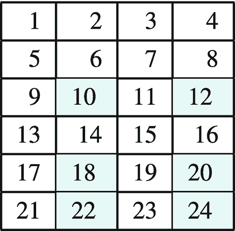

MATLAB 方便地允许我们使用 `a(I,J)` 定义子矩阵，其中 `I` 和 `J` 是我们的行和列的数组。然而，NumPy（截至 v1.20.2）在这里令人失望，因为 `a[I,J]` 会引发 `IndexError`。为了实现与 MATLAB 相同的提取，需要使用特殊的访问器函数 `np.ix_()`：

| MATLAB: | Python: |
| --- | --- |
| `>> a = reshape([1:24], 4,6)'`<br>`a =`<br>`    1    2    3    4`<br>`    5    6    7    8`<br>`    9   10   11   12`<br>`   13   14   15   16`<br>`   17   18   19   20`<br>`   21   22   23   24`<br>`>> I = [3 5 6];`<br>`>> J = [2  4];`<br>`>> a(I,J)`<br>`   10   12`<br>`   18   20`<br>`   22   24` | `In : a = np.arange(1,25).reshape(6,4)`<br>`In : a`<br>`array([[ 1,  2,  3,  4],`<br>`       [ 5,  6,  7,  8],`<br>`       [ 9, 10, 11, 12],`<br>`       [13, 14, 15, 16],`<br>`       [17, 18, 19, 20],`<br>`       [21, 22, 23, 24]])`<br>`In : I = [2, 4, 5]`<br>`In : J = [1, 3]`<br>`In : a[np.ix_(I,J)]`<br>`array([[10, 12],`<br>`       [18, 20],`<br>`       [22, 24]])` |

或者，我们可以使用索引链（第 3.4.5 节）配合一对单维索引数组：

**Python:**

```python
# 代码示例
```

`a[I,J]`

```
Traceback (most recent call last):
  ...
IndexError: shape mismatch: indexing arrays could not be broadcast
together with shapes (3,) (2,)
```

`a[I,:]`

```
array([[ 9, 10, 11, 12],
       [17, 18, 19, 20],
       [21, 22, 23, 24]])
```

`a[:,J]`

```
array([[ 2,  4],
       [ 6,  8],
       [10, 12],
       [14, 16],
       [18, 20],
       [22, 24]])
```

`a[I][:,J]`

```
array([[10, 12],
       [18, 20],
       [22, 24]])
```

不过，符号 `a[I][:,J]` 不够直观，不建议使用。

### 11.1.16 查找感兴趣的项

NumPy 和 MATLAB 都有用于在数组中定位满足所需属性的项的函数。以下各节将使用以下二维数组来演示在有 NaN 和无 NaN 的情况下在数组中搜索项。（NaN 用于大气科学等领域表示未知值，例如，卫星地形图像可能使用 NaN 来表示被云层遮挡的地面像素。）

在每个示例中，我们都需要找到满足属性的值以及这些值的索引。

| MATLAB: | Python: |
| --- | --- |
| `>> X = [0.22, -.47; ...`<br>`        0.97, -.31; ...`<br>`        0.32, 0.05];`<br>`>> Z = [0.22, -.47; ...`<br>`        0.97, -.31; ...`<br>`        nan , 0.05];` | `In : X = np.array(`<br>`       [[0.22, -.47,],`<br>`        [0.97, -.31,],`<br>`        [0.32, 0.05,]])`<br>`In : Z = np.array(`<br>`       [[0.22  , -.47,],`<br>`        [0.97  , -.31,],`<br>`        [np.NaN, 0.05,]])` |

#### 11.1.16.1 查找最小项

MATLAB 和 NumPy 的 `min()` 和 `max()` 函数的工作方式类似，除了处理 NaN 时——在 NumPy 中，如果预计要处理包含 NaN 的数组，必须显式调用一个能感知 NaN 的函数。此示例使用前一节中的 `X` 和 `Z`：

| MATLAB: | Python: |
| --- | --- |
| `>> min(X,[],'all')`<br>`-0.47000`<br>`>> min(Z,[],'all')`<br>`-0.47000` | `In : np.min(X)`<br>`Out: -0.47`<br>`In : np.min(Z)`<br>`Out: nan`<br>`In : np.nanmin(Z)`<br>`Out: -0.47` |

Python 的另一个不便之处在于，`np.argmin()` 返回的最小值的索引是一个*线性*索引，与 MATLAB 不同，对于具有两个或更多维度的数组，需要使用 `.take()` 方法。或者，可以将线性索引和数组的维度传递给 `np.unravel_index()`，以获取对应线性索引的行和列（以及更高维度，如果需要）的索引。

| MATLAB: | Python: |
| --- | --- |
| `>> [Rval, Rind] = min(X)`<br>`Rval =`<br>`0.22000  -0.47000`<br>`Rind =`<br>`1   1`<br>`>> [Cval, Cind] = min(Rval)`<br>`Cval = -0.47000`<br>`Cind =  2`<br>`>> R = Rind(Cind); C = Cind;`<br>`>> R, C`<br>`R =  1`<br>`C =  2`<br>`>> X(R,C)`<br>`-0.47000` | `In : lin_i = np.argmin(X)`<br>`In : lin_i`<br>`Out: 1`<br>`In : X.take(lin_i)`<br>`Out: -0.47`<br>`In : R, C = np.unravel_index(lin_i, X.shape)`<br>`In : R, C`<br>`Out: (0, 1)`<br>`In : X[R,C]`<br>`Out: -0.47` |

相同的过程在 MATLAB 中适用于包含 NaN 的 `Z` 数组。然而在 Python 中，必须调用 `np.nanargmin(Z)` 才能得到 –0.47。调用 `np.argmin(Z)` 会导致得到线性索引 4，对应于 NaN 项，而不是 1。

MATLAB 和 Python 在查找最小值方面的一个共同点是，如果矩阵中有多个相同的最小值，两种语言都会返回第一次出现的位置。

#### 11.1.16.2 查找最大项

毫不奇怪，查找最大项索引的过程与查找最小项完全相同，只是所有函数调用中将 `min` 替换为 `max`：

| MATLAB: | Python: |
| --- | --- |
| `>> [Rval, Rind] = max(X);`<br>`>> [Cval, Cind] = max(Rval);`<br>`>> R = Rind(Cind); C = Cind;`<br>`>> R, C`<br>`R =  2`<br>`C =  1`<br>`>> X(R,C)`<br>`ns =  0.97000` | `In : lin_i = np.argmax(X)`<br>`In : X.take(lin_i)`<br>`Out: 0.97`<br>`In : R, C = np.unravel_index(lin_i, X.shape)`<br>`In : R, C`<br>`Out: (1, 0)`<br>`In : X[R,C]`<br>`Out: 0.97` |

Python 中对 `argmax()` 的调用也可以写成 `X` 数组上的方法调用；`lin_i = X.argmax()` 等价于 `lin_i = np.argmax(X)`。

以下是根据您的要求翻译的中文版本，格式严格遵循注意事项，未遗漏任何内容，也未重复输出原文。

#### 11.1.16.3 查找最接近给定值的项

通过获取数组所有项与目标值之间的最小差值位置，可以找到最接近该值的项。以下示例查找最接近 –0.5 的项的索引：

| MATLAB: | Python: |
| --- | --- |
| `>> delta = abs(X - (-0.5));` `>> [Rval, Rind] = min(delta);` `>> [Cval, Cind] = min(Rval);` `>> R = Rind(Cind); C = Cind;` `>> R, C` `R = 1` `C = 2` `>> X(R,C)` `-0.47000` | `In : delta = np.abs(X - (-0.5))` `In : lin_i = delta.argmin()` `In : R, C = np.unravel_index(lin_i, X.shape)` `In : R, C` `Out: (0, 1)` `In : X[R, C]` `Out: -0.47` |

再次强调，在 Python 中对包含 NaN 的数组 `Z` 进行类似的搜索时，需要使用 `nanargmin()` 代替 `argmin()`。而上面展示的 MATLAB 代码既能处理 `X` 也能处理 `Z`。

#### 11.1.16.4 在已排序的一维数组中查找最接近给定值的项

搜索最接近给定值的项的一种特殊情况是：待搜索的数组是一维且已排序的。排序后的数据允许使用二分搜索快速定位目标项。一个典型应用场景是处理按时间顺序累积的数据；后续分析通常需要知道在给定时间 `T` 附近记录了哪些数据。

MATLAB 有一个未正式文档记载（且不能保证在未来版本中存在）的二分搜索功能，奇怪地通过 `builtin('_ismemberhelper',A,S)` 调用^((39))。但它只适用于精确匹配，不适用于最近邻匹配。在这种情况下，其性能并不优于第 11.1.16.3 节中 *O*(*N*) 复杂度的 `min()` 方法。

Python 的解决方案是所有 NumPy 数组可用的 `.searchsorted()` 方法。它执行 *O*(*log**2*) 复杂度的二分搜索，以找到目标元素应插入的位置来保持排序顺序。

| MATLAB: | Python: |
| --- | --- |
| `X = 1000:1700;` `for t = [1234.4, 1245.6]` `delta = abs(X - t);` `[val, ind] = min(delta);` `fprintf('%.2f\n', X(ind))` `end` `1234.00` `1246.00` | `In : A = np.arange(1000.0, 1701.0)` `In : t = [1234.5, 1245.6]` `In : ind = A.searchsorted(t)` `In : ind` `Out: array([235, 246])` `In : A[ind]` `Out: array([1235., 1246.])` |

#### 11.1.16.5 查找满足条件的项的索引

可以使用 NumPy 的 `argwhere()` 函数查找满足条件的项的位置，该函数返回一个包含那些匹配项索引的数组。MATLAB 的 `find()` 函数功能相同，但它返回的是数组的线性索引，而不是 Python 返回的索引集合（例如，二维数组的 (`i`,`j`) 对）。

以下示例演示如何获取绝对值小于 0.3 的项的索引：

| MATLAB: | Python: |
| --- | --- |
| `>> ind = find(abs(X) < .3)` `1` `6` | `In : ind = np.argwhere(np.abs(X)<.3)` `In : ind` `array([[0, 0],` `[2, 1]])` |

MATLAB 的 `find()` 返回的值可以直接用于数组下标索引，但 Python 的 `np.argwhere()` 却不行。必须先在每个索引对上调用 `tuple()` 函数：

| MATLAB: | Python: |
| --- | --- |
| `>> X(ind)` `0.220000` `0.050000` | `In : X[ind]` `array([[[ 0.22, -0.47],` `# 不是` `[ 0.22, -0.47]],` `# 我们` `[[ 0.32,  0.05],` `# 想要` `[ 0.97, -0.31]]])` `# 的结果！` `In : X[tuple(ind[0])]` `Out: 0.22` `In : X[tuple(ind[1])]` `Out: 0.05` |

第 11.1.14.1 节展示了更复杂的数组条件，包含数值的 AND 和 OR 运算。

### 11.1.17 面向对象编程与计算性能

前一章的第 10.2 节提到面向对象编程可能对计算性能产生负面影响。为了演示这一点，我们将创建模拟球在矩形封闭区域内弹跳的仿真程序。一个仿真将使用常规的基于过程的编程方法，所有数据存储在数组中，而另一个则使用面向对象技术。该仿真有两个计算密集型部分：确定球之间的碰撞，以及更新发生碰撞的球对的速度向量。这里，我们将只实现仿真的碰撞检测部分。

如果我们将球的坐标和半径存储在常规数组中，就能充分利用向量化特性，在 MATLAB 和 Python 中轻松以 60 Hz 的频率计算一千个球之间的碰撞。两种语言都充分利用广播机制来计算碰撞矩阵，该矩阵是一个 `N` x `N` 的对称布尔矩阵，在包含 `N` 个球的仿真中，如果球 `i` 和球 `j` 接触，则在索引 (`i`, `j`) 和 (`j`, `i`) 处为 1（MATLAB）或 `True`（Python）。

MATLAB:
```

```

# collision_matrix 函数

文件: `code/OO/collision_matrix.m`

```
function coll = collision_matrix(x, y, R)
    dx = x - x';
    dy = y - y';
    sep = sqrt(dx.² + dy.²);
    sum_r = R + R';
    coll = sep < sum_r;
end
```

# run_sim 函数

文件: `code/OO/run_sim.m`

```
function res = run_sim(N, n_iter)
    fprintf('n balls=%d\n', N)
    for i = 1:n_iter
        box_x = 10.;
        box_y = 6.;
        r_min = 0.1;
        r_max = 0.3;
        x = r_max + (box_x - 2 * r_max) * rand(N, 1);
        y = r_max + (box_y - 2 * r_max) * rand(N, 1);
        R = 0.1 + 0.8 * rand(N, 1);
        tic
        coll = collision_matrix(x, y, R);
        n_coll = (sum(sum(coll)) - N) / 2;
        fprintf('n coll=%d Hz = %.2f\n', n_coll, 1 / toc)
    end
end
```

# Python 脚本

```
#!/usr/bin/env python3
```

# 文件: code/OO/collision_matrix.py

```python
import numpy as np
from numpy.random import rand
import time

def collision_matrix(x, y, R):
    """
    使用广播机制返回一个方形布尔矩阵，
    如果圆 i 和圆 j 相交，则在位置 [i,j] 和 [j,i] 处为 True。
    """
    dx = x[:,np.newaxis] - x[np.newaxis,:]
    dy = y[:,np.newaxis] - y[np.newaxis,:]
    sep = np.sqrt( dx**2 + dy**2 )
    sum_r = R[:,np.newaxis] + R[np.newaxis,:]
    return sep < sum_r

def run_sim(N, n_iter):
    box_x, box_y = 10., 6.
    r_min, r_max = 0.1, 0.3
    print(f'n balls={N}')
    for i in range(n_iter):
        x = r_max + (box_x-2*r_max)*rand(N)
        y = r_max + (box_y-2*r_max)*rand(N)
        R = 0.1 + 0.8*rand(N)
        T_s = time.time()
        coll = collision_matrix(x, y, R)
        n_coll = (np.sum(coll) - N)//2
        print(f'n coll={n_coll} Hz = '
              f'{1/(time.time()-T_s):.2f}')
```

## MATLAB 和 Python 的表现同样出色：

| MATLAB: | Python: |
| --- | --- |
| `>> run_sim(1000, 10)`<br>`n balls=1000`<br>`n coll=29965 Hz = 59.29`<br>`n coll=28679 Hz = 47.92`<br>`n coll=29406 Hz = 45.44`<br>`n coll=30536 Hz = 62.94`<br>`n coll=28888 Hz = 62.21`<br>`n coll=29597 Hz = 62.99`<br>`n coll=29443 Hz = 62.64`<br>`n coll=29441 Hz = 63.83`<br>`n coll=30324 Hz = 65.24`<br>`n coll=29286 Hz = 63.38` | `In : run_sim(1000, 10)`<br>`n balls=1000`<br>`n coll=28836 Hz = 32.22`<br>`n coll=28728 Hz = 43.19`<br>`n coll=29613 Hz = 45.33`<br>`n coll=28559 Hz = 65.21`<br>`n coll=30694 Hz = 56.81`<br>`n coll=29023 Hz = 64.17`<br>`n coll=29755 Hz = 58.66`<br>`n coll=28404 Hz = 64.25`<br>`n coll=29196 Hz = 60.42`<br>`n coll=29824 Hz = 64.44` |

我们将重复仿真，这次将每个球定义为一个 `Ball` 对象（`Circle` 的一个变体，包含一个碰撞检测函数），并添加一个类方法来检测该球是否与给定的另一个球接触。

### MATLAB:

```matlab
% file: code/OO/Ball.m
classdef Ball
    properties
        x {mustBeNumeric}
        y {mustBeNumeric}
        r {mustBeNumeric}
    end
    methods
        function obj = Ball(x,y,r)
            obj.x = x;
            obj.y = y;
            obj.r = r;
        end
        function coll = collides_with(obj, other)
            dx = obj.x - other.x;
            dy = obj.y - other.y;
            sep = sqrt( dx² + dy² );
            sum_r = obj.r + other.r;
            coll = sep < sum_r;
        end
    end
end

% file: code/OO/run_oo_sim.m
function res = run_oo_sim(N, n_iter)
    fprintf('n balls=%d\n', N)
    box_x = 10.;
    box_y =  6.;
    r_min = 0.1;
    r_max = 0.3;
    for i = 1:n_iter
        tic
        balls = {};
        for j = 1:N
            x = r_max + (box_x-2*r_max)*rand();
            y = r_max + (box_y-2*r_max)*rand();
            R = 0.1 + 0.8*rand();
            balls{j} = Ball(x,y,R);
        end
        coll = eye(N);
        for j = 1:N
            for k = j+1:N
                coll(j,k) = balls{j}.collides_with(balls{k});
                coll(k,j) = coll(j,k);
            end
        end
        n_coll = (sum(sum(coll)) - N)/2;
        fprintf('n coll=%d Hz = %.2f\n', n_coll, 1/toc)
    end
end
```

### Python:

```python
#!/usr/bin/env python3
```

# file: code/OO/Ball.py

```python
import numpy as np

from numpy.random import rand

import time

class Ball:

    def __init__(self, x, y, r):

        self.x = x

        self.y = y

        self.r = r

    def collides_with(self, other):

        dx = self.x - other.x

        dy = self.y - other.y

        sep = np.sqrt(dx**2 + dy**2)

        sum_r = self.r + other.r

        return sep < sum_r

def run_oo_sim(N, n_iter):

    box_x, box_y = 10., 6.

    r_min, r_max = 0.1, 0.3

    print(f'n balls={N}')

    for i in range(n_iter):

        balls = []

        for j in range(N):

            x = r_max + (box_x-2*r_max)*rand()

            y = r_max + (box_y-2*r_max)*rand()

            R = 0.1 + 0.8*rand()

            balls.append(Ball(x, y, R))

        coll = np.eye(N, dtype=np.bool)

        T_s = time.time()

        for j in range(N):

            for k in range(j+1, N):

                coll[j, k] = balls[j].collides_with(balls[k])

                coll[k, j] = coll[j, k]

        n_coll = (np.sum(coll) - N)//2

        print(f'n coll={n_coll} Hz = '

              f'{1/(time.time()-T_s):.2f}')

def main():

    run_oo_sim(1000, 10)

if __name__ == "__main__":
    main()
```

除了代码量更多之外，面向对象的解决方案比向量化方案慢得多；其更新频率低于 1 Hz，而向量化方案的频率约为 60 Hz。

| MATLAB: | Python: |
| --- | --- |
| ``` >> run_oo_sim(1000, 10) n balls=1000 n coll=29788 Hz = 0.77 n coll=29959 Hz = 0.84 n coll=29236 Hz = 0.85 n coll=29422 Hz = 0.85 n coll=30776 Hz = 0.85 n coll=29626 Hz = 0.86 n coll=30527 Hz = 0.83 n coll=28534 Hz = 0.85 n coll=29844 Hz = 0.85 n coll=30211 Hz = 0.85 ``` ``` In : run_oo_sim(1000, 10) n balls=1000 n coll=28442 Hz = 0.96 n coll=28054 Hz = 0.97 n coll=29002 Hz = 0.96 n coll=29128 Hz = 0.97 n coll=28722 Hz = 0.91 n coll=30064 Hz = 0.93 n coll=29300 Hz = 0.94 n coll=28034 Hz = 0.93 n coll=28609 Hz = 0.93 n coll=30782 Hz = 0.94 ```

## 11.2 线性代数

MATLAB 和 Python（通过 `NumPy` 和 `SciPy`）在线性代数方面提供了相似的功能和计算性能。主要有三个区别：

*   MATLAB 用于线性代数记法的运算符比 `NumPy` 或 `SciPy` 的更简洁。
*   MATLAB 拥有一套统一的线性代数函数，而 Python 的函数分布在 `NumPy` 和 `SciPy` 中，这两个库在名称相同的线性代数子模块 `numpy.linalg` 和 `scipy.linalg` 中存在功能重叠。通常，`SciPy` 提供的线性代数功能比 `NumPy` 更丰富。
*   MATLAB 的函数适用于稠密矩阵和稀疏矩阵。在 `NumPy` 和 `SciPy` 中，必须使用名称不同的函数来操作稀疏矩阵。Python 的稀疏矩阵功能将在第 11.3 节讨论。

### 11.2.1 线性方程组

#### 11.2.1.1 *Ax* = *b*

具有方阵 A 的线性方程可以在两种语言中这样求解：

| MATLAB: | Python: |
| --- | --- |
| ``` >> A = [1,2,-3; ... 4,-5,6; ... -7,8,9]; >> b = [-1,0; 0,1; 1,0]; >> x = A\b x = -0.375000 0.175000 -0.250000 0.050000 0.041667 0.091667 ``` ``` In : import numpy as np In : A = np.array([[1,2,-3], [4,-5,6], [-7,8,9]]) In : b = np.array([[-1,0], [ 0,1], [ 1,0]]) In : x = np.linalg.solve(A,b) In : x array([[-0.375 , 0.175 ], [-0.25 , 0.05 ], [ 0.04166667, 0.09166667]]) ```

若仅需获取满秩矩阵的 *LU* 因子以便后续进行前代和回代，可以使用 `SciPy` 版本的 `linalg` 模块：

| MATLAB: | Python: |
| --- | --- |
| ``` >> A = [1,2,-3; ... 4,-5,6; ... -7,8,9]; >> [L, U, P] = lu(A) L = 1.00000 0.00000 0.00000 -0.14286 1.00000 0.00000 -0.57143 -0.13636 1.00000 U = -7.00000 8.00000 9.00000 0.00000 3.14286 -1.71429 0.00000 0.00000 10.90909 P = 置换矩阵 0 0 1 1 0 0 0 1 0 ``` ``` In : import scipy.linalg as spla In : A = np.array([[1,2,-3], [4,-5,6], [-7,8,9]]) In : LU, P = spla.lu_factor(A) In : LU, P (array([[-7. , 8. , 9. ], [-0.14285714, 3.14285714, -1.71428571], [-0.57142857, -0.13636364, 10.90909091]]), array([2, 2, 2], dtype=int32)) ```

其他选项包括对称矩阵的 Cholesky（`scipy.linalg.cholesky`、`scipy.linalg.cholesky_banded()`）和 LDL（`scipy.linalg.ldl()`）分解。然后使用 `lu_solve()`（或针对 Cholesky 因子使用 `cho_solve()`）进行前代和回代：

| MATLAB: | Python: |
| --- | --- |
| ``` >> b = [1; 3; 5]; >> x = U\(L\(P*b)) 9.750000000000000e-01 8.500000000000000e-01 5.583333333333333e-01 ``` ``` In : b = np.array([1,3,5]) In : x = spla.lu_solve( (LU, P), b ) In : x Out: array([0.975 , 0.85 , 0.55833333]) ```

### 11.2.2 奇异值分解

`NumPy` 和 `SciPy` 具有名称相同的 SVD 函数：`numpy.linalg.svd()` 和 `scipy.linalg.svd()`。`SciPy` 版本通过可选地检查 Inf 和 NaN 值（使用 `check_finite=True`）并提供可供选择的 LAPACK 例程（默认是 `lapack_driver='gesdd'`，而 `lapack_driver='gesvd'` 选择与 MATLAB 相同的例程）来提供稍多一些的功能。

| MATLAB: | Python: |
| --- | --- |
| ``` >> A = [9 8 7; 5 4 3; ... -1 2 -1; -5 5 0]; >> [U,S,V] = svd(A,0) U = -8.9152e-01 4.7790e-02 2.0140e-01 -4.5163e-01 -1.9355e-02 -3.8250e-01 2.1957e-03 2.9513e-01 -8.6635e-01 3.4816e-02 9.5407e-01 2.5014e-01 S = 1.5615e+01 0 0 0 7.3818e+00 0 0 0 1.2919e+00 V = -6.6973e-01 -6.4105e-01 -3.7485e-01 -5.6100e-01 7.6749e-01 -3.1021e-01 -4.8656e-01 -2.5282e-03 8.7365e-01 ``` ``` In : A = np.array([[9,8,7],[5,4,3], ...: [-1,2,-1],[-5,5,0.]]) In : U, S, V = np.linalg.svd(A, ...: full_matrices= ...: False) In : U array([[-0.89152435, 0.04778986, 0.20140207], [-0.45162746, -0.01935495, -0.38250147], [ 0.00219575, 0.29512661, -0.86634739], [ 0.0348158 , 0.95406593, 0.25014403]]) In : S array([15.61537691, 7.38180298, 1.29189342]) In : V array([[-0.66973287, -0.56100049, -0.48655557], [-0.64105237, 0.76749298, -0.00252817], [-0.37484629, -0.3102144 , 0.87364597]]) ```

MATLAB 和 Python 在 `U` 和 `S` 上的结果一致，但 `V` 是转置的。这里，我们通过从原始矩阵中减去重构的 `A` 来计算解的误差：

| MATLAB: | Python: |
| --- | --- |
| ``` >> A - U*S*V' 7.1054e-15 1.7764e-15 4.4409e-15 2.6645e-15 1.7764e-15 1.3323e-15 2.2204e-16 1.5543e-15 -1.1102e-16 8.8818e-16 6.2172e-15 1.1657e-15 ``` ``` In : A - U@np.diag(S)@V array( [[ 7.10542736e-15, 1.77635684e-15, 4.44089210e-15], [ 2.66453526e-15, 1.77635684e-15, 1.33226763e-15], [ 2.22044605e-16, 1.55431223e-15,-1.11022302e-16], [ 8.88178420e-16, 6.21724894e-15, 1.12317600e-15]]) ```

### 11.2.3 特征值问题

MATLAB 的重载函数能力对于求解特征值问题非常有吸引力，因为仅需两个函数 `eig()` 和 `eigs()`，就能处理所有情况——仅求特征值、求特征值和特征向量、简单形式、广义形式、对称或非对称输入、全解或部分解。相比之下，NumPy 和 SciPy 合起来有近十几个函数（其中一些名称完全相同）来覆盖这些情况。表格 11-4 展示了与 MATLAB 相比，Python 中特征值求解能力的分散情况。“非对称”列是指函数处理非对称矩阵的能力。该列中没有标记的函数仅适用于实对称或复厄尔米特矩阵。专门的 Python 函数 `eigvals_banded()` 和 `eigh_tridiagonal()` 未包含在内。

| MATLAB: | Python: |
| --- | --- |
| ```>> n = 3;>> ones = ones(n);>> off  = 2*tril(ones,-2);>> A = (n+2)*eye(n) - ones + offA =    4    -1    -1    -1     4    -1    1    -1     4>> [v,d] = eig(A)v =   -0.5774    0.0000    0.7071   -0.5774    0.7071    0.7071    0.5774   -0.7071   -0.0000d =    4.0000         0         0         0    5.0000         0         0         0    3.0000>> A*v - v*d   1.0e-14 *   -0.0444    0.0020         0   -0.2220    0.2665    0.1776    0.2220   -0.2665   -0.1228``` ```In :import numpy as npIn : n = 3In : ones = np.ones((n,n))In : off  = 2*np.tril(ones,-2)In : A = (n+2)*np.eye(n) - ones + offIn : AOut:array([[ 4., -1., -1.],       [-1.,  4., -1.],       [ 1., -1.,  4.]])In : [d,v] = np.linalg.eig(A)In : vOut: array(      [[ 2.22045e-15,  5.77350e-01,  7.07107e-01],       [ 7.07107e-01,  5.77350e-01,  7.07107e-01],       [-7.07107e-01, -5.77350e-01,    4.44089e-16]])In : dOut: array([5., 4., 3.])In : A@v - v@np.diag(d)Out: array(      [[-5.55111e-16, -4.44089e-16,  4.44089e-16],       [ 4.88498e-15,  3.10862e-15,  2.22046e-15],       [-1.77636e-15,  -8.88178e-16, -4.44089e-16]])```

**表 11-4** MATLAB、NumPy 和 SciPy 特征值求解器的能力

| | 稠密 | 稀疏 | *Ax* = *λx* | *Ax* = *λBx* | 非对称 | 全解 | 部分解 |
| --- | --- | --- | --- | --- | --- | --- | --- |
| MATLAB | | | | | | | |
| `eig` | • | • | • | • | • | • | |
| `eigs` | • | • | • | • | • | | • |
| `numpy.linalg` | | | | | | | |
| `eig` | • | | • | | • | • | |
| `eigh` | • | | • | | | • | |
| `eigvals` | • | | • | | • | • | |
| `eigvalsh` | • | | • | | | • | |
| `scipy.linalg` | • | | | | • | • | |
| `eig` | • | | • | • | • | • | |
| `eigh` | • | | • | • | | • | |
| `eigvals` | • | | • | • | • | • | |
| `eigvalsh` | • | | • | • | | • | |
| `scipy.sparse.linalg` | | | | | | | |
| `eig` | | • | • | • | • | | • |
| `eigsh` | | • | • | • | | | • |

除了 Python 的功能分散之外，其解决方案、计算性能和精度与 MATLAB 相当。

## 11.3 稀疏矩阵

稀疏矩阵是许多数值分析领域的核心，包括计算流体动力学、有限元分析、网络理论计算以及用于机器学习和人工智能的神经网络计算。SciPy 的 `sparse` 模块为 Python 提供了稀疏矩阵功能。在底层，`sparse` 使用 C 和 Fortran 库 SuperLU 和 ARPACK 来求解方程组和特征值问题。

SciPy 的稀疏矩阵功能很好，但不如 MATLAB 方便。MATLAB 有两个优势：其稀疏矩阵与语言集成度更高，并且有一种既高效又灵活的单一稀疏存储方案。SciPy 提供了许多稀疏矩阵操作，但其稀疏矩阵可能只能用于 NumPy 函数的一个子集。此外，在 SciPy 中创建稀疏矩阵之前，必须决定使用七种（！）存储格式中的哪一种。每种存储格式都有不同的索引能力和计算性能。然而，格式之间的转换很容易。

### 11.3.1 使用 COO、CSC、CSR 创建稀疏矩阵

可以通过将稠密矩阵传递给任何稀疏创建函数，从稠密矩阵创建稀疏矩阵。此示例使用了压缩行存储函数 `csr_matrix()`：

| MATLAB: | Python: |
| --- | --- |
| ```>> x = [1 2 0; 0 3 0; 0 4 5]x =    1     2     0    0     3     0    0     4     5>> y = sparse(x)y =   (1,1)        1   (1,2)        2   (2,2)        3   (3,2)        4   (3,3)        5``` ```import scipy.sparse as spIn : x = np.array([[1, 2, 0],                [0, 3, 0],[0, 4, 5]])In : xarray([[1, 2, 0],       [0, 3, 0],       [0, 4, 5]])In : y = sp.csr_matrix(x)In : print(y)Out      (0, 0)        1      (0, 1)        2      (1, 1)        3      (2, 1)        4      (2, 2)        5```

从稠密矩阵转换通常只用于测试稀疏算法，因为只有相对较小的稀疏矩阵才能通过这种方式创建。更典型的情况是，从头开始构建一个稀疏矩阵。最直接的方法是使用 SciPy 的“坐标”格式，也称为 “COO”。其创建方法很高效，并且与 MATLAB 非常相似——向构造函数提供行、列和值的线性数组。例如，定义以下矩阵的代码


如下所示：

| MATLAB: | Python: |
| --- | --- |

好的，高级文档工程师，已根据您的要求和示例对文本进行排版。

### 11.3.1.1 重复的 COO 索引

MATLAB 的 `sparse()` 函数会对索引重复的项求和。换句话说，如果索引项 `(i, j)` 在输入索引数组中出现了三次，并在值数组中对应值 `V[1]`、`V[2]` 和 `V[3]`，那么 MATLAB 矩阵在 `(i, j)` 处的值将是 `V[1] + V[2] + V[3]`。所有 SciPy 矩阵创建函数也具有相同的行为，尽管求和可能是隐式的——三个重复项被分开存储，但对稀疏矩阵的所有数学运算都产生与求和相同的结果。为了演示这一点，我们将创建稀疏矩阵

$$ \left(\begin{array}{cc}1&amp; 3\\ {}0&amp; 4\end{array}\right) $$

通过重复最后一行和最后一列的索引两次，第一次值为 10，第二次值为 -6。此示例省略了尾部维度参数，因为输入数组 `I` 和 `J` 中最大的行和列索引足以定义维度。

| MATLAB: | Python: |
| --- | --- |
| `>> I = [1 1 2 2 ];`<br>`>> J = [1 2 2 2 ];`<br>`>> V = [1 3 10 -6 ];`<br>`>> A = sparse(I,J,V)` `A =` `Compressed Column Sparse` (rows = 2, cols = 2, nnz = 3 [75%])`(1, 1) ->  1`  `(1, 2) ->  3`  `(2, 2) ->  4` | `In :` `import scipy.sparse as sp` `In : I = [0, 0, 1, 1]` `In : J = [0, 1, 1, 1]` `In : V = [1, 3, 10, -6]` `In : A = sp.coo_matrix((V,(I,J)))` `In : A` `<2x2 sparse matrix of type`<br>`'<class 'numpy.int64'>'` with 4 stored elements in` `COOrdinate format>` `In : print(A)` `(0, 0)        1` `(0, 1)        3` `(1, 1)       10` `(1, 1)       -6` |

尽管 Python 分别存储了重复的索引值，但矩阵计算表明它使用了最后一行的汇总值 4。

| MATLAB: | Python: |
| --- | --- |
| `>> A * [1; 1]`<br>`4`<br>`4` | `In : A.dot([1,1])`<br>`Out: array([4, 4], dtype=int64)` |

Python 中的重复索引项可以通过稀疏矩阵对象的 `.sum_duplicates()` 方法显式求和：

```python
In : print(A)
(0, 0)        1
(0, 1)        3
(1, 1)        10
(1, 1)        -6
In : A.sum_duplicates()
In : print(A)
(0, 0)        1
(0, 1)        3
(1, 1)        4
```

### 11.3.1.2 提取索引和值

COO 稀疏矩阵的索引和值存储为对象属性 `.row`、`.col` 和 `.data`。这些对应于 MATLAB 的 `find()` 函数在稀疏矩阵上的输出。使用第 11.3.1.1 节中的 `A`：

| MATLAB: | Python: |
| --- | --- |
| `>> [I J V] = find(A);`<br>`>> I'` `1 1 2`<br>`>> J'` `1 2 2`<br>`> V'` `1 3 4` | `In : A.sum_duplicates()`<br>`In : A.row`<br>`Out: array([0, 0, 1], dtype=int32)`<br>`In : A.col`<br>`Out: array([0, 1, 1], dtype=int32)`<br>`In : A.data`<br>`Out: array([1, 3, 4])` |

如果没有调用 `.sum_duplicates()`，索引和值属性将显示重复项。

只有 COO 矩阵具有 `.row` 和 `.col` 属性。然而，通过矩阵的 `.tocoo()` 方法从其他格式转换为 COO 代价很小。有关其他格式可用组件的完整列表，请参见第 11.3.5.2 节。

### 11.3.1.3 压缩行、列存储

压缩稀疏行（CSR）和压缩稀疏列（CSC）存储方案允许更快速的矩阵操作，例如因式分解和乘法。尽管它们的创建函数 `csr_matrix()` 和 `csc_matrix()` 可以接受与 `coo_matrix()` 相同的参数，但通常更快的方法是使用 `coo_matrix()` 创建矩阵，然后使用矩阵的 `.tocsr()` 或 `.tocsc()` 方法将其转换为 CSR 或 CSC 格式。重复的索引在这些转换过程中会被求和。

虽然 `csr_matrix()` 和 `csc_matrix()` 可以接受显式的行和列索引数组，但可以直接提供 CSR 和 CSC 内部表示原生的更紧凑索引和索引指针数组。对于 `csr_matrix()`，这意味着提供一个列索引数组（上例中的 `J`）和一个包含每行项计数的指针数组。指针数组 `indptr` 的定义使得第 `i` 行的索引存储在 `J[indptr[i]:indptr[i + 1]]` 中，对应的值存储在 `data[indptr[i]:indptr[i + 1]]` 中。这些输入重复了前面的示例：

```python
In : J = np.array([1,0,2,1,2])  # column indices
In : V = np.array([1,8,2,4,-3]) # matrix data values
In : indptr = np.array([0, 1, 3, 5, 5])
In : A = sp.csr_matrix((V, J, indptr), shape=(4, 3))
In : A.todense()
```

`indptr` 数组需要进一步澄清——我们如何得到 `[0, 1, 3, 5, 5]`？一种理解方式是差值 `indptr[i + 1] - indptr[i]` 是第 `i` 行的项数，而 `indptr` 中的每个项包含其之前的项的总和。表 11-5 显示了捕获稀疏矩阵索引 `(0, 1)`、`(1, 0)`、`(1, 2)`、`(2, 1)` 和 `(2, 2)` 所需的索引数组 `J` 的内容。

**表 11-5** 每行的 `indptr` 值

| 行   |     |     | 列索引    |

|------|-----|-----|-----------|

| `0`  | `J[ indptr[0]:indptr[1] ]` | `J[0:1]` | `[1]`     |

| `1`  | `J[ indptr[1]:indptr[2] ]` | `J[1:3]` | `[0,2]`   |

| `2`  | `J[ indptr[2]:indptr[3] ]` | `J[3:5]` | `[1,2]`   |

| `3`  | `J[ indptr[3]:indptr[4] ]` | `J[5:5]` | `[]`      |

要将行索引数组（在我们的例子中是 `I = [1,0,2,1,2]`）转换为索引指针，我们可以利用 `collections` 模块中的数据容器 `Counter`。`Counter` 接受一个可迭代对象（如列表或数组）并返回一个字典，其键是可迭代对象中的唯一条目，值是这些条目出现的次数。如果字典使用不存在的键进行索引，它不会引发 `KeyError`，而是简单地返回零。

Python:

```
In : I
Out: array([0, 1, 1, 2, 2])
In : from collections import Counter
In : n_terms_this_row = Counter(I)
In : indptr = [0]
In : for i in range(nRows):
...:     indptr.append( indptr[-1] + n_terms_this_row[i])
In : indptr
Out: [0, 1, 3, 5, 5]
```

`csc_matrix()` 的索引指针输入的工作方式与 `csc_matrix()` 相同，只是提供了显式的行索引和指向列索引的指针，而不是反过来。

## 11.3.2 使用 LIL 和 DOK 创建稀疏矩阵

上一节的三种存储格式（坐标格式、压缩行格式和压缩列格式）要求预先明确给出每一行的行索引、列索引和值。除了计算位置和值然后从中创建稀疏矩阵，还可以逐步构建稀疏矩阵。此外，许多工程应用（尤其是有限元分析）会从许多较小的子矩阵生成稀疏矩阵。最终得到的稀疏矩阵在相邻的行和列中包含非零项的小块。

SciPy 提供了三种存储格式：列表列表（LIL）、键字典（DOK）和分块压缩行（BSR），它们能够高效地对此类结构化稀疏矩阵进行增量式组装、访问和操作。

在这里，我们将重新创建矩阵


使用标量插入的方式处理第一行的 1 和第一列的 8，然后通过块插入的方式将子矩阵


放置到第二、三行和第二、三列。

此示例使用了 LIL 构造器：

| MATLAB: | Python: |

| --- | --- |

| `.``>> A = sparse(4,3)``>> A(1,2) = 1;``>> A(2,1) = 8;``>> A(2:3,2:3) = [0 2;4 -3];``>> A``A =``Compressed Column Sparse` `(rows = 4, cols = 3,` `nnz = 5 [42%])` `(2, 1) ->  8` `(1, 2) ->  1` `(3, 2) ->  4` `(2, 3) ->  2` `(3, 3) -> -3` | `import scipy.sparse as sp``A = sp.lil_matrix( (4,3) )``A[0,1] = 1``A[1,0] = 8``A[1:3,1:3] = np.array([[0, 2],``[4,-3]])``In : print(A)``(0, 1)        1.0``(1, 0)        8.0``(1, 2)        2.0``(2, 1)        4.0``(2, 2)       -3.0` |

键字典（DOK）构造器在功能上与 LIL 构造器相同。以下代码的唯一区别在于调用的是 `dok_matrix()` 而非 `lil_matrix()`：

| MATLAB: | Python: |

| --- | --- |

| `.``>> A = sparse(4,3)``>> A(1,2) = 1;``>> A(2,1) = 8;``>> A(2:3,2:3) = [0 2;4 -3];``>> A``A =``Compressed Column Sparse` `(rows = 4, cols = 3,` `nnz = 5 [42%])` `(2, 1) ->  8` `(1, 2) ->  1` `(3, 2) ->  4` `(2, 3) ->  2` `(3, 3) -> -3` | `import scipy.sparse as sp``A = sp.dok_matrix( (4,3) )``A[0,1] = 1``A[1,0] = 8``A[1:3,1:3] = np.array([[0, 2],``[4,-3]])``In : print(A)``(0, 1)        1.0``(1, 0)        8.0``(1, 2)        2.0``(2, 1)        4.0``(2, 2)        -3.0` |

除了直接插入项之外，MATLAB 和 SciPy 的 LIL 和 DOK 稀疏矩阵还允许对块进行求和，并在必要时更新稀疏结构：

| MATLAB: | Python: |

| --- | --- |

| `>> A(2:3,2:3) = ...` `A(2:3,2:3) + [0 2;4 -3];` | `A = sp.dok_matrix( (4,3) )``A[1:3,1:3] += np.array([[0, 2],``[4,-3]])` |

## 11.3.3 使用 BSR 和 DIA 创建稀疏矩阵

剩余的两种稀疏格式，即分块压缩行（BSR）和对角线（DIA），比前面五种更特殊，因此使用频率较低。

顾名思义，分块压缩行格式存储一组稠密子矩阵。不过它也有缺点：子矩阵的大小必须相同，并且不支持直接索引。BSR 构造器函数 `bsr_matrix()` 接受一个数据块的 3D 数组作为输入，以及包含块列索引的 1D 数组，以及指向每一行列索引的指针。此示例从四个 2 x 2 矩阵创建了一个 8 x 6 的稀疏矩阵——该稀疏矩阵随后有四个块行和三个块列：

Python:

```
In : V = np.array([[[1,1],[1,1]],
...:               [[2,2],[2,2]],
...:               [[3,3],[3,3]],
...:               [[4,4],[4,4]]])
In : J = np.array([1, 2, 0, 2])  # 列索引
In : indptr = np.array([0, 1, 2, 2, 4])
In : A = sp.bsr_matrix((V, J, indptr), shape=(8, 6))
In : A.todense()
matrix([[0, 0, 1, 1, 0, 0],
[0, 0, 1, 1, 0, 0],
[0, 0, 0, 0, 2, 2],
[0, 0, 0, 0, 2, 2],
[0, 0, 0, 0, 0, 0],
[0, 0, 0, 0, 0, 0],
[3, 3, 0, 0, 4, 4],
[3, 3, 0, 0, 4, 4]])
```

`indptr` 数组是根据块行索引（在此示例中为 `I = [0,1,3,3]`）计算得出的，其创建方式与 `csr_matrix()` 的 `indptr` 相同（请参考第 11.3.1 节）。

对角线存储格式 DIA 非常适合采用有限差分网格上迭代求解的计算流体动力学问题。`dia_matrix()` 构造器类似于 MATLAB 的 `spdiags()` 函数：

MATLAB:

### 11.3.3 DIA 稀疏矩阵

```matlab
>> data = [-2 -4 -6 -8 -10 -12 -14;
10 11 12 13  14  15  16;
-1 -3 -5 -7  -9 -11 -13]' ;
>> offsets = [2 0 -1];
>> A = spdiags(data, offsets, 7,7);
>> full(A)
10    0   -6    0    0    0    0
-1   11    0   -8    0    0    0
0   -3   12    0  -10    0    0
0    0   -5   13    0  -12    0
0    0    0   -7   14    0  -14
0    0    0    0   -9   15    0
0    0    0    0    0  -11   16
```

Python:

```python
In : data = np.array([[-2,-4,-6,-8,-10,-12,-14],
...:                  [10,11,12,13, 14, 15, 16],
...:                  [-1,-3,-5,-7, -9,-11,-13]])
In : offsets = np.array([2,0,-1])
In : A = sp.dia_matrix((data, offsets), shape=(7,7))
In : A.todense()
matrix([[ 10,   0,  -6,   0,   0,   0,   0],
        [ -1,  11,   0,  -8,   0,   0,   0],
        [  0,  -3,  12,   0, -10,   0,   0],
        [  0,   0,  -5,  13,   0, -12,   0],
        [  0,   0,   0,  -7,  14,   0, -14],
        [  0,   0,   0,   0,  -9,  15,   0],
        [  0,   0,   0,   0,   0, -11,  16]])
```

请注意，在 MATLAB 和 Python 中，`data` 中的项会被丢弃，以适应远离对角线时尺寸的减小。在我们的例子中，`-2` 和 `-4` 不会出现在对角线以上，而 `-13` 不会出现在对角线以下。

与 BSR 一样，DIA 稀疏矩阵不能被下标索引。

### 11.3.4 测试矩阵

第 11.1.6.14 节给出了一些稠密测试矩阵的示例；这里，我们针对稀疏矩阵做同样的事情。与稠密随机矩阵一样，MATLAB 的稀疏随机矩阵不会与 Python 的稀疏矩阵匹配。

#### 11.3.4.1 密度为 40% 的随机稀疏 4 × 3 数组

| MATLAB: | Python: |
| :--- | :--- |
| `>> A = sprand(4,3,.4);`<br>`>> full(A)`<br>`   0.000  0.000  0.000`<br>`   0.617  0.000  0.349`<br>`   0.000  0.000  0.000`<br>`   0.881  0.165  0.335` | `In : A = sp.rand(4, 3, density=0.4, format='dok')`<br>`In : A.todense()`<br>`matrix([[0.688, 0.401, 0.   ],`<br>`        [0.   , 0.   , 0.   ],`<br>`        [0.337, 0.   , 0.   ],`<br>`        [0.   , 0.023, 0.   ]])` |

#### 11.3.4.2 通过 `I`, `J`, `V` 生成随机稀疏矩阵

这里，我们还将使用 MATLAB 的 `spy()` 函数和 Python 的 `matplotlib` 来查看稀疏矩阵的结构：

| MATLAB: | Python: |
| :--- | :--- |
| `nR = 50;`<br>`nC = 50;`<br>`nNZ = 10*nC;`<br>`I = ceil(nR*rand(nNZ,1));`<br>`J = ceil(nC*rand(nNZ,1));`<br>`V = ceil(nC*rand(nNZ,1));`<br>`A = sparse(I,J,V);`<br>`spy(A)`<br>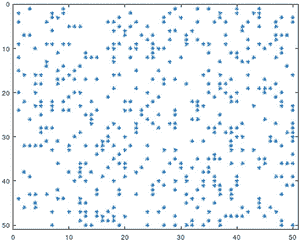 | `import scipy.sparse as sp`<br>`import numpy as np`<br>`import matplotlib.pyplot as plt`<br>`nR = 50`<br>`nC = 50`<br>`nNZ = 10*nC` *# 非零元素数量*<br>`I = np.random.randint(0, nR, size=(nNZ,))`<br>`J = np.random.randint(0, nC, size=(nNZ,))`<br>`V = np.random.randint(0, nC, size=(nNZ,))`<br>`A = sp.coo_matrix((V,(I,J)),shape=(nR,nC))`<br>`plt.spy(A)`<br>`plt.show()`<br> |

#### 11.3.4.3 箭头矩阵

| MATLAB: | Python: |
| :--- | :--- |
| `>> A = speye(4);`<br>`>> A(1,:) = 1;`<br>`>> A(:,1) = 1;`<br>`>> full(A)`<br>`   1   1   1   1`<br>`   1   1   0   0`<br>`   1   0   1   0`<br>`   1   0   0   1` | `In : A = sp.identity(4).todok()`<br>`In : A[0,:] = 1`<br>`In : A[:,0] = 1`<br>`In : A.todense()`<br>`matrix([[1., 1., 1., 1.],`<br>`        [1., 1., 0., 0.],`<br>`        [1., 0., 1., 0.],`<br>`        [1., 0., 0., 1.]])` |

### 11.3.5 稀疏矩阵的输入/输出（I/O）

MATLAB 的 `save` 和 `load` 命令可以轻松地将稀疏矩阵写入 `.mat` 文件并将其读回。与 NumPy 对应项不同，SciPy 稀疏矩阵缺乏用于文件输入和输出的内置方法。具有讽刺意味的是，SciPy 的 `savemat()` 和 `loadmat()` 函数支持从 MATLAB `.mat` 文件读取稀疏矩阵和向其写入稀疏矩阵。

#### 11.3.5.1 写入 MATLAB `.mat` 文件

此方法也适用于在 MATLAB 和 Python 之间传递稀疏矩阵。

#### 11.3.5.2 将组件部分写成 NumPy 数组

稀疏矩阵的组成部分——数据值以及行索引和列索引——是 NumPy 数组，因此我们可以使用 NumPy 的 `savez()` 和 `loadz()` 函数高效地读写它们。这里需要注意，项目名称因存储格式而异，因此在访问其组件之前，必须知道稀疏矩阵的格式（存储在其 `.format` 属性中）：

*   COO: `A.data`, `A.row`, `A.col`
*   CSR: `A.data`, `A.indices`, `A.indptr`
*   CSC: `A.data`, `A.indices`, `A.indptr`
*   LIL: `A.data`, `A.rows`（包含行和列索引）
*   BSR: `A.data`, `A.indices`, `A.indptr`
*   DIA: `A.data`, `A.offsets`

`DOK` 的独特之处在于其组件存储在字典中，而不是 NumPy 数组中。其条目可以通过 `A.keys()` 和 `A.values()` 检索。`DOK` 矩阵可以转换为其他格式以保存为 NumPy 数组，或者按照下一节所述写入 pickle 文件。

加载组件后，必须通过调用适当的构造函数重新生成矩阵。对于 COO 矩阵，过程如下：

Python：

```python
# 假设已加载 data, row, col 为 NumPy 数组
A = sp.coo_matrix((data, (row, col)), shape=(...))
```

# 11.3 稀疏矩阵

#### 11.3.5.3 写入 Python Pickle 对象

SciPy 稀疏矩阵是常规的 Python 变量，因此可以写入 pickle 文件（参考第 7.13 节）：

**Python：**

```python
In : import pickle
In : import scipy.sparse as sp
In : A = sp.rand(4, 3, 0.4, format='csr')
In : A.todense()
Out: matrix([[0.   , 0.   , 0.899],
             [0.   , 0.054, 0.   ],
             [0.   , 0.   , 0.   ],
             [0.   , 0.625, 0.603]])
In : with open('A.pkl', 'wb') as f:
In :     pickle.dump(A, f, 4) # protocol v 4
In : !ls -l A.pkl
In : -rw-rw-r-- 1 al al 457 May 29 14:15 A.pkl
In : A = None
In : with open('A.pkl', 'rb') as f:
In :     A = pickle.load(f)
In : A.todense()
Out: matrix([[0.   , 0.   , 0.899],
             [0.   , 0.054, 0.   ],
             [0.   , 0.   , 0.   ],
             [0.   , 0.625, 0.603]])
```

#### 11.3.6 线性代数

SciPy 的稀疏矩阵线性代数函数位于`scipy.sparse.linalg`模块中，该模块必须独立于`scipy.sparse`本身导入。

作为一个代表性矩阵，我们将使用来自美国国家标准与技术研究所 Matrix Market 的基于有限元的对称稀疏矩阵`fidap037`。可以使用`scipy.io`的`mmread()`函数将其加载到 Python，并使用`mmread.m`加载到 MATLAB。`SciPy`的`mmread()`返回坐标形式（COO）的稀疏矩阵。如果要对矩阵进行因式分解，则需要将其转换为诸如`CSC`之类的形式。

以下代码将文件加载到稀疏变量`K`中，并定义一个行数相等且有两列的矩阵`b`，其中第一列的所有值均为 +1，另一列的值为 –1。

| MATLAB: | Python: |
| --- | --- |
| `>> K = mmread('fidap037.mtx');`<br>`>> [nR,nC] = size(K);`<br>`>> b = ones(nR,2);`<br>`>> b(:,2) = -1;` | `from scipy.io import mmread`<br>`import scipy.sparse as sp`<br>`import scipy.sparse.linalg as spla`<br>`K = mmread('fidap037.mtx')` `# COO format`<br>`K = K.tocsc()` `# for factorization later`<br>`nR,nC = K.shape`<br>`b = np.ones((nR,2))`<br>`b[:,1] = -1` |

### 矩阵摘要

以下命令打印维度和非零项的数量，并显示稀疏模式。其他矩阵摘要功能因两个系统而异。MATLAB 有一个估计条件数的函数，但没有估计范数的函数，而 SciPy 则相反。这些值的 Matrix Market 值为 2.26e+02 和 1.5e+03。

| MATLAB: | Python: |
| --- | --- |
| `>> size(K)`<br>     `3565    3565`<br>`>> nnz(K)`<br>    `67591`<br>`>> spy(K)`<br>`>> condest(K)`<br>  `226.3745` | `In : K.shape`<br>`Out: (3565, 3565)`<br>`In : K.nnz`<br>`Out: 67591`<br>`In : import matplotlib.pyplot as plt`<br>`In : plt.spy(K,markersize=1)`<br>`In : plt.show()`<br>`In : spla.norm(K)`<br>`Out: 1472.080010077052` |

**图 11-2** Python

**图 11-1** MATLAB

### 矩阵-向量乘积

与使用`@`进行矩阵乘法的 NumPy 数组不同，SciPy 稀疏矩阵可以使用`*`。`.dot()`方法也适用于稀疏矩阵。仅显示乘积的 3565 行的一部分：

| MATLAB: | Python: |
| --- | --- |
| `>> Kb = K*b;`<br>`>> Kb(191:195,:)`<br>    `1.0000   -1.0000`<br>   `13.4848  -13.4848`<br>   `52.3418  -52.3418`<br>    `1.0000   -1.0000`<br>   `27.2083  -27.2083` | `In : Kb = K*b`<br>`In : Kb[190:195,:]`<br>`Out:`<br>`array([[  1.        ,  -1.        ],`<br>`       [ 13.48478231, -13.48478231],`<br>`       [ 52.3417648 , -52.3417648 ],`<br>`       [  1.        ,  -1.        ],`<br>`       [ 27.20825099, -27.20825099]])` |

### 线性方程组的解

MATLAB 的反斜杠运算符适用于稠密矩阵和稀疏矩阵。`SciPy`使用`spsolve()`求解 *Kx* = *b* 中的 *x*，并使用`splu()`将 *K* 分解为下三角矩阵和上三角矩阵（一起存储为 *LU*），然后使用`LU.solve(b)`求解：

| MATLAB: | Python: |
| --- | --- |

# 标准特征值问题的求解

如表格 11-4 所示，MATLAB 的 `eigs()` 函数通过多种参数控制的选项处理所有形式的稀疏特征值问题。SciPy 提供了两个函数 `eigs()` 和 `eigsh()` 分别处理非对称和对称输入。这两个函数都支持使用位移-反转变换参数 `sigma` 来搜索目标特征值区域附近的解，并且都支持提取指定数量的特征对。

以下示例求解方程 `Kx = λx`，目标是找到对称矩阵 `K` 的最接近位移 `σ = -1` 的十个特征值和特征向量。该问题极具挑战性，因为矩阵存在 1651 个重复的特征值 1.0（通过计算 Sturm 数获知，详见后文）。在位移 `-1` 附近，MATLAB 和 Python 均无法保证返回的特征值是完整的。尽管 MATLAB 返回了七个特征值 1.0（而 Python 返回了六个），但理想情况下两者都应返回十个值为 1.0 的特征值。

| MATLAB: | Python: |
| :--- | :--- |
| `>> [vec,val] = eigs(K,10,-1);` <br> `> format long e` <br> `>> diag(val)` <br> `9.999999999999947e-01` <br> `9.999999999999947e-01` <br> `9.999999999999956e-01` <br> `9.999999999999969e-01` <br> `9.999999999999978e-01` <br> `1.000000000000000e+00` <br> `1.000000000000000e+00` <br> `2.319122761249388e+00` <br> `2.390762542515986e+00` <br> `2.500701541757246e+00` | `In : val,vec = spla.eigsh(K,k=10,sigma=-1)` <br> `In : val` <br> `Out:` <br> `array([1.        ,` <br> `1.        ,` <br> `1.        ,` <br> `1.        ,` <br> `1.        ,` <br> `1.        ,` <br> `2.31912276,` <br> `2.39076254,` <br> `2.50070154,` <br> `2.63542116])` |

## Sturm 序列数

MATLAB 和 Python 的稀疏特征值求解器均无法判断请求的解的数量是否完整，即：如果在位移 `σ` 附近请求了 `n` 个解，返回的 `n` 个特征值是否是最接近 `σ` 的？或者是否有遗漏？对于广义特征值问题 `Kx = λMx`，Sturm 序列数消除了这一疑问。该数值是 `K - σM` 的 LU 分解中，对角线上的负值个数，它等于小于 `σ` 的特征值的数量。

以下代码计算了我们的 `K` 在 `σ[1] = 0.99` 和 `σ[2] = 1.01` 处的 Sturm 序列数。由于我们求解的是标准特征值问题 `Kx = λx`，因此此处的 `M` 就是单位矩阵：

| MATLAB: | Python: |
| :--- | :--- |
| `>> sigma = 0.99;` <br> `>> [L,U] = lu(K-sigma*eye(nR));` <br> `>> dU = diag(U);` <br> `>> sum(dU < 0)` <br> `0` <br> `>> sigma = 1.01;` <br> `>> [L,U] = lu(K - sigma*eye(nR));` <br> `>> dU = diag(U);` <br> `>> sum(dU < 0)` <br> `1651` | `In : sigma = 0.99` <br> `In : LU = spla.splu(K - sigma*sp.eye(nR))` <br> `In : dU = LU.U.diagonal()` <br> `In : np.sum(dU < 0)` <br> `Out:    0` <br> `In : sigma = 1.01` <br> `In : LU = spla.splu(K - sigma*sp.eye(nR))` <br> `In : dU = LU.U.diagonal()` <br> `In : np.sum(dU < 0)` <br> `Out: 1651` |

因此，我们知道 `Kx = λx` 在 0.99 和 1.01 之间有 1651 个特征值。

## 广义特征值问题的求解

广义特征值问题 `Kx = λMx` 常见于结构振动和屈曲问题等场景。MATLAB 和 SciPy 的稀疏特征值求解器都接受第二个矩阵来求解这类问题。我们创建了一个对角线元素从 1 到 3565 线性分布的对角矩阵 `M` 来配合我们的 `K`。

尽管 SciPy 返回的特征值已排序，但无论是 SciPy 还是 MATLAB 的 `eigs()` 都不保证返回顺序。为了简化比较，此处明确对 MATLAB 的输出进行了排序。

| MATLAB: | Python: |
| :--- | :--- |

### 11.3.7 稀疏格式与功能总结及建议

表格 11-6 总结了 SciPy 的稀疏矩阵格式及其功能。

**表 11-6 SciPy 稀疏存储方案比较**

| | 创建 | 支持下标访问 | 更改稀疏结构 | 矩阵-向量乘积 | 线性代数 |
| --- | --- | --- | --- | --- | --- |
| MATLAB | 快 | 是 | 是 | 快 | 是 |
| COO | 快 | 否 | 否 | 中等 | 否 |
| CSC/CSR_Indices_ | 快 | 是 | 是 | 快 | 是 |
| CSC/CSR_Subscripting_ | 非常慢 | 是 | 是 | 快 | 是 |
| LIL | 慢 | 是 | 快 | 快 | 是 |
| DOK | 非常慢 | 是 | 是 | 快 | 是 |
| BSR | 中等 | 否 | 否 | 快 | 是 |
| DIA | 非常快 | 否 | 否 | 快 | 是 |

性能测试表明，七种格式中的两种（`DOK` 和 `BSR`）可以从 SciPy 中移除而不会影响功能。`LIL` 可以完成 `DOK` 能做的一切，且速度更快；而 `BSR` 虽然专为分块矩阵设计，但既慢又不灵活。

在 Python 中使用稀疏矩阵最高效的方式是：使用索引数组创建 `COO`、`CSC` 或 `CSR` 矩阵。`COO` 矩阵的创建速度略快于 `CSC` 或 `CSR`，但 `COO` 矩阵不支持下标访问，也不能用于除矩阵乘法之外的线性代数运算。不过，将 `COO` 矩阵转换为 `CSC` 或 `CSR` 的速度很快。

如果性能是关键考量，应避免通过下标进行增量创建（即使用 `A[i,j] += v`）。格式间的转换成本较低，通常不到创建矩阵所需工作量的 1%。因此，如果需要大量下标更新，一种有效的策略是：将 `COO` / `CSR` / `CSC` 矩阵转换为 `LIL`（后者能以最快速度执行下标更新），执行下标更新，然后再转换回 `CSC` 或 `CSR`。

人们不禁要问，这些格式切换能否被抽象化，以提供像 MATLAB 那样单一、无缝的稀疏矩阵体验。

## 11.4 插值

数值数据通常需要以与原始记录不同的间隔进行重采样。这对于现场测量、测试设备等采集的观测数据尤其常见。

虽然 NumPy 和 SciPy 都提供了插值函数，但 SciPy 的功能更为强大。

### 11.4.1 一维插值

下图展示了区间 [0, 1] 上的五个点。我们将演示线性和样条插值方法来估算已知点之间的值。在第一个点之前和最后一个点之后进行外推时，最好使用曲线拟合方法，例如线性回归（第 11.5.1 节）。


#### 11.4.1.1 一维线性插值

一维线性插值可以使用 NumPy 的 `np.interp()` 完成。它接受三个输入参数：我们希望计算对应 `y` 值的 `x` 值数组，然后是已知的 `x` 和 `y` 集合：

```
In : x_known = np.array([0.194, 0.429, 0.512, 0.821, 0.917])
In : y_known = np.array([0.347, 0.543, 0.661, 0.811, 0.793])
In : x_desired = np.linspace(0, 1, num=21)
In : x_desired
array([0\.  , 0.05, 0.1 , 0.15, 0.2 ,
0.25, 0.3 , 0.35, 0.4 , 0.45,
0.5 , 0.55, 0.6 , 0.65, 0.7 ,
0.75, 0.8 , 0.85, 0.9 , 0.95, 1.])
In : y_desired = np.interp(x_desired, x_known, y_known)
```

插值得到的点（`x_desired`，`y_desired`）在下图中以蓝色加号表示：


外推得到的值仅仅是第一个和最后一个已知点的复制。可以通过 `np.interp()` 的可选关键字参数 `left=` 和 `right=` 将其更改为其他值（例如 `np.NaN`）。

#### 11.4.1.1 一维样条插值

一维样条插值需要使用 SciPy 的 `scipy.interpolate` 模块中的 `interp1d()` 函数。与 `np.interp()` 接受三个参数不同，`interp1d()` 仅将已知的 *x* 和 *y* 值作为输入，同时包含可选关键字参数 `kind`（用于描述插值方法，选项见表 11-7）、`bounds_error` 和 `fill_value`。其中 `bounds_error` 和 `fill_value` 这两个可选参数很重要，因为与 `np.interp()` 不同，`interp1d()` 不会对超出第一个点之前或最后一个点之后的值进行外推。默认情况下，`bounds_error` 为 `True`，这意味着尝试外推会导致代码抛出 `ValueError` 异常。我们可以通过将 `bounds_error` 设置为 `False` 来避免此异常，但此时我们需要在 `x_desired` 超出 `x_known` 范围时提供要使用的值，这就是 `fill_value` 的作用。一种常用的越界结果是 `np.NaN`，它可以告知后续处理程序插值器在对应的 *x* 值处执行失败。当然，这些后续处理程序必须能够处理 `np.NaN` 值。方便的是，包含 `np.NaN` 值的点不会在绘图中显示。

**表 11-7** `scipy.interpolate.interp1d()` 中 *kind* 参数的选项

| `kind` | 说明 |
| --- | --- |
| `'linear'` | 线性；与 `np.interp()` 相同 |
| `'nearest'` | 最近邻 |
| `'zero'` | 零阶样条 |
| `'slinear'` | 一阶样条 |
| `'quadratic'` | 二阶样条 |
| `'cubic'` | 三阶样条 |
| `'previous'` | 前一个点的值 |
| `'next'` | 下一个点的值 |

`interp1d()` 的返回值是一个新函数，该函数仅接受所需 *x* 值的数组作为唯一参数。该函数的返回值是给定 *x* 对应的 *y* 数组。下面的代码使用了与 11.4.1.1 节相同的 `x_known`、`y_known` 和 `x_desired`。

```
In : from scipy.interpolate import interp1d
In : new_fn = interp1d(x_known, y_known,
kind='cubic', bounds_error=False,
fill_value=np.NaN)
In : y_desired = new_fn(x_desired)
```

这将生成

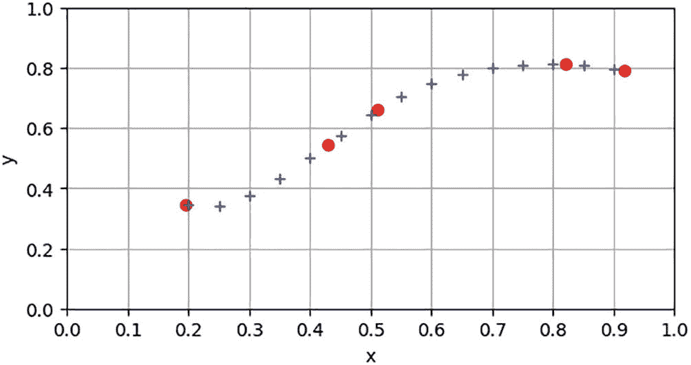

### 11.4.2 二维插值

二维插值是地理信息系统（GIS）、制图和遥感领域的常见任务。与一维插值类似，二维插值获取已知位置的值，并返回相邻位置（通常是规则间隔的网格）的估计值。规则网格上的值非常适合以热力图、等高线图或地图叠加层的形式进行可视化。

作为一个简单示例，让我们考察函数 `f(x, y) = x + 2(cos 7x + sin 5y) + 3y sin 6x`，其定义域为边界为 −0.6 < `x` < 1 和 −1 < `y` < 0.4 的矩形区域。`f(x, y)` 的等高线图如下所示：

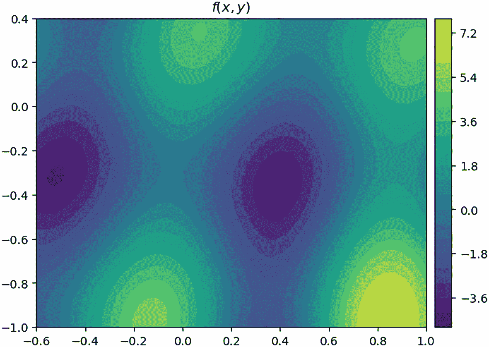

为了测试我们的二维插值方法，我们将从螺旋线区域中选取 114 个点对 `f(x, y)` 进行子采样，这些点由以下 `x` 和 `y` 值定义（布尔索引掩码如 `in_range` 在 11.1.14 节中解释）：

```
K = 0.005
t = np.linspace(0,800,num=1100)
Spiral = np.array([K*t*np.cos(t)+1,
K*t*np.sin(t)-1])
in_range = (-0.6 < Spiral[0,:]) * (Spiral[0,:] < 1.0) * \
(-1.0 < Spiral[1,:]) * (Spiral[1,:] < 0.4)
x = Spiral[0,in_range]
y = Spiral[1,in_range]
```


MATLAB 和 Python 都使用名为 `griddata()` 的函数来对不规则间隔的数据执行二维插值，将其映射到规则网格上；Python 中的该函数位于 SciPy 的 `scipy.interpolate` 模块中。`griddata()` 的输入参数是我们已知数据值的点的坐标、数据值本身，然后是一对二维数组，其中包含我们期望函数进行插值的 X 和 Y 坐标。X 和 Y 数组通常包含由 `mgrid[]` 或 `np.meshgrid()`（稍后解释）返回的规则间隔网格上的坐标；不过，也可以使用任意排列的点。在插值计算中，索引相差 1 的点被认为在拓扑上是相邻的。

我们希望结果分布在规则网格上，因此首先需要为该网格创建坐标值。在 Python 中可以通过两种方式实现。第一种方法使用 NumPy 的 `meshgrid()` 函数：

```matlab
>> nX = 3; nY = 4;
>> format short
>> [X, Y] = meshgrid(...
    linspace(-.6,  1,nX),...
    linspace(-1 ,-.4,nY))
X =
   -0.6000    0.2000    1.0000
   -0.6000    0.2000    1.0000
   -0.6000    0.2000    1.0000
   -0.6000    0.2000    1.0000
Y =
   -1.0000   -1.0000   -1.0000
   -0.8000   -0.8000   -0.8000
   -0.6000   -0.6000   -0.6000
   -0.4000   -0.4000   -0.4000
```

```python
In : nX, nY = 3, 4
In : X, Y = np.meshgrid(
...:     np.linspace(-.6,  1,nX),
...:     np.linspace(-1 ,-.4,nY))
In : X
array([[-0.6,  0.2,  1\. ],
       [-0.6,  0.2,  1\. ],
       [-0.6,  0.2,  1\. ],
       [-0.6,  0.2,  1\. ]])
In : Y
array([[-1\. , -1\. , -1\. ],
       [-0.8, -0.8, -0.8],
       [-0.6, -0.6, -0.6],
       [-0.4, -0.4, -0.4]])
```

第二种方法使用 NumPy 的 `mgrid` 对象（注意不是函数！），通过虚步长范围进行索引。普通的列表和 NumPy 索引范围只允许整数值，但 `mgrid` 索引范围可以包含浮点型的起始值、结束值和增量值。另一个特点是，*x* 和 *y* 的位置与 `np.meshgrid()` 相比是相反的：

## 11.4.2 使用 `griddata()` 进行二维插值

```matlab
>> nX = 3; nY = 4;
>> format short
>> [X, Y] = meshgrid(...
    linspace(-.6,  1,nX),...
    linspace(-1 ,-.4,nY))
X =
   -0.6000    0.2000    1.0000
   -0.6000    0.2000    1.0000
   -0.6000    0.2000    1.0000
   -0.6000    0.2000    1.0000
Y =
   -1.0000   -1.0000   -1.0000
   -0.8000   -0.8000   -0.8000
   -0.6000   -0.6000   -0.6000
   -0.4000   -0.4000   -0.4000
```

```python
In : nX, nY = 3, 4
In : Y, X = np.mgrid[-1.0:-0.4:nY*1j,
...:                 -0.6: 1.0:nX*1j]
In : X
array([[-0.6,  0.2,  1\. ],
       [-0.6,  0.2,  1\. ],
       [-0.6,  0.2,  1\. ],
       [-0.6,  0.2,  1\. ]])
In : Y
array([[-1\. , -1\. , -1\. ],
       [-0.8, -0.8, -0.8],
       [-0.6, -0.6, -0.6],
       [-0.4, -0.4, -0.4]])
```

现在我们拥有了二维插值所需的所有输入：114 个已知函数值点的坐标，以及我们想要获取插值结果的一个规则网格的坐标。默认情况下，`griddata()` 执行线性插值，但也可以进行三次插值和最近邻插值。我们将在 200 × 200 的网格上评估这三种方法：


# 网格数据与二维插值

| `code/griddata/spiral_interp.m` | `# code/griddata/spiral_interp.py` |
| :--- | :--- |

```matlab
K = 0.005;
% subsample f(x,y) at 114 points
t = linspace(0,800,1100);
X = [K*t.*cos(t)+1; K*t.*sin(t)-1];
in_range = (-0.6 < X(1,:)) & ...
            (X(1,:) < 1.0) & ...
            (-1.0 < X(2,:)) & ...
            (X(2,:) < 0.4);
x_known = X(1,in_range);
y_known = X(2,in_range);
F_known = f(x_known, y_known);
% make a 200 x 200 regular grid
nX = 200; nY = 200;
[X, Y] = meshgrid(...
    linspace(-.6,  1,nX),...
    linspace(-1 ,-.4,nY));
% interpolate  to the regular grid
F_near   = griddata(...
    x_known, y_known, ...
    F_known, X,Y, 'nearest');
F_linear = griddata(...
    x_known, y_known,...
    F_known, X,Y, 'linear');
F_cubic  = griddata(...
    x_known, y_known,...
    F_known, X,Y, 'cubic');
function [S] = f(x,y)
    S = x + 2*(cos(7*x) + ...
            sin(5*y)) + 3*y.*sin(6*x);
end

```

```python
import numpy as np
from scipy.interpolate import
    griddata
def f(x,y):
    return x + 2*(np.cos(7*x)+
        np.sin(5*y)) + 3*y*np.sin(6*x)
K = 0.005
# subsample f(x,y) at 114 points
t = np.linspace(0,800,num=1100)
X = np.array([K*t*np.cos(t)+1,
               K*t*np.sin(t)-1])
in_range = (-0.6 < X[0,:]) * \
           (X[0,:] < 1.0) * \
           (-1.0 < X[1,:]) * \
           (X[1,:] < 0.4)
x_known = X[0,in_range]
y_known = X[1,in_range]
F_known = f(x_known, y_known)
# make a 200 x 200 regular grid
nX, nY = 200, 200
Y, X = np.mgrid[-1.0:-0.4:nY*1j,
                -0.6: 1.0:nX*1j]
# interpolate to the regular grid
F_near   = griddata(
    (x_known, y_known),
    F_known, (X,Y), method="nearest")
F_linear = griddata(
    (x_known, y_known),
    F_known, (X,Y),method='linear')
F_cubic  = griddata(
    (x_known, y_known),
    F_known, (X,Y),method='cubic')

```


哪种插值方法最好？和许多问题一样，答案是“视情况而定”。三次方法最能保真地捕捉原始函数的梯度，尤其是在已知数据点集中的区域。然而，三次和线性方法都未能捕捉到上边缘的局部峰值。

这种失败是由`griddata()`的线性和三次插值方法在已知数据点上使用`Delaunay 三角剖分`导致的。三角剖分会在已知点周围用一个凸包填充元素，凸包内部的任何所需点都将从其边界元素获得插值。上边缘和左边缘的点被狭窄的薄片元素连接起来，这些元素无益地将距离很远的点关联起来。

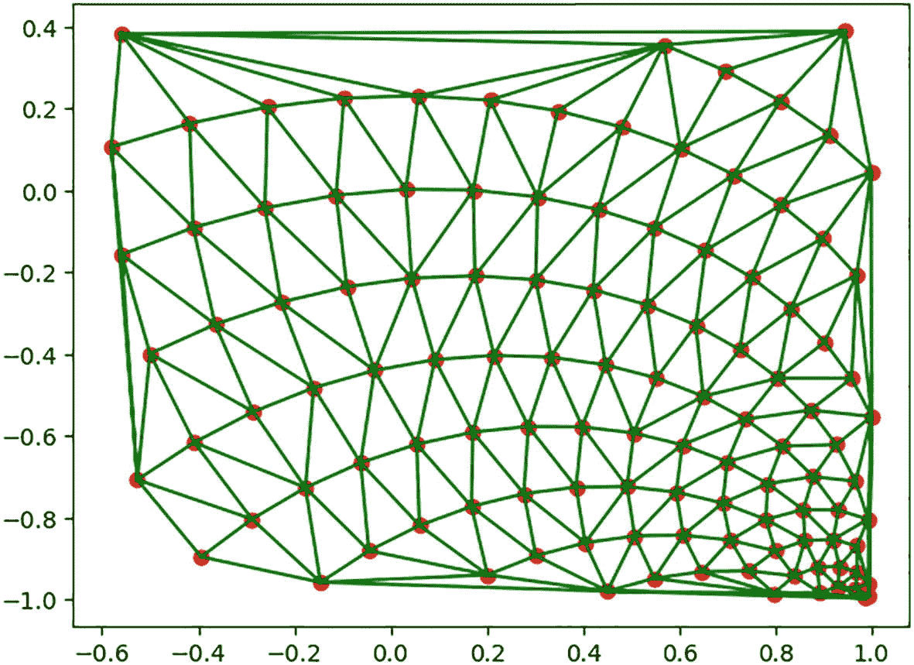

### 11.4.3 网格上的二维插值

一种简化但仍然常见的二维插值形式是，获取粗网格上的等间距值，并将这些值插值到更细的网格上。在图像处理中，这种插值被称为**图像缩放**，因为更细的网格比原始网格拥有更多的数据点（或像素）。

前一节讨论的MATLAB中的`interp2`和Python的`griddata`都可以用于此任务。但是，这两种方法都需要额外的参数来定义插值点的位置。Python的`scipy.ndimage`模块提供了一种更简单的方法。它的`zoom()`函数只需要两个参数：输入数组和放大（或缩小）量。默认情况下，`zoom()`执行三次样条插值，但样条阶数可以在 0 到 5 之间设置。以下示例将一个 3 x 5 矩阵的值插值以填充一个 10 x 12 的矩阵。

第二个参数描述每个维度应放大的倍数。我们希望有 10 行而不是 3 行，12 列而不是 5 列，因此缩放参数是`[10/3, 12/5]`：

**Python:**

```python
from scipy.ndimage import zoom
In : a = np.array([[0, 0, 0, 5, 6],
                    [0, 0, 0, 5, 6],
                    [4, 4, 5, 6, 8]])
In : b = zoom(a, [10/3, 12/5])
In : b.shape
Out: (10, 12)
In : b
Out: array([[ 0,  0,  0,  0,  0,  0,  1,  3,  5,  6,  6,  6],
            [ 0,  0,  0,  0, -1, -1,  1,  3,  5,  6,  6,  6],
            [ 0,  0,  0,  0, -1, -1,  0,  2,  5,  6,  6,  6],
            [ 0,  0,  0, -1, -1, -1,  0,  2,  4,  6,  6,  6],
            [ 0,  0,  0,  0, -1, -1,  0,  2,  5,  6,  6,  6],
            [ 0,  0,  0,  0,  0,  0,  1,  3,  5,  6,  6,  6],
            [ 1,  2,  2,  1,  1,  2,  2,  4,  5,  6,  7,  7],
            [ 3,  3,  3,  3,  3,  3,  4,  4,  5,  6,  7,  7],
            [ 4,  4,  4,  4,  4,  4,  5,  5,  6,  7,  7,  8],
            [ 4,  4,  4,  4,  4,  5,  5,  5,  6,  7,  8,  8]])
```

如果缩放参数是单个值，则两个维度都会按相同因子增加。

负值是三次样条在拟合跨越 0/5 边界的阶跃函数时产生的伪影。通过设置`order=1`可以执行双线性插值：

**Python:**

```python
from scipy.ndimage import zoom
In : a = np.array([[0, 0, 0, 5, 6],
                    [0, 0, 0, 5, 6],
                    [4, 4, 5, 6, 8]])
In : b = zoom(a, [10/3, 12/5], order=1)
In : b
Out: array([[0, 0, 0, 0, 0, 0, 1, 3, 5, 5, 6, 6],
            [0, 0, 0, 0, 0, 0, 1, 3, 5, 5, 6, 6],
            [0, 0, 0, 0, 0, 0, 1, 3, 5, 5, 6, 6],
            [0, 0, 0, 0, 0, 0, 1, 3, 5, 5, 6, 6],
            [0, 0, 0, 0, 0, 0, 1, 3, 5, 5, 6, 6],
            [0, 0, 0, 0, 0, 1, 1, 3, 5, 5, 6, 6],
            [1, 1, 1, 1, 1, 2, 2, 4, 5, 6, 6, 7],
            [2, 2, 2, 2, 2, 3, 3, 4, 5, 6, 7, 7],
            [3, 3, 3, 3, 3, 4, 4, 5, 6, 6, 7, 8],
            [4, 4, 4, 4, 4, 5, 5, 6, 6, 7, 7, 8]])
```

## 11.5 曲线拟合

### 11.5.1 线性回归

线性回归用于寻找一条最佳拟合一组数据点的直线的斜率和垂直截距。“最佳拟合”定义为使误差平方和（即各点到直线的距离之和）最小的那条直线。求解线性回归问题的动机通常分为两类：一是仅需要最佳拟合直线的斜率和截距，二是需要包含误差残差、偏度、峰度以及其他众多特征值的综合解。

在本节中，我们将重点关注其简单形式。包含加权最小二乘法的综合解将在第 11.7 节中介绍。

MATLAB 和 Python 都可以通过将多项式次数设置为 1，利用其各自的 `polyfit()`（通用多项式拟合求解器）函数来解决线性回归问题。虽然这两个函数返回的解相同，但 Python 函数返回的是垂直截距和斜率，而 MATLAB 函数返回的顺序则相反：

| MATLAB: | Python: |
| --- | --- |
| `>> Pts = [7.312 15.878;` `7.657 16.308;` `7.934 16.690;` `7.962 16.902;` `8.614 17.013;` `8.623 17.766];` `>> polyfit(Pts(:,1),Pts(:,2),1)` `1.1346   7.6638` | `from numpy.polynomial.polynomial` `\` `import polyfit` `In : Pts = np.array([` `[ 7.312, 15.878],` `[ 7.657, 16.308],` `[ 7.934, 16.690],` `[ 7.962, 16.902],` `[ 8.614, 17.013],` `[ 8.623, 17.766]])` `In : b, m = polyfit(Pts[:,0],Pts[:,1],1)` `In : m, b` `Out: (1.134557, 7.663752)` |


### 11.5.2 拟合高阶多项式

上一节中展示的 `polyfit()` 函数当然也可用于寻找次数大于 1 的最佳拟合多项式的系数。在这里，我们计算一个最佳拟合另一组数据点的三次多项式的系数。请注意，在此情况下，这些点并未按 X 坐标的升序排列——点的顺序是无关紧要的。

该解包含四个值：`a[3]`、`a[2]`、`a[1]` 和 `a[0]`，它们是对该组数据点进行最佳拟合的下列三次多项式的系数


除了返回系数的顺序相反（MATLAB 返回 `a[0]`、`a[1]`、`a[2]` 和 `a[3]`，而 Python 返回 `a[3]`、`a[2]`、`a[1]` 和 `a[0]`）之外，数值是匹配的。

| MATLAB: | Python: |
| --- | --- |
| `Pts = [-0.938  16.875;` `0.326  21.290;` `1.787  22.317;` `2.968  28.767;` `4.038  10.210;` `5.358 -53.774];` `>> polyfit(Pts(:,1),Pts(:,2),3)` `-1.356 4.306 2.967 15.960` | `from numpy.polynomial.polynomial` `\` `import polyfit` `In : Pts = np.array([` `[ -0.938,  16.875],` `[  0.326,  21.290],` `[  1.787,  22.317],` `[  2.968,  28.767],` `[  4.038,  10.210],` `[  5.358, -53.774]])` `In : polyfit(Pts[:,0],Pts[:,1],3)` `Out: array([15.960, 2.967,` `4.306, -1.356])` |

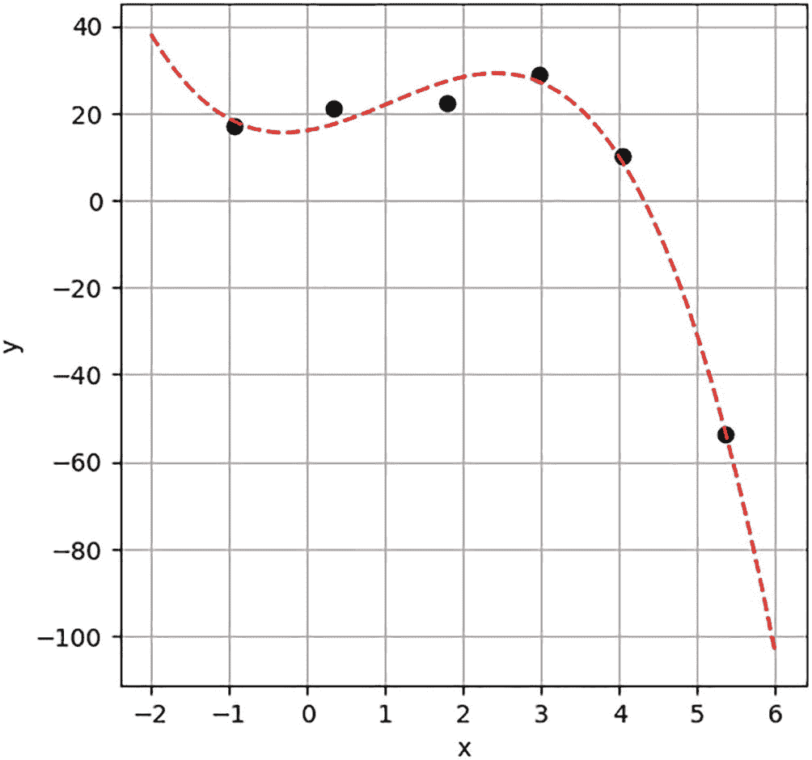

### 11.5.3 拟合模型

现实世界中的数据集很少能完美拟合线性或多项式模型，至少在很宽的范围内是这样。更常见的分布（至少在物理现象中）是高斯分布、正弦分布、指数或对数衰减或增长分布——或者这些分布的组合。

`scipy.optimize` 模块提供了许多可用于将模型拟合到数据的函数。在这里，我们将研究其中的两个：`curve_fit()` 和 `differential_evolution()`。MATLAB 拥有强大的曲线拟合工具箱，但对于较简单的曲线，通用优化函数 `fminsearch()` 通常也很有效。

`scipy.optimize.curve_fit()` 旨在寻找能够最佳拟合数据集的连续平滑模型（例如曲线方程）的参数。当模型是单调的（例如，图 11-3 中所示的对数增长）时，它表现良好。


图 11-3

对数增长数据

对于变化更大的数据，例如来自欠阻尼系统的正弦衰减数据点分布（如图 11-4 所示），`scipy.optimize.curve_fit()` 函数和 MATLAB 的 `fminsearch()` 函数表现欠佳。


图 11-4

正弦衰减数据

对于这类数据，我们需要一种更稳健的方法。一个可选方案是差分进化算法 [3]，该算法在 `scipy.optimize.differential_evolution()` 中实现。它对目标函数中的局部最小值不太敏感，并且通常能在广泛的输入域内找到极好的解。该算法的 MATLAB 实现可在 FileExchange^(⁴³) 上找到。

#### 11.5.3.1 案例 1：对数增长

图 11-3 中的数据点是使用函数

`f(t) = A ln Bt + C`

生成的，其中 `A = 5`, `B = 14`, `C = -13.7`，然后以随机值的形式添加噪声：

| MATLAB: | Python: |
| --- | --- |
| `% code/optim/log_test_data.py` `A = 5; B = 14; C = -13.7;` `Fn = @(t,A,B,C)(A*log(B*t) + C);` `rand('seed',234567);` `n_pts = 1000;` `t = 2 + linspace(.2,30,n_pts)+...` `.3*rand(1,n_pts);` `y_true = Fn(t, A, B, C);` `y_meas = y_true + 0.2*A*(0.5 -...` `rand(1,n_pts));` `t_meas = t  + 0.1*A*(0.5 -...` `rand(1,n_pts));` | `#!/usr/bin/env python3` `# code/optim/log_test_data.py` `import numpy as np` `A, B, C = 5, 14, -13.7` `def` `Fn(t, A, B, C):`     `return` `A*np.log(B*t) + C` `np.random.seed(234567)` `n_pts = 1000` `t = 2 + np.linspace(.2,30,n_pts)+\` `.3*np.random.rand(n_pts)` `y_true = Fn(t, A, B, C)` `y_meas = y_true + 0.2*A*(0.5 -` `np.random.rand(n_pts))` `t_meas = t  + 0.1*A*(0.5 -` `np.random.rand(n_pts))` |

我们的任务是仅使用含噪声的数据点和模型方程 `f(t) = A ln Bt + C` 来确定 `A`、`B` 和 `C` 的值。在开始之前，我们需要一种方法来评估给定的一组 `A`、`B` 和 `C` 值对我们的模型的拟合程度。一个合理的选择是 `R²` 判定系数。

#### 11.5.3.2 用于评估解的 `R²`

将含噪声的数据叠加在具有解参数模型方程的曲线上形成一张图，这将为我们提供关于解好坏的主观感受。虽然图表很有用，但对“拟合优度”的数值估计也同样有价值。在 Python 方面，我们将使用 `sklearn.metrics`（机器学习）模块中的 `r2_score()` 函数。它返回已知值与估计值之间的 `R²` 判定系数；1.0 代表极好的一致性，0.0（或更糟的负分）则意味着一致性极差。MATLAB 的统计与机器学习工具箱具有计算 `R²` 的函数。相关实现也可以在 FileExchange^(⁴⁴) 上找到。

好的，作为高级文档工程师和翻译员，我将严格按照您提供的注意事项和示例，将给定的英文文本翻译成中文。

#### 11.5.3.3 使用 `curve_fit()` 拟合对数增长

`curve_fit()` 函数只有三个必需参数：模型函数（`Fn()`）、自变量（`t_meas`）和因变量（`y_meas`）。它返回两个变量：`popt`（参数的最优值）和 `pcov`（最优值的估计协方差）。

用 MATLAB 编写解决方案需要更多的工作。除了模型函数外，我们还需要定义一个误差函数，该函数采用平方差之和的形式，并且本身是从另一个匿名函数中调用的。更困难的是需要为 `A`、`B` 和 `C` 估算初始值。

| MATLAB:                                                                                     | Python:                                                                                                                      |
| ------------------------------------------------------------------------------------------- | ---------------------------------------------------------------------------------------------------------------------------- |
| `% code/optim/log_test_data_full.m`<br>`A = 5; B = 14; C = -13.7;`<br>`Fn = @(t,A,B,C)(A*log(B*t) + C);`<br>`rand('seed',234567);`<br>`n_pts = 1000;`<br>`t = 2 + linspace(.2,30,n_pts)+...`<br>`        `.3*rand(1,n_pts);`<br>`y_true = Fn(t, A, B, C);`<br>`y_meas = y_true + 0.2*A*(0.5 -...`<br>`        `rand(1,n_pts));`<br>`t_meas = t  + 0.1*A*(0.5 -...`<br>`        `rand(1,n_pts));`<br>`opt_Fn = @(x)sum_sq(x,t_meas,y_meas);`<br>`popt = fminsearch(opt_Fn,[1 1 1])`<br>`function` `ss = sum_sq(x,t,ydata)`<br>`  A = x(1); B = x(2); C = x(3);`<br>`  ss = sum((ydata - A*log(B*t) + C).²);`<br>`end` | `In : run log_test_data.py`<br>`In :`<br>`from scipy.optimize import`<br>`curve_fit`<br>`In :`<br>`from sklearn.metrics import`<br>`r2_score`<br>`In : popt, pcov = curve_fit(Fn,t_meas,y_meas)`<br>`In : popt`<br>`Out: array([  5.00663437,`<br>`12.05087493,`<br>`-12.99449958])`<br>`In : r2_score(y_meas, y_curve_fit)`<br>`Out: 0.9920846142243493` |

MATLAB 的结果并不理想，而且对初始猜测很敏感：

**MATLAB:**

```
>> log_test_data_full
>> popt = fminsearch(opt_Fn,[1 1 1])
popt =
    4.9880    0.5889   -2.1631
>> popt = fminsearch(opt_Fn,[1 10 -10])
popt =
    4.9881   11.9819   12.8655
```

Python 的 *R*² 得分为 0.99，非常出色。我们对 `A` = 5.007、`B` = 12.05 和 `C` = –12.99 的估计值与真实值 5、14 和 –13.7 相当接近；更令人印象深刻的是，生成的曲线与实际曲线非常接近，以至于难以区分：


### 11.5.3.4 案例 2：正弦衰减

更复杂的模型需要对 `curve_fit()` 的选项进行更多调整，例如参数边界、初始值、不确定性估计和雅可比矩阵。相反，我们将切换到更稳健（但计算成本更高）的 `differential_evolution()` 函数。

我们将应用这个欠阻尼系统模型：

*f*(*t*) = *Ae*^(−*Bt*) sin *Ct* + *D* （11.1）

来估算最适合图 11-4 中数据点的 *A*、*B*、*C* 和 *D* 的值。该图中的数据点是使用以下代码生成的。它从已知的 A…D 值开始，然后在模型函数中添加随机值形式的噪声。

**Python:**

```
# code/optim/sin_decay_test_data.py
import numpy as np
A, B, C, D = 1, .2, 1.4, 10
def Fn(t, A, B, C, D):
    return A*np.exp(-B*t)*\
           np.sin(C*t) + D
np.random.seed(234567)
n_pts = 1000
t = np.linspace(1,20,n_pts) + .3*np.random.rand(n_pts)
y_true = Fn(t, A, B, C, D)
y_meas = y_true + .11*(0.5 - np.random.rand(n_pts))
```

### 11.5.3.5 使用 `curve_fit()` 拟合正弦衰减

将我们的带噪数据和模型函数发送给 `curve_fit()` 会得到一个不令人满意的结果。

**Python:**

```
In : from scipy.optimize import curve_fit
In : from sklearn.metrics import r2_score
run sin_decay_test_data.py # set t, y_meas, y_true
In : popt, pcov = curve_fit(Fn,t,y_meas)
In : y_curve_fit = Fn(t, *popt)
In : popt
Out: [99.999 3.843 5.886 9.995]
In : r2_score(y_meas, y_curve_fit)
Out: 0.033069669065311835
```

*R*² 得分为 0.03，这意味着我们的解决方案毫无价值。下一节图 11-5 中的绿色曲线直观地展示了其糟糕程度。

### 11.5.3.6 使用 `differential_evolution()` 拟合正弦衰减

与 `curve_fit()` 不同，`scipy.optimize.differential_evolution()` 要求提供参数的上限和下限。我们将提供较宽的范围，以展示该方法惊人的稳健性：

`0.01 <= A <= 100`

`-10 <= B <= 10`

`0.01 <= C <= 10`

`-100 <= D <= 100`

**Python:**

```
In : from scipy.optimize import differential_evolution
In : from sklearn.metrics import r2_score
In : def func(parameters, *data):
...:     A, B, C, D = parameters
...:     Fn, t, Y = data
...:     return np.linalg.norm(Fn(t,A,B,C,D)-Y)
In : bounds = ([0.01, 100],
...:           [ -10,  10],
...:           [0.01,  10],
...:           [-100, 100])
run sin_decay_test_data.py # set t, y_meas, y_true
In : args = (Fn, t, y_meas)
In : DE_result = differential_evolution(func, bounds, args=args)
In : DE_result
     fun: 1.0028485230670718
     jac: array([ 1.15463195e-06, -2.70894418e-06,  9.99200722e-07, -3.79696274e-06])
message: 'Optimization terminated successfully.'
    nfev: 3430
     nit: 55
 success: True
       x: array([1.00574221, 0.1992207 , 1.40038483, 9.99905623])
In : y_DE_fit = Fn(t, *DE_result.x)
In : r2_score(y_true, y_DE_fit)
Out: 0.9998993756587
```

这次 *R*² 得分接近 1.0，表明拟合效果极佳。图 11-5 展示了 `curve_fit()` 和 `differential_evolution()` 对此问题的解决方案。


**图 11-5** – 使用曲线拟合和微分进化建模的正弦衰减。

无需尝试使用 MATLAB 的 `fminsearch()` 来解决这个更具挑战性的问题，第 11.6 节中的方法展示了如何使用 SciPy 的 `differential_evolution()` 在 MATLAB 中解决曲线拟合问题。当然，如果你可以使用 FileExchange 实现的 `differential_evolution()`，那么它将比使用 Python 更方便。毋庸置疑，曲线拟合工具箱是更好的选择。

# 11.6 方案 11-1：使用 `differential_evolution()` 进行曲线拟合

曲线拟合工具箱是确定数据最佳拟合曲线方程的首选工具包。在没有该工具箱的情况下，来自 SciPy `optimize` 模块的 `differential_evolution()` 函数是比 MATLAB 核心产品的 `fminsearch` 更强大的替代方案。此处，我们演示如何将 Python 实现的 `differential_evolution()` 与 MATLAB 结合使用，以寻找衰减正弦函数的系数 `A`、`B`、`C` 和 `D`，这与仅使用 Python 在章节 11.5.3.6 中所做的操作相同。

该方案揭示了 MATLAB 的 `py` 模块的一个限制：作为参数传递给 Python 函数的 MATLAB 函数无法从 Python 调用。这阻止了我们直接从 MATLAB 调用诸如 `differential_evolution()` 之类的优化器，因为它们的第一个参数是要最小化或最大化的函数。

至少有两种可能的解决方案：(1) 用 Python 编写代价函数，并完全在 Python 桥接模块中执行优化，或 (2) 通过 `matlab.engine` 模块从 Python 调用 MATLAB 的代价函数（章节 6.10）。第二种方法更强大，因为它应该能够处理任何 MATLAB 函数。然而在实践中，通过 Python 对 `matlab.engine` 对象的调用经常失败，并出现 MATLAB 错误：“无法连接到 matlab.engine：无法连接到 MATLAB 会话。” 因此，此处仅演示第一种方法。

当在 Python 中评估代价函数时，MATLAB 部分仅将数据点传递给一个 Python 桥接模块，该模块包含代价函数和对优化器的调用。然后，桥接模块中的一个函数将最佳拟合系数返回给 MATLAB。

Python：

```python
# code/optim/bridge_de.py
import numpy as np
from scipy.optimize import differential_evolution
def Fn(t, A, B, C, D):
    return A*np.exp(-B*t)*np.sin(C*t) + D
def func(parameters, *data):
    A, B, C, D = parameters
    Fn, t, Y = data
    return np.linalg.norm(Fn(t,A,B,C,D)-Y)
def compute_ABCD(bounds, t, y_meas):
    args = (Fn, t, y_meas)
    DE_result = differential_evolution(func, bounds, args=args)
    soln = { 'success' : DE_result.success,
             'message' : DE_result.message,
             'x' : DE_result.x,
    }
    if DE_result.success:
        y_DE_fit = Fn(t, *DE_result.x)
    else:
        y_DE_fit = []
    soln['y_fit'] = y_DE_fit
    return soln
```

以下 MATLAB 驱动程序将参数边界和测试数据发送给 Python 的 `compute_ABCD()` 函数，该函数返回一个包含解的字典（如果找到解的话）：

MATLAB：

```matlab
% code/optim/fit_decaying_sine.m
Im = @py.importlib.import_module;
optim = Im('bridge_de');
np = Im('numpy');
sk = Im('sklearn.metrics');
A = 1; B = .2; C = 1.4; D = 10;
rng(234567);
n_pts = 1000;
t = linspace(1,20,n_pts) + .3*rand(1,n_pts);
y_true = Fn(t, A, B, C, D);
y_meas = y_true + .11*(0.5 - rand(1,n_pts));
bounds = py.tuple({[0.01, 100], ...
                   [ -10,  10], ...
                   [0.01,  10], ...
                   [-100, 100]});
solution = optim.compute_ABCD(bounds, np.array(t), np.array(y_meas));
if solution.get('success')
    R2 = sk.r2_score(np.array(y_true), np.array(solution.get('y_fit')));
    ABCD = py2mat(solution.get('x'));
    fprintf('A=%.6f, B=%.6f, C=%.6f, D=%.6f\n', ABCD)
    fprintf('score = %f\n', R2)
else
    fprintf('Failed: %s\n', solution.get('message'))
end
function [x] = Fn(t, A, B, C, D)
    x = A*exp(-B*t).*sin(C*t) + D;
end
```

来自 MATLAB 的解与章节 11.5.3.6 的 Python 解相匹配：

MATLAB：

```matlab
>> fit_decaying_sine
A=1.005742, B=0.199221, C=1.400385, D=9.999056
score = 0.999899
```

# 11.7 回归

### 11.7.1 普通最小二乘法

Python 模块 `statsmodels` 拥有自己具有统计特色的线性回归（或称最小二乘法）求解器，其返回的结果比章节 11.5.1 中描述的 NumPy 的 `polyfit()` 函数更丰富。主要的函数是用于普通最小二乘法的 `OLS()` 和用于加权最小二乘法的 `WLS()`。

以下示例生成点对 (`x`, `y`)，这些点粗略地近似于给定斜率 `m` 和垂直截距 `b` 的直线 `y = mx + b`。我们将调用 `OLS()` 和 `WLS()` 来查看我们恢复 `m` 和 `b` 的效果如何。

| MATLAB: | Python: |
| --- | --- |
| `% 创建随机 X,Y`<br>`m = 3.77;`<br>`b = -5.5;`<br>`nPts = 20;`<br>`X = -5 + 12*rand(nPts,1);`<br>`X = sort(X);`<br>`noise = 8*(rand(nPts,1)-.5);`<br>`Y = m*X + b + noise;`<br>`% 恢复 m 和 b`<br>`mb = polyfit(X,Y,1);`<br>`m_ls = mb(1);`<br>`b_ls = mb(2);`<br>`fprintf("ML : %f %f\n", ...`<br>`        ` `m_ls,b_ls)`<br>`Y_pred = m_ls*X + b_ls;`<br>`plot(X,Y,'g.')`<br>`hold on`<br>`plot(X,Y_pred,'r-')`<br>`grid`<br>`---------- 输出：`<br>`ML : 3.558505 -4.843925` | `import numpy as np`<br>`import statsmodels.api as stats`<br>`import matplotlib.pyplot as plt`<br>`# 创建随机 X,Y`<br>`m = 3.77` `# 真实斜率`<br>`b = -5.5` `# 真实截距`<br>`nPts = 20`<br>`X = -5 + 12*np.random.rand(nPts)`<br>`X.sort()`<br>`noise = 8*(np.random.rand(nPts)-.5)`<br>`Y = m*X + b + noise`<br>`% 恢复 m 和 b`<br>`Xb = stats.add_constant(X,0)`<br>`ols = stats.OLS(Y, Xb).fit()`<br>`m_ls, b_ls = ols.params`<br>`print(f'OLS {m_ls} {b_ls}')`<br>`Y_pred = ols.predict(Xb)`<br>`plt.plot(X,Y,'g.')`<br>`plt.plot(X,Y_pred,'r-')`<br>`plt.grid(True)`<br>`plt.show()`<br>`---------- 输出：`<br>`OLS 3.86476 -6.23757` |


MATLAB 和 Python 的实现会看到不同的点对，因此我们不期望它们对 `m` 和 `b` 的各自解在小样本量下能够匹配。如果我们使用 1000 个点而不是 20 个点，Python 和 MATLAB 都将返回与真实值相差 1% 以内的结果。

前面 Python 示例中的 `ols` 对象具有许多方法和属性。以下文本是 `print(ols.summary())` 的输出：

OLS 回归结果
===========================================================================
因变量:                   y   R 平方:                       0.973
模型:                         OLS   调整后 R 平方:                  0.972
方法:              最小二乘法   F 统计量:                     653.9
日期:             2020 年 6 月 26 日, 星期五   F 统计量的概率 (Prob):           1.33e-15
时间:                     15:05:59   对数似然值:                -42.682
观测数:               20   赤池信息准则 (AIC):             89.36
残差自由度:                   18   贝叶斯信息准则 (BIC):             91.36
模型自由度:                        1
协方差类型:          非稳健
===========================================================================
系数   标准误        t 值     P>|t|     [0.025     0.975]

x1             3.8648      0.151    25.571     0.000      3.547     4.182
常数项         -6.2376      0.511   -12.214     0.000     -7.310    -5.165
===========================================================================
Omnibus 检验:                    0.521   德宾-沃森统计量:                2.171
Omnibus 检验概率:                  0.771   雅克-贝拉检验 (JB):             0.578
偏度:                           0.055   JB 检验概率:                     0.749
峰度:                       2.174   条件数 (Cond. No.):                     3.62
===========================================================================

### 11.7.2 加权最小二乘法

数据点的权重可能并不相同——设想一项使用了不同型号测试设备进行的测量活动。在计算所有点的总体属性时，使用更精确设备观测到的数值应被赋予更大的重要性。

MATLAB 可以使用曲线拟合工具箱中的 `fittype()` 和 `fit()` 函数，或统计与机器学习工具箱中的 `nlinfit()` 函数来执行加权最小二乘法拟合。Python 的 `statsmodule` 通过 `WLS()` 函数解决此类问题，该函数的输入与上一节中 `OLS()` 的输入相同，但多了一个用于指定权重的参数。

以下示例重复了普通最小二乘法示例，但权重从左到右线性分配给各数据点。在下图中，点的大小代表权重：

Python：

```python
#!/usr/bin/env python3
# code/statistics/wls.py
import numpy as np
import statsmodels.api as stats
import matplotlib.pyplot as plt
m = 3.77 # 真实斜率
b = -5.5 # 真实截距
nPts = 20
X = -5 + 12*np.random.rand(nPts)
X.sort()
W = X - np.min(X) + 1
noise = 8*(np.random.rand(nPts)-.5)
Y = m*X + b + noise
Xb = stats.add_constant(X,0)
wls = stats.WLS(Y, Xb, weight=W).fit()
m_ls, b_ls = wls.params
print(f'WLS {m_ls} {b_ls}')
Y_pred = wls.predict(Xb)
plt.scatter(X,Y, marker='o',s=5*W)
plt.plot(X,Y_pred,'r-')
plt.grid(True)
plt.title('加权最小二乘法')
plt.show()
```

这段代码会输出：

```
WLS 3.774306 -4.79019
```

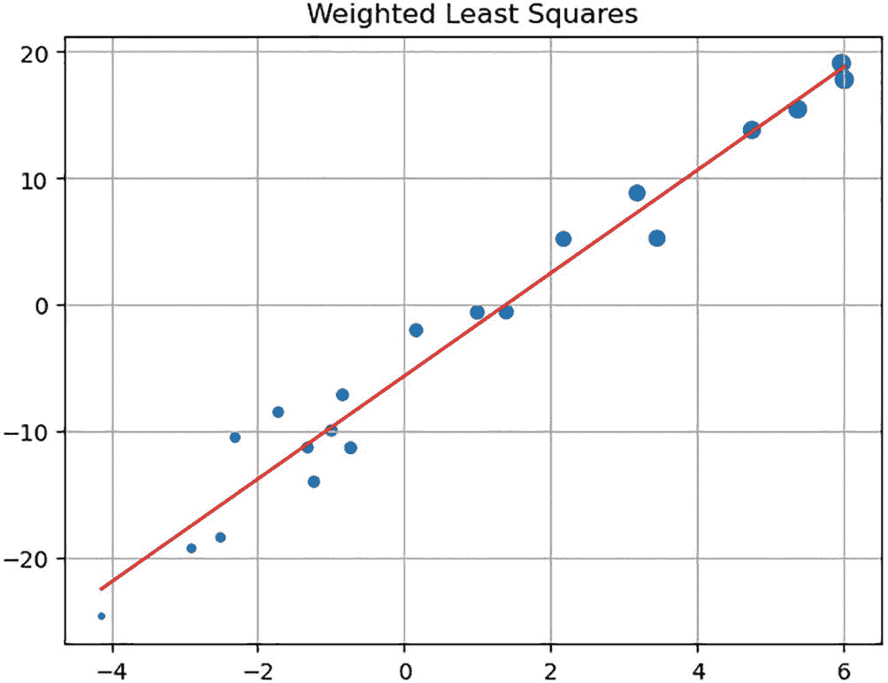

请按照第 11.8 节中的方法在 MATLAB 中求解加权最小二乘问题。

### 11.7.3 置信区间与预测区间

MATLAB 统计与机器学习工具箱中的 `coefCI()` 函数可以返回线性回归模型系数的置信区间。不过，绘制这些区间需要额外一些功夫。如果没有这个工具箱，可以使用 Seaborn Python 模块中的 `regplot()` 函数非常方便地绘制置信区间图。

以下代码重复了普通最小二乘问题的一部分，增加了噪声并添加了更多数据点：

Python：

```python
#!/usr/bin/env python3
# code/statistics/conf_interval.py
import numpy as np
import matplotlib.pyplot as plt
import seaborn as sns
m = 3.77 # 真实斜率
b = -5.5 # 真实截距
nPts = 80
X = -5 + 12*np.random.rand(nPts)
X.sort()
noise = 30*(np.random.rand(nPts) - 0.5)
Y = m*X + b + noise
sns.regplot(x=X, y=Y, marker='.')
plt.xlabel('X')
plt.ylabel('Y')
plt.grid()
plt.title('使用 seaborn.regplot() 绘制的置信区间')
plt.savefig('conf_interval.png', bbox_inches='tight',
pad_inches=0.1, transparent=True)
plt.show()
```


预测区间通常比置信区间更有用。可以使用 MATLAB 曲线拟合工具箱中的 `predint()` 函数，或 Python 中的 `predband()` 函数[1]来计算，如下所示：

Python：

## 11.8 方法 11-2：在 MATLAB 中进行加权最小二乘法

直接从 MATLAB 调用 Python 的加权最小二乘函数会得到令人失望的结果。以下是使用上一节示例问题的一次尝试：

MATLAB：

```matlab
m = 3.77; % 真实斜率
b = -5.5; % 真实截距
nPts = 20;
X = -5 + 12*rand(nPts,1);
X = sort(X);
W = X - min(X) + 1;
noise = 8*(rand(nPts,1)-.5);
Y  = py.numpy.array(m*X + b + noise);
Xb = py.statsmodels.api.add_constant(X,0);
wls = py.statsmodels.api.WLS(Y, Xb, pyargs('weight', W)).fit();
[m_ls, b_ls] = wls.params
```

程序在最后一行失败，并显示以下错误：

```
未识别类 'py.statsmodels.regression.linear_model.RegressionResultsWrapper' 的方法、属性或字段 'params'。
```

失败的原因是`py.statsmodels.api.WLS()`返回的`wls`对象缺少`.params`属性——以及许多其他属性和方法——因此尝试访问不存在的`.params`会抛出错误。

我们需要一个小的桥接模块，其中包含一个函数，该函数接收原始 MATLAB 输入（在本例中为`X`、`Y`和`W`数组），调用`statsmodels.api.WLS()`，然后以 MATLAB 能理解的形式返回所需的结果部分。换句话说，对`WLS()`的调用完全在 Python 中发生，无需穿越 MATLAB/Python 接口。整个模块仅用十行代码定义了一个函数：

Python：

```python
# 文件 bridge_WLS.py
import os
import sys
import statsmodels.api as stats
def slope_intercept(X, Y, W):
    if sys.platform == 'win32':
        os.environ['KMP_DUPLICATE_LIB_OK'] = 'TRUE'
    Xb = stats.add_constant(X,0)
    wls = stats.WLS(Y, Xb, weight=W).fit()
    m_ls, b_ls = wls.params
    Y_pred = wls.predict(Xb)
    if sys.platform == 'win32':
        del os.environ['KMP_DUPLICATE_LIB_OK']
    return { 'm' : m_ls,
             'b' : b_ls,
             'Y_predict' : Y_pred }
```

返回的字典由`py2mat()`转换成一个结构体，包含斜率(`.m`)、截距(`.b`)和预测 *y* 值数组(`.Y_predict`)。以下 MATLAB 代码正确地调用了 Python 的加权最小二乘法：

MATLAB：

```matlab
% code/matlab_py/weighted_LS.m
np  = py.importlib.import_module('numpy');
WLS = py.importlib.import_module('bridge_WLS');
m = 3.77; % 真实斜率
b = -5.5; % 真实截距
nPts = 20;
X = -5 + 12*rand(nPts,1);
X = sort(X);
W = X - min(X) + 1;
noise = 8*(rand(nPts,1)-.5);
Y  = np.array(m*X + b + noise);
X  = np.array(X);
W  = np.array(W);
mbY = WLS.slope_intercept(X,Y,W);
mbY = py2mat(mbY);
fprintf('斜率 = % .3f  截距 = % .3f\n', mbY.m, mbY.b)
scatter(X,Y,5*W,'b','filled')
hold on
plot(X,mbY.Y_predict,'r-')
grid on
saveas(gcf,'matlab_WLS.png')
```


**注意**

此示例的 Python 和 MATLAB 代码会随机生成数据点，因此两张图上点的位置会有所不同。

## 11.9 方案 11-3：MATLAB 中的置信区间与预测区间

以下 MATLAB 程序重现了 11.7.3 节中展示的置信区间和预测区间图。唯一需要注意的是，`Seaborn`要求输入为 NumPy 数组，因此使用`mat2py()`工具将`X`和`Y`显式地从 MATLAB 原生变量转换为 Python 原生变量。

**置信区间：**

MATLAB：

```python
#!/usr/bin/env python3
# code/statistics/predict_interval.py
import numpy as np
import matplotlib.pyplot as plt
import scipy.stats
import statsmodels.api as stats
import seaborn as sns
def predband(x, xd, yd, p, func, conf=0.95):
    """
    来源：https://apmonitor.com/che263/index.php/Main/PythonRegressionStatistics
    x = 请求的点
    xd = x 数据
    yd = y 数据
    p = 传递给 func 的附加参数（位于 xd 之后）
    func = 函数名称
    """
    alpha = 1.0 - conf  # 显著性水平
    N = xd.size         # 数据样本量
    var_n = len(p)      # 参数个数
    # 自由度为 N-var_n 的 t 分布在 p=(1-alpha/2) 处的分位数
    q = scipy.stats.t.ppf(1.0 - alpha / 2.0, N - var_n)
    # 单次测量的标准差
    se = np.sqrt(1\. / (N - var_n) *
                 np.sum((yd - func(xd, *p)) ** 2))
    # 辅助定义
    sx = (x - xd.mean()) ** 2
    sxd = np.sum((xd - xd.mean()) ** 2)
    # 预测值（最佳拟合模型）
    yp = func(x, *p)
    # 预测带
    dy = q * se * np.sqrt(1.0+ (1.0/N) + (sx/sxd))
    # 上下预测带。
    lpb, upb = yp - dy, yp + dy
    return lpb, upb
def model_function(x, m, b):
    return m*x + b
m = 3.77 # 真实斜率
b = -5.5 # 真实截距
nPts = 80
X_even = np.linspace(-5, 7)
X = -5 + 12*np.random.rand(nPts)
X.sort()
noise = 30*(np.random.rand(nPts) - 0.5)
Y = m*X + b + noise
Xb = stats.add_constant(X,0)
ols = stats.OLS(Y, Xb).fit()
m_ls, b_ls = ols.params # 最佳拟合斜率、截距
lpb, upb = predband(X_even, X, Y, [m_ls, b_ls], model_function, conf=0.95)
sns.regplot(x=X, y=Y, marker='.')
plt.plot(X_even, lpb, 'k--',label='95% 预测带')
plt.plot(X_even, upb, 'k--')
plt.xlabel('X')
plt.ylabel('Y')
plt.grid()
plt.title('预测区间与置信区间')
plt.legend(loc='best')
plt.savefig('pred_interval.png', bbox_inches='tight',
            pad_inches=0.1, transparent=True)
plt.show()
```


## 11.10 求根

### 11.10.1 单变量

SciPy 的`optimization`模块中的`root_scalar()`函数，相当于 MATLAB 的`fzero()`函数。`root_scalar()`提供了八种用于求解标量方程根的算法：`bisect`、`brentq`、`brenth`、`ridder`、`toms748`、`newton`、`secant`、`halley`。前五种方法需要自变量的边界，而`newton`、`secant`和`halley`方法则适用于无界域。可以提供起始猜测值或斜率函数等额外信息来加速收敛。如果未指定方法，求解器会根据给定的输入（是否指定了边界、是否提供了斜率函数等）自动选择最佳选项。

以下示例在区间 0 ≤ *x* ≤ 1 上求解 *f*(*x*) = 0 的 *x*，其中

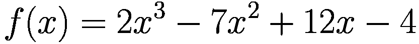

且未指定方法。`fzero()`没有定义边界的选项；相反，我们必须为解提供一个初始猜测值。`root_scalar()`返回一个包含解的对象（如果找到的话），该解位于其 `.root` 属性中：

| MATLAB: | Python: |

| --- | --- |

| `>> F = @(x)(2*x.³-7*x.²+12*x-4);`<br>`>> fzero(F, 0)`<br>     `4.265215061673047e-01` | `In :` `import numpy as np`<br>`In :` `import scipy.optimize as so`<br>`In :` `def F(x):`<br>`In :`   `return 2*x**3-7*x**2+12*x-4`<br>`In : x = np.linspace(-1,2, num=100)`<br>`In : f_zero = so.root_scalar(F,`<br>`...:           bracket=[0, 1])`<br>`In : f_zero`<br>`Out[14]:`<br>`converged: True`<br>`flag: 'converged'`<br>`function_calls: 9`<br>`iterations: 8`<br>`root: 0.42652150616730566`<br>`In : f_zero.root`<br>`Out: 0.42652150616730566` |

以下调用展示了如何指定特定方法来求解无边界 *x* 的问题。`secant`方法不需要斜率函数（`newton`和`halley`需要），但需要两个初始猜测值 *x*[0] 和 *x*[1]。同样，`fzero()`没有类似选项，因此我们将通过从一个远离真实解的猜测值开始，来展示其稳健性。

| MATLAB: | Python: |

| --- | --- |

| `>> F = @(x)(2*x.³-7*x.²+12*x-4);`<br>`>> fzero(F, 100)`<br>     `4.265215061673049e-01` | `In : f_zero = so.root_scalar(F, x0=100,`<br>`...:            x1=200, method="secant")`<br>`Out[25]:`<br>`converged: True`<br>`flag: 'converged'`<br>`function_calls: 25`<br>`iterations: 24`<br>`root: 0.4265215061673047` |

### 11.10.2 多变量

SciPy 更通用的多变量求根器是`scipy.optimize.root()`。与`scipy.optimize.root_scalar()`类似，你可以在多种求解方法中进行选择，并可选择性地提供雅可比矩阵函数。其用法通过求解一个平面、一个球面和一个椭球面之间的交点来演示：


MATLAB 可以使用优化工具箱中的`fsolve()`来求解。或者，MATLAB 也可以使用`scipy.optimize.root()`来求解；这在[11.11](https://example.org/516169_1_En_11_Chapter.xhtml#Sec112)节的方案中进行了演示。

Python：

### 11.10.2.1 预测区间

以下程序从纯 Python 版本的预测区间示例中导入了`model_function()`和`predband()`：

MATLAB：

```matlab
% code/statistics/predict_interval.m
Im = @py.importlib.import_module;
plt   = Im('matplotlib.pyplot');
mpl   = Im('matplotlib');
sns   = Im('seaborn');
np    = Im('numpy');
%scipy_stats = Im('scipy.stats')
stats = Im('statsmodels.api');
JH    = Im('predict_interval');
if ispc
    mpl.use('WXAgg');
else
    mpl.use('TkAgg');
end
m = 3.77; % 真实斜率
b = -5.5; % 真实截距
nPts = 80;
X_even = linspace(-5, 7);
X = -5 + 12*rand(nPts,1);
X = sort(X);
noise = 30*(rand(nPts,1) - 0.5);
Y = m*X + b + noise;
X = mat2py(X);
Y = mat2py(Y);
Xb = stats.add_constant(X,0);
ols = stats.OLS(Y, Xb).fit();
[m_ls, b_ls] = ols.params % 最佳拟合斜率，y 轴截距
[lpb, upb] = JH.predband(X_even, X, Y, [m_ls, b_ls], ...
                         JH.model_function, pyargs('conf',0.95));
sns.regplot(pyargs('x',X,'y',Y,'marker','.'))
plt.plot(X_even, lpb, 'k--',pyargs('label','95% 预测带'))
plt.plot(X_even, upb, 'k--')
plt.xlabel('X')
plt.ylabel('Y')
plt.grid()
plt.title('预测区间与置信区间')
plt.legend(pyargs('loc=','best'))
plt.show()
```

#### 11.10.2.2 使用 `scipy.optimize.root()` 求交点

Python：

```python
import numpy as np
from scipy.optimize import root

def equations(x):
    x, y, z = x
    return [
        x + y + z - 1,
        x**2 + y**2 + z**2 - 1,
        x**2 + 4*y**2 + z**2 - 2
    ]

sol = root(equations, [0, 0, 0])
print(sol.x)
```

### 11.10.1.1 使用 `seaborn` 绘制置信区间

```matlab
% code/statistics/conf_interval.m
Im = @py.importlib.import_module;
plt   = Im('matplotlib.pyplot');
mpl   = Im('matplotlib');
sns   = Im('seaborn')
if ispc
    mpl.use('WXAgg')
else
    mpl.use('TkAgg')
end
m = 3.77; % 真实斜率
b = -5.5; % 真实截距
nPts = 80;
X = -5 + 12*rand(nPts,1);
X = sort(X);
noise = 30*rand(nPts,1) - 0.5;
Y = m*X + b + noise;
% seaborn 需要 Python 原生数组
X = mat2py(X);
Y = mat2py(Y);
sns.regplot(pyargs('x',X,'y',Y,'marker','.'))
plt.xlabel('X')
plt.ylabel('Y')
plt.grid()
plt.title('使用 seaborn.regplot() 绘制的置信区间')
plt.show()
```

```python
In : import scipy.optimize as so
In : def F(x):
...:   return x[0]+x[1]+ x[2]-1 - (x[0]**2+  x[1]**2+x[2]**2-1), \
...:       x[0]+x[1]+x[2]-1 - (x[0]**2+4*x[1]**2+x[2]**2-2), \
...:       (x[0]**2+x[1]**2+x[2]**2-1) - (x[0]**2+4*x[1]**2+x[2]**2-2)
In : so.root(F, [0,0,0])
fjac: array([[-0.21557015,  0.57423188,  0.78980203],
            [-0.78752535, -0.5804519 ,  0.20707345],
            [ 0.57735027, -0.57735027,  0.57735027]])
fun: array([-1.08435e-12,  1.44386e-11,  1.55230e-11])
message: 'The solution converged.'
nfev: 37
qtf: array([ 7.84383e-09, -6.23725e-09, -4.21542e-22])
r: array([-2.19228e+00, -1.97436e+00,  8.33239e-01,
           4.49321e-01, -2.26699e+00, -1.70549e-13])
status: 1
success: True
x: array([ 0.16314374,  0.57735027, -0.29406851])
```

选择一个远离解的起始点可能导致方法失败：

```python
In : so.root(F, [0,10,10])
fjac: array([[-7.06972124e-01, -7.07241361e-01, -2.69237135e-04],
            [ 4.08481434e-01, -4.08015101e-01, -8.16496537e-01],
            [-5.77350270e-01,  5.77350270e-01, -5.77350268e-01]])
fun: array([-180., -479., -299.])
message: 'The iteration is not making good progress, as measured by the
          improvement from the last ten iterations.'
nfev: 17
qtf: array([ 4.66104096e+02,  3.66045040e+02, -5.80555266e-07])
r: array([ 3.62141354e+01, -1.88545072e+04,  1.36198852e+03,
           7.18371924e+01,  1.06466345e-01,  1.09677462e-07])
status: 5
success: False
x: array([ 0., 10., 10.])
```

## 11.11 食谱 11-4：求解联立非线性方程组

第 11.10.2 节中的平面/球体/椭球体相交问题，可以在 MATLAB 中借助 SciPy 的多元求根器来求解。与曲线拟合食谱（第 11.6 节）类似，我们需要在 Python 中实现待求解的函数，因为 Python 无法求值作为参数传入的 MATLAB 函数。

以下是桥接模块。用于封装求解器调用的函数 `F_roots()`，在未提供初始点时，默认使用 `(0,0,0)` 作为起始点：

Python：

```python
# code/optim/bridge_nonlinear_roots.py
import scipy.optimize as so
def F(x):
    return x[0]+x[1]+ x[2]-1 - (x[0]**2+  x[1]**2+x[2]**2-1), \
           x[0]+x[1]+x[2]-1 - (x[0]**2+4*x[1]**2+x[2]**2-2),  \
           (x[0]**2+x[1]**2+x[2]**2-1) - (x[0]**2+4*x[1]**2+x[2]**2-2)
def F_roots(guess=[0,0,0]):
    return so.root(F, guess)
```

在 MATLAB 中调用它非常简单：

MATLAB：

```matlab
>> soln = py.bridge_nonlinear_roots.F_roots();
>> soln.get('success')

logical

>> soln.get('message')
Python str with no properties.
The solution converged.
>> py2mat(soln.get('x'))
1.631437374762493e-01  5.773502691851446e-01  -2.940685072817079e-01
```

再次调用，这次提供一个较差的起始点：

MATLAB：

```matlab
>> soln = py.bridge_nonlinear_roots.F_roots(pyargs('guess',{0,10,10}));
>> soln.get('success')

logical

>> soln.get('message')
Python str with no properties.
The iteration is not making good progress, as measured by the
improvement from the last ten iterations.
```

## 11.12 优化

SciPy 的 `scipy.optimize` 模块包含许多用于求解优化问题的函数。我们已在第 11.5.3 节中目睹了其最强大的全局优化器之一 `scipy.optimize.differential_evolution()` 的实际应用。在此，我们将探讨更广泛的问题类型，包括带线性与非线性约束的局部单变量及多变量优化、线性规划，以及路线规划等问题的组合优化。

### 11.12.1 线性规划

线性规划问题在工业工程、运筹学、物流及调度领域无处不在。MATLAB 的 Optimization Toolbox 和 SciPy 都提供了一个名为 `linprog()` 的函数，用于求解实数值的线性规划问题。更困难的混合整数线性规划问题需要 SciPy 中未包含的模块；针对此类问题，我们将求助于 PuLP，可通过 `conda install` 将其添加到 Anaconda 环境中。

以一个简单的代表性线性规划问题为例：假设你负责组建一间计算机服务器机房，以支持所在组织的各个工程与研究部门。有些部门的需求适中，而另一些则需要大量高性能服务器。各部门同意根据其使用的资源按成本回收结构付费；你的目标是找出该成本模型的公平参数。服务器属性及协商好的成本回收费率如表 11-8 所示。

表 11-8 计算机类别与属性

|        | 核心数 | 功率 [kW] | 体积 [ft³] | 成本回收 [$/hr] |
|--------|--------|-----------|------------|-----------------|
| 小型   | 4      | 50        | 10         | 0.10            |
| 中型   | 8      | 105       | 20         | 0.60            |
| 大型   | 12     | 192       | 40         | 0.96            |
| 超大型 | 48     | 391       | 40         | 2.83            |

你的决策归结为分别购买多少台小型、中型、大型和超大型服务器，以满足以下条件：

- 总功耗低于 30,000 kW。
- 容纳所有服务器所需的总空间小于 80,000 ft³。
- 计算核心总数超过 1000 个。
- 大型服务器的核心数量超过超大型服务器的核心数量。

目标函数是最大化成本回收：

`maximize  0.10 * S + 0.60 * M + 0.96 * L + 2.83 * H`

（其愿景是：各部门贡献越大，未来设施扩容的机会就越多），需满足以下约束：

```
50*S + 105*M + 192*L + 391*H ≤ 30000
10*S + 20*M + 40*L + 40*H ≤ 80000
4*S + 8*M + 12*L + 48*H ≥ 1000
12*L ≥ 48*H
```

由于 `S`、`H` 等变量的值只能取整数，因此这是一个整数线性规划问题。尽管如此，我们仍将观察 SciPy 的 `linprog()` 函数求出的实数解与 PuLP 的纯整数解之间的接近程度。

#### 11.12.1.1 SciPy `linprog()`

SciPy 的 `linprog()` 函数调用参数与优化工具箱版本几乎相同。输入包括待最小化函数的系数、描述不等式关系的系数矩阵、等式关系（如果有的话）以及上下界。不等式关系必须表示为左边是自变量、右边是常数值的小于不等式。大于关系可以通过改变两边的符号转换为小于关系。

因此，我们的问题转化为在以下约束条件下最小化 `-0.1S - 0.6M - 0.96L - 2.83H`：

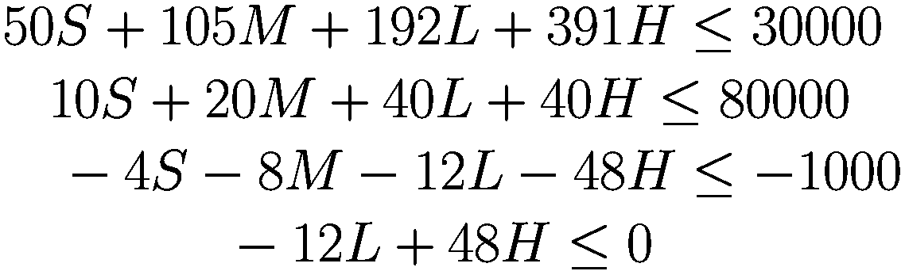

左侧系数定义矩阵 `A`，右侧项定义 `b`，成本函数的系数定义 `f`。最后一个约束是我们只寻求正解，因此变量 `UL_bounds` 中四个（下界，上界）元组的第一个值均为零。

Python 解决方案如下所示：

```python
from scipy.optimize import linprog
f = [ -0.1, -0.6, -0.96, -2.83])
A = [[ 50, 105, 192, 391],
    [ 10,  20,  40,  40],
    [ -4,  -8, -12, -48],
    [  0,   0, -12,  48]]
b  = [ 30000, 80000, -1000, 0]
UL_bounds = [ (0, None), (0, None),
              (0, None), (0, None) ]
sol = linprog(f,A,b,bounds=UL_bounds)
```

该函数返回一个对象（本例中为 `sol`），包含以下属性：

```python
In : print(sol)
con: array([], dtype=float64)
fun: -172.64883520249523
message: 'Optimization terminated successfully.'
nit: 13
slack: array([2.90929165e-08, 7.48231234e+04,
       1.48490078e+03, 1.47610990e-09])
status: 0
success: True
x: array([1.15833172e-10, 1.37570134e-08,
       1.03537532e+02, 2.58843831e+01])
In : print(sol.status)
Out: 0
In : print(sol.x)
array([1.15833172e-10, 1.37570134e-08,
       1.03537532e+02, 2.58843831e+01])
```

状态值为 0 表示成功收敛，自变量解在属性 `.x` 中。与解最接近的整数值是 `S` = 0、`M` = 0、`L` = 104、`H` = 26，对应的总计费值为每小时 172.42 美元。

如果你没有优化工具箱，仍然可以通过在 MATLAB 中调用 SciPy 的 `linprog()` 来求解该问题：

```matlab
f = [ -0.1; -0.6; -0.96; -2.83];
A = [ 50 105 192 391; ...
      10  20  40  40; ...
      -4  -8 -12 -48; ...
       0   0 -12  48 ];
b = [ 30000; 80000; -1000; 0];
UL_bounds = { py.tuple({0, py.None}), py.tuple({0, py.None}), ...
              py.tuple({0, py.None}), py.tuple({0, py.None}) };
opt = py.importlib.import_module('scipy.optimize');
sol = opt.linprog(f,A,b,pyargs('bounds',py.list(UL_bounds)))
```

运行上述代码可以得到正确解，但令人沮丧的是，在 MATLAB 中无法访问解的各个分量：

```
sol =
Python OptimizeResult with no properties.
con: array([], dtype=float64)
fun: -172.64883520249523
message: 'Optimization terminated successfully.'
nit: 13
slack: array([2.90929165e-08, 7.48231234e+04, 1.48490078e+03, 1.47599621e-09])
status: 0
success: True
x: array([1.15833172e-10, 1.37570134e-08, 1.03537532e+02, 2.58843831e+01])
>> y = sol.x
Unrecognized method, property, or field 'x' for class
'py.scipy.optimize.optimize.OptimizeResult'.
```

因此，我们需要再次编写一个小型 Python 桥接模块，其中包含一个能够提取并返回所需分量的函数。

| MATLAB: | Python: |
| --- | --- |
| `LP = py.importlib.import_module('bridge_linprog');`<br>`py.importlib.reload(LP);`<br>`f = [ -0.1; -0.6; -0.96; -2.83];`<br>`A = [ 50 105 192 391; 10 20 40 40; -4 -8 -12 -48; 0 0 -12 48 ];`<br>`b = [ 30000; 80000; -1000; 0];`<br>`UL_bounds = { py.tuple({0, py.None}), py.tuple({0, py.None}), py.tuple({0, py.None}), py.tuple({0, py.None}) };`<br>`py_sol = LP.solver(f,A,b,pyargs('bounds',py.list(UL_bounds)));`<br>`m_sol = py2mat(py_sol);` | ```python<br># 文件 bridge_linprog.py<br>from scipy.optimize import linprog<br><br>def solver(f,A,b,bounds=None):<br>    sol = linprog(f,A,b,bounds=bounds)<br>    return {<br>        'fun' : sol.fun,<br>        'message' : sol.message,<br>        'status' : sol.status,<br>        'success' : sol.success,<br>        'x' : sol.x<br>    }<br>```

现在，我们在桥接模块中捕获的五个分量可以在 MATLAB 中使用：

```
>> m_sol

struct with fields:

fun: -172.6488
message: "Optimization terminated successfully."
status: 0
success: 1
x: [1.1583e-10 1.3757e-08 103.5375 25.8844]
```

#### 11.12.1.2 PuLP

Python PuLP 模块有两个吸引人的方面：可以将变量定义为整数或实数，并且约束条件可以用比其他模块更自然的形式表达：

```python
import pulp

model = pulp.LpProblem("服务器机房", pulp.LpMaximize)

S = pulp.LpVariable('S', lowBound=0, cat='Integer')
M = pulp.LpVariable('M', lowBound=0, cat='Integer')
L = pulp.LpVariable('L', lowBound=0, cat='Integer')
H = pulp.LpVariable('H', lowBound=0, cat='Integer')
```

# 常数
```
C_s, C_m, C_l, C_h = .10,  .60,  .96, 2.83  # 成本
T_s, T_m, T_l, T_h = 50, 105, 192, 391      # 热功耗
O_s, O_m, O_l, O_h =  4,   8,  12, 48       # 核心数
V_s, V_m, V_l, V_h = 10,  20,  40, 40       # 体积
```

# 要最大化的函数

`model += C_s*S +  C_m*M +  C_l*L +  C_h*H, "计费"`

# 约束条件

`model += T_s*S + T_m*M + T_l*L + T_h*H = 1000` # 核心数

`model += O_l*L >= O_h*H` # 核心数

`model += V_s*S + V_m*M + V_l*L + V_h*H <= 80000` # 体积

# 计算解

计算解并打印状态的代码如下：

```python
model.solve()
print(pulp.LpStatus[model.status])
```

结果是：

```
0 S,   30 M,   93 L,   23 H   计费 = 172.37
Optimal
```

## 模拟退火算法

模拟退火是一种基于金属在温度下降时晶体形成概念的随机全局优化方法。简而言之，该算法会对一个解进行随机猜测，然后在下一轮迭代中要么对该解进行扰动，要么生成一个全新猜测。决定是扰动解还是创建新猜测，取决于解的成本以及算法在“退火计划”中的进展程度。在初期，一个比前一个解更差的猜测也很可能会被接受，但随着迭代的进行和“温度”的下降，解的改进更有可能存活到下一轮。

通过 conda-forge 提供的 Python 模块 `simanneal`，为使用模拟退火解决优化问题提供了一个便捷框架。`simanneal` 要求用户提供以下内容：

*   一个继承自 `simanneal` 的 `Annealer` 类的类，该类需提供构造函数（`__init__()` 函数）、一个用于扰动现有解的 `move()` 函数，以及一个用于评估解的成本函数的 `energy()` 函数。
*   一个初始猜测解。
*   一个退火计划。

为了说明如何实现这三个要素，我们将通过简化 `simanneal` 文档中给出的旅行商问题（TSP）解法来求解该问题。

第 12–22 行定义了从 `Annealer` 派生的类。我们问题的成本函数在第 20 行使用 `energy()` 方法定义。`.state` 属性是我们希望优化的变量集合——在我们的案例中，它是一个定义路径的城市索引列表。对我们来说，一个解的成本是路径中相邻城市间距离的总和。这里，我们访问 `.distance_matrix` 属性，这是一个城市间距离的查找表；它是一个 *N* x *N* 矩阵，其中索引 (*i*, *j*) 处的值表示城市 *i* 和 *j* 之间的距离。距离矩阵在类的构造函数第 13 行中填充。除了添加 `.distance_matrix` 作为属性外，构造函数完全是样板代码。最后，第 16 行的 `move()` 方法定义了如何对当前状态应用随机扰动，换句话说，就是如何随机改变我们的路径。

第 24 行的 `compute_distances()` 函数使用第 11.1.13 节中提到的 `broadcasting` 技术计算距离矩阵。

第 31–34 行定义了排列在 8 x 10 网格上的 80 个城市。这种布局的简单性使得识别最优解变得容易。

退火计划在第 42 行定义。参数 `tsp.auto(minutes=0.5)` 告诉模块估算计划参数，以便在大约 30 秒的运行时间内返回一个解。或者，你也可以自己控制参数：

```python
schedule = {
    'tmax' : 20000.0, # 起始温度
    'tmin' :     2.0, # 终止温度
    'steps' : 50000 , # 迭代次数
    'updates' : 100 , # 标准输出更新次数
}
tsp.set_schedule(schedule)
```

在实践中，自动估算器在便利性、解的质量以及对等待答案时间的预期之间提供了理想的平衡。如果你的解不够最优，只需增加允许退火器运行的时间（通过 `tsp.auto()` 的 `minutes` 参数）。

```python
1   import numpy as np
2   import random
3   from simanneal import Annealer
4   import matplotlib.pyplot as plt
6   def plot_route(route, coordinates, fname):
7       circuit = [_ for _ in route] + [ route[0] ]
8       plt.plot(coordinates[circuit,0], coordinates[circuit,1])
9       plt.scatter(coordinates[:,0], coordinates[:,1], color='r')
10      plt.show()
12  class TravellingSalesmanProblem(Annealer):
13      def __init__(self, state, distance_matrix):
14          self.distance_matrix = distance_matrix # 在对象中存储距离
15          super(TravellingSalesmanProblem, self).__init__(state)
16      def move(self): # 交换路径中的两个城市；返回该距离变化
17          a, b = random.sample(range(len(self.state)), k=2)
18          self.state[a], self.state[b] = self.state[b], self.state[a]
19          return self.energy()
20      def energy(self): # 对于此问题，成本 = 路径距离
21          S = self.state
22          return sum([self.distance_matrix[S[i-1],S[i]] for i in range(len(S))])
24  def compute_distances( city_coord ): # 使用广播
25      X, Y = city_coord[:,0], city_coord[:,1]
26      dX = X[:,np.newaxis] - X[np.newaxis,:]
27      dY = Y[:,np.newaxis] - Y[np.newaxis,:]
28      return np.sqrt( dX**2 + dY**2 )
30  def main():
31      nR, nC = 8, 10
32      J, I = np.meshgrid(range(nR),range(nC))
33      city_coord = np.vstack( [I.ravel(), J.ravel()] ).T
34      distance_matrix = compute_distances( city_coord )
36      # 初始状态，一个随机排序的行程
37      starting_sequence = list(range(nR*nC))
38      random.shuffle(starting_sequence) # 原地修改 starting_sequence
39      plot_route(starting_sequence, city_coord, 'tsp_start')
41      tsp = TravellingSalesmanProblem(starting_sequence, distance_matrix)
42      tsp.set_schedule(tsp.auto(minutes=0.5))
43      tsp.copy_strategy = "slice" # state 是列表；slice 方法最快
44      state, e = tsp.anneal()     # 开始优化
46      print(f'路径距离 = {e:.2f}, 路径 = ',state)
47      plot_route(state, city_coord, 'tsp_solved')
48  if __name__ == '__main__': main()
```


图 11-8：使用 `simanneal` 和 `tsp.auto(minutes=2.5)` 找到的 TSP 解


图 11-7：使用 `simanneal` 和 `tsp.auto(minutes=0.25)` 找到的 TSP 解

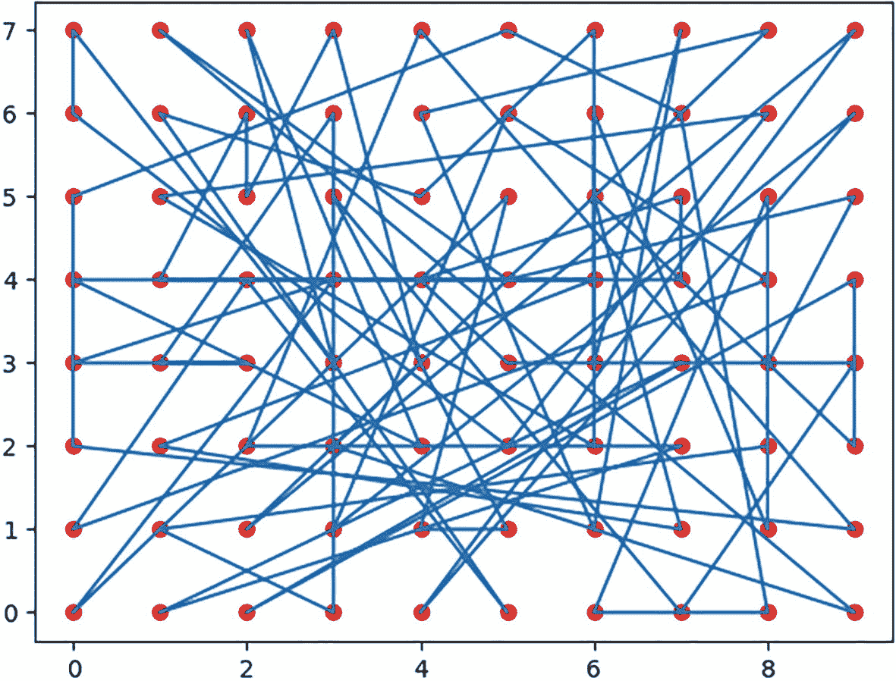

图 11-6：TSP 的初始随机猜测

## 11.13 微分方程

SciPy 的微分方程求解器集合与 MATLAB 的 `ode*()` 函数族旗鼓相当。不过它们的调用方法截然不同。MATLAB 的例程会返回完整的解（如果能找到的话），而 SciPy 返回的是一个迭代器，需要在循环中调用。

作为示例问题，我们将求解杜芬振荡方程：^(⁴⁶)


由于 MATLAB 和 Python 的求解器只处理一阶微分方程，这个二阶方程必须线性化为一对一阶方程：


下面的 MATLAB^(⁴⁷) 和 Python 函数 `Duff()` 会返回一个包含两个值的数组，对应于这两个方程的右侧：

| MATLAB: | Python: |
| --- | --- |
| *% 文件: code/ode/duffing.m*<br>`Time = [0 40];`<br>`U_0   = [0; 0];`<br>`c = 0.1;`<br>`k = 0.7;`<br>`k3 = 1;`<br>`A = 44.5;`<br>`omega = 1.1;`<br>`options = odeset('RelTol',1e-7);`<br>`[t,u] = ode45(@(t,u)Duff(...`<br>`    t,u,k,c,k3,A,omega), ...`<br>`    Time,U_0,options);`<br>`figure`<br>`plot(u(:,1),u(:,2));`<br>`xlabel('Position');`<br>`ylabel('Velocity');`<br>`title('Duffing oscillator')`<br>`function` `u = Duff(t,u,k,c,k3,A,omega)`<br>  `u = [u(2); -k*u(1)-c*u(2)- ...`<br>`           k3*u(1)³+A*sin(omega*t)];`<br>`end` | *# 文件: code/ode/duffing.py*<br>`import numpy as np`<br>`from scipy.integrate import` `RK45`<br>`import matplotlib.pyplot as plt`<br>`def` `Duff(t,u,k=0.7,c=0.1,k3=1,`<br>`A=44.5,omega=1.1):`<br>`return` `[u[1], -k*u[0]-c*u[1] -`<br>`k3*u[0]**3+A*np.sin(omega*t)]`<br>`T0, Tn = 0, 40`<br>`U_0 = [0, 0]`<br>`t, u = [], []`<br>`sol = RK45(Duff, T0, U_0, Tn,`<br>`rtol=1e-7)`<br>`while` `sol.t < Tn:`<br>`    t.append(sol.t)`<br>`    u.append([sol.y[0], sol.y[1]])`<br>`    sol.step()`<br>`u = np.array(u)`<br>`plt.plot(u[:,0], u[:,1])`<br>`plt.xlabel('Position');`<br>`plt.ylabel('Velocity');`<br>`plt.title('Duffing oscillator');`<br>`plt.show()` |

左侧对 `ode45()` 的单行调用对应于 Python 中对 `RK45()` 的调用，随后跟一个 while 循环，循环中依次调用求解器对象的 `.step()` 方法。两个求解器都配置为返回相对精度为 10^(-7) 的解，但 MATLAB 需要 5093 次迭代，而 Python 只用了 1002 次。解在该相空间的图形显示出良好的一致性：


## 11.14 符号数学

Python 模块 SymPy 是一个计算机代数系统（CAS），可与 MATLAB 的符号工具箱相媲美。SymPy 是一个功能极其强大的 CAS，涵盖的主题包括微积分、微分几何、组合数学、数论、密码学、级数以及常微分和偏微分方程。除了符号化地计算结果外，它还可以将解表示为 LaTeX 格式，或表示为 Python、MATLAB 及其他多种语言的计算机代码，如表 11-9 所示。

表 11-9 SymPy 代码生成器

| 语言 | `sympy.printing` 函数 |
| --- | --- |
| C | `ccode()` |
| C++ | `cxxcode()` |
| Fortran | `fcode()` |
| GLSL | `glsl_code()` |
| JavaScript | `jscode()` |
| Julia | `julia_code()` |
| Maple | `maple_code()` |
| Mathematica | `mathematica_code()` |
| MATLAB | `octave_code()` |
| Python | `pycode()` |
| R | `rcode()` |
| Rust | `rust_code()` |

本节展示的示例仅是 SymPy 强大功能的冰山一角。

### 11.14.1 定义符号变量

SymPy 中的变量通过从 `sympy.abc` 模块导入来标识。例如，表达式 `from sympy.abc import x, y, phi` 将 `x`、`y` 和 `phi` 标识为要符号化处理的变量。

### 11.14.2 导数

使用 `sympy.diff()` 函数求导数。此示例展示了如何计算下式的导数：

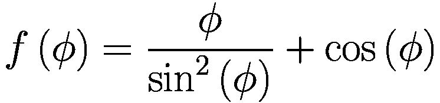

Python:
```

In : from sympy import cos, sin, diff

In : from sympy.abc import phi

In : from sympy.printing.latex import print_latex, octave_code

In : f = phi/sin(phi)**2 + cos(phi)

In : d = diff(f)

In : d.doit()

In : d.doit()

Out: -2*phi*cos(phi)/sin(phi)**3 - sin(phi) + sin(phi)**(-2)

In : print_latex(d)

- \frac{2 \phi \cos{\left(\phi \right)}}{\sin^{3}{\left(\phi \right)}} -

\sin{\left(\phi \right)} + \frac{1}{\sin^{2}{\left(\phi \right)}}

```

该导数的 LaTeX 输出渲染如下：

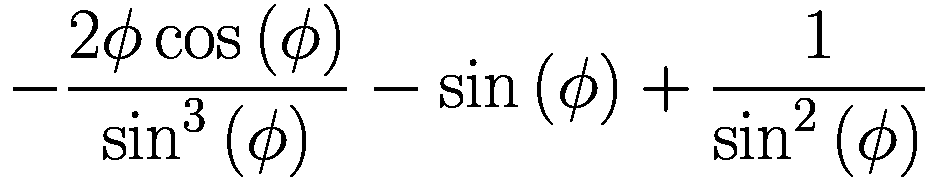

并且，可以像下面这样生成输入和输出函数的 MATLAB 代码：

Python:
```

In : print(octave_code(f))

phi./sin(phi).² + cos(phi)

In : print(octave_code(d))

-2*phi.*cos(phi)./sin(phi).³ - sin(phi) + sin(phi).^(-2)
```

### 11.14.3 积分

使用 `sympy.integrate()` 进行积分。例如，积分

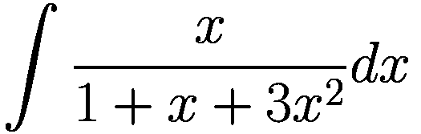

可以通过以下方式求得：

```python
In : from sympy import integrate

In : from sympy.abc import x

In : from sympy.printing.latex import print_latex

In : s = integrate(x/(1 + x + 3*x**2))

In : s.doit()

Out: log(x**2 + x/3 + 1/3)/6 - sqrt(11)*atan(6*sqrt(11)*x/11 + sqrt(11)/11)/33

In : print_latex(s)

\frac{\log{\left(x^{2} + \frac{x}{3} + \frac{1}{3} \right)}}{6} - \frac{\sqrt{11}

\operatorname{atan}{\left(\frac{6 \sqrt{11} x}{11} + \frac{\sqrt{11}}{11}

\right)}}{33}
```

结果如下所示：

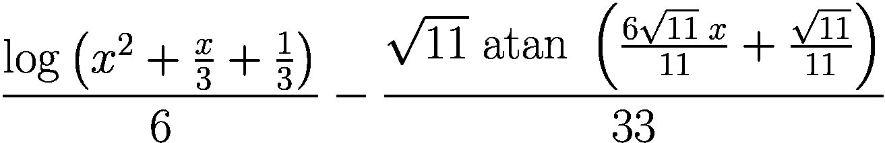

### 11.14.4 求解方程

方程组


描述了一个圆和一条直线。以下代码求解用 `R`、`m` 和 `b` 表示的这些交点 `(x, y)`：

```python
In : from sympy import Eq

In : from sympy.solvers import solve

In : from sympy.abc import x,y,R,m,b

In : circle = (x-1)**2 + (y+3)**2 - R**2

In : line = m*x + b

In : solve(Eq(circle,line), (x,y))

Out: [(m/2 - sqrt(4*R**2 + 4*b + m**2 +

4*m - 4*y**2 - 24*y - 36)/2 + 1, y),

(m/2 + sqrt(4*R**2 + 4*b + m**2 +

4*m - 4*y**2 - 24*y - 36)/2 + 1, y)]
```

### 11.14.5 线性代数

#### 11.14.5.1 执行 的符号 LU 分解

矩阵

![$$ \left[\begin{array}{ccc}1&amp; 2&amp; -3\\ {}4&amp; -5&amp; 6\\ {}-7&amp; 8&amp; 9\end{array}\right] $$](images/516169_1_En_11_Chapter/516169_1_En_11_Chapter_TeX_Equu.png)

使用以下代码通过精确算术分解为下三角和上三角矩阵：

```python
In : from sympy import Matrix

In : A = Matrix([[1,2,-3],

[4,-5,6],

[-7,8,9]])

In : L, U, perm = \

...:    A.LUdecomposition()

In : L

Matrix([

[ 1,      0, 0],

[ 4,      1, 0],

[-7, -22/13, 1]])

In : U

Matrix([

[1,   2,     -3],

[0, -13,     18],

[0,   0, 240/13]])

In : perm

Out: []

In : L*U - A

Matrix([

[0, 0, 0],

[0, 0, 0],

[0, 0, 0]])
```

#### 11.14.5.2 符号求解 `A*x = b`

以下列三个方程和三个未知数为例

![$$ \left[\begin{array}{ccc}1&amp; 2&amp; -3\\ {}4&amp; -5&amp; 6\\ {}-7&amp; 8&amp; 9\end{array}\right]x=\left\{\begin{array}{c}1\\ {}-2\\ {}1\end{array}\right\} $$](images/516169_1_En_11_Chapter/516169_1_En_11_Chapter_TeX_Equv.png)

通过以下代码使用高斯-若尔当消元法对 `x` 进行符号求解：

```python
In : b = Matrix([1, -2, 1])

In : x, params = A.gauss_jordan_solve(b)

In : x

Matrix([

[ 1/20],

[ 3/10],

[-7/60]])

In : params

Out: Matrix(0, 1, [])
```

### 11.14.6 级数

SymPy 支持傅里叶级数、幂级数、级数求和以及级数展开。以下示例展示了如何找到闭式求和的结果

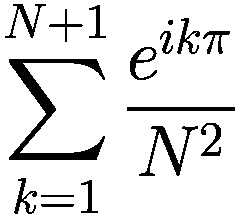

```python
In : from sympy import I, Sum, exp, pi

In : from sympy.abc import k, N

In : s = Sum( exp(I*k*pi)/N**2, (k, 1, N+1))

In : s.doit()

Out: (-(-1)**(N + 2)/2 - 1/2)/N**2
```

## 11.15 方案 11-5：在 MATLAB 中使用 SymPy

在定义符号变量以及 `i` 和 `π` 的 SymPy 特定常量后，可以在 MATLAB 中完成第 11.14.6 节中的级数求和。我们将所有 Python 变量加上前缀“`p`”，以避免与 MATLAB 内置变量发生名称冲突，尽管在本例中只有 `pi` 会导致冲突。

```matlab
>> pI = py.sympy.I;

>> pPi = py.sympy.pi;

>> pk = py.sympy.abc.k;

>> pN = py.sympy.abc.N;

>> s = py.sympy.Sum( py.sympy.exp(pI*pk*pPi)/pN², py.tuple({pk,1,pN+1}));

>> s.doit()

Python Mul with properties:

args: [1×2 py.tuple]

assumptions0: [1×1 py.dict]

canonical_variables: [1×1 py.dict]

expr_free_symbols: [1×1 py.set]

free_symbols: [1×1 py.set]

func: [1×1 py.sympy.core.assumptions.ManagedProperties]

is_algebraic: [1×1 py.NoneType]

:

is_rational: [1×1 py.NoneType]

is_real: [1×1 py.NoneType]

is_transcendental: [1×1 py.NoneType]

is_zero: [1×1 py.NoneType]

N**(-2.0)*(-(-1)**(N + 2.0)/2 - 0.5)
```

`s.doit()` 的输出是 MATLAB 中的一个 Python 变量；要获得包含求解结果的 MATLAB 字符串，我们只需访问 Python 求解结果的 `.char` 属性：

```matlab
>> s_soln = s.doit();

>> m_soln = s_soln.char;

>> m_soln

'N**(-2.0)*(-(-1)**(N + 2.0)/2 - 0.5)'
```

## 11.16 方案 11-6：计算拉普拉斯变换

MATLAB 符号工具箱中的 `laplace()` 函数可以计算拉普拉斯变换。SymPy 中的 `laplace_transform()` 函数也可以完成同样的功能。以下示例计算了以下函数的变换：

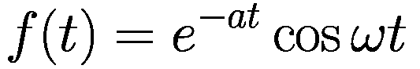

MATLAB 2020b:

```matlab
>> sympy = py.importlib.import_module('sympy');

>> s = sympy.symbols('s');

>> t = sympy.symbols('t');

>> a = sympy.symbols('a', pyargs('real','True', 'positive','True'));

>> omega = sympy.symbols('omega', pyargs('real','True'));

>> f = sympy.exp(-a*t)*sympy.cos(omega*t);

>> L = sympy.laplace_transform(f, t, s)

L =

Python tuple with no properties.

((a + s)/(omega**2 + (a + s)**2), -a, Eq(2*Abs(arg(omega)), 0))

>> latex = py.importlib.import_module('sympy.printing.latex');

>> latex.print_latex(L{1})

\frac{a + s}{\omega^{2} + \left(a + s\right)^{2}}
```

LaTex 输出渲染为：

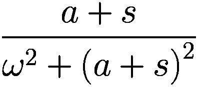

## 11.17 单位系统

Python 模块 `pint` 允许将单位分配给数字标量和数组，这与 MATLAB 符号工具箱中的类似功能非常相似。一旦为变量分配了单位，在计算中尝试混合维度不兼容的项（例如，将面积与温度相加）会引发 `DimensionalityError`。混合维度兼容但单位制不同的项（例如，将以米为单位的长度与以英寸为单位的长度相加）可以正确工作，因为会首先应用适当的缩放因子。

在 `pint` 和符号工具箱中，都必须首先初始化单位对象（在两种语言的以下示例中均使用 `u`）。后续变量可以通过将数值或变量乘以单位对象的众多属性之一来获得单位。在此，我们展示如何将 6061 铝合金^(⁴⁸)的弹性模量和密度从公制转换为美制单位。

Python:

```python
In : from pint import UnitRegistry

In : u = UnitRegistry()

In : E = 68.9 * u.GPa

In : rho = 2.70 * u.g/u.cm**3

In : E_us = E.to(u.psi)

In : rho_us = rho.to(u.lb/u.inch**3)

In : E_us

Out: 9993100.129611416 

In : rho_us

Out: 0.09754368840022593 
```

`pint` 和符号工具箱都支持数百种基本单位和导出单位；完整列表可在 [`https://github.com/hgrecco/pint/blob/master/pint/default_en.txt`](https://github.com/hgrecco/pint/blob/master/pint/default_en.txt) 和 [`www.mathworks.com/help/symbolic/units-list.html`](http://www.mathworks.com/help/symbolic/units-list.html) 找到。

单位可以分配给 NumPy 数组；对该数组的单个项或切片进行操作时，只能使用无单位变量或其他一致的单位变量。但是，无法创建包含混合单位的 NumPy 数组。这排除了在阵列的行或列具有不同单位类型的应用中使用 `pint` 的可能性。一个例子是同时包含线刚度和旋转刚度的有限元矩阵。

### 11.17.1 在 `pint` 中定义单位

可以轻松定义任意单位。在下一个示例中，定义了“美元”和“欧元”的货币单位。然后基于它们定义了每单位面积的价格，并将其应用于一个包含四个属性的房地产地块集合。最后，给出了每个集合以美元和欧元计的价格。注意，在计算 `cost` 向量时，`pint` 不会自动简化复合单位；我们必须显式地转换为美元或欧元：

Python:

```python
In : from pint import UnitRegistry

In : u = UnitRegistry()

In : u.define('dollar = 1 = USD')

In : u.define('euro = 1.31 * dollar = EU')

In : USD_per_ft2 = 2.1 * u.USD/u.foot**2

In : EU_per_m2 = USD_per_ft2.to(u.EU/u.meter**2)

In : EU_per_m2

Out: 17.2551 

In : a = np.arange(20).reshape(5,4) * u.acre

In : a

array([[ 0,  1,  2,  3],

[ 4,  5,  6,  7],

[ 8,  9, 10, 11],

[12, 13, 14, 15],

[16, 17, 18, 19]]) 

In : P = np.ones(4) * USD_per_ft2

In : P

Out: array([2.1, 2.1, 2.1, 2.1]) 

In : cost = a@P

In : cost

Out: array([ 12.6,  46.2,  79.8, 113.4, 147\. ])

In : cost.to(u.USD)

array([ 548858.19543059, 2012480.04991215, 3476101.90439371,

4939723.75887528, 6403345.61335684]) 

In : cost.to(u.euro)

array([ 418975.72170274, 1536244.31291004, 2653512.90411734,

3770781.49532464, 4888050.08653194]) 
```

`pint` 文档指出，为变量添加单位会导致使用这些变量执行计算时性能下降。每次 `pint` 检查单位时确实如此。但是，如果变量是 NumPy 数组，则此单位检查仅对整个数组执行一次，而不是对数组中的每个项执行。总的来说，性能受数值数组计算主导的程序，在使用单位时与不使用单位时运行速度大致相同。

## 11.18 食谱 11-7：在 MATLAB 中使用 `pint`

11.17 节的单位示例需稍作修改才能在 MATLAB 中使用。主要区别在于，不能通过点号访问注册表变量中的单位。相反，我们必须使用 `.Units()` 访问器函数。例如，“米”单位在 MATLAB 中必须引用为 `u.Unit('meter')`，而不能像在 Python 中那样直接写 `u.meter`。还需注意，矩阵 `a` 被定义为 4×5 矩阵的转置，以便获得与 Python 相同的行主序值。

MATLAB:

```matlab
>> u = py.pint.UnitRegistry;

>> u.define('dollar = 1 = USD');

>> u.define('euro = 1.31 * dollar = EU');

>> USD_per_ft2 = 2.1 * u.Unit('USD')/u.Unit('foot')²;

>> EU_per_m2 = USD_per_ft2.to(u.Unit('EU')/u.Unit('meter')²);

>> a = reshape(0:19, 4,5)';

>> b = py.numpy.array(a)*u.Unit('acre');

>> P = py.numpy.ones(int64(4)) * USD_per_ft2;

>> cost = b.dot(P)

cost =

Python Quantity with properties :

T: [1×1 py.pint.quantity.Quantity]

:

units: [1×1 py.pint.unit.Unit]

[12.6 46.2 79.8 113.4 147.0] acre * dollar / foot ** 2

>> cost.to(u.Unit('USD'))

Python Quantity with properties:

T: [1×1 py.pint.quantity.Quantity]
```


# 12. 绘图

MATLAB 因其可视化数值数据的便捷性而闻名。Python 也具备类似的能力，但在开始之前，必须从众多优秀的绘图模块中选择一个。其中佼佼者包括：

- Altair
- Bokeh
- matplotlib
- Plotly
- Seaborn

Altair 允许用相对较少的代码生成复杂的图形；Bokeh 和 Plotly 擅长创建交互式的 Web 图形；Seaborn 基于 matplotlib 构建，具有精致的视觉风格和快捷函数，能创建相对复杂的图形，尤其适用于统计工作。我选择了其中最古老的 matplotlib，原因如下：其命令和绘图范式与 MATLAB 最为相似；是 Cartopy（第 12.4 节）和 Pandas（第 13 章）的底层绘图包；并且可以随时添加 Seaborn 的增强功能。

## 12.1 点图与线图

除了额外的导入语句外，在 Python 中绘制抛物线的命令与在 MATLAB 中看起来相似。结果也几乎相同：

| MATLAB: | Python: |
| --- | --- |
| `x=-10:10;` `y= x .² - 36;` `plot(x,y)` | `import numpy as np` `import matplotlib.pyplot as plt` `x = np.arange(-10,11)` `y = x**2 – 36` `plt.plot(x,y)` `plt.show()` |

两者之间的一个显著区别是，默认情况下，MATLAB 会自动打开一个显示窗口来展示正在创建的图形，而 Python 除非显式调用 `plt.show()`，否则不会显示任何内容。MATLAB 的这种行为在交互式工作时很方便。但是，如果你运行一个包含长时间计算的 MATLAB m 文件，最终出现的绘图窗口可能会在你活跃于其他窗口时“劫持”你的鼠标点击。当你的代码在循环中创建图形，导致一连串窗口不断弹出时，这尤其令人厌烦。另一方面，如果你忘记最后的 `plt.show()`（或者如果你要写入图像文件而非显示，则忘记 `plt.savefig()`），Python 程序将不会显示图形。在 IPython 中交互式工作时也是如此。然而，像 PyCharm、Spyder 和 Jupyter notebook 这样的 IDE 和其他图形化 Python 工作环境，其工作方式与 MATLAB IDE 类似，会立即显示图形。


图 12-2 Python


图 12-1 MATLAB

用于添加标题、坐标轴标签和图例的 `matplotlib` 命令与 MATLAB 中的对应命令非常相似。此外，对于简单的图形，我们只需直接引用 `matplotlib.pyplot`（通常导入为 `plt`）的命令即可：

| MATLAB: | Python: |
| --- | --- |
| `t=linspace(0,10*pi,300);` `decay = exp(-t/10);` `osc = decay .* sin(t);` `pts = -decay(1:10:end);` `plot(t,osc,'g')` `hold on` `plot(t,decay,'r')` `scatter(t(1:10:end),pts)` `grid on` `hold off` `title('衰减正弦波')` `xlabel('时间 [秒]')` `ylabel('exp(-t/10)*sin(t)')` `saveas(1,"decay.png")` | `import numpy as np` `import matplotlib.pyplot as plt` `t = np.linspace(0,10*np.pi,num=300)` `decay = np.exp(-t/10)` `osc = decay*np.sin(t)` `pts = -decay[::10]` `plt.plot(t,osc,'g')` `plt.plot(t,decay,'r')` `plt.scatter(t[::10],pts)` `plt.grid()` `plt.title('衰减正弦波')` `plt.xlabel('时间 [秒]')` `plt.ylabel('exp(-t/10)*sin(t)')` `plt.savefig('decay.png')` `plt.show()` `# 可选` |

### 12.1.1 将图形保存到文件

Matplotlib 用于将图形保存为 PNG、JPEG 等格式的函数是 `plt.savefig()`。它类似于 MATLAB 的 `saveas()`、`print()` 和 `exportgraphics()` 函数，但其优势在于支持 PNG 文件的透明背景——这对于插入 PowerPoint 演示文稿、Word 文档、网站、电子书和 PDF 来说是一个理想的特性。MATLAB 仅支持以 PDF 格式保存的图形具有透明度，而这个过程比写入 PNG 或 JPEG 文件要慢得多。

matplotlib 支持的图像文件格式可以通过 `plt.gcf().canvas.get_supported_filetypes()` 显示：

```python
In : plt.gcf().canvas.get_supported_filetypes()

Out:
```


图 12-4 Python


图 12-3 MATLAB

```python
{'ps': 'Postscript',
 'eps': '封装的 Postscript',
 'pdf': '便携式文档格式',
 'pgf': '用于 LaTeX 的 PGF 代码',
 'png': '便携式网络图形',
 'raw': '原始 RGBA 位图',
 'rgba': '原始 RGBA 位图',
 'svg': '可缩放矢量图形',
 'svgz': '可缩放矢量图形',
 'jpg': '联合图像专家组格式',
 'jpeg': '联合图像专家组格式',
 'tif': '标签图像文件格式',
 'tiff': '标签图像文件格式'}
```

本书中的大部分图像都是使用如下命令保存的：

```python
plt.savefig('plot.png', dpi=200, bbox_inches='tight',
            pad_inches=0.1, transparent=True)
```

> **提示**：如果你希望 Python 程序既在屏幕上显示图形，又将其保存到文件，请先调用`plt.savefig()`，再调用`plt.show()`；否则，图像文件将是空的。

### 12.1.2 每张图形中的多个子图

Matplotlib 的`subplots()`函数类似于 MATLAB 的`subplot()`，两者都将所需子图的行数和列数作为前两个参数。MATLAB 函数的第三个参数是要绘制的子图按行主序的偏移量，而 matplotlib 的函数则返回一个坐标轴句柄数组：

| MATLAB: | Python: |
| --- | --- |
| `t = -10*pi:0.1:10*pi;` `C = {{'blue' , 'red',},` `...` `{'green', 'black'}};` `figure` `i = 1;` `for` `r = 0:1` `for` `c = 0:1` `subplot(2, 2, i)` `i = i+1;` `k = 1 + (1.1*r + 1.5*c)/10;` `y = sin(t) + sin(k*t);` `plot(t,y,C{r+1}{c+1})` `xlabel('t')` `ylabel('y')` `title(sprintf(` `...` `'r=%d, c=%d',r,c))` `grid on` `end` `end` | `import numpy as np` `import matplotlib.pyplot as plt` `t = np.arange(-10*np.pi, 10*np.pi, 0.1)` `C = [['blue' , 'red',],` `['green', 'black']]` `fig, ax = plt.subplots(nrows=2,` `ncols=2, constrained_layout=` `True` `)` `for` `r` `in` `[0, 1]:` `for` `c` `in` `[0, 1]:` `k = 1 + (1.1*r + 1.5*c)/10` `y = np.sin(t) + np.sin(k*t)` `ax[r,c].plot(t,y,color=C[r][c])` `ax[r,c].set_xlabel('t')` `ax[r,c].set_ylabel('y')` `ax[r,c].set_title(` `f'r=` `{r}`, c=` `{c}` `', fontsize=14)` `ax[r,c].grid(` `True` `)` `plt.show()` |


**图 12-6** Python


**图 12-5** MATLAB

### 12.1.3 X 轴上的日期和时间

X 轴上的日期和时间标注可能很棘手，因为它们占用了太多空间。MATLAB 和 Python 的 matplotlib 都允许精细控制日期字符串格式以及旋转轴标签以防止重叠。MATLAB 的时间标记对齐到中午，而 matplotlib 的对齐到午夜。

| MATLAB: | Python: |
| --- | --- |
| `t = .1:.01:.8;` `y = sin(3./t).*sin(5./(1-t));` `S = 30*24*60*60*t + 1620000000;` `dates = arrayfun(@(x) datetime(` `...` `x,'ConvertFrom','posix'), S);` `scatter(dates,y,'v','filled')` `grid()` `xtickformat('yyyy-MM-dd hh:mm')` `xtickangle(30)` | `import numpy as np` `import matplotlib.pyplot as plt` `import matplotlib.dates as mdates` `from datetime import` `datetime` `t = np.arange(.1, .8, .01)` `y = np.sin(3/t)*np.sin(5/(1-t))` `S = 30*24*60*60*t + 1620000000` `dates = [datetime.fromtimestamp(_)` `for` `_` `in` `S]` `fig, ax = plt.subplots()` `ax.scatter(dates,y,marker=11)` `plt.grid()` `ax.xaxis.set_major_formatter(` `mdates.DateFormatter('%Y-%m-` `%d` `%H:%S'))` `fig.autofmt_xdate()` |


**图 12-8** Python


**图 12-7** MATLAB

### 12.1.4 双 Y 轴

相互竞争的单位系统，例如公制与美制，可以通过在左右垂直轴上标注不同的单位来同时显示。此示例显示了数种金属的弹性模量（通常称为杨氏模量）^(⁴⁹)，左侧单位为吉帕斯卡（GPa），右侧单位为兆磅每平方英寸（Mpsi）。这在 MATLAB 中使用`yyaxis left`和`yyaxis right`命令会稍微容易一些，这两个命令定义了后续命令操作的垂直轴。在 matplotlib 中，我们通过复制第一个垂直轴对象来创建一个新的垂直轴对象，然后用第二个单位系统的属性修改这个副本。

| MATLAB: | Python: |
| --- | --- |
| `*% file: code/plots/double_y_axis.m*` `yL = [68 108 112 116 193 200];` `yR = [9.86 15.7 16.2 16.8 28 29];` `yLmax = max(yL) * 1.1;` `materials = {'aluminum',` `...` `'zinc', 'bronze', 'titanium',` `...` `'iron', 'steel'};` `bar(yL)` `yyaxis left` `ylabel('GPa')` `ylim([0 yLmax])` `yyaxis right` `ylabel('Mpsi')` `ylim([0 yLmax/6.8965])` `xticklabels(materials)` `grid()` `title("Young's Modulus")` | `*# file: code/plots/double_y_axis.py*` `import numpy as np` `import matplotlib.pyplot as plt` `fig, ax = plt.subplots()` `yL = [68, 108, 112, 116, 193, 200]` `yR = [9.86, 15.7, 16.2, 16.8, 28, 29]` `yLmax = np.max(yL) * 1.1` `materials = ['aluminum', 'zinc',` `'bronze', 'titanium',` `'iron', 'steel']` `P = ax.bar(materials, yL)` `ax.set_ylabel('GPa')` `ax2 = ax.twinx()` `ax2.set_ylabel('Mpsi')` `ax.set_ylim(ymax=yLmax)` `ax2.set_ylim(ymax=yLmax/6.8965)` `ax.grid(` `True` `)` `ax.set_axisbelow(` `True` `)` `plt.title("Young's Modulus")` `plt.show()` |


**图 12-10** Python


**图 12-9** MATLAB

### 12.1.5 直方图

以下示例显示了正态分布和瑞利分布的直方图。生成这些分布的 MATLAB 函数`normrnd()`和`raylrnd()`位于统计和机器学习工具箱中。我没有该工具箱的访问权限，因此在 MATLAB 中我将调用 NumPy 的等效函数。通过在 MATLAB 和 Python 中使用相同的随机数源，我还可以初始化相同的种子，从而在两种语言中生成相同的分布。

| MATLAB: | Python: |
| --- | --- |
| `*% file: code/plots/hist_demo.m*` `Im = @py.importlib.import_module;` `rnd = Im('numpy.random');` `N = int64(10000);` `rnd.seed(int64(123));` `w1 = rnd.rayleigh(int64(3), N);` `w1 = py2mat(w1);` `w2 = rnd.normal(int64(8),` `...` `int64(3), N);` `w2 = py2mat(w2)` `;` `bins = linspace(-5, 20, 80);` `h1 = histogram(w1,bins);` `set(h1,'FaceAlpha',0.5,` `...` `'EdgeAlpha',0.0);` `hold on` `h2 = histogram(w2,bins);` `set(h2,'FaceAlpha',0.5,` `...` `'EdgeAlpha',0.0);` `legend('Rayleigh','Normal');` `grid on` | `*# file: code/plots/hist_demo.py*` `import numpy as np` `import matplotlib.pyplot as plt` `N = 10000` `np.random.seed(123)` `w1 = np.random.rayleigh(3, N)` `w2 = np.random.normal(8, 3, N)` `bins = np.linspace(-5, 20, 80)` `plt.hist(w1, bins, alpha=0.5,` `label="Rayleigh")` `plt.hist(w2, bins, alpha=0.5,` `label="Normal")` `plt.legend(loc='upper right')` `plt.ylim([0, 700])` `plt.grid(` `True` `)` `plt.show()` |

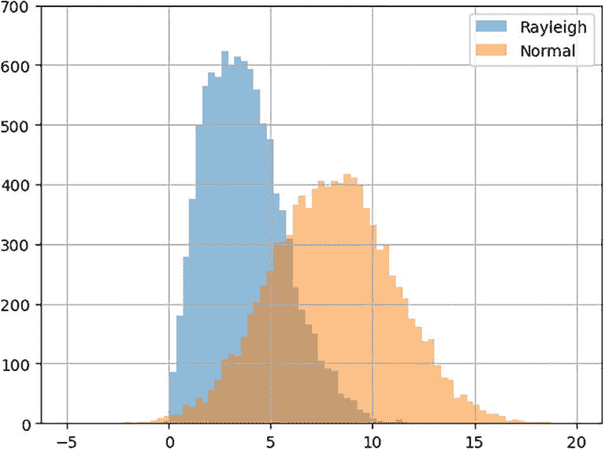

**图 12-12** Python

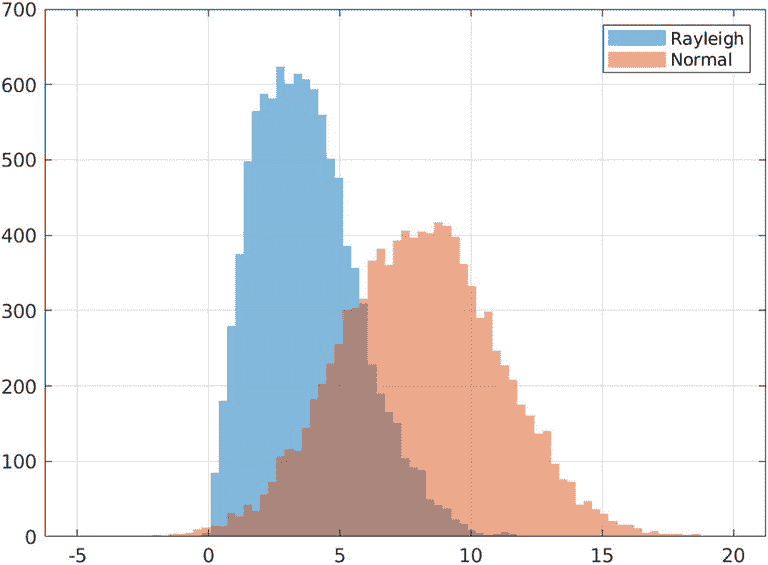

**图 12-11** MATLAB

### 12.1.6 堆叠图

堆叠图（或沙堆图）可以使用 MATLAB 中的`area()`和 matplotlib 中的`stackplot()`创建。（MATLAB 有一个`stackedplot()`函数，但其目的是创建共享一个 x 轴的多个垂直对齐的图。）

| MATLAB: | Python: |
| --- | --- |
| `*% file: code/plots/stack_demo.m*` `t = linspace(0, 20, 100);` `w = [0.11, 0.25, 0.17, 0.32];` `L = {};` `y = zeros(length(t),length(w));` `for i = 1:length(w)` `F = w(i);` `y(:,i) = cos(F*t).² + F;` `L{i} = sprintf(` `...` `'\\omega = %.2f', F);` `end` `area(t, y)` `legend(L);` `xlabel('\omega')` `grid on` | `*# file: code/plots/stack_demo.py*` `import numpy as np` `import matplotlib.pyplot as plt` `t = np.linspace(0, 20, 100)` `w = [0.11, 0.25, 0.17, 0.32]` `L = [f'$\omega$ =` `{_:.2f}` `'` `for` `_` `in` `w]` `y = np.zeros((len(w),len(t)))` `for` `i,F` `in` `enumerate(w):` `y[i,:] = np.cos(F*t)**2 + F` `fig, ax = plt.subplots()` `ax.stackplot(t, y, labels=L)` `ax.legend(loc='upper right')` `ax.set_xlabel('$\omega$')` `plt.grid()` `ax.set_axisbelow(` `True` `)` `plt.show()` |


**图 12-14** Python

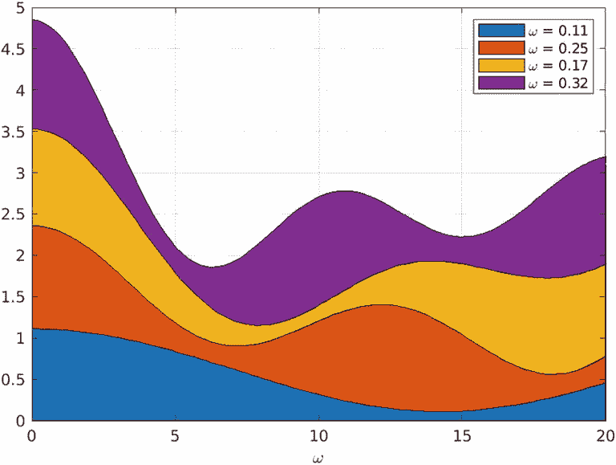

**图 12-13** MATLAB

## 12.2 面积图

### 12.2.1 `imshow()`

最简单的二维图是通过使用颜色映射为各个数组元素着色，直接渲染二维数值数组而成。MATLAB 和 matplotlib 都可以使用名为`imshow()`的函数将二维数组显示为图像。然而，MATLAB 的`imshow()`在显示数组时，每个数组元素会映射到一个屏幕像素；一个 5×5 的数组在大多数屏幕上会显示得非常微小。需要使用可选参数对`'InitialMagnification','fit'`来将小数组缩放到大小合适的图像。MATLAB 的`imagesc()`会将数组缩放到合适的大小，但它不提供像`imshow()`那样不同的插值方法。

第一个例子展示了 MATLAB 中的`imagesc()`和 matplotlib 中的`imshow()`对一个 16×16 数组的处理。（关于`np.newaxis`的回顾，请参见第 11.​1.​13 节。）matplotlib 方便地设置了 1:1 的纵横比：

| MATLAB: | Python: |
| --- | --- |
| `% file: code/plots/imshow_demo.m` `x = 0:0.2:pi;` `S = sin(x);` `z = S .* S';` `imagesc(z)` `colorbar` | `# file: code/plots/imshow1_demo.py` `import numpy as np` `import matplotlib.pyplot as plt` `x = np.arange(0,np.pi,0.2)` `S = np.sin(x)` `z = S[:,np.newaxis] * S[np.newaxis,:]` `hz = plt.imshow(z)` `plt.colorbar(hz)` |


图 12-16 Python


图 12-15 MATLAB

下一个例子在 MATLAB 和 matplotlib 中都使用了带双线性插值的`imshow()`。如果没有显式的`colorbar`参数，MATLAB 图像将以灰度显示。

| MATLAB: | Python: |
| --- | --- |
| `% file: code/plots/imshow_demo.m` `x = 0:0.2:pi;` `S = sin(x);` `z = S .* S';` `imshow(z, 'Interpolation',` **...** `'bilinear','Colormap',` **...** `parula,` **...** `'InitialMagnification','fit')` `colorbar` | `# file: code/plots/imshow2_demo.py` `import numpy as np` `import matplotlib.pyplot as plt` `x = np.arange(0,np.pi,0.2)` `S = np.sin(x)` `z = S[:,np.newaxis] * S[np.newaxis,:]` `hz = plt.imshow(z,` `interpolation="bilinear")` `plt.colorbar(hz)` |

然而，在 Python 中进行更专业的绘图需要用户获取独立的图形和坐标轴对象的句柄。请注意在以下等高线示例中，函数名前的不同前缀`plt.`、`ax.`和`fig.`：

| MATLAB: | Python: |
| --- | --- |
| `N = 500;` `rN = 1:N` `;` `[J, I] = meshgrid(rN, rN);` `x = -10 + 20*J/N;` `y = -10 + 20*I/N;` `z = cos(2*x/3).*sin(y/3)./` `...` `(100 + x.ˆ2+y.ˆ2);` `contourf(z)` `daspect([1 1 1])` `colorbar()` `title('Filled Contour')` `saveas(1,"m_contourf.png")` | `import numpy as np` `import matplotlib.pyplot as plt` `N = 500; rN = range(N)` `J, I = np.meshgrid(rN, rN)` `x = -10 + 20*J/N` `y = -10 + 20*I/N` `fig, ax = plt.subplots()` `ax.set_aspect('equal')` `z = np.cos(2*x/3)*np.sin(y/3)/(` `100 + x**2+y**2)` `cf = ax.contourf(z)` `fig.colorbar(cf)` `ax.set_title('Filled Contour')` `plt.savefig('contourf.png')` |


图 12-18 Python


图 12-17 MATLAB


图 12-20 Python

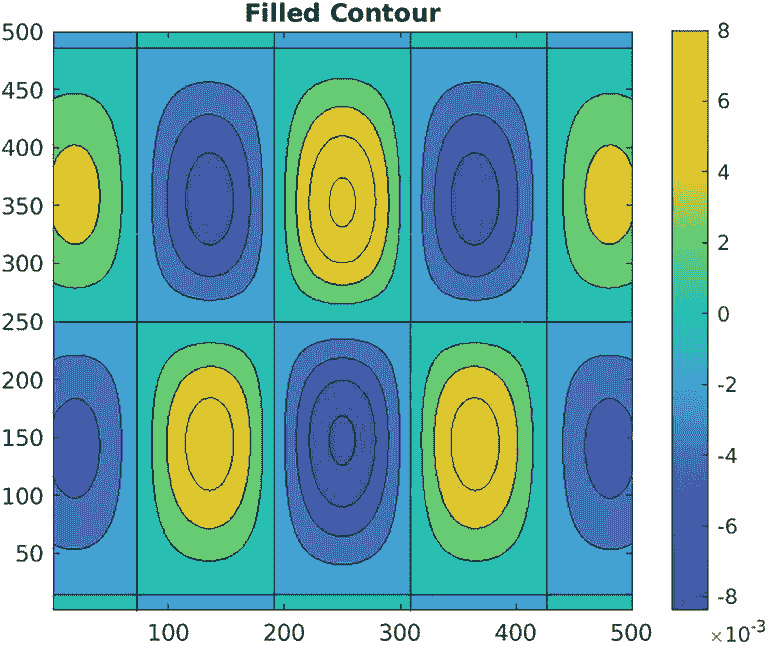

图 12-19 MATLAB

## 12.3 动画

Matplotlib 可以像 MATLAB 一样制作动画。然而，除非动画很简单，否则避免使用全局变量可能是一个挑战。我们将从一个简单的程序开始，该程序绘制一个宽度随每一帧变化的椭圆。所有操作都封装在一个函数中，不需要全局变量。

动画的关键要素是`A_values`（第 23 行`FuncAnimation()`的第三个参数）和第 18 行的`update()`函数。`A_values`是一个系数向量，用于缩放椭圆的宽度；其值从 0.9 下降到 0.1，然后又回到 0.9。每次调用`update()`时，会取出`A_values`中的下一个系数，并重新绘制椭圆的图像。

Python：

```python
# 代码示例（原始文本中未提供具体代码，保持此结构）
```


# file: `code/plots/circle_ellipse.py`

```python
import numpy as np
import matplotlib.pyplot as plt
from matplotlib.animation import FuncAnimation

def circle_to_ellipse():
    fig, ax = plt.subplots()
    T = np.linspace(0, 2*np.pi, 200)
    x = np.cos(T)
    y = np.sin(T)
    curve, = plt.plot(x,y,'b')
    A_values = np.hstack([np.linspace(0.1, 0.9, 100),
                          np.linspace(0.9, 0.1, 100)])
    def init():
        ax.set_xlim(-1, 1)
        ax.set_ylim(-1, 1)
        ax.set_aspect('equal')
        return curve,
    def update(A):
        x = A*np.cos(T)
        y = np.sin(T)
        curve, = plt.plot(x,y,'b')
        return curve,
    ani = FuncAnimation(fig, update, A_values,
                        interval=20, # 毫秒
                        init_func=init, blit=True)
    plt.show()

circle_to_ellipse()
```


第二个动画示例展示了一个在抛物面碗中弹跳的球。它要复杂得多，并且使用`全局变量`来存储球的运动轨迹。

Python：

```
```


# file: code/plots/bouncing_ball.py

```python
import numpy as np
import matplotlib.pyplot as plt
import matplotlib.animation as animation
from copy import copy

A = 0.08  # 碗的形状：y = A*xˆ2
dt = 1.0 / 500  # 时间步长，秒
T = np.arange(0, 20, dt)
n_iter = len(T)
damping = 0.9997
restitution = 0.995
ball_radius = 0.3
history_x, history_y = [], []
point, trace = None, None

def timestep(pos, vel):
    new_pos = copy(pos)
    new_vel = copy(vel)
    new_vel[1] += -9.8 * dt
    new_vel *= damping
    new_pos[0] += new_vel[0] * dt
    new_pos[1] += new_vel[1] * dt
    bowl_y = A * new_pos[0]**2
    if new_pos[1] < bowl_y:
```

# 碰到碗，回弹

```
normal = np.array([-2*A*new_pos[0],1])

normal /= np.linalg.norm(normal)

new_vel += -2*new_vel.dot(normal)*normal

new_pos[1] = bowl_y

return new_pos, new_vel

def run_simulation():

nX = 21

pos = np.zeros((n_iter,2))

pos[0,:] = np.array([-3., 3.]) # 初始位置，米

vel = np.array([0.5, 0])       # 初始速度，米/秒

bowl = np.zeros((nX,2))

bowl[:,0] = np.linspace(-3.5, 3.5, num=nX)

X = bowl[:,0]

bowl[:,1] = A*X**2
```


# 中心线是偏离抛物线碗的曲线，


# 偏移量为球的半径；这是球心似乎发生弹跳的地方

`den = 1/np.sqrt(1 + (2*A*X)**2)`

`centerline = np.zeros((nX,2))`

`centerline[:,0] = X + 2*A*ball_radius*X*den`

`centerline[:,1] = A*X**2 - ball_radius*den`

```python
for i in range(1,n_iter):

    pos[i], vel = timestep(pos[i-1],vel)

return bowl, centerline, pos, vel
```

```python
def init(bowl, centerline):
    global point, trace
    fig, ax = plt.subplots()
    plt.plot(bowl[:,0],bowl[:,1],':')
    plt.plot(centerline[:,0],centerline[:,1])
    plt.ylim([-1,4])
    ax.set_aspect('equal')
    point, = ax.plot([], [], 'o', markersize=25)
    trace, = ax.plot([], [], ',-', lw=1)
    return fig
```

```python
def animate(i):
    global history_x, history_y
    if i == 0:
        history_x.clear()
        history_y.clear()
    history_x.append(pos[i,0])
    history_y.append(pos[i,1])
    point.set_data(pos[i,0], pos[i,1])
    trace.set_data(history_x, history_y)
    return point, trace
```

```python
bowl, centerline, pos, vel = run_simulation()
fig = init(bowl, centerline)
ani = animation.FuncAnimation(
    fig, animate, n_iter, interval=dt*1000, blit=True)
plt.show()
```

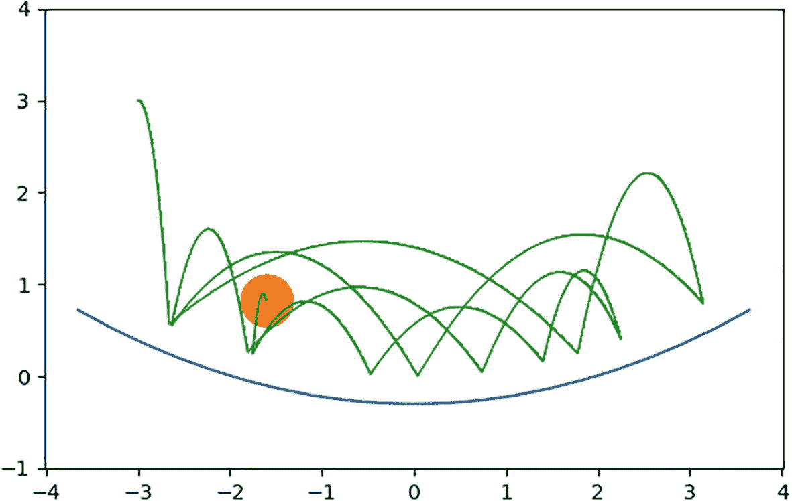

## 12.4 使用 Cartopy 在地图上绘图

由英国气象局开发的 Python `Cartopy` 模块，提供了大量与 `matplotlib` 配合使用的地图变换和投影函数。其功能丰富程度堪比 MATLAB 的地图工具箱。多个 `Cartopy` 子模块会使用基于网络的地图瓦片服务，因此制作带有影像增强的图表时需要互联网连接。

与所有绘图包一样，开始使用 `Cartopy` 的最简单方式是查看其示例画廊^(⁵⁰)并修改可用的示例。

我们将从 `Cartopy` 中的点和线数据绘图开始探索地图绘图，同时也会介绍 MATLAB 的 `geo*` 函数系列。不过，在 MATLAB 中绘制更复杂的地理叠加图需要地图工具箱。另一种选择是从 MATLAB 调用 `Cartopy`；我们将通过两个具体示例演示这一方法：在全球地图上叠加海面温度（第 12.6 节）以及绘制一张根据小麦产量着色的南美洲国家地图（第 12.7 节）。

### 12.4.1 点

MATLAB 的 `geo*` 函数既支持下一章将介绍的表格，也支持常规矩阵变量。本示例展示了如何在巴黎高分辨率地图上叠加两个点，MATLAB 使用表格，而 Python 使用标量变量。红点位于巴黎圣母院，蓝点位于先贤祠。

**提示**

使用 Google 地球^(⁵¹)查找地图的经纬度范围（调用 `ax.set_extent()` 时使用）。

| MATLAB: | Python: |
| --- | --- |
| `% code/plots/paris_pt.m`<br>`T = table([48.853;48.846],` `...`<br>`[2.3497;2.3464],` `...`<br>`'VariableNames',` `...`<br>`{'Lat','Lon'},` `...`<br>`'RowNames', {'Notre Dame',` `'Pantheon'});`<br>`C = [1 0 0; 0 0 1];`<br>`geoscatter(T.Lat, T.Lon,124,` `...`<br>`C, 'Filled')`<br>`geolimits([48.8425 48.8625],` `...`<br>`[2.3283 2.3722])`<br>`geobasemap streets`<br>`title("Notre Dame (red) and " +` `...`<br>`"the Pantheon (blue)")` | `#!/usr/bin/env python3`<br>`# code/plots/cartopy_pt.py`<br>`import matplotlib.pyplot as plt`<br>`import numpy as np`<br>`import cartopy.crs as ccrs`<br>`from cartopy.io.img_tiles import OSM`<br>`imagery = OSM()`<br>`PC = ccrs.PlateCarree()`<br>`fig = plt.figure()`<br>`ax = fig.add_subplot(1, 1, 1,`<br>`projection=imagery.crs)`<br>`ax.set_extent([2.3283, 2.3722,`<br>`48.8425, 48.8625],`<br>`crs=PC)`<br>`ax.add_image(imagery, 14)`<br>`ax.plot(2.3497, 48.853, transform=PC,`<br>`marker="o", color="red",`<br>`markersize=6)`<br>`ax.plot(2.3464, 48.846, transform=PC,`<br>`marker="o", color="blue",`<br>`markersize=6)`<br>`ax.set_title('Notre Dame (red) and '`<br>`'the Pantheon (blue)')`<br>`plt.savefig('Paris.png')`<br>`plt.show()` |


图 12-22 Python

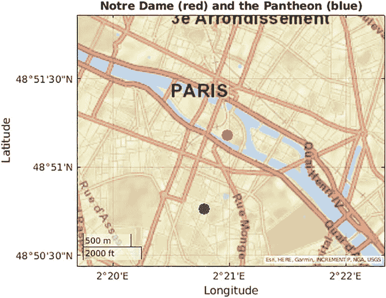

图 12-21 MATLAB

一个常见的错误与从互联网下载地图瓦片有关：

```
网上可以找到许多解释和解决方案，
但针对 Cartopy 获取地图瓦片的特定情况，
我发现最可靠的解决方案是直接修改 Cartopy 的源代码，
使用 `requests` 模块
代替 `urllib`。
详情见第 12.4.4 节。
```

### 12.4.2 线

在本示例中，我们绘制一头名为“蓝鲸 158390”的鲸鱼在 2018 年 9 月 21 日至 2018 年 11 月 18 日期间的移动路径。位置数据^(⁵²)必然存在较大的误差范围，因为其中一个数据点位于北纬 48.64328°、西经 66.47227°，在加拿大新不伦瑞克省的一片内陆约 60 公里的田野中。这大致相当于赤道处约 0.5° 的纬度或经度。在 Python 中，我们将利用这一信息，用蓝色叠加一个宽 0.5° 的区域，表示鲸鱼路径的误差范围。MATLAB 代码虽然极其简洁优雅，但无法控制 `geoplot()` 绘制线条的宽度，因此其图形缺少这一功能。

此示例还展示了如何向 `Cartopy` 地图添加额外细节——经纬度网格线、国界、河流。

`whale_data()` 返回的经纬度数值位于 `data/plots/whale_path.txt` 文件中。

| MATLAB: | Python: |
| --- | --- |
| `% code/plots/whale.m`<br>`P = importdata('whale_path.txt');`<br>`geoplot(P(:,2), P(:,1),'r')`<br>`geolimits([30 55], [-80 -50])`<br>`geobasemap colorterrain`<br>`title("Blue Whale 158390, " + ...`<br>`"Fall 2018")` | `#!/usr/bin/env python3`<br>`# code/plots/cartopy_whale.py`<br>`import numpy as np`<br>`import shapely.geometry as sgeom`<br>`import cartopy.crs as ccrs`<br>`import cartopy.feature as cfeature`<br>`import matplotlib.pyplot as plt`<br>`fig = plt.figure()`<br>`PC = ccrs.PlateCarree()`<br>`ax = fig.add_subplot(1, 1, 1, projection=PC)`<br>`ax.coastlines(resolution='50m')`<br>`ax.set_extent([-80, -50, 30, 55], crs=PC)`<br>`ax.add_feature(cfeature.LAND)`<br>`ax.add_feature(cfeature.OCEAN)`<br>`ax.add_feature(cfeature.COASTLINE)`<br>`ax.add_feature(cfeature.BORDERS, linestyle='-')`<br>`ax.add_feature(cfeature.LAKES.with_scale('50m'),`<br>`alpha=0.5)`<br>`ax.add_feature(cfeature.RIVERS.with_scale('50m'))`<br>`plt.title('Blue Whale 158390, Fall 2018')`<br>`path = np.loadtxt('whale_path.txt')`<br>`track = sgeom.LineString(path)`<br>`error = track.buffer(.5) # degrees`<br>`ax.gridlines(draw_labels=True)`<br>`ax.add_geometries([error], ccrs.PlateCarree(),`<br>`facecolor='#1F18F4', alpha=.5)`<br>`ax.add_geometries([track], ccrs.PlateCarree(),`<br>`facecolor="none", edgecolor="r")`<br>`plt.savefig('whale.png', bbox_inches="tight",`<br>`pad_inches=0, transparent=True)`<br>`plt.show()` |


图 12-24 Python


图 12-23 MATLAB

如果你的 MATLAB 图表需要 `geoplot()` 无法提供的对地理线条的精细控制，请参阅配方 12.5，其中展示了如何从 MATLAB 重现右侧的 `Cartopy` 图表。

### 12.4.3 区域

在地图上叠加的大部分数据覆盖的是区域，而不是点或线。这类数据不胜枚举：地球科学数据，如陆地和海面温度、地表类型、植被指数和降雨量；商业数据，如农业产量和国内生产总值；政治数据，如投票结果、政党归属和冲突区域。

在 MATLAB 中，用于在地图上叠加区域数据的原生选项是地图工具箱和免费提供的气候数据工具箱。^(⁵³) 在 Python 中，我们将继续使用 `Cartopy`。

#### 12.4.3.1 海面温度

我们的第一个示例使用一对投影显示全球海面温度。通过使用来自 NASA 地球观测^(⁵⁴) 数据库的自定义地球背景图像——此处为植被指数——增强了图表效果。为此，请将植被指数图像文件 `earth_veg_index.jpeg` 及随附的 JSON 元数据保存到一个目录中，然后将环境变量 `CARTOPY_USER_BACKGROUNDS` 设置为该目录。^(⁵⁵)

海面温度 (SST) 数据来自 NOAA 的每日 AVHRR 卫星数据集。^(⁵⁶) 每天的数据存储在一个 NetCDF 文件（第 7.​10 节）中，该文件包含在 0.5° 经纬度网格上的海面温度。第一行和第一列对应纬度 –89.875° 和经度 0.125°；赤道由第 359 行和第 360 行（使用从零开始的索引）跨越，而国际日期变更线由第 719 列和第 720 列跨越。

**Python:**

```python
#!/usr/bin/env python3

# code/plots/cartopy_sst.py

import os

import numpy as np

import matplotlib.pyplot as plt

from netCDF4 import Dataset

import cartopy.crs as ccrs

from mpl_toolkits.axes_grid1 import make_axes_locatable

os.environ["CARTOPY_USER_BACKGROUNDS"] = "cartopy/background"

File = 'oisst-avhrr-v02r01.20190101.nc'

rg = Dataset(File, 'r')

lat = rg["lat"][:]

lon = rg["lon"][:]

sst_ds = rg["sst"][0][0]

sst = sst_ds.data

mask = sst_ds.mask

sst[mask] = np.NaN

fig = plt.figure()

Ortho = ccrs.Orthographic(-10, 15)

PC = ccrs.PlateCarree()

ax = fig.add_subplot(1, 1, 1, projection=Ortho)
```

# 或者 -

```markdown
```python
ax = fig.add_subplot(1, 1, 1, projection=PC)

ax.coastlines()

ax.set_global()

ax.gridlines()

h = ax.contourf(lon, lat, sst, levels=20,
                vmin=-2, vmax=35, transform=PC, cmap='jet')

divider = make_axes_locatable(ax)
ax_cb = divider.new_horizontal(size="5%", pad=0.1,
                               axes_class=plt.Axes)
fig.add_axes(ax_cb)

plt.colorbar(h, cax=ax_cb)

ax.background_img(name='VI', resolution='low')

ax.set_title('SST 2020-01-02 [Celcius]')

plt.savefig('sst_globe.png', bbox_inches='tight',
            pad_inches=0, transparent=True)

plt.show()
```

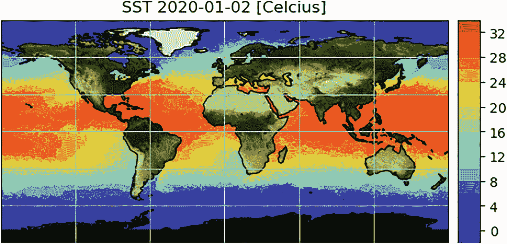

有许多投影可供选择。可以通过将 `PlateCarree` 投影替换为以下代码，生成一个中心位于西经 10°、北纬 15°的正交投影：

```python
Ortho = ccrs.Orthographic(-10, 15)
ax = fig.add_subplot(1, 1, 1, projection=Ortho)
```


在 MATLAB 中使用 12.6 节中的方法创建此图。

#### 12.4.3.2 南美小麦产量（2014 年）

第二个示例展示受国家边界限定的数据。我们的数据集将使用 2014 年南美洲的小麦产量数据⁵⁷。目标是根据每个国家的产量值对其进行着色。

虽然 `Cartopy` 自带海岸线数据库，但它不包含国家或州界。理想情况下，我们希望能写出类似 `plot(region(country='Canada'), 'grey')` 或 `plot(region(zipcode=90210), 'orange')` 的语句，但目前还不具备这种功能。（剧透：第 13.12 节中介绍的 `GeoPandas` 可以实现这一点。）

因此，我们将通过从 `Natural Earth` 项目下载形状文件及相关元数据，自行创建国家边界数据库。“低分辨率”文件⁵⁸包含 `Cartopy` 可读取的文件，这些文件含有国家边界、多种语言的国家名称、所属大洲名称、经济状况、人口及 GDP 估算值等信息。但获取数据、读取并以便于使用的形式存储这些数据的任务需要由我们完成。

以下 Python 代码要求将文件 `'ne_110m_admin_0_countries.zip'` 解压到一个名为 `nat_earth` 的子目录中。我们将使用 `Cartopy` 的形状读取器加载国家形状和元数据，并据此构建一个字典 `shp`，以英文国家名称为键，边界几何形状为对应的值。为了增加趣味性，我们再构建第二个字典 `rec`，用于存储每个国家的元数据。

```python
In : from cartopy.io.shapereader import Reader

In : shp = {} # 按名称索引的国家形状

In : rec = {} # 按名称索引的国家元数据

In : Countries = Reader('nat_earth/ne_110m_admin_0_countries')

In : for geom, meta in zip(Countries.geometries(), Countries.records()):
...:     name = meta.attributes['NAME_EN']
...:     shp[name] = geom
...:     rec[name] = meta
```

探索这些字典会发现一些有趣的信息：

```python
In : sorted( shp.keys() )
Out: shp.keys()
['阿富汗',
 '阿尔巴尼亚',
 '阿尔及利亚',
 '安哥拉',
 '南极洲',
 '阿根廷',
 ...
 '越南',
 '西撒哈拉',
 '也门',
 '赞比亚',
 '津巴布韦',
 '斯威士兰']

In : rec['越南']
Out[9]: ,
{'featurecla': '行政 0 级国家', 'scalerank': 1, 'LABELRANK': 2,
 'SOVEREIGNT': '越南', 'POSTAL': 'VN', 'MAPCOLOR7': 5, 'MAPCOLOR8': 6,
 'POP_EST': 96160163, 'POP_RANK': 16, 'GDP_MD_EST': 594900.0,
 'POP_YEAR': 2017, 'LASTCENSUS': 2009, 'GDP_YEAR': 2016,
 ...

In [12]: rec['越南'].attributes['POP_EST']
Out[12]: 96160163
```

更重要的是，`matplotlib` + `Cartopy` 的组合能够理解从 shape 文件生成的多边形区域，从而可以用所需的颜色为各个国家着色。但地理政治边界构成的多边形有一个微妙的特性：有些边界是单个多边形，而其他边界（例如印度尼西亚的群岛）则包含多个不相交的多边形。用于添加由多边形边界定义的区域的 `matplotlib` `add_geometries()` 函数，期望其第一个参数是一个多边形列表。因此，我们必须首先检查一个国家的地形是单个多边形还是多边形列表；如果是单个，则必须将传递给 `add_geometries()` 的参数扩展为一个包含单个元素的列表。以下清单中的第 42 行展示了如何适当处理这些情况：

```python
#!/usr/local/anaconda3/2020.07/bin/python
# code/plots/cartopy_wheat.py
import numpy as np
import cartopy.crs as ccrs
import cartopy.feature as cfeature
from cartopy.io.shapereader import Reader
from shapely.geometry.polygon import Polygon
import matplotlib.pyplot as plt
from matplotlib.colors import from_levels_and_colors
from mpl_toolkits.axes_grid1 import make_axes_locatable

wheat_tons = {
    'Argentina' : 13_930_078 ,
    'Brazil' : 6_261_895 ,
    'Chile' : 1_358_128 ,
    'Uruguay' : 1_076_000 ,
    'Paraguay' : 840_000 ,
    'Bolivia' : 263_076 ,
    'Peru' : 214_533 ,
    'Colombia' : 9_718 ,
    'Ecuador' : 6_584 ,
    'Venezuela' : 161 , }

Countries = Reader('nat_earth/ne_110m_admin_0_countries')
shp = {} # country shape indexed by name
for geom, meta in zip(Countries.geometries(),
                      Countries.records()):
    name = meta.attributes['NAME_EN']
    shp[name] = geom

PC = ccrs.PlateCarree()
fig, ax = plt.subplots(1, 1, subplot_kw=dict(projection=PC))
ax.set_extent([-85, -33, # lon
```

### 12.4.4 MATLAB 与 Cartopy

不过，从 MATLAB 使用 Cartopy 存在一个重大挑战。当 Cartopy（0.18.0 版，截至 2021 年 7 月为最新版本）尝试从地图服务下载影像图块时，会与 MATLAB 产生异常交互。可能会发生以下两种情况之一：要么出现此错误

或者生成的绘图根本缺少背景图像。

有一个变通方法，但需要修改 Cartopy 的文件 `cartopy/io/img_tiles.py`，使其使用 `requests` 模块而不是 Python 标准库中的 `urllib.request` 来下载图块。第一步是找到包含 `img_tiles.py` 的目录或文件夹。这可以在 `ipython` 中通过导入 `cartopy.io` 然后检查其 `__path__` 属性来完成。在我的 Linux 计算机上，此目录是

```
ipython:

In : import cartopy.io

In : cartopy.io.__path__

Out: ['/usr/local/anaconda3/2020.07/envs/matpy/lib/python3.8/site-packages/cartopy/io']
```

> **注意**：如果你在多个虚拟环境中安装了 Cartopy，则需要在你计划从中启动 MATLAB 的每个环境中编辑 `img_tiles.py`。

接下来，编辑 `img_tiles.py`，使其包含对 `requests` 的导入（右侧的第 41 行），并将对 `urlopen()`、`six.BytesIO()` 和 `fh.close()` 的调用（左侧的第 190–193 行）替换为右侧突出显示的行。（实际行号会因你安装的 Cartopy 版本而异。）

| `img_tiles.py` 原始版本： | `img_tiles.py` 修复版本： |
| --- | --- |
| `39` `import numpy as np`  `40`  `import six`  `41` `42`  `import cartopy` `43`  `import cartopy.crs as ccrs` `188` `url = self._image_url(tile)` `189`  `try:` `190`    `request = Request(url, headers={` `"User-Agent": self.user_agent})` `191`    `fh = urlopen(request)` `192`    `im_data = six.BytesIO(fh.read())` `193`    `fh.close()` `194`    `img = Image.open(im_data)` | `39`  `import numpy as np` `40`  `import six` `41` `import requests` `42` `43`  `import cartopy` `44`  `import cartopy.crs as ccrs` `189` `url = self._image_url(tile)` `190`  `try:` `191` `request = requests.get(url,` `stream=True)` `192` `request.raw.decode content = True` `193` `img = Image.open(request.raw)` |

用于自动执行此补丁的实用程序 `patch_cartopy.py` 的源代码清单见附录 E。

### 12.4.5 在 MATLAB 中避免使用 matplotlib 的 Qt 后段！

MATLAB 使用 Qt 库来渲染图形。虽然 `matplotlib` 可以使用六种不同的图形库，但其默认使用 Qt。这是一个问题！Anaconda 发行版附带的 Qt 库不太可能与 MATLAB 自带的 Qt 库匹配。因此，如果你在 MATLAB 中使用 `matplotlib` 的 `plt.show()` 命令，将会导致 MATLAB 崩溃。不过有一个简单的变通方法：只需将 `matplotlib` 配置为使用不同的后端即可。首先，我们查询 Python 安装以查看其当前使用的后端：

```
Python:

In : import matplotlib

In : matplotlib.get_backend()

Out: 'Qt5Agg'
```

`Qt5Agg` 在 MATLAB 中肯定是个问题。一个好的替代方案是 Linux 和 macOS 上的 `TkAgg` 后端，以及 Windows 上的 `WXAgg` 后端。例如，在 Python 中切换到 `TkAgg` 后端的方法如下：

```
Python:

import matplotlib

matplotlib.use('TkAgg')
```

在 MATLAB 中切换的方法如下：

```
MATLAB 2020b:

Im  = @py.importlib.import_module;

mpl = Im('matplotlib');

mpl.use('TkAgg')
```

## 12.5 配方 12-1：使用 Cartopy 在地图上绘制线条

第 12.4.2 节中鲸鱼轨迹在 MATLAB 中的等效代码如下所示：

```
MATLAB 2020b:

% file: code/matlab_py/cartopy_whale.m

Im = @py.importlib.import_module;

np     = Im('numpy');

sgeom  = Im('shapely.geometry');

ccrs   = Im('cartopy.crs');

cfeat  = Im('cartopy.feature');

plt    = Im('matplotlib.pyplot');

mpl    = Im('matplotlib');

if ispc

mpl.use('WXAgg')

else

mpl.use('TkAgg')

end

PC = ccrs.PlateCarree();

fig = plt.figure();

i1 = int64(1);

ax = fig.add_subplot(i1, i1, i1, pyargs('projection',PC));
```

使用第 12.7 节中的配方在 MATLAB 中创建此绘图。

```
import numpy as np

ton_intervals = np.array([0, 10_000, 100_000, 1_000_000, 10_000_000, 15_000_000,])

fraction_interval = np.linspace(0.12, 1, num=len(ton_intervals))

colors = plt.cm.BuPu(fraction_interval[:-1])

for ctry in wheat_tons:

    color = colors[np.searchsorted(ton_intervals, wheat_tons[ctry]) - 1]

    shape = [shp[ctry]] if isinstance(shp[ctry], Polygon) else shp[ctry]

    ax.add_geometries(shape, crs=PC, facecolor=color)

ax.add_feature(cfeature.BORDERS)

ax.add_feature(cfeature.COASTLINE)

ax.set_title('Wheat Production, 2014 [10$ˆ6$ tons]')

# colorbar

divider = make_axes_locatable(ax)

ax_cb = divider.new_horizontal(size="5%", pad=0.1, axes_class=plt.Axes)

fig.add_axes(ax_cb)

cmap, norm = from_levels_and_colors(ton_intervals/1.0e+6, colors)

sm = plt.cm.ScalarMappable(cmap=cmap, norm=norm)

plt.colorbar(sm, cax=ax_cb)

plt.show()

#plt.savefig('SA_wheat_2014.png', dpi=200,

# bbox_inches='tight', pad_inches=0, transparent=True)
```

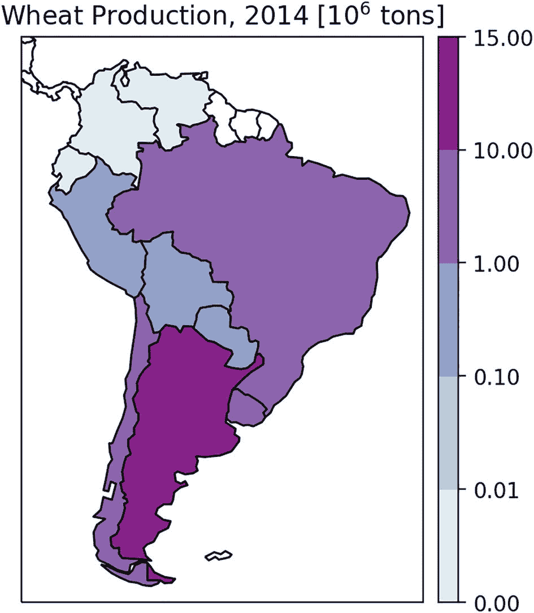

## 12.6 方案 12-2：使用 Cartopy 在地球仪上叠加等高线

在章节 12.4.3.1 中制作的海面温度叠加图，可以使用 `MATLAB` 结合 `Cartopy` 来实现。

### MATLAB 2020b：

```matlab
Im = @py.importlib.import_module;
OS    = Im('os');
np    = Im('numpy');
plt   = Im('matplotlib.pyplot');
ccrs  = Im('cartopy.crs');
axes  = Im('mpl_toolkits.axes_grid1');
mpl   = Im('matplotlib');

if ispc
    netcdf.inqLibVers; % avoid DLL conflict
    mpl.use('WXAgg')
else
    mpl.use('TkAgg')
end

nc   = Im('netCDF4');

i1 = int64(1);
OS.environ{'CARTOPY_USER_BACKGROUNDS'} = ...
    '../plots/cartopy/background';

File = '../plots/oisst-avhrr-v02r01.20201001_preliminary.nc';
lat = ncread(File, 'lat');
lon = ncread(File, 'lon');
sst = ncread(File, 'sst')';
mask = isnan(sst);

fig = plt.figure();
Ortho = ccrs.Orthographic(-10, 15);
PC    = ccrs.PlateCarree();
ax = fig.add_subplot(i1, i1, i1,pyargs('projection',Ortho));
%            - or -
%ax = fig.add_subplot(i1, i1, i1, pyargs('projection',PC));

ax.coastlines();
ax.set_global();
ax.gridlines();

h = ax.contourf(lon, lat, sst,...
    pyargs('levels',int64(20), 'vmin',-2,'vmax',35,...
    'transform',PC,'cmap','jet'));

divider = axes.make_axes_locatable(ax);
ax_cb = divider.new_horizontal(...
    pyargs('size','5%','pad',0.1,'axes_class',plt.Axes));
fig.add_axes(ax_cb);
plt.colorbar(h, pyargs('cax',ax_cb));

ax.background_img(pyargs('name',"VI",'resolution',"low"));
ax.set_title('SST 2020-01-02 [Celcius]');

plt.savefig('sst_globe.png', pyargs('bbox_inches','tight',...
    'pad_inches',0,'transparent','True'));
plt.show()
```

## 12.7 方案 12-3：使用 Cartopy 按数值对地图区域进行着色

在章节 12.4.3.2 中制作的南美洲小麦产量地图，可以使用 `MATLAB` 结合 `Cartopy` 来实现。

### MATLAB 2020b：

```matlab
Im = @py.importlib.import_module;
np     = Im('numpy');
ccrs   = Im('cartopy.crs');
cfeat  = Im('cartopy.feature');
shape  = Im('cartopy.io.shapereader');
poly   = Im('shapely.geometry.polygon');
plt    = Im('matplotlib.pyplot');
col    = Im('matplotlib.colors'); % from_levels_and_colors
axes   = Im('mpl_toolkits.axes_grid1'); % make_axes_locatable
mpl    = Im('matplotlib');

if ispc
    mpl.use('WXAgg')
else
    mpl.use('TkAgg')
end

i1 = int64(1);

wheat_tons.Argentina = 13930078;
wheat_tons.Brazil    = 6261895;
wheat_tons.Chile     = 1358128;
wheat_tons.Uruguay   = 1076000;
wheat_tons.Paraguay  = 840000;
wheat_tons.Bolivia   = 263076;
wheat_tons.Peru      = 214533;
wheat_tons.Colombia  = 9718;
wheat_tons.Ecuador   = 6584;
wheat_tons.Venezuela = 161;

Countries = shape.Reader('nat_earth/ne_110m_admin_0_countries.shp');
shp = py.dict(); % country shape indexed by name
for geom_meta = py.list(py.zip(...
        Countries.geometries(), Countries.records()))
    name = geom_meta{1}{2}.attributes.get('NAME_EN'); % {1}{2} = meta
    shp.update(pyargs(name, geom_meta{1}{1})); % {1}{1} = geom
end

PC = ccrs.PlateCarree();
fig_ax = plt.subplots(i1, i1, pyargs('subplot_kw',...
    py.dict(pyargs('projection',PC))));
fig = fig_ax{1};
ax  = fig_ax{2};
ax.set_extent([-85, -33, ... % lon
              -55, 14]) % lat

ton_intervals = [0, 10000, 100000, 1000000, 10000000, 15000000];
fraction_interval = linspace(0.12, 1, length(ton_intervals));
```

`ax.coastlines(pyargs('resolution','50m'));`

`ax.set_extent([-80 -50 30 55], pyargs('crs',PC));`

`ax.add_feature(cfeat.LAND);`

`ax.add_feature(cfeat.OCEAN);`

`ax.add_feature(cfeat.COASTLINE);`

`ax.add_feature(cfeat.BORDERS, pyargs('linestyle','-'));`

`ax.add_feature(cfeat.LAKES.with_scale('50m'), pyargs('alpha', 0.5));`

`ax.add_feature(cfeat.RIVERS.with_scale('50m'));`

`plt.title('Blue Whale 158390, Fall 2018');`

`path = load('whale_path.txt');`

`track = sgeom.LineString(np.array(path));`

`error = track.buffer(.5); % degrees`

`ax.gridlines(pyargs('draw_labels','True'));`

`ax.add_geometries({error}, PC, pyargs('facecolor','#1F18F4','alpha',.5));`

`ax.add_geometries({track}, PC, pyargs('facecolor','none','edgecolor','r'));`

`plt.savefig('whale.png', pyargs('bbox_inches','tight','pad_inches',0, ...`

`    'transparent','True'));`

`plt.show()`

```markdown
colors = plt.cm.BuPu(fraction_interval(1:end-1));

col_ind = np.arange(4, pyargs('dtype',np.int64));

country_names = fieldnames(wheat_tons);

for i = 1:numel(country_names)

ctry = country_names{i};

w_tons = wheat_tons.(ctry);

color_row = np.searchsorted(ton_intervals, w_tons) - 1;

fprintf('%20s %10d tons, color=%d\n', ctry, w_tons, int32(color_row))

color = colors.take(col_ind + int64(4)*color_row);

if py.isinstance(shp.get(ctry), poly.Polygon)

shape = py.list({shp.get(ctry)});

else

shape = shp.get(ctry);

end

ax.add_geometries(shape, pyargs('crs',PC,'facecolor',color));

end

ax.add_feature(cfeat.BORDERS);

ax.add_feature(cfeat.COASTLINE);

ax.set_title('Wheat Production, 2014 [10$ˆ6$ tons]');

% colorbar

divider = axes.make_axes_locatable(ax);

ax_cb = divider.new_horizontal(pyargs('size',"5%",'pad',0.1,...

'axes_class',plt.Axes));

fig.add_axes(ax_cb);

cmap_norm = col.from_levels_and_colors(ton_intervals/1.0e+6, colors);

cmap = cmap_norm{1};

norm = cmap_norm{2};

sm = plt.cm.ScalarMappable(pyargs('cmap',cmap,'norm',norm));

plt.colorbar(sm, pyargs('cax',ax_cb));

plt.savefig('SA_wheat_2014.png', pyargs('bbox_inches','tight',...

'pad_inches',0,'transparent','True'));

plt.show()

```

## 12.8 使用 GeoPandas 在地图上绘图

下一章将介绍 MATLAB 表格和 Pandas 数据框。`GeoPandas` 是 `Pandas` 的扩展，它结合了 `Cartopy`、`Pandas` 和 `Shapely`（以及其它 Python 模块），使得地理数据的绘制变得非常简便。章节 13.12 展示了如何按邮政编码绘制洛杉矶县房价地图。相比直接调用 `Cartopy` 函数，这种方法省力得多。

## 12.9 批量模式绘图

绘图生成通常是一种交互式体验，用户在图表绘制时通过显示器查看。而完全自动化的工作流程则完全无需显示器；图表可以直接写入 PNG 或其他图像格式，以便直接嵌入网站或文档。MATLAB 和 Python 都支持“无头”绘图生成，但方法不同。

MATLAB 的批量绘图方法依赖于 `matlab` 命令的命令行参数。下面的命令将运行章节 12.1.5 中的 `hist_demo.m` 脚本：

### MATLAB：

```

> matlab -nodesktop -nodisplay -nosplash -r "hist_demo;saveas(1,'hist.png');exit"

```

matplotlib 的批量绘图方法需要使用“Agg”后端，如代码第 4 行和第 5 行所示：

### Python：

```python

#!/usr/bin/env python3
```

# file: `code/plots/hist_demo_Agg.py`

```python
import numpy as np

import matplotlib as mpl

mpl.use('Agg')

import matplotlib.pyplot as plt

N = 10000

np.random.seed(123)

w1 = np.random.rayleigh(3, N)

w2 = np.random.normal(8, 3, N)

bins = np.linspace(-5, 20, 80)

plt.hist(w1, bins, alpha=0.5, label='Rayleigh')

plt.hist(w2, bins, alpha=0.5, label='Normal')

plt.legend(loc='upper right')

plt.ylim([0, 700])

plt.grid(True)

plt.savefig('hist.png', bbox_inches='tight', pad_inches=0, transparent=True)
```

**提示**

在`ipython`会话中，你可以通过以下命令获取所有可用后端的列表：

```
In :   import matplotlib

In :   matplotlib.rcsetup.interactive_bk
```

# 12.10 交互式图表编辑

调整`matplotlib`图表以用于出版物，可能会变成一场关于字体、颜色、字形和坐标选择的令人抓狂的练习。MATLAB 在这方面具有优势，因为它的图表编辑器允许用户交互式地修改图表元素。`matplotlib`的`Qt5Agg`后端提供了一些交互式图表功能，可通过显示工具中的指定图标访问：


然而，因为`Qt5Agg`后端与 MATLAB 自身的 Qt5 库冲突，它并未包含在`matpy` conda 环境中。你需要退出该 conda 环境（`conda deactivate`）并返回“base”环境才能进行此类编辑。`pylustrator`⁵⁹是一个更高级的交互式编辑`matplotlib`图表的工具。其功能最好通过在其文档网站[`https://pylustrator.readthedocs.io/`](https://pylustrator.readthedocs.io/)上观看 YouTube 视频来了解。


