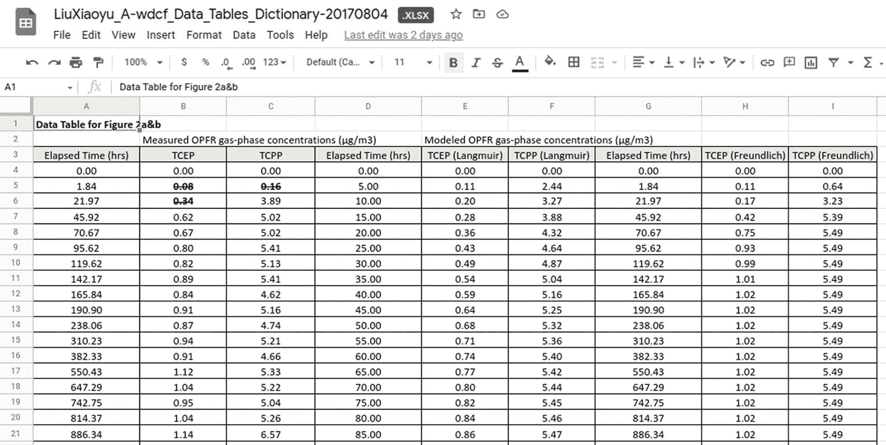

# 7. 输入与输出

解决许多计算问题的第一步是从命令行、交互式输入、文本或二进制文件、网络、串行端口或这些方式的组合中读取数据。最后一步通常涉及将数据写入文本或二进制文件。在本章中，我们将详细介绍输入和输出方法，包括读取和写入对科学和数值分析至关重要的文件格式——纯文本文件；二进制文件；普遍使用的 Excel 格式 `.csv`、`.xls` 和 `.xlsx`；HDF5；NetCDF4；XML；JSON；YAML；`.ini`；SQLite；以及 HTML。

在本章结尾，我们将讨论向 MATLAB 本身发送数据和从其接收数据的方法。这些方法包括读写 `.mat` 文件，以及使用 MATLAB 的 `py` 模块（第 6 章）通过网络与 MATLAB 通信。

第 6.5 节描述了如何从 MATLAB 代码直接二进制访问 Python 数据。

## 7.1 文本文件

在 Python 中读取文本文件最通用的方式是调用 `open()` 函数，并传入要读取的文件名，获取文件句柄，接着使用 `for` 循环迭代该文件句柄，然后关闭文件句柄。以下是 MATLAB 和 Python 将文件 `data.txt` 的内容打印到标准输出的等效代码：

| MATLAB: | Python: |
| --- | --- |
| `fh = fopen('data.txt')`<br>`while ˜feof(fh)`<br>`line = fgetl(fh);`<br>`fprintf('%s\n', line);`<br>`end`<br>`fclose(fh)` | `fh = open('data.txt')`<br>`for line in fh:`<br>`print(line, end='')`<br>`fh.close()` |

MATLAB 的 `fgetl()` 与 Python 中 `for line in fh:` 隐式读取的一个区别在于，`fgetl()` 会去除行尾的换行符。因此，我们在 `fprintf()` 格式字符串中添加了 `\n`；否则，输出会显示为一行长文本。Python 则相反——它会保留行中的所有字符，但 Python 的 `print()` 函数会在末尾自动添加一个新行。我们通过可选的 `end=""` 参数来抑制这一行为；否则，输出会双倍行距。

或者，在 Python 中，我们可以在打印之前，对 `line` 调用 `.rstrip()` 方法，以去除字符串右侧的尾随空白和换行符。这样，我们就可以使用 `print(line.rstrip())` 代替 `print(line, end="")`。

更符合 Python 风格的文本文件读取方式是使用“上下文管理器”，即 `with` 语句：

Python:

```python
with open('data.txt') as fh:
    for line in fh:
        print(line, end='')
```

注意这里没有文件关闭语句。上下文管理器会在 `with` 块结束时自动释放在上下文内打开的资源——在本例中，是打开文件的句柄。

在 Python 中读取文本文件的另一种方法是使用 `pathlib` 模块，我们将在第 8 章再次见到它。`pathlib.Path` 对象有一个方法 `read_text()`，它返回包含整个文件的字符串。你可以像这样从文本文件创建一个行列表（`split()` 方法在第 4.2.4 节中描述，并将在后面的第 7.1.4.2 节中讨论）：

Python:

```python
import pathlib

P = pathlib.Path('data.txt')
all_lines = P.read_text().split('\n')
```


写入文本文件遵循类似的模式：获取要写入文件的文件句柄，这次要传入`'w'`标志表示**写入**模式，使用文件句柄的`.write()`方法写入一个字符串，然后关闭文件句柄。以下示例展示了如何制作一个文件的副本，其中副本的每一行都会以井号和空格作为前缀。请注意，`with`允许使用多个表达式，本例中我们分配了两个文件句柄，一个用于读取，一个用于写入：

| MATLAB: | Python: |
| --- | --- |
| `fin = fopen('data.txt')`<br>`fout = fopen('copy.txt', 'w')`<br>`while ˜feof(fin)`<br>`L = fgetl(fin);`<br>`fprintf(fout, '# %s\n', L);`<br>`end`<br>`fclose(fin)`<br>`fclose(fout)` | `with open('data.txt') as fin, open('copy.txt', 'w') as fout:`<br>`for L in fin:`<br>`fout.write(f'#{L}')` |

### 7.1.1 使用 `pathlib` 读取损坏的文本文件

我倾向于使用`pathlib`读取文本文件，因为它非常方便——只需对`pathlib.Path()`对象调用`.read_text()`方法即可。偶尔，这种方法会在处理我遇到的一些大型文本文件时失败，因为这些文件中包含垃圾二进制字符，导致`pathlib`抛出`UnicodeDecodeError`异常。不需要的二进制字符的常见来源是有缺陷的可执行文件生成的格式错误的字符串输出以及网络故障。

`pathlib`可以处理损坏的文本文件，但必须以二进制模式读取它们，然后显式地转换为字符串。以下示例创建了一个包含嵌入式二进制字符的文本文件，尝试使用`.read_text()`读取它，并在失败时使用`.read_bytes()`读取：

Python:

```
# 此处为示例代码占位符
```
```

# file: code/IO/pathlib_bin.txt

```python
import pathlib
import sys

File = 'text_w_binary.txt'
P = pathlib.Path(File)
chars = [ord(_) for _ in 'this is line 1\n' +
                         'this is line 2\n' +
                         'the end\n']
chars[8:12] = [0xFA, 0xFB, 0xFC, 0xFD] # insert non-text
P.write_bytes(bytes(chars))
try:
    lines = P.read_text()
except UnicodeDecodeError:
    print(f'failed reading {File} as text, trying binary')
    lines = str(P.read_bytes()).split(r'\n')
except:
    print(f'giving up on {File}')
    sys.exit(1)
print('\n'.join(lines))
```

输出如下所示：

```
failed reading text_w_binary.txt as text, trying binary
b'this is \xfa\xfb\xfc\xfd 1
this is line 2
the end
```

## 7.1.2 读写数值数据

第 11 章有一个详细的小节，介绍如何在文本文件中读写数值数组，参见第 11.1.9 节。

## 7.1.3 I/O 异常

对文件系统的读取和写入是运行时错误的常见来源。常见的问题包括输入文件不存在、写入文件的权限不足、文件系统已满以及由于网络问题导致文件系统无响应。为了在出现此类情况时使代码能够优雅地失败，至少应使用异常处理程序保护文件打开语句，如第 10.1.3 节所述。

在文件复制示例上使用异常处理程序的 MATLAB 和 Python 等效代码如下：

| MATLAB: | Python: |
| --- | --- |
| `try`<br>`fin  = fopen('data.txt')`<br>`fout = fopen('copy.txt', 'w')`<br>`while ˜feof(fin)`<br>`L = fgetl(fin);`<br>`fprintf(fout, '# %s\n', L);`<br>`end`<br>`fclose(fin)`<br>`fclose(fout)`<br>`catch EO`<br>`fprintf('error: %s', ...`<br>`EO.message)`<br>`end` | `try:`<br>`with open('data.txt') as fin, open('copy.txt', 'w') as fout:`<br>`for L in fin:`<br>`fout.write(f'# {L}')`<br>`except IOError as err:`<br>`print(f'I/O error: {err}')`<br>`except:`<br>`err = sys.exc_info()[1]`<br>`print(f'other error: {err}')` |

## 7.1.4 解析文本

既然我们已经能够读取文本文件，接下来就要对文件内容进行一些有用的处理，比如提取感兴趣的值。从文本中解析数据的常见操作包括：（1）去除首尾空白符，（2）将字符串分割成单词或短语，以及（3）在字符串中搜索模式。虽然字符串已在章节 4.2 中详细介绍过，但此处将重申解析文本最常用的字符串操作子集。

### 7.1.4.1 去除空白符

字符串开头和结尾的空白符可以通过以下字符串方法去除：`.lstrip()`（去除左侧）、`.rstrip()`（去除右侧）以及 `.strip()`（同时去除两侧）。它们对应于 MATLAB 的 `strip()` 函数，并带有可选的 `'left'`、`'right'` 或 `'both'`（默认值）参数。这些方法不会修改原字符串的内容，而是返回一个去除了空白符的新字符串。`.rstrip()` 还会去除字符串末尾的换行符（如果存在）：

| MATLAB： | Python： |
| --- | --- |
| `>> L = " abc "`<br>`" abc "`<br>`>> strip(L,'left')`<br>`"abc "`<br>`>> strip(L,'right')`<br>`" abc"`<br>`>> strip(L)`<br>`"abc"`<br>`>> L`<br>`" abc "` | `In : L = ' abc '`<br>`In : L`<br>`Out: ' abc '`<br>`In : L.lstrip()`<br>`Out: 'abc '`<br>`In : L.rstrip()`<br>`Out: ' abc'`<br>`In : L.strip()`<br>`Out: 'abc'`<br>`In : L`<br>`Out: ' abc '` |

### 7.1.4.2 使用子字符串分割字符串

可以使用字符串的 `.split()` 方法，通过子字符串来分割字符串。不带参数时，`.split()` 返回一个由空白符分隔的子字符串列表。如果为 `.split()` 提供了一个参数，该方法将按该参数分割字符串。第二个可选参数（也可通过 `maxsplit` 关键字定义）是最大分割次数（换句话说，`maxsplit=1` 会生成一个包含两个元素的列表）：

```
In : L = "abc 123.4 def; 5; 6 7 "
In : L.split()
Out: ['abc', '123.4', 'def;', '5;', '6', '7']
In : L.split(";")
Out: ['abc 123.4 def', ' 5', ' 6 7 ']
In : L.split(maxsplit=1)
Out: ['abc', '123.4 def; 5; 6 7 ']
```

要将字符串分割成单个字符，可以将字符串传递给 `list()` 函数：

```
In : list(L)
Out: [ 'a', 'b', 'c', ' ', '1', '2', '3',
       '.', '4', ' ', 'd', 'e', 'f', ';',
       ' ', ' ', '5', ';', ' ', '6', ' ',
       '7', ' ']
```

### 7.1.4.3 正则表达式

正则表达式是一个庞大的主题，足以写成整本书，因此这里的讨论必然有限。在大多数情况下，MATLAB 和 Python 使用相同的正则表达式元字符和模式匹配规则。此处不一一列举，而是在接下来的章节中展示两种语言的示例。

正如章节 4.2.6 所述，Python 的正则表达式库位于名为 `re` 的模块中，因此代码示例中包含

```python
import re
```

**提示**

交互式网站 [`https://regex101.com/`](https://regex101.com/) 是试验和测试正则表达式的绝佳资源。

### 7.1.4.4 使用正则表达式分割字符串

可以使用 `re.split()` 通过正则表达式来分割字符串。本示例使用了与章节 7.1.4.2 中常量字符串 `.split()` 方法相同的文本行。此处我们不再按空白符分割，而是构造一个正则表达式，仅返回数值。模式 `[ˆ\ .\ d]+` 表示“一个或多个既不是数字也不是小数点的字符”：

```
In : import re
In : L = "abc 123.4 def; 5; 6 7 "
In : re.split(r'[ˆ\d\.]+', L)
Out: ['', '123.4', '5', '6', '7', '']
```

这种分割并不完美，因为它会返回空字符串，需要我们手动过滤掉。一种方法是使用条件列表推导式，其中尾部条件 `if _` 利用字符串的“真值性”来决定是否将该词条包含在输出中。空字符串求值为 `False`，因此会被排除。

```
In : [_ for _ in re.split(r'[ˆ\d\.]+', L) if _]
Out: ['123.4', '5', '6', '7']
```

### 7.1.4.5 在字符串中搜索模式

可以使用以下函数之一来检查字符串是否包含某种文本模式：`re.search()`、`re.match()` 和 `re.fullmatch()`。它们的参数包括一个正则表达式、一个待搜索的字符串，以及可选的标志，用于定义是否区分大小写。

假设我们有一个数据文件，其中包含时间戳、纬度、经度和城市名称。有时数据不完整，会缺失一个或多个合法值，如下例所示：

```
1983-08-09 unknown Riverbank US America/Los_Angeles
2012-05-06 NaN -88.3162 Crystal Lake US America/Chicago
2016-12-09 unknown Evergreen Park US America/Chicago
```

2006-12-08 NaN -93.75018 Shreveport US America/Chicago
1999-02-15
1998-05-02 unknown Brenham US America/Chicago
2009-06-18 40.72371 -73.95097 Greenpoint US America/New_York
1992-11-25 NaN -76.72803 Woodlawn US America/New_York
1979-04-30 29.84576 -90.10674 Estelle US America/Chicago
1983-01-05 38.06084 -97.92977 Hutchinson US America/Chicago
2013-07-09 39.32288 -76.72803 Woodlawn US America/New_York
2005-08-31 NaN -102.36764 Odessa US America/Chicago
2014-02-05 unknown Fairview Heights US America/Chicago
2010-03-23
1990-09-04

我们的目标是，在纬度和经度值有定义的地方提取它们的数值。有多种方法可以实现，但此处我们将通过匹配正则表达式并保存匹配到的模式来构建解决方案。表示纬度或经度的字符遵循以下顺序：
* 空白符
* 可选的负号
* 一个或多个数字
* 小数点
* 一个或多个数字
* 空白符

将这些转换为正则表达式的语言，就变成：
* `\s+`
* `[-]?`
* `\d+`
* `\.`
* `\d+`
* `\s+`

因此，我们用来匹配纬度或经度的正则表达式如下：`\s+[-]?\d+\.\d+\s+`。为了捕获匹配到的文本，我们必须用括号将感兴趣的模式括起来；因此，我们得到 `\s+([-]?\d+\.\d+)\s+`，重复两次，一次用于纬度，一次用于经度。经验丰富的正则表达式用户可能会倾向于只使用一次该模式，然后加上 `{2}` 量词来告诉正则引擎“将前面的模式匹配两次”。然而，这样做会使后续捕获数值变得复杂。因此，我们将显式地将模式重复两次。

我们传递给 `re.search()` 的最终正则表达式是 `\s+([-]?\d+\.\d+)\s+([-]?\d+\.\d+)\s+`。正则表达式往往包含大量反斜杠字符。这会造成一个问题，因为反斜杠也用于定义不可打印字符；例如，在Python字符串中，`control-c` 会是 `'\c'`。正则表达式需要的是字面反斜杠，通常在字符串中表示为 `'\\'`。幸运的是，Python有一种*原始字符串*模式，通过在字符串前加上 `r` 来定义，它告诉解释器按字面值处理字符串中的每个字符。在这种情况下，`r'\c'` 表示两个字符——反斜杠和小写字母C——而不是 `control-c`。因此，包含正则表达式的字符串几乎总是被定义为原始字符串。

`re.search()` 返回一个 `re.Match` 类型的对象，如果未找到所需模式，其值为 `None`。如果与提供的字符串匹配成功，则捕获的文本位于 `m.group(1)`（对应第一个括号组）、`m.group(2)`（对应第二个括号组），以此类推。

让我们测试一下：

```python
In : import re

In : L = '1983-01-05 38.06084 -97.92977 Hutchinson US America/Chicago'

In : pattern = re.compile(r'\s+([-]?\d+\.\d+)\s+([-]?\d+\.\d+)\s')

In : m = re.search(pattern, L)

In : m
Out: <re.Match object; span=(8, 25), match=' 38.06084 -97.92977 '>

In : m is None
Out: False

In : m.group(1)
Out: '38.06084'

In : m.group(2)
Out: '-97.92977'

In : L = '1983-01-05 NaN -97.92977 Hutchinson US America/Chicago'

In : m = re.search(pattern, L)

In : m is None
Out: True
```

请注意，我们测试的第二行中包含`NaN`而不是真实纬度，报告匹配失败，因为我们的正则表达式要求有两个数字。

现在我们可以编写一个完整的程序，用于读取数据文件并打印纬度和经度值。回顾一下，正则匹配结果都是字符串，因此如果我们需要以数值形式使用它们，就必须将匹配结果类型转换为浮点数：

```python
#!/usr/bin/env python3
import sys
import re

if len(sys.argv) != 2:
    print(f"Usage: {sys.argv[0]} <datafile>")
    raise SystemExit

File = sys.argv[1]
pattern = re.compile(r'\s+([-]?\d+\.\d+)\s+([-]?\d+\.\d+)\s')

try:
    with open(File) as fh:
        for line in fh:
            m = re.search(pattern, line)
            if m is None:
                continue
            lat = float( m.group(1) )
            lon = float( m.group(2) )
            print(f'lat={lat: 8.3f} lon={lon: 8.3f}')
except IOError as err:
    print(f'Failed to read {File}: {err}')
```

在数据样本上运行该程序，输出如下：

```
lat=  40.724  lon= -73.951
lat=  29.846  lon= -90.107
lat=  38.061  lon= -97.930
lat=  39.323  lon= -76.728
```

### 7.1.5 CSV

逗号分隔值（CSV）文件格式，无论好坏（普遍共识似乎是“坏”），都是所有数据格式中最流行的一种。虽然 CSV 对于纯数值数据很有效，但文本数据会带来复杂性，因为逗号字符本身可能是文本条目的一部分。在这种情况下，CSV格式规定，包含嵌入逗号的文本字符串必须被引号括起来——这又引出了如何保存引号等问题。嵌入的换行符进一步使情况复杂化。

不言而喻，我们更愿意使用现有的CSV读取库，而不是自己解析数据。幸运的是，MATLAB和Python都有成熟的CSV读取器。

MATLAB的 `readmatrix()` 函数以CSV文件名作为输入，并返回一个包含各列数据列的结构体。

Python有几个从CSV文件加载数据的选项：
1. 标准的 `csv` 模块，返回一个列表的列表
2. Pandas模块的 `read_csv()` 函数，返回一个Pandas数据帧
3. NumPy模块的 `genfromtxt()` 函数，返回一个NumPy数组
4. 手动读取和解析数据（不推荐！）

Pandas（将在第13章介绍）拥有目前最强大的CSV读取器。如果你计划对加载的数据执行数组计算，NumPy选项会很有吸引力。

这个小的CSV文件将用于演示前三种读取选项：

文件名：`industry_data.csv`

```
lon, lat, name, industry, revenue ($M)
-106.52,35.079,"Acme, Inc.",cosmetics, 12.3
-86.17,41.717,FlexMex,restaurant,0.5
-80.75,41.214,"Titan Hercules, LLP",sporting goods, 45.3
-95.54,29.783,"The Chicken Palace", restaurant, 22.3
-98.48,29.355,"Joe's Diner", restaurant, 0.0045
-78.99,33.784,Amalgamated Powders,cosmetics, 1.9
-122.68,45.525,Pie and Cake,restaurant,2.2
```

#### 7.1.5.1 Python 的 csv 模块

```python
In : import csv

In : fh = open('industry_data.csv')

In : for row in csv.reader(fh):
...:     print(row)

['lon', ' lat', ' name', ' industry', ' revenue ($M)']
```


['-106.52', '35.079', 'Acme, Inc.', 'cosmetics', ' 12.3']
['-86.17', '41.717', 'FlexMex', 'restaurant', '0.5']
['-80.75', '41.214', 'Titan Hercules, LLP', 'sporting goods', ' 45.3']
['-95.54', '29.783', 'The Chicken Palace', ' restaurant', ' 22.3']
['-98.48', '29.355', "Joe's Diner", ' restaurant', ' 0.0045']
['-78.99', '33.784', 'Amalgamated Powders', 'cosmetics', ' 1.9']
['-122.68', '45.525', 'Pie and Cake', 'restaurant', '2.2']

## 7.1.5.2 Pandas 的 `read_csv()` 函数

```python
In : import pandas as pd

In : data = pd.read_csv('industry_data.csv')

In : data

Out:
                     lon      lat                  name        industry  revenue ($M)
0  -106.52  35.079             Acme, Inc.      cosmetics       12.3000
1   -86.17  41.717               FlexMex      restaurant        0.5000
2   -80.75  41.214   Titan Hercules, LLP  sporting goods       45.3000
3   -95.54  29.783    The Chicken Palace      restaurant       22.3000
4   -98.48  29.355           Joe's Diner      restaurant        0.0045
5   -78.99  33.784   Amalgamated Powders       cosmetics        1.9000
6  -122.68  45.525          Pie and Cake      restaurant        2.2000
```

新变量`data`是一个Pandas**数据帧**，一个具有许多强大特性的对象。首先，可以通过字典风格或属性风格访问单个数据列：

```python
In : data['lon']

Out:
0   -106.52
1    -86.17
2    -80.75
3    -95.54
4    -98.48
5    -78.99
6   -122.68
Name: lon, dtype: float64

In : data.lon

Out:
0   -106.52
1    -86.17
2    -80.75
3    -95.54
4    -98.48
5    -78.99
6   -122.68
Name: lon, dtype: float64
```

还要注意，与标准`csv`模块不同，Pandas 会自动将表示数值的字符串转换为数字。

当第一行中的字符串没有前导或尾随空格或特殊字符时，列名转换为数据帧属性是可行的。我们的第五列`revenue ($M)`由于美元符号而存在问题；如果我们不重命名它，Pandas 会将其重命名为`_5`（因为它是第五列）。不过重命名列很容易：

```python
In : data.rename(columns={'revenue ($M)' : 'revenue'}, inplace=True)

In : data.revenue

Out:
0    12.3000
1     0.5000
2    45.3000
3    22.3000
4     0.0045
5     1.9000
6     2.2000
Name: revenue, dtype: float64
```

有关访问、过滤和修改使用 Pandas 加载的数据的详细信息和示例，请参见第 13 章。

## 7.1.5.3 NumPy 的 `genfromtxt()` 函数

这是一个通用文本文件读取器，最适合纯数值数据和简单字符串。Pandas 的`load_csv()`可轻松处理的带嵌入逗号的引用字符串，将难倒`genfromtxt()`：

```python
In : data=np.genfromtxt('industry_data.csv', delimiter=',')

ValueError: Some errors were detected !
Line #2 (got 6 columns instead of 5)
Line #4 (got 6 columns instead of 5)
```

## 7.1.6 XML

Python 有一个标准的 XML 模块，毫不意外地命名为`xml`，用于读写 XML 文件。Anaconda 自带的`lxml`模块是一个更强大的选项，因为它允许使用 XPath 表达式定位元素。

另一方面，在 MATLAB 中读取 XML 充其量是繁琐的。检索感兴趣的数据通常需要半打或更多链式调用`.getChildNodes`、`.getElementsByTagName()`和`.item(0)`。此外，数据项以`java.lang.String`类型返回，而不是 MATLAB 字符串。这些变量必须先使用`string()`进行转换，然后才能传递给 MATLAB 字符串处理函数（如下面代码中的`strip()`，用于去除多余的前导和尾随空格）。

如果涉及的 XML 文件使用了命名空间，XML 读取技术会略有不同。这类文件可以通过文件顶部的`xmlns:`条目以及包含冒号的标签名称（如`<gmd:language>`）来识别。我们将从更简单的无命名空间情况开始。

### 7.1.6.1 无命名空间的 XML

MATLAB 和 Python 的 XML 读取代码示例读取了文件 `mondial-3.0.xml`，该文件包含许多国家和城市的社会经济数据。文件的一部分内容如下所示：

文件：`mondial-3.0.xml`

```xml
<country>
  <name>Tirane</name>
</country>
<country>
  <name>Belgium</name>
</country>
<city>
  <name>Antwerp</name>
</city>
```

以下代码会打印出每个具有纬度和经度条目的城市名称：

MATLAB：

```matlab
xDoc = xmlread('data/mondial-3.0.xml');
countries = xDoc.getElementsByTagName('country');
cities = xDoc.getElementsByTagName('city');
fprintf('%d countries, %d cities\n',...
    countries.getLength, cities.getLength)
for i = 1:cities.getLength
    c = cities.item(i-1);
    nodes = c.getChildNodes;
    name = nodes.getElementsByTagName('name').item(0);
    name_txt = name.getChildNodes.item(0).getData;
    name_txt = strip(string(name_txt));
    lat = nodes.getAttribute('latitude');
    lon = nodes.getAttribute('longitude');
    if strip(string(lat)) == "" || ...
       strip(string(lon)) == ""
        continue
    end
    fprintf('%-20s %s %s\n', name_txt, lat, lon)
end
```

Python：

```python
#!/usr/bin/env python3
import lxml.etree

dom = lxml.etree.parse('data/mondial-3.0.xml')
countries = dom.xpath('//country')
cities = dom.xpath('//city')
print(f'{len(countries)} countries, '
      f'{len(cities)} cities')
for c in cities:
    name = c.find('name').text.strip()
```


### 7.1.6.2 带有命名空间的 XML

包含命名空间的 XML 需要更多精力来解析。这里只展示 Python 解决方案。

此类文件的一个示例是`bermuda_forecastgrids_2015.xml`，这是由美国国家环境卫星、数据和信息服务局（NESDIS）生成的水位预测文件。该文件的前几行是
```xml
<gmd:MD_Metadata>
  <gmd:fileIdentifier>
    <gco:CharacterString>gov.noaa.ngdc.mgg.dem:bermuda_forecastgrids_2015</gco:CharacterString>
  </gmd:fileIdentifier>
  <gmd:language>
    <gco:CharacterString>eng; USA</gco:CharacterString>
  </gmd:language>
  <gmd:characterSet>
    <gmd:MD_CharacterSetCode>utf8</gmd:MD_CharacterSetCode>
  </gmd:characterSet>
</gmd:MD_Metadata>
```

要读取这样的文件，必须向每个提取数据的`lxml`调用提供一个额外的参数，即命名空间映射。命名空间映射本身只是一个字典，包含在 XML 文件顶部定义的`xmlns:`条目。

以下是同一 XML 文件中定义地理边界框的另一部分：
文件：`bermuda_forecastgrids_2015.xml`
```xml
<gmd:EX_GeographicBoundingBox>
  <gmd:extentTypeCode>
    <gco:Boolean>ISO valid extents for A Grid</gco:Boolean>
  </gmd:extentTypeCode>
  <gmd:westBoundLongitude>
    <gco:Decimal>-65.400</gco:Decimal>
  </gmd:westBoundLongitude>
  <gmd:eastBoundLongitude>
    <gco:Decimal>-64.200</gco:Decimal>
  </gmd:eastBoundLongitude>
  <gmd:southBoundLatitude>
    <gco:Decimal>31.700</gco:Decimal>
  </gmd:southBoundLatitude>
  <gmd:northBoundLatitude>
    <gco:Decimal>32.900</gco:Decimal>
  </gmd:northBoundLatitude>
</gmd:EX_GeographicBoundingBox>
```

用于读取纬度和经度值的命名空间感知代码如下所示：
```python
#!/usr/bin/env python3
import lxml.etree

F = 'data/bermuda_forecastgrids_2015.xml'
NSMAP = {
    "gmi"  : "http://www.isotc211.org/2005/gmi",
    "gco"  : "http://www.isotc211.org/2005/gco",
    "gmd"  : "http://www.isotc211.org/2005/gmd",
    "gmx"  : "http://www.isotc211.org/2005/gmx",
    "gsr"  : "http://www.isotc211.org/2005/gsr",
    "gss"  : "http://www.isotc211.org/2005/gss",
    "gts"  : "http://www.isotc211.org/2005/gts",
    "gml"  : "http://www.opengis.net/gml/3.2",
    "xsi"   : "http://www.w3.org/2001/XMLSchema-instance",
    "xlink" : "http://www.w3.org/1999/xlink",
}
xlink = NSMAP['xlink']
dom = lxml.etree.parse(F)
for SysInfo in dom.xpath('//gmd:referenceSystemInfo',
                         namespaces=NSMAP):
    title = SysInfo.attrib[f'{{{xlink}}}title']
    print(f'title = {title}')
for extent in dom.xpath('//gmd:EX_GeographicBoundingBox',
                        namespaces=NSMAP):
    for Dir in [ 'westBoundLongitude',
                 'eastBoundLongitude',
                 'southBoundLatitude',
                 'northBoundLatitude']:
        Letter = Dir[0].upper() # N S E or W
        block = extent.find(f'gmd:{Dir}', namespaces=NSMAP)
        value = block.findtext('gco:Decimal', namespaces=NSMAP)
        print(f'{Letter}: {value} ', end='')
    print('')
```

不寻常的表达式`f'{{{xlink}}}title'`是因为需要在变量`xlink`的 f-string 展开结果周围打印大括号。如果只打印值，f-string 会是`f'{xlink}'`。然而，我们希望输出也包含大括号`{`和`}`。在 f-string 中打印大括号的规则是将其加倍，因此出现了三重花括号。

输出为
```
title = WGS84
title = Mean High Water height
W:  -65.400  E: -64.200  S: 31.700  N: 32.900
W:  -65.060  E: -64.541  S: 32.175  N: 32.540
W:  -64.900  E: -64.630  S: 32.240  N: 32.425
```

### 7.1.6.3 写入 XML

如果说读取 XML 很繁琐，那么使用`lxml`或`xml`模块写入 XML 则更加繁琐。与其手动创建和填充 XML “节点”，一个捷径是使用像`dicttoxml`这样的模块（可通过 conda 安装），从 Python 字典或其他数据容器创建 XML 的字节数组。以下是一个示例：
```python
In : from dicttoxml import dicttoxml
In : import numpy as np
In : a = { 'list' : [ 5, 3.3, 'fish',],
      ...: 'dict' : { 'golf' : 'ball', 'swim' : 'pool'},
      ...: 'array' : np.array([[4.4, 5.5],[6, 7]]),
      ...: 'scalar' : 42 }
In : a
Out:
{'list': [5, 3.3, 'fish'],
 'dict': {'golf': 'ball', 'swim': 'pool'},
 'array': array([[4.4, 5.5],
        [6\. , 7\. ]]),
 'scalar': 42}
In : my_xml = dicttoxml(a)
In : my_xml
```

Out: `b'<root><list>5</list><list>3.3</list><list>fish</list><dict><golf>ball</golf><swim>pool</swim></dict><array><item>4.4</item><item>5.5</item><item>6.0</item><item>7.0</item></array><scalar>42</scalar></root>'`

然后，可以使用第 7.1 节中描述的方法之一，将字节数组 `my_xml` 写入文本文件。

### 7.1.6.4 美化打印 XML

上一节中创建的 `my_xml` 字符串难以理解。`xml` 模块有一个函数，可以以更美观、更易理解的形式打印 XML 数据。

Python：

```python
In : import xml.dom.minidom

In : dom = xml.dom.minidom.parseString(my_xml)

In : print(dom.toprettyxml())
```

```xml
<?xml version="1.0" ?>
<root>
  <list>5</list>
  <list>3.3</list>
  <list>fish</list>
  <dict>
    <golf>ball</golf>
    <swim>pool</swim>
  </dict>
  <array>
    <item>4.4</item>
    <item>5.5</item>
    <item>6.0</item>
    <item>7.0</item>
  </array>
  <scalar>42</scalar>
</root>
```

## 7.1.7 YAML

YAML 文件格式有许多优点，最显著的是易于人类读写，并且是存储小型数据集（如程序配置数据）的绝佳格式。与 Python 类似，YAML 文件中数据项的层次结构由缩进表示。YAML 数据可以轻松加载到 Python 中，但对于 MATLAB 则不然。在 MATLAB 中，通过一些第三方工具或通过基于 Java 的 YAML 读取器（与 Java 到 MATLAB 接口绑定），可以部分支持。或者，可以从 MATLAB 使用 Python 来读写 YAML 文件；这些操作将在第 7.2 和 7.3 节中演示。

以下是一个示例文件：

文件：`simple.yaml`

```yaml
tolerance : 1.0E-7
max_iter : 100
cases :
- { lat: -106.52, lon : 35.079, revenue : 12.3 }
```

# a comment

```yaml
- { lat:  -86.17, lon : 41.717, revenue : 0.5 }
- { lat:  -80.75, lon : 41.214, revenue : 45.3 }
- { lat:  -95.54, lon : 29.783, revenue : 22.3 }
```

可以使用 `yaml` 模块的 `safe_load()` 函数将其加载到 Python 程序中：

```python
import yaml

with open('simple.yaml') as fh:
    data = yaml.safe_load(fh)
```

然后，变量 `data` 被填充为一个字典，包含键 `tolerance`、`max_iter` 和 `cases`，其中 `cases` 本身是一个包含四个项的列表，每个项都是一个字典，包含键 `lat`、`lon` 和 `revenue`：

```python
In : data
Out:
{'tolerance': 1e-07,
 'max_iter': 100,
 'cases': [{'lat': -106.52, 'lon': 35.079, 'revenue': 12.3},
           {'lat': -86.17, 'lon': 41.717, 'revenue': 0.5},
           {'lat': -80.75, 'lon': 41.214, 'revenue': 45.3},
           {'lat': -95.54, 'lon': 29.783, 'revenue': 22.3}]}
```

警告：永远不要使用 `yaml.load()` 函数，因为它会执行特制 YAML 文件中找到的 Python 代码——这显然是一种安全风险。应该只使用 `yaml.safe_load()` 函数，它仅将代码加载到字符串中。

### 7.1.8 JSON

JSON，即 JavaScript 对象表示法格式，已成为基于 Web 数据传输的代名词。MATLAB 和 Python 都原生支持 JSON。JSON 与 YAML 非常相似，区别在于 JSON 使用花括号而非缩进来定义层级结构；事实上，JSON 中完全忽略空格。

上一节关于 YAML 中所示数据的 JSON 表示可能如下所示：

文件：`simple.json`

```json
{"tolerance": 1e-07, "max_iter": 100, "cases": [{"lat": -106.52,
"lon": 35.079, "revenue": 12.3}, {"lat": -86.17, "lon": 41.717,
"revenue": 0.5}, {"lat": -80.75, "lon": 41.214, "revenue":
45.3}, {"lat": -95.54, "lon": 29.783, "revenue": 22.3}]}
```

用两种语言加载文件 `simple.json` 并解引用前两个纬度的代码：

| MATLAB: | Python: |
| --- | --- |
| `>> fh = fopen('simple.json', 'r');`<br>`>> str = fread(fh, '*char').';`<br>`>> fclose(fh);`<br>`>> J = jsondecode(str)`<br>    `tolerance: 1.0000e-07`<br>    `max_iter: 100`<br>    `cases: [4x1 struct]`<br>`>> J.cases`<br>  `4x1 struct array with fields:`<br>    `lat`<br>    `lon`<br>    `revenue`<br>`>> [J.cases(1:2).lat]`<br>  `-106.5200 -86.1700` | `In : import json`<br>`In : J = json.load(open('simple.json'))`<br>`In : J`<br>`Out:`<br>`{'tolerance': 1e-07,`<br>`'max_iter': 100,`<br>`'cases': [`<br>`{'lat': -106.52, 'lon': 35.079, 'revenue': 12.3},`<br>`{'lat': -86.17, 'lon': 41.717, 'revenue': 0.5},`<br>`{'lat': -80.75, 'lon': 41.214, 'revenue': 45.3},`<br>`{'lat': -95.54, 'lon': 29.783, 'revenue': 22.3}]}`<br>`In : [J['cases'][_]['lat'] for _ in [0,1]]`<br>`Out: [-106.52, -86.17]` |

### 7.1.9 ini

`.ini` 文件最初是 MS-DOS 中用于存储程序配置数据的格式，但现在已无处不在。与 YAML 一样，Python 原生支持这些文件，但 MATLAB 不支持。同样，与 YAML 一样，MATLAB 可以利用 Python 读写这些文件的能力；相关示例见第 7.4 节和第 7.5 节。

这是一个简单的文件 `sample.ini`：

```ini
[Main]
tolerance = 1e-07
max_iter = 100

[case_A]
lat = -106.52
lon = 35.079
revenue = 12.3

[case_B]
lat = -86.17
lon = 41.717
revenue = 0.5
```

它可以这样读取：Python:

# 读取 INI 文件

```python
import configparser

D = configparser.ConfigParser()
D.read('sample.ini')

for S in D.sections():
    print(f'Section {S}:')
    for k in D[S]:
        print(f' {k} = {D[S][k]}')
```

产生如下输出：

```
Section Main:
tolerance = 1e-07
max_iter = 100
Section case_A:
lat = -106.52
lon = 35.079
revenue = 12.3
Section case_B:
lat = -86.17
lon = 41.717
revenue = 0.5
```

> **注意**：`configparser`的`read()`方法在文件不存在或因权限不足等原因无法读取时不会引发错误，而是只返回一个空对象。

这个示例展示了如何写入之前使用的`sample.ini`文件：

Python:

```python
```

# file: code/IO/write_ini.py

```python
import configparser

D = configparser.ConfigParser()

D['Main'] = {"tolerance": 1e-07, "max_iter": 100 }

D['case_A'] = {"lat": -106.52, "lon": 35.079, "revenue": 12.3}

D['case_B'] = {"lat": -86.17, "lon": 41.717, "revenue": 0.5}

with open('sample.ini', 'w') as configfile:

D.write(configfile)
```

## 7.2 Recipe 7-1: 读取 YAML 文件

截至 MATLAB 2020b 版本，尚无官方支持读取或写入 YAML 文件。存在多个开源解决方案，例如`yamlmatlab`^(¹⁹)和`ReadYAML`^(²⁰)。或者，您可以直接使用 Python 读取 YAML 文件。

这是一个示例文件：

```yaml
data :

values : [2, 3, 4, 5.0]

dict : { pet : fish, food : flakes }

date : 2020-12-11 03:25:00

items:

-

titles :

- A Tale of Two Cities

- Wuthering Heights

- green

- orange
```

YAML 文件可以在 MATLAB 中仅用两行代码读取，一行用 Python 读取文件，一行将结果转换为 MATLAB 原生变量：

MATLAB 2020b:

```matlab
>> x = py.yaml.safe_load(py.open('demo.yaml'));

>> mat_x = py2mat(x);

>> mat_x.data
values: {[2] [3] [4] [5]}
dict: [1×1 struct]
date: 11-Dec-2020 03:25:00
items: {[1×1 struct] ["green"] ["orange"]}

>> mat_x.data.dict
pet: "fish"
food: "flakes"

>> mat_x.data.items{1}
titles: {["A Tale of Two Cities"] ["Wuthering Heights"]}

>> mat_x.data.items{1}.titles{2}
"Wuthering Heights"
```

## 7.3 Recipe 7-2: 写入 YAML 文件

只要 MATLAB 变量由简单的数值和字符串数据类型组成，写入 YAML 文件就和读取一样容易。如下例所示，MATLAB 的`datetime`变量不被 Python YAML 的`dump()`序列化器理解，必须先转换为字符串。这里，我们将使用上一个示例中的同一个`mat_x`结构，先将`mat_x`序列化为 Python 字符串，再将其转换为 MATLAB 字符串，然后将 MATLAB 字符串写入文件。

MATLAB 2020b:

```matlab
>> py_str = py.yaml.dump(mat_x);
Error using py.yaml.dump
Conversion of MATLAB 'datetime' to Python is not supported.

>> mat_x.data.date = sprintf('%s', mat_x.data.date);

>> py_str = py.yaml.dump(mat_x);

>> py_str
Python str with no properties.
data:
  date: 11-Dec-2020 03:25:00
  dict:
    food: flakes
    pet: fish
  items: !!python/tuple
  - titles: !!python/tuple
    - A Tale of Two Cities
    - Wuthering Heights
  - green
  - orange
  values: !!python/tuple
  - 5.0

>> mat_str = string(py_str);

>> fh = fopen('new_demo.yaml', 'w');

>> fwrite(fh, mat_str);

>> fclose(fh);
```

## 7.4 Recipe 7-3: 读取 ini 文件

如第 7.1.9 节所示，使用`configparser`模块读取`.ini`文件很容易。不幸的是，`configparser`返回的对象不便于在 MATLAB 中遍历；我们需要一个桥接模块来提供在 MATLAB 中无法直接访问的键列表和索引功能。这个小型模块将满足我们的需求：

Python:

```python
```

# 桥接模块的使用

我们使用一个简单的桥接模块来从 Python 访问 `configparser`。该模块的代码位于 `code/matlab_py/bridge_ini.py`。

```python
import configparser

def read(File):
    D = configparser.ConfigParser()
    D.read(File)
    return D

def keys(D):
    return list(D.keys())

def get(D, key):
    return D[key]
```

## 读取 .ini 文件

我们将读取与第 7.1.9 节相同的 `.ini` 文件：

```ini
[Main]
tolerance = 1e-07
max_iter = 100

[case_A]
lat = -106.52
lon = 35.079
revenue = 12.3

[case_B]
lat = -86.17
lon = 41.717
revenue = 0.5
```

它可以在 MATLAB 中这样读取（MATLAB 2020b）：

```matlab
% file: code/matlab_py/read_ini.m
ini = py.importlib.import_module('bridge_ini');
in_file = 'sample.ini';
D = ini.read(in_file);
if ~length(D.sections())
    fprintf('Unable to read %s\n', in_file);
end
for S = py2mat(D.sections())
    fprintf('Section %s\n', S{1});
    sect = ini.get(D,S{1});
    for k = py2mat(ini.keys(sect))
        value = py2mat(ini.get(sect,k{1}));
        fprintf(' %s = %s\n', k{1}, value);
    end
end
```

输出为（MATLAB 2020b）：

```text
>> read_ini
Section Main
tolerance = 1e-07
max_iter = 100
Section case_A
lat = -106.52
lon = 35.079
revenue = 12.3
Section case_B
lat = -86.17
lon = 41.717
revenue = 0.5
```

## 7.5 方法 7-4：编写 ini 文件

编写 `.ini` 文件同样需要一个桥接模块，因为 `configparser` 返回的对象不允许使用 `.update()` 进行字典赋值。此外，该对象的 `.write()` 方法需要 Python 文件句柄，因此我们最好也自己实现一个 `write()` 包装器，这样会更方便：

Python:

```python
# (待补充的 Python 代码)
```

# file: code/matlab_py/bridge_ini_w.py

```python
import configparser

def config():
    return configparser.ConfigParser()

def add_section(config, section, data):
    config[section] = data
    return config

def write(config, ini_file):
    with open(ini_file, 'w') as fh:
        config.write(fh)
```

以下是 MATLAB 代码，用于填充变量并将其发送到我们的桥接模块进行写入：

```matlab
% file: code/matlab_py/write_ini.m
ini_w = py.importlib.import_module('bridge_ini_w');
d.pos  = [0.5 -0.3];
d.vel  = [2.7  3.8];
d.name = "point B";
a.CA.county = "LA";
a.CA.zip = 91234;
a.population = 1e7;
config = ini_w.config();
config = ini_w.add_section(config, 'DEFAULT', d);
config = ini_w.add_section(config, 'States', a);
ini_w.write(config, 'out.ini');
```

写入的文件内容如下：

```ini
[DEFAULT]
pos = array('d', [0.5, -0.3])
vel = array('d', [2.7, 3.8])
name = point B
[States]
ca = {'county': 'LA', 'zip': 91234.0}
population = 10000000.0
```

## 7.6 二进制文件

基于文本的数据适用于小数据集或供人阅读的数据。然而，随着数据量的增长，读写它们所需的空间和额外时间会变得难以承受。在这些情况下，我们可以通过使用二进制文件来节省存储空间并加快输入/输出操作。

与文本文件一样，我们将从示例开始，展示如何读写通用的二进制文件，然后转向流行的预定义二进制格式，例如 Excel、HDF5、NetCDF4、SQLite 和 MATLAB 自身的 `.mat` 格式。

后续章节 11.1.9 中的第 11 章将专门讨论 NumPy 数组的读写。

在 Python 中，通过向 `open()` 函数传递第二个参数 `'rb'`（代表“read binary”，即“读二进制”）来以二进制读取模式打开文件。在 MATLAB 中也是如此，只不过使用的是 `fopen()` 而不是 `open()`。文件打开后，我们可以通过文件句柄的 `.read()` 方法读取所需数量的字节（或整个文件的内容）到字节数组中；使用 `.seek()` 定位到文件内的特定偏移量；使用 `.tell()` 确定当前在文件中的位置。

大多数情况下，读取字节只是完成了一半工作。另一半工作涉及将字节块转换为更高级别的数据类型，如整数、浮点数、字符串等。

标准 Python 模块 `struct` 提供了两个函数 `unpack()` 和 `pack()`，用于将字节转换为其他数据类型，反之亦然。`unpack()` 和 `pack()` 接收一个格式字符串作为输入参数，该字符串描述了所期望数据的数量和类型。我们将首先编写一个包含从 1 到 1,000,000 的整数值的二进制文件，然后再读取该文件。

| MATLAB: | Python: |
| :--- | :--- |
| ```matlab<br>x = 1:1000000; % double<br>fh = fopen('data.bin', 'wb');<br>fwrite(fh,x,'uint32');<br>fclose(fh);<br>```

```python<br>import numpy as np<br>from struct import pack<br>n = 1_000_000<br>x = np.arange(1,n+1) *# int64*<br>raw = pack(f'{n}I', *x)<br>with open('data.bin', 'wb') as fh:<br>    fh.write(raw)<br>```

关于 Python 版本的一些说明：
1.  数字常量中的下划线（`n = 1_000_000`）会被忽略。它们可以作为“语法糖”，使大数值更易于阅读。
2.  传递给 `pack()` 的参数 `*x` 表示展开数组的各个元素；`pack()` 需要的是单独的标量值，即 `1, 2, 3, ...`，而不是一个数组 `x`（“星号”符号在章节 4.3.20 中讨论）。
3.  对于纯数值的二进制文件，并不一定需要使用 `struct.pack()`；NumPy 数组具有 `.tofile()` 方法，可以自动完成此操作。下面这几行代码生成的文件与之前使用 `pack()` 的代码相同：

```python
import numpy as np
n = 1_000_000
x = np.arange(1,n+1) # int64
x.astype(np.uint32).tofile('data.bin')
```

# 读取和写入二进制文件

在下面的例子中，我们将读取一个大文件到一个名为 `raw` 的字节元组中，然后从这个元组创建一个名为 `Ints` 的新数组，其中包含四字节无符号整数。因此，文件的大小应该是四字节的倍数。

| MATLAB: | Python: |
| --- | --- |
| `fh = fopen('data.bin', 'rb');``raw = uint8(fread(fh));``fclose(fh);``Ints = typecast(raw(:),'uint32');` | `from struct import unpack``with open('data.bin', 'rb') as fh:``raw = fh.read()``n_ints = len(raw) // 4``Ints = unpack(f'<{n_ints}I', raw)` |

**注意**

单一数据类型的数值二进制文件可以通过调用 NumPy 的 `fromfile()` 函数加载（参考章节 11.1.10.5）。

传递给 `unpack()` 的格式字符串包含三个部分：`<` 表示小端序数据（这是可选的；如果省略，数据将根据运行代码的操作系统的字节序加载）；要返回的无符号整数个数；以及所需的格式——`I` 表示“无符号四字节整数”。表 7-1 显示了 `struct` 的字母代码及其含义。

**表 7-1** `struct` 格式字符

| 格式 | C 类型 | Python 类型 | 字节数 |
| --- | --- | --- | --- |
| `x` | 填充字节 | 无值 | 1 |
| `c` | char | bytes | 1 |
| `b` | signed char | 整数 | 1 |
| `B` | unsigned char | 整数 | 1 |
| `?` | _Bool | bool | 1 |
| `h` | short | 整数 | 2 |
| `H` | unsigned short | 整数 | 2 |
| `i` | int | 整数 | 4 |
| `I` | unsigned int | 整数 | 4 |
| `l` | long | 整数 | 4 |
| `L` | unsigned long | 整数 | 4 |
| `q` | long long | 整数 | 8 |
| `Q` | unsigned long long | 整数 | 8 |
| `n` | ssize_t | 原生整数 | *可变* |
| `N` | Size_t | 无符号原生整数 | *可变* |
| `e` | short float | 浮点数 | 2 |
| `f` | float | 浮点数 | 4 |
| `d` | double | 浮点数 | 8 |
| `s` | char[] | bytes | 1 |
| `p` | char[] | bytes | 1 |

在 Python 中写入二进制文件涉及以“写入二进制”模式 `'wb'` 打开文件，然后将一个或多个字节传递给文件句柄的 `.write()` 方法。我们可以使用 `struct` 的 `pack()` 函数从简单的 Python 数据类型创建字节。以下代码写入一个二进制文件，其中包含一个短头部，后跟一个双精度浮点数数组。头部包含一个已签名 32 位整数形式的双精度浮点数计数，接着是 20 个描述数据的字符，最后是双精度浮点数本身。

| MATLAB: | Python: |
| --- | --- |
| `fh = fopen('data2.bin', 'wb');``N = 50;``info = "test data";``padded = sprintf('%-20s',info);``x = 0:N-1;``fh = fopen('data2.bin', 'wb');``fwrite(fh,N,'integer*4');``fwrite(fh,padded,'char');``fwrite(fh,x,'double');``fclose(fh);` | `import numpy as np``from struct import pack``N = 50``info = "test data"``x = np.arange(N, dtype=np.double)``with open('data2.bin', 'wb') as fh:``fh.write(pack('1i', N))``fh.write(pack('20s', info.encode()))``fh.write(pack(f'{N}d', *x))` |

两种实现生成的 `data2.bin` 二进制文件中的数值部分将是相同的。然而，字符串部分有所不同，因为 Python 用零填充空余部分，而 MATLAB 的 `sprintf()` 使用空格填充。

Python 符号 `*x`（来自 `fh.write(pack(f'Nd', *x))`）可能看起来不直观。回想一下章节 4.3.20 的内容，列表或数组前的星号基本上表示“此容器中的所有项”；`x` 是一个单独的项，但 `*x` 表示 `x` 中所有 50 个单独的元素，这正是 `pack()` 所需要的。

## 7.7 Excel `.xls, .xlsx`

原生 Excel 文件格式 `.xls`（2007 版之前的 Excel）和 `.xlsx` 的流行程度或许仅次于 `.csv` 文件。虽然使用 Excel 应用程序本身查看和操作这些文件最为便捷，但许多编程语言（包括 MATLAB 和 Python）都提供了相应的文件读取和写入库。

MATLAB 的 `sheetnames()` 和 `readtable()` 函数最接近的对应是 Pandas 模块中的 `ExcelFile()` 和 `read_excel()` 函数。Pandas 本身是一个庞大的主题，将在第 13 章中更全面地介绍。此处，我仅使用与读取和写入 Excel 文件相关的部分。Pandas 的 Excel 函数是对两个底层 Python 模块的封装：`xlrd`（用于 `.xls` 文件）和 `openpyxl`（用于 `.xlsx` 文件）。所有这些都包含在 Anaconda 发行版中。

### 7.7.1 读取 `.xls` 和 `.xlsx` 文件

Excel 文件的读取通过两个文件进行演示。`subprime_2006_distributed.xls` 包含了 1993 年至 2006 年间提供次级贷款的美国金融机构名称，其中每年的数据都存放在一个以该年份命名的工作表（一个选项卡）中。在 Google 表格中，它看起来像这样：


`LiuXiaoyu A-wdcf_Data_Tables_Dictionary-20170804.xlsx` 比 `.xls` 文件更复杂，因为它在单个工作表中包含了多个表格。这个电子表格伴随一篇期刊论文《测量和模拟有机磷酸酯阻燃剂在不透水表面上的表面吸附动力学》发布，并来自美国环境保护署网站。它看起来像这样：



接下来将展示电子表格的常见读取操作。

#### 7.7.1.1 获取工作表名称

除了获取工作表名称外，我们还将识别标题为 “1994” 的工作表的索引。在 MATLAB 中，需要这个索引来从特定工作表提取数据。在 Python 中则不需要，因为可以通过标题直接选择单个工作表。

| MATLAB: | Python: |
| --- | --- |
| `>> F = 'subprime_2006_distributed.xls';`<br>`>> tabs = sheetnames(F)`<br>`13×1 string array`<br>`"1993"`<br>`"1994"`<br>`:`<br>`"2005"`<br>`>> find(tabs == "1994")`<br>`2` | `In : import pandas as pd`<br>`In : F = 'subprime_2006_distributed.xls';`<br>`In : tabs = pd.ExcelFile(F)`<br>`In : tabs.sheet_names`<br>`Out[16]:`<br>`['1993',`<br>`'1994',`<br>`:`<br>`'2005']` |

#### 7.7.1.2 获取工作表大小

| MATLAB: | Python: |
| --- | --- |
| `>> [nRows, nCols] = size(T)`<br>`nRows = 85`<br>`nCols = 5` | `In : nRows, nCols = T.shape`<br>`In : nRows, nCols`<br>`(85, 5)` |

#### 7.7.1.3 提取行

此处，我们从 `.xls` 文件的 “1994” 选项卡中提取第九行。行索引可能比较棘手，因为 MATLAB 和 Pandas 都会尝试推断合理的列名以及到实际数据起始位置的正确偏移量。MATLAB 能够识别此文件中交错的标题，并从第 4 行开始加载数据；因此，第九行出现在行索引 6 处。Pandas 无法自动识别这一点，因此我们传递一个可选参数 `header=2`，告诉它从第三行（索引从 0 开始）获取列名。

| MATLAB: | Python: |
| --- | --- |
| `>> F = 'subprime_2006_distributed.xls';`<br>`>> tabs = sheetnames(F);`<br>`>> i = find(tabs == "1994");`<br>`>> T = readtable(F,'Sheet',i);`<br>`>> Tc = table2cell(T);`<br>`>> Tc(6,:)`<br>`1×5 cell array`<br>`{'20000943518'} {'2'} {[943518]} {[1]}` `'PROVIDENT BK OF KY'` | `In : import pandas as pd`<br>`In : F = 'subprime_2006_distributed.xls';`<br>`In : T = pd.read_excel(F, sheet_name='1994',header=2)`<br>`In : T.values[5,:]`<br>`Out:`<br>`array(['20000943518', 2.0, 943518, 1.0,` `'PROVIDENT BK OF KY          '], dtype=object)` |

可以通过将 5（在 Python 中）或 6（在 MATLAB 中）替换为一个范围（例如，5:8）来选择更多行。

变量 `T` 在 MATLAB 中是一个表格（table），在 Python 中是一个数据框（dataframe）。表格和数据框具有强大的功能，将在第 13 章中探讨，但当你只需要电子表格中的数值而不需要过滤、排序、合并等操作时，它们就显得大材小用了。因此，在 MATLAB 中我们将表格转换为更简单的容器，在 Python 中则通过其 `.values` 属性访问数据框。MATLAB 表格可以使用一个 `table2*` 函数转换为矩阵、元胞数组或结构体变量。`table2cell()` 对于上述数据中字符串和数字的混合体是一个合理的选择。

#### 7.7.1.4 提取列

列子集的操作与行子集类似；只需要对表格变量使用不同的索引即可。此处，我们将提取 C 列和 D 列的值。以下会话延续了前面的行示例。

| MATLAB: | Python: |
| --- | --- |
| `>> table2array(T(:,3:4))`<br>`1.503300000e+04 1.000000000e+00`<br>`2.255900000e+04 1.000000000e+00`<br>`6.126180000e+05 1.000000000e+00`<br>`7.655780000e+05 1.000000000e+00`<br>`8.567750000e+05 1.000000000e+00` `:` | `In : T.values[:,2:4]`<br>`array([[15033, 1.0],`<br>`[22559, 1.0],`<br>`[612618, 1.0],`<br>`[765578, 1.0],`<br>`[856775, 1.0]],` `:` |

#### 7.7.1.5 提取矩形区域

`.xlsx` 文件处理起来更具挑战性，因为每个工作表中都包含多个表格。我们不能依赖 MATLAB 或 Pandas 来理解数据结构；相反，我们需要自行确定要提取的行和列的特定区域。示例中的文件名缩写为 `LiuXiaoyu_A.xlsx` 以适应格式要求。我们将从工作表 “`Data Table (Figs 2a&b&c&d)`” 的 D、E、F 列中提取所有数值。首先，我们了解一下如果不指定行或列边界，自动加载器会加载哪些内容：

| MATLAB: | Python: |
| --- | --- |
| `>> F = 'LiuXiaoyu_A.xlsx';`<br>`>> tabs = sheetnames(F);`<br>`>> sheet = 'Data Table (Figs 2a&b&c&d)';`<br>`>> i = find(tabs == sheet);`<br>`>> T = readtable(F,'Sheet',i);`<br>`>> size(T)` `301 19` | `In : import pandas as pd`<br>`In : F = 'LiuXiaoyu_A.xlsx';`<br>`In : sheet = 'Data Table (Figs 2a&b&c&d)'`<br>`In : T = pd.read_excel(F, sheet_name=sheet,header=2)`<br>`In : T.shape`<br>`Out: (301, 19)` |

毫不意外，两者都无法识别此处的多个表格；它们都只返回一个由所有较小表格的最后一行和最后一列限定的单一表格。要选择一个区域，MATLAB 使用 `'Range'` 可选参数来限制行和列。Pandas 使用关键字参数 `usecols` 选择列，并结合 `skiprows` 和 `nrows` 选择行范围。

| MATLAB: | Python: |
| --- | --- |
| `>> F = 'LiuXiaoyu_A.xlsx';`<br>`>> tabs = sheetnames(F);`<br>`>> sheet = 'Data Table (Figs 2a&b&c&d)';`<br>`>> i = find(tabs == sheet);`<br>`>> T = readtable(F,'Sheet',i, 'Range','D4:F304');`<br>`>> Tc = table2array(T);`<br>`>> Tc(300:end,1:2)`<br>`1.4950e+03 3.9029e-02`<br>`1.5000e+03 3.5008e-02` | `In : import pandas as pd`<br>`In : F = 'LiuXiaoyu_A.xlsx';`<br>`In : sheet = 'Data Table (Figs 2a&b&c&d)'`<br>`In : T = pd.read_excel(F, sheet_name=sheet, usecols='D:F',skiprows=2)`<br>`In : T.values[299:,:2]`<br>`Out:`<br>`array([[1.49500000e+03, 3.90288541e-02],`<br>`[1.50000000e+03, 3.50079764e-02]])` |

注意，我们不需要告诉 Pandas 要读取多少行——它会在没有更多数据时自动停止。MATLAB 的矩形区域选择则不那么方便，因为我们必须知道结束行的行号。

### 7.7.2 编写 `.xlsx` 文件

Pandas 编写 `.xlsx` 文件的能力与读取它一样简单——只要你的数据存在于 Pandas 数据帧中即可。同样地，MATLAB 的 `writetable()` 可以直接将表格写入 `.xlsx` 文件。针对表格 `T` 和数据帧 `df`，操作如下所示：

| MATLAB: | Python: |
| --- | --- |
| `writetable(T,'file.xlsx','Sheet','tab name');` | `df.to_excel('file.xlsx', sheet_name='tab name')` |

如果你的工作流程不使用 Pandas，则必须先将其数据插入一个或多个数据帧中，然后才能使用 Pandas 的 `.to_excel()` 方法。这可能会得不偿失。如果你还没有数据帧，更简单的方法是直接使用 `openpyxl` 模块。`openpyxl` 的写入功能非常强大，因为它可以访问字体大小、颜色、单元格合并以及许多其他自定义功能，而 MATLAB 本身只能通过 COM 在 Windows 上实现这些功能。^((23)) (当然，MATLAB 可以在 Python 的帮助下编写一个精心制作的 `.xlsx` 文件。第 7.8 节展示了以下由 MATLAB 调用 `openpyxl` 实现的示例。)

以下示例展示了 `openpyxl` 设置字体样式和单元格颜色、合并单元格以及插入公式的能力：

Python:

```python
import openpyxl
wb = openpyxl.Workbook()
ws = wb.active

# 写入标题和数据
ws['A1'] = 'X'
ws['B1'] = 'Y'
for i in range(10):
    ws.cell(row=i+2, column=1, value=i)
    ws.cell(row=i+2, column=2, value=i**2)

# 合并单元格并写入标题
ws.merge_cells('A12:B12')
ws['A12'] = 'Sum of Y values'

# 插入公式
ws['B12'] = '=SUM(B2:B11)'

# 设置样式
from openpyxl.styles import Font, PatternFill
header_font = Font(bold=True, color='FFFFFF')
header_fill = PatternFill(start_color='4472C4', end_color='4472C4', fill_type='solid')
for cell in ws[1]:
    cell.font = header_font
    cell.fill = header_fill

# 保存文件
wb.save('example.xlsx')
```

# 文件: `code/IO/demo_openpyxl.py`

```python
from openpyxl import Workbook
from openpyxl.styles import Font, Alignment, PatternFill

book = Workbook()
sheet = book.active
sheet.title = "Pets by weight"
```

# 字体样式，背景颜色

`ft_title = Font(name='Arial', size=14, bold=True)`

`ft_red = Font(color='00FF0000')`

`ft_italics = Font(bold=True, italic=True)`

`bg_green = PatternFill(fgColor='C5FD2F', fill_type='solid')`

`sheet.merge_cells('B2:D3')`

`sheet['B2'] = 'My Pets'`

`sheet['B2'].font = ft_title`

`sheet['B2'].alignment = Alignment(horizontal="center", vertical="center")`

# 列标题

```python
category = ['Name', 'Animal', 'weight [kg]']

row, col = 4, 2

for i in range(len(category)):

cell = sheet.cell(row,col+i,category[i])

cell.fill = bg_green

pets = [['Nutmeg', 'Rabbit', 2.5],

['Annabel', 'Dog', 4.3],

['Sunny', 'Bird', 0.02],

['Harley', 'Dog', 17.1],

['Toby', 'Dog', 24.0],

['Mr Socks', 'Cat', 3.9]]

for P in pets:

row += 1

for j in range(len(category)):

cell = sheet.cell(row,col+j,P[j])

if j == 2 and P[j] < 0.1:

cell.font = ft_red
```

# 对所有重量求和的公式

`sheet[f'D{row+1}'] = f"=SUM(D4:D{row})"`

`row += 1`

`sheet.merge_cells(f'B{row}:C{row}')`

`sheet[f'B{row}'] = 'Total weight:'`

`sheet[f'B{row}'].font = ft_italics`

`book.save("pets.xlsx")`

图 7-1 显示了 `pets.xlsx` 在 Google Sheets 中的外观。


图 7-1

使用 `openpyxl` 设置字体样式、单元格颜色和单元格合并

## 7.8 方案 7-5：编写一个 `.xlsx` 文件

虽然 `MATLAB` 可以自行编写 Excel `.xlsx` 文件，但对单元格元素的精细控制只能在 `Windows` 上通过 `COM` 完成。要在任何平台上，无需 `COM` 实现相同程度的控制，可以从 `MATLAB` 中调用 `Python` 的 `openpyxl` 模块。这里，我们重复第 7.7.1.2 节的纯 `Python` 解决方案来创建 `pets.xlsx` 文件。

需要一个带有允许单元格赋值函数的小型桥接模块。

`Python`:

```python
# Python 代码示例占位，原文未提供具体内容
```

# 文件: `code/matlab_py/bridge_openpyxl.py`

```python
def set(worksheet,
    loc=None,
    row=None,
    col=None,
    value=None,
    font=None,
    align=None,
    fill=None):
    """
    为 MATLAB 提供
    worksheet[cell] = value
    - 和 -
    worksheet[cell].attribute = attribute value
    功能。单元格坐标
    可以通过位置指定，例如
    loc = 'B2'
    或者从 1 开始索引的行和列值。
    """
    if loc is not None:
        cell = worksheet[loc]
    elif row is not None and col is not None:
        cell = worksheet.cell(row=row, column=col)
    else:
        print(f'bridge_openpyxl error: give loc or row and col')
    if value is not None:
        cell.value = value
    if font is not None:
        cell.font = font
    if align is not None:
        cell.alignment = align
    if fill is not None:
        cell.fill = fill
```

图 7-1 中展示的 Excel 文件可以在 MATLAB 中通过以下方式创建：

MATLAB 2020b:

```matlab
% 文件: code/IO/demo_openpxl.m
Im = @py.importlib.import_module;
OP = Im('openpyxl');
styles = Im('openpyxl.styles');
OP_bridge = Im('bridge_openpyxl');
Workbook = OP.Workbook;
Font        = styles.Font;
Alignment   = styles.Alignment;
PatternFill = styles.PatternFill;
book = Workbook();
sheet = book.active;
sheet.title = "Pets by weight";

% 字体样式，背景颜色
ft_title = Font(pyargs('name','Arial','size',int64(14),'bold',py.True));
ft_red = Font(pyargs('color','00FF0000'));
ft_italics = Font(pyargs('bold',py.True,'italic',py.True));
bg_green = PatternFill(pyargs('fgColor','C5FD2F','fill_type','solid'));

sheet.merge_cells('B2:D3')
OP_bridge.set(sheet, pyargs('loc','B2','value','My Pets'));
OP_bridge.set(sheet, pyargs('loc','B2','font',ft_title));
alignment = Alignment(pyargs('horizontal','center',...
    'vertical','center'));
OP_bridge.set(sheet, pyargs('loc','B2','align',alignment));

% 列标题
category = {'Name', 'Animal', 'weight [kg]'};
row = int64(4); col = int64(1);
for i = 1:length(category)
    OP_bridge.set(sheet, pyargs('row',row,'col',col+i,'value',category{i}));
    OP_bridge.set(sheet, pyargs('row',row,'col',col+i,'fill',bg_green));
end

pets = {{'Nutmeg', 'Rabbit', 2.5}, ...
        {'Annabel', 'Dog', 4.3},   ...
        {'Sunny', 'Bird', 0.02},   ...
        {'Harley', 'Dog', 17.1},   ...
        {'Toby', 'Dog', 24.0},     ...
        {'Mr Socks', 'Cat', 3.9}};
for P = pets
    row = row + 1;
    for j = 1:length(category)
        OP_bridge.set(sheet, pyargs('row',row,'col',col+j,...
            'value',P{1}{j}));
        if j == 3 && P{1}{j} < 0.1
            OP_bridge.set(sheet, pyargs('row',row,'col',col+j,...
                'font',ft_red));
        end
    end
end

% 对所有重量求和的公式
eqn = sprintf("=SUM(D4:D%d)", row);
loc = sprintf("D%d", row + 1);
OP_bridge.set(sheet, pyargs('loc',loc,'value',eqn));
row = row + 1;
sheet.merge_cells(sprintf("B%d:C%d",row,row));
Brow = sprintf("B%d",row);
OP_bridge.set(sheet, pyargs('loc',Brow,'value','Total weight:'));
OP_bridge.set(sheet, pyargs('loc',Brow,'font',ft_italics));

book.save("pets.xlsx")
```

## 7.9 HDF5

分层数据文件（HDF）格式，由美国国家超级计算应用中心构想，现由非营利组织 `HDF Group`（`www.hdfgroup.org/`）开发并维护，已成为科学、工程和金融领域许多应用的标准。目前处于第五个主要修订版，HDF 可以高效且以平台中立的方式存储多维数值和文本数据的集合。`MATLAB` 和 Python 都可以轻松读写 HDF5 文件。此外，`MathWorks` 在其最新版本 7.3 中将其 `.mat` 文件的底层格式更改为 HDF5。

### 7.9.1 读取 HDF5 文件

以下示例使用一个文件^([24](#fn24))，在代码中简称为 `SVDNB.h5`，该文件包含由 `Suomi NPP` 气象卫星于 2019 年 6 月 18 日世界协调时间 05:10:14 至 05:15:53 期间采集的“昼/夜波段”影像。

在尝试将其数据加载到 `MATLAB` 或 Python 之前，熟悉一下 `.h5` 文件的内容会有所帮助。

**提示**

`Anaconda` Python 发行版附带了许多与这些文件相关的实用 HDF5 命令行工具，其中包括：

`h52gif` `h5clear` `h5diff` `h5import` `h5redeploy` `h5stat`
`h5c++` `h5copy` `h5dump` `h5jam` `h5mkgrp` `h5repack`
`h5cc` `h5debug` `h5fc` `h5ls` `h5repart` `h5watch`

`h5ls` 命令行工具可以打印我们 h5 文件的目录内容：

```
> h5ls -r SVDNB.h5
/                       Group
/All_Data               Group
/All_Data/VIIRS-DNB-SDR_All Group
/All_Data/VIIRS-DNB-SDR_All/ModeGran Dataset {4/Inf}
/All_Data/VIIRS-DNB-SDR_All/ModeScan Dataset {192/Inf}
/All_Data/VIIRS-DNB-SDR_All/NumberOfBadChecksums Dataset {192/Inf}
/All_Data/VIIRS-DNB-SDR_All/NumberOfDiscardedPkts Dataset {192/Inf}
/All_Data/VIIRS-DNB-SDR_All/NumberOfMissingPkts Dataset {192/Inf}
/All_Data/VIIRS-DNB-SDR_All/NumberOfScans Dataset {4/Inf}
/All_Data/VIIRS-DNB-SDR_All/PadByte1 Dataset {12/Inf}
```

### 7.9.2 写入 HDF5 文件

用Python写入HDF5文件和读取它一样简单。此示例展示了如何创建一个`.h5`文件，其中包含一个2D短整型（16位）浮点数数组、一个1D 64位无符号整数数组，以及一个自定义数据类型表，其列分别是12个字符的字符串、32位有符号整数和复数双精度数。`create_dataset()`函数支持许多高级HDF5特性，例如压缩、缩放/偏移滤波器、设置填充值以及通过关键字参数进行时间和顺序跟踪。

Python:

```python
import h5py
import numpy as np

F = 'new.h5'
h5 = h5py.File(F, 'w')

array_2D = np.array([[1.1, 1.2], [2.1, 2.2]], dtype=np.float16)
array_1D = np.arange(30,33, dtype=np.uint64) # 30, 31, 32

table_type = np.dtype([('name' , 'S12'),
                       ('ID' , np.uint32),
                       ('phase', np.complex128)])
table_data    = np.zeros((2,), dtype=table_type)
table_data[0] = 'abc', 25573, 5.5-8.5j
table_data[1] = 'def', 42651, 9.2+4.5j

h5.create_dataset('/data/A2d', data=array_2D)
h5.create_dataset('/data/A1d', data=array_1D)
h5.create_dataset('/Table'   , data=table_data)

h5.close()
```

运行上述命令后，我们将得到一个名为`new.h5`的新HDF5文件。`h5ls`命令行工具确认其内容符合预期：

```
> h5ls -r data/new.h5
/                     Group
/Table                Dataset {2}
/data                 Group
/data/A1d             Dataset {3}
/data/A2d             Dataset {2, 2}
```

#### 7.9.2.1 简写符号

前面展示的`create_dataset()`函数并非严格必需，因为如果你不需要使用`create_dataset()`中的高级选项，`h5py`提供了一种更简便的写符号。此示例演示了如何将一个3 × 2的8位有符号整数数组写入数据集`/db/x`。

| MATLAB: | Python: |
| --- | --- |
| `x = int8([-1 2; 3 -5; -6 7]);`<br>`h5create('x_matlab.h5',`<br>`...`<br>`'/db/x', [3 2]);`<br>`h5write('x_matlab.h5',`<br>`...`<br>`'/db/x', x);` | `import h5py`<br>`import numpy as np`<br>`x = np.array([[-1,2],[3,-5],[-6,7]],`<br>`dtype=np.int8)`<br>`h5 = h5py.File('x_python.h5','w')`<br>`h5['/db/x'] = x`<br>`h5.close()` |

MATLAB需要为每个数据集进行一对`h5create`/`h5write`调用，但在Python中，我们可以通过简单的赋值语句`h5['/db/x'] = x`来创建并填充数据集。

#### 7.9.2.2 注意：MATLAB的`h5read()`与`h5write()`会转置矩阵

MathWorks在实现`h5read()`和`h5write()`时做出了奇特的设计决策，因为这两个函数读写的是转置后的矩阵。我们来仔细看看前面定义的`x`：

| MATLAB: | Python: |
| --- | --- |
| `>> x = int8([-1 2; 3 -5; -6 7])`<br>`3×2 int8 matrix`<br>`-1    2`<br>`3   -5`<br>`-6    7` | `In :`<br>`import numpy as np`<br>`In : x = np.array([[-1,2],[3,-5],[-6,7]],`<br>`...:             dtype=np.int8)`<br>`In : x`<br>`array([[-1, 2],`<br>`       [ 3, -5],`<br>`       [-6, 7]], dtype=int8)` |

这里没什么奇怪的；两种语言都创建了相同的3×2矩阵。人们可能会认为之前写入的两个HDF5文件`x_matlab.h5`和`x_python.h5`包含相同的数据，但这样想就错了。命令行工具`h5dump`（随Anaconda一起发布）显示MATLAB实际上写入了`x`的转置矩阵：

```
> h5dump x_matlab.h5

HDF5 "x_matlab.h5" {

GROUP "/" {

GROUP "db" {
```

在Python中加载`/All_Data/VIIRS-DNB-SDR_All/Radiance`数据集并查看其内容：

Python:

```python
import h5py

F = 'SVDNB.h5'
h5 = h5py.File(F, 'r')
dataset = '/All_Data/VIIRS-DNB-SDR_All/Radiance'
radiance = h5[dataset]
radiance
# Out: 
radiance[10:12,10:12]
# Out:
# array([[0.00425367, 0.00468846],
#        [0.00457452, 0.00468481]], dtype=float32)
x = radiance[:]
whos
```

变量`radiance`是一个指向HDF5数据集的句柄，而非其包含的值。数值是通过对句柄进行索引来提取的，可以索引一个切片，如`radiance[10:12,10:12]`，也可以索引所有元素，如`radiance[:]`。返回的对象是一个NumPy数组（NumPy将在第11章进行详细讨论）。

## 7.9.3 读写 HDF5 数据集属性

DATASET `x` {

DATATYPE `H5T_IEEE_F64LE`

DATASPACE `SIMPLE { ( 2, 3 ) / ( 2, 3 ) }`

DATA {

(0,0): -1, 3, -6,

(1,0): 2, -5, 7

}

}

}

}

}

> `h5dump x_python.h5`

`HDF5 "x_python.h5" {`

GROUP `/` {

GROUP `db` {

DATASET `x` {

DATATYPE `H5T_STD_I8LE`

DATASPACE `SIMPLE { ( 3, 2 ) / ( 3, 2 ) }`

DATA {

(0,0): -1, 2,

(1,0): 3, -5,

(2,0): -6, 7

}

}

}

}

}

`

注意，`MATLAB` 写入了双精度浮点数（"`F64LE`" 表示浮点数、64 位、小端字节序），而不是 `int8` 类型；为了在输出文件中保留类型，我们必须将 `'Datatype','int8'` 作为附加参数传递给 `h5create()`。显式定义类型是将数据集定义与数据集填充分离的必然结果——`h5create()` 不知道将要添加的变量的数据类型。而 `h5write()` 知道，但此时为时已晚，因为数据集必须在此之前已经定义好。`Python` 能够保留数据类型，因为数据集的创建和填充是在同一步骤中完成的。

幸运（或者说不幸）的是，`h5read()` 在读取时也会转置矩阵，因此至少 `MATLAB` 内部是一致的：

| `MATLAB`: | `Python`: |
| --- | --- |
| `>> new_x = h5read(``...`      `'x_matlab.h5', '/db/x')`    `-1    2`     `3   -5`    `-6    7``>> new_xpy = h5read(``...`      `'x_python.h5', '/db/x')`  `2×3 int8 matrix`   `-1    3   -6`    `2   -5    7` | `In :` `import h5py``In : h5 = h5py.File('x_matlab.h5','r')``In : h5['/db/x'][:]``Out:``array([[-1., 3., -6.],``[ 2., -5., 7.]])``In : h5.close()``In : h5 = h5py.File('x_python.h5','r')``In : h5['/db/x'][:]``Out:``array([[-1, 2],``[ 3, -5],``[-6, 7]], dtype=int8)``In : h5.close()` |

请务必牢记 `MATLAB` 这种古怪的转置行为，如果你使用 HDF5 文件在 `MATLAB` 与其他任何语言（不仅仅是 `Python`）之间交换多维数组的话。

### 7.9.4 读写 HDF5 数据集属性

额外的元数据，称为“属性”，可以通过数据集句柄的 `.attrs` 对象（其行为类似字典）添加到新的或现有的数据集上。以下示例创建了一个新的数据集 `/data/Avector`，然后为其添加一个名为 `units` 的属性，值为 `meters per second`。同时，它还向之前创建的现有数据集 `/data/A2d` 添加了一个名为 `scale factor` 的属性，并赋值为 `1.995 x 10^(–3)`：

`Python`:

```
In : a = h5.create_dataset('/data/Avector', data=[2,3,4])

In : a.attrs['units'] = 'meters per second'

In : b =h5['/data/A2d']

In : b.attrs['scale factor'] = 1.995e-3
```

来自 `SVDNB.h5` 的 `/Data_Products/VIIRS-DNB-SDR/VIIRS-DNB-SDR_Aggr` 数据集的属性如下所示：

`Python`:

```
In : import h5py

In : F = 'SVDNB.h5'

In : h5 = h5py.File(F, 'r')

In : dataset = '/Data_Products/VIIRS-DNB-SDR/VIIRS-DNB-SDR_Aggr'

In : for attr_name in h5[dataset].attrs:
...: print(f'{attr_name:30s}',aggr.attrs.get(attr_name))
...:
AggregateBeginningDate        [[b'20190618']]
AggregateBeginningGranuleID   [[b'NPP002415066160']]
AggregateBeginningOrbitNumber [[39581]]
AggregateBeginningTime        [[b'051014.820804Z']]
AggregateEndingDate           [[b'20190618']]
AggregateEndingGranuleID      [[b'NPP002415068721']]
AggregateEndingOrbitNumber    [[39581]]
AggregateEndingTime           [[b'051553.431811Z']]
AggregateNumberGranules       [[4]]

In : h5.close()
```

当文件被关闭时，数据集和属性会被持久化保存到文件中。

### 7.9.5 遍历所有 HDF5 数据集

处理 `.h5` 文件的实用程序通常需要知道文件中每个数据集的名称。命令行工具 `h5ls` 可以提供这些信息，但我们希望以编程方式实现。幸运的是，`h5py` 模块提供了一个递归函数 `visititems()`，每当它到达一个“节点”（HDF5 组或数据集）时，就会运行一个用户提供的回调函数。我们只需提供回调函数并收集结果即可。以下是一种可能的解决方案：

`Python`:

```
import h5py

def all_datasets(h5) -> list:
    DS = []
    def Fn(name, node):
        if isinstance(node, h5py.Dataset):
            DS.append(name)
    h5.visititems(Fn)
    return DS
```

以下是使用之前提到的 `SVDNB.h5` 文件得到的结果：

`Python`:

```
In : import h5py

In : h5 = h5py.File('SVDNB.h5', 'r')

In : datasets = all_datasets(h5)

In : datasets
Out:
['All_Data/VIIRS-DNB-SDR_All/ModeGran',
 'All_Data/VIIRS-DNB-SDR_All/ModeScan',
 'All_Data/VIIRS-DNB-SDR_All/NumberOfBadChecksums',
 'All_Data/VIIRS-DNB-SDR_All/NumberOfDiscardedPkts',
 'All_Data/VIIRS-DNB-SDR_All/NumberOfMissingPkts',
 'All_Data/VIIRS-DNB-SDR_All/NumberOfScans',
 'All_Data/VIIRS-DNB-SDR_All/PadByte1',
 'All_Data/VIIRS-DNB-SDR_All/QF1_VIIRSDNBSDR',
 'All_Data/VIIRS-DNB-SDR_All/QF2_SCAN_SDR',
 'All_Data/VIIRS-DNB-SDR_All/QF3_SCAN_RDR',
 'All_Data/VIIRS-DNB-SDR_All/Radiance',
 'Data_Products/VIIRS-DNB-SDR/VIIRS-DNB-SDR_Aggr',
 'Data_Products/VIIRS-DNB-SDR/VIIRS-DNB-SDR_Gran_0',
 'Data_Products/VIIRS-DNB-SDR/VIIRS-DNB-SDR_Gran_1',
 'Data_Products/VIIRS-DNB-SDR/VIIRS-DNB-SDR_Gran_2',
 'Data_Products/VIIRS-DNB-SDR/VIIRS-DNB-SDR_Gran_3']

In : h5.close()
```

# 7.10 NetCDF4

NetCDF 第 4 版基于 HDF5 构建，在读写科学数据集方面提供了类似级别的便利性和性能。尤其是气候学和气象学领域，已经广泛采用了 netCDF 格式。它们为 netCDF 元数据制定的“气候与预报约定”简化了跨库和应用程序（例如重网格化任务）的互操作性。与 HDF5 类似，Anaconda 便捷地附带了 NetCDF 命令行工具，包括 `nc-config`、`nccopy`、`ncdump`、`ncgen` 和 `ncinfo`。

## 7.10.1 读取 NetCDF4 文件

我们的示例 `.nc` 文件 `avhrr-only-v2.20190101.nc`^((25)) 来自美国国家海洋和大气管理局国家环境信息中心。它包含全球海面温度，这些温度主要由 NOAA 卫星上的 AVHRR 仪器测量得出。命令行工具 `ncinfo` 提供了文件内容的有用概览：

```
ncinfo avhrr-only-v2.20190101.nc

根组（NETCDF4 数据模型，文件格式 HDF5）：

约定：CF-1.6

标题：基于 AVHRR 的 NCEI 每日 OISST V2 最终版

历史：版本 2.0

创建日期：2019-01-16 11:16

数据来源：NCEP GTS、AVHRR19、MetOpA、NCEP ICE

源：NOAA/国家环境信息中心

联系人：oisst-help，邮箱：oisst-help@noaa.gov

维度（大小）：time(1)、zlev(1)、lat(720)、lon(1440)

变量（维度）：float32 time(time)、float32 zlev(zlev)、
float32 lat(lat)、float32 lon(lon)、
int16 sst(time、zlev、lat、lon)、int16 anom(time、zlev、lat、lon)、
int16 err(time、zlev、lat、lon)、int16 ice(time、zlev、lat、lon)

组：
```

温度值被映射到一个经纬度均匀分布的笛卡尔网格上。这些数据以及海面温度，在 MATLAB 和 Python 中都很容易加载：

| MATLAB | Python |
| --- | --- |
| `File = 'avhrr-only-v2.20190101.nc'`<br>`lat = ncread(File,'lat')`<br>`lon = ncread(File,'lon')`<br>`sst = ncread(File,'sst')` | `from netCDF4 import Dataset`<br>`File = 'avhrr-only-v2.20190101.nc'`<br>`nc = Dataset(File, 'r')`<br>`lat = nc["lat"]`<br>`lon = nc["lon"]`<br>`sst = nc["sst"]` |

不过，变量 `lat`、`lon` 和 `sst` 在两种语言中差异很大。在 MATLAB 中，它们仅仅是数值数组。而在 Python 中，它们是除了数值之外还带有元数据的对象：

| MATLAB | Python |
| --- | --- |
| `>> lat`<br>  `-89.8750`<br>  `-89.6250`      :   `89.6250`   `89.8750`<br>`>> sst`<br>   `NaN  .. -1.7800`    :          :   `NaN  .. -1.7800` | `In : lat`<br>`Out:`<br>`masked_array(data=[-89.875, -89.625,`<br>`:`<br>`89.625, 89.875],`<br>`mask=`<br>`False`<br>`,`<br>`fill_value=1e+20,`<br>`dtype=float32)`<br>`In : sst`<br>`masked_array(``data=[[--, --, --, ..., ],``...,``[-1.7800, -1.7800, ...]``mask=[[` `True``,` `True``, ...,],``...,``[``False``,` `False``, ... ]],``fill_value=-999,``dtype=float32)` |

MATLAB 将四维数组 `sst` 折叠成了二维。虽然这看起来很方便，但它会使编写必须处理包含多个时间和多个层次的文件的代码变得复杂。MATLAB 还会应用掩码数组，并在掩码为 `True` 的位置插入 `NaN`。

### 7.10.1.1 读取 NetCDF4 属性

许多与天气相关的数据集都包含“填充值”来表示未知数据。例如，卫星在云层遮挡的地形上空测量的陆地或海面温度。星载辐射计会返回云层的温度，而不是其背后的地面温度，因此这些像素点的地面温度会被赋予一个填充值。填充值通常作为属性存储在 NetCDF4 文件中。要弄清楚 `sst` 数据集的填充值是什么，我们需要查看这个属性保存的名称。Python 很容易做到这一点，因为它的 `sst` 是一个带有方法 `.ncattrs()` 的对象，该方法可以列出所有属性名称。这在 MATLAB 中要困难得多，因为如前所述，它的 `sst` 只是一个双精度矩阵。我们将使用 Python 中 `.ncattrs()` 的输出获取填充值属性名称，然后在 MATLAB 中使用它：

| MATLAB | Python |
| --- | --- |
| `>> ncreadatt(File,'sst','_FillValue')`<br>   `-999` | `In : sst.ncattrs()`<br>`Out:`<br>`['long_name',`<br>`'units',`<br>`'_FillValue',`<br>`'add_offset',`<br>`'scale_factor',`<br>`'valid_min',`<br>`'valid_max']`<br>`In : sst.getncattr('_FillValue')`<br>`Out: -999` |

# 7.11 SQLite

关系数据库引擎 SQLite 出现在二进制 I/O 部分可能看起来有些不寻常，尤其是因为数据库交互将在后面的 7.19 节中介绍。SQLite 在所有其他结构化查询语言程序中（包括：PostgreSQL、MySQL、Oracle 和 Microsoft SQL）是独一无二的，原因有二。首先，它是基于文件的，而不是基于客户端/服务器网络的；换句话说，向 SQLite 数据库添加数据或从中读取数据，就像写入或读取二进制文件一样，而不是通过网络向数据库服务器发送和接收数据。基于文件也意味着一次只能有一个进程写入数据库。

其次，SQLite 的接口模块 `sqlite3` 位于标准库中，因此可用于所有 Python 发行版。因此，用 SQLite 编写的数据库文件可以被视为一个二进制文件，任何平台上的任何 Python 2 或 Python 3 程序都可以读取。

SQL 经验有助于充分利用 SQLite，但这并非必需。不熟悉 SQL 的开发人员可以将 SQLite 数据库视为等同于具有多个选项卡的 Excel 电子表格，每个选项卡保存一个表。

作为示例，我们将重新审视第 7.1.5 节逗号分隔值讨论中使用的数据，并展示如何创建数据库文件、定义表，然后插入、提取和删除值。

Python:

```python
#!/usr/bin/env python3
```

# `code/IO/sqlite_create.py`

import `sqlite3`

import `os`

import `os.path`

# create the database file lat_lon_company.db

```
db_file = 'lat_lon_company.db'
if os.path.exists(db_file):
os.remove(db_file)
connection = sqlite3.connect(db_file)
cursor     = connection.cursor()
```

# add a table called 'companies' with five fields

`cursor.execute`('''create table companies(

lon float,

lat float,

name text,

industry text,

revenue_mil float);''')

```sql
cursor.execute('''create table companies(
    lon float,
    lat float,
    name text,
    industry text,
    revenue_mil float);''')
```

`data` = [

[-106.52, 35.079, "Acme, Inc.", "cosmetics", 12.3],

[-86.17, 41.717, "FlexMex", "restaurant", 0.5],

[-80.75, 41.214, "Titan Hercules, LLP", "sporting goods", 45.3],

[-95.54, 29.783, "The Chicken Palace", "restaurant", 22.3],

[-98.48, 29.355, "Joe's Diner", "restaurant", 0.0045],

[-78.99, 33.784, "Amalgamated Powders", "cosmetics", 1.9],

[-122.68, 45.525, "Pie and Cake", "restaurant", 2.2],

]

```python
data = [
    [-106.52, 35.079, "Acme, Inc.", "cosmetics", 12.3],
    [-86.17, 41.717, "FlexMex", "restaurant", 0.5],
    [-80.75, 41.214, "Titan Hercules, LLP", "sporting goods", 45.3],
    [-95.54, 29.783, "The Chicken Palace", "restaurant", 22.3],
    [-98.48, 29.355, "Joe's Diner", "restaurant", 0.0045],
    [-78.99, 33.784, "Amalgamated Powders", "cosmetics", 1.9],
    [-122.68, 45.525, "Pie and Cake", "restaurant", 2.2],
]
```

# insert the first row

`cursor.execute('insert into companies values (?,?,?,?,?)', data[0])`

# insert a bunch of rows at once

```
cursor.executemany('insert into companies values (?,?,?,?,?)', data[1:])
```

# commit the pending transactions

```python
connection.commit()

connection.close()
```

运行上述程序后，我们将得到一个包含一些数据的数据库文件 `lat_lon_company.db`。下面是一个演示如何读回和更新数据的小程序：

Python:

```python
#!/usr/bin/env python3
```

# code/IO/sqlite_read.py

```python
import sqlite3

connection = sqlite3.connect('lat_lon_company.db')

cursor     = connection.cursor()
```

# read the contents of each row in descending order of revenue

```python
query = 'select lat,name,revenue_mil from companies ' \
'order by revenue_mil desc'

for row in cursor.execute(query):
    lat, name, revenue_mil = row
    print(f'lat={lat:9.2f} {name:20s} {revenue_mil:9.5f}')
```

# update the revenue of restaurants by 20%

```cursor.execute("update companies set revenue_mil = "

"revenue_mil * 1.2 where industry = 'restaurant'");```

# print updated restaurant values

```python
query = "select lat,name,revenue_mil from companies " \
       "where industry = 'restaurant' order by revenue_mil desc"

for row in cursor.execute(query):
    lat, name, revenue_mil = row
    print(f'Updated: {name:20s} {revenue_mil:9.5f}')

connection.commit() # necessary to preserve update
connection.close()
```

运行此程序将输出

```plaintext
lat=    41.21 Titan Hercules, LLP   45.30000
lat=    29.78 The Chicken Palace    26.76000
lat=    35.08 Acme, Inc.            12.30000
lat=    45.52 Pie and Cake           2.64000
lat=    33.78 Amalgamated Powders    1.90000
lat=    41.72 FlexMex                0.60000
lat=    29.36 Joe's Diner            0.00540
Updated:  The Chicken Palace        32.11200
Updated:  Pie and Cake          3.16800
Updated:  FlexMex               0.72000
Updated:  Joe's Diner           0.00648
```

虽然`sqlite3`模块能将浮点数和字符串字段加载为正确类型的Python变量（双精度浮点数和字符串），但更特殊的数据类型（例如半精度浮点数或无符号短整数，这些类型可在NumPy中表示）则必须手动转换。

作为最后一个SQLite代码示例，我们将删除收入低于1000万美元的企业：

```python
#!/usr/bin/env python3
```

# `code/IO/sqlite_delete.py`

```
import sqlite3
connection = sqlite3.connect('lat_lon_company.db')
cursor     = connection.cursor()
```

# remove underperforming companies

```sql
cursor.execute("delete from companies where revenue_mil < 10;");
```

# print all entries once more

```python
query = 'select lat,name,revenue_mil from companies ' \

'order by revenue_mil desc'

for row in cursor.execute(query):

lat, name, revenue_mil = row

print(f'lat={lat:9.2f} {name:20s} {revenue_mil:9.5f}')

connection.commit()

connection.close()
```

现在输出结果为：

```
lat=   41.21 Titan Hercules, LLP   45.30000

lat=   29.78 The Chicken Palace    26.76000

lat=   35.08 Acme, Inc.            12.30000
```

# 7.12 食谱 7-6：使用 SQLite 数据库进行 CRUD 操作

MATLAB 的数据库工具箱提供了处理 SQLite 文件的函数。如果你无法使用数据库工具箱，可以通过 MATLAB 的 `py` 模块导入 Python 的 `sqlite3` 模块，并对 SQLite 文件执行 CRUD（创建、读取、更新、删除）操作。

以下代码重复了第 7.11 节中创建 SQLite 数据库的示例，这次是在 MATLAB 中实现。除了 `executemany()` 函数的最后一个参数外，它与纯 Python 代码非常相似。需要先将元胞数组的元胞数组强制转换为 Python 列表，函数才能正确处理。

MATLAB 2020b：

```matlab
% code/IO/sqlite_create.m

Im = @py.importlib.import_module;

sqlite3 = Im('sqlite3');

db_file = 'lat_lon_company.db';

if exist(db_file, 'file')

delete(db_file);

end

connection = sqlite3.connect(db_file);

cursor     = connection.cursor();

% add a table called 'companies' with five fields (fails

% if the database already has such a table)

cursor.execute(strcat('create table companies(',...

'lon float, ',        ...

'lat float, ',        ...

'name text, ',        ...

'industry text, ',    ...

'revenue_mil float);'));

data = {...

{-106.52, 35.079, "Acme, Inc.", "cosmetics", 12.3},...

{-86.17, 41.717, "FlexMex", "restaurant", 0.5},...

{-80.75, 41.214, "Titan Hercules, LLP", "sporting goods", 45.3},...

{-95.54, 29.783, "The Chicken Palace", "restaurant", 22.3},...

{-98.48, 29.355, "Joe's Diner", "restaurant", 0.0045},...

{-78.99, 33.784, "Amalgamated Powders", "cosmetics", 1.9},...

{-122.68, 45.525, "Pie and Cake", "restaurant", 2.2},...

};

% insert the first row

cursor.execute('insert into companies values (?,?,?,?,?)', data{1});

% insert rows 2 to the end in one step

cursor.executemany('insert into companies values (?,?,?,?,?)', ...

py.list(data(2:end)));

% commit the pending transactions

connection.commit()

connection.close()
```

在 MATLAB 中从 SQLite 数据库读取数据会变得有些繁琐，因为解引用查询结果时需要混合使用圆括号和花括号：

MATLAB 2020b：

```matlab
% code/IO/sqlite_read.m

Im = @py.importlib.import_module;

sqlite3 = Im('sqlite3');

connection = sqlite3.connect('lat_lon_company.db');

cursor     = connection.cursor();

% read the contents of each row in descending order of revenue

query = strcat("select lat,name,revenue_mil from companies ", ...

"order by revenue_mil desc");

for row = cursor.execute(query).fetchall

lat_name_rev = py2mat(row{1});

lat = lat_name_rev(1);

name = lat_name_rev(2);

revenue_mil = lat_name_rev(3);

fprintf('lat=%9.2f %-20s %9.5f\n', lat{1}, name{1}, revenue_mil{1})

end

% update the revenue of restaurants by 20%

cursor.execute(strcat("update companies set revenue_mil = " , ...

"revenue_mil * 1.2 where industry = 'restaurant'"));

% print updated restaurant values

query = strcat("select lat,name,revenue_mil from companies where ",...

"industry = 'restaurant' order by revenue_mil desc");

for row = cursor.execute(query).fetchall

lat_name_rev = py2mat(row{1});

name = lat_name_rev(2);

revenue_mil = lat_name_rev(3);

fprintf('Updated: %20s %9.5f\n', name{1}, revenue_mil{1})

end

connection.commit() % necessary to preserve update

connection.close()
```

删除行则十分直接：

MATLAB 2020b：

```matlab
% code/IO/sqlite_delete.m

Im = @py.importlib.import_module;

sqlite3 = Im('sqlite3');

connection = sqlite3.connect('lat_lon_company.db');

cursor     = connection.cursor();

% remove underperforming companies

cursor.execute("delete from companies where revenue_mil < 10;");

% print all entries once more

query = strcat("select lat,name,revenue_mil from companies ",...

"order by revenue_mil desc");

for row = cursor.execute(query).fetchall

lat_name_rev = py2mat(row{1});

lat = lat_name_rev(1);

name = lat_name_rev(2);

revenue_mil = lat_name_rev(3);

fprintf('lat=%9.2f %-20s %9.5f\n', lat{1}, name{1}, revenue_mil{1})

end

connection.commit()

connection.close()
```

## 7.13 Pickle 文件

Python 有一个名为 `pickle` 的模块，可以将 Python 变量保存到文件中，之后再加载回来。表面上，这类似于在 MATLAB 中使用 `save` 和 `load` 读写 `.mat` 文件，但有一个重要区别：pickle 文件对写入文件的 Python 版本很敏感，因此其可移植性或版本兼容性不如 `.mat` 文件。除非采取预防措施明确指定 pickle 格式，否则用旧版本 Python 写入的 pickle 文件很可能会在新版本中无法读取。

警告：`pickle` 模块并不安全。除了加载数据之外，pickle 文件还可以包含代码，这些代码会在加载文件时执行。除非你信任文件的来源，否则不要加载 pickle 文件。

以下是一对程序，分别用于将 Python 变量写入 pickle 文件以及从文件中读取数据：

Python：

```python
#!/usr/bin/env python3

import pickle

import numpy as np

cm = np.array([[2., 3],[0, 1]]) - np.eye(2)*1j

a_list = ['this', 'is', 'a', 'complex', 'matrix', cm]

a_dict = { 1 : 1, 2 : 'two', 'three' : 3}

an_int = 42

some_bytes = b'1ee50ffe2fb5104144142f001a8ca94ae56b90cf'

X = np.arange(12,dtype=np.float16).reshape(3,4)

P = {

'a_list' : a_list,

'a_dict' : a_dict,

'an_int' : an_int,

'some_bytes' : some_bytes,

'X' : X,

}

with open('data.pkl', 'wb') as fh:

pickle.dump(P, fh, pickle.HIGHEST_PROTOCOL)
```

下一个程序读取 pickle 文件 `data.pkl` 并打印其中的每个变量：

Python：

```python
#!/usr/bin/env python3

import pickle

import numpy as np

with open('data.pkl', 'rb') as fh:

P = pickle.load(fh)

print(f'Loaded {len(P)} variables:')

for v in P:

print(f'  {v} ===========')

print(P[v])
```

其输出为：

```
Loaded 5 variables:
a_list ===========
['this', 'is', 'a', 'complex', 'matrix', array([[2.-1.j, 3.+0.j],
       [0.+0.j, 1.-1.j]])]
a_dict ===========
{1: 1, 2: 'two', 'three': 3}
an_int ===========
some_bytes ===========
b'1ee50ffe2fb5104144142f001a8ca94ae56b90cf'
X ===========
[[ 0\.  1\.  2\.  3.]
 [ 4\.  5\.  6\.  7.]
 [ 8\.  9\. 10\. 11.]]
```

MATLAB 的 `save` 命令在不带参数调用时，会将当前会话中的所有内容保存到文件 `matlab.mat` 中。标准的 `pickle` 模块无法实现这一点，但可以使用 `pickle` 的替代品 `dill` [2] 来实现。

## 7.14 MATLAB `.mat` 文件

SciPy 模块 `scipy.io` 提供了一对函数：`loadmat()` 和 `savemat()`，用于读写 7.0 或更早版本 MATLAB 保存的 `.mat` 文件。7.3 版本的 `.mat` 文件使用 HDF5 格式，正如我们在第 7.9 节中所见，Python 处理这种格式毫无困难。第 7.14.1 节到第 7.14.3 节涵盖了 `scipy.io` 中处理 v7 及以下 `.mat` 文件格式的函数，而第 7.14.4 节则介绍最新的 v7.3 格式。

`scipy.io` 还提供了一个函数 `whosmat()`，它可以返回 `.mat` 文件中存储的变量的名称、大小和数据类型。为了演示这些函数的操作，我们首先创建一个包含多种 MATLAB 数据容器的 `.mat` 文件：

MATLAB：

```matlab
>> a1 = uint16([ 5441 32207 ])
1x2 uint16 row vector
5441 32207
>> a2 = rand(2,3)
0.2785 0.9575 0.1576
0.5469 0.9649 0.9706
>> b = { 'this is a', "cell", 5+6i }
1x3 cell array
{'this is a'} {["cell"]} {[5.0000 + 6.0000i]}
>> c.x = -17.6;
>> c.y = 4.98;
>> c
struct with fields:
    x: -17.6000
    y: 4.9800
>> save('by_matlab.mat', 'a1', 'a2', 'b', 'c')
```

在 MATLAB 2020b 中，上述 `save()` 命令默认写入一个版本 7 的 `.mat` 文件。可以通过向 `save()` 传递参数 `'-v7.3'` 来创建基于 HDF5 的 `.mat` 文件：

MATLAB：

```matlab
>> save('by_matlab_7.3.mat', 'a1', 'a2', 'b', 'c', '-v7.3')
```

### 7.14.1 检查 `.mat` 文件的内容

`whosmat()` 返回一个元组列表，其中每个元组包含变量的名称、维度和类型。在这里，我们扫描之前创建的 `.mat` 文件的内容：

Python：

```python
In : import scipy.io as IO

In : IO.whosmat('by_matlab.mat')
Out[2]:
[('a1', (1, 2), 'uint16'),
 ('a2', (2, 3), 'double'),
 ('b', (1, 3), 'cell'),
 ('c', (1, 1), 'struct'),
 ('__function_workspace__', (1, 928), 'uint8')]
```

最后一项 `__function_workspace__` 包含 Python 执行数据转换所需的额外类型信息^(²⁶)。这是一个我们可以忽略的“幕后”变量。

我们可以使用列表推导式（第 4.3.14 节）扫描 `whosmat()` 的返回值，以检查文件中是否存在某个特定变量。在以下代码中，第一个元组项 `_[0]` 包含了 `.mat` 文件中每个变量的名称：

Python：

```python
In : import scipy.io as IO

In : contents = IO.whosmat('by_matlab.mat')

In : 'a2' in [_[0] for _ in contents]
Out: True

In : 'd' in [_[0] for _ in contents]
Out: False
```

`whosmat()` 函数使得编写一个有用的工具——一个独立的实用程序来打印给定 `.mat` 文件中变量的名称、大小和数据类型成为可能。`lsmat.py` 程序只需几行代码：

Python：

```python
#!/usr/bin/env python3
```

# code/IO/lsmat.py

```python
import sys

import scipy.io

if len(sys.argv) < 2:
    print('Usage: python lsmat.py <file1> [file2] ...')
    sys.exit(1)

for F in sys.argv[1:]:
    print(f'{F}:')
    for name, size, type in scipy.io.whosmat(F):
        if name.startswith('__'):
            continue
        print(f' {name:20s} {type:12s} {size}')
```

有了这个工具，我们可以直接从操作系统的终端列出 `.mat` 文件的内容，而无需启动 MATLAB 或交互式 Python 会话：

Python:

```
> lsmat.py by_matlab.mat

by_matlab.mat:

a1        uint16    (1,  2)
a2        double    (2,  3)
b         cell      (1,  3)
c         struct    (1,  1)
```

### 7.14.2 读取 `.mat` 文件

`loadmat()` 将 `.mat` 文件的名称作为参数，并返回一个以变量名作为键的字典。它有几个可选参数来处理 MATLAB 和 Python 之间数据容器的差异。截至 SciPy 1.5.0 版本，其局限性包括：

*   `loadmat()` 无法读取 MATLAB 字符串。如果需要在 Python 中读取这些变量，应在保存前将字符串转换为 MATLAB 中的字符数组。
*   `loadmat()` 无法读取某些特定工具箱的数据类型，例如 Fixed-Point Designer 中的 `embedded.fi` 变量。
*   `savemat()` 无法写入 Python 集合。

我们从默认选项开始：

Python:

```python
In : import scipy.io as IO

In : p = IO.loadmat('by_matlab.mat')

In : p.keys()
Out: dict_keys(['__header__', '__version__', '__globals__',
       'a1', 'a2', 'b', 'c', '__function_workspace__'])

In : p['a1']
Out: array([[ 5441, 32207]], dtype=uint16)

In : p['a2']
Out:
array([[0.27849822, 0.95750684, 0.15761308],
       [0.54688152, 0.96488854, 0.97059278]])

In : p['b']
Out:
array([[array(['this is a'], dtype='<U9'),
        MatlabOpaque([(b'', b'MCOS', b'string', array([[3707764736],
                                                       [ 2], [ 1], [ 1], [ 1], [ 1]], dtype=uint32))],
                      dtype=[('s0', 'O'), ('s1', 'O'), ('s2', 'O'), ('arr', 'O')]),
        array([[5.+6.j]])]], dtype=object)

In : p['c']
Out:
array([[(array([[-17.6]]), array([[4.98]]))]],
      dtype=[('x', 'O'), ('y', 'O')])
```

数组 `a1` 和 `a2` 看起来合理，但元胞数组 `b` 和结构体 `c` 则是一团糟。它们的值只能通过令人头疼的索引来访问：

Python:

```python
In : p['b'][0][0][0], p['b'][0][2][0]
Out: ('this is a', array([5.+6.j]))

In : p['c'][0][0][0], p['c'][0][0][1]
Out: (array([[-17.6]]), array([[4.98]]))
```

我们故意跳过了 `p['b']` 中的第二项，该项被保存为 MATLAB 字符串 (`"cell"`)，对于 `loadmat()` 来说是无法理解的。

可选参数 `squeeze_me=True` 会移除多余的维度，并大大简化索引操作。在我看来，这个选项默认应该为 `True`；我在所有对 `loadmat()` 的调用中都启用了它。

Python:

```python
In : import scipy.io as IO

In : p = IO.loadmat('by_matlab.mat', squeeze_me=True)

In : p['a1']
Out: array([ 5441, 32207], dtype=uint16)

In : p['a2']
Out:
array([[0.27849822, 0.95750684, 0.15761308],
       [0.54688152, 0.96488854, 0.97059278]])

In : p['b']
Out:
array(['this is a',
       MatlabOpaque([(b'', b'MCOS', b'string', array([3707764736,
                                                      2, 1, 1, 1, 1], dtype=uint32))],
                     dtype=[('s0', 'O'), ('s1', 'O'), ('s2', 'O'), ('arr', 'O')]),
       (5+6j)], dtype=object)

In : p['c']
Out: array((-17.6, 4.98), dtype=[('x', 'O'), ('y', 'O')])
```

虽然我们现在可以更容易地访问元胞数组和结构体中的各个项，但结构体成员的“数组对象”类型还需要使用 `float()` 进行额外处理，才能得到可用的标量值：

Python:

```python
In : p['b'][0], p['b'][2]
Out: ('this is a', (5+6j))

In : p['c']['x'], p['c']['y']
Out: (array(-17.6, dtype=object), array(4.98, dtype=object))

In : float(p['c']['x']), float(p['c']['y'])
Out: (-17.6, 4.98)
```

### 7.14.3 写入 `.mat` 文件

`savemat()` 接受两个必需参数：要创建的 `.mat` 文件的名称，以及包含所有要写入数据的字典。我们将使用两个数组、一个列表和一个 Python 字典来演示，然后看看它们在 MATLAB 中的显示效果。

我们将传递给 `savemat()` 的 Python 字典看起来很像 `loadmat()` 在读取 `.mat` 文件时返回的字典——键是 MATLAB 将看到的变量名，值是这些变量的内容：

Python:

```python
In : import numpy as np
In : import scipy.io as IO

In : a1 = np.array([5441, 32207], dtype=np.uint16)
In : a2 = np.array([[0.2785, 0.9575, 0.1576],
...:                [0.5469, 0.9649, 0.9706]])
In : b = [ 'this is a', "list", 5+6j ]
In : c = { 'x' : -17.6, 'y' : 4.98 }

In : M = {}
In : M['a1'] = a1
In : M['a2'] = a2
In : M['b'] = b
In : M['c'] = c

In : IO.savemat('by_python.mat', M)
```

MATLAB 读取 Python 数据时比反过来时麻烦更少：

MATLAB:

```matlab
>> clear all
>> load by_python
>> whos
  Name        Size            Bytes  Class    Attributes

  a1          1x2                 4  uint16
  a2          2x3                48  double
  b           3x9                54  char
  c           1x1               352  struct

>> a1
ans =
  1x2 uint16 row vector
       5441       32207

>> a2
ans =
    0.2785    0.9575    0.1576
    0.5469    0.9649    0.9706

>> b
ans =
  3x9 char array
    'this is a'
    'list     '
    '(5+6j)   '

>> c
```

# 7.14.3.1 写入元胞数组

上一个示例中最大的缺陷是，`b` 列表在 MATLAB 中变成了一个 3x9 的字符数组，而不是元胞数组——这完全不是我们想要的。不过解决方案很简单；我们只需将 `b` 定义为一个通用对象即可：

Python:
```python
In : b = np.empty((3,), dtype=object)
In : b[:] = ['this is a', "list", 5+6j ]
In : M['b'] = b
In : IO.savemat('by_python.mat', M)
```
赋值语句左侧的 `b[:]` 符号很重要。如果没有括号，`b` 会被简单地重新定义为一个列表，这样在 MATLAB 中我们得到的仍然是无用的字符数组，和之前一样。`[:]` 保留了 `b` 作为 `object` 的类型，并简单地将右侧的值填充到 `b` 的数据槽中。MATLAB 非常喜欢这种形式的 `b`：

MATLAB:
```matlab
>> load by_python
>> b
1x3 cell array
{'this is a'} {'list'} {[5.0000 + 6.0000i]}
```
`object` 技巧功能强大，因为它允许创建任意复杂的数据结构：

Python:
```python
b = np.empty((2,), dtype=object)
b[0] = {}
b[0]['pos'] = np.array([0.5, -.3])
b[0]['vel'] = np.array([2.7, 3.8])
b[1] = [ { 'u' : [0, 3], 'v' : ['a', 'bc'] }, 22 ]
M['b'] = b
IO.savemat('by_python.mat', M)
```
MATLAB 看到的这个相当复杂的 `b` 是这样的：

MATLAB:
```matlab
>> load by_python
>> b
1x2 cell array
{1x1 struct}    {1x2 cell}
>> b{1}
struct with fields:
pos: [0.5000 -0.3000]
vel: [2.7000 3.8000]
>> b{2}
1x2 cell array
{1x1 struct}    {[22]}
>> b{2}{1}
struct with fields:
u: [0 3]
v: [2x2 char]
>> b{2}{1}.v
2x2 char array
'a '
'bc'
```
下面是一个更简洁的说明，展示了 `b` 的内部结构是如何被索引的：

| MATLAB | Python |
| --- | --- |
| `b{1}.pos = [0.5000 -0.3000]`<br>`b{1}.vel = [2.7000 3.8000]`<br>`b{2}{1}.u = [0 3]`<br>`b{2}{1}.v = ['a ' 'bc']`<br>`b{2}{2} = 22` | `b[0]['pos'] = np.array([0.5, -0.3])`<br>`b[0]['vel'] = np.array([2.7, 3.8])`<br>`b[1][0]['u'] = [0, 3]`<br>`b[1][0]['v'] = ['a', 'bc']`<br>`b[1][1] = 22` |

# 7.14.3.2 写入结构体数组

结构体数组是 MATLAB 中很自然的容器，但在 Python 中写入它们需要额外（且不太直观）的努力。我们已经看到，写入 `.mat` 文件的 Python 字典在 MATLAB 中会变成结构体，因此人们可能会认为 NumPy 字典数组会变成结构体数组。不幸的是，事实并非如此；我们最终得到的不是结构体数组，而是一个结构体元胞数组。当然，可以在 MATLAB 中将元胞数组转换为常规数组，但这会增加 MATLAB 端的额外麻烦。我们可以通过创建自定义的 NumPy 数据类型，然后用该类型保存变量来获得结构体数组。以下示例说明了这个过程。首先，我们在 MATLAB 中创建一个结构体数组：

MATLAB:
```matlab
for i = 1:4
    a(i).s = -sin(.34*i);
    a(i).c =  cos(.34*i);
    a(i).z.uu = exp(.34*i);
    a(i).z.vv = sqrt(.34*i);
end
```
`a` 的各个组成部分如下所示：

MATLAB:
```matlab
>> [a(:).s]
   -0.3335   -0.6288   -0.8521   -0.9779
>> [a(:).c]
    0.9428    0.7776    0.5234    0.2092
>> arrayfun(@(x)(x.uu), [a(:).z])
    1.4049    1.9739    2.7732    3.8962
>> arrayfun(@(x)(x.vv), [a(:).z])
    0.5831    0.8246    1.0100    1.1662
```
创建并保存一个 Python 变量，使其在加载回 MATLAB 后具有与之前相同的结构和内容的代码如下所示：

Python:
```python
import numpy as np
from scipy.io import savemat

a = np.zeros((4,),dtype=[('s','O'),('c','O'),
           ('z', [('uu','O'),('vv','O')]  )])
for i in range(len(a)):
    a[i]['s'] = -np.sin(.34*(i+1))
    a[i]['c'] =  np.cos(.34*(i+1))
    a[i]['z']['uu'] = np.exp(.34*(i+1))
    a[i]['z']['vv'] = np.sqrt(.34*(i+1))
savemat('arr_of_struct.mat', {'a':a})
```
循环体中的 `(i+1)` 偏移是必要的，因为 Python 的 `i` 从 0 到 3。此外，您可能已经猜到，`'O'` 是 NumPy 中 `object` 的简写。

# 7.14.4 `mat` 版本 7.3

v7.3 的 `.mat` 文件相比早期格式既有优点也有缺点。主要优点是 C++、Fortran 和 Java 程序可以通过各自对应的 HDF5 库来读取这些文件，这比读取较旧的 `.mat` 格式要容易得多。对于 Python 开发者来说，缺点是用于读写此格式的模块（`mat73`^((27))、`hdf5storage`^((28))）仍处于早期阶段。虽然在 Python 中使用 `h5py` 读取 v7.3 的 `.mat` 文件并不困难，但不太方便，因为与 `scipy.io.loadmat()` 不同，它无法一次性地填充整个数据结构。

在本节开头，我们使用以下命令写入了一个 v7.3 的 `.mat` 文件：

MATLAB:
```matlab
>> save('by_matlab_7.3.mat', 'a1', 'a2', 'b', 'c', '-v7.3')
```
`h5ls` 命令行工具显示了这些变量如何映射到数据集。排除十几个元数据条目后，输出如下：

```
> h5ls -r by_matlab_7.3.mat
/a1                      Dataset {2, 1}
/a2                      Dataset {3, 2}
/b                       Dataset {3, 1}
/c                       Group
/c/x                     Dataset {1, 1}
/c/y                     Dataset {1, 1}
```
有了这些信息，编写代码来读取数据就很容易了：

Python:
```python
#!/usr/bin/env python3
```

# code/IO/read_mat_73.py

```python
import h5py

F = 'by_matlab_7.3.mat'
h5 = h5py.File(F, 'r')
a1 = h5['/a1'][:]
a2 = h5['/a2'][:]
c = {}
c['x'] = h5['/c/x'][:]
c['y'] = h5['/c/y'][:]
h5.close()
```

除了必须逐个加载 `c` 的字段外，这没什么大不了的。显然，读取一个复杂的数据结构所需的精力将比调用 `scipy.io.loadmat()` 要多得多。

## 7.15 命令行输入

MATLAB 的用户体验主要是交互式的，即在 IDE 中开发和调用单个命令和/或用户开发的程序。当然，Python 也可以通过 `PyCharm`、`Spyder`、`VS Code` 和 `Eclipse` 等 IDE，通过 `Jupyter notebook` 或 `Jupyterlab`，或通过 `ipython` 或 `bpython` 等控制台 REPL 进行交互式使用。

然而，Python 也非常适合批处理使用，即将 Python 程序保存到文本文件中，然后从控制台或另一个程序将其作为命令调用。虽然在 MATLAB 中也可以做到这一点，但相比之下用得少得多。

批处理程序或命令行程序的输入可以来自命令行参数、环境变量和配置文件。在接下来的章节中，我们将看到两种语言如何捕获和处理命令行参数。

### 7.15.1 Python: `sys.argv`

从 Python 程序中获取命令行参数的最简单方法是使用 `sys` 模块，该模块在列表 `sys.argv` 中存储了程序在命令行中看到的所有内容：

```python
#!/usr/bin/env python3
```

# code/IO/sys_argv_demo.py

```python
import sys

nArg = len(sys.argv)

print(f'你提供了 {nArg} 个参数。它们是：')

for i,Arg in enumerate(sys.argv):
    print(f'  sys.argv[{i}] = "{sys.argv[i]}"')
```

在所有操作系统上，可以通过首先键入 Python 可执行文件的名称，然后跟上程序的文件名及其参数来直接在命令行上调用该程序：

```bash
> python sys_argv_demo.py 2.71828 -1 'a string'

你提供了 4 个参数。它们是：

sys.argv[0] = "sys_argv_demo.py"

sys.argv[1] = "2.71828"

sys.argv[2] = "-1"

sys.argv[3] = "a string"
```

有几点值得一提：

- 程序本身的名称始终是 `sys.argv` 列表中的第一个条目。
- 参数以字符串形式存储。如果您希望它们作为数值，则必须先将它们转换为所需的类型。例如，如果您编写 `5*sys.argv[2]`，您将得到字符串 `-1-1-1-1-1`。要获得预期的结果 `-5`，您需要将第二个参数转换为整数：`5*int(sys.argv[2])`。

# MATLAB：函数参数；`varargin`

MATLAB 有两种方式将命令行参数传入 m 文件。第一种方式是将所需的“主”程序定义为一个函数，其参数将在命令行中提供：

MATLAB:

```matlab
% code/IO/command_line_demo.m

function command_line_demo(arg_1, arg_2)

if ~exist(arg_1, 'var') || ~exist(arg_2, 'var')
    fprintf('需要两个参数：arg_1 和 arg_2\n');
    return
end

fprintf('arg_1 = "%s"\n', arg_1);
fprintf('arg_2 = "%s"\n', arg_2);

end
```

然后，文件 `command_line_demo.m` 可以通过一系列开关从命令行作为独立程序调用，这些开关用于抑制 MATLAB 的 IDE (`-nojvm`)、抑制启动画面 (`-nosplash`) 以及运行 (`-r`) 该 m 文件：

Linux 或 macOS:

```bash
> matlab -nojvm -nosplash -r command_line_demo.m -1 'a string'
```

Windows:

```batch
> matlab /nojvm /nosplash /r command_line_demo.m -1 'a string'
```

这种将命令行参数直接作为函数参数传递的方法有两个局限性：

*   参数必须按照它们在函数定义中出现的相同顺序传递。
*   该方法不支持可变数量的参数。

更通用的方法，也是最接近 `sys.argv` 灵活性的方法，使用变量 `nargin`（参数数量的计数）和 `varargin`（一个保存参数的元胞数组）：

```matlab
% code/IO/varargin_demo.m

function varargin_demo(varargin)

fprintf('你提供了 %d 个参数。它们分别是：\n', nargin);

for i = 1:nargin
    fprintf('varargin{%d} = %s\n', i, varargin{i});
end

end
```

Linux 或 macOS:

```bash
> matlab -nojvm -nosplash -r varargin_demo.m 2.71828 -1 'a string'
```

Windows:

```batch
> matlab /nojvm /nosplash /r varargin_demo.m 2.71828 -1 'a string'
```

## Python：`argparse`

使用 `sys.argv` 解析命令行参数仅适用于简单程序。随着程序功能的发展，解析可选开关和标志可能会变得与编写程序主逻辑一样繁重。Python 有几个流行的参数解析模块来简化这项繁琐工作，但这里我们只介绍标准库中的 `argparse` 模块。

此示例展示了如何解析布尔开关；带有整数、浮点数和字符串参数的开关；以及一个只能取四个预设值之一的开关。该程序本身也接受任意数量的文件名作为参数：

```python
% code/IO/argparse_demo.m

#!/usr/bin/env python

import sys
import argparse

def parse_args():

    parser = argparse.ArgumentParser(description=
        """演示 argparse 的基本选项。
        简单回显命令行给出的值。
        """)
```

# 输入数据文件的名称；至少需要一个

```python
parser.add_argument('datafiles', metavar='DF', type=str, nargs='+', help='要处理的文件。')
```

# 一个布尔值

`parser.add_argument('-n', '--dry-run', dest='dry_run', action='store_true', default=False, help='打印将要执行的操作，但不实际执行。')`

# 一个计数器

```
parser.add_argument('-v', '--verbose', dest='verbose',
action='count', default=0,
help='详细模式（可多次指定'
'以增加输出信息量）。')
```

# 一个整数

`parser.add_argument('--num-cases', dest='n_cases', action='store', type=int, default=10, help='要创建的数据行数 [10]。')`

# 一个字符串

```
parser.add_argument('-o', '--out', dest='csv_file',
                    action='store', type=str, default='sales_data.csv',
                    help='要创建的 CSV 文件的名称 ["sales_data.csv"]。')
```

# 四个选项之一

```
parser.add_argument('--type', dest='interpolation_type', action='store',

choices=['nearest', 'linear', 'bilinear',

'cubic'], type=str, default='nearest',

help='插值类型 ["nearest"]。')

if len(sys.argv) == 1:

```

# 命令行参数处理

没有参数；打印帮助信息并退出。

`parser.print_help()`

`sys.exit(0)`

`args = parser.parse_args()`

`return args`

`def print_args(A):`

`print(f'datafiles = {A.datafiles}')`

`print(f'dry_run   = {A.dry_run}')`

`print(f'verbose   = {A.verbose}')`

`print(f'n_cases   = {A.n_cases}')`

`print(f'csv_file  = {A.csv_file}')`

`print(f'interpolation_type = {A.interpolation_type}')`

`def main():`

`args = parse_args()`

`print_args(args)`

`if __name__ == "__main__": main()`

```

## 运行示例

不带参数运行程序，或者使用 `-h` 或 `--help` 运行程序，会产生以下输出：

```
usage: argparse_demo.py [-h] [-n] [-v] [--num-cases N_CASES]
                        [-o CSV_FILE]
                        [--type {nearest,linear,bilinear,cubic}]
                        DF [DF ...]

演示 argparse 的基本选项。简单回显命令行给出的值。

positional arguments:
  DF                    要处理的文件。

optional arguments:
  -h, --help            显示此帮助信息并退出
  -n, --dry-run         打印将要执行的操作，但不实际执行。
  -v, --verbose         详细模式（可多次指定以增加输出信息量）。
  --num-cases N_CASES   要创建的数据行数 [10]。
  -o CSV_FILE, --out CSV_FILE
                        要创建的 CSV 文件的名称 ["sales_data.csv"]。
  --type {nearest,linear,bilinear,cubic}
                        插值类型 ["nearest"]。
```

一个典型的调用可能如下所示：

```
> ./argparse_demo.py -v --num-cases 5 x.dat
datafiles = ['x.dat']
dry_run   = False
verbose   = 1
n_cases   = 5
csv_file  = sales_data.csv
interpolation_type = nearest
```

提供错误的参数会产生：

```
> ./argparse_demo.py --fast-mode x.dat
usage: argparse_demo.py [-h] [-n] [-v] [--num-cases N_CASES]
                        [-o CSV_FILE]
                        [--type {nearest,linear,bilinear,cubic}]
                        DF [DF ...]
argparse_demo.py: error: unrecognized arguments: --fast-mode
```

或者，如果为 `--type` 提供的选项之一无效：

```
> ./argparse_demo.py --type farthest x.dat
usage: argparse_demo.py [-h] [-n] [-v] [--num-cases N_CASES]
                        [-o CSV_FILE]
                        [--type {nearest,linear,bilinear,cubic}]
                        DF [DF ...]
argparse_demo.py: error: argument --type: invalid choice:
'farthest' (choose from 'nearest', 'linear', 'bilinear', 'cubic')
```

# 交互式输入

通常，人们倾向于预先向程序提供输入，然后让程序自行运行直到得出结果。在运行过程中向用户询问额外信息是一件很麻烦的事。然而，在初始原型设计或处理严重错误等情况下，开发人员可能希望以交互方式提示输入。

MATLAB 和 Python 都使用 `input()` 函数提示用户并接收输入；但是，MATLAB 默认期望一个数字参数，而 Python 始终捕获一个字符串。（如果向 `input()` 提供 `'s'` 作为第二个参数，MATLAB 将接受一个字符串。）

| MATLAB: | Python: |
| --- | --- |
| `n_cases = input('多少个案例？');`<br>`if n_cases:  % 一个数字`<br>`    print(f'收到 {n_cases}')`<br>`else:`<br>`    print('什么都没收到')` | `n_cases = input('多少个案例？')`<br>`if n_cases:`  *# 一个字符串*<br>`    print(f'收到 {n_cases}')`<br>`else:`<br>`    print('什么都没收到')` |

如果用户仅在提示符处按 *Enter* 键，则 `n_cases` 在 MATLAB 中变为空矩阵，在 Python 中变为空字符串。此类条目在 `if` 测试中计算结果为 False，从而将代码执行发送到“else”子句。

```
> ./input_demo.py
要运行多少个测试案例？
什么都没收到

> ./input_demo.py
要运行多少个测试案例？ 5
收到 5
```

# 通过网络接收和发送

MATLAB 和 Python 支持多种网络通信协议，包括 TCP/IP、HTTP/HTTPS、FTP 和 WebSockets。网络通信实际上是 Python 和 MATLAB 程序交换数据的另一种机制。

## 7.17.1 HTTP, HTTPS

MATLAB 和 Python 提供了许多用于从网站下载和解析数据的选项。根据网站的应用程序编程接口（API），下载和解析步骤都可能相当繁琐。以下示例使用流行的 Python `requests` 模块（类似于 MATLAB 的 `urlread`）从美国地质调查局网站拉取实时地震数据。该网站是为程序化访问而创建的；它代表了数据下载和解析的理想场景。方便的是，`urlread` 和 `requests` 返回的数据在 MATLAB 中是结构体，在 Python 中是字典。

**MATLAB：**

```
% file: code/IO/urlread_demo.m
url = 'https://earthquake.usgs.gov/earthquakes/feed/v1.0/summary/2.5_hour.geojson';
data = jsondecode(urlread(url));
for i = 1:length(data.features)
    prop = data.features(i).properties;
    T = prop.time/1000;
    Tstr = datetime(T,'convertFrom','epochtime');
    P = prop.place;
    M = prop.mag;
    fprintf('Magnitude %5.2f at %s in %s\n', M, Tstr, P)
end
```

**Python：**

```

# 文件 `code/IO/requests_demo.py` 代码示例与网络请求

```python
import requests
from datetime import datetime

url = 'https://earthquake.usgs.gov/earthquakes/feed/v1.0/summary/2.5_hour.geojson'
data = requests.get(url).json()

for F in data['features']:
    T = F['properties']['time']/1000
    Tstr = datetime.utcfromtimestamp(T)
    P = F['properties']['place']
    M = F['properties']['mag']
    print(f'Magnitude {M:5.2f} at {Tstr} in {P}')
```

输出如下：

MATLAB：

```
Magnitude  3.40 at 05-Jun-2021 22:10:47 in 105 km ENE of Chignik, Alaska
Magnitude  2.57 at 05-Jun-2021 22:10:19 in 9km WNW of Calipatria, CA
Magnitude  2.51 at 05-Jun-2021 22:09:59 in 10km W of Calipatria, CA
Magnitude  3.12 at 05-Jun-2021 21:49:40 in 12km WNW of Calipatria, CA
Magnitude  2.48 at 05-Jun-2021 21:33:17 in 10km N of Westmorland, CA
Magnitude  2.65 at 05-Jun-2021 21:30:13 in 12km N of Westmorland, CA
```

Python：

```
Magnitude  3.40 at 2021-06-05 22:10:47.998000 in 105 km ENE of Chignik, Alaska
Magnitude  2.57 at 2021-06-05 22:10:19.990000 in 9km WNW of Calipatria, CA
Magnitude  2.51 at 2021-06-05 22:09:59.760000 in 10km W of Calipatria, CA
Magnitude  3.12 at 2021-06-05 21:49:40.230000 in 12km WNW of Calipatria, CA
Magnitude  2.48 at 2021-06-05 21:33:17.460000 in 10km N of Westmorland, CA
Magnitude  2.65 at 2021-06-05 21:30:13.570000 in 12km N of Westmorland, CA
```

Python 的 `requests` 模块适用于许多网站。但并非所有 HTML 都能转换为 JSON。在第 12 章，第 12.4.2 节中，一只鲸鱼几个月来的路径被叠加在北大西洋的地图上。鲸鱼坐标随时间变化的数据可以在 [`http://www2.whalenet.org/whalenet-stuff/StopBm2016/data_2018`](http://www2.whalenet.org/whalenet-stuff/StopBm2016/data) 找到。

不幸的是，`requests` 无法解析这个网站的 HTML；它的 `.json()` 方法失败并抛出 `JSONDecodeError`。在这种情况下，我们不得不求助于手动解析原始的底层 HTML，而 `lxml.html` 模块可以帮助我们完成这项工作。

### 7.17.2 Python 作为 Web 服务器

Python 的 `http` 模块包含一个 Web 服务器。只需在终端命令行中输入：

```
> python3 -m http.server
```

即可在本地机器的 8000 端口启动 Web 服务。然后，可以通过将 Web 浏览器指向以下任意 URL，来查看执行该命令的目录中的内容：

*   `http://localhost:8000/`
*   `http://127.0.0.1:8000/`
*   `http://0.0.0.0:8000/`

从本地机器，或者从本地网络上的其他机器通过 `http://w.x.y.z:8000/`（其中 `w.x.y.z` 是服务器的 IP 地址）进行访问。如果目标计算机上启用了名称解析，则可以使用主机名代替 IP 地址。

按 `control`-`c` 组合键停止服务器。

如果本地网络上的计算机没有共享文件服务器，或者跨越了不同的认证域，Python 内置的 Web 服务器可以极大地简化它们之间的数据交换。只需在包含数据的目录中启动一个 Web 服务器，然后在目标计算机上使用 `wget` 或 `curl` 从服务器下载文件；`wget` 的递归选项甚至可以获取所有子目录。

或者，利用 MATLAB 的 `urlread()` 函数或 Python 的 `requests` 模块，将 Python 托管目录中的内容直接加载到程序中。

其他应用包括托管以 HTML 文件形式交付的文档，以及提供自定义仪表板。一个简单的自定义仪表板示例是一个 Python 程序，它每隔几秒反复捕获机器负载信息，然后将这些信息写入一个 HTML 文件，该文件指示浏览器频繁重新加载页面（`<meta>` 部分中的 `content="5"` 值强制每五秒重新加载一次）。这里，我们预先了解一下 Python 的 `psutil` 模块，该模块将在第 9.3 节中更详细地介绍：

```python
#!/usr/bin/env python3
```

# code/IO/post_cpu_load.py

```python
from datetime import datetime

import time

import psutil

from string import Template

import pathlib

page = Template("""


${time}


1 minute load = ${load_1}


memory use percentage = ${mem_fraction}


""")

P = pathlib.Path('index.html')


while True:


    now = datetime.now().strftime("%Y-%m-%d %H:%M:%S")


    L1, L5, L15 = psutil.getloadavg()


    mem = psutil.virtual_memory()


    mem_pct = f'{100*mem.used/mem.total:0.1f}%'


    P.write_text(page.substitute(time=now, load_1=L1, mem_fraction=mem_pct))


    time.sleep(3)
```

在要展示负载的机器上打开两个终端，在一个终端中运行该程序，然后在第二个终端中从同一目录启动 Web 服务。然后，网络上的其他机器可以通过`Web`浏览器查看该机器的本地时间、`CPU`负载和内存使用百分比。

**警告**

这并不安全！任何能够访问您计算机的人都能看到正在提供的数据。此外，由于这使用的是`HTTP`而不是`HTTPS`，内容在网络上传输时未经加密。

## 7.17.3 TCP/IP

以下示例展示了交换数值数组的客户端和服务器程序：客户端向服务器发送随机方阵，服务器对矩阵求逆并将逆矩阵返回给客户端。客户端的出站请求包含两条消息：一个定义后续矩阵维度的整数，然后是矩阵本身。服务器等待矩阵维度，然后等待与期望矩阵大小相等的字节流。它将字节转换为双精度浮点数的线性数组，将值重塑为二维数组，计算逆矩阵，然后将逆矩阵发送给客户端。

`MATLAB`客户端和服务器的等效实现将在`Python`版本之后给出。由于这两种语言使用标准协议进行通信，因此`Python`客户端可以与`MATLAB`服务器配合使用，反之亦然。

### 7.17.3.1 Python 客户端

`Python`:

```python
#!/usr/bin/env python3
```

# `code/IO/tcp/client.py`

```python
import socket
import numpy as np
import struct

def wait_for_nBytes(n, Sock):
    Bytes = b''
    received = 0
    block_size = 2048
    while received < n:
        data = Sock.recv(min(n-received, block_size))
        if not data:
            break
        Bytes += data
        received += len(data)
        if len(Bytes) == n:
            break
    return Bytes

def main():
    Host, Port = '127.0.0.1', 5006
    s = socket.socket(socket.AF_INET, socket.SOCK_STREAM)
    s.connect((Host, Port))
    for i in range(10):
        N = np.random.randint(3,10) # 3 <= N < 10
        A = np.random.rand(N,N)
        s.send(struct.pack('q',N)) # send N
        print(f'sending A ({N:2d} x {N:2d}) ',end='')
        s.send(A.tobytes()) # send A
        Bytes = wait_for_nBytes(8*N*N, s)
        Ainv = np.frombuffer(Bytes, dtype=np.float64)
```


# 也可以使用


# Ainv = np.array(struct.unpack(f'{N*N}d',Bytes))

Ainv = Ainv.reshape(N,N)

err = np.max(np.eye(N) - A@Ainv)

print(f'err = {err:e}')

s.close()

if __name__ == "__main__": main()

```

TCP 套接字的`.send()`和`.recv()`函数处理原始字节序列的方式与二进制文件读写类似。这意味着发送的数据必须先使用`struct`模块的`pack()`函数（如第 7.6 节所示）或 NumPy 数组的`.tobytes()`方法，从其原生存储格式转换为字节。

同样，传入的 TCP 数据以字节组的形式到达，最大不超过声明的缓冲区大小，本例中为 2048 字节。^(²⁹) 如果预期消息大于缓冲区大小，我们会持续累积字节，直到达到预期大小。空消息表示连接已断开。在接收到完整消息后，必须使用`struct.unpack()`或（如果要创建 NumPy 数组）`np.frombuffer()`将字节解码为所需的类型。

## 7.17.3.2 Python 服务器

Python 服务器程序重用了在客户端程序中定义的`wait_for_nBytes()`函数：

```python
#!/usr/bin/env python3
```

# code/IO/tcp/server.py

## 服务器功能

一个简单的TCP服务器，用于接收数据并解析为numpy数组。

```python
import struct
import numpy as np
import socket
from client import wait_for_nBytes

def main():
    Host, Port = 'localhost', 5006
    s = socket.socket(socket.AF_INET, socket.SOCK_STREAM)
    s.bind((Host, Port))
    s.listen(1)
    conn, addr = s.accept()
    while True:
        try:
            Bytes = wait_for_nBytes(8, conn) # 获取 N 的字节
            if not Bytes:
                break
            N = struct.unpack(f'q', Bytes)[0] # 字节 -> N
            print(f'got N={N}')
            Bytes = wait_for_nBytes(8*N*N, conn) # 获取 A 的字节
            A = np.frombuffer(Bytes, dtype=np.float64)
```

# 也可以使用

# A = np.array(struct.unpack(f'{N*N}d', Bytes))

A = A.reshape(N,N)

print(f'received {N} x {N} from client')

inv = np.linalg.inv(A)

conn.send(inv.tobytes()) # 发送 inv(A)

print(f'sent inverse to client')

except KeyboardInterrupt:

break

conn.close()

if __name__ == "__main__": main()

```

### 7.17.3.3 MATLAB 客户端

MATLAB 客户端相对直接；唯一的陷阱是矩阵维度 `N` 必须强制转换为 Python 服务器期望的数据类型，即 64 位整数。如果不进行类型转换，`N` 将具有 MATLAB 默认的 “double” 类型，Python 接收后会将其视为一个巨大的、不正确的整数：

MATLAB 2020b:

```matlab

% file: code/IO/tcp/client.m

Host = 'localhost';

Port = 5006;

Socket = tcpclient(Host,Port);

for i = 1:10

N = int64(randi([3,10])); % 类型转换很重要！

A = rand(N);

write(Socket, N);

fprintf('sending A (%2d x %2d) ', N,N)

write(Socket, A(:) );

Ainv = read(Socket, N*N, 'double');

Ainv = reshape(Ainv, N,N);

err = max(eye(N) - A*Ainv, [], 'all');

fprintf('error = %e\n', err)

end

```

MATLAB 控制台中显示的一次典型运行（涉及 Python 服务器和 MATLAB 客户端）的输出为：

MATLAB:

```text

>> client

sending A ( 6 x  6)  error = 4.440892e-15

sending A ( 5 x  5)  error = 4.440892e-16

sending A ( 6 x  6)  error = 5.551115e-16

sending A ( 9 x  9)  error = 5.771870e-15

sending A (10 x 10)  error = 1.422013e-15

sending A (10 x 10)  error = 1.792961e-15

sending A ( 6 x  6)  error = 1.998401e-15

sending A ( 3 x  3)  error = 1.332268e-15

sending A ( 6 x  6)  error = 1.776357e-15

sending A ( 5 x  5)  error = 6.106227e-16

```

### 7.17.3.4 MATLAB 服务器

在 MATLAB 中创建 TCP 服务需要使用 Instrument Control Toolbox 或 Python 的 `socket` 模块。下一个配方展示了如何利用 MATLAB 中的 `py` 模块来使 `socket` 的服务器功能可用。

## 7.18 配方 7-7：TCP 服务器

Instrument Control Toolbox 函数 `tcpip()` 可以创建 TCP 服务。如果没有此工具箱，纯 MATLAB 程序只能配置为客户端。不过，我们可以编写一个混合 MATLAB/Python 程序，在 MATLAB 中使用 Python 的 `socket` 模块来创建 TCP 服务。

除了 `socket`，我们还将重用在第 7.17.3.1 节中为 Python 客户端编写的 `wait_for_nBytes()` 函数。我们通过将当前目录添加到 Python 路径，然后将 `client.py` 作为 MATLAB 变量 `pyclient` 导入来实现这一点。该服务器执行的操作与第 7.17.3.2 节的 Python 矩阵求逆服务器相同，并且可以与第 7.17.3.1 节和第 7.17.3.3 节中所示的 Python 或 MATLAB 客户端配合工作。

MATLAB 2020b:

```matlab

% code/IO/tcp/server.m

import py.list.*

import py.sys.path

append(py.sys.path, '.')

pyclient = py.importlib.import_module('client');

AF_INET = py.socket.AF_INET;

SOCK_STREAM = py.socket.SOCK_STREAM;

s = py.socket.socket(AF_INET,SOCK_STREAM);

addr = py.tuple([{"localhost"}, int64(5006)]); % 主机，端口

s.bind(addr)

s.listen(int64(1))

conn_addr = s.accept();

conn = conn_addr{1};

while 1

bytes = pyclient.wait_for_nBytes(int64(8), conn);

N = typecast(uint8(bytes), 'int64');

if isempty(N)

break

end

bytes = pyclient.wait_for_nBytes(int64(8*N*N), conn);

A = typecast(uint8(bytes), 'double');

A = reshape(A, N,N);

Ainv = inv(A);

bytes = typecast(Ainv(:), 'uint8');

conn.send(bytes);

end

conn.close()

```

细心的读者可能会疑惑，Python 服务器如何能同时正确地与 Python 客户端和 MATLAB 客户端协作，因为这两个客户端存储和发送矩阵项的方式不同：Python 客户端按行主序发送，而 MATLAB 客户端按列主序发送。如果两个客户端发送相同的矩阵，服务器将从 Python 客户端得到原始矩阵，从 MATLAB 客户端得到该矩阵的转置。

然而，在返回过程中，Python 服务器和 MATLAB 客户端之间也会发生转置。Python 按行主序发回逆矩阵，而 MATLAB 则按列主序获取这些项并填充其 `Ainv`。MATLAB 最终得到正确的逆矩阵，这得益于恒等式

*A*^(-1) ≡ [*A*^(-*T*)]^(*T*)

换句话说，MATLAB 得到的是 `inv(A')'`，它与 `inv(A)` 相同。

显然，并非所有处理多维矩阵的跨语言客户端/服务器应用程序都会有如此巧合的设置。理解矩阵的存储顺序对于编写正确的客户端/服务器应用程序至关重要。

## 7.19 与数据库交互

几乎每个现有的数据库引擎似乎都有对应的 Python 模块。在这里，我们将展示 PostgreSQL 和 MongoDB 的示例。（所有 Python 安装都支持 SQLite；与它的交互在第 7.11 节中介绍。）

### 7.19.1 PostgreSQL

Python 模块 `psycopg2` 可用于与 PostgreSQL 交互。该模块可从 Anaconda 仓库获取：

```text

> conda install psycopg2

```

在运行 Python 代码操作 PostgreSQL 数据库之前，我们需要在 PostgreSQL 服务器上拥有一个账户和一个数据库。^((30)) 如果你能访问 PostgreSQL 实例，请登录数据库账户（通常是 `postgres` 用户），启动客户端程序，然后用如下命令创建账户和数据库：

```text

> psql

postgres=# create user "Al" with login password "SuperSecret";

postgres=# create database pet_store;

postgres=# grant all privileges on database pet_store TO "Al";

postgres=# quit

```

通过下面这个小型 Python 程序，可以确认数据库引擎正在运行，并且用户和数据库可以访问：

```python

#!/usr/bin/env python3

import psycopg2

conn = psycopg2.connect(host="localhost",

user="Al", password="SuperSecret",

database="pet_store")

conn.close()
```

## 常见错误

如果程序无报错运行，则一切正常。如果出现错误，很可能是以下三种之一：

1.  `psycopg2.OperationalError: could not connect to server: Connection refused`
2.  `psycopg2.OperationalError: FATAL: password authentication failed for user Al`
3.  `psycopg2.OperationalError: FATAL: database pet_store does not exist`

第一种错误意味着数据库服务已停止，或存在网络问题（例如防火墙）阻止访问。第二种和第三种错误表明数据库服务可达，但你要使用的账户或数据库要么不存在，要么未正确配置。你需要或你的数据库管理员需要重新检查设置。

## CRUD 示例

下面的程序演示了 Python 中的增、改、读、删操作。在创建步骤中，我们使用 `psycopg2` 的 `executemany()` 函数来高效处理批量插入。此代码示例以 3000 条为一批，插入了 10000 条记录：

```python
#!/usr/bin/env python3
# code/IO/postgres_crud.py
import psycopg2
import random
import time

def record():
    """返回一个随机整数、浮点数和宠物类型。"""
    n = random.randint(1,15)
    price = 10.0 + 30*random.random()
    pet = random.choice(['dog', 'cat',
            'bunny', 'fish', 'horse'])
    return (n, price, pet)

def populate_table(conn, cur):
    T_start = time.time()
    cur.execute("""create table myvalues (id serial primary key,
                n integer, price float, pet varchar)""")
    batch_size = 3_000
    n_records = 10_000
    batch = []
    insert = "insert into myvalues (n,price,pet) values(%s,%s,%s)"
    for i in range(n_records):
        n,price,pet = record()
        batch.append((n, price, pet))
        if len(batch) % batch_size == 0 or i == n_records - 1:
            cur.executemany(insert, batch)
            conn.commit()
            batch.clear()
    print(f'populate_table耗时: {time.time() - T_start:.4f}s')

def query_results(cur):
    cur.execute('select n, price, pet from myvalues limit 10')
    rows = cur.fetchall()
    print('n\tprice\tpet')
    for row in rows:
        print(f'{row[0]}\t{row[1]:.2f}\t{row[2]}')
    print('-' * 60)

def rename_pets(cursor, before, after):
    update_cmd = f"update myvalues set pet='{after}' where pet='{before}'"
    cursor.execute(update_cmd)
    print(f'已执行: {update_cmd}')

def remove_pets(cursor, pet):
    delete_cmd = f"delete from myvalues where pet='{pet}'"
    cursor.execute(delete_cmd)
    print(f'已执行: {delete_cmd}')

def main():
    try:
        conn = psycopg2.connect( host="413.198.155.245",
            user="al", password="SuperSecret",
            database="pet_store")
    except psycopg2.OperationalError as e:
        print(f'连接失败: {e}')
        return
    cur = conn.cursor()
    # 如果表 'myvalues' 已存在，则删除它
    try:
        cur.execute('drop table myvalues')
    except:
        pass
    populate_table(conn, cur)
    query_results(cur)
    rename_pets(cur, 'bunny', 'rabbit')
    query_results(cur)
    remove_pets(cur, 'cat')
    query_results(cur)
    cur.execute('drop table myvalues')
    conn.close()

if __name__ == "__main__": main()
```

## MongoDB 示例

Python 模块 `pymongo` 可用于与 MongoDB 交互。该模块同样可从 Anaconda 仓库获取：

```
conda install pymongo
```

我们的示例使用附录 B 中描述的 `faker` 模块，生成了 10000 个包含假数据的采购订单，并填充到 MongoDB 数据库中。这些假采购订单包含订单 ID、订单日期、客户姓名和电话号码、所购物品列表以及订单总价。以下是一个典型条目：

```python
{'customer_name': 'Paul Reynolds',
'customer_phone': '418.583.4214x467',
'order_number': 'ba9b18f5-301a-4f75-8d44-587c3efca6ba',
'order': [{'item': 'glove', 'quantity': 3},
{'item': 'bike', 'quantity': 6},
{'item': 'golf club', 'quantity': 6},
{'item': 'glove', 'quantity': 7}],
'total_price': 1450.0,
'order_date': datetime.datetime(2021, 4, 6, 6, 51, 7)}
```

订单创建逻辑并不完美，因为一个包含多个物品的订单中，同一物品可能出现重复条目——如前面手套所示。

需要运行 MongoDB 服务器实例；此处的代码预期它在本地机器上运行，并使用默认端口 27017：

Python:

```python
#!/usr/bin/env python
# code/fake_data/mongo_fake_PO.py
from pymongo import MongoClient
from urllib.parse import quote_plus
from faker import Faker
from datetime import datetime
import time

fake = Faker()
Faker.seed(123) # 为了可复现性
start_date = datetime(1997, 1, 31, 12, 0, 0)
end_date = datetime(2025, 1, 31, 12, 0, 0)

def start_new_order():
    PO = {}
    PO['customer_name'] = fake.name()
    PO['customer_phone'] = fake.phone_number()
    PO['order_number'] = fake.uuid4()
    PO['order_date'] = fake.date_time_between_dates(
                            start_date, end_date)
    return PO
```

# 使用 MongoDB 进行数据操作示例

`order_items` 函数根据价格字典 `price` 随机生成订单。它使用 `fake` 模块（可能是 `faker` 库）生成订单项目数量和具体商品，并计算总价格。`main` 函数模拟了向 MongoDB 数据库批量插入订单的过程。它根据 `local` 标志决定是连接本地还是远程的 MongoDB 实例，然后生成 `n_orders`（10,000）个订单并插入到 `purchase_orders` 集合中。最后打印所用时间。

```python
def order_items(price):
    n_items = fake.random_int(min=1,max=len(price))
    order = []
    total_price = 0
    for i in range(n_items):
        item = fake.random_element(price.keys())
        quantity = fake.random_int(min=1,max=8)
        order.append({'item' : item, 'quantity' : quantity})
        total_price += price[item]*quantity
    return order, total_price

def main():
    T_start = time.time()
    n_orders = 10_000
    price = { 'bike' : 80.00, 'golf club' : 120.00,
              'ball' : 4.50, 'glove' : 25.00, 'hat' : 8.25}
    local = True
    if local:
        client = MongoClient('localhost:27017')
    else:
        uri = "mongodb://%s:%s@%s/purchase_orders" % (
                quote_plus('al'),
                quote_plus('SuperSecret'),
                quote_plus('413.198.231.158:27027'))
        client = MongoClient(uri)
    db = client.purchase_orders
    all_PO = []
    for i in range(n_orders):
        PO = start_new_order()
        PO['order'], PO['total_price'] = order_items(price)
        all_PO.append( PO )
    db.purchase_orders.insert_many( all_PO )
    print(f'在 {time.time()-T_start:.3f} 秒内添加了 {n_orders} 个订单')

if __name__ == "__main__": main()
```

我们可以使用 MongoDB 客户端程序查询数据库，例如查找最贵的订单：

```
mongo --port 27017 purchase_orders
db.purchase_orders.aggregate([ { "$group": {
"_id" : null, "Maxl": { "$max": "$total_price"} } } ]);
{ "_id" : null, "Max" : 1698 }
db.purchase_orders.find({"total_price" : {"$eq":1698} }).pretty();
{
"_id" : ObjectId("607b78452c748f4aacbdc34a"),
"customer_name" : "Jeffery Hampton",
"customer_phone" : "640.474.9845x311",
"order_number" : "3d5d8f38-c97f-4215-b425-ffda9234554b",
"order" : [ { "item" : "ball", "quantity" : 4 },
{ "item" : "golf club", "quantity" : 8 },
{ "item" : "golf club", "quantity" : 6 }
],
"total_price" : 1698,
"order_date" : ISODate("2021-01-21T13:10:02Z")
}
exit
bye
```

## 配方 7-8：使用 PostgreSQL 数据库进行 CRUD 操作

MATLAB 的 `py` 模块提供了对 `psycopg2` 的无缝访问，用于操作 PostgreSQL。

以下 MATLAB 程序重复了第 7.19.1 节的纯 Python 程序。唯一值得注意的方面是：(1) 保存待插入行集合的 `batch` 变量必须是一个 Python 容器，因为 Python 模块 `psycopg2` 需要这样；(2) 查询操作返回一个 Python 元组列表，该列表通过 `py2mat()` 转换为嵌套的 MATLAB 元胞数组。

MATLAB：

```matlab
% code/matlab_py/postgres_crud.m
Im = @py.importlib.import_module;
psycopg2 = Im('psycopg2');
conn = psycopg2.connect(pyargs('host','413.198.155.245', ...
    'user','al','password','SuperSecret', ...
    'database','pet_store'));
cur = conn.cursor();

% 如果表已存在则删除
try
    cur.execute('drop table myvalues');
    conn.commit();
catch EO
    fprintf('表 "myvalues" 不存在，跳过删除操作。\n')
end

populate_table(conn, cur);
query_results(cur);
rename_pets(cur, 'bunny', 'rabbit');
query_results(cur);
remove_pets(cur, 'cat');
query_results(cur);
cur.execute('drop table myvalues');
conn.close();

function [n, price, pet] = record()
    n = int64(randi([1,15]));
    price = 10.0 + 30*rand();
    pets = {'dog', 'cat','bunny', 'fish', 'horse'};
    pet = pets{randi([1,5])};
end

function populate_table(conn, cur)
    tic;
    cur.execute(['create table myvalues (id serial primary key, ' ...
        'n integer, price float, pet varchar)']);
    batch_size = 300;
    n_records = 1000;
    batch = py.list();
    insert = 'insert into myvalues (n,price,pet) values(%s,%s,%s)';
    for i = 1:n_records
        [n,price,pet] = record();
        batch.append(py.list({n, price, pet}));
        if ~(mod(i,100))
            fprintf('i = %5d\r', i);
        end
        if length(batch) < batch_size
            continue
        end
        fprintf('i = %5d 正在插入批次\n', i);
        cur.executemany(insert, batch)
        conn.commit()
        batch = py.list();
    end
    if ~isempty(batch)
        cur.executemany(insert, batch)
        conn.commit()
    end
    fprintf('在 %.3f 秒内插入了 %d 行\n', toc, n_records)
end

function query_results(cursor)
    query = 'select sum(price), sum(n), pet from myvalues group by pet';
    cursor.execute(query);
    fprintf('查询结果 %s:\n', query)
```

```
all = py2mat(cursor.fetchall());

for i = 1:length(all)

sum_price = all{i}{1};

sum_n     = all{i}{2};

pet       = all{i}{3};

fprintf(' %.2f %6d %7s\n', sum_price, sum_n, pet)

end

fprintf(repmat('-',1,60)); fprintf('\n')

end

function rename_pets(cursor, before, after)

update_cmd = sprintf("update myvalues set pet='%s' where pet='%s'",...

after, before);

cursor.execute(update_cmd);

fprintf('已执行：%s\n', update_cmd)

end

function remove_pets(cursor, pet)

delete_cmd = sprintf("delete from myvalues where pet='%s'",pet);

cursor.execute(delete_cmd)

fprintf('已执行：%s\n', delete_cmd)

end

```

## 7.21 配方 7-9：使用 MongoDB 数据库进行 CRUD 操作

与`psycopg2`不同，Python MongoDB 接口模块`pymongo`的数据库对象并未在 MATLAB 中暴露其所有方法。我们需要一个小型桥接模块来解决这个问题：

Python：

```

# code/matlab_py/bridge_mongo.py

def insert_many(db, database, document):

db[database].insert_many(document)

def aggregate(db, database, pipeline):

result = []

for x in db[database].aggregate(pipeline):

result.append(x)

return result

def find_one(db, database, kwargs):

x = db[database].find_one(**kwargs)

return x

def delete_many(db, database, kwargs):

x = db[database].delete_many(**kwargs)

return x

def drop(client, database):

client.drop_database(database)

def update_one(client, database):

client.update_one(database)

```

以下代码重复了第 7.19.2 节的 Python 采购订单示例。与 Python 版本一样，此 MATLAB 程序创建一个名为 `purchase_orders` 的数据库，然后向其中填入 10000 个模拟订单。除了 `bridge_mongo.py` 之外，此 MATLAB 程序还导入了一个 Python 程序 `mongo_fake_PO.py`，以便调用其 `start_new_order()` 函数。

MATLAB 2020b：

```

1   % code/matlab_py/mongo_fake_PO.m

2   Im = @py.importlib.import_module;

3   pymongo = Im('pymongo');

4   fake_PO = Im('mongo_fake_PO');

5   bridge_mongo = Im('bridge_mongo');

7   tic;

8   price.bike       = 80.00;

9   price.golf_club  = 120.00;

10   price.ball       = 4.50;

11   price.glove      = 25.00;

12   price.hat        = 8.25;

13   price_items = fieldnames(price);

15   local = true;

17   if local

18       client = pymongo.MongoClient('localhost:27017');

19   else

20       db_user = 'al';

21       db_passwd = 'SuperSecret';

22       db_host = '413.198.231.158';

23       db_port = 27027;

24       uri = sprintf("mongodb://%s:%s@%s:%d/purchase_orders", ...

25              db_user, db_passwd, db_host, db_port);

26       client = pymongo.MongoClient(uri);

27   end

28   db = client.get_database('purchase_orders');

29   n_orders = 10000;

30   all_PO = py.list();

31   for i = 1:n_orders

32       PO = fake_PO.start_new_order();

33       [order, total_price] = order_items(price, price_items);

34       PO.update(pyargs('order', order));

35       PO.update(pyargs('total_price', total_price));

36       all_PO.append( PO );

37   end

38   bridge_mongo.insert_many( db, 'purchase_orders', all_PO );

39   fprintf('在 %.3f 秒内添加了 %d 个订单\n', toc, n_orders)

41   function [order, total_price] = order_items(price, price_items)

42       n_prices = length(price_items);

43       n_items = randi(n_prices,1,1);

44       order = py.list();

45       total_price = 0;

46       for i = 1:n_items

47           i_item = randi(n_prices,1,1);

48           item = price_items{i_item};

49           quantity = randi(8,1,1);

50           this_order = py.dict(pyargs('item',item,'quantity',quantity));

51           order.append(this_order);

52           total_price = total_price + price.(item)*quantity;

53       end

54   end

```

插入性能比纯 Python 解决方案慢大约 2 倍：

```

>> mongo_fake_PO

在 23.459 秒内添加了 10000 个订单

```

### 7.21.1 读取操作

在这里，我们获取总成本最大的文档。我们不执行 `$max` 聚合，而是简单地在按成本降序排序后返回第一个文档。

MATLAB 2020b：

```

>> total_price =  py.tuple({"total_price", pymongo.DESCENDING});

>> total_price =  py.list( { total_price } )

>> sort_on_price = py.dict(pyargs('sort',total_price))

>> x = bridge_mongo.find_one(db,'purchase_orders',sort_on_price)

x =

Python dict with no properties .

{'_id': ObjectId('607cb7fb705a307702b591a0'), 'customer_name':

'John Ford', 'customer_phone': '971-016-8700x4084', 'order_number':

'7bd40678-3d1c-4381-959c-d35f87f74e8a', 'order_date':

datetime.datetime(2021, 3, 28, 20, 16, 4), 'order': [

{'item': 'bike', 'quantity': 8.0},

{'item': 'golf_club', 'quantity': 7.0},

{'item': 'hat', 'quantity': 4.0},

{'item': 'golf_club', 'quantity': 8.0},

{'item': 'golf_club', 'quantity': 8.0}], 'total_price': 3433.0}

```

变量 `total_price` 和 `sort_on_price` 是 Python 原生 MATLAB 变量，用于构建一个在 Python 程序中看起来像这样的表达式：

Python：

```

db.purchase_order.find_one({'sort': [('total_price', pymongo.DESCENDING)]})

```

返回的变量 `x` 是 Python 原生的，因此在 MATLAB 中不能直接使用。如果不是因为 `_id` 键，我们可以使用 `struct()` 函数将 `x` 转换为 MATLAB 结构体。然而，结构体字段名必须是合法的 MATLAB 变量，而前导下划线违反了该规则。我们需要删除此键或使用 `py2mat()` 函数（附录 D）。这里我们采用后者：

MATLAB 2020b：

```

>> y = py2mat(x)
```

K000001__id: [1×1 py.bson.objectid.ObjectId]

customer_name: "John Ford"

customer_phone: "971-016-8700x4084"

order_number: "7bd40678-3d1c-4381-959c-d35f87f74e8a"

order_date: 28-Mar-2021 20:16:04

order: {[1×1 struct]  [1×1 struct]  [1×1 struct]

[1×1 struct]  [1×1 struct]}

total_price: 3433

>> y.order{2}

item: "golf_club"

quantity: 7

### 7.21.2 更新

假设我们的大客户约翰·福特（`John Ford`）用一个新的电话号码更新了他的账户信息。在 MongoDB 中，数据库的更新操作如下所示：

**MATLAB 2020b**：

```
> mongo purchase_order
> do findOne based on name
> db.purchase_orders.updateOne({'customer_name':'John Ford'},
{'$set': {"customer_phone":"abc"}})
{ "acknowledged" : true, "matchedCount" : 0, "modifiedCount" : 0 }
```

在 MATLAB 中实现如下：

**MATLAB 2020b**：

```matlab
>> name = "John Ford";
>> new_phone = "971-255-9876";
>> phone_dict = py.dict(pyargs("customer_phone", new_phone));
>> pipeline = py.dict(pyargs("$set", phone_dict));
>> bridge_mongo.update_one(db,'purchase_orders',pipeline);
```

### 7.21.3 删除

整个 `purchase_orders` 数据库可以通过以下方式删除：

**MATLAB 2020b**：

```matlab
>> bridge_mongo.drop(client,'purchase_orders')
```

## 7.22 方案 7-10：与 Redis 交互

`Redis`，即“远程字典服务器”，是一个基于网络的快速内存数据库，用于存储键/值对。除了高性能和存储结构化值的能力外，`Redis` 还实现了发布/订阅服务，以便应用程序可以收到其所订阅键值发生变更的通知。`MATLAB Production Server` 具有 `Redis` 接口。Python 也有；conda 仓库中既包含完整的 `Redis` 应用程序，也包含 Python 接口模块。可以通过以下命令安装它们：

```bash
conda install redis redis-py
```

如果你已经安装了 `Redis` 应用程序，则只需安装 `redis-py`。

以下示例程序是等效的 MATLAB 和 Python 程序，展示了以下功能：
*   使用主机名和端口值配置 `Redis` 连接
*   通过 `Redis` `ping` 检查是否能够连接到 `Redis` 服务器
*   调用 `mset` 函数一次设置多个键值
*   使用 `get` 检索键值
*   以编程方式设置 `Redis` 客户端连接以接收键空间事件的通知
*   订阅键空间变更
*   打印已发生变更的键的值
*   在与服务器的连接结束时干净地退出

要运行任一演示程序，您需要三个终端会话来执行以下操作：
1.  运行一个 `Redis` 服务器实例。
2.  运行一个 MATLAB 或 Python 演示程序实例。
3.  使用 `Redis` 命令行工具提交任意的 `set` 命令。

这三个终端会话可以在同一台计算机上，也可以在同一网络中的不同计算机上。如果您在不同的计算机上运行它们，则需要向演示程序和命令行工具显式提供运行服务器的主机名。

首先启动一个 `Redis` 服务器实例：

```bash
redis-server
```

默认情况下，服务器会期望客户端连接在 6379 端口上；例如，在上面的命令中添加 `--port 12345` 开关可以将端口值更改为 12345。

接下来，运行以下其中一个程序：

**MATLAB 2020b**：

```matlab
% code/matlab_py/redis_demo.m
main()

function [clean] = redis_str(x)
% 输入是由 Python Redis 模块返回的 Python 字节数组。
% 返回一个 MATLAB 字符串。
% 例如 x = py.bytes([uint8(56), uint8(46), uint8(57), uint8(53)])
%      clean = "8.95"
    clean = char( x );
    clean = string(clean(3:end-1)); % 去除开头的 'b' 和结尾的 '
end

function main()
    redis = py.importlib.import_module('redis');
    R = redis.Redis(pyargs('host','localhost','port',int64(6379)));
    try
        R.ping();
    catch EO
        fprintf('Redis 在运行吗？无法连接: %s\n', EO.message)
        return
    end
    fprintf('已连接到服务器.')
    R.config_set('notify-keyspace-events', 'KEA');
    mapping = struct;
    mapping.X = 8.9655;
    mapping.month = 'Feb';
    R.mset(mapping)
    retrieved_X     = redis_str(R.get('X'));
    retrieved_month = redis_str(R.get('month'));
    fprintf('Got X = %s\n', retrieved_X);
    fprintf('Got month = %s\n', retrieved_month);
    Sub = R.pubsub();
    Sub.psubscribe('__keyspace@0__:*')
    i = 1;
    while 1
        try
            message = Sub.get_message();
        catch EO
            fprintf('与服务器连接丢失: %s\n', EO.message)
            break
        end
        if message == py.None
            pause(0.01)
            continue
        end
        keyname = replace(redis_str(message{'channel'}), '__keyspace@0__:', '');
        if keyname == '*'
            % 初始订阅值
            continue
        end
        value = redis_str(R.get(keyname));
        fprintf('%s = %s\n', keyname, value)
    end
end
```

**Python**：

```python
#!/usr/bin/env python
"""code/matlab_py/redis_demo.py
https://tech.webinterpret.com/redis-notifications-python/
```

# 启动服务器：
`redis-server [config file] [--port 12345]`

# 从命令行执行 set/get：

```
redis-cli config set notify-keyspace-events KEA
```

# 从命令行执行 set/get：

`redis-cli set price 3.21`

`redis-cli get price`

```
import time

import sys

import redis

R = redis.Redis(host='localhost',port=6379) # 默认值

try:

R.ping()

except redis.exceptions.ConnectionError as e:

print(f'Redis 在运行吗？无法连接 {e}')

sys.exit(1)

print(f'已连接到服务器.')
```

# 修改配置以启用键空间通知

```python
R.config_set('notify-keyspace-events', 'KEA')

retrieved_X = R.get('X')
retrieved_month = R.get('month')

print(f'Got X = {retrieved_X}')
print(f'Got month = {retrieved_month}')

print('等待订阅事件')

Sub = R.pubsub()
Sub.psubscribe('__keyspace@0__:*')

while True:
    try:
        message = Sub.get_message()
    except redis.exceptions.ConnectionError:
        print('与服务器连接丢失')
        sys.exit(1)

    if message is None:
        time.sleep(0.01)
        continue

    keyname = message['channel'].decode().replace('__keyspace@0__:', '')

    if keyname == '*':
```

# 初始订阅值

```
continue
value = R.get(keyname)
print(f'{keyname} = {value}')
```

最后，要测试订阅，请使用 Redis 命令行工具设置键值。示例如下：

```
redis-cli set price 93.67
```

## 7.23 参考文献

1.  M.M. McKerns 等人。 “构建预测科学框架。”载于：*第 10 届 Python 科学会议论文集*（2011 年）。 URL: [`https://github.com/uqfoundation/dill`](https://github.com/uqfoundation/dill)

脚注 1   2   3   4   5   6   7   8   9   10   11   12   13   14   15


