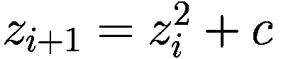

# file: `code/matlab_py/bridge_geopandas.py`

```python
def row_filter(dframe, A, op, B):
    operation = {
        '==' : lambda DF, A, B : DF[DF[A] == B],
        '!=' : lambda DF, A, B : DF[DF[A] != B],
        '>=' : lambda DF, A, B : DF[DF[A] >= B],
        '>'  : lambda DF, A, B : DF[DF[A] >  B],
    }
    if op not in operation:
        print(f'bridge_geopandas.row_filter: "{op}" not recognized')
        return None
    return operation[op]

def col_filter(dframe, cols):
    return dframe[[*cols]]

def rename_col(dframe, A, B):
    dframe.rename(columns={A:B}, inplace=True)

def astype(dframe, col, new_type):
    if new_type == 'int':
        dframe[col] = dframe[col].astype(int)
    elif new_type == 'float':
        dframe[col] = dframe[col].astype(float)
    elif new_type == 'str':
        dframe[col] = dframe[col].astype(str)
    else:
        print(f'bridge_geopandas.astype: "{new_type}" not recognized')

def mult_by(dframe, col, scale):
    dframe[col] *= scale

def iterrows(dframe):
    i = -1
    n_rows = len(dframe)
    def increment():
        nonlocal i
        i += 1
        if i < n_rows:
            return dframe.iloc[i]
        else:
            return None
    return increment
```

在以下 MATLAB 程序中，调用桥接函数之前是已注释掉的 Python 代码，这些代码实现了 Pandas 操作。此外，命令的顺序与第 [13.12] 节(#516169_1_En_13_Chapter.xhtml#Sec26)的纯 Python 程序略有不同，以减少内存占用。两个数据帧的行在读取后立即被过滤。

## MATLAB 2020b:

```matlab
% file: code/geopandas/LA_home_prices.m
Im  = @py.importlib.import_module;
pd  = Im('pandas');
gp  = Im('geopandas');
BG  = Im('bridge_geopandas');
plt = Im('matplotlib.pyplot');
trx = Im('matplotlib.transforms');
mpl = Im('matplotlib');
if ispc
    mpl.use('WXAgg')
else
    mpl.use('TkAgg')
end
zipcode_geom = gp.read_file('usa_zip/tl_2019_us_zcta510.shp');
% zipcode_geom.rename(columns={'ZCTA5CE10':'ZipCode'}, inplace=True)
BG.rename_col(zipcode_geom, 'ZCTA5CE10','ZipCode');
% zipcode_geom['ZipCode'] = zipcode_geom['ZipCode'].astype(int)
BG.astype(zipcode_geom, 'ZipCode', 'int');
% zipcode_geom = zipcode_geom[ zipcode_geom['ZipCode'] > 90000]
BG.row_filter(zipcode_geom, 'ZipCode', '>', 90000);
home_prices = pd.read_csv('Zip_zhvi_uc_sfrcondo_tier_0.33_0.67_sm_sa_mon.csv');
% home_prices.rename(columns={'RegionName':'ZipCode'}, inplace=True)
BG.rename_col(home_prices, 'RegionName', 'ZipCode');
% home_prices = home_prices[['ZipCode','2020-05-31','2021-05-31']]
home_prices = BG.col_filter(home_prices, py.list({'ZipCode',...
    'CountyName','2020-05-31','2021-05-31'}));
% LA_prices = home_prices[home_prices['CountyName'] == 'Los Angeles County']]
LA_prices = BG.row_filter(home_prices, 'CountyName', '==', 'Los Angeles County');
LA_price_map = zipcode_geom.merge(LA_prices,pyargs('on','ZipCode'));
% LA_price_map['2020-05-31'] /= 1.0e6  # 将单位改为百万美元
BG.mult_by(LA_price_map, '2020-05-31', 1.0/1.0e6);
size_10_14 = py.tuple([10,14]);
LA_price_map.plot(pyargs('column','2020-05-31','cmap','plasma',...
    'legend',py.True,'figsize',size_10_14));
plt.xlim(pyargs('left',-118.55,'right',-118.17));
plt.ylim(pyargs('top',34.14,'bottom',33.7));
plt.title('Los Angeles County Home Prices 2020-05-31, $M');
plt.ylabel('Latitude [deg]');
plt.xlabel('Longitude [deg]');
% 标记每个邮政编码
next_row = BG.iterrows(LA_price_map);
while 1
    row = next_row();
    if strcmp(class(row), 'py.NoneType')
        break
    end
    geo = row.get('geometry');
    xy = py.tuple([geo.centroid.x, geo.centroid.y]);
    plt.annotate(pyargs('text',row.get('ZipCode'),'xy',xy,...
        'horizontalalignment','center'));
end
bbox = trx.Bbox([0.9 0.9; 9 13]);
plt.savefig('LA_m.png', pyargs('bbox_inches',bbox,'transparent',py.True));
plt.show()
```

不幸的是，截至 2021 年 11 月，由于 DLL 加载问题，在 Windows 上通过 MATLAB 使用 `geopandas` 会存在问题。请访问本书的 GitHub 仓库^(⁶³)以获取更新。

## 13.14 参考文献

1. Kelsey Jordahl 等人。 `geopandas/geopandas: v0.8.1`。版本 `v0.8.1`。2020 年 7 月。DOI: `10.5281/zenodo.3946761`。网址: [`https://doi.org/10.5281/zenodo.3946761`](https://doi.org/10.5281/zenodo.3946761)
2. Wes McKinney。 `Python for Data Analysis, 第 2 版`。O'Reilly Media，2017 年。

# 14. 高性能计算

从事大规模或长时间数值工作的工程师、科学家和数据分析师总是渴望更快的速度、更多的核心、内存、带宽和存储。就其本质而言，数值模型总能通过更高的分辨率、更精细的离散化以及一切——自由度、时间步长、频率区间、神经元、层数、迭代次数、像素、光线、案例——的丰富性来改进。MATLAB 的很大一部分用户都属于这个对计算能力有强烈需求的人群。MathWorks 投入了大量精力，使其核心客户群能够最大限度地发挥 MATLAB 的性能。因此，性能问题将会引起许多研究 Python 的 MATLAB 用户的兴趣。

在本章中，我们将研究使 Python 代码运行得更快的方法。推而广之，更快的 Python 代码可能意味着更快的 MATLAB 代码，因为 MATLAB 可以调用 Python。编写更快代码的步骤对于高性能计算（HPC）的实践者来说应该很熟悉：

1.  对程序进行性能分析，了解时间消耗在哪里。
2.  尽可能消除冗余的 I/O 并批量处理 I/O 操作。
3.  研究代码中耗时部分的算法复杂度。例如，是否存在可以用 `O(N log N)` 算法替代的 `O(N²)` 步骤？
4.  启用编译器或解释器的优化功能。
5.  将数据组织到连续的内存块中。
6.  将算法中适合向量化的部分实现为向量操作。
7.  调用优化库中的函数（这些库通常用编译型语言编写）。
8.  将工作任务分配到同一台机器的多个核心上。
9.  使用拥有更多核心的硬件（特别是 GPU）。
10. 将工作任务分配到多台机器上。

高性能计算中的一个基本挑战是，步骤 3-10 常常相互冲突，它们的相对收益会随着问题类型、规模和可用计算机硬件的变化而变化。在 GPU 上运行的 `O(N²)` 算法可能比在传统 CPU 上运行的 `O(N log N)` 算法更快，而一个在单台多核计算机上运行的通信密集型并行程序，可能比在多个由慢速网络连接的类似计算机上运行的同一程序还要快。在性能权衡空间中找到一个合适的平衡点，最终归结为你愿意投入多少精力来实现令人满意的速度提升。

## 14.1 提升 Python 代码速度的路径

在前面列出的十个步骤中，我们将重点关注四个具有 Python 特定方面的步骤：

1.  使用 Python 专用工具（如 `Cython`、`Numba` 和 `Pythran`）提升单 CPU 性能。
2.  使用 `multiprocessing`、`Pythran`、`Numba` 或 `Dask` 在多个核心上并行化代码。
3.  用 `C`、`C++` 或 `Fortran` 重写关键代码段，并为其创建 Python 接口模块。
4.  使用 `Dask` 在多台计算机上并行化代码。

正如我们将在本章末尾的实践指南（第 `14.12` 节和第 `14.14` 节）中看到的，MATLAB 程序也可以通过调用加速后的 Python 代码来显著提高运行速度。

## 14.2 参考问题

我们将用两个程序来演示 Python 中的 HPC 技术。第一个程序用于计算曼德勃罗特集合的项，它看起来直截了当，但存在负载均衡方面的问题，使得向量化变得复杂。第二个程序是一个有限元求解器，更接近真实世界的问题。它涉及从数十兆字节的文本数据中加载数据，组装具有一百万个自由度的稀疏质量矩阵和刚度矩阵，并利用它们求解广义特征值问题。代码分布在多个文件和类中。

这些参考程序也使用 MATLAB 进行了实现，以便与 Python 版本进行性能比较。

关于这些问题的最后一点说明是，它们的绝对性能数值并不是特别重要。这些参考问题被用作你希望进行的计算密集型工作的代表。其目的是展示寻找代码慢速部分、加速选项的详细步骤，并比较各种技术及其有效性。

### 14.2.1 曼德勃罗特集合

“曼德勃罗特集合是满足以下条件的模长 ≤ 2 的复数 `c` 的集合：对于函数 `f_c = z² + c`，当从 `z = 0` 开始迭代时，该函数不会发散，即序列 `f_c`, `f_c(f_c)` 等的绝对值保持有界。”^(⁶⁴) 换句话说，如果我们选择一个随机复数 `c`（模长 ≤ 2），并将复数 `z` 初始化为零，那么在第几次迭代 `i` 时，递推式  的值会超过 2？该集合通常被可视化为一个等值线图，其中迭代次数 `i` 是 `z` 的实部和虚部的函数。

虽然这是一个“玩具”问题，但有几个方面使得计算曼德勃罗特集合的项对于说明 HPC 问题很有用：算法易于描述，可以用少量代码实现，可以向量化并轻松并行实现，同时具有不平凡的负载均衡方面，并且可以任意扩大规模。由此产生的迷人图像是一个不错的附加好处。

以下是我们顺序实现的参考代码：

| MATLAB | Python |
|--------|--------|
| `% file: code/hpc/MB_main.m`<br>`main()`<br>**function** `[i]=nIter(c, imax)`<br>&nbsp;&nbsp;&nbsp;&nbsp;`z = complex(0,0);`<br>&nbsp;&nbsp;&nbsp;&nbsp;`for i = 0:imax-1`<br>&nbsp;&nbsp;&nbsp;&nbsp;&nbsp;&nbsp;&nbsp;&nbsp;`z = z*z + c;`<br>&nbsp;&nbsp;&nbsp;&nbsp;&nbsp;&nbsp;&nbsp;&nbsp;`if abs(z) > 2`<br>&nbsp;&nbsp;&nbsp;&nbsp;&nbsp;&nbsp;&nbsp;&nbsp;&nbsp;&nbsp;&nbsp;&nbsp;`break`<br>&nbsp;&nbsp;&nbsp;&nbsp;&nbsp;&nbsp;&nbsp;&nbsp;`end`<br>&nbsp;&nbsp;&nbsp;&nbsp;`end`<br>`end`<br>**function** `[img]=MB(Re,Im,imax)`<br>&nbsp;&nbsp;&nbsp;&nbsp;`nR = size(Im,2);`<br>&nbsp;&nbsp;&nbsp;&nbsp;`nC = size(Re,2);`<br>&nbsp;&nbsp;&nbsp;&nbsp;`img = zeros(nR, nC, ...`<br>&nbsp;&nbsp;&nbsp;&nbsp;&nbsp;&nbsp;&nbsp;&nbsp;&nbsp;&nbsp;&nbsp;&nbsp;&nbsp;&nbsp;`'uint8');`<br>&nbsp;&nbsp;&nbsp;&nbsp;`for i = 1:nR`<br>&nbsp;&nbsp;&nbsp;&nbsp;&nbsp;&nbsp;&nbsp;&nbsp;`for j = 1:nC`<br>&nbsp;&nbsp;&nbsp;&nbsp;&nbsp;&nbsp;&nbsp;&nbsp;&nbsp;&nbsp;`c = complex(Re(j),Im(i));`<br>&nbsp;&nbsp;&nbsp;&nbsp;&nbsp;&nbsp;&nbsp;&nbsp;&nbsp;&nbsp;`img(i,j) = nIter(c,imax);`<br>&nbsp;&nbsp;&nbsp;&nbsp;&nbsp;&nbsp;&nbsp;&nbsp;`end`<br>&nbsp;&nbsp;&nbsp;&nbsp;`end`<br>**end** | `#!/usr/bin/env python3`<br>`# file: code/hpc/MB.py`<br>**import numpy as np**<br>**import time**<br>**def** `nIter(c, imax):`<br>&nbsp;&nbsp;&nbsp;&nbsp;`z = complex(0, 0)`<br>&nbsp;&nbsp;**for** `i` **in** `range(imax):`<br>&nbsp;&nbsp;&nbsp;&nbsp;&nbsp;&nbsp;`z = z*z + c`<br>&nbsp;&nbsp;&nbsp;&nbsp;`if abs(z) > 2:`<br>&nbsp;&nbsp;&nbsp;&nbsp;&nbsp;&nbsp;`break`<br>&nbsp;&nbsp;&nbsp;&nbsp;`return np.uint8(i)`<br>**def** `MB(Re, Im, imax):`<br>&nbsp;&nbsp;&nbsp;&nbsp;`nR = len(Im)`<br>&nbsp;&nbsp;&nbsp;&nbsp;`nC = len(Re)`<br>&nbsp;&nbsp;&nbsp;&nbsp;`img = np.zeros((nR, nC),`<br>&nbsp;&nbsp;&nbsp;&nbsp;&nbsp;&nbsp;&nbsp;&nbsp;&nbsp;&nbsp;&nbsp;&nbsp;`dtype=np.uint8)`<br>&nbsp;&nbsp;**for** `i` **in** `range(nR):`<br>&nbsp;&nbsp;&nbsp;&nbsp;**for** `j` **in** `range(nC):`<br>&nbsp;&nbsp;&nbsp;&nbsp;&nbsp;&nbsp;`c = complex(Re[j],Im[i])`<br>&nbsp;&nbsp;&nbsp;&nbsp;&nbsp;&nbsp;`img[i,j] = nIter(c,imax)`<br>&nbsp;&nbsp;**return** `img` |
| **function** `[] = main()`<br>&nbsp;&nbsp;&nbsp;&nbsp;`imax = 255;`<br>&nbsp;&nbsp;&nbsp;&nbsp;`for N = [500 1000 2000 5000]`<br>&nbsp;&nbsp;&nbsp;&nbsp;&nbsp;&nbsp;&nbsp;&nbsp;`tic`<br>&nbsp;&nbsp;&nbsp;&nbsp;&nbsp;&nbsp;&nbsp;&nbsp;`nR = N; nC = N;`<br>&nbsp;&nbsp;&nbsp;&nbsp;&nbsp;&nbsp;&nbsp;&nbsp;`Re = linspace(-0.7440,...`<br>&nbsp;&nbsp;&nbsp;&nbsp;&nbsp;&nbsp;&nbsp;&nbsp;&nbsp;&nbsp;&nbsp;&nbsp;&nbsp;&nbsp;&nbsp;&nbsp;&nbsp;&nbsp;-0.7433, nC);`<br>&nbsp;&nbsp;&nbsp;&nbsp;&nbsp;&nbsp;&nbsp;&nbsp;`Im = linspace( 0.1315,...`<br>&nbsp;&nbsp;&nbsp;&nbsp;&nbsp;&nbsp;&nbsp;&nbsp;&nbsp;&nbsp;&nbsp;&nbsp;&nbsp;&nbsp;&nbsp;&nbsp;&nbsp;&nbsp;0.1322, nR);`<br>&nbsp;&nbsp;&nbsp;&nbsp;&nbsp;&nbsp;&nbsp;&nbsp;`img = MB(Re, Im, imax);`<br>&nbsp;&nbsp;&nbsp;&nbsp;&nbsp;&nbsp;&nbsp;&nbsp;`fprintf('%5d %.3f\n',N,toc);`<br>&nbsp;&nbsp;&nbsp;&nbsp;`end`<br>`end` | **def** `main():`<br>&nbsp;&nbsp;&nbsp;&nbsp;`imax = 255`<br>&nbsp;&nbsp;**for** `N` **in** `[500,1000,2000,5000]:`<br>&nbsp;&nbsp;&nbsp;&nbsp;`T_s = time.time()`<br>&nbsp;&nbsp;&nbsp;&nbsp;`nR, nC = N, N`<br>&nbsp;&nbsp;&nbsp;&nbsp;`Re = np.linspace(-0.7440,`<br>&nbsp;&nbsp;&nbsp;&nbsp;&nbsp;&nbsp;&nbsp;&nbsp;&nbsp;&nbsp;&nbsp;&nbsp;&nbsp;&nbsp;&nbsp;&nbsp;`-0.7433, nC)`<br>&nbsp;&nbsp;&nbsp;&nbsp;`Im = np.linspace( 0.1315,`<br>&nbsp;&nbsp;&nbsp;&nbsp;&nbsp;&nbsp;&nbsp;&nbsp;&nbsp;&nbsp;&nbsp;&nbsp;&nbsp;&nbsp;&nbsp;&nbsp;`0.1322, nR)`<br>&nbsp;&nbsp;&nbsp;&nbsp;`img = MB(Re, Im, imax)`<br>&nbsp;&nbsp;&nbsp;&nbsp;`print(N, time.time() - T_s)`<br>**if** `__name__ == '__main__': main()` |

### 14.2.2 二维有限元求解器

Python 有许多优秀的有限元（FE）软件包。工业级应用包括 `deal.II`^(⁶⁵)、`FEniCS`^(⁶⁶)、`SfePy`^(⁶⁷) 和 `Code-Aster`^(⁶⁸)。这些都是由众多领域专家开发的大型项目，拥有数十万行源代码。

毋庸置疑，我们的第二个代表性程序只是这些高级程序的一个缩影。尽管我们的有限元求解器只实现了二维杆单元（基本上是线性弹簧），但它所执行的操作代表了许多有限元代码。我们的程序

1.  读取由 `triangle` [4] 程序创建的三角形单元和二维节点坐标的文本文件
2.  根据三角形边创建杆单元
3.  计算每个杆单元的刚度矩阵和质量矩阵，然后将它们插入到稀疏的全局刚度矩阵和质量矩阵 `K` 和 `M` 中
4.  通过求解广义特征值问题 `K[x] = λM[x]` 来计算无约束模型的振动模态

步骤 3 中生成的 `K` 异常稀疏；一个典型的由 `triangle` 输出导出的杆单元网格，每行或每列平均只有 14 个非零项。`M` 是一个对角矩阵。因此，拥有 8 GB 内存的计算机可以很容易地处理具有一百万个自由度的模型。Python 和 MATLAB 有限元源文件的名称见附录 C；源文件本身可在本书的 Github 仓库中找到。^(⁶⁹)

有限元求解器接受由 `triangle` 创建的任何二维网格。`triangle` 程序本身读取一个文本文件，该文件定义了待划分网格形状的外部（以及内部，如果有孔洞的话）边界。该输入文件，保存为

`beam.poly`