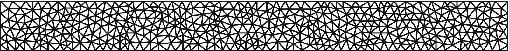
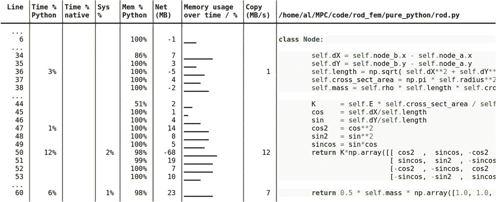
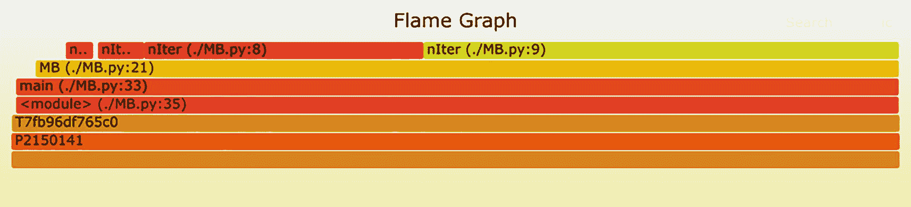
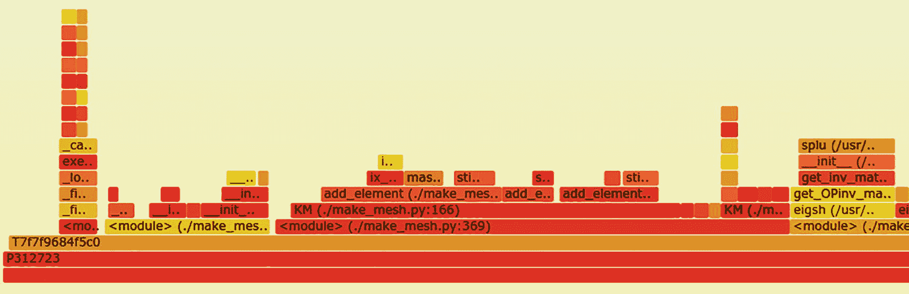

# 无孔洞
```

定义了一个 10 x 1 的矩形。以下是调用 `triangle` 可执行文件与 `beam.poly` 的命令行，用于创建五对 `beam.*.ele` 和 `beam.*.node` 文件，分辨率依次提高：

```
> triangle -pq34a.2 beam        # -> beam.1.ele, beam.1.node
> triangle -rpq34a.02 beam.1    # -> beam.2.ele, beam.2.node
> triangle -rpq34a.002 beam.2   # -> beam.3.ele, beam.3.node
> triangle -rpq34a.0002 beam.3  # -> beam.4.ele, beam.4.node
> triangle -rpq34a.00002 beam.4 # -> beam.5.ele, beam.5.node
```

例如，来自 `beam.2.ele` 和 `beam.2.node` 的网格如下图所示：



最后一对文件 `beam.5.ele` 和 `beam.5.node` 分别为 32 MB 和 28 MB，定义了一个具有超过一百万个自由度的网格。

## 14.3 参考硬件与操作系统

本章余下部分用于基准测试的硬件、操作系统以及 MATLAB 和 Python 版本如下：

*   2015 款 Dell XPS13 笔记本电脑
*   4 核 i5-5200U CPU @ 2.2 GHz
*   8 GB 内存
*   Ubuntu 20.04
*   MATLAB 2020b
*   Anaconda Python 2020.07

虽然 Python 代码可以轻松运行在更快的云托管硬件上，但 MATLAB 代码由于许可证限制，只能绑定到这台机器上。

## 14.4 基准性能

第 14.5.2 节和附录 C 中所示的参考程序的性能，针对各种问题规模显示如下。

### 14.4.1 曼德勃罗特集合性能

MATLAB 在这个问题上表现良好，其运行速度比 Python 版本快三倍。表 14-1 显示了各种 *N* × *N* 图像尺寸的耗时。*N* 的较大值可能看起来有些过头，但一旦我们开始应用优化技术，它们的包含就会变得显而易见。

### 14.4.2 有限元求解器性能


好的，作为一名高级文档工程师和翻译员，我将严格遵循您的格式要求，将以下英文文本翻译成中文。


# 有限元求解器的四个阶段

第 14.2.2 节所述的有限元求解器的四个阶段执行的操作截然不同。第一阶段，从文件加载模型数据，属于 I/O 密集型。第二阶段，根据三角形连接创建杆单元连接数据，纯粹是指针操作。

**表 14-1** 原始 Mandelbrot 程序的执行时间（秒）

| *N*   | MATLAB | Python |
|-------|--------|--------|
| 500   | 1.3    | 4.2    |
| 1000  | 4.4    | 17.1   |
| 2000  | 17.7   | 67.4   |
| 5000  | 112.5  | 420.0  |

第三阶段结合了单元矩阵生成和稀疏矩阵创建的浮点运算。最后阶段，计算稀疏矩阵的最小六个特征值及其对应的特征向量，主要由浮点运算主导。

表 14-2 显示了每个阶段的时间消耗和峰值内存结果。整个运行过程中的峰值内存使用情况，通过在 Linux 上使用 GNU Time，以命令 `/usr/bin/time -v` 后接 Python 程序或 `matlab`^(⁷⁰) 命令来捕获，然后在 Python 程序结束或 MATLAB 会话关闭后，从其结果中获取 `最大常驻集大小 (kbytes)` 的值。

**表 14-2** 基线有限元求解器的 CPU 时间和内存使用情况

| 模型  | 自由度      | 阶段             | MATLAB          | Python          |
|-------|-------------|------------------|-----------------|-----------------|
|       |             |                  | 秒    | 峰值 GB | 秒    | 峰值 GB |
| beam.4| 99,324      | 读取文件         | 5.0   |         | 0.4   |         |
|       |             | 三角形 → 杆      | 8.2   |         | 2.1   |         |
|       |             | 组装 ***K***, ***M*** | 6.8 |         | 6.5   |         |
|       |             | 特征值求解       | 2.9   |         | 2.5   |         |
|       |             | 总计             | 22.9  | 1.0     | 11.9  | 0.5     |
| beam.5| 1,025,250   | 读取文件         | 48.4  |         | 4.1   |         |
|       |             | 三角形 → 杆      | 84.6  |         | 26.5  |         |
|       |             | 组装 ***K***, ***M*** | 70.0 |         | 68.9  |         |
|       |             | 特征值求解       | 43.9  |         | 55.4  |         |
|       |             | 总计             | 240.2 | 7.1     | 157.1 | 5.4     |

Python 代码在前三个阶段以及总求解时间上均优于 MATLAB，但 MATLAB 的特征值求解明显更快。特别是从文本文件读取模型数据，Python 比 MATLAB 快十倍。Python 使用的内存也远少于 MATLAB。

## 14.5 分析 Python 代码

任何性能提升尝试的第一步都是测量代码的缓慢之处。有时，这些位置很明显，可以在关键位置包裹简单的计时代码（如前面 FE 求解器所做的那样），以评估后续代码优化的有效性。然而，对于细粒度的结果，我们需要额外的分析工具。

标准 Python 库包含两个模块，`cProfile` 和 `profile`，它们以确定性的方式（相对于统计性的，后者不太精确）测量对各个 Python 函数的调用次数和花费的时间。结果以表格文本形式呈现。标准分析工具有三个缺点：

1.  结果粗糙；分辨率在函数级别。这掩盖了单个性能瓶颈行。

2.  对于大型程序，文本表格可能难以解读。

3.  仅分析 CPU 使用情况；没有分析内存使用情况的选项。

Python IDE（如 Spyder 和 PyCharm）与 MATLAB 的 IDE 一样，具有集成的分析功能，但 Python 版本基于 `cProfile`，因此仅提供函数级别的分辨率。MATLAB 的 IDE 可以显示单行代码的分析结果。逐行结果对于性能调优至关重要，因此我们转向不随 Anaconda 附带且必须单独安装的工具。

### 14.5.1 Scalene

Scalene [1] 是一个低开销的采样分析器，它还能额外报告 GPU 使用情况（如果检测到 GPU）、内存复制指标和内存消耗——所有这些都在逐行级别上进行。Scalene 在 Python 代码分析工具中因其几个原因而独树一帜。其主要杀手级特性是，它将每一行的 CPU 结果细分为纯 Python 时间、底层编译库（称为“本机”时间）所花费的时间以及系统时间（用于 I/O 和与代码无关的操作）。这种分离有助于回答关于如何处理慢速代码行的隐含问题。如果大部分时间花在纯 Python 上，则可能有办法重写代码以调用更快的库函数。另一方面，如果大部分时间被底层库或系统占用，则改进的机会可能较小。Scalene 也适用于多线程和多进程。

以下命令用于分析 Mandelbrot 程序：

```
> scalene ./MB.py
```

其输出如下：

```
Memory usage: =======#####==== (max: 117.00MB)
./MB.py: % of time =  99.58% out of  27.70s.
Line |Time % |Time %  |Sys |Mem %  |Net   |Memory usage  |Copy   |
|Python |native  |%   |Python |(MB)  |over time / % |(MB/s) |./MB.py
-------+-------+--------+----+-------+------+--------------+-------+----------------------
1 |       |        |    |       |      |              |       |#!/usr/bin/env python3
2 |       |        |    |       |      |              |       |# code/hpc/MB.py
3 |       |        |    |       |      |              |       |import numpy as np
4 |       |        |    |       |      |              |       |import time
5 |       |        |    |  100% |    3 |---           |       |def nIter(c, imax):
6 |    1% |        |    |  100% |   47 |-----         |       |  z = complex(0, 0)
7 |    6% |        |    |   99% |   46 |----          |       |  for i in range(imax):
8 |   43% |     1% |    |  100% | 3609 |===== 95%     |       |    z = z*z + c
9 |   44% |     1% |    |  100% |-3608 |--------      |       |    if abs(z) > 2:
10 |       |        |    |       |  -57 |              |       |      break
11 |       |        |    |       |      |              |       |  return i
[... lines truncated...]
```

显示第 8 行和第 9 行是热点，消耗了近 90% 的求解时间。另一方面，内存结果则反直觉，因为峰值使用发生在仅对复数标量进行乘法和加法运算的行上。

默认情况下，`scalene` 会打印每个源文件中的每一行，无论其贡献是否显著。这对于大型程序来说显然过于冗长；在这种情况下，可以使用 `--reduced-profile` 来修剪输出。结果也可以输出到 HTML 文件以简化浏览：

```
> scalene --html --outfile profile.html --reduced-profile make_mesh.py
```

`profile.html` 中显示了单行最昂贵的代码（占总体 CPU 时间的 12%，用于返回单元刚度矩阵）的部分，在浏览器中看起来像这样：



有趣的是，`scalene` 的结果表明时间花费在了复制内存上，而不是执行计算上。


### 14.5.2 Austin 和 FlameGraph

`Austin`^(⁷¹)是另一种采样分析器。与`scalene`一样，它开销极低，无需修改被分析的代码，并且可以将结果发送到`FlameGraph`^(⁷²)等其他指标工具进行图形化显示。（MATLAB 的分析器也能将时序结果以火焰图形式显示，不过使用的是石板灰配色方案，而非红色/橙色/黄色。）

`FlameGraph`垂直展示调用栈，主程序位于底部。每个条形的宽度表示在 MATLAB 的某个特定函数或使用`austin`分析的某行代码上所花费的时间；代码热点会显示为最宽的条形。条形的左右排列是任意的，并不表示时间顺序执行顺序。条形的颜色也是任意的。垂直排列具有意义：一个条形所代表的代码会调用其正上方条形中的代码。最底部的条形自然是最宽的，因为它代表程序的主函数入口点。可识别的函数名称通常出现在从底部数起的第三或第四个条形中。

与`scalene`类似，`austin`从命令行调用。主要参数包括微秒单位的采样间隔以及要运行的 Python 程序（及参数）。输出可以直接写入文件，或者通过管道传递给`FlameGraph`。`FlameGraph`本身是一个命令行程序，它接受诸如显示结果的最小分辨率以及时序结果所采用的单位等参数。以下命令对*N* = 1000 的曼德博集合程序进行分析，每 50 *μ*s 采集一次样本：

```
> austin -a -i 50 ./MB.py | flamegraph.pl --minwidth 10 --countname=us > flame.svg
```

`FlameGraph`的`--minwidth 10`开关排除了那些会使条形宽度小于 10 像素的条目。没有这个参数，图表会充斥着贡献微小、难以解读的条目。提高或降低这个像素宽度值，可以得到你感兴趣的解析度等级。`FlameGraph`的输出是一个可以通过网页浏览器查看的 SVG 文件。图中



显示大部分计算时间花费在第 8 行和第 9 行的`nIter()`函数中。回顾第 14.2.1 节，`nIter()`的实现为：

Python:

```
5   def nIter(c, imax):
6     z = complex(0, 0)
7     for i in range(imax):
8       z = z*z + c
9       if abs(z) > 2:
10         break
11     return i
```

第 8 行和第 9 行的计算工作发生在语句`z = z*z + c`和`if abs(z) > 2`中。对`beam.4`算例的有限元求解器运行相同的分析命令，则会产生更复杂的图表。



与曼德博集合的结果不同，这里没有明显的性能瓶颈。`FlameGraph`显示大部分执行时间发生在`make_model.py`的第 369 行，该行创建了全局质量矩阵和刚度矩阵：

```
368 T_s = default_timer()
369 K,M = m.KM()
370 T_e = default_timer()
371 print(f'[K], [M] creation {m.nDof} dof : {T_e-T_s:.6f} s')
```

在调用栈中深入一层，`.KM()`方法内的第 166 行是一个耗时点：

```
163       # sparse K in COO (coordinate) form
164       I, J, kV = [], [], []
165       for eid in self.elem:
166           self.add_element(eid, kV, I, J, M)
```

## 14.6 使用`multiprocessing`进行多核计算

Python 有一个`threading`模块，这让人相信它可以将工作分叉到多个线程。它可以做到，但这仅对于等待进行的 I/O 事件有效。通过这种方式提交的通用计算会被阻塞，以至于一次只运行一个线程，这使得它对非 I/O 任务毫无意义。要在计算机的多个核上同时运行任意代码，你需要使用 Python 的另一个标准模块`multiprocessing`。

使用`multiprocessing`的最常见方式是建立一个工作进程池（通常是你想要运行的核数），然后将需要并行运行的函数提交到该进程池。以下代码展示了使用`multiprocessing`在三个核上运行曼德博集合计算的一种方法。工作通过以步长方式遍历`Im`数组的行来在各个核之间细分，步长等于我们将使用的核数。在我们的例子中，我们将设置`n_workers = 3`，这样进程 0 获取第 0、3、6…行；进程 1 获取第 1、4、7…行；以此类推；这是通过`Im_subset = Im[i::n_workers]`这一行完成的。高亮显示的代码显示了为使用`multiprocessing`模块而应用的代码修改：

Python:

```
1   #!/usr/bin/env python3
2   # code/hpc/MB_multi.py
3   import numpy as np
4   import time
5   from multiprocessing import Pool
6   def nIter(c, imax):
7     z = complex(0, 0)
8     for i in range(imax):
9       z = z*z + c
10       if abs(z) > 2:
11         break
12     return np.uint8(i)

14   def MB(Re, Im, imax):
15     nR = len(Im)
16     nC = len(Re)
17     img = np.zeros((nR, nC), dtype=np.uint8)
18     for i,I in enumerate(Im):
19       for j,R in enumerate(Re):
20         c = complex(R, I)
21         img[i, j] = nIter(c, imax)
22     return img

24   def main():
25     imax = 255
26     for N in [500, 1000, 2000, 5000 ]:
27       T_s = time.time()
28       nR, nC = N, N
29       Re = np.linspace(-0.7440, -0.7433, nC)
30       Im = np.linspace( 0.1315,  0.1322, nR)
31       n_workers = 3
32       img = np.zeros((nR, nC), dtype=np.uint8)
33       with Pool(n_workers) as pool:
34           results = []
35           for i in range(n_workers):
36               Im_subset = Im[i::n_workers]
37               results.append( pool.apply_async(
38                       MB, (Re, Im_subset, imax,)) )
39           for i,R in enumerate(results):
40               img[i::n_workers, :] = R.get()
41       print(N, time.time() - T_s)
42   if __name__ == '__main__': main()
```

第 35–38 行的循环很快就完成了，因为这些函数是异步提交给工作进程池的。只有在第 40 行为每个提交的函数调用`.get()`方法时，多核上的计算才会开始。

尽管`multiprocessing`忠实地让三个核保持忙碌，每个核处理总任务的三分之一，但表 14-3 显示对于这个问题，其性能并不令人振奋。

**表 14-3** *标量与向量化曼德博集合实现方式的执行时间（秒）*

| N | MATLAB 单核 | Python 单核 | Python `multiprocessing` + 3 核 |
|---|---|---|---|
| 500 | 1.6 | 4.2 | 3.0 |
| 1000 | 5.8 | 17.1 | 11.4 |
| 2000 | 23.2 | 67.4 | 41.6 |
| 5000 | 145.1 | 420.0 | 250.0 |

前方有更好的选择，因此为了节省篇幅，我将从未来的基准测试结果中省略`multiprocessing`的结果。


## 14.7 向量化

对于 MATLAB 和 NumPy 而言，一种广为人知的优化技术是编写向量化代码——即对整个矩阵而非其索引项执行操作的代码。当矩阵中的所有项都需要执行相同的操作集时，与使用显式循环的标量代码相比，向量化通常能带来 10 倍到 60 倍的性能提升。

曼德勃罗集的一个有趣特征是，其计算量在解域内变化很大。向量化是否能提升性能尚不明确，因为收敛最慢的项决定了整个区域的计算速度。唯一确定的方法是实现向量形式的解法，然后比较性能。

以下向量解法大量使用了布尔索引掩码（第 11.​1.​14 节）。`Idx` 标识仍在积极更新的项，`New` 是在当前迭代中已收敛的项的集合。每次迭代结束时都会更新 `Idx`，以便将新收敛的项从后续细化中移除。只有当没有新项需要更新时，解法才算完成。

MATLAB：
Python：

```
% file: code/hpc/MB_vectorized.m
main()
function [img]=nIter(c, imax)
[nR,nC]= size(c);
z = complex(zeros(nR,nC), ...
             zeros(nR,nC));
img = zeros(nR,nC,'uint8');
Idx = ones(nR,nC,'logical');
for i = 0:imax-1
    z(Idx) = z(Idx).*z(Idx)+ ...
           + c(Idx);
    New = (real(z).²+ ...
           imag(z).² <= 4);
    if ~any(New,'all')
        break
    end
    img(New) = i;
    Idx = Idx & New;
end
end
function [] = main()
imax = 255;
for N = [500 1000 2000 5000]
    tic
    nR = N; nC = N;
    Re = linspace(-0.7440,...
                  -0.7433, nC);
    Im = linspace( 0.1315,...
                   0.1322, nR);
    [zR, zI] = meshgrid(Re,Im);
    z_init = complex(zR,zI);
    img = nIter(z_init, imax);
    fprintf('%5d %.3f\n',N,toc);
end
end
```

```
#!/usr/bin/env python3
