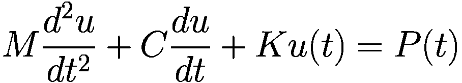
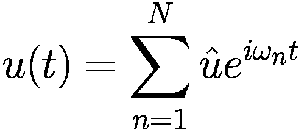
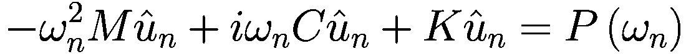
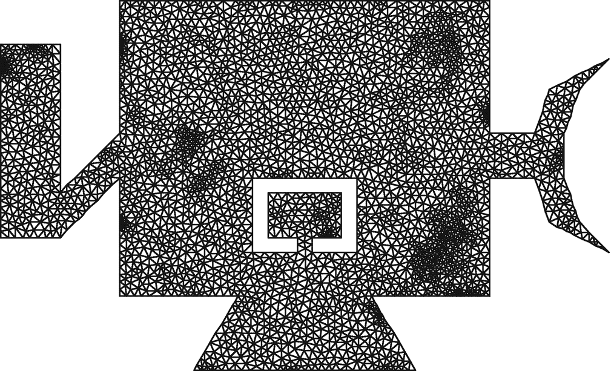
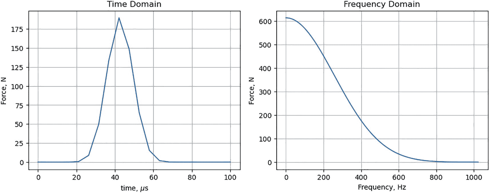

# code/dask/prime_seq.py

```python
from sympy import primefactors
import time

def my_fn(a, b, incr):
    Ts = time.time()
    s = 0
    for x in range(a,b,incr):
        s += sum(primefactors(x))
    return s, time.time() - Ts

def main():
    A = 2
    B = 10_000_000
    incr = 1
    S, dT = my_fn(A, B, incr)
    print(f'A={A} B={B}, '
          f'{dT:.4f} sec')
    print(f'S={S}')

if __name__ == "__main__": main()
```

在我的 Linux 笔记本上运行结果如下：

MATLAB：

```
>> prime_seq
A=2 B=10000000, 682.681 sec
S=5495501355056
```

Python：

```
> ./prime_seq.py
A=1 B=10000000, 519.531 sec
S=5495501355056
```

对计算密集型函数 `my_fn()` 的调用是独立的，可以按任何顺序调用，甚至可以同时调用。我们将使用 dask 在本地机器的三个核心上精确地实现这一点。为了均匀地分配负载，我们只需将起始计数器按任务编号偏移，并让 `my_fn()` 内部的 `range(a,b,incr)` 调用将待分解的数字分散到各个处理器上。例如，如果要计算 2 到 20 之间数字的质因数，并希望将工作均匀地分配到三个任务中，分配情况将是：

Python：

```
In : list(range(2,21))          # 原始集合
Out: [2, 3, 4, 5, 6, 7, 8, 9, 10, 11, 12, 13, 14, 15, 16, 17, 18, 19, 20]

In : list(range(2+0,21,3))
Out: [2, 5, 8, 11, 14, 17, 20]

In : list(range(2+1,21,3))
Out: [3, 6, 9, 12, 15, 18]

In : list(range(2+2,21,3))
Out: [4, 7, 10, 13, 16, 19]
```

或者在 MATLAB 中等价地：

MATLAB：

```
>> 2:3:20
2     5     8    11    14    17    20

>> 2+1:3:20
3     6     9    12    15    18

>> 2+2:3:20
4     7    10    13    16    19
```

在本地计算机上，将工作拆分为三个同时运行的任务的 dask 版本质因数求和程序如下所示：

Python：

```python
#!/usr/bin/env python3
# code/dask/prime_dask.py
from sympy import primefactors
import time
import dask
from dask.distributed import Client

def my_fn(a, b, incr):
    Ts = time.time()
    s = 0
    for x in range(a,b,incr):
        s += sum(primefactors(x))
    return s, time.time() - Ts

def main():
    client = Client('127.0.0.1:8786')
#   client = Client('143.198.155.245:8786')
    tasks  = []
    main_T_start = time.time()
#   n_jobs = 11*18
    n_jobs = 3
    A = 2
    B = 10_000 # _000
    incr = n_jobs
    for i in range(n_jobs):
        job = dask.delayed(my_fn)(A+i, B, incr)
        tasks.append(job)
    results = dask.compute(*tasks)
    client.close()
    total_sum = 0
    for i in range(len(results)):
        partial_sum, T_el = results[i]
        print(f'job {i}:  sum= {partial_sum}  T= {T_el:.3f}')
        total_sum += partial_sum
    print(f'total sum={total_sum}')
    elapsed = time.time() - main_T_start
    print(f'main took {elapsed:.3f} sec')

if __name__ == "__main__": main()
```

当程序运行时，第 16 行的 `Client('127.0.0.1:8786')` 调用会尝试连接到一个运行在本地主机上并监听 8786 端口的 dask 调度器。（第 17 行，当前已被注释掉，将在第 14.13.5 节讨论）。如果这样的调度器没有运行，程序将在 30 秒后失败并显示：

Python：

```
OSError: Timed out trying to connect to tcp://127.0.0.1:8786 after 30 s
```

第 21 行定义了 `n_jobs`，这是我们要创建的任务数量计数器。为了充分利用硬件性能，该值至少应等于或超过集群中可用的核心数。如果任务持续时间各不相同且数量众多，将 `n_jobs` 设置为远大于核心数的值有助于更均衡地在各核心间分配负载。

第 24-26 行将延迟任务添加到第 18 行初始化的列表 `tasks` 中。每个任务都是对 `my_fn()` 的调用，参数为 `A+i, B, incr`。计算在第 27 行执行，此时 dask 将延迟任务列表交给调度器，由其分发给工作进程。每次调用的返回值出现在列表 `results` 中，该列表将包含 `n_jobs` 个条目。

最后，第 29-32 行将各部分的素数总和汇总为总值。

关于在多台计算机上设置 dask 调度器和工作进程的详细信息将在下一节介绍。目前，我们仅在本地计算机上操作以避免许多复杂问题。通过创建一个包含三个回环 IP 地址副本的文本文件，可以最简便地启动后台调度器和工作任务：

```
hostfile.txt
127.0.0.1
127.0.0.1
127.0.0.1
```

然后将此文件名作为参数传给 `dask-ssh` 命令：

```
> dask-ssh --hostfile hostfile.txt
```

这会在文件中定义的每台计算机上启动一个工作进程，并在第一行定义的计算机上启动一个调度器进程。当然，在这种情况下，所有这些后台进程都在本地计算机上运行。

调度器和工作进程在后台运行后，我们现在可以运行启用 dask 的素数因式分解求和程序 `prime_dask.py`。它的运行速度比顺序版本快，但提升不大：

```
3 个工作进程，3 个 dask 任务：
job 0:  sum= 2418248946959  T= 327.969
job 1:  sum= 659400211060  T= 206.228
job 2:  sum= 2417852197037  T= 327.709
total sum=5495501355056
main took 328.852 sec
```

# 设置分布式 Dask 集群

## 在多台计算机上设置 Dask 集群

在单台计算机上运行 `dask` 是代码开发和初始故障排查中有用的第一步。然而，它在性能方面无法令人满意。要真正受益于 `dask` 的强大功能，我们需要在多台计算机上运行它。

可以通过多种方式设置 `dask` 集群：手动方式（使用 `ssh`）；使用 Kubernetes；使用 Helm；或使用针对 LSF、MOAB、Slurm 和 PBS 等作业调度器的 `dask` 专用配置。本节介绍如何使用 `ssh` 实现 `dask` 集群，这可能是普通用户最容易上手的方法。Kubernetes、Helm、LSF 等可能需要同事、DevOps 专家或集群管理员协助设置。`ssh` 方法意味着两个前提条件：统一的 Python 安装和所有计算机间的无缝`ssh`访问。

具体来说，所有计算机应具备：
*   兼容（最好相同）的 Python 安装
*   Python 可执行文件的相同路径
*   设置和使用集群的用户的相同账户名
*   该用户账户在所有计算机间具有统一的、基于密钥的双向`ssh`访问权限
*   相同的`ssh`端口
*   防火墙规则开放，允许 `ssh` 以及 `dask` 调度器和指标端口（默认情况下为 8786 和 8787）

一旦满足这些条件，将集群中每台计算机的 IP 地址（或主机名，如果名称解析有效）添加到主机文件（`my_hosts.txt`表示该文件，如下所示）。主机文件中列出的第一台计算机将运行后台调度器进程，所有计算机都将运行后台工作进程。然后在控制台中调用`dask-ssh`来启动调度器和工作进程：

```bash
dask-ssh --hostfile my_hosts.txt
```

**警告！**

使用 `dask-ssh` 设置分布式 Dask 集群是**极其不安全**的！任何知道调度器 IP 地址和端口的用户都可以连接到你的集群，并在启动工作器的账户（即你的账户）下运行任意 Python 代码。

设置安全的多用户 Dask 集群的正确方法是配置一个 `dask-gateway`<sup>84</sup>，它实现了身份验证层。

### 14.13.5 示例 2：多台计算机上的质因数之和

一旦 Dask 集群中的计算机运行了调度器和工作器，我们就可以开始享受显著的性能提升。本节使用 DigitalOcean<sup>85</sup> 云基础设施上的 18 台虚拟机。每台 VM 运行其最低级别的“droplet”，具有 1 GB 内存、1 个 2.5 GHz 的 CPU 核心和 25 GB 存储空间。这些 VM 运行 Ubuntu 20.04.3 LTS，安装了 Anaconda 2021.05，并使用 `matpy` conda 环境（第 2.5.1 节）。

第一步是登录到 18 台 VM 中的一台，并发出 `dask-ssh` 命令来启动调度器和工作器：

```bash
dask-ssh --hostfile DigitalOcean_VMs.txt
```

其中 `DigitalOcean_VMs.txt` 包含了所有 18 台计算机的 IP 地址。对 `prime_dask.py`（代码列表见第 14.13.3 节）需要做的唯一更改是将对 `Client(127.0.0.1:8786)` 的调用替换为运行调度器的 VM 的 IP 地址，即 `DigitalOcean_VMs.txt` 中的第一个条目。第 17 行显示了可能的样子。

最后，我们可以从任何能够连接到调度器的计算机上运行 `prime_dask.py`；该程序无需从 Dask 集群中的 VM 调用。在我的例子中，我在家用计算机上运行该程序。我选择的任务数量是工作器数量的倍数：11 x 18 = 198。结果如下：

```
/usr/../client.py:1105: VersionMismatchWarning: Mismatched versions found

+---------+--------+-----------+---------+
| Package | client | scheduler | workers |
+---------+--------+-----------+---------+
| numpy   | 1.19.4 | 1.20.3    | 1.20.3  |
| pandas  | 1.2.4  | 1.3.2     | 1.3.2   |
+---------+--------+-----------+---------+
warnings.warn(version_module.VersionMismatchWarning(msg[0]["warning"]))
job 0:  sum= 58821526361  T= 4.812
job 1:  sum= 20950602326  T= 2.896
job 2:  sum= 21058399941  T= 5.235
job 3:  sum= 20835967514  T= 2.718
job 4:  sum= 58744527113  T= 5.268
:
job 192:  sum= 58671468728  T= 4.242
job 193:  sum= 21006229047  T= 2.808
job 194:  sum= 21149296400  T= 3.376
job 195:  sum= 20947903441  T= 3.108
job 196:  sum= 58678967783  T= 3.779
job 197:  sum= 217715273  T= 0.847
total sum=5495501355056
main took 43.393 sec
```

该程序的顺序版本在单台 VM 上需要 718.057 秒，因此 18 个核心实现了 16.5 倍的加速。

### 14.13.6 示例 3：十亿像素曼德勃罗图像

在第 14.10.3 节中，我们使用 Numba 将计算 5000 x 5000 曼德勃罗图像所需的时间从一个核心上的 420 秒减少到约 9 秒。现在让我们提高难度，使用我们的 18 台单核 VM 集群来计算一幅 35,000 x 35,000（即 12 亿）像素的图像。每个像素将由一个字节表示，该字节是 *z* 方程收敛所需的迭代次数。在拥有至少 8 GB 内存的计算机上运行的 MATLAB 和 Python 都可以轻松存储这样的图像；MATLAB 甚至可以用 `imshow()` 显示它（matplotlib 的 `imshow()` 在如此大的图像上会崩溃）。

我们的十亿像素图像将是 5k 图像的 7² 倍，即大约 50 倍，因此单个由 Numba 驱动的核心生成它应该需要大约 440 秒。此外，我们的 Dask 集群有 18 台计算机，因此如果我们能够很好地平衡任务负载，运行时间将大大缩短。让我们尝试一下。

一种平衡曼德勃罗集负载的策略是以轮询方式将行或列分配给工作器。以下是采用该策略的 Dask + Numba 解决方案：

```python
#!/usr/bin/env python3
# code/dask/MB_numba_dask.py
import numpy as np
from numba import jit, uint8, int64, float64, complex128
import dask
from dask.distributed import Client
import time
import matplotlib.pyplot as plt

@jit(uint8(complex128,int64), nopython=True, fastmath=True)
def nIter(c, imax):
    z = complex(0, 0)
    for i in range(imax):
        z = z*z + c
        if z.real*z.real + z.imag*z.imag > 4:
            break
    return i

@jit(uint8[:,:],
                nopython=True)
def MB(Re, Im, imax, job_id, n_jobs):
    nR = len(Im)
    nC = len(Re)
    my_rows = range(job_id, len(Im), n_jobs)
    n_rows_here = len(my_rows)
    img = np.zeros((n_rows_here, nC), dtype=np.uint8)
    row_counter = 0
    for i in my_rows:
        I = Im[i]
        for j,R in enumerate(Re):
            c = complex(R, I)
            img[row_counter, j] = nIter(c, imax)
        row_counter += 1
    return img

def main():
    imax = 255
    N = 35_000
    T_s = time.time()
    nR, nC = N, N
    Re = np.linspace(-0.7440, -0.7433, nC)
    Im = np.linspace( 0.1315,  0.1322, nR)
    n_jobs = 18
    #client = Client('127.0.0.1:8786')
    client = Client('413.198.155.245:8786')
    tasks = []
    for i in range(n_jobs):
        job = dask.delayed(MB)(Re, Im, 255, i, n_jobs)
        tasks.append(job)
    results = dask.compute(*tasks)
    client.close()

    # reassemble the image
    img = np.empty((N,N), dtype=np.uint8)
    for i in range(n_jobs):
        my_rows = range(i, len(Im), n_jobs)
        img[my_rows,:] = results[i][:]
    print(f'{time.time() - T_s:.3f}  {N:5d}')
    plt.imshow(img)
    plt.show()

if __name__ == '__main__': main()
```

当 *N* < 15,000 时工作正常且加速效果令人满意，但更大的尺寸会引入新问题。Dask 工作器会崩溃，并显示：

```
[ worker 127.0.0.1 ] : distributed.core - INFO - Event loop was unresponsive
in Worker for 4.89s.  This is often caused by long-running GIL-holding
functions or moving large chunks of data. This can cause timeouts and instability.
```

导致主程序以以下错误结束：

# distributed.comm.core.CommClosedError: in : Stream is closed

换句话说，工作器因内存不足而崩溃。虽然提交作业的计算机有 8 GB 内存，但工作器只有 1 GB，其中一部分被操作系统和 Dask 工作器进程占用。

与其让每台远程计算机累积分配给它的所有作业的结果，我们需要在运行过程中从远程计算机收集结果。一种方法是将作业分成组，并在每组提交后调用 `.compute()` 方法。以下曼德勃罗程序的修订版就做到了这一点。还实现了一个额外的修改以提高并行效率：我们不向远程工作器发送实部和虚部数组，而是仅发送起始值和结束值，让工作器自己计算数组项。最后，为了简化最终图像的重新组装，除了图像切片外，我们还让每个工作器告诉我们它处理的行索引。

```python
#!/usr/bin/env python
# code/dask/MB_numba_dask2.py
import numpy as np
from numba import jit, uint8, int64, float64, complex128
from numba.types import Tuple as nb_tuple
import dask
from dask.distributed import Client
import time
import matplotlib.pyplot as plt

@jit(uint8(complex128,int64), nopython=True, fastmath=True)
def nIter(c, imax):
    z = complex(0, 0)
    for i in range(imax):
        z = z*z + c
        if z.real*z.real + z.imag*z.imag > 4:
            break
    return i
```

```python
@jit(nb_tuple((int64[:],uint8[:,:]))(int64,float64[:],int64,float64[:],
        int64,int64,int64), nopython=True)
def MB(nC, Re_limits, nR, Im_limits, imax, job_id, n_jobs):
    Re = np.linspace(Re_limits[0], Re_limits[1], nC)
    Im = np.linspace(Im_limits[0], Im_limits[1], nR)
    my_rows = np.arange(job_id, len(Im), n_jobs, dtype=np.int64)
    n_rows_here = len(my_rows)
    img = np.zeros((n_rows_here, nC), dtype=np.uint8)
    row_counter = 0
    for i in my_rows:
        I = Im[i]
        for j, R in enumerate(Re):
            c = complex(R, I)
            img[row_counter, j] = nIter(c, imax)
        row_counter += 1
    return my_rows, img

def main():
    imax = 255
    N = 35_000
    T_s = time.time()
    nR, nC = N, N
    Re_limits = np.array([-0.7440, -0.7433])
    Im_limits = np.array([ 0.1315,  0.1322])
    n_groups = 16
    n_jobs_per_group = 18
    n_jobs = n_jobs_per_group * n_groups
    # client = Client('127.0.0.1:8786')
    client = Client('143.198.155.245:8786')
    results = []
    for c in range(n_groups):
        tasks = []
        Tcs = time.time()
        for i in range(n_jobs_per_group):
            job = dask.delayed(MB)(nC, Re_limits, nR, Im_limits, 255,
                c * n_jobs_per_group + i, n_jobs)
            tasks.append(job)
        results.extend(dask.compute(*tasks))
        Tce = time.time() - Tcs
        print(f'group {c:2d} took {Tce:.3f} sec')
    client.close()
    # reassemble the image
    img = np.empty((N, N), dtype=np.uint8)
    for i in range(len(results)):
        my_rows, img_rows = results[i]
        img[my_rows,:] = img_rows
    print(f'{time.time() - T_s:.3f}  {N:5d}')
    return
    plt.imshow(img)
    plt.show()

if __name__ == '__main__': main()
```

我们使用的 35,000 x 35,000 的 `uint8` 数组意味着我们的集群将生成并传输超过 1GB 的数据。显然，网络速度会影响性能。两次运行鲜明地展示了这一点。左侧的任务是从我的家庭计算机启动，并在 DigitalOcean 云上的 18 个虚拟机集群上执行的。右侧的任务是直接从其中一个虚拟机启动的，因此所有流量都保留在 DigitalOcean 的网络内。当然，由于这些虚拟机只有 1GB 内存，我必须跳过最终组装 `img` 矩阵的步骤。

| 在家庭计算机上启动： | 在 DigitalOcean 计算机上启动： |
| --- | --- |
| `chunk  0 took 7.500 sec` `chunk  1 took 5.564 sec` `chunk  2 took 4.944 sec` `chunk  3 took 4.873 sec` `chunk  4 took 4.978 sec` `chunk  5 took 5.834 sec` `chunk  6 took 5.280 sec` `chunk  7 took 4.559 sec` `chunk  8 took 4.531 sec` `chunk  9 took 5.989 sec` `chunk 10 took 4.997 sec` `chunk 11 took 4.574 sec` `chunk 12 took 4.459 sec` `chunk 13 took 4.799 sec` `chunk 14 took 5.020 sec` `chunk 15 took 4.785 sec` `83.715  35000` | `chunk  0 took 7.929 sec` `chunk  1 took 2.427 sec` `chunk  2 took 1.955 sec` `chunk  3 took 1.851 sec` `chunk  4 took 1.808 sec` `chunk  5 took 1.806 sec` `chunk  6 took 1.812 sec` `chunk  7 took 1.817 sec` `chunk  8 took 1.805 sec` `chunk  9 took 3.032 sec` `chunk 10 took 3.456 sec` `chunk 11 took 2.697 sec` `chunk 12 took 2.612 sec` `chunk 13 took 2.114 sec` `chunk 14 took 1.842 sec` `chunk 15 took 1.777 sec` `40.819  35000` |

我最初估计，在我的家庭计算机的单核上，使用 Numba 加速求解这个尺寸的曼德勃罗集需要 440 秒，因此使用 18 台基于云的计算机耗时 83 秒，加速比为 5.3。这或许令人失望，但清楚地说明，对于涉及大量数据传输的问题，其性能在很大程度上取决于网络。

### 14.13.7 示例 4：有限元频域响应

正如之前在多核部分所述，我将使用一个承受动态载荷的有限元模型，来代表一个更贴近实际的分布式内存计算问题。那些用于素数求和和计算曼德勃罗集的玩具问题具有教学意义，但没有处理大型输入集所带来的复杂性。

模拟结构在突然加速（例如，冲击或爆炸螺栓的发射，这在释放可活动部件的航天器中很常见）作用下的行为是棘手的。适用于此类工作的有限元模型需要细小的单元来捕捉由此产生的结构波的短波长。冲击和爆炸的频谱含量很高，因此如果进行模态分析，将需要大量的特征解——这通常是一个不切实际的数量。或者，可以尝试对运动平衡方程进行直接时间积分（例如，使用 Newmark-beta 方法）：



`u(t)` 和 `P(t)` 是随时间变化的响应和施加的载荷。第三种可能是，其中 `M`、`C` 和 `K` 是有限元质量矩阵、阻尼矩阵和刚度矩阵，这非常适合大型并行计算机：将平衡方程变换到频域，在该频域中，许多频率中的每一个都可以独立处理。这种变换可以通过代入来实现：



这就留下了一系列 `N` 个线性方程：



或

![$$ \left[K+i{\omega}_nC-{\omega}_n²M\right]{\hat{u}}_n=P\left({\omega}_n\right) $$](images/516169_1_En_14_Chapter/516169_1_En_14_Chapter_TeX_Equd.png)

其中 `P(ω)` 是载荷时间历程 `P(t)` 的傅里叶变换。我们现在的时间域二阶微分方程变成了一系列线性方程，这些方程在 `N` 个频率 `ω[n]` 中的每一个上都是独立的。频带必须足够宽，以捕捉施加载荷的完整频谱内容，并且频率间隔必须足够小，以便在等效的时间域中，所有运动都已衰减到静止状态。

理论上，如果我们有 `N` 个处理器，我们可以给每个处理器分配一个频率，并在仅求解一次方程组所需的时间内得到我们的解 `û`。然后可以通过对 `û` 进行逆傅里叶变换来恢复时间域解 `u(t)` [2]。实际上，精确求解需要数千个频率，而我们中很少有人能使用那么多处理器。此外，数据量巨大；将矩阵传输到处理器，使其仅求解一次线性方程组的开销不太可能是值得的。

对于我们的最终示例，我们将使用 `dask` 来求解一个直接的频率响应问题。这个示例更能代表真实的工作负载，因为与之前的示例不同，这个问题需要向工作节点发送大量的输入数据。

#### 14.13.7.1 一个概念性卫星模型

作为一个示例问题，我们将模拟一颗卫星，其太阳能电池板展开机构将通过爆炸螺栓释放。卫星中心有一个精密传感器。我们的目标是测量由于爆炸引起的传感器支架的变形。

再次，我们将使用 `triangle` 将边界文件 `satellite/satellite.poly` 细分成一系列越来越精细的有限元网格：

```bash
triangle -pa0.8        satellite.poly
triangle -rpq34a0.2    satellite.1
triangle -rpq34a0.1    satellite.2
triangle -rpq34a0.05   satellite.3
triangle -rpq34a0.02   satellite.4
triangle -rpq34a0.015  satellite.5
triangle -rpq34a0.005  satellite.6
```

执行完最后一条命令后，我们将得到一对文件 `satellite.7.ele` 和 `satellite.7.node`，它们定义了一个约 60 万自由度的模型，我们将使用该模型进行分析。该模型的适配器环底部（最低水平边缘）将完全约束，并在左侧肘关节处施加载荷（即爆炸螺栓的位置）。我们仅保存代表传感器支架的几个节点的形变，该支架是支撑中心镂空部分的小杆。下图是模型的第二次细化版本 `satellite.2`，其自由度约为 7600（大约是我们 60 万自由度模型的 1%）。



爆炸螺栓载荷历程的时域和频域图如下所示：



#### 14.13.7.2 问题概述

以下是直接频率响应问题的伪代码：

```
从文件加载模型数据
从文件加载力时间历程
计算力历程的 FFT
确定合适的频率区间和范围
组装 K、C、M 矩阵
遍历频率：
  KCM = K - i*omega*C + omega²*M
  求解 x = KCM\b
  存储 x 的子集
```

哪些部分应该在主程序（也称为客户端或驱动程序）上顺序执行，哪些部分应该发送到远程工作机？有几种策略可供考虑：（1）将模型数据和力历程文件发送到远程计算机，让它们从头到尾解决整个问题，但只处理频率循环的一部分；或者（2）在客户端上执行频率循环之前的所有步骤，然后将矩阵和载荷历程发送到远程计算机，让它们运行各自频率循环的部分。两种方法都可行，特别是因为频率循环之前的步骤可以在单台计算机上相对较快地完成。

假设你正在使用 MATLAB 解决这个问题，并且已经在 `m` 文件中编写了完整的求解代码，但它在你的计算机上运行速度太慢。你可以使用 Python 和 `dask` 将任务分发到集群，但远程计算部分必须用 Python 编写。那么决策归结为：（1）将整个应用程序翻译成 Python，或者（2）用 Python 编写一个线性方程封装器。虽然我喜欢 Python，但我更倾向于避免额外的工作。在这种情况下，我肯定会将大部分直接频率响应程序保留在 MATLAB 中，只在 Python 中处理线性代数部分。

### 14.13.7.3 向远程计算机发送大型输入

我们的求解策略是向每台远程计算机发送一个频率子集，`ω[n]`；三个有限元矩阵 `K`、`C` 和 `M`；载荷向量 `b`；载荷谱 `P̂_n`；以及我们想要获取响应的自由度列表。与质数求和和曼德勃罗集的示例不同，对于这个问题，我们必须向每个工作机发送总计数百兆字节或更大的庞大数组。（用于 `satellite.7` 的 `K`、`C`、`M` 和 `b` 的 `.mat` 文件为 224 MB。）

幸运的是，`dask` 有一个数据分发机制——即客户端的 `.scatter()` 方法，接着是客户端的 `.submit()`——来处理这种情况。以下代码片段显示了左侧向远程工作机发送数据的常规方法和右侧的数据分发方法：

| Python; 不使用 Scatter 的 Dask | Python; 使用 Scatter 的 Dask |
| --- | --- |
| `client = Client(cluster)`<br>`for i in range(n_jobs):`<br>`    job = dask.delayed(solve)(`<br>`        K, C, M, b, omega_subset[i])`<br>`    tasks.append(job)`<br>`results = dask.compute(*tasks)` | `client = Client(cluster)`<br>`client.wait_for_workers(n_jobs)`<br>`KCMb_dist = client.scatter(`<br>`    [K, C, M, b], broadcast=True)`<br>`for i in range(n_jobs):`<br>`    job = client.submit(solve2,`<br>`        KCMb_dist, omega_subset[i])`<br>`    tasks.append(job)`<br>`results = client.gather(tasks)` |

左侧的常规 `dask` 代码会让调度程序序列化对 `solve()` 的调用参数并将其发送给工作机。如果参数占用大量内存，就像我们的情况一样，你会看到 `dask` 警告，并且代码可能会挂起。右侧的代码多执行了几个步骤。首先，在创建客户端之后，它会等待请求的工作机准备就绪。然后，在调用求解器之前，它会将我们的巨大变量列表传递给 `scatter` 方法，以便分发给所有工作机。求解器函数本身略有不同，数组被打包成一个单独的列表，该列表需要由远程执行的函数解包。与左侧接收矩阵的方式不同，使用预先分发数据的求解器将按右侧所示的方式获取参数：

| Python | Python, 使用预先分发数据 |
| --- | --- |
| `def solve(K, C, M, b, omega):` | `def solve2(KCMb, omega):`<br>`    K, C, M, b = KCMb` |

### 14.13.7.4 细分工作以最小化数据移动

我们已经注意将矩阵预先分发给每台远程计算机。我们最不希望看到的是 `dask` 调度程序对求解器进行多于绝对必要的调用，从而可能导致传输更多数据。为了实现这一目标，我们将为集群中的每台计算机精确提交一个 `dask` 任务，并让该任务处理频率的一个子集。

我们将像分发曼德勃罗域的行一样，在处理器之间分配频率，即通过创建按参与的计算机数量进行步进的子集。如果 `Hertz` 是频率数组，并且我们有 `n_jobs` 个处理器，那么处理器 `i` 将获得如下所示的切片：

| MATLAB | Python |
| --- | --- |
| `Hz_subset = Hertz(i:n_jobs:end);` | `Hz_subset = Hertz[i::n_jobs]` |

## 从远程计算机提取结果

即使是规模适中的模型，有限元直接频率响应解也可能非常庞大。复数双精度频域位移向量 `û` 占用 `N[自由度]` x `N[频率]` x 16 字节。我们那个拥有 60 万自由度的模型，在 4092 个频率点上就需要 40 GB 的存储空间。

`dask` 和 MATLAB 都可以存储和处理超出内存大小的数组，但直接频率响应分析中很少需要存储所有数据。其目标是测量关键位置（而非每个节点）随时间变化的位移（以及由此推导出的量，如速度、加速度和应变）。在我们的案例中，我们只关心传感器固定位置处的响应。因此，我们将在计算出结果后，将解向量 `û` 仅缩减至用户提供的关键自由度列表。这可以通过向求解器传递一个额外的索引列表 `keep_dof` 来实现，该列表标识了要返回的 `û` 的对应行。

在我们有限元模型中，固定传感器的支架中心位于 (23.5, 10.5)。我们可以先获取该点附近（例如，在 ±0.5 单位范围内）节点的索引，然后根据简单规则（水平自由度 ID 为节点 ID 的两倍，垂直自由度 ID 为节点 ID 的两倍加一）将节点列表扩展为自由度列表，以此获得自由度列表。通过这种方式找到的自由度对应于无约束模型。求解自由度集更小，因为属于适配环底座的约束自由度已被移除。字典 `u_to_c` 将无约束自由度映射到约束自由度，因此我们可以用它来获得求解集里正确的自由度：

MATLAB：
```matlab
keep_nodes = find(abs(23.5 - node_xy(:,1)) < 1.5 & ...
                 abs(10.5 - node_xy(:,2)) < 1.5);
keep_dof_full = sort([keep_nodes*2-1; keep_nodes*2]);
keep_dof = cell2mat(values(u_to_c, num2cell(keep_dof_full))); % 约束自由度
```

Python：
```python
keep_nodes = np.argwhere((np.abs(23.5 - node_xy[:,0]) < 0.5) *
              (np.abs(10.5 - node_xy[:,1]) < 0.5)).ravel()
keep_dof   = sorted(np.hstack([keep_nodes*2, keep_nodes*2+1]))
```


`np.argwhere()` 始终返回一个二维索引数组，即使输入数组只有一维（如本例）。`.ravel()` 方法可以去除多余的维度。之后，我们可以通过仅保留求解器中我们需要的项来对结果进行子集化。Python 解决方案数组可以像 MATLAB 一样进行索引，但索引链式操作（第 3.4.5 节）可以节省一个中间步骤。

| MATLAB | Python，提取后的 Ax=b |
| --- | --- |
| `KCM = K+1j*omega*C-omega**2*M;` `xfull = KCM\(b*P);` `x  = xfull(keep_dof);` | `from scikits import umfpack` `KCM = K+1j*omega*C-omega**2*M` `LU = umfpack.splu(KCM)` `x  = LU.solve(b*P)[keep_dof]` |

关于求解器的选择：我选择了 UMFPACK 的线性方程组求解器，而不是 SciPy 自带的，因为 UMFPACK 求解器在处理复数矩阵时速度更快。它可以在 `scikit-umfpack` 包中找到。

## 并行求解器模块

第 14.13.7.2 节的伪代码展示了一个简单的算法：遍历一组频率，在每个频率点上将矩阵相加，然后求解得到的稀疏复线性方程组。

为了灵活性——并考虑到未来在 MATLAB 中使用——我将求解器代码组织在一个 Python 模块 `pysolve.py` 中，该模块包含三个函数：

- `remote_solve()` 接收用户的高级输入（矩阵 *K*、*C*、*M*、载荷向量 *b*、频率相关的载荷幅值 *P*、要计算的频率列表，以及报告结果所需的自由度），为 `n_jobs` 个工作进程配置一个 dask 集群，等待所有工作进程就绪，将大型输入分发给这些工作进程，然后调用 `submit_solve_jobs()`。一个 `remote_solve()` 实例在提交作业的计算机上运行。

- `submit_solve_jobs()` 将频域分割成 `n_jobs` 个片段，然后提交一个 dask 任务，让每个片段上运行 `solve_subset()`。它等待所有工作进程生成它们的解，然后将结果返回给 `remote_solve()`。一个 `submit_solve_jobs()` 实例在提交作业的计算机上运行。

- `solve_subset()` 实现了伪代码中描述的 `for` 循环。它在给定频率上求解方程组，并返回提取后的解。当从 `submit_solve_jobs()` 中调用时，一个实例在 `n_jobs` 个远程工作进程中的每一个上运行。`solve_subset()` 也可以直接从传统的、非 dask 的顺序程序中调用，在这种情况下，只有一个实例运行。

以下是代码：

Python:

```python
# code/dask/pysolve.py

import numpy as np

from scikits import umfpack

from dask.distributed import Client, LocalCluster

def solve_subset(K,C,M,b, P_subset, Hertz_subset, keep_dof):
    results_subset = np.zeros((len(keep_dof),len(P_subset)), dtype=np.complex128)
    for i,(w,P) in enumerate(zip(Hertz_subset,P_subset)):
        omega = 2*np.pi*w
        KCM = K + 1j*omega*C - omega**2 * M
        LU = umfpack.splu(KCM)
        x  = np.squeeze( LU.solve(b*P)[keep_dof] )
        results_subset[:,i] = x
    return results_subset

def submit_solve_jobs(client, KCMb, P, Hertz, keep_dof, n_jobs):
    K, C, M, b = KCMb
    results = []
    n_keep = len(keep_dof)
    n_freq = len(Hertz)
    x = np.zeros( (n_keep, n_freq), dtype=np.complex128)
    results = []
    for i in range(n_jobs):
        Hertz_subset = Hertz[i::n_jobs]
        P_subset     = P[i::n_jobs]
        job = client.submit(solve_subset,
                           K,C,M,b, P_subset, Hertz_subset, keep_dof)
        results.append( job )
    for i,x_subset in enumerate(client.gather(results)):
        x[:,i::n_jobs] = x_subset
    return x

def remote_solve(solve_with, n_jobs, K, C, M, b, P, Hertz, keep_dof):
    if solve_with == 'localhost':
        cluster = LocalCluster('127.0.0.1:8786')
    elif solve_with == 'digitalocean':
        cluster = LocalCluster('143.198.155.245:8786')
    elif solve_with == 'coiled':
        import coiled
       #coiled.create_software_environment(
       #    name="and-fe-env",
       #     conda={ "channels": ["conda-forge", "defaults"],
       #             "dependencies": ["dask", "numba",
       #             "scikit-umfpack", "requests" ], },)
        cluster = coiled.Cluster(n_workers=n_jobs, software="and-fe-env")
    client = Client(cluster)
    client.wait_for_workers(n_jobs)
    client.upload_file('pysolve.py')
    KCMb = client.scatter([K, C, M, b], broadcast=True)
    solnx = submit_solve_jobs(client, KCMb, P, Hertz, keep_dof, n_jobs)
    client.close()
    cluster.close()
    return solnx
```


## 13.13.7.7 在 Coiled 云端运行

Dask 背后的公司 Coiled 提供专门针对 dask 任务的云服务。对于无法访问私有集群，且希望避免在 Amazon AWS、Microsoft Azure 或 Google Cloud 等商业云上创建支持 dask 的集群所带来的复杂性的个人或公司而言，这是理想之选。更棒的是，截至 2021 年底，Coiled 每月为用户免费提供 1000 个 CPU 小时。

使用 Coiled 的云服务需要初始设置。首先，在其网站上创建一个账户。^((86)) 接着，按照你将通过电子邮件收到的说明，在你计划用来启动 dask 任务的所有计算机上安装 `coiled` Python 模块。

最后一步设置涉及创建一个自定义软件配置，其中包含你需要的但 Coiled 默认配置中未包含的 Python 模块。默认配置包含 NumPy、SciPy、Pandas 等许多模块，但缺少 Numba 和 UMFPACK。`pysolve.py` 模块清单中第 37–41 行的注释显示了我是如何创建名为 `and-fe-env` 的自定义环境，并添加了额外模块的。（早期实验曾使用 `requests` 模块，但效果不佳）。首次运行这些行时，会在 Coiled 的云端创建这个自定义环境。这是一次性步骤，因此后续运行中可以注释掉或删除 `coiled.create_software_environment()` 的调用；你的自定义设置将被保存，并在未来通过 `coiled.Cluster()` 的 `software =` 关键字按名称引用时使用。

或许不言而喻，但在提交初始设置运行时，不需要使用超过一两个 worker。

## 13.13.7.8 Coiled 云端的性能与成本

当你在 Coiled 云端提交一个 dask 任务时，终端会显示如下信息：
```
: 创建集群。这可能需要几分钟...
```
随后会有一段延迟，可能较长。发生了什么？

你的任务在满足两个条件后才会运行：(1) 任务容器创建完成，以及 (2) 你请求的 worker 数量可用。收到你的任务后，Coiled 会创建一个包含 Python、你的额外模块以及你提交的代码的 Docker 镜像。这最多需要五分钟。接着，你的任务必须等待，直到请求数量的 worker 可用。如果你在美国的黄金时段运行，或请求了大量 worker，这个延迟可能会很长。如果延迟超过 20 分钟，dask 任务会超时，你需要重新提交。

你可以通过登录 Coiled 账户并访问仪表盘页面来查看任务状态。“Worker 数量”列显示运行你任务的 worker 数量。更多详情出现在日志文件中，可以通过点击任务右侧的“日志”按钮查看。

另一个延迟来源是数据分发步骤。在我们的例子中，`pysolve.remote_solve()` 中的以下 Python 调用：
```
KCMb = client.scatter([K, C, M, b], broadcast=True)
```
大约需要 200 秒将我们的 60 万矩阵发送给 100 个 worker，相当于每个 worker 每秒约 1 MB 的传输速度。

考虑到创建 Docker 镜像、等待 worker 和分发大型数据集这些开销如此之大，很明显，用 Coiled 云端解决小问题毫无意义。

表 14-11 显示了针对一系列频率和 worker 数量运行 60 万节点 `satellite.7` 模型所消耗的时间。耗时测量从任务提交开始，包括了创建 Docker 镜像和等待 worker 的 Coiled 相关开销。成本值来自 Coiled 的网页版仪表盘。

**表 14-11** 在 Coiled 云端进行直接频率响应分析的时间和成本

| Worker 数量 | 频率数量 | 时间 [秒] | 成本 [美元] |
| --- | --- | --- | --- |
| 2 | 2 | 388.6 | 0.01 |
| 3 | 16 | 413.1 | 0.02 |
| 16 | 16 | 348.9 | 0.08 |
| 32 | 32 | 388.4 | 0.19 |
| 64 | 64 | 445.6 | 0.31 |
| 100 | 100 | 523.7 | 0.58 |
| 100 | 1024 | 740.1 | 1.21 |
| 100 | 2048 | 918.3 | 1.55 |

一些观察结果：

- 在 Coiled 云端使用 32 个或更少 worker 运行单个频率的“入场价格”大约为 400 秒。
- 在我的 Linux 笔记本上，使用 Python 的 UMFPACK 求解 60 万节点方程组，每个频率大约需要 12 秒；使用 MATLAB 的稀疏求解器则需 15 秒。在单台计算机上，2048 个频率在 Python 中大约需要 7 小时，在 MATLAB 中需要 8.5 小时。与顺序执行的 Python 相比，100 个 Coiled worker 带来了 26 倍的加速比；与顺序执行的 MATLAB 相比，加速比为 33 倍。
- 使用 100 个 worker 求解 2048 个频率所消耗的时间仅比求解 100 个频率多 1.75 倍。基线开销仍占总时间的三分之一。

总结：Coiled 云端擅长解决大型计算问题。请将小问题留在本地计算机上处理。

# 13.14 方案 14-2：在多个计算机上使用 Python 加速 MATLAB

MATLAB 可以像 Python 一样轻松地将工作发送到 dask 集群，并获得相同的性能提升。不过，由 MATLAB 发送的“工作”必须用 Python 实现。在本方案中，我们将编写 MATLAB 程序，将第 13.13 节三个示例问题（求素因子之和、创建十亿像素曼德勃罗图像、求解直接频率响应问题）的 Python 函数提交到 dask 集群，然后将求解结果作为 MATLAB 变量收集回来。

前两个示例（素数和与曼德勃罗集）将使用这个从 MATLAB 到 dask 的小桥接模块来提交任务并启动计算：

Python:
```python
```
