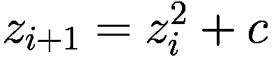
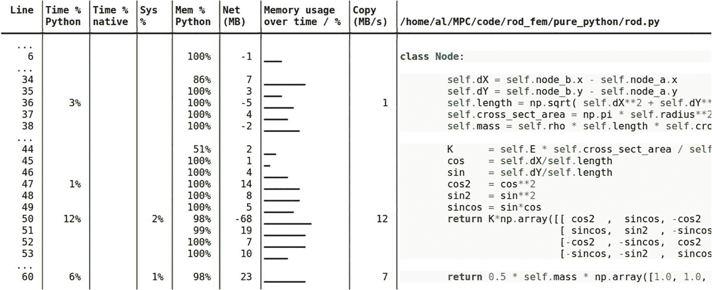
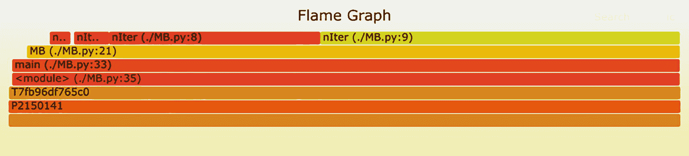
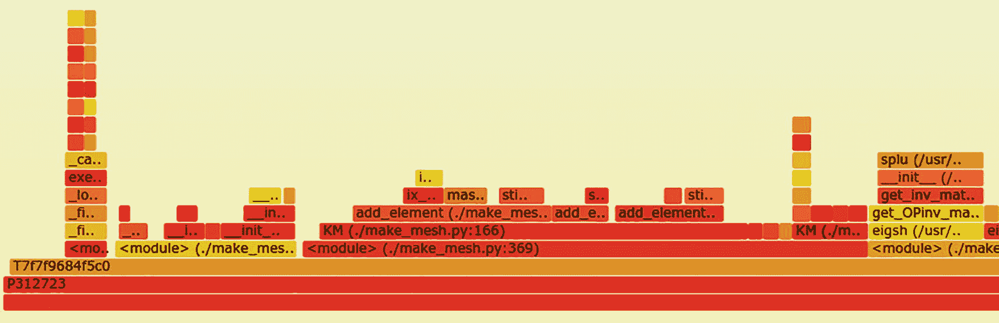
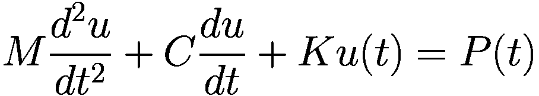
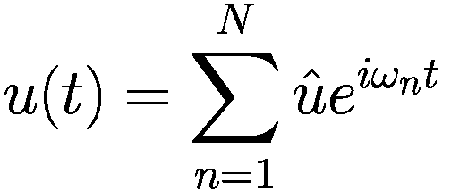
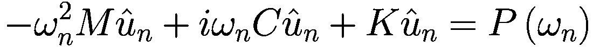
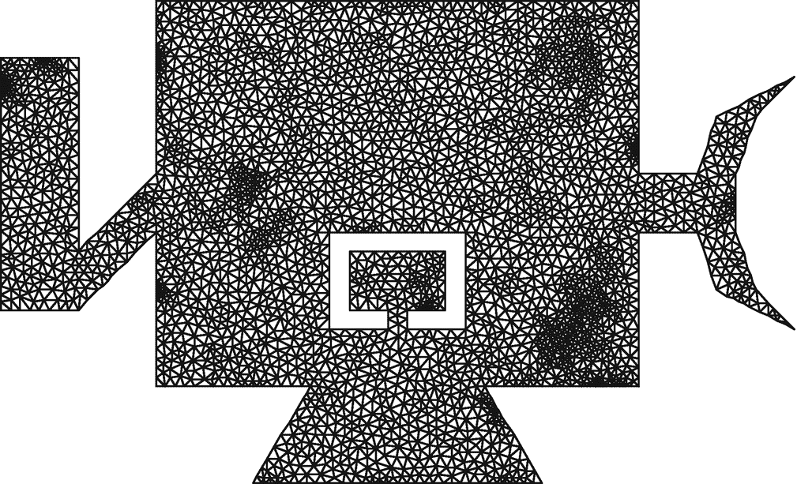
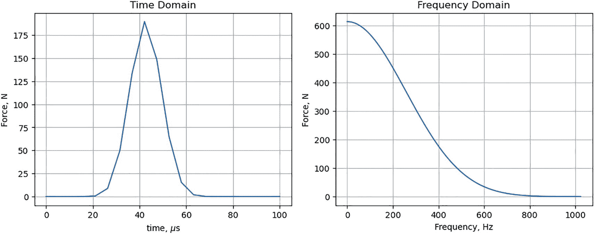

# 14. 高性能计算

从事大规模或长时间数值工作的工程师、科学家和数据分析师总是渴望更快的速度、更多的核心、内存、带宽和存储。就其本质而言，数值模型总能通过更高的分辨率、更精细的离散化以及一切——自由度、时间步长、频率区间、神经元、层数、迭代次数、像素、光线、案例——的丰富性来改进。MATLAB 的很大一部分用户都属于这个对计算能力有强烈需求的人群。MathWorks 投入了大量精力，使其核心客户群能够最大限度地发挥 MATLAB 的性能。因此，性能问题将会引起许多研究 Python 的 MATLAB 用户的兴趣。

在本章中，我们将研究使 Python 代码运行得更快的方法。推而广之，更快的 Python 代码可能意味着更快的 MATLAB 代码，因为 MATLAB 可以调用 Python。编写更快代码的步骤对于高性能计算（HPC）的实践者来说应该很熟悉：

1.  对程序进行性能分析，了解时间消耗在哪里。
2.  尽可能消除冗余的 I/O 并批量处理 I/O 操作。
3.  研究代码中耗时部分的算法复杂度。例如，是否存在可以用 `O(N log N)` 算法替代的 `O(N²)` 步骤？
4.  启用编译器或解释器的优化功能。
5.  将数据组织到连续的内存块中。
6.  将算法中适合向量化的部分实现为向量操作。
7.  调用优化库中的函数（这些库通常用编译型语言编写）。
8.  将工作任务分配到同一台机器的多个核心上。
9.  使用拥有更多核心的硬件（特别是 GPU）。
10. 将工作任务分配到多台机器上。

高性能计算中的一个基本挑战是，步骤 3-10 常常相互冲突，它们的相对收益会随着问题类型、规模和可用计算机硬件的变化而变化。在 GPU 上运行的 `O(N²)` 算法可能比在传统 CPU 上运行的 `O(N log N)` 算法更快，而一个在单台多核计算机上运行的通信密集型并行程序，可能比在多个由慢速网络连接的类似计算机上运行的同一程序还要快。在性能权衡空间中找到一个合适的平衡点，最终归结为你愿意投入多少精力来实现令人满意的速度提升。

## 14.1 提升 Python 代码速度的路径

在前面列出的十个步骤中，我们将重点关注四个具有 Python 特定方面的步骤：

1.  使用 Python 专用工具（如 `Cython`、`Numba` 和 `Pythran`）提升单 CPU 性能。
2.  使用 `multiprocessing`、`Pythran`、`Numba` 或 `Dask` 在多个核心上并行化代码。
3.  用 `C`、`C++` 或 `Fortran` 重写关键代码段，并为其创建 Python 接口模块。
4.  使用 `Dask` 在多台计算机上并行化代码。

正如我们将在本章末尾的实践指南（第 `14.12` 节和第 `14.14` 节）中看到的，MATLAB 程序也可以通过调用加速后的 Python 代码来显著提高运行速度。

## 14.2 参考问题

我们将用两个程序来演示 Python 中的 HPC 技术。第一个程序用于计算曼德勃罗特集合的项，它看起来直截了当，但存在负载均衡方面的问题，使得向量化变得复杂。第二个程序是一个有限元求解器，更接近真实世界的问题。它涉及从数十兆字节的文本数据中加载数据，组装具有一百万个自由度的稀疏质量矩阵和刚度矩阵，并利用它们求解广义特征值问题。代码分布在多个文件和类中。

这些参考程序也使用 MATLAB 进行了实现，以便与 Python 版本进行性能比较。

关于这些问题的最后一点说明是，它们的绝对性能数值并不是特别重要。这些参考问题被用作你希望进行的计算密集型工作的代表。其目的是展示寻找代码慢速部分、加速选项的详细步骤，并比较各种技术及其有效性。

### 14.2.1 曼德勃罗特集合

“曼德勃罗特集合是满足以下条件的模长 ≤ 2 的复数 `c` 的集合：对于函数 `f_c = z² + c`，当从 `z = 0` 开始迭代时，该函数不会发散，即序列 `f_c`, `f_c(f_c)` 等的绝对值保持有界。”^(⁶⁴) 换句话说，如果我们选择一个随机复数 `c`（模长 ≤ 2），并将复数 `z` 初始化为零，那么在第几次迭代 `i` 时，递推式  的值会超过 2？该集合通常被可视化为一个等值线图，其中迭代次数 `i` 是 `z` 的实部和虚部的函数。

虽然这是一个“玩具”问题，但有几个方面使得计算曼德勃罗特集合的项对于说明 HPC 问题很有用：算法易于描述，可以用少量代码实现，可以向量化并轻松并行实现，同时具有不平凡的负载均衡方面，并且可以任意扩大规模。由此产生的迷人图像是一个不错的附加好处。

以下是我们顺序实现的参考代码：

| MATLAB | Python |
|--------|--------|
| `% file: code/hpc/MB_main.m`<br>`main()`<br>**function** `[i]=nIter(c, imax)`<br>&nbsp;&nbsp;&nbsp;&nbsp;`z = complex(0,0);`<br>&nbsp;&nbsp;&nbsp;&nbsp;`for i = 0:imax-1`<br>&nbsp;&nbsp;&nbsp;&nbsp;&nbsp;&nbsp;&nbsp;&nbsp;`z = z*z + c;`<br>&nbsp;&nbsp;&nbsp;&nbsp;&nbsp;&nbsp;&nbsp;&nbsp;`if abs(z) > 2`<br>&nbsp;&nbsp;&nbsp;&nbsp;&nbsp;&nbsp;&nbsp;&nbsp;&nbsp;&nbsp;&nbsp;&nbsp;`break`<br>&nbsp;&nbsp;&nbsp;&nbsp;&nbsp;&nbsp;&nbsp;&nbsp;`end`<br>&nbsp;&nbsp;&nbsp;&nbsp;`end`<br>`end`<br>**function** `[img]=MB(Re,Im,imax)`<br>&nbsp;&nbsp;&nbsp;&nbsp;`nR = size(Im,2);`<br>&nbsp;&nbsp;&nbsp;&nbsp;`nC = size(Re,2);`<br>&nbsp;&nbsp;&nbsp;&nbsp;`img = zeros(nR, nC, ...`<br>&nbsp;&nbsp;&nbsp;&nbsp;&nbsp;&nbsp;&nbsp;&nbsp;&nbsp;&nbsp;&nbsp;&nbsp;&nbsp;&nbsp;`'uint8');`<br>&nbsp;&nbsp;&nbsp;&nbsp;`for i = 1:nR`<br>&nbsp;&nbsp;&nbsp;&nbsp;&nbsp;&nbsp;&nbsp;&nbsp;`for j = 1:nC`<br>&nbsp;&nbsp;&nbsp;&nbsp;&nbsp;&nbsp;&nbsp;&nbsp;&nbsp;&nbsp;`c = complex(Re(j),Im(i));`<br>&nbsp;&nbsp;&nbsp;&nbsp;&nbsp;&nbsp;&nbsp;&nbsp;&nbsp;&nbsp;`img(i,j) = nIter(c,imax);`<br>&nbsp;&nbsp;&nbsp;&nbsp;&nbsp;&nbsp;&nbsp;&nbsp;`end`<br>&nbsp;&nbsp;&nbsp;&nbsp;`end`<br>**end** | `#!/usr/bin/env python3`<br>`# file: code/hpc/MB.py`<br>**import numpy as np**<br>**import time**<br>**def** `nIter(c, imax):`<br>&nbsp;&nbsp;&nbsp;&nbsp;`z = complex(0, 0)`<br>&nbsp;&nbsp;**for** `i` **in** `range(imax):`<br>&nbsp;&nbsp;&nbsp;&nbsp;&nbsp;&nbsp;`z = z*z + c`<br>&nbsp;&nbsp;&nbsp;&nbsp;`if abs(z) > 2:`<br>&nbsp;&nbsp;&nbsp;&nbsp;&nbsp;&nbsp;`break`<br>&nbsp;&nbsp;&nbsp;&nbsp;`return np.uint8(i)`<br>**def** `MB(Re, Im, imax):`<br>&nbsp;&nbsp;&nbsp;&nbsp;`nR = len(Im)`<br>&nbsp;&nbsp;&nbsp;&nbsp;`nC = len(Re)`<br>&nbsp;&nbsp;&nbsp;&nbsp;`img = np.zeros((nR, nC),`<br>&nbsp;&nbsp;&nbsp;&nbsp;&nbsp;&nbsp;&nbsp;&nbsp;&nbsp;&nbsp;&nbsp;&nbsp;`dtype=np.uint8)`<br>&nbsp;&nbsp;**for** `i` **in** `range(nR):`<br>&nbsp;&nbsp;&nbsp;&nbsp;**for** `j` **in** `range(nC):`<br>&nbsp;&nbsp;&nbsp;&nbsp;&nbsp;&nbsp;`c = complex(Re[j],Im[i])`<br>&nbsp;&nbsp;&nbsp;&nbsp;&nbsp;&nbsp;`img[i,j] = nIter(c,imax)`<br>&nbsp;&nbsp;**return** `img` |
| **function** `[] = main()`<br>&nbsp;&nbsp;&nbsp;&nbsp;`imax = 255;`<br>&nbsp;&nbsp;&nbsp;&nbsp;`for N = [500 1000 2000 5000]`<br>&nbsp;&nbsp;&nbsp;&nbsp;&nbsp;&nbsp;&nbsp;&nbsp;`tic`<br>&nbsp;&nbsp;&nbsp;&nbsp;&nbsp;&nbsp;&nbsp;&nbsp;`nR = N; nC = N;`<br>&nbsp;&nbsp;&nbsp;&nbsp;&nbsp;&nbsp;&nbsp;&nbsp;`Re = linspace(-0.7440,...`<br>&nbsp;&nbsp;&nbsp;&nbsp;&nbsp;&nbsp;&nbsp;&nbsp;&nbsp;&nbsp;&nbsp;&nbsp;&nbsp;&nbsp;&nbsp;&nbsp;&nbsp;&nbsp;-0.7433, nC);`<br>&nbsp;&nbsp;&nbsp;&nbsp;&nbsp;&nbsp;&nbsp;&nbsp;`Im = linspace( 0.1315,...`<br>&nbsp;&nbsp;&nbsp;&nbsp;&nbsp;&nbsp;&nbsp;&nbsp;&nbsp;&nbsp;&nbsp;&nbsp;&nbsp;&nbsp;&nbsp;&nbsp;&nbsp;&nbsp;0.1322, nR);`<br>&nbsp;&nbsp;&nbsp;&nbsp;&nbsp;&nbsp;&nbsp;&nbsp;`img = MB(Re, Im, imax);`<br>&nbsp;&nbsp;&nbsp;&nbsp;&nbsp;&nbsp;&nbsp;&nbsp;`fprintf('%5d %.3f\n',N,toc);`<br>&nbsp;&nbsp;&nbsp;&nbsp;`end`<br>`end` | **def** `main():`<br>&nbsp;&nbsp;&nbsp;&nbsp;`imax = 255`<br>&nbsp;&nbsp;**for** `N` **in** `[500,1000,2000,5000]:`<br>&nbsp;&nbsp;&nbsp;&nbsp;`T_s = time.time()`<br>&nbsp;&nbsp;&nbsp;&nbsp;`nR, nC = N, N`<br>&nbsp;&nbsp;&nbsp;&nbsp;`Re = np.linspace(-0.7440,`<br>&nbsp;&nbsp;&nbsp;&nbsp;&nbsp;&nbsp;&nbsp;&nbsp;&nbsp;&nbsp;&nbsp;&nbsp;&nbsp;&nbsp;&nbsp;&nbsp;`-0.7433, nC)`<br>&nbsp;&nbsp;&nbsp;&nbsp;`Im = np.linspace( 0.1315,`<br>&nbsp;&nbsp;&nbsp;&nbsp;&nbsp;&nbsp;&nbsp;&nbsp;&nbsp;&nbsp;&nbsp;&nbsp;&nbsp;&nbsp;&nbsp;&nbsp;`0.1322, nR)`<br>&nbsp;&nbsp;&nbsp;&nbsp;`img = MB(Re, Im, imax)`<br>&nbsp;&nbsp;&nbsp;&nbsp;`print(N, time.time() - T_s)`<br>**if** `__name__ == '__main__': main()` |

### 14.2.2 二维有限元求解器

Python 有许多优秀的有限元（FE）软件包。工业级应用包括 `deal.II`^(⁶⁵)、`FEniCS`^(⁶⁶)、`SfePy`^(⁶⁷) 和 `Code-Aster`^(⁶⁸)。这些都是由众多领域专家开发的大型项目，拥有数十万行源代码。

毋庸置疑，我们的第二个代表性程序只是这些高级程序的一个缩影。尽管我们的有限元求解器只实现了二维杆单元（基本上是线性弹簧），但它所执行的操作代表了许多有限元代码。我们的程序

1.  读取由 `triangle` [4] 程序创建的三角形单元和二维节点坐标的文本文件
2.  根据三角形边创建杆单元
3.  计算每个杆单元的刚度矩阵和质量矩阵，然后将它们插入到稀疏的全局刚度矩阵和质量矩阵 `K` 和 `M` 中
4.  通过求解广义特征值问题 `K[x] = λM[x]` 来计算无约束模型的振动模态

步骤 3 中生成的 `K` 异常稀疏；一个典型的由 `triangle` 输出导出的杆单元网格，每行或每列平均只有 14 个非零项。`M` 是一个对角矩阵。因此，拥有 8 GB 内存的计算机可以很容易地处理具有一百万个自由度的模型。Python 和 MATLAB 有限元源文件的名称见附录 C；源文件本身可在本书的 Github 仓库中找到。^(⁶⁹)

有限元求解器接受由 `triangle` 创建的任何二维网格。`triangle` 程序本身读取一个文本文件，该文件定义了待划分网格形状的外部（以及内部，如果有孔洞的话）边界。该输入文件，保存为

`beam.poly`

# beam.poly

file: `beam.poly`

# 一个尺寸为 10 x 1 的矩形。

4 2 0 0    # 四个顶点，二维

# 节点 ID   X    Y

```
1      0    0
2     10    0
3     10    1
4      0    1
4 0 # 四条边界线段，无标记
```

# 边界 ID   节点 A   节点 B

| 边界 ID | 节点 A | 节点 B |
| :---: | :---: | :---: |
| 1 | 1 | 2 |
| 2 | 2 | 3 |
| 3 | 3 | 4 |
| 4 | 4 | 1 |

# 无孔洞

定义了一个 10 x 1 的矩形。以下是调用 `triangle` 可执行文件与 `beam.poly` 的命令行，用于创建五对 `beam.*.ele` 和 `beam.*.node` 文件，分辨率依次提高：

```
> triangle -pq34a.2 beam        # -> beam.1.ele, beam.1.node

> triangle -rpq34a.02 beam.1    # -> beam.2.ele, beam.2.node

> triangle -rpq34a.002 beam.2   # -> beam.3.ele, beam.3.node

> triangle -rpq34a.0002 beam.3  # -> beam.4.ele, beam.4.node

> triangle -rpq34a.00002 beam.4 # -> beam.5.ele, beam.5.node
```

例如，来自 `beam.2.ele` 和 `beam.2.node` 的网格如下图所示：


最后一对文件 `beam.5.ele` 和 `beam.5.node` 分别为 32 MB 和 28 MB，定义了一个具有超过一百万个自由度的网格。

## 14.3 参考硬件与操作系统

本章余下部分用于基准测试的硬件、操作系统以及 MATLAB 和 Python 版本如下：

*   2015 款 Dell XPS13 笔记本电脑
*   4 核 i5-5200U CPU @ 2.2 GHz
*   8 GB 内存
*   Ubuntu 20.04
*   MATLAB 2020b
*   Anaconda Python 2020.07

虽然 Python 代码可以轻松运行在更快的云托管硬件上，但 MATLAB 代码由于许可证限制，只能绑定到这台机器上。

## 14.4 基准性能

第 14.5.2 节和附录 C 中所示的参考程序的性能，针对各种问题规模显示如下。

### 14.4.1 曼德勃罗特集合性能

MATLAB 在这个问题上表现良好，其运行速度比 Python 版本快三倍。表 14-1 显示了各种 *N* × *N* 图像尺寸的耗时。*N* 的较大值可能看起来有些过头，但一旦我们开始应用优化技术，它们的包含就会变得显而易见。

**表 14-1** 原始 Mandelbrot 程序的执行时间（秒）

| *N*   | MATLAB | Python |
|-------|--------|--------|
| 500   | 1.3    | 4.2    |
| 1000  | 4.4    | 17.1   |
| 2000  | 17.7   | 67.4   |
| 5000  | 112.5  | 420.0  |

### 14.4.2 有限元求解器性能

第 14.2.2 节所述的有限元求解器的四个阶段执行的操作截然不同。第一阶段，从文件加载模型数据，属于 I/O 密集型。第二阶段，根据三角形连接创建杆单元连接数据，纯粹是指针操作。

第三阶段结合了单元矩阵生成和稀疏矩阵创建的浮点运算。最后阶段，计算稀疏矩阵的最小六个特征值及其对应的特征向量，主要由浮点运算主导。

表 14-2 显示了每个阶段的时间消耗和峰值内存结果。整个运行过程中的峰值内存使用情况，通过在 Linux 上使用 GNU Time，以命令 `/usr/bin/time -v` 后接 Python 程序或 `matlab` 命令来捕获，然后在 Python 程序结束或 MATLAB 会话关闭后，从其结果中获取 `最大常驻集大小 (kbytes)` 的值。

**表 14-2** 基线有限元求解器的 CPU 时间和内存使用情况

| 模型  | 自由度      | 阶段             | MATLAB          | Python          |
|-------|-------------|------------------|-----------------|-----------------|
|       |             |                  | 秒    | 峰值 GB | 秒    | 峰值 GB |
| beam.4| 99,324      | 读取文件         | 5.0   |         | 0.4   |         |
|       |             | 三角形 → 杆      | 8.2   |         | 2.1   |         |
|       |             | 组装 `K`, `M` | 6.8 |         | 6.5   |         |
|       |             | 特征值求解       | 2.9   |         | 2.5   |         |
|       |             | 总计             | 22.9  | 1.0     | 11.9  | 0.5     |
| beam.5| 1,025,250   | 读取文件         | 48.4  |         | 4.1   |         |
|       |             | 三角形 → 杆      | 84.6  |         | 26.5  |         |
|       |             | 组装 `K`, `M` | 70.0 |         | 68.9  |         |
|       |             | 特征值求解       | 43.9  |         | 55.4  |         |
|       |             | 总计             | 240.2 | 7.1     | 157.1 | 5.4     |

Python 代码在前三个阶段以及总求解时间上均优于 MATLAB，但 MATLAB 的特征值求解明显更快。特别是从文本文件读取模型数据，Python 比 MATLAB 快十倍。Python 使用的内存也远少于 MATLAB。

## 14.5 分析 Python 代码

任何性能提升尝试的第一步都是测量代码的缓慢之处。有时，这些位置很明显，可以在关键位置包裹简单的计时代码（如前面 FE 求解器所做的那样），以评估后续代码优化的有效性。然而，对于细粒度的结果，我们需要额外的分析工具。

标准 Python 库包含两个模块，`cProfile` 和 `profile`，它们以确定性的方式（相对于统计性的，后者不太精确）测量对各个 Python 函数的调用次数和花费的时间。结果以表格文本形式呈现。标准分析工具有三个缺点：

1.  结果粗糙；分辨率在函数级别。这掩盖了单个性能瓶颈行。
2.  对于大型程序，文本表格可能难以解读。
3.  仅分析 CPU 使用情况；没有分析内存使用情况的选项。

Python IDE（如 Spyder 和 PyCharm）与 MATLAB 的 IDE 一样，具有集成的分析功能，但 Python 版本基于 `cProfile`，因此仅提供函数级别的分辨率。MATLAB 的 IDE 可以显示单行代码的分析结果。逐行结果对于性能调优至关重要，因此我们转向不随 Anaconda 附带且必须单独安装的工具。

### 14.5.1 Scalene

Scalene [1] 是一个低开销的采样分析器，它还能额外报告 GPU 使用情况（如果检测到 GPU）、内存复制指标和内存消耗——所有这些都在逐行级别上进行。Scalene 在 Python 代码分析工具中因其几个原因而独树一帜。其主要杀手级特性是，它将每一行的 CPU 结果细分为纯 Python 时间、底层编译库（称为“本机”时间）所花费的时间以及系统时间（用于 I/O 和与代码无关的操作）。这种分离有助于回答关于如何处理慢速代码行的隐含问题。如果大部分时间花在纯 Python 上，则可能有办法重写代码以调用更快的库函数。另一方面，如果大部分时间被底层库或系统占用，则改进的机会可能较小。Scalene 也适用于多线程和多进程。

以下命令用于分析 Mandelbrot 程序：

```
> scalene ./MB.py
```

其输出如下：

```
Memory usage: =======#####==== (max: 117.00MB)

./MB.py: % of time =  99.58% out of  27.70s.

Line |Time % |Time %  |Sys |Mem %  |Net   |Memory usage  |Copy   |

|Python |native  |%   |Python |(MB)  |over time / % |(MB/s) |./MB.py
```

# 文档排版处理结果


-------+-------+--------+----+-------+------+--------------+-------+----------------------

1 |       |        |    |       |      |              |       |#!/usr/bin/env python3

2 |       |        |    |       |      |              |       |# code/hpc/MB.py

3 |       |        |    |       |      |              |       |import numpy as np

4 |       |        |    |       |      |              |       |import time

5 |       |        |    |  100% |    3 |---           |       |def nIter(c, imax):

6 |    1% |        |    |  100% |   47 |-----         |       |  z = complex(0, 0)

7 |    6% |        |    |   99% |   46 |----          |       |  for i in range(imax):

8 |   43% |     1% |    |  100% | 3609 |===== 95%     |       |    z = z*z + c

9 |   44% |     1% |    |  100% |-3608 |--------      |       |    if abs(z) > 2:

10 |       |        |    |       |  -57 |              |       |      break

11 |       |        |    |       |      |              |       |  return i

[... lines truncated...]

显示第 8 行和第 9 行是热点，消耗了近 90% 的求解时间。另一方面，内存结果则反直觉，因为峰值使用发生在仅对复数标量进行乘法和加法运算的行上。

默认情况下，`scalene`会打印每个源文件中的每一行，无论其贡献是否显著。这对于大型程序来说显然过于冗长；在这种情况下，可以使用`--reduced-profile`来修剪输出。结果也可以输出到`HTML`文件以简化浏览：

```
> scalene --html --outfile profile.html --reduced-profile make_mesh.py
```

`profile.html`中显示了单行最昂贵的代码（占总体 CPU 时间的 12%，用于返回单元刚度矩阵）的部分，在浏览器中看起来像这样：



有趣的是，`scalene`的结果表明时间花费在了复制内存上，而不是执行计算上。

### 14.5.2 Austin 和 FlameGraph

`Austin`是另一种采样分析器。与`scalene`一样，它开销极低，无需修改被分析的代码，并且可以将结果发送到`FlameGraph`等其他指标工具进行图形化显示。（`MATLAB`的分析器也能将时序结果以火焰图形式显示，不过使用的是石板灰配色方案，而非红色/橙色/黄色。）

`FlameGraph`垂直展示调用栈，主程序位于底部。每个条形的宽度表示在 MATLAB 的某个特定函数或使用`austin`分析的某行代码上所花费的时间；代码热点会显示为最宽的条形。条形的左右排列是任意的，并不表示时间顺序执行顺序。条形的颜色也是任意的。垂直排列具有意义：一个条形所代表的代码会调用其正上方条形中的代码。最底部的条形自然是最宽的，因为它代表程序的主函数入口点。可识别的函数名称通常出现在从底部数起的第三或第四个条形中。

与`scalene`类似，`austin`从命令行调用。主要参数包括微秒单位的采样间隔以及要运行的 Python 程序（及参数）。输出可以直接写入文件，或者通过管道传递给`FlameGraph`。`FlameGraph`本身是一个命令行程序，它接受诸如显示结果的最小分辨率以及时序结果所采用的单位等参数。以下命令对*N* = 1000 的曼德博集合程序进行分析，每 50 *μ*s 采集一次样本：

```
> austin -a -i 50 ./MB.py | flamegraph.pl --minwidth 10 --countname=us > flame.svg
```

`FlameGraph`的`--minwidth 10`开关排除了那些会使条形宽度小于 10 像素的条目。没有这个参数，图表会充斥着贡献微小、难以解读的条目。提高或降低这个像素宽度值，可以得到你感兴趣的解析度等级。`FlameGraph`的输出是一个可以通过网页浏览器查看的 `SVG`文件。图中



显示大部分计算时间花费在第 8 行和第 9 行的`nIter()`函数中。回顾第 14.2.1 节，`nIter()`的实现为：

Python:

```python
5   def nIter(c, imax):
6     z = complex(0, 0)
7     for i in range(imax):
8       z = z*z + c
9       if abs(z) > 2:
10         break
11     return i
```

第 8 行和第 9 行的计算工作发生在语句`z = z*z + c`和`if abs(z) > 2`中。对`beam.4`算例的有限元求解器运行相同的分析命令，则会产生更复杂的图表。



与曼德博集合的结果不同，这里没有明显的性能瓶颈。`FlameGraph`显示大部分执行时间发生在`make_model.py`的第 369 行，该行创建了全局质量矩阵和刚度矩阵：

```python
368 T_s = default_timer()
369 K,M = m.KM()
370 T_e = default_timer()
371 print(f'[K], [M] creation {m.nDof} dof : {T_e-T_s:.6f} s')
```

在调用栈中深入一层，`.KM()`方法内的第 166 行是一个耗时点：

```python
163       # sparse K in COO (coordinate) form
164       I, J, kV = [], [], []
165       for eid in self.elem:
166           self.add_element(eid, kV, I, J, M)
```

## 14.6 使用`multiprocessing`进行多核计算

Python 有一个`threading`模块，这让人相信它可以将工作分叉到多个线程。它可以做到，但这仅对于等待进行的 I/O 事件有效。通过这种方式提交的通用计算会被阻塞，以至于一次只运行一个线程，这使得它对非 I/O 任务毫无意义。要在计算机的多个核上同时运行任意代码，你需要使用 Python 的另一个标准模块`multiprocessing`。

使用`multiprocessing`的最常见方式是建立一个工作进程池（通常是你想要运行的核数），然后将需要并行运行的函数提交到该进程池。以下代码展示了使用`multiprocessing`在三个核上运行曼德博集合计算的一种方法。工作通过以步长方式遍历`Im`数组的行来在各个核之间细分，步长等于我们将使用的核数。在我们的例子中，我们将设置`n_workers = 3`，这样进程 0 获取第 0、3、6…行；进程 1 获取第 1、4、7…行；以此类推；这是通过`Im_subset = Im[i::n_workers]`这一行完成的。高亮显示的代码显示了为使用`multiprocessing`模块而应用的代码修改：

Python:

```python
1   #!/usr/bin/env python3
2   # code/hpc/MB_multi.py
3   import numpy as np
4   import time
5   from multiprocessing import Pool
6   def nIter(c, imax):
7     z = complex(0, 0)
8     for i in range(imax):
9       z = z*z + c
10       if abs(z) > 2:
11         break
```


```python
12     return np.uint8(i)

14   def MB(Re, Im, imax):

15     nR = len(Im)

16     nC = len(Re)

17     img = np.zeros((nR, nC), dtype=np.uint8)

18     for i,I in enumerate(Im):

19       for j,R in enumerate(Re):

20         c = complex(R, I)

21         img[i, j] = nIter(c, imax)

22     return img

24   def main():

25     imax = 255

26     for N in [500, 1000, 2000, 5000 ]:

27       T_s = time.time()

28       nR, nC = N, N

29       Re = np.linspace(-0.7440, -0.7433, nC)

30       Im = np.linspace( 0.1315,  0.1322, nR)

31       n_workers = 3

32       img = np.zeros((nR, nC), dtype=np.uint8)

33       with Pool(n_workers) as pool:

34           results = []

35           for i in range(n_workers):

36               Im_subset = Im[i::n_workers]

37               results.append( pool.apply_async(

38                       MB, (Re, Im_subset, imax,)) )

39           for i,R in enumerate(results):

40               img[i::n_workers, :] = R.get()

41       print(N, time.time() - T_s)

42   if __name__ == '__main__': main()
```

第 35–38 行的循环很快就完成了，因为这些函数是异步提交给工作进程池的。只有在第 40 行为每个提交的函数调用`.get()`方法时，多核上的计算才会开始。

尽管`multiprocessing`忠实地让三个核保持忙碌，每个核处理总任务的三分之一，但表 14-3 显示对于这个问题，其性能并不令人振奋。

**表 14-3** *标量与向量化曼德博集合实现方式的执行时间（秒）*

| N | MATLAB 单核 | Python 单核 | Python `multiprocessing` + 3 核 |
|---|---|---|---|
| 500 | 1.6 | 4.2 | 3.0 |
| 1000 | 5.8 | 17.1 | 11.4 |
| 2000 | 23.2 | 67.4 | 41.6 |
| 5000 | 145.1 | 420.0 | 250.0 |

前方有更好的选择，因此为了节省篇幅，我将从未来的基准测试结果中省略`multiprocessing`的结果。

## 14.7 向量化

对于 MATLAB 和 NumPy 而言，一种广为人知的优化技术是编写向量化代码——即对整个矩阵而非其索引项执行操作的代码。当矩阵中的所有项都需要执行相同的操作集时，与使用显式循环的标量代码相比，向量化通常能带来 10 倍到 60 倍的性能提升。

曼德勃罗集的一个有趣特征是，其计算量在解域内变化很大。向量化是否能提升性能尚不明确，因为收敛最慢的项决定了整个区域的计算速度。唯一确定的方法是实现向量形式的解法，然后比较性能。

以下向量解法大量使用了布尔索引掩码（第 11.​1.​14 节）。`Idx` 标识仍在积极更新的项，`New` 是在当前迭代中已收敛的项的集合。每次迭代结束时都会更新 `Idx`，以便将新收敛的项从后续细化中移除。只有当没有新项需要更新时，解法才算完成。

MATLAB：

```
% file: code/hpc/MB_vectorized.m

main()

function [img]=nIter(c, imax)

[nR,nC]= size(c);

z = complex(zeros(nR,nC), ...

             zeros(nR,nC));

img = zeros(nR,nC,'uint8');

Idx = ones(nR,nC,'logical');

for i = 0:imax-1

    z(Idx) = z(Idx).*z(Idx)+ ...

           + c(Idx);

    New = (real(z).²+ ...

           imag(z).² <= 4);

    if ~any(New,'all')

        break

    end

    img(New) = i;

    Idx = Idx & New;

end

end

function [] = main()

imax = 255;

for N = [500 1000 2000 5000]

    tic

    nR = N; nC = N;

    Re = linspace(-0.7440,...

                  -0.7433, nC);

    Im = linspace( 0.1315,...

                   0.1322, nR);

    [zR, zI] = meshgrid(Re,Im);

    z_init = complex(zR,zI);

    img = nIter(z_init, imax);

    fprintf('%5d %.3f\n',N,toc);

end

end
```

Python：

```
#!/usr/bin/env python3
```

# 第14章 性能

## 14.8 Cython

### 性能结果（表 14-4）

```python
# file: code/hpc/MB_vectorized.py

import numpy as np

import time

def nIter(c, imax):

nR,nC = c.shape

z = np.zeros_like(c)

img = np.zeros(z.shape,
               dtype=np.uint8)

Idx = np.ones(z.shape,
              dtype=np.bool )

  for i in
range(imax):

z[Idx] = z[Idx]*z[Idx] + \
         c[Idx]

New = (z.real**2 +
       z.imag**2 <= 4) \
      .reshape(nR,nC)

    if not np.any(New):
      break

img[New] = i

Idx *= New

  return img

def main():

imax = 255

  for N in
[500,1000,2000,5000]:

T_s = time.time()

nR, nC = N, N

Re = np.linspace(-0.7440,
                 -0.7433, nC)

Im = np.linspace( 0.1315,
                   0.1322, nR)

zR,zI = np.meshgrid(Re,Im)

z_init = zR + zI*(1j)

img = nIter(z_init, imax)

print(N, time.time() - T_s)

if __name__ == '__main__': main()

```

性能结果很有意思；向量化对 `MATLAB` 没有影响，但在 `Python` 中带来了 3 倍的加速。令人失望的是，`Linux` 上的 `MATLAB` 2020b 在计算 `N` = 5000 的解时崩溃了。

**表 14-4：** 标量与向量曼德勃罗实现执行时间（秒）

| `N` | `MATLAB` 标量 | `MATLAB` 向量 | `Python` 标量 | `Python` 向量 |
|---|---|---|---|---|
| 500 | 1.6 | 1.7 | 4.2 | 1.3 |
| 1000 | 5.8 | 5.7 | 17.1 | 4.7 |
| 2000 | 23.2 | 24.6 | 67.4 | 19.3 |
| 5000 | 145.1 | 崩溃 | 420.0 | 184.4 |

### Cython

`Cython`⁷³ 是一个 `Python` 到 `C` 的编译器。虽然它没有实现完整的 `Python` 语言，但未实现的功能会按常规方式解释执行，只是不进行编译。

`Cython` 拥有两种强大的能力，可以使 `Python` 代码运行得更快。它能够：

*   将部分 `Python` 代码转换为 `C`，然后将 `C` 编译成优化的共享对象，该对象可作为 `Python` 模块加载。
*   提供一个接口层，使得调用原生 `C` 和 `C++` 库变得简单直接。

#### 使用 Cython 编译的 Python

使用 `Cython` 生成编译后的 `Python` 模块需要四个步骤：

1.  将你希望编译的现有 `Python` 源文件中的函数复制到以 `.pyx`（而非 `.py`）结尾的新文件中。包含 `main()` 的文件不会被编译，且必须保留在 `.py` 文件中。
2.  在 `.pyx` 文件中，对希望提升速度的 `Python` 变量添加 `C` 语言类型注解。如果你的代码使用了 `NumPy`，还需添加一行与 `NumPy` `import` 对应的 `cimport` 语句。
3.  创建一个设置文件（一个小的 `Python` 程序），告诉 `Cython` 需要编译哪些 `.pyx` 文件，并可选择指定要使用的编译器以及编译和链接标志。
4.  运行设置文件来编译你的代码。

以曼德勃罗集程序为例，前两个步骤通过左侧原始代码（不包括 `main()`）与右侧灰色显示的 `Cython` 增强代码的并排对比来展示。

| `Python`，基线版本： | `Python`，含 `Cython` 注解： |
| --- | --- |
| `1` `#!/usr/bin/env python3`<br>`2` `# cython/mb/MB_orig.py`<br>`3`<br>`4` `import numpy as np`<br>`5` `import time`<br>`6` `def nIter(c, imax):`<br>`7`<br>`8`<br>`9`<br>`10` `z = complex(0, 0)`<br>`11` `for i in range(imax):`<br>`12` `z = z*z + c`<br>`13` `if abs(z) > 2:`<br>`14` `break`<br>`15` `return i`<br>`16`<br>`17` `def MB(Re, Im, imax):`<br>`18`<br>`19`<br>`20`<br>`21` `nR = len(Im)`<br>`22` `nC = len(Re)`<br>`23` `img = np.zeros((nR, nC))`<br>`24` `for i,I in enumerate(Im):`<br>`25` `for j,R in enumerate(Re):`<br>`26` `c = complex(R, I)`<br>`27` `img[i, j] = nIter(c, imax)`<br>`28` `return img` | `1` `#  cython/mb/MB_cython.pyx`<br>`2` `cimport numpy as np`<br>`3` `import numpy as np`<br>`4` `import time`<br>`5` `def nIter(double complex c,`<br>`6` `long imax):`<br>`7` `cdef int i`<br>`8` `cdef double complex z`<br>`9` `z = complex(0, 0)`<br>`10` `for i in range(imax):`<br>`11` `z = z*z + c`<br>`12` `if z.real*z.real + z.imag*z.imag > 4:`<br>`13` `break`<br>`14` `return i`<br>`15`<br>`16` `def MB(Re, Im, imax):`<br>`17` `cdef int i,j`<br>`18` `cdef double I, R`<br>`19` `cdef double complex c`<br>`20` `nR = len(Im)`<br>`21` `nC = len(Re)`<br>`22` `img = np.zeros((nR, nC), dtype=np.uint8)`<br>`23` `for i,I in enumerate(Im):`<br>`24` `for j,R in enumerate(Re):`<br>`25` `c = complex(R, I)`<br>`26` `img[i, j] = nIter(c, imax)`<br>`27` `return img` |

适用于第三步的设置文件如下所示：

```python
```

# file: `cython/mb/cython_setup.py`

```python
import os

from setuptools import setup

from Cython.Build import cythonize

import numpy

os.environ['CFLAGS'] = '-Ofast'

setup(
    ext_modules=cythonize("MB_cython.pyx"),
    include_dirs=[numpy.get_include()]
)
```

最后，运行此设置文件来编译代码：
```
python cython_setup.py build_ext --inplace
```

一次典型的调用会产生警告、新的 C 源文件，并希望最终生成一个以 `.pyx` 文件命名的共享对象。在我的 Linux 机器上，共享对象是 `MB_cython.cpython-38-x86_64-linux-gnu.so`。尽管名称很长，但在 Python 中通过 `import MB_cython` 即可导入。我们这番努力获得了什么？一个小型驱动程序加载编译后的模块并运行案例：

```python
#!/usr/bin/env python3
```

# cython/mb/main2.py

```
from MB_cython import MB

import numpy as np

import time

max_iter = 255

nR, nC = 1000, 1000

Re = np.linspace(-0.7440, -0.7433, nC)

Im = np.linspace( 0.1315,  0.1322, nR)

T_s = time.time()

image = MB(Re, Im, max_iter)

print(f'Cython time = {time.time() - T_s:.3f} sec')
```

对于 `N` = 1000 的情况，运行时间从 17.1 秒骤降至仅 1.85 秒。原始 Python 代码比 MATLAB 慢 3 倍，但经过 Cython 增强，Python 的速度反而快了 3 倍。

我们还能做得更好。回顾第[14.5.1]节和第[14.5.2]节的性能分析工作，结果显示`if abs(z) > 2:`是热点。复数的`abs()`函数会计算其模长，即实部和虚部平方和的平方根。由于这一行消耗了大量时间，我们应通过仅测试平方和来绕过平方根运算。这可以通过将左侧原代码的第 13 行修改为右侧优化后的代码来实现：

```
13   if abs(z) > 2:
```

```
13   if z.real**2 + z.imag**2 > 4:
```

这一行代码的优化将 `N` = 1000 时 Python+Cython 的时间从 1.85 秒减少到 1.01 秒，而 MATLAB 在等效修改后的时间从 5.8 秒减少到 4.4 秒。

### 14.8.2 使用 Cython 实现并行 `for` 循环

MATLAB 核心产品不包含 `parfor` 并行 `for` 循环命令——该功能仅在 MATLAB Coder 或并行计算工具箱中提供。因此，本书中的 MATLAB 实现仅限于串行 `for` 循环。

Cython 有一个 `prange()` 函数，允许编写并行 `for` 循环。在底层，这个 `prange()` 函数是通过 OpenMP 实现的，因此继承了 OpenMP 的限制。Cython 文档展示了一些简单的并行 `for` 循环示例，但在实践中，非平凡的循环需要大量的代码调整才能克服诸如“Indexing Python object not allowed without gil”、“Constructing Python tuple not allowed without gil”和“Coercion from Python not allowed without the GIL”等编译错误。

除非你的代码段包含基本的 `for` 循环，否则你将要么需要花费大量时间研读 Cython 文档，要么避免使用其 `prange()` 函数。第[14.9]节和第[14.10.1]节中描述的用于并行 `for` 循环的 Pythran 和 Numba 选项要容易得多。

### 14.8.3 Cython 性能

在 MATLAB 和 Python+Cython 实现中将 `abs(z)` 替换为 `z.real**2 + z.imag**2` 后，我们更新的性能如表[14-5]所示。

**表 14-5** Mandelbrot 程序的执行时间（秒）

| `N` | MATLAB | Python 基线 | Python+Cython |
| --- | --- | --- | --- |
| 500 | 1.3 | 4.2 | 0.25 |
| 1000 | 4.4 | 17.1 | 1.01 |
| 2000 | 17.7 | 67.4 | 4.03 |
| 5000 | 112.5 | 420.0 | 25.18 |

## 14.9 Pythran

Pythran [3] 与 Cython 类似，它从一个包含简单注释的 Python 函数文件创建一个编译后的二进制模块。与 Cython 相比，其主要优势在于所需的代码修改完全作为源代码注释实现。这意味着经过 Pythran 增强的代码是纯 Python 代码；即使在没有 Pythran 编译器的系统上，该代码也能以相同的方式运行，只是速度会慢一些。另一个优势是使用 OpenMP 进行 `for` 循环并行化很容易实现。

与 Cython 相比，Pythran 也存在一些劣势：Pythran 支持的 Python 子集比 Cython 小。某些语句如 `with` 完全不支持，其他一些语句如 f-string 支持有限。另一个缺点（截至 2021 年底）是该项目的文档网站缺乏足够的示例。为了全面了解 `#pythran` 指令可以采取的不同形式，最好的办法是下载项目的源代码，然后研究 `pythran/tests/cases` 中的许多示例。

### 14.9.1 签名注释示例

用于声明以下函数 `Fn()` 参数的 Pythran `#pythran export Fn` 指令能够理解下表中列出的数据类型。当左列包含“or”时，Pythran 编译器将推断出所需的类型。类似地，“string or int”表示该函数将在给定位置接受字符串或整数参数。

**表 14-6** Pythran 函数签名类型

| 标量类型或数据容器 | Pythran 类型指定 |
| --- | --- |
| 字符串 | `str` |
| 布尔 | `bool` |
| 无符号 8 位整数 | `uint8` |
| 无符号 16 位整数 | `uint16` |
| 无符号 32 位整数 | `uint32` |
| 无符号 64 位整数 | `uint64` |
| 32 或 64 位整数 | `int` |
| 字符串 *或* 整数 | `str or int` |
| 8 位整数 | `int8` |
| 16 位整数 | `int16` |
| 32 位整数 | `int32` |
| 64 位整数 | `int64` |
| 32 或 64 位浮点 | `float` |
| 32 位浮点 | `float32` |
| 64 或 128 位复数 | `complex` |
| 128 位复数 | `complex128` |
| 整数列表 | `int list` |
| 整数列表的列表 | `int list list` |
| 浮点列表 | `float list` |
| 1D 数组整数 | `int[]` 或 `int[:]` |
| 1D 数组浮点 | `float[]` 或 `float[:]` |
| 2D 数组整数 | `int[][]` 或 `int[:,:]` |
| 2D 数组浮点 | `float[][]` 或 `float[:,:]` |
| 字符串到整数的字典 | `str : int dict` |
| 两个整数的元组 | `(int, int)` |

因此，对于接受一个字符串、一个整数列表和一个 32 位浮点 2D 数组的函数 `Fn()`，其定义前的注释行应为：

```
#pythran export Fn(str, int list, float32[][])
```

### 14.9.2 使用 Pythran 编译的 Python；并行 `for` 循环

与 Cython 一样，Mandelbrot 函数 `nIter()` 和 `MB()` 被分离到自己的文件中进行编译。只需要三个注释行就能让 Pythran 编译我们的代码：

```

# pythran/mb/MB_pythran.py

import numpy as np

#pythran export nIter(complex, int)

def nIter(c, imax):

    z = complex(0, 0)

    for i in range(imax):

        z = z*z + c

        if abs(z) > 2:

            break

    return np.uint8(i)

#pythran export MB(float [], float [], int)

def MB(Re, Im, imax):

    nR = Im.shape[0]

    nC = Re.shape[0]

    img = np.zeros((nR, nC), dtype=np.uint8)

    #omp parallel for

    for i, I in enumerate(Im):

        for j, R in enumerate(Re):

            c = complex(R, I)

            img[i, j] = nIter(c, imax)

    return img

```

前两个注释定义了后面几行函数的签名（不包括返回类型，`Pythran` 会自动推断），第三个注释指定 `for i, I` 循环为并行循环。

使用以下命令编译函数：

```
> pythran -Ofast -fopenmp MB_pythran.py
```

`Pythran` 需要 C 头文件才能使用基本线性代数子程序（`BLAS`）。如果你的编译命令显示：

```
fatal error: cblas.h: No such file or directory
```

并且没有创建共享对象文件，你需要下载并安装适合你操作系统的 `BLAS` 开发头文件。例如，在 `Ubuntu` 上，可以通过 `apt install libopenblas-dev` 解决。即使安装了头文件，你仍然可能看到“fatal error”，但共享对象文件已成功创建。

要禁止 `for` 循环的 `OpenMP` 并行化，可以从源代码中删除 `#omp parallel for` 注释，或者从编译命令中删除 `-fopenmp` 开关。

`pythran` 命令会产生一个以输入源文件命名的编译后共享对象文件（在我的电脑上是 `MB_pythran.cpython-38-x86_64-linux-gnu.so`）。用于运行 `Pythran` 编译模块的驱动程序与用于 `Cython` 编译模块的驱动程序相同。唯一的区别是加载的模块名称——`import MB_pythran` 而不是 `import MB_cython`：

```python
#!/usr/bin/env python3
```

# pythran/mb/MB_pythran_main.py

```python
import numpy as np

from MB_pythran import MB

import time

def main():

    imax = 255

    for N in [500, 1000, 2000, 5000]:

        T_s = time.time()

        nR, nC = N, N

        Re = np.linspace(-0.7440, -0.7433, nC)

        Im = np.linspace( 0.1315,  0.1322, nR)

        img = MB(Re, Im, imax)

        print(N, time.time() - T_s)

if __name__ == '__main__': main()
```

## 14.9.3 Pythran 性能

单核 Pythran 性能比单核 Cython 提升超过 2.5 倍，四核版本比单核快 2.5 倍（表 14-7）。值得注意的是，相较于基线 Python 版本，性能提升了一个数量级，而实现这一提升仅需添加三行注释并在函数文件上调用 Pythran 编译器。

**表 14-7** Mandelbrot 程序执行时间（秒）

| `N` | MATLAB 单核 | Python 基线 单核 | Python + Cython 单核 | Python + Pythran 单核 | Python + Pythran 四核 |
| --- | --- | --- | --- | --- | --- |
| 500 | 1.3 | 4.2 | 0.25 | 0.10 | 0.05 |
| 1000 | 4.4 | 17.1 | 1.01 | 0.40 | 0.15 |
| 2000 | 17.7 | 67.4 | 4.03 | 1.59 | 0.62 |
| 5000 | 112.5 | 420.0 | 25.18 | 9.93 | 3.88 |

## 14.10 Numba

Numba^((76)) 是一个专注于加速数值计算的 Python 即时（JIT）编译器。与 Cython 和 Pythran 类似，Numba 也允许编写并行 for 循环。同样，使用 Numba 所需的代码修改主要涉及类型定义。这些修改是纯 Python 的。此外，无需处理外部生成的源文件、语言或编译器。另一个好处是，需要加速的函数可以与未修改的函数（包括主程序）共存，无需将它们隔离到单独的文件中。基于这些原因，使用 Numba 增强的代码比使用 Cython 或 Pythran 增强的代码更方便使用和部署。

通过以下步骤为 Python 添加 Numba 增强功能：

1.  导入 `numba` 模块，引入 `jit` 装饰器、要使用的数值数据类型，以及可选地引入用于编写并行 for 循环的 `prange` 函数。
2.  对每个需要提速的函数应用 `@jit()` 装饰器。该装饰器的参数是函数的签名，即其返回类型和每个输入参数的类型。该装饰器还接受其他关键字参数，例如 `nopython` 和 `fastmath`。
3.  可选地，使用 Numba 的并行 range 函数 `prange()` 重写 for 循环。

使用 Numba 增强的 Mandelbrot 程序如下所示：

**Python:**

```python
#!/usr/bin/env python3
```

# file: numba/mb/MB_numba.py

import numpy as np

from numba import jit, prange, uint8, int64, float64, complex128

import time

@jit(uint8(complex128,int64),nopython=True, fastmath=True)

def nIter(c, imax):

    z = complex(0, 0)

    for i in range(imax):

        z = z*z + c

        if z.real*z.real + z.imag*z.imag > 4:

            break

    return i

@jit(uint8:,:,

     nopython=True, fastmath=True, parallel=True)

def MB(Re, Im, imax):

    nR = len(Im)

    nC = len(Re)

    img = np.zeros((nR, nC), dtype=np.uint8)

    for i in prange(len(Im)):

        I = Im[i]

        for j,R in enumerate(Re):

            c = complex(R, I)

            img[i, j] = nIter(c, imax)

    return img

def main():

    imax = 255

    for N in [500, 1000, 2000, 5000]:

        T_s = time.time()

        nR, nC = N, N

        Re = np.linspace(-0.7440, -0.7433, nC)

        Im = np.linspace( 0.1315, 0.1322, nR)

        img = MB(Re, Im, imax)

        T_e = time.time()

        print(f'{T_e - T_s:.3f}  {N:5d}')

if __name__ == '__main__': main()

```

`nIter()` 和 `MB()` 的 `@jit()` 装饰器可能看起来令人生畏，但其组成部分很直接。`nIter()` 返回一个标量 `uint8`。输入是一个双精度复数标量——`complex128`——和一个常规的 Python 整数标量 `int64`。因此，`nIter()` 的签名是 `uint8(complex128, int64)`。关键字参数 `nopython` 和 `fastmath` 将在第 14.10.2 节中解释。`MB()` 函数返回一个 `uint8` 的二维数组，在 Numba 中表示为 `uint8[:,:]`。输入是一对一维双精度浮点数组和一个整数标量。因此，`MB()` 的签名是 `uint8:,:`。`MB()` 的装饰器还有一个额外的关键字参数 `parallel=True`，表示使用了并行 range 函数 `prange()`。

### 14.10.1 使用 Numba 的并行 for 循环

Numba 的 `prange()` 函数类似于 Cython 的。编写并行 for 循环相当于将现有的 `for i in ...` 结构替换为 `for i in prange(N)`，其中 `N` 是一个整数标量。要求循环迭代一个整数范围可能意味着，如果现有循环迭代其他对象，则需要对该循环进行小幅修改。

在我们的例子中，我们必须将左侧的结构（它同时填充了索引 `i` 和第 `i` 个虚数标量值）替换为右侧的结构（它仅遍历索引）。标量值必须在后续行中提取：

| **Python，基线：** | **Python，Numba 并行 for：** |
| --- | --- |
| `for i,I in enumerate(Im):` | `for i in prange(len(Im)):` `I = Im[i]` |

Numba 负责将循环体中的工作分发到不同核心，以及聚合同时计算之间共享变量的结果。

### 14.10.2 Numba 关键字参数 `nopython`, `fastmath`

`@jit()` 的关键字参数 `nopython`（通常设置为 `True`）指示 JIT 编译器完全跳过 Python 解释器，仅使用编译后的代码。这是推荐设置，甚至有其专用的装饰器：`@njit()` 等同于 `@jit(...,nopython=True)`。仅当编译失败时才应将该关键字设置为 `False`。

关键字参数 `fastmath` 启用不安全的操作^((77))，例如假设输入永远不会是 NaN 或 Inf，并允许编译器重新排序浮点指令。当然，请比较 `fastmath=True` 开启与关闭时代码的输出，以确保结果不受影响。

### 14.10.3 Numba 性能

如表 14-8 所示，使用 Numba 增强的 Mandelbrot 程序性能令人惊叹。使用 Numba，纯 Python 代码的速度超过了 Cython 和 Pythran 编译的模块。

### 14.10.4 Numba 的限制

虽然 Numba 的性能提升令人印象深刻，但它们也附带了一些限制。需要由 Numba 加速的函数应相对底层且计算密集。

**表 14-8** Mandelbrot 程序执行时间（秒）

| *N* | MATLAB 单核 | Python 基线 单核 | Python + Cython 单核 | Python + Pythran 单核 | Python + Pythran 四核 | Python + Numba 单核 | Python + Numba 四核 |
| --- | --- | --- | --- | --- | --- | --- | --- |
| 500 | 1.3 | 4.2 | 0.25 | 0.10 | 0.05 | 0.09 | 0.04 |
| 1000 | 4.4 | 17.1 | 1.01 | 0.40 | 0.15 | 0.36 | 0.15 |
| 2000 | 17.7 | 67.4 | 4.03 | 1.59 | 0.62 | 1.44 | 0.62 |
| 5000 | 112.5 | 420.0 | 25.18 | 9.93 | 3.88 | 8.95 | 3.71 |

除非使用 Numba 的包装器地址协议（Wrapper Address Protocol），^((78)) 否则通过 `@jit` 装饰的函数只能调用 NumPy 和标准库函数的一个子集。

在使用 `Numba` 进行优化尝试之前，先编写一个测试程序，其中包含执行所需加速计算所需的语言结构和函数调用。用 `@jit` 修饰这些试验函数，然后运行程序以检查是否正常。如果看到类似如下的错误：

```

NameError: global name 'XYZ' is not defined

```

并且在被 `@jit` 修饰的函数中存在对 `XYZ()` 的调用，这意味着 `Numba` 无法编译该函数。此时，你的选择包括：简化函数直至能被编译、回退到 `multiprocessing` 模块（第 14.6 节），或使用将在第 14.13 节介绍的 `dask`。

## 14.11 f2py

`f2py` 是 `NumPy` 自带的一个命令行工具。它能让你比使用任何其他二进制接口工具都更轻松地，从经过特殊注释的 Fortran 代码创建已编译的 Python 模块。`f2py` 带来两大重要优势：它能创建用于调用遗留 Fortran 代码的 Python 接口模块，并且能为用 Fortran 重写的 Python 函数提供显著的计算加速。

以下 Fortran 代码实现了 Mandelbrot 实现中较早出现的 `nIter()` 和 `MB()` 函数。定义输入和输出参数的五行 `cf2py` 代码，是 `f2py` 创建包含文档的 Python 接口所需的全部内容。

Fortran 代码：

```

1   c file: code/f2py/mb.f

2         integer function nIter(c, imax)

3   cf2py intent(in)   :: c, imax

4   cf2py intent(out)  :: nIter

5         implicit none

6         complex*16 z, c

7         integer i, imax

8         nIter = imax

9         z = 0

10         do i = 0,imax - 1

11           z = z*z + c

12           if (zabs(z) .gt. 2.0) then

```


```fortran
13             nIter = i

14             return

15           endif

16         enddo

17         nIter = imax

18         end

20         subroutine MB(nR, nC, Re, Im, img, imax)

21   cf2py intent(in)   :: Re, Im, imax

22   cf2py intent(out)  :: img

23   cf2py intent(hide) :: nR, nC

24         implicit none

25         integer nR, nC, nIter, imax, i, j, ij

26         integer(kind=2) img(nR*nC)

27         real*8 Re(nR), Im(nC)

28         complex*16 c

29         do i = 1,nR

30           do j = 1,nC

31             c = cmplx(Re(i), Im(j))

32             ij = (i-1)*nC+j

33             img(ij) = nIter(c,imax)

34           enddo

35         enddo

36         end
```

使用命令 `f2py -c --opt="-Ofast" -m MB_fortran mb.f` 会生成 Python/Fortran 接口代码，使用系统的 Fortran 编译器编译该代码和前述 `mb.f`，然后将它们链接成一个编译好的 Python 模块 `MB_fortran`（在我的电脑上，该模块的全名是 `MB_fortran.cpython-38-x86_64-linux-gnu.so`）。

除了编写接口代码，`f2py` 还会为每个函数生成文档：

```
In : import MB_fortran

In : MB_fortran.mb?
调用签名: MB_fortran.mb(*args, **kwargs)

类型:           fortran

字符串形式:    

文档字符串:

img = mb(re,im,imax)

针对 ``mb`` 的包装器。

参数

re : 输入 rank-1 array('d')，边界为 (nr)

im : 输入 rank-1 array('d')，边界为 (nc)

imax : 输入 int

返回

img : rank-1 array('h')，边界为 (nr*nc)
```

这个驱动程序加载 Fortran 编译的模块，然后运行我们的基准测试案例：

```
#!/usr/bin/env python3
```


```python
# file: code/f2py/MB_main.py

import numpy as np
import time
from MB_fortran import mb

def main():
    imax = 255
    for N in [500, 1000, 2000, 5000]:
        T_s = time.time()
        nR, nC = N, N
        Re = np.linspace(-0.7440, -0.7433, nC)
        Im = np.linspace(0.1315, 0.1322, nR)
        img = np.zeros((nR*nC,), dtype=np.int16)
        img = mb(Re, Im, imax).reshape(nR, nC)
        print(N, time.time() - T_s)

if __name__ == '__main__':
    main()
```

表 14-9 显示了 `f2py` 编译的模块与其他单 CPU 结果的对比情况。

**表 14-9**  
Mandelbrot 程序的执行时间（秒）

| N    | MATLAB 1 核 | Python 基线 1 核 | Python+ Cython 1 核 | Python+ Pythran 1 核 | Python+ Numba 1 核 | Python+ f2py 1 核 |
|------|-------------|------------------|---------------------|----------------------|--------------------|--------------------|
| 500  | 1.3         | 4.2              | 0.25                | 0.10                 | 0.09               | 0.10               |
| 1000 | 4.4         | 17.1             | 1.01                | 0.40                 | 0.36               | 0.40               |
| 2000 | 17.7        | 67.4             | 4.03                | 1.59                 | 1.44               | 1.60               |
| 5000 | 112.5       | 420.0            | 25.18               | 9.93                 | 8.95               | 10.05              |

## 14.12 配方 14-1：在单台计算机上使用 Python 加速 MATLAB

在 Mandelbrot 问题上，单 CPU 的 MATLAB 性能相比普通的单 CPU Python 实现表现不俗（表 14-8）。但与性能增强后的 Python 版本相比，则黯然失色。与 Python 类似，MATLAB 的性能也可以通过多种方式提升：

- 使用并行 for 循环（需要并行计算工具箱或 MATLAB Coder）。
- 用 C、C++ 或 Fortran 编写 `MB()` 和 `nIter()` 函数，添加头文件并调用 `mex` API 函数，然后使用 `mex` 命令创建编译好的 MATLAB 扩展。
- 调用性能增强的 Python 模块。

此处，我们将探讨最后一种方案，即从 MATLAB 调用基于 Python 的 `Cython`、`Pythran`、`Numba` 和 `f2py` 加速方案。在所有情况下，该方案都包含将 MATLAB 输入转换为 Python 变量，以及将 Python 返回值转换为 MATLAB 变量的开销。表 14-10 所示的计时结果，不包含 MATLAB 程序启动时在 MATLAB 内部加载 Python 模块的时间。

### 14.12.1 在 MATLAB 友好的虚拟环境中编译 Python 模块

接下来的四节中的三节，即第 14.12.2、14.12.3 和 14.12.5 节，会使用你计算机上的 C、C++ 或 Fortran 编译器来构建二进制 Python 模块。在 macOS 上，这意味着必须安装 Xcode 开发库。在所有操作系统上，务必在共享库与 MATLAB 一致的 conda 环境（如 `matpy`，第 2.5.1 节）中工作。否则，编译好的模块将无法在 MATLAB 中加载。

### 14.12.2 MATLAB + Cython

该驱动程序加载在第 14.11 节编译的 `MB_cython` 模块。

MATLAB 2020b：

```
% file: cython/mb/MB_main.m

np = py.importlib.import_module('numpy');
MB_cython = py.importlib.import_module('MB_cython');
imax = int64(255);

for N = [500 1000 2000 5000]
    tic
    nR = N; nC = N;
    Re = np.array(linspace(-0.7440, -0.7433, nC));
    Im = np.array(linspace( 0.1315,  0.1322, nR));
    img = py2mat(MB_cython.MB(Re, Im, imax));
    fprintf('%5d %.3f\n',N,toc);
end
```

### 14.12.3 MATLAB + Pythran

该驱动程序加载在第 14.9 节编译的 `MB_pythran` 模块。

MATLAB 2020b：

```
% file: pythran/mb/MB_main.m

np = py.importlib.import_module('numpy');
MB_pythran = py.importlib.import_module('MB_pythran');
imax = int64(255);

for N = [500 1000 2000 5000]
    tic
    nR = N; nC = N;
    Re = np.array(linspace(-0.7440, -0.7433, nC));
    Im = np.array(linspace( 0.1315,  0.1322, nR));
    img = py2mat(MB_pythran.MB(Re, Im, imax));
    fprintf('%5d %.3f\n',N,toc);
end
```

### 14.12.4 MATLAB + Numba

该驱动程序加载第 14.10 节的并行 for 循环模块 `MB_numba_prange`。

MATLAB 2020b：

```
% file: numba/mb/MB_main.m

np = py.importlib.import_module('numpy');
MB_numba = py.importlib.import_module('MB_numba_prange');
imax = int64(255);

for N = [500 1000 2000 5000]
    tic
    nR = N; nC = N;
    Re = np.array(linspace(-0.7440, -0.7433, nC));
    Im = np.array(linspace( 0.1315,  0.1322, nR));
    img = py2mat(MB_numba.MB(Re, Im, imax));
    fprintf('%5d %.3f\n',N,toc);
end
```

### 14.12.5 MATLAB + f2py

该驱动程序加载在第 14.11 节编译的 `MB_fortran` 模块。

MATLAB 2020b：

```
% file: f2py/mb/MB_main.m

np = py.importlib.import_module('numpy');
MB_fortran = py.importlib.import_module('MB_fortran');
imax = int64(255);

for N = [500 1000 2000 5000]
    tic
    nR = N; nC = N;
    Re = np.array(linspace(-0.7440, -0.7433, nC));
    Im = np.array(linspace( 0.1315,  0.1322, nR));
    img = py2mat(MB_fortran.mb(Re, Im, imax));
    fprintf('%5d %.3f\n',N,toc);
end
```

```matlab
% file: code/f2py/MB_main.m
```

np = py.importlib.import_module('numpy');

MB_fortran = py.importlib.import_module('MB_fortran');

imax = int64(255);

for N = [500 1000 2000 5000]

tic

nR = N; nC = N;

Re = np.array(linspace(-0.7440, -0.7433, nC));

Im = np.array(linspace( 0.1315,  0.1322, nR));

img = py2mat(MB_fortran.mb(Re, Im, imax));

fprintf('%5d %.3f\n',N,toc);

end

```

### 14.12.6 MATLAB + Python 性能结果

表 14-10 显示，对于我们的基准问题，Python 中观察到的性能提升同样使 MATLAB 受益。

**表 14-10** 基于 MATLAB 且经 Python 增强的 Mandelbrot 程序的执行时间（秒）

| `N` | MATLAB 单核 | MATLAB + Cython 单核 | MATLAB + Pythran 4 核 | MATLAB + Numba 4 核 | MATLAB + f2py 单核 |
| --- | --- | --- | --- | --- | --- |
| 500 | 1.3 | 0.29 | 0.05 | 0.05 | 0.11 |
| 1000 | 4.4 | 1.02 | 0.21 | 0.19 | 0.41 |
| 2000 | 17.7 | 4.21 | 0.69 | 0.58 | 1.59 |
| 5000 | 112.5 | 26.02 | 4.10 | 3.93 | 10.13 |

尽管单核的 `f2py` 性能与多核 `Numba` 相比略显逊色，但 `f2py` 提供了一个其他加速工具所不具备的次要优势：通过 `f2py`，你可以比使用 MATLAB 自带的 `mex` 工具更轻松地为 MATLAB 创建 Fortran 接口。

## 14.13 使用 Dask 进行分布式内存并行处理

前面的章节展示了将工作负载分布到计算机的多个核心上可以显著提升性能。我们还可以做得更好——好得多——通过将工作负载分布到多台计算机上。有几个 Python 模块，包括 Ray、^(⁷⁹) dispy^(⁸⁰) 和 dask^(⁸¹)，都可以轻松地运行一个将任务分发给多台计算机的 Python 程序。

`Dask` 相对于其他模块有其优势，因为它还提供了一个外核数据容器，即 `dask` 数组，它支持对计算机内存无法容纳的大型数组进行计算，类似于 MATLAB 的“tall 数组”。此外，`dask` 得到了 Coiled^(⁸²) 的支持，后者为 `dask` 作业提供商业支持和云计算服务。Coiled 每月为 `dask` 作业提供最多 100 个核心、总计 1000 小时的免费 CPU 时间，这对于无法访问高端计算集群的个人来说颇具吸引力。

后续章节将使用 `Dask` 来演示分布式内存并行处理。主要的 `dask` 概念在第 14.13.2 节中介绍，但如果没有详细的示例，这些概念可能意义不大。第 14.13.3 节将给出这样一个示例，我们将在该节中解决一个“易并行”且计算密集型的问题——对许多数字的质因数求和。首先，我们只使用单台计算机的多个核心。

真正的乐趣要从我们使用多台计算机才开始。在我们能在多台计算机上运行 `dask` 之前，必须在这些计算机上启动后台调度程序和工作者作业；相关细节将在第 14.13.4 节中解释。一旦后台机制就绪，在第 14.13.5 节中，我们将在一组计算机上重新运行质因数求和问题，并看到一些不错的加速效果。

内存密集型作业会带来额外的复杂性。在第 14.13.6 节中，我们将使用一组只有 1 GB 内存的计算机制作我们在第 14.2 节中计算过的 Mandelbrot 集合的十亿像素图像。不用说，我们必须采取预防措施以避免崩溃。

最后，在第 14.13.7 节中，我们将结合使用 `dask` 积累的经验来解决一个与真实世界应用非常相似的问题。我们将使用一个包含 50 万个自由度的模型，通过跨越数千个频率的频域解决方案，求解一个瞬态动态有限元问题。此类问题在单台计算机上可能需要数天时间，但我们将使用 `Coiled` 的云服务，在不到 15 分钟内（无论通过 Python 还是 MATLAB）获得解决方案。

### 14.13.1 并行 MATLAB

与 Python 一样，MATLAB 也可以在分布式内存集群和云集群上运行。最直接的方法是使用并行计算工具箱。其他选项包括使用 `MATLAB Coder` 或 `MATLAB Compiler` 创建可以发送到远程计算机的独立可执行文件。

`MathWorks` 还提供 `MATLAB Online`，并通过它提供 `MATLAB in the Cloud`，但其功能仅限于您的 MATLAB 许可证所启用的功能。换句话说，如果您没有并行计算工具箱或云使用的许可证，您将无法在云中的多台计算机上运行您的 `m-files`。

如前所述（第 1.​3 节），本书的范围仅限于核心 MATLAB 产品，这排除了将纯 MATLAB 云解决方案与其对应的 Python 解决方案进行比较的可能性。尽管如此，我们将在第 14.14 节中看到，混合 MATLAB/Python 代码在私有集群以及 `Coiled` 云上都运行得非常高效。

### 14.13.2 Dask 执行范式与性能预期

# Dask 执行范式

Dask 的执行范式涵盖四个主要概念：

- **集群**是任务所有者可以访问的计算机集合。集群中的计算机必须具有一致的 Python 安装环境，并包含 `dask` 和 `distributed` 模块。集群实际上可以小到只有你当前正在使用的单台计算机（此时 `dask` 任务会分布到该计算机的多个核心上），也可以是大型 `HPC` 计算集群（可选配 `LSF`、`Slurm` 或 `PBS` 等独立任务调度器）。在后一种情况下，用户必须在所有计算机上拥有相同的账户，能够无密码通过 `ssh` 在计算机之间通信，或者能够通过单独的任务调度器向计算机提交任务。

- **`dask-scheduler`** 和 **`dask-worker`** 是在集群计算机上运行的后台任务。调度器的实例运行在其中一台计算机上，而每个计算机上则运行一个工作节点实例。这些进程需要通过 `dask-ssh` 命令手动启动，或者由任务调度器特定的配置文件来启动和管理。

- **客户端**是通过连接到 `dask` 调度器进程创建的 Python 变量。

- **延迟**任务是一个 Python 函数及其调用参数，它不会立即执行，而是被添加到一个待执行的任务列表中。

一个支持 `dask` 的 Python 程序会先用延迟任务填充一个列表，然后将此列表传递给 `dask.compute()`。这个函数将任务交给 `dask` 调度器，调度器再将每个任务发送给下一个空闲的工作节点（可能运行在不同的计算机上）。工作节点接收到任务后，会使用用户提供的参数调用任务对应的用户定义函数，然后将返回值发送回调度器。`dask.compute()` 从调度器获取任务的返回值，并将其追加到结果列表中。我们的程序负责设置好要并行执行的函数调用，而 `dask` 则处理其余的一切——将这些调用分配给处理器，序列化并通过网络发送输入参数，在远程计算机上执行调用，最后将返回值序列化并发送回启动任务的计算机。

`dask` 带来的便利性伴随着一定的性能代价，其大小取决于你可能只能有限控制的几个因素：

- 负载均衡策略
- 传递给远程执行函数或从其接收的数据量
- 网络速度
- 计算机资源的均匀性

最重要的是，`dask` 决定了如何以及何时传输数据。代码开发者通常很乐意卸下这个负担，即使计算/传输步骤的交错方式并不理想，但后续的并行效率可能会令人失望。“你的情况可能有所不同”这句谚语在并行处理中始终成立。

这一切听起来很复杂（在底层确实如此！）。我们究竟如何建立并运行一个分布式内存并行程序？如何能让代码运行得更快？唯一的方法就是通过示例来理解。

### 14.13.3 示例 1：单台计算机上的质因数之和

我们的第一个示例是一个计算给定范围内所有数的不同质因数之和的程序。计算质因数本身这个困难的部分，由 `SymPy` 的 `primefactors()` 函数完成，该函数类似于 MATLAB 的 `factor()`。^(⁸³) 串行版本如下所示：

MATLAB：

```

% code/dask/prime_seq.m

A = 2;

B = 10000000;

incr = 1;

[S, dT] = my_fn(A, B, incr);

fprintf('A=%d B=%d, %.3f sec\n',...

         A, B, dT);

fprintf('S=%ld\n', S);

function [S, dT]=my_fn(A, B, incr)

tic;

S = 0;

  for i = A:incr:B-1

   S = S + sum(unique(factor(i)));

end

dT = toc;
```

## Python

```python
#!/usr/bin/env python3
```

# code/dask/prime_seq.py

```python
from sympy import primefactors
import time

def my_fn(a, b, incr):
    Ts = time.time()
    s = 0
    for x in range(a,b,incr):
        s += sum(primefactors(x))
    return s, time.time() - Ts

def main():
    A = 2
    B = 10_000_000
    incr = 1
    S, dT = my_fn(A, B, incr)
    print(f'A={A} B={B}, '
          f'{dT:.4f} sec')
    print(f'S={S}')

if __name__ == "__main__": main()
```

在我的 Linux 笔记本上运行结果如下：

MATLAB：

```
>> prime_seq
A=2 B=10000000, 682.681 sec
S=5495501355056
```

Python：

```
> ./prime_seq.py
A=1 B=10000000, 519.531 sec
S=5495501355056
```

对计算密集型函数 `my_fn()` 的调用是独立的，可以按任何顺序调用，甚至可以同时调用。我们将使用 dask 在本地机器的三个核心上精确地实现这一点。为了均匀地分配负载，我们只需将起始计数器按任务编号偏移，并让 `my_fn()` 内部的 `range(a,b,incr)` 调用将待分解的数字分散到各个处理器上。例如，如果要计算 2 到 20 之间数字的质因数，并希望将工作均匀地分配到三个任务中，分配情况将是：

Python：

```
In : list(range(2,21))          # 原始集合
Out: [2, 3, 4, 5, 6, 7, 8, 9, 10, 11, 12, 13, 14, 15, 16, 17, 18, 19, 20]

In : list(range(2+0,21,3))
Out: [2, 5, 8, 11, 14, 17, 20]

In : list(range(2+1,21,3))
Out: [3, 6, 9, 12, 15, 18]

In : list(range(2+2,21,3))
Out: [4, 7, 10, 13, 16, 19]
```

或者在 MATLAB 中等价地：

MATLAB：

```
>> 2:3:20
2     5     8    11    14    17    20

>> 2+1:3:20
3     6     9    12    15    18

>> 2+2:3:20
4     7    10    13    16    19
```

在本地计算机上，将工作拆分为三个同时运行的任务的 dask 版本质因数求和程序如下所示：

Python：

```python
#!/usr/bin/env python3
# code/dask/prime_dask.py
from sympy import primefactors
import time
import dask
from dask.distributed import Client

def my_fn(a, b, incr):
    Ts = time.time()
    s = 0
    for x in range(a,b,incr):
        s += sum(primefactors(x))
    return s, time.time() - Ts

def main():
    client = Client('127.0.0.1:8786')
#   client = Client('143.198.155.245:8786')
    tasks  = []
    main_T_start = time.time()
#   n_jobs = 11*18
    n_jobs = 3
    A = 2
    B = 10_000 # _000
    incr = n_jobs
    for i in range(n_jobs):
        job = dask.delayed(my_fn)(A+i, B, incr)
        tasks.append(job)
    results = dask.compute(*tasks)
    client.close()
    total_sum = 0
    for i in range(len(results)):
        partial_sum, T_el = results[i]
        print(f'job {i}:  sum= {partial_sum}  T= {T_el:.3f}')
        total_sum += partial_sum
    print(f'total sum={total_sum}')
    elapsed = time.time() - main_T_start
    print(f'main took {elapsed:.3f} sec')

if __name__ == "__main__": main()
```

当程序运行时，第 16 行的 `Client('127.0.0.1:8786')` 调用会尝试连接到一个运行在本地主机上并监听 8786 端口的 dask 调度器。（第 17 行，当前已被注释掉，将在第 14.13.5 节讨论）。如果这样的调度器没有运行，程序将在 30 秒后失败并显示：

Python：

```
OSError: Timed out trying to connect to tcp://127.0.0.1:8786 after 30 s
```

第 21 行定义了 `n_jobs`，这是我们要创建的任务数量计数器。为了充分利用硬件性能，该值至少应等于或超过集群中可用的核心数。如果任务持续时间各不相同且数量众多，将 `n_jobs` 设置为远大于核心数的值有助于更均衡地在各核心间分配负载。

第 24-26 行将延迟任务添加到第 18 行初始化的列表 `tasks` 中。每个任务都是对 `my_fn()` 的调用，参数为 `A+i, B, incr`。计算在第 27 行执行，此时 dask 将延迟任务列表交给调度器，由其分发给工作进程。每次调用的返回值出现在列表 `results` 中，该列表将包含 `n_jobs` 个条目。

最后，第 29-32 行将各部分的素数总和汇总为总值。

关于在多台计算机上设置 dask 调度器和工作进程的详细信息将在下一节介绍。目前，我们仅在本地计算机上操作以避免许多复杂问题。通过创建一个包含三个回环 IP 地址副本的文本文件，可以最简便地启动后台调度器和工作任务：

```
hostfile.txt
127.0.0.1
127.0.0.1
127.0.0.1
```

然后将此文件名作为参数传给 `dask-ssh` 命令：

```
> dask-ssh --hostfile hostfile.txt
```

这会在文件中定义的每台计算机上启动一个工作进程，并在第一行定义的计算机上启动一个调度器进程。当然，在这种情况下，所有这些后台进程都在本地计算机上运行。

调度器和工作进程在后台运行后，我们现在可以运行启用 dask 的素数因式分解求和程序 `prime_dask.py`。它的运行速度比顺序版本快，但提升不大：

```
3 个工作进程，3 个 dask 任务：
job 0:  sum= 2418248946959  T= 327.969
job 1:  sum= 659400211060  T= 206.228
job 2:  sum= 2417852197037  T= 327.709
total sum=5495501355056
main took 328.852 sec
```

# 设置分布式 Dask 集群

## 在多台计算机上设置 Dask 集群

在单台计算机上运行 `dask` 是代码开发和初始故障排查中有用的第一步。然而，它在性能方面无法令人满意。要真正受益于 `dask` 的强大功能，我们需要在多台计算机上运行它。

可以通过多种方式设置 `dask` 集群：手动方式（使用 `ssh`）；使用 Kubernetes；使用 Helm；或使用针对 LSF、MOAB、Slurm 和 PBS 等作业调度器的 `dask` 专用配置。本节介绍如何使用 `ssh` 实现 `dask` 集群，这可能是普通用户最容易上手的方法。Kubernetes、Helm、LSF 等可能需要同事、DevOps 专家或集群管理员协助设置。`ssh` 方法意味着两个前提条件：统一的 Python 安装和所有计算机间的无缝`ssh`访问。

具体来说，所有计算机应具备：
*   兼容（最好相同）的 Python 安装
*   Python 可执行文件的相同路径
*   设置和使用集群的用户的相同账户名
*   该用户账户在所有计算机间具有统一的、基于密钥的双向`ssh`访问权限
*   相同的`ssh`端口
*   防火墙规则开放，允许 `ssh` 以及 `dask` 调度器和指标端口（默认情况下为 8786 和 8787）

一旦满足这些条件，将集群中每台计算机的 IP 地址（或主机名，如果名称解析有效）添加到主机文件（`my_hosts.txt`表示该文件，如下所示）。主机文件中列出的第一台计算机将运行后台调度器进程，所有计算机都将运行后台工作进程。然后在控制台中调用`dask-ssh`来启动调度器和工作进程：

```bash
dask-ssh --hostfile my_hosts.txt
```

**警告！**

使用 `dask-ssh` 设置分布式 Dask 集群是**极其不安全**的！任何知道调度器 IP 地址和端口的用户都可以连接到你的集群，并在启动工作器的账户（即你的账户）下运行任意 Python 代码。

设置安全的多用户 Dask 集群的正确方法是配置一个 `dask-gateway`<sup>84</sup>，它实现了身份验证层。

### 14.13.5 示例 2：多台计算机上的质因数之和

一旦 Dask 集群中的计算机运行了调度器和工作器，我们就可以开始享受显著的性能提升。本节使用 DigitalOcean<sup>85</sup> 云基础设施上的 18 台虚拟机。每台 VM 运行其最低级别的“droplet”，具有 1 GB 内存、1 个 2.5 GHz 的 CPU 核心和 25 GB 存储空间。这些 VM 运行 Ubuntu 20.04.3 LTS，安装了 Anaconda 2021.05，并使用 `matpy` conda 环境（第 2.5.1 节）。

第一步是登录到 18 台 VM 中的一台，并发出 `dask-ssh` 命令来启动调度器和工作器：

```bash
dask-ssh --hostfile DigitalOcean_VMs.txt
```

其中 `DigitalOcean_VMs.txt` 包含了所有 18 台计算机的 IP 地址。对 `prime_dask.py`（代码列表见第 14.13.3 节）需要做的唯一更改是将对 `Client(127.0.0.1:8786)` 的调用替换为运行调度器的 VM 的 IP 地址，即 `DigitalOcean_VMs.txt` 中的第一个条目。第 17 行显示了可能的样子。

最后，我们可以从任何能够连接到调度器的计算机上运行 `prime_dask.py`；该程序无需从 Dask 集群中的 VM 调用。在我的例子中，我在家用计算机上运行该程序。我选择的任务数量是工作器数量的倍数：11 x 18 = 198。结果如下：

```
/usr/../client.py:1105: VersionMismatchWarning: Mismatched versions found

+---------+--------+-----------+---------+
| Package | client | scheduler | workers |
+---------+--------+-----------+---------+
| numpy   | 1.19.4 | 1.20.3    | 1.20.3  |
| pandas  | 1.2.4  | 1.3.2     | 1.3.2   |
+---------+--------+-----------+---------+
warnings.warn(version_module.VersionMismatchWarning(msg[0]["warning"]))
job 0:  sum= 58821526361  T= 4.812
job 1:  sum= 20950602326  T= 2.896
job 2:  sum= 21058399941  T= 5.235
job 3:  sum= 20835967514  T= 2.718
job 4:  sum= 58744527113  T= 5.268
:
job 192:  sum= 58671468728  T= 4.242
job 193:  sum= 21006229047  T= 2.808
job 194:  sum= 21149296400  T= 3.376
job 195:  sum= 20947903441  T= 3.108
job 196:  sum= 58678967783  T= 3.779
job 197:  sum= 217715273  T= 0.847
total sum=5495501355056
main took 43.393 sec
```

该程序的顺序版本在单台 VM 上需要 718.057 秒，因此 18 个核心实现了 16.5 倍的加速。

### 14.13.6 示例 3：十亿像素曼德勃罗图像

在第 14.10.3 节中，我们使用 Numba 将计算 5000 x 5000 曼德勃罗图像所需的时间从一个核心上的 420 秒减少到约 9 秒。现在让我们提高难度，使用我们的 18 台单核 VM 集群来计算一幅 35,000 x 35,000（即 12 亿）像素的图像。每个像素将由一个字节表示，该字节是 *z* 方程收敛所需的迭代次数。在拥有至少 8 GB 内存的计算机上运行的 MATLAB 和 Python 都可以轻松存储这样的图像；MATLAB 甚至可以用 `imshow()` 显示它（matplotlib 的 `imshow()` 在如此大的图像上会崩溃）。

我们的十亿像素图像将是 5k 图像的 7² 倍，即大约 50 倍，因此单个由 Numba 驱动的核心生成它应该需要大约 440 秒。此外，我们的 Dask 集群有 18 台计算机，因此如果我们能够很好地平衡任务负载，运行时间将大大缩短。让我们尝试一下。

一种平衡曼德勃罗集负载的策略是以轮询方式将行或列分配给工作器。以下是采用该策略的 Dask + Numba 解决方案：

```python
#!/usr/bin/env python3
# code/dask/MB_numba_dask.py
import numpy as np
from numba import jit, uint8, int64, float64, complex128
import dask
from dask.distributed import Client
import time
import matplotlib.pyplot as plt

@jit(uint8(complex128,int64), nopython=True, fastmath=True)
def nIter(c, imax):
    z = complex(0, 0)
    for i in range(imax):
        z = z*z + c
        if z.real*z.real + z.imag*z.imag > 4:
            break
    return i

@jit(uint8[:,:],
                nopython=True)
def MB(Re, Im, imax, job_id, n_jobs):
    nR = len(Im)
    nC = len(Re)
    my_rows = range(job_id, len(Im), n_jobs)
    n_rows_here = len(my_rows)
    img = np.zeros((n_rows_here, nC), dtype=np.uint8)
    row_counter = 0
    for i in my_rows:
        I = Im[i]
        for j,R in enumerate(Re):
            c = complex(R, I)
            img[row_counter, j] = nIter(c, imax)
        row_counter += 1
    return img

def main():
    imax = 255
    N = 35_000
    T_s = time.time()
    nR, nC = N, N
    Re = np.linspace(-0.7440, -0.7433, nC)
    Im = np.linspace( 0.1315,  0.1322, nR)
    n_jobs = 18
    #client = Client('127.0.0.1:8786')
    client = Client('413.198.155.245:8786')
    tasks = []
    for i in range(n_jobs):
        job = dask.delayed(MB)(Re, Im, 255, i, n_jobs)
        tasks.append(job)
    results = dask.compute(*tasks)
    client.close()

    # reassemble the image
    img = np.empty((N,N), dtype=np.uint8)
    for i in range(n_jobs):
        my_rows = range(i, len(Im), n_jobs)
        img[my_rows,:] = results[i][:]
    print(f'{time.time() - T_s:.3f}  {N:5d}')
    plt.imshow(img)
    plt.show()

if __name__ == '__main__': main()
```

当 *N* < 15,000 时工作正常且加速效果令人满意，但更大的尺寸会引入新问题。Dask 工作器会崩溃，并显示：

```
[ worker 127.0.0.1 ] : distributed.core - INFO - Event loop was unresponsive
in Worker for 4.89s.  This is often caused by long-running GIL-holding
functions or moving large chunks of data. This can cause timeouts and instability.
```

导致主程序以以下错误结束：

# distributed.comm.core.CommClosedError: in : Stream is closed

换句话说，工作器因内存不足而崩溃。虽然提交作业的计算机有 8 GB 内存，但工作器只有 1 GB，其中一部分被操作系统和 Dask 工作器进程占用。

与其让每台远程计算机累积分配给它的所有作业的结果，我们需要在运行过程中从远程计算机收集结果。一种方法是将作业分成组，并在每组提交后调用 `.compute()` 方法。以下曼德勃罗程序的修订版就做到了这一点。还实现了一个额外的修改以提高并行效率：我们不向远程工作器发送实部和虚部数组，而是仅发送起始值和结束值，让工作器自己计算数组项。最后，为了简化最终图像的重新组装，除了图像切片外，我们还让每个工作器告诉我们它处理的行索引。

```python
#!/usr/bin/env python
# code/dask/MB_numba_dask2.py
import numpy as np
from numba import jit, uint8, int64, float64, complex128
from numba.types import Tuple as nb_tuple
import dask
from dask.distributed import Client
import time
import matplotlib.pyplot as plt

@jit(uint8(complex128,int64), nopython=True, fastmath=True)
def nIter(c, imax):
    z = complex(0, 0)
    for i in range(imax):
        z = z*z + c
        if z.real*z.real + z.imag*z.imag > 4:
            break
    return i
```

```python
@jit(nb_tuple((int64[:],uint8[:,:]))(int64,float64[:],int64,float64[:],
        int64,int64,int64), nopython=True)
def MB(nC, Re_limits, nR, Im_limits, imax, job_id, n_jobs):
    Re = np.linspace(Re_limits[0], Re_limits[1], nC)
    Im = np.linspace(Im_limits[0], Im_limits[1], nR)
    my_rows = np.arange(job_id, len(Im), n_jobs, dtype=np.int64)
    n_rows_here = len(my_rows)
    img = np.zeros((n_rows_here, nC), dtype=np.uint8)
    row_counter = 0
    for i in my_rows:
        I = Im[i]
        for j, R in enumerate(Re):
            c = complex(R, I)
            img[row_counter, j] = nIter(c, imax)
        row_counter += 1
    return my_rows, img

def main():
    imax = 255
    N = 35_000
    T_s = time.time()
    nR, nC = N, N
    Re_limits = np.array([-0.7440, -0.7433])
    Im_limits = np.array([ 0.1315,  0.1322])
    n_groups = 16
    n_jobs_per_group = 18
    n_jobs = n_jobs_per_group * n_groups
    # client = Client('127.0.0.1:8786')
    client = Client('143.198.155.245:8786')
    results = []
    for c in range(n_groups):
        tasks = []
        Tcs = time.time()
        for i in range(n_jobs_per_group):
            job = dask.delayed(MB)(nC, Re_limits, nR, Im_limits, 255,
                c * n_jobs_per_group + i, n_jobs)
            tasks.append(job)
        results.extend(dask.compute(*tasks))
        Tce = time.time() - Tcs
        print(f'group {c:2d} took {Tce:.3f} sec')
    client.close()
    # reassemble the image
    img = np.empty((N, N), dtype=np.uint8)
    for i in range(len(results)):
        my_rows, img_rows = results[i]
        img[my_rows,:] = img_rows
    print(f'{time.time() - T_s:.3f}  {N:5d}')
    return
    plt.imshow(img)
    plt.show()

if __name__ == '__main__': main()
```

我们使用的 35,000 x 35,000 的 `uint8` 数组意味着我们的集群将生成并传输超过 1GB 的数据。显然，网络速度会影响性能。两次运行鲜明地展示了这一点。左侧的任务是从我的家庭计算机启动，并在 DigitalOcean 云上的 18 个虚拟机集群上执行的。右侧的任务是直接从其中一个虚拟机启动的，因此所有流量都保留在 DigitalOcean 的网络内。当然，由于这些虚拟机只有 1GB 内存，我必须跳过最终组装 `img` 矩阵的步骤。

| 在家庭计算机上启动： | 在 DigitalOcean 计算机上启动： |
| --- | --- |
| `chunk  0 took 7.500 sec` `chunk  1 took 5.564 sec` `chunk  2 took 4.944 sec` `chunk  3 took 4.873 sec` `chunk  4 took 4.978 sec` `chunk  5 took 5.834 sec` `chunk  6 took 5.280 sec` `chunk  7 took 4.559 sec` `chunk  8 took 4.531 sec` `chunk  9 took 5.989 sec` `chunk 10 took 4.997 sec` `chunk 11 took 4.574 sec` `chunk 12 took 4.459 sec` `chunk 13 took 4.799 sec` `chunk 14 took 5.020 sec` `chunk 15 took 4.785 sec` `83.715  35000` | `chunk  0 took 7.929 sec` `chunk  1 took 2.427 sec` `chunk  2 took 1.955 sec` `chunk  3 took 1.851 sec` `chunk  4 took 1.808 sec` `chunk  5 took 1.806 sec` `chunk  6 took 1.812 sec` `chunk  7 took 1.817 sec` `chunk  8 took 1.805 sec` `chunk  9 took 3.032 sec` `chunk 10 took 3.456 sec` `chunk 11 took 2.697 sec` `chunk 12 took 2.612 sec` `chunk 13 took 2.114 sec` `chunk 14 took 1.842 sec` `chunk 15 took 1.777 sec` `40.819  35000` |

我最初估计，在我的家庭计算机的单核上，使用 Numba 加速求解这个尺寸的曼德勃罗集需要 440 秒，因此使用 18 台基于云的计算机耗时 83 秒，加速比为 5.3。这或许令人失望，但清楚地说明，对于涉及大量数据传输的问题，其性能在很大程度上取决于网络。

### 14.13.7 示例 4：有限元频域响应

正如之前在多核部分所述，我将使用一个承受动态载荷的有限元模型，来代表一个更贴近实际的分布式内存计算问题。那些用于素数求和和计算曼德勃罗集的玩具问题具有教学意义，但没有处理大型输入集所带来的复杂性。

模拟结构在突然加速（例如，冲击或爆炸螺栓的发射，这在释放可活动部件的航天器中很常见）作用下的行为是棘手的。适用于此类工作的有限元模型需要细小的单元来捕捉由此产生的结构波的短波长。冲击和爆炸的频谱含量很高，因此如果进行模态分析，将需要大量的特征解——这通常是一个不切实际的数量。或者，可以尝试对运动平衡方程进行直接时间积分（例如，使用 Newmark-beta 方法）：



`u(t)` 和 `P(t)` 是随时间变化的响应和施加的载荷。第三种可能是，其中 `M`、`C` 和 `K` 是有限元质量矩阵、阻尼矩阵和刚度矩阵，这非常适合大型并行计算机：将平衡方程变换到频域，在该频域中，许多频率中的每一个都可以独立处理。这种变换可以通过代入来实现：



这就留下了一系列 `N` 个线性方程：



或

![$$ \left[K+i{\omega}_nC-{\omega}_n²M\right]{\hat{u}}_n=P\left({\omega}_n\right) $$](images/516169_1_En_14_Chapter/516169_1_En_14_Chapter_TeX_Equd.png)

其中 `P(ω)` 是载荷时间历程 `P(t)` 的傅里叶变换。我们现在的时间域二阶微分方程变成了一系列线性方程，这些方程在 `N` 个频率 `ω[n]` 中的每一个上都是独立的。频带必须足够宽，以捕捉施加载荷的完整频谱内容，并且频率间隔必须足够小，以便在等效的时间域中，所有运动都已衰减到静止状态。

理论上，如果我们有 `N` 个处理器，我们可以给每个处理器分配一个频率，并在仅求解一次方程组所需的时间内得到我们的解 `û`。然后可以通过对 `û` 进行逆傅里叶变换来恢复时间域解 `u(t)` [2]。实际上，精确求解需要数千个频率，而我们中很少有人能使用那么多处理器。此外，数据量巨大；将矩阵传输到处理器，使其仅求解一次线性方程组的开销不太可能是值得的。

对于我们的最终示例，我们将使用 `dask` 来求解一个直接的频率响应问题。这个示例更能代表真实的工作负载，因为与之前的示例不同，这个问题需要向工作节点发送大量的输入数据。

#### 14.13.7.1 一个概念性卫星模型

作为一个示例问题，我们将模拟一颗卫星，其太阳能电池板展开机构将通过爆炸螺栓释放。卫星中心有一个精密传感器。我们的目标是测量由于爆炸引起的传感器支架的变形。

再次，我们将使用 `triangle` 将边界文件 `satellite/satellite.poly` 细分成一系列越来越精细的有限元网格：

```bash
triangle -pa0.8        satellite.poly
triangle -rpq34a0.2    satellite.1
triangle -rpq34a0.1    satellite.2
triangle -rpq34a0.05   satellite.3
triangle -rpq34a0.02   satellite.4
triangle -rpq34a0.015  satellite.5
triangle -rpq34a0.005  satellite.6
```

执行完最后一条命令后，我们将得到一对文件 `satellite.7.ele` 和 `satellite.7.node`，它们定义了一个约 60 万自由度的模型，我们将使用该模型进行分析。该模型的适配器环底部（最低水平边缘）将完全约束，并在左侧肘关节处施加载荷（即爆炸螺栓的位置）。我们仅保存代表传感器支架的几个节点的形变，该支架是支撑中心镂空部分的小杆。下图是模型的第二次细化版本 `satellite.2`，其自由度约为 7600（大约是我们 60 万自由度模型的 1%）。



爆炸螺栓载荷历程的时域和频域图如下所示：



#### 14.13.7.2 问题概述

以下是直接频率响应问题的伪代码：

```
从文件加载模型数据
从文件加载力时间历程
计算力历程的 FFT
确定合适的频率区间和范围
组装 K、C、M 矩阵
遍历频率：
  KCM = K - i*omega*C + omega²*M
  求解 x = KCM\b
  存储 x 的子集
```

哪些部分应该在主程序（也称为客户端或驱动程序）上顺序执行，哪些部分应该发送到远程工作机？有几种策略可供考虑：（1）将模型数据和力历程文件发送到远程计算机，让它们从头到尾解决整个问题，但只处理频率循环的一部分；或者（2）在客户端上执行频率循环之前的所有步骤，然后将矩阵和载荷历程发送到远程计算机，让它们运行各自频率循环的部分。两种方法都可行，特别是因为频率循环之前的步骤可以在单台计算机上相对较快地完成。

假设你正在使用 MATLAB 解决这个问题，并且已经在 `m` 文件中编写了完整的求解代码，但它在你的计算机上运行速度太慢。你可以使用 Python 和 `dask` 将任务分发到集群，但远程计算部分必须用 Python 编写。那么决策归结为：（1）将整个应用程序翻译成 Python，或者（2）用 Python 编写一个线性方程封装器。虽然我喜欢 Python，但我更倾向于避免额外的工作。在这种情况下，我肯定会将大部分直接频率响应程序保留在 MATLAB 中，只在 Python 中处理线性代数部分。

### 14.13.7.3 向远程计算机发送大型输入

我们的求解策略是向每台远程计算机发送一个频率子集，`ω[n]`；三个有限元矩阵 `K`、`C` 和 `M`；载荷向量 `b`；载荷谱 `P̂_n`；以及我们想要获取响应的自由度列表。与质数求和和曼德勃罗集的示例不同，对于这个问题，我们必须向每个工作机发送总计数百兆字节或更大的庞大数组。（用于 `satellite.7` 的 `K`、`C`、`M` 和 `b` 的 `.mat` 文件为 224 MB。）

幸运的是，`dask` 有一个数据分发机制——即客户端的 `.scatter()` 方法，接着是客户端的 `.submit()`——来处理这种情况。以下代码片段显示了左侧向远程工作机发送数据的常规方法和右侧的数据分发方法：

| Python; 不使用 Scatter 的 Dask | Python; 使用 Scatter 的 Dask |
| --- | --- |
| `client = Client(cluster)`<br>`for i in range(n_jobs):`<br>`    job = dask.delayed(solve)(`<br>`        K, C, M, b, omega_subset[i])`<br>`    tasks.append(job)`<br>`results = dask.compute(*tasks)` | `client = Client(cluster)`<br>`client.wait_for_workers(n_jobs)`<br>`KCMb_dist = client.scatter(`<br>`    [K, C, M, b], broadcast=True)`<br>`for i in range(n_jobs):`<br>`    job = client.submit(solve2,`<br>`        KCMb_dist, omega_subset[i])`<br>`    tasks.append(job)`<br>`results = client.gather(tasks)` |

左侧的常规 `dask` 代码会让调度程序序列化对 `solve()` 的调用参数并将其发送给工作机。如果参数占用大量内存，就像我们的情况一样，你会看到 `dask` 警告，并且代码可能会挂起。右侧的代码多执行了几个步骤。首先，在创建客户端之后，它会等待请求的工作机准备就绪。然后，在调用求解器之前，它会将我们的巨大变量列表传递给 `scatter` 方法，以便分发给所有工作机。求解器函数本身略有不同，数组被打包成一个单独的列表，该列表需要由远程执行的函数解包。与左侧接收矩阵的方式不同，使用预先分发数据的求解器将按右侧所示的方式获取参数：

| Python | Python, 使用预先分发数据 |
| --- | --- |
| `def solve(K, C, M, b, omega):` | `def solve2(KCMb, omega):`<br>`    K, C, M, b = KCMb` |

### 14.13.7.4 细分工作以最小化数据移动

我们已经注意将矩阵预先分发给每台远程计算机。我们最不希望看到的是 `dask` 调度程序对求解器进行多于绝对必要的调用，从而可能导致传输更多数据。为了实现这一目标，我们将为集群中的每台计算机精确提交一个 `dask` 任务，并让该任务处理频率的一个子集。

我们将像分发曼德勃罗域的行一样，在处理器之间分配频率，即通过创建按参与的计算机数量进行步进的子集。如果 `Hertz` 是频率数组，并且我们有 `n_jobs` 个处理器，那么处理器 `i` 将获得如下所示的切片：

| MATLAB | Python |
| --- | --- |
| `Hz_subset = Hertz(i:n_jobs:end);` | `Hz_subset = Hertz[i::n_jobs]` |

## 从远程计算机提取结果

即使是规模适中的模型，有限元直接频率响应解也可能非常庞大。复数双精度频域位移向量 `û` 占用 `N[自由度]` x `N[频率]` x 16 字节。我们那个拥有 60 万自由度的模型，在 4092 个频率点上就需要 40 GB 的存储空间。

`dask` 和 MATLAB 都可以存储和处理超出内存大小的数组，但直接频率响应分析中很少需要存储所有数据。其目标是测量关键位置（而非每个节点）随时间变化的位移（以及由此推导出的量，如速度、加速度和应变）。在我们的案例中，我们只关心传感器固定位置处的响应。因此，我们将在计算出结果后，将解向量 `û` 仅缩减至用户提供的关键自由度列表。这可以通过向求解器传递一个额外的索引列表 `keep_dof` 来实现，该列表标识了要返回的 `û` 的对应行。

在我们有限元模型中，固定传感器的支架中心位于 (23.5, 10.5)。我们可以先获取该点附近（例如，在 ±0.5 单位范围内）节点的索引，然后根据简单规则（水平自由度 ID 为节点 ID 的两倍，垂直自由度 ID 为节点 ID 的两倍加一）将节点列表扩展为自由度列表，以此获得自由度列表。通过这种方式找到的自由度对应于无约束模型。求解自由度集更小，因为属于适配环底座的约束自由度已被移除。字典 `u_to_c` 将无约束自由度映射到约束自由度，因此我们可以用它来获得求解集里正确的自由度：

MATLAB：
```matlab
keep_nodes = find(abs(23.5 - node_xy(:,1)) < 1.5 & ...
                 abs(10.5 - node_xy(:,2)) < 1.5);
keep_dof_full = sort([keep_nodes*2-1; keep_nodes*2]);
keep_dof = cell2mat(values(u_to_c, num2cell(keep_dof_full))); % 约束自由度
```

Python：
```python
keep_nodes = np.argwhere((np.abs(23.5 - node_xy[:,0]) < 0.5) *
              (np.abs(10.5 - node_xy[:,1]) < 0.5)).ravel()
keep_dof   = sorted(np.hstack([keep_nodes*2, keep_nodes*2+1]))
```


`np.argwhere()` 始终返回一个二维索引数组，即使输入数组只有一维（如本例）。`.ravel()` 方法可以去除多余的维度。之后，我们可以通过仅保留求解器中我们需要的项来对结果进行子集化。Python 解决方案数组可以像 MATLAB 一样进行索引，但索引链式操作（第 3.4.5 节）可以节省一个中间步骤。

| MATLAB | Python，提取后的 Ax=b |
| --- | --- |
| `KCM = K+1j*omega*C-omega**2*M;` `xfull = KCM\(b*P);` `x  = xfull(keep_dof);` | `from scikits import umfpack` `KCM = K+1j*omega*C-omega**2*M` `LU = umfpack.splu(KCM)` `x  = LU.solve(b*P)[keep_dof]` |

关于求解器的选择：我选择了 UMFPACK 的线性方程组求解器，而不是 SciPy 自带的，因为 UMFPACK 求解器在处理复数矩阵时速度更快。它可以在 `scikit-umfpack` 包中找到。

## 并行求解器模块

第 14.13.7.2 节的伪代码展示了一个简单的算法：遍历一组频率，在每个频率点上将矩阵相加，然后求解得到的稀疏复线性方程组。

为了灵活性——并考虑到未来在 MATLAB 中使用——我将求解器代码组织在一个 Python 模块 `pysolve.py` 中，该模块包含三个函数：

- `remote_solve()` 接收用户的高级输入（矩阵 *K*、*C*、*M*、载荷向量 *b*、频率相关的载荷幅值 *P*、要计算的频率列表，以及报告结果所需的自由度），为 `n_jobs` 个工作进程配置一个 dask 集群，等待所有工作进程就绪，将大型输入分发给这些工作进程，然后调用 `submit_solve_jobs()`。一个 `remote_solve()` 实例在提交作业的计算机上运行。

- `submit_solve_jobs()` 将频域分割成 `n_jobs` 个片段，然后提交一个 dask 任务，让每个片段上运行 `solve_subset()`。它等待所有工作进程生成它们的解，然后将结果返回给 `remote_solve()`。一个 `submit_solve_jobs()` 实例在提交作业的计算机上运行。

- `solve_subset()` 实现了伪代码中描述的 `for` 循环。它在给定频率上求解方程组，并返回提取后的解。当从 `submit_solve_jobs()` 中调用时，一个实例在 `n_jobs` 个远程工作进程中的每一个上运行。`solve_subset()` 也可以直接从传统的、非 dask 的顺序程序中调用，在这种情况下，只有一个实例运行。

以下是代码：

Python:

```python
# code/dask/pysolve.py

import numpy as np

from scikits import umfpack

from dask.distributed import Client, LocalCluster

def solve_subset(K,C,M,b, P_subset, Hertz_subset, keep_dof):
    results_subset = np.zeros((len(keep_dof),len(P_subset)), dtype=np.complex128)
    for i,(w,P) in enumerate(zip(Hertz_subset,P_subset)):
        omega = 2*np.pi*w
        KCM = K + 1j*omega*C - omega**2 * M
        LU = umfpack.splu(KCM)
        x  = np.squeeze( LU.solve(b*P)[keep_dof] )
        results_subset[:,i] = x
    return results_subset

def submit_solve_jobs(client, KCMb, P, Hertz, keep_dof, n_jobs):
    K, C, M, b = KCMb
    results = []
    n_keep = len(keep_dof)
    n_freq = len(Hertz)
    x = np.zeros( (n_keep, n_freq), dtype=np.complex128)
    results = []
    for i in range(n_jobs):
        Hertz_subset = Hertz[i::n_jobs]
        P_subset     = P[i::n_jobs]
        job = client.submit(solve_subset,
                           K,C,M,b, P_subset, Hertz_subset, keep_dof)
        results.append( job )
    for i,x_subset in enumerate(client.gather(results)):
        x[:,i::n_jobs] = x_subset
    return x

def remote_solve(solve_with, n_jobs, K, C, M, b, P, Hertz, keep_dof):
    if solve_with == 'localhost':
        cluster = LocalCluster('127.0.0.1:8786')
    elif solve_with == 'digitalocean':
        cluster = LocalCluster('143.198.155.245:8786')
    elif solve_with == 'coiled':
        import coiled
       #coiled.create_software_environment(
       #    name="and-fe-env",
       #     conda={ "channels": ["conda-forge", "defaults"],
       #             "dependencies": ["dask", "numba",
       #             "scikit-umfpack", "requests" ], },)
        cluster = coiled.Cluster(n_workers=n_jobs, software="and-fe-env")
    client = Client(cluster)
    client.wait_for_workers(n_jobs)
    client.upload_file('pysolve.py')
    KCMb = client.scatter([K, C, M, b], broadcast=True)
    solnx = submit_solve_jobs(client, KCMb, P, Hertz, keep_dof, n_jobs)
    client.close()
    cluster.close()
    return solnx
```


## 13.13.7.7 在 Coiled 云端运行

Dask 背后的公司 Coiled 提供专门针对 dask 任务的云服务。对于无法访问私有集群，且希望避免在 Amazon AWS、Microsoft Azure 或 Google Cloud 等商业云上创建支持 dask 的集群所带来的复杂性的个人或公司而言，这是理想之选。更棒的是，截至 2021 年底，Coiled 每月为用户免费提供 1000 个 CPU 小时。

使用 Coiled 的云服务需要初始设置。首先，在其网站上创建一个账户。^((86)) 接着，按照你将通过电子邮件收到的说明，在你计划用来启动 dask 任务的所有计算机上安装 `coiled` Python 模块。

最后一步设置涉及创建一个自定义软件配置，其中包含你需要的但 Coiled 默认配置中未包含的 Python 模块。默认配置包含 NumPy、SciPy、Pandas 等许多模块，但缺少 Numba 和 UMFPACK。`pysolve.py` 模块清单中第 37–41 行的注释显示了我是如何创建名为 `and-fe-env` 的自定义环境，并添加了额外模块的。（早期实验曾使用 `requests` 模块，但效果不佳）。首次运行这些行时，会在 Coiled 的云端创建这个自定义环境。这是一次性步骤，因此后续运行中可以注释掉或删除 `coiled.create_software_environment()` 的调用；你的自定义设置将被保存，并在未来通过 `coiled.Cluster()` 的 `software =` 关键字按名称引用时使用。

或许不言而喻，但在提交初始设置运行时，不需要使用超过一两个 worker。

## 13.13.7.8 Coiled 云端的性能与成本

当你在 Coiled 云端提交一个 dask 任务时，终端会显示如下信息：
```
: 创建集群。这可能需要几分钟...
```
随后会有一段延迟，可能较长。发生了什么？

你的任务在满足两个条件后才会运行：(1) 任务容器创建完成，以及 (2) 你请求的 worker 数量可用。收到你的任务后，Coiled 会创建一个包含 Python、你的额外模块以及你提交的代码的 Docker 镜像。这最多需要五分钟。接着，你的任务必须等待，直到请求数量的 worker 可用。如果你在美国的黄金时段运行，或请求了大量 worker，这个延迟可能会很长。如果延迟超过 20 分钟，dask 任务会超时，你需要重新提交。

你可以通过登录 Coiled 账户并访问仪表盘页面来查看任务状态。“Worker 数量”列显示运行你任务的 worker 数量。更多详情出现在日志文件中，可以通过点击任务右侧的“日志”按钮查看。

另一个延迟来源是数据分发步骤。在我们的例子中，`pysolve.remote_solve()` 中的以下 Python 调用：
```
KCMb = client.scatter([K, C, M, b], broadcast=True)
```
大约需要 200 秒将我们的 60 万矩阵发送给 100 个 worker，相当于每个 worker 每秒约 1 MB 的传输速度。

考虑到创建 Docker 镜像、等待 worker 和分发大型数据集这些开销如此之大，很明显，用 Coiled 云端解决小问题毫无意义。

表 14-11 显示了针对一系列频率和 worker 数量运行 60 万节点 `satellite.7` 模型所消耗的时间。耗时测量从任务提交开始，包括了创建 Docker 镜像和等待 worker 的 Coiled 相关开销。成本值来自 Coiled 的网页版仪表盘。

**表 14-11** 在 Coiled 云端进行直接频率响应分析的时间和成本

| Worker 数量 | 频率数量 | 时间 [秒] | 成本 [美元] |
| --- | --- | --- | --- |
| 2 | 2 | 388.6 | 0.01 |
| 3 | 16 | 413.1 | 0.02 |
| 16 | 16 | 348.9 | 0.08 |
| 32 | 32 | 388.4 | 0.19 |
| 64 | 64 | 445.6 | 0.31 |
| 100 | 100 | 523.7 | 0.58 |
| 100 | 1024 | 740.1 | 1.21 |
| 100 | 2048 | 918.3 | 1.55 |

一些观察结果：

- 在 Coiled 云端使用 32 个或更少 worker 运行单个频率的“入场价格”大约为 400 秒。
- 在我的 Linux 笔记本上，使用 Python 的 UMFPACK 求解 60 万节点方程组，每个频率大约需要 12 秒；使用 MATLAB 的稀疏求解器则需 15 秒。在单台计算机上，2048 个频率在 Python 中大约需要 7 小时，在 MATLAB 中需要 8.5 小时。与顺序执行的 Python 相比，100 个 Coiled worker 带来了 26 倍的加速比；与顺序执行的 MATLAB 相比，加速比为 33 倍。
- 使用 100 个 worker 求解 2048 个频率所消耗的时间仅比求解 100 个频率多 1.75 倍。基线开销仍占总时间的三分之一。

总结：Coiled 云端擅长解决大型计算问题。请将小问题留在本地计算机上处理。

# 13.14 方案 14-2：在多个计算机上使用 Python 加速 MATLAB

MATLAB 可以像 Python 一样轻松地将工作发送到 dask 集群，并获得相同的性能提升。不过，由 MATLAB 发送的“工作”必须用 Python 实现。在本方案中，我们将编写 MATLAB 程序，将第 13.13 节三个示例问题（求素因子之和、创建十亿像素曼德勃罗图像、求解直接频率响应问题）的 Python 函数提交到 dask 集群，然后将求解结果作为 MATLAB 变量收集回来。

前两个示例（素数和与曼德勃罗集）将使用这个从 MATLAB 到 dask 的小桥接模块来提交任务并启动计算：

Python:
```python
```


## 代码组织策略

```python
# code/dask/bridge_dask.py

import dask

def delayed(Fn, *args):

    return dask.delayed(Fn)(*args);

def compute(delayed_tasks):

    return dask.compute(*delayed_tasks)
```

---

这样组织代码让我们可以对直接调用 `solve_subset()` 的顺序处理，以及并行处理（包括从 MATLAB 调用的并行处理，如我们在第 13.14 节将看到的）使用相同的模块。第 31–42 行的复合 `if` 语句是“先走再跑”策略的一部分。将未经测试的并行程序发送给 1000 个处理器通常不是个好主意。成功是逐步实现的：首先，让顺序算法正常工作；然后，在本地机器的两三个核心上验证并行运行；接着，在小型集群上验证；最后，在小型运行检查通过后，再启动大规模运行。变量 `solve_with` 让我可以根据设想的运行目标选择 dask 集群——在本地机器上测试新功能或修复 Bug，在我的 DigitalOcean 虚拟机集群上进行初步性能测试，或在 Coiled 云端进行生产环境运行。

加载 `satellite.7` 节点和单元数据、组装有限元模型、应用约束，然后调用 `pycode.remote_solve()` 的 Python 驱动程序可以在 `code/dask/run_fr_dask.py` 中找到。

### 14.14.1 使用 MATLAB 的并行质数求和

下面的 MATLAB 程序将文件 `my_fn.py` 上传到 `dask` 集群，然后调用其中同名的函数 `my_fn.my_fn()`，用于对给定区间内的质因子求和。

```python
```

# `code/dask/my_fn.py`

```python
from sympy import primefactors
import time

def my_fn(a, b, incr):
    Ts = time.time()
    s = 0
    for x in range(a,b,incr):
        s += sum(primefactors(x))
    return s, time.time() - Ts
```

MATLAB:

```matlab
% code/dask/prime_dask.m
Im = @py.importlib.import_module;
ddist = Im('dask.distributed');
my_fn = Im('my_fn');
br_dask = Im('bridge_dask');
A = int64(2);
B = int64(1000000);
n_jobs = int64(11*18);
[S, elapsed] = do_parallel(A, B, n_jobs);
tic;
%client = ddist.Client('127.0.0.1:8786');
client = ddist.Client('143.198.155.245:8786');
client.upload_file('my_fn.py');
% 将任务提交到集群
output = py.list({});
incr = n_jobs;
for i = 0:n_jobs-1
    task = br_dask.delayed(my_fn.my_fn, A+i, B, incr);
    output.append(task);
end
output = br_dask.compute(output);
client.close()
% 后处理：聚合部分解
S = 0;
mat_output = py2mat(output);
for i = 1:length(mat_output)
    partial_sum = mat_output{i}{1};
    S = S + partial_sum;
end
dT = toc;
fprintf('A=%d B=%d, %.3f sec\n', A, B, dT);
fprintf('S=%ld\n', S);
```

### 14.14.2 使用 MATLAB 的并行千兆像素曼德博集合

这里有一个 MATLAB 程序，它将第 14.13.6 节中展示的 `MB_numba_dask2.py` 文件中 Numba 增强的 `MB()` 函数发送到 `dask` 集群：

MATLAB:

```matlab
% code/dask/MB_numba_dask.m
Im = @py.importlib.import_module;
ddist = Im('dask.distributed');
np    = Im('numpy');
br_dask = Im('bridge_dask');
MB_py = Im('MB_numba_dask2');
N = int64( 35000 );
Tc = tic;
nR = N; nC = N;
Re_limits = np.array({-0.7440, -0.7433});
Im_limits = np.array({ 0.1315,  0.1322});
n_groups = 16;
n_jobs_per_group = 18;
n_jobs = n_jobs_per_group*n_groups;
%client = ddist.Client('127.0.0.1:8786');
client = ddist.Client('143.198.155.245:8786');
results = py.list({});
for c = 1:n_groups
    tasks  = py.list({});
    Tcs = tic;
    for i = 1:n_jobs_per_group
        job = br_dask.delayed(MB_py.MB, nC, Re_limits, ...
            nR, Im_limits, 255, (c-1)*n_jobs_per_group+i-1, n_jobs);
        tasks.append(job);
    end
    results.extend( br_dask.compute(tasks) )
    Tce = toc(Tcs);
    fprintf('group %2d took %.3f sec\n', c-1, Tce)
end
client.close();
% 重新组装图像
img = zeros(N,N, 'uint8');
Tps = tic;
for i = 1:length(results)
    my_rows  = py2mat(results{i}{1}) + 1; % 0 索引转 1 索引
    img_rows = py2mat(results{i}{2});
    img(my_rows,:) = img_rows;
end
Tpe = toc(Tps);
fprintf('py2mat conversion took %.3f\n', Tpe);
Te = toc(Tc);
fprintf('%.3f  %5d\n', Te, N);
imshow(img)
```

性能比纯 Python 解决方案（耗时 84 秒）更差，因为 MATLAB 需要将 1.1 GB 的 `img` 数组从 Python 原生变量转换为 MATLAB 原生变量。如果不考虑这个转换时间，性能将是相同的：

```
>> MB_numba_dask
group  0 took 5.658 sec
group  1 took 6.278 sec
group  2 took 4.812 sec
group  3 took 5.495 sec
group  4 took 4.746 sec
group  5 took 5.028 sec
group  6 took 4.982 sec
group  7 took 5.098 sec
group  8 took 4.911 sec
group  9 took 5.036 sec
group 10 took 4.923 sec
group 11 took 4.790 sec
group 12 took 4.946 sec
group 13 took 4.530 sec
group 14 took 4.528 sec
group 15 took 5.192 sec
py2mat conversion took 30.253
111.463  35000
```

回想一下表 14-1 中 MATLAB 处理 5k x 5k 性能的 112 秒时间。在这里，借助 Python 和一个 18 节点的集群，MATLAB 可以在相同时间内解决一个规模大 49 倍的问题。性能提升大部分来自 Numba 极大地加快了 `MB()` 函数的运行速度，其余则源于计算机数量的增加。对于这个问题，MATLAB 相比 Python 的一个优势是 MATLAB 能够渲染千兆像素图像。Python 中的 `matplotlib` 会因一个不明确的错误而失败。


### 14.14.3 使用 MATLAB 的并行直接频率响应

前两个 MATLAB 与 `dask` 结合使用的示例直接将 Python 的 `dask` 模块导入 MATLAB，并从中向 `dask` 集群提交任务和收集结果。对于更为复杂的直接频率响应问题，这种方法行不通。由于未知原因，用于此问题的基于 Python 的工作节点会失去与 MATLAB 中 `dask` 集群变量的连接，导致任务失败。

我能够让 MATLAB 运行这个大型问题的唯一方法是将所有 `dask` 对象和活动（集群创建、数据分发、任务提交）都保留在 Python 中。然后 MATLAB 必须通过一个 Python 封装器间接访问基于 `dask` 的求解器。这实际上是将第 14.13.7.6 节中展示的 `pysolve.py` 的直接频率响应求解器代码组织成三个函数的主要原因。`pysolve.py` 中的 `remote_solve()` 函数就是 MATLAB 需要的封装器。

下面是使用基于 Python 的 `dask` 求解器解决直接频率响应问题的 MATLAB 代码。我们不会从头重建有限元模型，而是从由 Python 程序 `code/dask/save_KCMb.py` 创建的 `.mat` 文件中加载矩阵。

MATLAB:

```matlab
% code/dask/run_fr_dask.m
clear all
Im = @py.importlib.import_module;
```

np      = Im('numpy');

pysolve = Im('pysolve');

T_main_s = tic;

%%

load('KCMb_7.mat') % K, C, M, b, keep_dof

fprintf('Keeping response at %d DOF\n', length(keep_dof))

load_history = load('load_hist_smoothed.txt');

n_jobs = int64(100);

n_FFT = 4096;

solve_with = "coiled";

% solve_with = "localhost";

% solve_with = "digitalocean";

%%

n_freq = int64(floor(n_FFT/2));

dT    = 5.0e-4;   % load_history 中每个点之间的时间间隔

Time  = 0:dT:dT*n_FFT;

Fs    = 1/dT;     % 采样频率 Hz

Hertz = linspace(0, Fs/2, n_freq); % 仅到奈奎斯特频率

dHz   = Hertz(2);

P = fft(load_history);

P_Nyq = P(1:n_freq);

n_dof = size(M,1);

fprintf('Time: %d times, 0.0 to %.6f sec steps of %.6f sec\n', n_FFT, Time(end), dT)

fprintf('Freq: %d freq, 0.0 to %.1f Hz steps of %.1f Hz\n', n_freq, Hertz(end), dHz)

% 将 MATLAB 原生数组转换为 Python 原生

b = rand(n_dof,1);

K = mat2py(K);

C = K * 0.004; % 比例阻尼

M = mat2py(M);

b = np.array(b);

P_Nyq = mat2py(P_Nyq);

Hertz = np.array(Hertz);

keep_dof = np.array(keep_dof).astype(np.int64);

x = pysolve.remote_solve(solve_with, n_jobs, K, C, M, b, P_Nyq, Hertz, keep_dof);

x = py2mat(x);

fprintf('%d frequencies took %.3f s\n', n_freq, toc(T_main_s))

```

## 性能与成本分析

性能和成本与表 14-11 中的值相似。Coiled 云上的负载会导致时间和成本的波动，这超出了我们的控制范围。

如第 14.13.7.8 节所述，在 MATLAB 中单台计算机上运行 2048 个频率的时间大约是 8.5 小时。借助 Python 和 Coiled 云上的 100 个工作者，时间缩短到大约 15 分钟，速度提升了 33 倍。

**表 14-12** 在 Coiled 云上基于 MATLAB 的直接频率响应的耗时和成本

| 工作者数量 | 频率数量 | 时间 [秒] | 成本 [美元] |
|:---:|:---:|:---:|:---:|
| 3 | 16 | 402.1 | 0.02 |
| 64 | 64 | 472.1 | 0.50 |
| 100 | 100 | 628.0 | 0.88 |
| 100 | 1024 | 743.0 | 0.95 |
| 100 | 2048 | 940.2 | 1.60 |

## 参考文献

1. Emery D. Berger. *Scalene: Scripting-Language Aware Profiling for Python*. 2020. arXiv: `2006.03879 [cs.PL]`. URL: [`https://github.com/plasma-umass/scalene`](https://github.com/plasma-umass/scalene)
2. James F. Doyle. *结构中的波传播*. Springer-Verlag, 1989.
3. Serge Guelton 等. “Pythran：实现科学 Python 程序的静态优化.” 载于：*计算科学与发现* 8.1 (2015), 第 014001 页.
4. Jonathan Richard Shewchuk. “Triangle：设计一个二维高质量网格生成器与 Delaunay 三角剖分器.” 载于：*应用计算几何：面向几何工程*. 由 Ming C. Lin 和 Dinesh Manocha 编辑. 第 1148 卷. 计算机科学讲义. 选自第一届 ACM 应用计算几何研讨会. Springer-Verlag, 1996 年 5 月, 第 203–222 页. URL: [`www.cs.cmu.edu/˜quake/triangle.html`](https://www.cs.cmu.edu/%257Equake/triangle.html)

# 脚注


# 15. 语言陷阱

## 15.1 棘手的语言特性

MATLAB 和 Python 都不是理想的语言。两者都有令人烦恼甚至危险的地方——至少对于不熟悉语言设计中微妙细节的新手程序员而言。对其中一种语言的批评者热衷于指出对方的缺陷，同时对自己偏爱的语言所遭受的批评却视而不见。


## 15.2 MATLAB

*   **危险：** 混合类型的数学表达式会*向下*而非向上进行类型转换。

```

>> a = uint8(1) - 0.6

a =

uint8

```

结果得到 0 而不是 0.4，这令人震惊（或者更直白地说，完全错误）。MATLAB 在这一设计选择上独树一帜。C、C++、Fortran、Go、Java、JavaScript、Julia、Mathematica、OCaml、Python+NumPy、R、Rust 和 Scala 都向上进行类型转换，并对上述计算得出预期的浮点值 0.4。不言而喻，MATLAB 的向下转换可能会导致毫无戒心的开发者得到错误的结果。

*   **危险：** MATLAB“命名空间中存在你能想到的一切函数”这一特性，会导致在装有相同版本 MATLAB 但不同工具箱的计算机上运行同一个 `.m` 文件时产生意外行为。

*   **令人烦恼：** 虽然一个 `.m` 文件可以包含多个函数，但除非将这些函数所在文件转换为类，否则其他 `.m` 文件无法调用其中任何一个。在不采用面向对象编程的大型项目中，代码最终会分散在数百个 `.m` 文件中。这给代码编辑、调试和项目文件管理增加了后勤上的麻烦。

*   **令人烦恼：** 矩阵切片继承的是原始矩阵的维度，而不是切片自身的维度。例如，如果我们创建一个 4D 矩阵，然后沿每个维度提取一个 1D 切片，结果是具有两、三或四个维度的数组：

```

>> a = rand(3,4,5,6);

>> size(a)

3     4     5      6

>> size(a(:,1,1,1))

3     1

>> size(a(1,:,1,1))

1     4

>> size(a(1,1,:,1))

1     1     5

>> size(a(1,1,1,:))

1     1     1       6

```

这会为诸如 `plot()` 这样无法处理超过两个维度的函数带来问题：

```

>> plot(a(:,1,1,1))   % 绘图成功

>> plot(a(1,:,1,1))   % 绘图成功

>> plot(a(1,1,:,1))

使用 plot 时出错

数据不能超过两个维度。

```

为了获得期望的行为——在此示例中即一个仅包含一个维度的切片——必须显式地对切片调用 `squeeze()`。

*   **令人烦恼：** 默认的 Emacs 键绑定（*control*-w 和 *control*-y 用于剪切和粘贴；*control*-x *control*-s 用于保存等）会激怒新的 MATLAB 用户。世界其他地区已采用适用于 GUI 应用程序的 Windows 键绑定（*control*-c 和 *control*-v 用于剪切和粘贴；*control*-s 用于保存等）。虽然 MATLAB IDE 允许用户将键绑定更改为 Windows 风格（主页/环境/偏好设置/键盘/快捷键/活动设置/Windows 默认设置），但似乎只有少数用户知道这一点，并继续使用默认设置。

*   **令人困扰：** 无法将函数定义直接复制粘贴到 MATLAB 提示符中——`"Error: Function definition not supported in this context. Create functions in code file."` 这阻碍了对简单函数进行快速的沙盒测试。

### MATLAB 的不足

- **令人困扰：** 无法控制传递给 MATLAB 函数的参数是按值传递还是按引用传递。^((87)) 从技术上讲，所有参数都是按引用传递的，但 MATLAB 的即时编译器会采用写时复制逻辑，该逻辑可能遵循也可能不遵循代码中对输入和输出参数的重复使用。如果即时编译器决定复制变量而非就地使用，则可能导致严重的性能损失。

- **令人困扰：** 除非工具箱已经安装，否则无法确定一个 MATLAB 程序需要哪些工具箱。换句话说，如果从外部来源收到一个 MATLAB 程序，`matlab.codetools.requiredFilesAndProducts()` 函数只会报告在运行该函数的计算机上已找到的程序所依赖的工具箱。

- **令人困扰：** 关键字 `end` 用于关闭索引范围、类、函数、`if` 块、`for` 循环、`while` 循环、`switch/case` 语句、`try/catch` 块以及其他可能的语言结构。虽然 MATLAB 集成开发环境能轻松看出一个 `end` 关闭的是哪个结构，但在功能较弱的编辑器、纸质文档、网页、PDF 或 Word 文档中查看 m 文件时，这种配对会变得相当困难。

- **令人困扰：** 这是函数还是数据结构？MATLAB 使用圆括号向函数传递参数*同时*也用于索引矩阵和元胞数组，这使得无法通过查看代码（例如 `grF(x)`）来判断符号 `grF` 是函数还是数据容器。在 Python 中，你可以立即识别出 `grF(x)` 是函数调用，而 `grF[x]` 是索引过的数据容器。

- **令人困扰：** 由 MathWorks 托管的 MATLAB File Exchange 是一个由用户贡献的 m 文件资源库，非常有价值。与 GitHub 或 SourceForge 等其他代码分享网站不同，从 File Exchange 下载需要经过身份验证的登录。这一不便之处阻碍了 MATLAB 代码的分享。

## 15.3 Python

- **危险：** 列表和 NumPy 数组在使用标量索引进行索引时会进行边界检查，但使用索引范围时不会。这可能导致错误在程序中无声地传播（第 4.​3.​6 节）。

- **危险：** 当等号右侧是一个数据结构时，左侧的变量会成为右侧数据的*引用*，而不是其副本（第 4.​8 节）。因此，如果 `A` 是一个列表、字典、NumPy 数组等，那么赋值语句 `B = A` 会得到两个指向同一数据的变量。对 `A` 的更改会变成对 `B` 的更改，反之亦然。要使 `B` 包含 `A` 数据的副本，必须导入 `copy` 模块并使用其 `copy()` 或 `deepcopy()` 函数。不了解 Python 引用复制行为的开发者很可能会看到数据损坏以及代码计算结果错误。

- **令人困扰：** 对于期望 `N` 出现的 MATLAB 程序员来说，索引切片 `M:N` 以及对 `range(N)` 和 `np.arange(N)` 的调用令人抓狂。这些结构“不使用终值”的行为需要很长时间才能适应。

- **令人困扰：** NumPy 和 SciPy 都有一个名为 `linalg` 的线性代数子模块，它们包含常用函数但功能不同。例如，`scipy.linalg.eig()` 可以解决标准 (*Ax* = *λx*) 和广义 (*Ax* = *λBx*) 特征值问题，而 `numpy.linalg.eig()` 只解决标准问题。至少，这两个函数的内置文档中都应该有一个“另请参阅”条目，指向另一个模块中的对应函数。

- **烦人之处：** 与 MATLAB 全面实现的稀疏矩阵相比，Python 的稀疏矩阵感觉像是二等公民。

- **烦人之处：** 类型转换 NumPy 数组需要与转换标量不同的表示法。以下示例展示了将标量和数组从整数转换为双精度浮点数的语法：

```
In : I_scalar = 4  # 64 位整数

In : I_array  = np.array(([5, 6]), dtype=np.int64)

In : D_scalar = np.double(I_scalar)        # <- 类型转换标量

In : D_array = I_array.astype(np.double)   # <- 类型转换数组
```

`I.astype(np.double)`这种表示法并不直观。如果能像编写`np.float(I)`这样来将 NumPy 数组以及标量都转换为浮点数，会更清晰。

- **烦人之处**：虚拟环境是一个累赘。它们迫使你将模块集合分散到多个环境中，然后还得记住哪个环境能做什么，从而增加了不必要的复杂性。
- **烦人之处**：与 MATLAB 内置文档一贯的高质量相比，人们进行科学与工程工作所需的众多 Python 模块的文档在质量、风格和位置上都参差不齐。虽然良好的网络连接和浏览器通常能快速解答复杂的 Python 问题，但处于隔离网络中的开发者在这方面会遇到困难。

# 脚注

# 索引

## A

- `Altair`
- `Anaconda`
- 动画
    - 弹跳球
    - 关键元素
    - `matplotlib`
- 应用程序编程接口（API）
- `arange()`函数
- 面积图
    - `imagesc()`
    - `imshow()`
        - 双线性插值
        - 前缀
- `astimezone()`方法
- `Austin`

## B

- 基本线性代数子程序（BLAS）
- 块压缩行（BSR）
- `Bokeh`
- 桥接模块
- 内置作用域

## C

- `Cartopy`
    - 制图转换
    - 在地图上绘制线条
    - MATLAB
    - 在地球仪上叠加等值线
    - 投影函数
    - 按值对地图区域进行着色
- 单元格数组
- 类
    - `circle`
    - 构造函数方法
    - 自定义异常
    - 自定义打印方法
    - `__init__()`函数
    - 实例
    - 私有变量`与`公有变量
    - 变量
- 云服务
    - `Coiled`云
    - 性能
    - 运行
- 命令行输入
    - `argparse`
    - 函数参数
    - `sys`模块
- 逗号分隔值（CSV）
- 注释
    - 块注释
    - 定义
    - 文档字符串
- 通信密集型并行程序
- 压缩稀疏列（CSC）
- 压缩稀疏行（CSR）
- 计算机代数系统（CAS）
- `conda`包管理器
- `Conda`环境
- `conda-meta`目录
- `conda update`
- 转换器
- `create_dataset()`函数
- 创建、读取、更新、删除（CRUD）
- 曲线拟合
    - `differential_evolution()`
        - 桥接模块
        - `compute_ABCD()`函数
        - 代价函数
        - `matlab.engine`
        - `py`模块
        - 解决方案
    - 拟合模型
        - `curve_fit()`
        - `differential_evolution()`
        - `r2_score()`函数
        - `scipy.optimize`模块
        - `scipy.optimize.curve_fit()`
        - 测试数据
    - 线性回归
    - 多项式
- `Cython`
    - MATLAB
    - 并行`for`循环
    - 性能
    - Python

## D

- `Dask`
    - 执行范式
    - 曼德勃罗集
    - 多台计算机
    - 并行 MATLAB
    - 质因数
    - 调度器
    - 单台计算机
- 数据
    - 清洗
        - 列
        - 更改
            - 数据类型
            - 重命名
            - 时间戳
- 数据类
    - 便利机制
    - 动态修改
    - 实体关系
    - 字段值
        - 调用`mag()`
        - MATLAB `与` Python
        - `point`
        - 遍历
        - 类型强制
        - 类型验证，`Pydantic`
- 数据容器
    - MATLAB
    - 非标量
    - Python
- 数据帧。见“表格”
- 日期
    - `datetime`
    - 字符串
    - 时间差
    - `datestr()`函数
    - `datetime`函数
    - `datetime`模块
    - `datetime`对象
    - 定义
    - ISO 8601 时间字符串
    - 儒略日
    - Unix 纪元秒数
- 调试
    - Python 代码
        - 日记模式
        - `do_work()`
        - 函数
        - 日志记录
        - 步骤
        - `trace`模块
- `deepcopy()`函数
- 字典
    - 添加键
    - 创建
    - 数据集
    - 遍历键
        - `for key in dict`
        - 按键排序
        - 按值排序
    - 键是否存在
        - `.get()`方法
        - `KeyError`
        - `.setdefault()`方法
        - `test_key`
    - 局限性
    - `与`列表
    - Python
        - 国家到首都的关系
        - 下标
        - `struct`
        - 元组
    - 值
- 字典键（DOK）
- 微分方程
- 直接频率
- 目录
    - 内容
    - 创建
    - 删除
    - 表达式
    - 树
        - `.csv`文件
        - `dir()`
        - `find()`函数
        - 生成器
        - `os.walk()`
        - 输出
        - 打印
        - 遍历
        - `.xlsx`文件
- 杜芬振子方程

## E

- `eig()`特征值函数
- 封闭作用域
- `enumerate()`函数
- 枚举
- `env`命令
- Excel `.xls`、`.xlsx`
    - 定义
    - 提取列
    - 提取矩形块
    - 提取行
    - 获取工作表名称
    - 读取文件
    - 写入
    - 写入文件
- 异常
    - `executemany()` 函数
    - 外部可执行文件
    - 类字节对象
    - `CalledProcessError`
    - `ffmpeg`
    - `os.environ` 对象
    - 结果
    - `Result.returncode`
    - 状态
    - `subprocess` 模块
    - `subprocess.CalledProcessError`
    - `subprocess.run()`
    - `subsystem.run()`
    - `system()` 函数

## F

- `f2py` 命令
- 文件系统
    - 删除
    - 查找
    - MATLAB
    - Python
- 有限元
- `FlameGraphs`
- `For` 循环
    - 定义
    - 示例
    - 退出
    - 嵌套循环
    - 变量
- Fortran 编译模块
- 函数
    - 比较运算符
    - 装饰器
    - 关键字参数
    - 左侧参数计数
    - 列表/字典/数组
    - 按值传递/按引用传递
    - 类型注解/参数验证
    - 可变参数

## G

- 生成器
    - 定义
    - `range()`
    - `yield`, `next()`
- `geo*` 函数
- `GeoPandas`
    - 创建绘图
    - 数据框
    - 数据类型
    - 地理数据
    - 连接
    - 地图
    - 桥接函数
    - 桥接模块
    - 问题
    - `iterrows()`
    - 绘图
    - `read_file()` 函数
    - shapefile
    - Zillow 研究
    - 邮政编码
- `global` 关键字
- 全局作用域

## H

- `h5dump` 命令行工具
- HDF5
    - 数据集
    - `netcdf4`
    - 读取文件
    - 读取/写入数据集属性
    - 写入文件
- 分层数据文件
- 高性能计算
    - 基准性能
    - 有限元
    - 曼德勃罗集
    - 多处理
    - 性能分析工具
        - `austin`
        - 缺点
        - `flameGraphs`
        - `scalene`
    - 参考硬件/操作系统
    - 参考问题
        - 有限元
        - 曼德勃罗集

## I

- `If` 语句
    - 布尔表达式/运算符
    - 范围测试
    - 变量
- `imshow()` 函数
- 缩进
- 括号/圆括号
- 索引
    - 链
    - 方法
    - 步长
    - MATLAB 和 Python
    - 起始/结束/负索引
    - 制表符
    - 零基索引/索引范围
- 索引掩码
    - 创建
    - 数学运算
    - 用途
- `input()` 函数
- 安装，MATLAB
    - 创建/运行 Python 程序
    - 下载
    - 包
    - 安装后配置/检查
    - 工具箱
- 插值
    - 一维
        - 外推
        - 线性
        - 样条
    - 二维
        - 三次/线性方法
        - 评估
        - 函数
        - 网格
        - `griddata()`
        - `meshgrid()`
        - `np.meshgrid()`
        - 测试
        - 值
- 整数
- `ipython`, IDE
    - 应用程序导航器
    - 自动加载模块
    - 版本
- 可迭代对象
- `iterrows()`

## J

- JavaScript 对象表示法
    - 复杂数据结构
    - MATLAB 到 Python
    - Python 到 MATLAB
- 即时编译

## K

- 关键字参数

## L

- `Lambda` 函数
- 线性代数
    - 特征值问题
    - 线性方程
    - MATLAB 与 Python 对比
    - 奇异值分解
- 线性索引
- 线性规划问题
    - 整数值
    - `linprog()`
        - 桥接模块
        - 系数
        - MATLAB
        - Python 解法
        - 关系
        - sol 对象
        - 求解状态
        - 目标函数
    - `PuLP` 模块
    - 服务器属性
- `Linux`
- `list()` 函数
- 列表的列表
- 列表
- 局部作用域
- 局部变量，然后闭包、全局和内建
- 长表达式

## M

- `macOS`
- 曼德勃罗集
- MATLAB `.mat` 文件
    - 数据容器
    - 定义
    - 读取文件
    - v7.3
    - 写入文件
- MATLAB
    - Anaconda 的 Python 发行版
    - 调用函数
    - 现有会话
    - 新会话
    - 元胞数组
    - 配置
        - Linux/macOS
        - `matlab` 命令
        - 路径
        - `pyenv` 命令
        - Windows
    - `container.Map`
        - 定义
        - 特征求解器
    - 环境变量
    - 错误
    - 函数
    - `horzcat()` 函数
    - 混合环境
        - 不兼容的库函数
        - 安装引擎
        - 安装模块
        - 库
            - 底层库
        - 映射
    - `matpy`
    - `py` 模块
    - Python
        - `pyversion()`
        - 软件
        - 软件工程
        - 工具箱
    - MATLAB 原生变量
    - MATLAB 性能
    - MATLAB/Python 交互
        - 文件 I/O
        - 系统调用
        - TCP/IP 交换
- `matplotlib` 模块
- 矩阵切片
- `maxsplit` 关键字
- `MB()` 函数
- 混合类型数学表达式
- 模块/包
    - 定义
    - `def main()`
    - 依赖冲突/虚拟环境
    - 安装
    - 命名空间
    - 搜索路径
- `MongoDB`
    - 桥接模块
    - 删除
    - 读取
    - 更新
- `mset` 函数
- `multiprocessing` 模块

## N

- Natural Earth 项目
- `ncinfo` 命令行工具
- 网络通信协议
    - HTTP, HTTPS
    - MATLAB 客户端
    - Python 作为 Web 服务器
    - TCP/IP
    - TCP 服务器
- `Numba`
    - 关键字参数
    - 局限性
    - 曼德勃罗程序
    - MATLAB
    - 并行 for 循环
    - 性能
    - Python
- 数值数组
    - 常量
    - 转换
        - MATLAB
        - 命令
        - 函数
        - 单精度浮点数
        - 类型
- `NumPy`
    - 定义
    - 特征求解器
- `NumPy` 和 `SciPy`
- `NumPy` 数组
    - 十进制转二进制
    - 十六进制转十进制
    - MATLAB
    - 标量
    - 运算
        - 加/减
        - 逐元素
        - 厄米特
        - 转置
    - 感兴趣项
        - `find()` 函数
        - 最小项
    - 排序数据
    - 文本文件，读取
    - 类型转换
- `NumPy` 数组
    - 二进制文件
        - 字节序转换
        - 元数据
        - 读取
        - 二进制转十进制
    - 广播
        - 定义
        - 距离矩阵
        - 内存
        - 归一化向量
        - 规则
    - 复数标量
    - 创建
        - 对角矩阵
        - 单位矩阵
        - 膨胀矩阵
        - 等间距向量
        - 对数间距向量
        - 网格矩阵
        - `nan()` 函数
        - `np.array()` 函数
        - 全一矩阵
        - 随机矩阵
        - `range()` 函数
        - 堆叠
        - 测试矩阵
        - 三角矩阵
        - `zeros()` 函数
    - 数据类型
        - 十进制转十六进制
        - 定义
        - 维度
        - `dtype` 参数
        - `dtype` 参数
        - 格式化
        - 导入
        - MATLAB
        - `vs.` MATLAB 矩阵
        - 列主序
        - 维度
        - 数值字面量
        - `.resize()` 方法
        - 标量
        - `np.array()` 函数
    - `NumPy` 模块
    - 操作
        - 按位操作
        - 逐元素操作
        - 厄米操作
        - 乘法
        - 转置
    - 子矩阵
        - 提取
        - 更新
    - 关注项
        - 最近项
        - `find()` 函数
        - 最长项
        - 排序数据
    - 数值
    - 文本文件
        - 读取
        - 写入
    - 类型转换
- `whos` 命令

## O

- 面向对象编程 (OOP)
    - 类方法
    - 冲突
    - 计算性能
    - 性能影响
    - 模拟
    - 向量化解法
- `open()` 函数
- 操作系统
    - 计算机硬件
    - CPU 周期
    - 环境变量
    - 独立方法
    - MATLAB
    - 内存
    - 数值分析
    - 程序迭代
    - Python
    - 随机向量
    - `setenv()` 函数
    - 模拟
    - `TypeError` 错误

## P

- `pack()` 函数
- `Pandas`
- 并行程序
- `pathlib.Path()` 对象
- Pickle 文件
- 固定
- 数据透视表
    - 多级聚合
    - 单级聚合
- `Plotly`
- 图形
    - 批处理模式
    - 编辑
    - 线图
    - 点图
    - 堆叠图
- 绘图
    - 区域图
    - `Cartopy`
    - 探索
    - 线图
    - 点图
    - 点/线图
        - 日期和时间
        - 直方图
        - MATLAB
        - `matplotlib` 命令
        - 公制 `vs.` 美制
        - Python
        - 保存
        - 命令
        - 格式
        - MATLAB
        - `matplotlib` 函数
        - Python
        - `subplots()` 函数
        - 杨氏模量
- `PostgreSQL`
- `prange()` 函数
- 质因数
- `print()` 函数
- `purchase_orders`
- `py2mat()` 函数
- Python
    - 部署
    - 发行版
    - 列表
        - `.append()` 方法
        - 列表推导式
        - `.count()` 方法
        - 创建
        - 空列表
        - `.extend()` 方法
        - 提取范围
        - `find()` 函数
        - `IndexError`
        - 索引
        - `.insert()` 方法
        - 长度
        - 列表推导式
        - 成员测试
        - 合并
        - 方法
        - 嵌套容器
        - `.pop()` 方法
        - `.remove()` 方法
        - `.reverse()` 方法
        - 排序
        - 子集提取
        - 拆分
        - `ValueError` 异常
        - 压缩
    - 模块导入
    - 多台计算机
    - 高昂成本
    - `sys.path`
    - 别名
    - `append()`
    - `insert()`
    - 元组
        - 创建
        - 可哈希
        - 括号
        - `vs.` Python 列表
        - 包装
    - 变量
- Python 包索引 (PyPI)
- Python 特有方面
- `Pythran`
    - 注释
    - MATLAB
    - 并行 for 循环
    - 性能

## Q

- `Qt` 库

## R

- `range()` 函数
- `.ravel()` 方法
- 读取-求值-打印-循环 (REPL)
- `readmatrix()` 函数
- `read_text()` 方法
- `Redis`
- 回归
    - 置信区间
    - 最小二乘法
    - 普通回归
    - 加权回归
    - 预测区间
- 正则表达式
- 远程计算机
- `re.split()`
- 根
    - 多变量
    - 非线性方程组
    - 单变量
- `rstrip()` 方法

## S

- 卫星
- `save()` 命令
- 标量
- `Scalene`
- `SciPy`
    - 坐标格式 (COO)
    - 定义
    - 特征值求解器
    - 函数
    - 优化模块
    - `scipy.interpolate` 模块
    - `scipy.optimize` 模块
    - 稀疏模块
    - 稀疏矩阵
- `scipy.io.loadmat()`
- `Seaborn`
- 海面温度 (SST)
    - `CARTOPY_USER_BACKGROUNDS`
    - 数据
    - `earth_veg_index.jpeg`
    - 正射投影
- 二阶微分方程
- `.send()` 和 `.recv()` 函数
- 集合操作
    - MATLAB，`unique()` 函数
    - Python，`.issuperset()` 方法
    - 迭代/类型转换
    - `set()` 函数
- 模拟退火
    - 派生自 Annealer 的类
    - 自动估计器
    - `compute_distances()` 函数
    - 概念
    - `.distance_matrix` 属性
    - `energy()` 方法
    - 参数
    - 要求
    - `.state` 属性
    - 旅行商问题 (TSP)
- 奇异值分解 (SVD)
- `sleeper()` 和 `add_numbers()`
- 求解器代码
- 求解器函数
- 南美小麦产量
    - `add_geometries()` 函数
    - 边界
    - `Cartopy`
    - 案例
    - 国家名称
    - 数据库
    - 低分辨率文件
    - 多边形区域
- 稀疏矩阵
    - 块稀疏行 (BSR)
    - 创建
    - 坐标格式 (COO)
    - `csr_matrix()`
    - 稠密矩阵
    - 稠密表示
    - 坐标格式 (COO)
        - 维度
        - 索引值
        - 索引/值
        - 行/列
        - `sparse()` 函数
        - `.sum_duplicates()` 方法
    - 压缩稀疏列 (CSC)
    - 压缩稀疏行 (CSR)
    - 定义
    - 对角格式 (DIA)
    - 键字典格式 (DOK)
    - 格式/功能
    - 输入和输出 (I/O)
        - 组成部分
        - `.mat` 文件
        - `pickle` 文件
    - 链表格式 (LIL)
    - 线性代数
        - 特征值问题
        - 基于有限元的对称矩阵
        - 线性方程组
        - 矩阵摘要
        - 矩阵-向量乘积
        - `scipy.sparse.linalg` 模块
    - `Sturm` 序列号
    - MATLAB
    - `SciPy`
- `.split()` 方法
- `SQLite`
- 堆叠图
- `start_new_order()` 函数
- 启动目录
- `startup.m` 文件
- `strftime()` 函数
- 字符串
    - 字节数组
    - 字符数组
    - 格式化
    - 操作
        - 追加
        - 命令
        - 转换
        - 长度
        - `<TAB>` 键
        - 方法链式调用
        - 重复
        - 替换字符
        - 正则表达式
        - 用途
        - 替换
        - 分隔
        - 子字符串
        - 拆分
        - 模板
        - 测试
            - 相等性
            - 起始字符
            - 子串
            - 结尾字符
- `struct()` 函数
- `struct` 的 `pack()` 函数
- 结构化数据
    - 类
    - `hasattr()` 函数
    - `isfield()` 函数
    - `namedtuple` 方法
    - `SimpleNamespace` 方法
- 结构化查询语言 (SQL)
- 符号数学
    - `char` 属性
    - 冲突
    - 导数
    - 积分
    - `laplace_transform()` 函数
    - 线性代数
    - `s.doit()`
    - 级数
    - 求解方程
    - `SymPy` 代码生成器
    - 变量
- `sys.exc_info()` 函数

## T

- 表格
    - 列
        - 添加
        - 删除
        - 名称
        - 类型
    - 创建
    - `.describe()` 方法
    - `groupsummary()` 方法
    - `head()` 函数
    - 索引
    - `.info()` 方法
    - 连接
        - 风格
        - 食品成本
        - 食品类型
        - `how=` 关键字
        - `wxp` 列
    - 加载
        - MATLAB 的表格
        - `pets.csv` 文件
        - `read_csv()`
        - 字符串/浮点类型
    - 行
        - 迭代
        - 排序
    - 大小
    - 子集
        - 所有列，选中行
        - 所有行，选中列
        - 筛选行，条件操作
        - 选中行，选中列
    - `summary()` 函数
    - `tail()` 函数
    - `.value_counts()` 方法
- 测试矩阵
    - 箭头矩阵
    - 随机稀疏矩阵
    - 数组
    - `spy()` 函数
- 文本文件
    - 赋值
    - 二进制文件
    - CSV
    - 定义
    - `NumPy` 的 `genfromtxt()` 函数
    - `pandas`
    - `python` 模块
    - `ini` 文件
    - I/O 异常
    - JSON
    - MATLAB/Python
    - 解析文本
    - 操作
        - 正则表达式
        - `re.split()`
        - 分割字符串，子串
        - 字符串搜索
        - 去除空白符
    - `pathlib`，读取损坏文件
    - 读取/写入数值数组
    - 读取 `ini` 文件
    - 标准输出 (STDOUT)
    - 写入 `ini` 文件
    - 写入 YAML 文件
    - XML
        - `lxml` 模块
        - 带命名空间
        - 漂亮打印
        - 不带命名空间
        - 写入 XML
    - YAML
- 时间
    - 当前时间
    - 定义
    - 模块
    - 字符串格式
    - `tic/toc/%timeit`
    - `time.strftime()` 函数
    - `time.time()` 函数
- 时区
- `.tobytes()` 方法
- `to_datetime()` 函数
- `.to_excel()` 方法
- `.tofile()` 方法
- 旅行商问题 (TSP)
- 遍历生成器
- 元组，`np.ones()` 函数
- 二维数组

## U

- 单位制
    - 定义单位
    - MATLAB
    - 公制值
    - `NumPy` 数组
    - `pint/`符号工具箱
    - Python
- Unix 纪元秒
- `urlread()` 函数

## V

- 变量赋值
    - `=`
    - 就地更新运算符
    - 语言
    - 打印表达式
    - 海象运算符
- 向量化
- 虚拟环境
    - `Anaconda`
    - 命令
    - 定义
    - `matpy`
    - 开源语言

## W

- `which` 命令
- `While` 循环
- `whosmat()` 函数
- `write()` 方法

## X

- `$max` 聚合

## Y

- `yield` 关键字
- 杨氏模量

## Z

- `zoneinfo`
- `zoneinfo` 模块

# 脚注