# 12. 绘图

MATLAB 因其可视化数值数据的便捷性而闻名。Python 也具备类似的能力，但在开始之前，必须从众多优秀的绘图模块中选择一个。其中佼佼者包括：

- Altair
- Bokeh
- matplotlib
- Plotly
- Seaborn

Altair 允许用相对较少的代码生成复杂的图形；Bokeh 和 Plotly 擅长创建交互式的 Web 图形；Seaborn 基于 matplotlib 构建，具有精致的视觉风格和快捷函数，能创建相对复杂的图形，尤其适用于统计工作。我选择了其中最古老的 matplotlib，原因如下：其命令和绘图范式与 MATLAB 最为相似；是 Cartopy（第 12.4 节）和 Pandas（第 13 章）的底层绘图包；并且可以随时添加 Seaborn 的增强功能。

## 12.1 点图与线图

除了额外的导入语句外，在 Python 中绘制抛物线的命令与在 MATLAB 中看起来相似。结果也几乎相同：

| MATLAB: | Python: |
| --- | --- |
| `x=-10:10;` `y= x .² - 36;` `plot(x,y)` | `import numpy as np` `import matplotlib.pyplot as plt` `x = np.arange(-10,11)` `y = x**2 – 36` `plt.plot(x,y)` `plt.show()` |

两者之间的一个显著区别是，默认情况下，MATLAB 会自动打开一个显示窗口来展示正在创建的图形，而 Python 除非显式调用 `plt.show()`，否则不会显示任何内容。MATLAB 的这种行为在交互式工作时很方便。但是，如果你运行一个包含长时间计算的 MATLAB m 文件，最终出现的绘图窗口可能会在你活跃于其他窗口时“劫持”你的鼠标点击。当你的代码在循环中创建图形，导致一连串窗口不断弹出时，这尤其令人厌烦。另一方面，如果你忘记最后的 `plt.show()`（或者如果你要写入图像文件而非显示，则忘记 `plt.savefig()`），Python 程序将不会显示图形。在 IPython 中交互式工作时也是如此。然而，像 PyCharm、Spyder 和 Jupyter notebook 这样的 IDE 和其他图形化 Python 工作环境，其工作方式与 MATLAB IDE 类似，会立即显示图形。

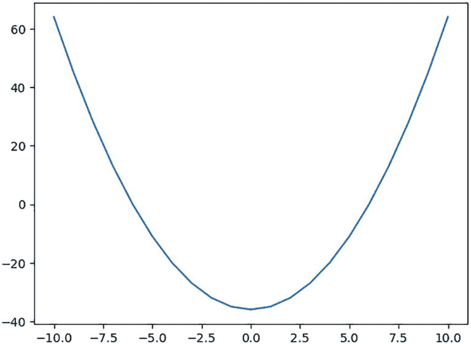

图 12-2 Python

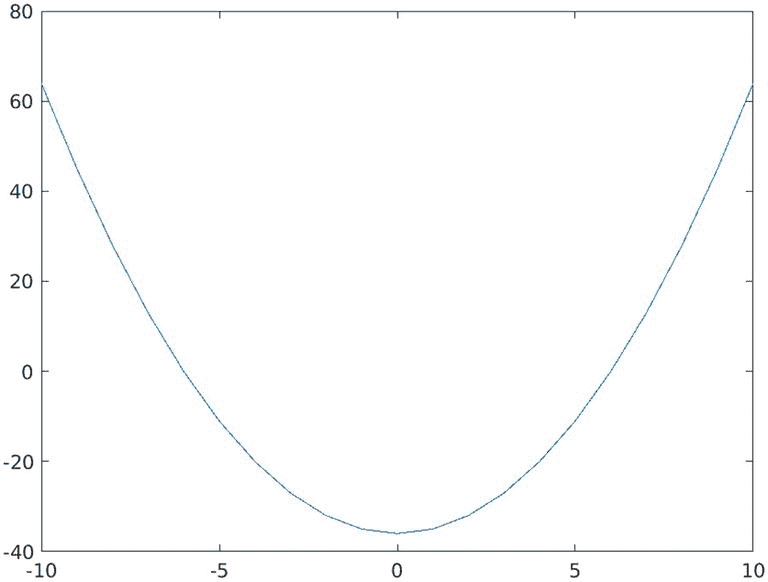

图 12-1 MATLAB

用于添加标题、坐标轴标签和图例的 `matplotlib` 命令与 MATLAB 中的对应命令非常相似。此外，对于简单的图形，我们只需直接引用 `matplotlib.pyplot`（通常导入为 `plt`）的命令即可：

| MATLAB: | Python: |
| --- | --- |
| `t=linspace(0,10*pi,300);` `decay = exp(-t/10);` `osc = decay .* sin(t);` `pts = -decay(1:10:end);` `plot(t,osc,'g')` `hold on` `plot(t,decay,'r')` `scatter(t(1:10:end),pts)` `grid on` `hold off` `title('衰减正弦波')` `xlabel('时间 [秒]')` `ylabel('exp(-t/10)*sin(t)')` `saveas(1,"decay.png")` | `import numpy as np` `import matplotlib.pyplot as plt` `t = np.linspace(0,10*np.pi,num=300)` `decay = np.exp(-t/10)` `osc = decay*np.sin(t)` `pts = -decay[::10]` `plt.plot(t,osc,'g')` `plt.plot(t,decay,'r')` `plt.scatter(t[::10],pts)` `plt.grid()` `plt.title('衰减正弦波')` `plt.xlabel('时间 [秒]')` `plt.ylabel('exp(-t/10)*sin(t)')` `plt.savefig('decay.png')` `plt.show()` `# 可选` |

### 12.1.1 将图形保存到文件

Matplotlib 用于将图形保存为 PNG、JPEG 等格式的函数是 `plt.savefig()`。它类似于 MATLAB 的 `saveas()`、`print()` 和 `exportgraphics()` 函数，但其优势在于支持 PNG 文件的透明背景——这对于插入 PowerPoint 演示文稿、Word 文档、网站、电子书和 PDF 来说是一个理想的特性。MATLAB 仅支持以 PDF 格式保存的图形具有透明度，而这个过程比写入 PNG 或 JPEG 文件要慢得多。

matplotlib 支持的图像文件格式可以通过 `plt.gcf().canvas.get_supported_filetypes()` 显示：

```python
In : plt.gcf().canvas.get_supported_filetypes()

Out:
```

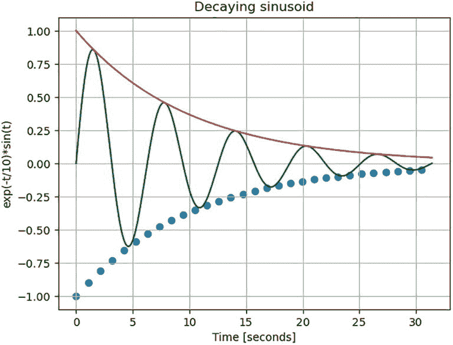

图 12-4 Python

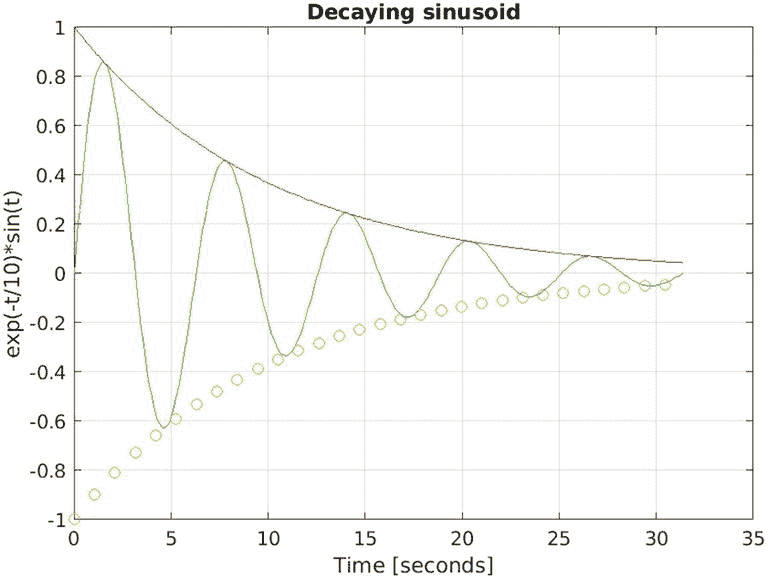

图 12-3 MATLAB

```python
{'ps': 'Postscript',
 'eps': '封装的 Postscript',
 'pdf': '便携式文档格式',
 'pgf': '用于 LaTeX 的 PGF 代码',
 'png': '便携式网络图形',
 'raw': '原始 RGBA 位图',
 'rgba': '原始 RGBA 位图',
 'svg': '可缩放矢量图形',
 'svgz': '可缩放矢量图形',
 'jpg': '联合图像专家组格式',
 'jpeg': '联合图像专家组格式',
 'tif': '标签图像文件格式',
 'tiff': '标签图像文件格式'}
```

本书中的大部分图像都是使用如下命令保存的：

```python
plt.savefig('plot.png', dpi=200, bbox_inches='tight',
            pad_inches=0.1, transparent=True)
```

> **提示**：如果你希望 Python 程序既在屏幕上显示图形，又将其保存到文件，请先调用`plt.savefig()`，再调用`plt.show()`；否则，图像文件将是空的。

### 12.1.2 每张图形中的多个子图

Matplotlib 的`subplots()`函数类似于 MATLAB 的`subplot()`，两者都将所需子图的行数和列数作为前两个参数。MATLAB 函数的第三个参数是要绘制的子图按行主序的偏移量，而 matplotlib 的函数则返回一个坐标轴句柄数组：

| MATLAB: | Python: |
| --- | --- |
| `t = -10*pi:0.1:10*pi;` `C = {{'blue' , 'red',},` `...` `{'green', 'black'}};` `figure` `i = 1;` `for` `r = 0:1` `for` `c = 0:1` `subplot(2, 2, i)` `i = i+1;` `k = 1 + (1.1*r + 1.5*c)/10;` `y = sin(t) + sin(k*t);` `plot(t,y,C{r+1}{c+1})` `xlabel('t')` `ylabel('y')` `title(sprintf(` `...` `'r=%d, c=%d',r,c))` `grid on` `end` `end` | `import numpy as np` `import matplotlib.pyplot as plt` `t = np.arange(-10*np.pi, 10*np.pi, 0.1)` `C = [['blue' , 'red',],` `['green', 'black']]` `fig, ax = plt.subplots(nrows=2,` `ncols=2, constrained_layout=` `True` `)` `for` `r` `in` `[0, 1]:` `for` `c` `in` `[0, 1]:` `k = 1 + (1.1*r + 1.5*c)/10` `y = np.sin(t) + np.sin(k*t)` `ax[r,c].plot(t,y,color=C[r][c])` `ax[r,c].set_xlabel('t')` `ax[r,c].set_ylabel('y')` `ax[r,c].set_title(` `f'r=` `{r}`, c=` `{c}` `', fontsize=14)` `ax[r,c].grid(` `True` `)` `plt.show()` |

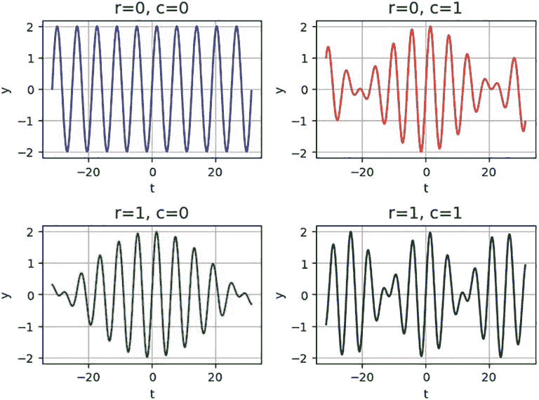

**图 12-6** Python

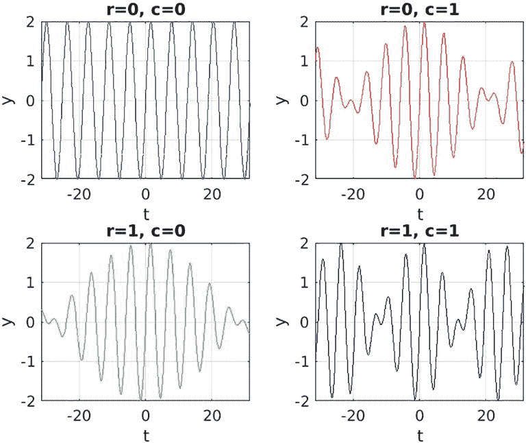

**图 12-5** MATLAB

### 12.1.3 X 轴上的日期和时间

X 轴上的日期和时间标注可能很棘手，因为它们占用了太多空间。MATLAB 和 Python 的 matplotlib 都允许精细控制日期字符串格式以及旋转轴标签以防止重叠。MATLAB 的时间标记对齐到中午，而 matplotlib 的对齐到午夜。

| MATLAB: | Python: |
| --- | --- |
| `t = .1:.01:.8;` `y = sin(3./t).*sin(5./(1-t));` `S = 30*24*60*60*t + 1620000000;` `dates = arrayfun(@(x) datetime(` `...` `x,'ConvertFrom','posix'), S);` `scatter(dates,y,'v','filled')` `grid()` `xtickformat('yyyy-MM-dd hh:mm')` `xtickangle(30)` | `import numpy as np` `import matplotlib.pyplot as plt` `import matplotlib.dates as mdates` `from datetime import` `datetime` `t = np.arange(.1, .8, .01)` `y = np.sin(3/t)*np.sin(5/(1-t))` `S = 30*24*60*60*t + 1620000000` `dates = [datetime.fromtimestamp(_)` `for` `_` `in` `S]` `fig, ax = plt.subplots()` `ax.scatter(dates,y,marker=11)` `plt.grid()` `ax.xaxis.set_major_formatter(` `mdates.DateFormatter('%Y-%m-` `%d` `%H:%S'))` `fig.autofmt_xdate()` |

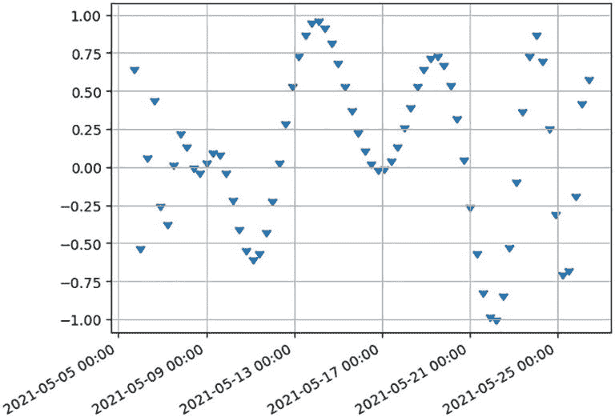

**图 12-8** Python

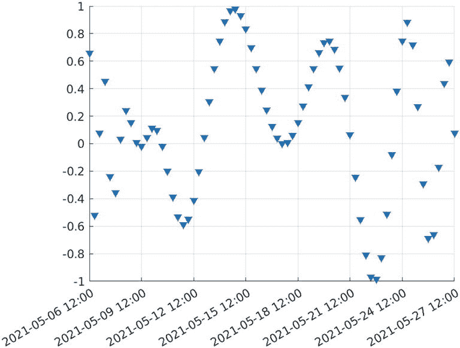

**图 12-7** MATLAB

### 12.1.4 双 Y 轴

相互竞争的单位系统，例如公制与美制，可以通过在左右垂直轴上标注不同的单位来同时显示。此示例显示了数种金属的弹性模量（通常称为杨氏模量）^(⁴⁹)，左侧单位为吉帕斯卡（GPa），右侧单位为兆磅每平方英寸（Mpsi）。这在 MATLAB 中使用`yyaxis left`和`yyaxis right`命令会稍微容易一些，这两个命令定义了后续命令操作的垂直轴。在 matplotlib 中，我们通过复制第一个垂直轴对象来创建一个新的垂直轴对象，然后用第二个单位系统的属性修改这个副本。

| MATLAB: | Python: |
| --- | --- |
| `*% file: code/plots/double_y_axis.m*` `yL = [68 108 112 116 193 200];` `yR = [9.86 15.7 16.2 16.8 28 29];` `yLmax = max(yL) * 1.1;` `materials = {'aluminum',` `...` `'zinc', 'bronze', 'titanium',` `...` `'iron', 'steel'};` `bar(yL)` `yyaxis left` `ylabel('GPa')` `ylim([0 yLmax])` `yyaxis right` `ylabel('Mpsi')` `ylim([0 yLmax/6.8965])` `xticklabels(materials)` `grid()` `title("Young's Modulus")` | `*# file: code/plots/double_y_axis.py*` `import numpy as np` `import matplotlib.pyplot as plt` `fig, ax = plt.subplots()` `yL = [68, 108, 112, 116, 193, 200]` `yR = [9.86, 15.7, 16.2, 16.8, 28, 29]` `yLmax = np.max(yL) * 1.1` `materials = ['aluminum', 'zinc',` `'bronze', 'titanium',` `'iron', 'steel']` `P = ax.bar(materials, yL)` `ax.set_ylabel('GPa')` `ax2 = ax.twinx()` `ax2.set_ylabel('Mpsi')` `ax.set_ylim(ymax=yLmax)` `ax2.set_ylim(ymax=yLmax/6.8965)` `ax.grid(` `True` `)` `ax.set_axisbelow(` `True` `)` `plt.title("Young's Modulus")` `plt.show()` |

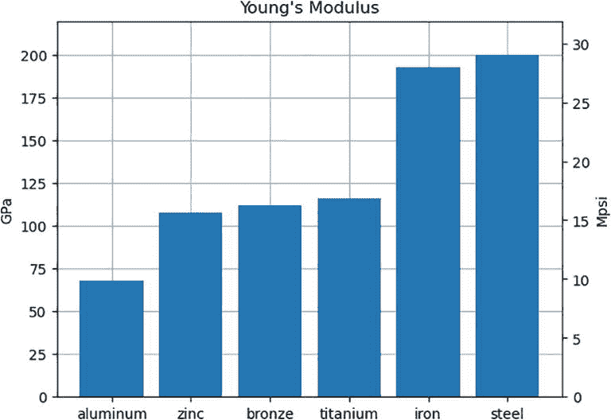

**图 12-10** Python

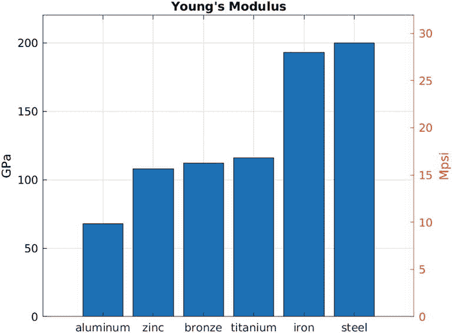

**图 12-9** MATLAB

### 12.1.5 直方图

以下示例显示了正态分布和瑞利分布的直方图。生成这些分布的 MATLAB 函数`normrnd()`和`raylrnd()`位于统计和机器学习工具箱中。我没有该工具箱的访问权限，因此在 MATLAB 中我将调用 NumPy 的等效函数。通过在 MATLAB 和 Python 中使用相同的随机数源，我还可以初始化相同的种子，从而在两种语言中生成相同的分布。

| MATLAB: | Python: |
| --- | --- |
| `*% file: code/plots/hist_demo.m*` `Im = @py.importlib.import_module;` `rnd = Im('numpy.random');` `N = int64(10000);` `rnd.seed(int64(123));` `w1 = rnd.rayleigh(int64(3), N);` `w1 = py2mat(w1);` `w2 = rnd.normal(int64(8),` `...` `int64(3), N);` `w2 = py2mat(w2)` `;` `bins = linspace(-5, 20, 80);` `h1 = histogram(w1,bins);` `set(h1,'FaceAlpha',0.5,` `...` `'EdgeAlpha',0.0);` `hold on` `h2 = histogram(w2,bins);` `set(h2,'FaceAlpha',0.5,` `...` `'EdgeAlpha',0.0);` `legend('Rayleigh','Normal');` `grid on` | `*# file: code/plots/hist_demo.py*` `import numpy as np` `import matplotlib.pyplot as plt` `N = 10000` `np.random.seed(123)` `w1 = np.random.rayleigh(3, N)` `w2 = np.random.normal(8, 3, N)` `bins = np.linspace(-5, 20, 80)` `plt.hist(w1, bins, alpha=0.5,` `label="Rayleigh")` `plt.hist(w2, bins, alpha=0.5,` `label="Normal")` `plt.legend(loc='upper right')` `plt.ylim([0, 700])` `plt.grid(` `True` `)` `plt.show()` |

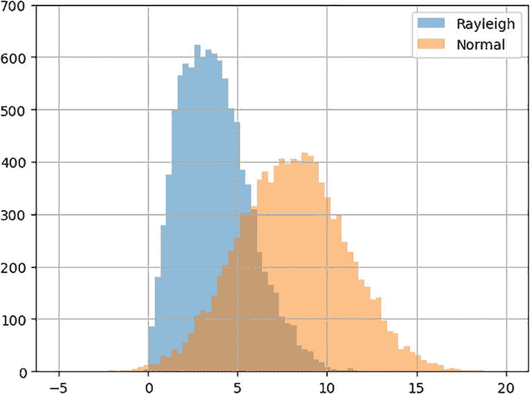

**图 12-12** Python

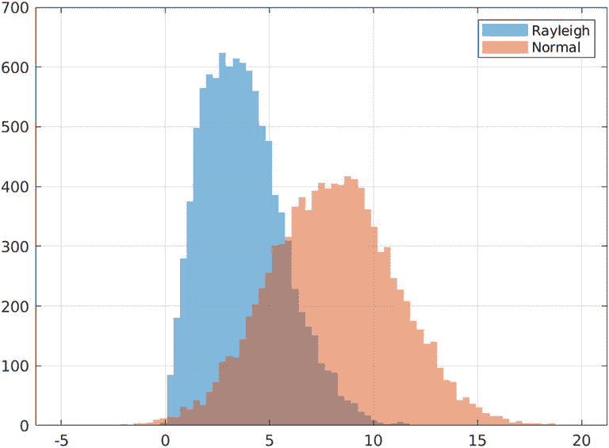

**图 12-11** MATLAB

### 12.1.6 堆叠图

堆叠图（或沙堆图）可以使用 MATLAB 中的`area()`和 matplotlib 中的`stackplot()`创建。（MATLAB 有一个`stackedplot()`函数，但其目的是创建共享一个 x 轴的多个垂直对齐的图。）

| MATLAB: | Python: |
| --- | --- |
| `*% file: code/plots/stack_demo.m*` `t = linspace(0, 20, 100);` `w = [0.11, 0.25, 0.17, 0.32];` `L = {};` `y = zeros(length(t),length(w));` `for i = 1:length(w)` `F = w(i);` `y(:,i) = cos(F*t).² + F;` `L{i} = sprintf(` `...` `'\\omega = %.2f', F);` `end` `area(t, y)` `legend(L);` `xlabel('\omega')` `grid on` | `*# file: code/plots/stack_demo.py*` `import numpy as np` `import matplotlib.pyplot as plt` `t = np.linspace(0, 20, 100)` `w = [0.11, 0.25, 0.17, 0.32]` `L = [f'$\omega$ =` `{_:.2f}` `'` `for` `_` `in` `w]` `y = np.zeros((len(w),len(t)))` `for` `i,F` `in` `enumerate(w):` `y[i,:] = np.cos(F*t)**2 + F` `fig, ax = plt.subplots()` `ax.stackplot(t, y, labels=L)` `ax.legend(loc='upper right')` `ax.set_xlabel('$\omega$')` `plt.grid()` `ax.set_axisbelow(` `True` `)` `plt.show()` |

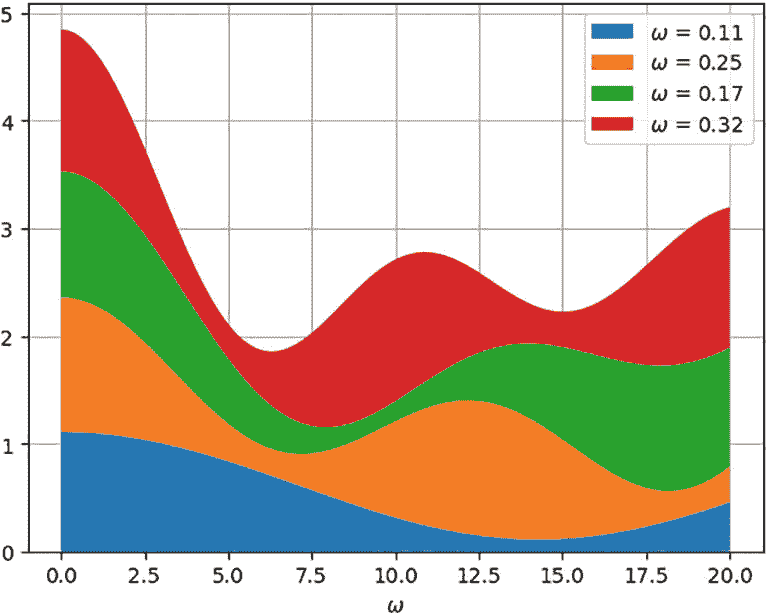

**图 12-14** Python

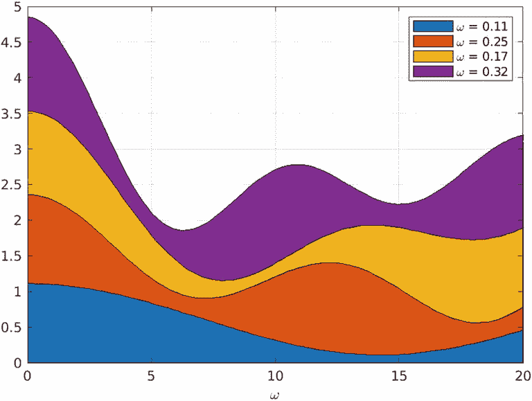

**图 12-13** MATLAB

## 12.2 面积图

### 12.2.1 `imshow()`

最简单的二维图是通过使用颜色映射为各个数组元素着色，直接渲染二维数值数组而成。MATLAB 和 matplotlib 都可以使用名为`imshow()`的函数将二维数组显示为图像。然而，MATLAB 的`imshow()`在显示数组时，每个数组元素会映射到一个屏幕像素；一个 5×5 的数组在大多数屏幕上会显示得非常微小。需要使用可选参数对`'InitialMagnification','fit'`来将小数组缩放到大小合适的图像。MATLAB 的`imagesc()`会将数组缩放到合适的大小，但它不提供像`imshow()`那样不同的插值方法。

第一个例子展示了 MATLAB 中的`imagesc()`和 matplotlib 中的`imshow()`对一个 16×16 数组的处理。（关于`np.newaxis`的回顾，请参见第 11.​1.​13 节。）matplotlib 方便地设置了 1:1 的纵横比：

| MATLAB: | Python: |
| --- | --- |
| `% file: code/plots/imshow_demo.m` `x = 0:0.2:pi;` `S = sin(x);` `z = S .* S';` `imagesc(z)` `colorbar` | `# file: code/plots/imshow1_demo.py` `import numpy as np` `import matplotlib.pyplot as plt` `x = np.arange(0,np.pi,0.2)` `S = np.sin(x)` `z = S[:,np.newaxis] * S[np.newaxis,:]` `hz = plt.imshow(z)` `plt.colorbar(hz)` |

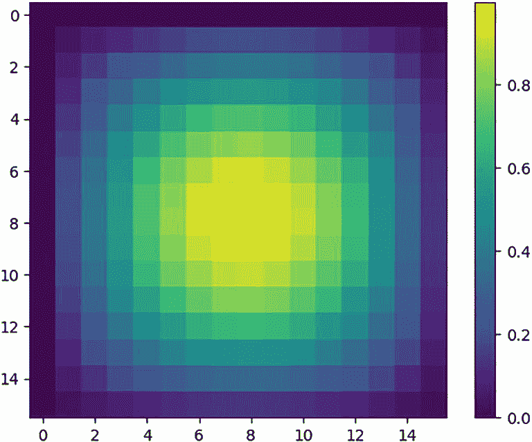

图 12-16 Python

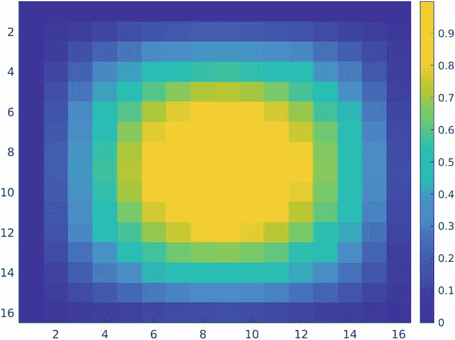

图 12-15 MATLAB

下一个例子在 MATLAB 和 matplotlib 中都使用了带双线性插值的`imshow()`。如果没有显式的`colorbar`参数，MATLAB 图像将以灰度显示。

| MATLAB: | Python: |
| --- | --- |
| `% file: code/plots/imshow_demo.m` `x = 0:0.2:pi;` `S = sin(x);` `z = S .* S';` `imshow(z, 'Interpolation',` **...** `'bilinear','Colormap',` **...** `parula,` **...** `'InitialMagnification','fit')` `colorbar` | `# file: code/plots/imshow2_demo.py` `import numpy as np` `import matplotlib.pyplot as plt` `x = np.arange(0,np.pi,0.2)` `S = np.sin(x)` `z = S[:,np.newaxis] * S[np.newaxis,:]` `hz = plt.imshow(z,` `interpolation="bilinear")` `plt.colorbar(hz)` |

然而，在 Python 中进行更专业的绘图需要用户获取独立的图形和坐标轴对象的句柄。请注意在以下等高线示例中，函数名前的不同前缀`plt.`、`ax.`和`fig.`：

| MATLAB: | Python: |
| --- | --- |
| `N = 500;` `rN = 1:N` `;` `[J, I] = meshgrid(rN, rN);` `x = -10 + 20*J/N;` `y = -10 + 20*I/N;` `z = cos(2*x/3).*sin(y/3)./` `...` `(100 + x.ˆ2+y.ˆ2);` `contourf(z)` `daspect([1 1 1])` `colorbar()` `title('Filled Contour')` `saveas(1,"m_contourf.png")` | `import numpy as np` `import matplotlib.pyplot as plt` `N = 500; rN = range(N)` `J, I = np.meshgrid(rN, rN)` `x = -10 + 20*J/N` `y = -10 + 20*I/N` `fig, ax = plt.subplots()` `ax.set_aspect('equal')` `z = np.cos(2*x/3)*np.sin(y/3)/(` `100 + x**2+y**2)` `cf = ax.contourf(z)` `fig.colorbar(cf)` `ax.set_title('Filled Contour')` `plt.savefig('contourf.png')` |

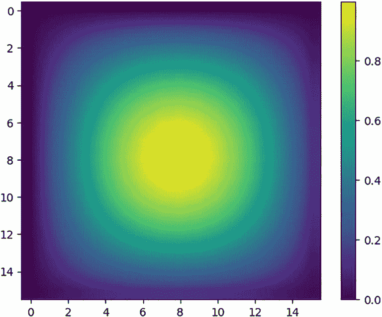

图 12-18 Python

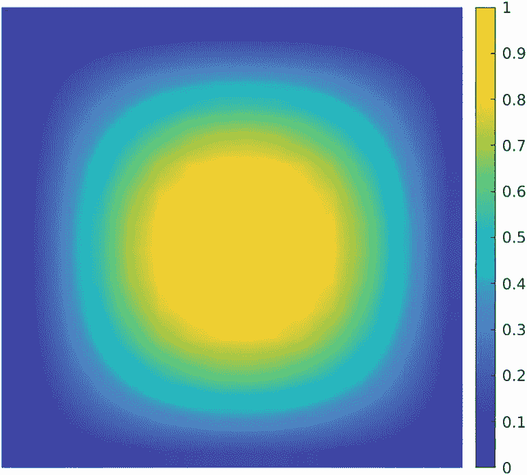

图 12-17 MATLAB

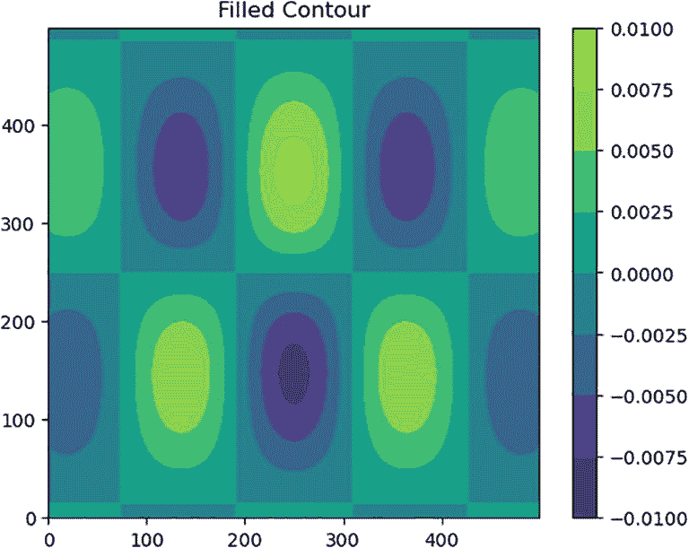

图 12-20 Python

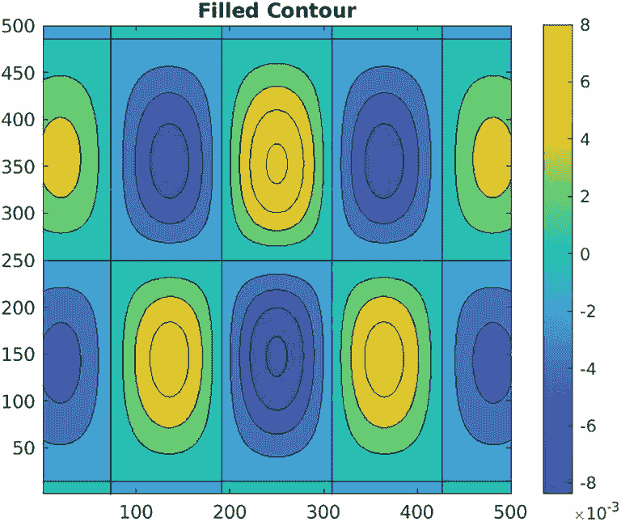

图 12-19 MATLAB

## 12.3 动画

Matplotlib 可以像 MATLAB 一样制作动画。然而，除非动画很简单，否则避免使用全局变量可能是一个挑战。我们将从一个简单的程序开始，该程序绘制一个宽度随每一帧变化的椭圆。所有操作都封装在一个函数中，不需要全局变量。

动画的关键要素是`A_values`（第 23 行`FuncAnimation()`的第三个参数）和第 18 行的`update()`函数。`A_values`是一个系数向量，用于缩放椭圆的宽度；其值从 0.9 下降到 0.1，然后又回到 0.9。每次调用`update()`时，会取出`A_values`中的下一个系数，并重新绘制椭圆的图像。

Python：

```python
# 代码示例（原始文本中未提供具体代码，保持此结构）
```


# file: `code/plots/circle_ellipse.py`

```python
import numpy as np
import matplotlib.pyplot as plt
from matplotlib.animation import FuncAnimation

def circle_to_ellipse():
    fig, ax = plt.subplots()
    T = np.linspace(0, 2*np.pi, 200)
    x = np.cos(T)
    y = np.sin(T)
    curve, = plt.plot(x,y,'b')
    A_values = np.hstack([np.linspace(0.1, 0.9, 100),
                          np.linspace(0.9, 0.1, 100)])
    def init():
        ax.set_xlim(-1, 1)
        ax.set_ylim(-1, 1)
        ax.set_aspect('equal')
        return curve,
    def update(A):
        x = A*np.cos(T)
        y = np.sin(T)
        curve, = plt.plot(x,y,'b')
        return curve,
    ani = FuncAnimation(fig, update, A_values,
                        interval=20, # 毫秒
                        init_func=init, blit=True)
    plt.show()

circle_to_ellipse()
```

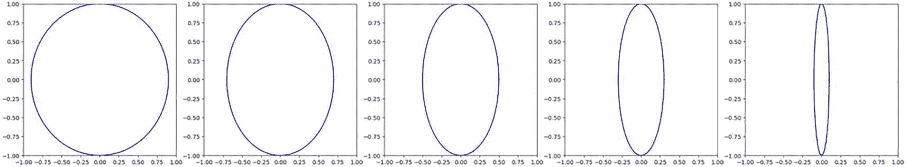

第二个动画示例展示了一个在抛物面碗中弹跳的球。它要复杂得多，并且使用`全局变量`来存储球的运动轨迹。

Python：

```
```


# file: code/plots/bouncing_ball.py

```python
import numpy as np
import matplotlib.pyplot as plt
import matplotlib.animation as animation
from copy import copy

A = 0.08  # 碗的形状：y = A*xˆ2
dt = 1.0 / 500  # 时间步长，秒
T = np.arange(0, 20, dt)
n_iter = len(T)
damping = 0.9997
restitution = 0.995
ball_radius = 0.3
history_x, history_y = [], []
point, trace = None, None

def timestep(pos, vel):
    new_pos = copy(pos)
    new_vel = copy(vel)
    new_vel[1] += -9.8 * dt
    new_vel *= damping
    new_pos[0] += new_vel[0] * dt
    new_pos[1] += new_vel[1] * dt
    bowl_y = A * new_pos[0]**2
    if new_pos[1] < bowl_y:
```

# 碰到碗，回弹

```
normal = np.array([-2*A*new_pos[0],1])

normal /= np.linalg.norm(normal)

new_vel += -2*new_vel.dot(normal)*normal

new_pos[1] = bowl_y

return new_pos, new_vel

def run_simulation():

nX = 21

pos = np.zeros((n_iter,2))

pos[0,:] = np.array([-3., 3.]) # 初始位置，米

vel = np.array([0.5, 0])       # 初始速度，米/秒

bowl = np.zeros((nX,2))

bowl[:,0] = np.linspace(-3.5, 3.5, num=nX)

X = bowl[:,0]

bowl[:,1] = A*X**2
```


# 中心线是偏离抛物线碗的曲线，


# 偏移量为球的半径；这是球心似乎发生弹跳的地方

`den = 1/np.sqrt(1 + (2*A*X)**2)`

`centerline = np.zeros((nX,2))`

`centerline[:,0] = X + 2*A*ball_radius*X*den`

`centerline[:,1] = A*X**2 - ball_radius*den`

```python
for i in range(1,n_iter):

    pos[i], vel = timestep(pos[i-1],vel)

return bowl, centerline, pos, vel
```

```python
def init(bowl, centerline):
    global point, trace
    fig, ax = plt.subplots()
    plt.plot(bowl[:,0],bowl[:,1],':')
    plt.plot(centerline[:,0],centerline[:,1])
    plt.ylim([-1,4])
    ax.set_aspect('equal')
    point, = ax.plot([], [], 'o', markersize=25)
    trace, = ax.plot([], [], ',-', lw=1)
    return fig
```

```python
def animate(i):
    global history_x, history_y
    if i == 0:
        history_x.clear()
        history_y.clear()
    history_x.append(pos[i,0])
    history_y.append(pos[i,1])
    point.set_data(pos[i,0], pos[i,1])
    trace.set_data(history_x, history_y)
    return point, trace
```

```python
bowl, centerline, pos, vel = run_simulation()
fig = init(bowl, centerline)
ani = animation.FuncAnimation(
    fig, animate, n_iter, interval=dt*1000, blit=True)
plt.show()
```

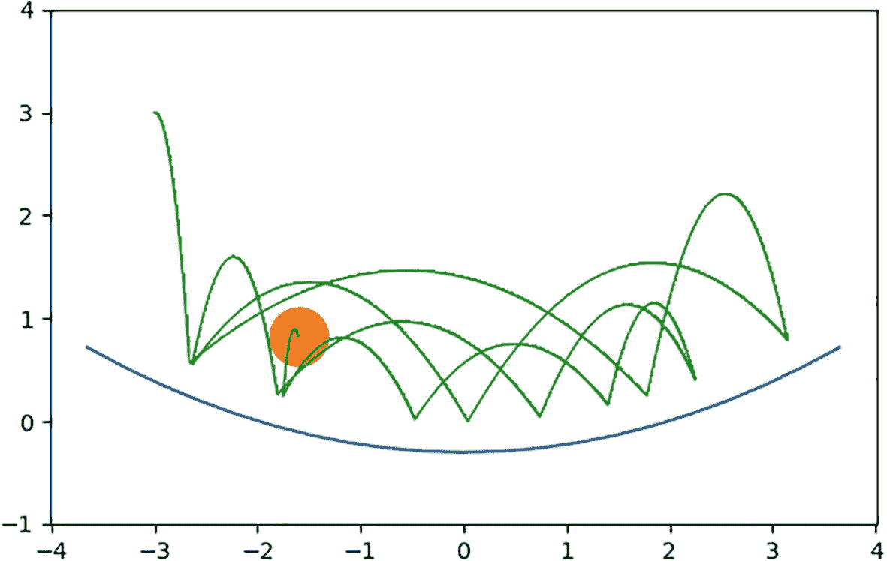

## 12.4 使用 Cartopy 在地图上绘图

由英国气象局开发的 Python `Cartopy` 模块，提供了大量与 `matplotlib` 配合使用的地图变换和投影函数。其功能丰富程度堪比 MATLAB 的地图工具箱。多个 `Cartopy` 子模块会使用基于网络的地图瓦片服务，因此制作带有影像增强的图表时需要互联网连接。

与所有绘图包一样，开始使用 `Cartopy` 的最简单方式是查看其示例画廊^(⁵⁰)并修改可用的示例。

我们将从 `Cartopy` 中的点和线数据绘图开始探索地图绘图，同时也会介绍 MATLAB 的 `geo*` 函数系列。不过，在 MATLAB 中绘制更复杂的地理叠加图需要地图工具箱。另一种选择是从 MATLAB 调用 `Cartopy`；我们将通过两个具体示例演示这一方法：在全球地图上叠加海面温度（第 12.6 节）以及绘制一张根据小麦产量着色的南美洲国家地图（第 12.7 节）。

### 12.4.1 点

MATLAB 的 `geo*` 函数既支持下一章将介绍的表格，也支持常规矩阵变量。本示例展示了如何在巴黎高分辨率地图上叠加两个点，MATLAB 使用表格，而 Python 使用标量变量。红点位于巴黎圣母院，蓝点位于先贤祠。

**提示**

使用 Google 地球^(⁵¹)查找地图的经纬度范围（调用 `ax.set_extent()` 时使用）。

| MATLAB: | Python: |
| --- | --- |
| `% code/plots/paris_pt.m`<br>`T = table([48.853;48.846],` `...`<br>`[2.3497;2.3464],` `...`<br>`'VariableNames',` `...`<br>`{'Lat','Lon'},` `...`<br>`'RowNames', {'Notre Dame',` `'Pantheon'});`<br>`C = [1 0 0; 0 0 1];`<br>`geoscatter(T.Lat, T.Lon,124,` `...`<br>`C, 'Filled')`<br>`geolimits([48.8425 48.8625],` `...`<br>`[2.3283 2.3722])`<br>`geobasemap streets`<br>`title("Notre Dame (red) and " +` `...`<br>`"the Pantheon (blue)")` | `#!/usr/bin/env python3`<br>`# code/plots/cartopy_pt.py`<br>`import matplotlib.pyplot as plt`<br>`import numpy as np`<br>`import cartopy.crs as ccrs`<br>`from cartopy.io.img_tiles import OSM`<br>`imagery = OSM()`<br>`PC = ccrs.PlateCarree()`<br>`fig = plt.figure()`<br>`ax = fig.add_subplot(1, 1, 1,`<br>`projection=imagery.crs)`<br>`ax.set_extent([2.3283, 2.3722,`<br>`48.8425, 48.8625],`<br>`crs=PC)`<br>`ax.add_image(imagery, 14)`<br>`ax.plot(2.3497, 48.853, transform=PC,`<br>`marker="o", color="red",`<br>`markersize=6)`<br>`ax.plot(2.3464, 48.846, transform=PC,`<br>`marker="o", color="blue",`<br>`markersize=6)`<br>`ax.set_title('Notre Dame (red) and '`<br>`'the Pantheon (blue)')`<br>`plt.savefig('Paris.png')`<br>`plt.show()` |

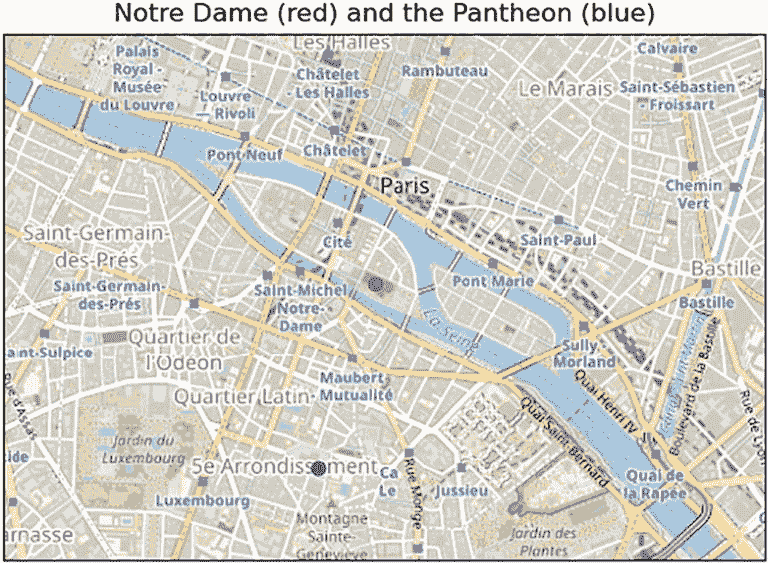

图 12-22 Python

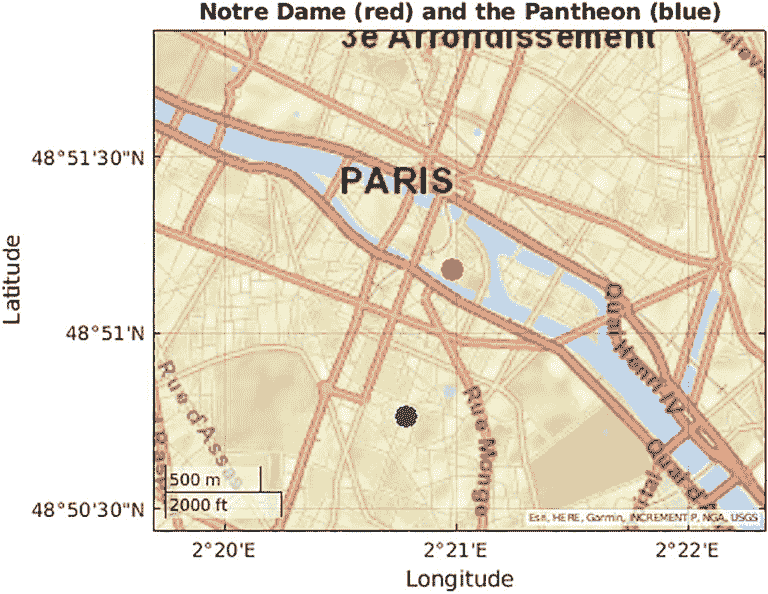

图 12-21 MATLAB

一个常见的错误与从互联网下载地图瓦片有关：

```
网上可以找到许多解释和解决方案，
但针对 Cartopy 获取地图瓦片的特定情况，
我发现最可靠的解决方案是直接修改 Cartopy 的源代码，
使用 `requests` 模块
代替 `urllib`。
详情见第 12.4.4 节。
```

### 12.4.2 线

在本示例中，我们绘制一头名为“蓝鲸 158390”的鲸鱼在 2018 年 9 月 21 日至 2018 年 11 月 18 日期间的移动路径。位置数据^(⁵²)必然存在较大的误差范围，因为其中一个数据点位于北纬 48.64328°、西经 66.47227°，在加拿大新不伦瑞克省的一片内陆约 60 公里的田野中。这大致相当于赤道处约 0.5° 的纬度或经度。在 Python 中，我们将利用这一信息，用蓝色叠加一个宽 0.5° 的区域，表示鲸鱼路径的误差范围。MATLAB 代码虽然极其简洁优雅，但无法控制 `geoplot()` 绘制线条的宽度，因此其图形缺少这一功能。

此示例还展示了如何向 `Cartopy` 地图添加额外细节——经纬度网格线、国界、河流。

`whale_data()` 返回的经纬度数值位于 `data/plots/whale_path.txt` 文件中。

| MATLAB: | Python: |
| --- | --- |
| `% code/plots/whale.m`<br>`P = importdata('whale_path.txt');`<br>`geoplot(P(:,2), P(:,1),'r')`<br>`geolimits([30 55], [-80 -50])`<br>`geobasemap colorterrain`<br>`title("Blue Whale 158390, " + ...`<br>`"Fall 2018")` | `#!/usr/bin/env python3`<br>`# code/plots/cartopy_whale.py`<br>`import numpy as np`<br>`import shapely.geometry as sgeom`<br>`import cartopy.crs as ccrs`<br>`import cartopy.feature as cfeature`<br>`import matplotlib.pyplot as plt`<br>`fig = plt.figure()`<br>`PC = ccrs.PlateCarree()`<br>`ax = fig.add_subplot(1, 1, 1, projection=PC)`<br>`ax.coastlines(resolution='50m')`<br>`ax.set_extent([-80, -50, 30, 55], crs=PC)`<br>`ax.add_feature(cfeature.LAND)`<br>`ax.add_feature(cfeature.OCEAN)`<br>`ax.add_feature(cfeature.COASTLINE)`<br>`ax.add_feature(cfeature.BORDERS, linestyle='-')`<br>`ax.add_feature(cfeature.LAKES.with_scale('50m'),`<br>`alpha=0.5)`<br>`ax.add_feature(cfeature.RIVERS.with_scale('50m'))`<br>`plt.title('Blue Whale 158390, Fall 2018')`<br>`path = np.loadtxt('whale_path.txt')`<br>`track = sgeom.LineString(path)`<br>`error = track.buffer(.5) # degrees`<br>`ax.gridlines(draw_labels=True)`<br>`ax.add_geometries([error], ccrs.PlateCarree(),`<br>`facecolor='#1F18F4', alpha=.5)`<br>`ax.add_geometries([track], ccrs.PlateCarree(),`<br>`facecolor="none", edgecolor="r")`<br>`plt.savefig('whale.png', bbox_inches="tight",`<br>`pad_inches=0, transparent=True)`<br>`plt.show()` |

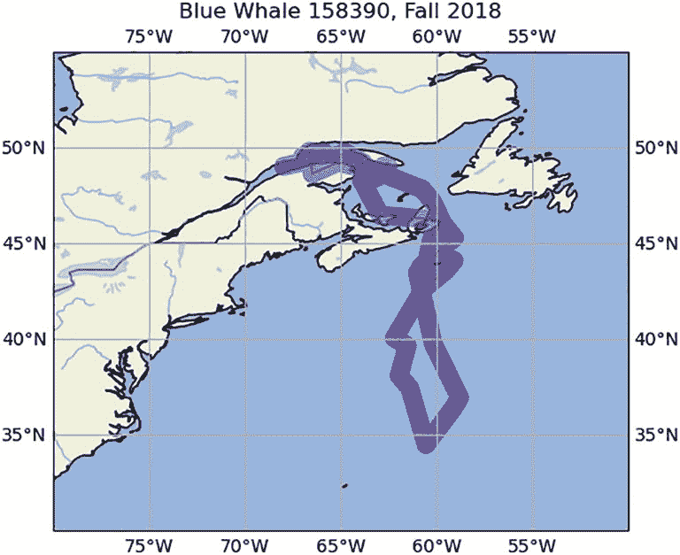

图 12-24 Python

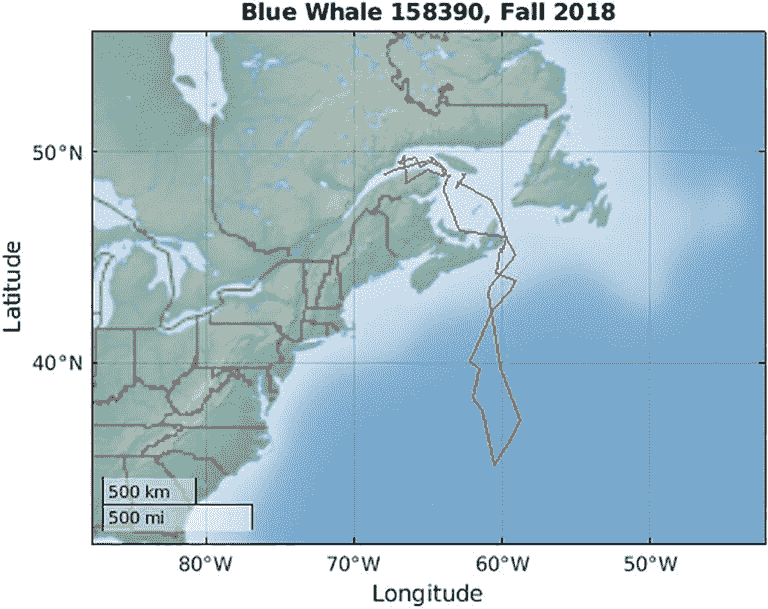

图 12-23 MATLAB

如果你的 MATLAB 图表需要 `geoplot()` 无法提供的对地理线条的精细控制，请参阅配方 12.5，其中展示了如何从 MATLAB 重现右侧的 `Cartopy` 图表。

### 12.4.3 区域

在地图上叠加的大部分数据覆盖的是区域，而不是点或线。这类数据不胜枚举：地球科学数据，如陆地和海面温度、地表类型、植被指数和降雨量；商业数据，如农业产量和国内生产总值；政治数据，如投票结果、政党归属和冲突区域。

在 MATLAB 中，用于在地图上叠加区域数据的原生选项是地图工具箱和免费提供的气候数据工具箱。^(⁵³) 在 Python 中，我们将继续使用 `Cartopy`。

#### 12.4.3.1 海面温度

我们的第一个示例使用一对投影显示全球海面温度。通过使用来自 NASA 地球观测^(⁵⁴) 数据库的自定义地球背景图像——此处为植被指数——增强了图表效果。为此，请将植被指数图像文件 `earth_veg_index.jpeg` 及随附的 JSON 元数据保存到一个目录中，然后将环境变量 `CARTOPY_USER_BACKGROUNDS` 设置为该目录。^(⁵⁵)

海面温度 (SST) 数据来自 NOAA 的每日 AVHRR 卫星数据集。^(⁵⁶) 每天的数据存储在一个 NetCDF 文件（第 7.​10 节）中，该文件包含在 0.5° 经纬度网格上的海面温度。第一行和第一列对应纬度 –89.875° 和经度 0.125°；赤道由第 359 行和第 360 行（使用从零开始的索引）跨越，而国际日期变更线由第 719 列和第 720 列跨越。

**Python:**

```python
#!/usr/bin/env python3

# code/plots/cartopy_sst.py

import os

import numpy as np

import matplotlib.pyplot as plt

from netCDF4 import Dataset

import cartopy.crs as ccrs

from mpl_toolkits.axes_grid1 import make_axes_locatable

os.environ["CARTOPY_USER_BACKGROUNDS"] = "cartopy/background"

File = 'oisst-avhrr-v02r01.20190101.nc'

rg = Dataset(File, 'r')

lat = rg["lat"][:]

lon = rg["lon"][:]

sst_ds = rg["sst"][0][0]

sst = sst_ds.data

mask = sst_ds.mask

sst[mask] = np.NaN

fig = plt.figure()

Ortho = ccrs.Orthographic(-10, 15)

PC = ccrs.PlateCarree()

ax = fig.add_subplot(1, 1, 1, projection=Ortho)
```

# 或者 -

```markdown
```python
ax = fig.add_subplot(1, 1, 1, projection=PC)

ax.coastlines()

ax.set_global()

ax.gridlines()

h = ax.contourf(lon, lat, sst, levels=20,
                vmin=-2, vmax=35, transform=PC, cmap='jet')

divider = make_axes_locatable(ax)
ax_cb = divider.new_horizontal(size="5%", pad=0.1,
                               axes_class=plt.Axes)
fig.add_axes(ax_cb)

plt.colorbar(h, cax=ax_cb)

ax.background_img(name='VI', resolution='low')

ax.set_title('SST 2020-01-02 [Celcius]')

plt.savefig('sst_globe.png', bbox_inches='tight',
            pad_inches=0, transparent=True)

plt.show()
```

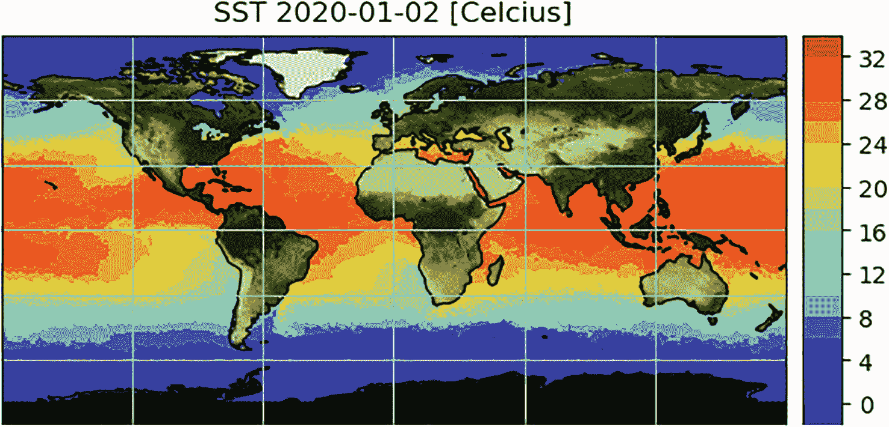

有许多投影可供选择。可以通过将 `PlateCarree` 投影替换为以下代码，生成一个中心位于西经 10°、北纬 15°的正交投影：

```python
Ortho = ccrs.Orthographic(-10, 15)
ax = fig.add_subplot(1, 1, 1, projection=Ortho)
```

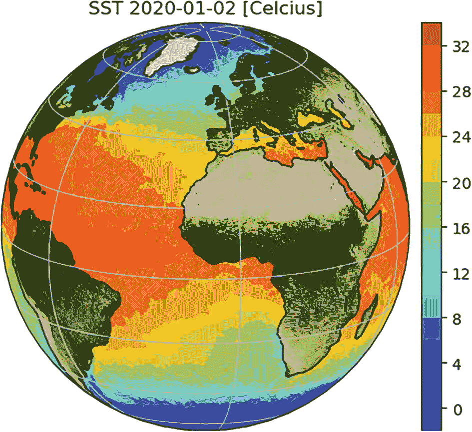

在 MATLAB 中使用 12.6 节中的方法创建此图。

#### 12.4.3.2 南美小麦产量（2014 年）

第二个示例展示受国家边界限定的数据。我们的数据集将使用 2014 年南美洲的小麦产量数据⁵⁷。目标是根据每个国家的产量值对其进行着色。

虽然 `Cartopy` 自带海岸线数据库，但它不包含国家或州界。理想情况下，我们希望能写出类似 `plot(region(country='Canada'), 'grey')` 或 `plot(region(zipcode=90210), 'orange')` 的语句，但目前还不具备这种功能。（剧透：第 13.12 节中介绍的 `GeoPandas` 可以实现这一点。）

因此，我们将通过从 `Natural Earth` 项目下载形状文件及相关元数据，自行创建国家边界数据库。“低分辨率”文件⁵⁸包含 `Cartopy` 可读取的文件，这些文件含有国家边界、多种语言的国家名称、所属大洲名称、经济状况、人口及 GDP 估算值等信息。但获取数据、读取并以便于使用的形式存储这些数据的任务需要由我们完成。

以下 Python 代码要求将文件 `'ne_110m_admin_0_countries.zip'` 解压到一个名为 `nat_earth` 的子目录中。我们将使用 `Cartopy` 的形状读取器加载国家形状和元数据，并据此构建一个字典 `shp`，以英文国家名称为键，边界几何形状为对应的值。为了增加趣味性，我们再构建第二个字典 `rec`，用于存储每个国家的元数据。

```python
In : from cartopy.io.shapereader import Reader

In : shp = {} # 按名称索引的国家形状

In : rec = {} # 按名称索引的国家元数据

In : Countries = Reader('nat_earth/ne_110m_admin_0_countries')

In : for geom, meta in zip(Countries.geometries(), Countries.records()):
...:     name = meta.attributes['NAME_EN']
...:     shp[name] = geom
...:     rec[name] = meta
```

探索这些字典会发现一些有趣的信息：

```python
In : sorted( shp.keys() )
Out: shp.keys()
['阿富汗',
 '阿尔巴尼亚',
 '阿尔及利亚',
 '安哥拉',
 '南极洲',
 '阿根廷',
 ...
 '越南',
 '西撒哈拉',
 '也门',
 '赞比亚',
 '津巴布韦',
 '斯威士兰']

In : rec['越南']
Out[9]: ,
{'featurecla': '行政 0 级国家', 'scalerank': 1, 'LABELRANK': 2,
 'SOVEREIGNT': '越南', 'POSTAL': 'VN', 'MAPCOLOR7': 5, 'MAPCOLOR8': 6,
 'POP_EST': 96160163, 'POP_RANK': 16, 'GDP_MD_EST': 594900.0,
 'POP_YEAR': 2017, 'LASTCENSUS': 2009, 'GDP_YEAR': 2016,
 ...

In [12]: rec['越南'].attributes['POP_EST']
Out[12]: 96160163
```

更重要的是，`matplotlib` + `Cartopy` 的组合能够理解从 shape 文件生成的多边形区域，从而可以用所需的颜色为各个国家着色。但地理政治边界构成的多边形有一个微妙的特性：有些边界是单个多边形，而其他边界（例如印度尼西亚的群岛）则包含多个不相交的多边形。用于添加由多边形边界定义的区域的 `matplotlib` `add_geometries()` 函数，期望其第一个参数是一个多边形列表。因此，我们必须首先检查一个国家的地形是单个多边形还是多边形列表；如果是单个，则必须将传递给 `add_geometries()` 的参数扩展为一个包含单个元素的列表。以下清单中的第 42 行展示了如何适当处理这些情况：

```python
#!/usr/local/anaconda3/2020.07/bin/python
# code/plots/cartopy_wheat.py
import numpy as np
import cartopy.crs as ccrs
import cartopy.feature as cfeature
from cartopy.io.shapereader import Reader
from shapely.geometry.polygon import Polygon
import matplotlib.pyplot as plt
from matplotlib.colors import from_levels_and_colors
from mpl_toolkits.axes_grid1 import make_axes_locatable

wheat_tons = {
    'Argentina' : 13_930_078 ,
    'Brazil' : 6_261_895 ,
    'Chile' : 1_358_128 ,
    'Uruguay' : 1_076_000 ,
    'Paraguay' : 840_000 ,
    'Bolivia' : 263_076 ,
    'Peru' : 214_533 ,
    'Colombia' : 9_718 ,
    'Ecuador' : 6_584 ,
    'Venezuela' : 161 , }

Countries = Reader('nat_earth/ne_110m_admin_0_countries')
shp = {} # country shape indexed by name
for geom, meta in zip(Countries.geometries(),
                      Countries.records()):
    name = meta.attributes['NAME_EN']
    shp[name] = geom

PC = ccrs.PlateCarree()
fig, ax = plt.subplots(1, 1, subplot_kw=dict(projection=PC))
ax.set_extent([-85, -33, # lon
```

### 12.4.4 MATLAB 与 Cartopy

不过，从 MATLAB 使用 Cartopy 存在一个重大挑战。当 Cartopy（0.18.0 版，截至 2021 年 7 月为最新版本）尝试从地图服务下载影像图块时，会与 MATLAB 产生异常交互。可能会发生以下两种情况之一：要么出现此错误

或者生成的绘图根本缺少背景图像。

有一个变通方法，但需要修改 Cartopy 的文件 `cartopy/io/img_tiles.py`，使其使用 `requests` 模块而不是 Python 标准库中的 `urllib.request` 来下载图块。第一步是找到包含 `img_tiles.py` 的目录或文件夹。这可以在 `ipython` 中通过导入 `cartopy.io` 然后检查其 `__path__` 属性来完成。在我的 Linux 计算机上，此目录是

```
ipython:

In : import cartopy.io

In : cartopy.io.__path__

Out: ['/usr/local/anaconda3/2020.07/envs/matpy/lib/python3.8/site-packages/cartopy/io']
```

> **注意**：如果你在多个虚拟环境中安装了 Cartopy，则需要在你计划从中启动 MATLAB 的每个环境中编辑 `img_tiles.py`。

接下来，编辑 `img_tiles.py`，使其包含对 `requests` 的导入（右侧的第 41 行），并将对 `urlopen()`、`six.BytesIO()` 和 `fh.close()` 的调用（左侧的第 190–193 行）替换为右侧突出显示的行。（实际行号会因你安装的 Cartopy 版本而异。）

| `img_tiles.py` 原始版本： | `img_tiles.py` 修复版本： |
| --- | --- |
| `39` `import numpy as np`  `40`  `import six`  `41` `42`  `import cartopy` `43`  `import cartopy.crs as ccrs` `188` `url = self._image_url(tile)` `189`  `try:` `190`    `request = Request(url, headers={` `"User-Agent": self.user_agent})` `191`    `fh = urlopen(request)` `192`    `im_data = six.BytesIO(fh.read())` `193`    `fh.close()` `194`    `img = Image.open(im_data)` | `39`  `import numpy as np` `40`  `import six` `41` `import requests` `42` `43`  `import cartopy` `44`  `import cartopy.crs as ccrs` `189` `url = self._image_url(tile)` `190`  `try:` `191` `request = requests.get(url,` `stream=True)` `192` `request.raw.decode content = True` `193` `img = Image.open(request.raw)` |

用于自动执行此补丁的实用程序 `patch_cartopy.py` 的源代码清单见附录 E。

### 12.4.5 在 MATLAB 中避免使用 matplotlib 的 Qt 后段！

MATLAB 使用 Qt 库来渲染图形。虽然 `matplotlib` 可以使用六种不同的图形库，但其默认使用 Qt。这是一个问题！Anaconda 发行版附带的 Qt 库不太可能与 MATLAB 自带的 Qt 库匹配。因此，如果你在 MATLAB 中使用 `matplotlib` 的 `plt.show()` 命令，将会导致 MATLAB 崩溃。不过有一个简单的变通方法：只需将 `matplotlib` 配置为使用不同的后端即可。首先，我们查询 Python 安装以查看其当前使用的后端：

```
Python:

In : import matplotlib

In : matplotlib.get_backend()

Out: 'Qt5Agg'
```

`Qt5Agg` 在 MATLAB 中肯定是个问题。一个好的替代方案是 Linux 和 macOS 上的 `TkAgg` 后端，以及 Windows 上的 `WXAgg` 后端。例如，在 Python 中切换到 `TkAgg` 后端的方法如下：

```
Python:

import matplotlib

matplotlib.use('TkAgg')
```

在 MATLAB 中切换的方法如下：

```
MATLAB 2020b:

Im  = @py.importlib.import_module;

mpl = Im('matplotlib');

mpl.use('TkAgg')
```

## 12.5 配方 12-1：使用 Cartopy 在地图上绘制线条

第 12.4.2 节中鲸鱼轨迹在 MATLAB 中的等效代码如下所示：

```
MATLAB 2020b:

% file: code/matlab_py/cartopy_whale.m

Im = @py.importlib.import_module;

np     = Im('numpy');

sgeom  = Im('shapely.geometry');

ccrs   = Im('cartopy.crs');

cfeat  = Im('cartopy.feature');

plt    = Im('matplotlib.pyplot');

mpl    = Im('matplotlib');

if ispc

mpl.use('WXAgg')

else

mpl.use('TkAgg')

end

PC = ccrs.PlateCarree();

fig = plt.figure();

i1 = int64(1);

ax = fig.add_subplot(i1, i1, i1, pyargs('projection',PC));
```

使用第 12.7 节中的配方在 MATLAB 中创建此绘图。

```
import numpy as np

ton_intervals = np.array([0, 10_000, 100_000, 1_000_000, 10_000_000, 15_000_000,])

fraction_interval = np.linspace(0.12, 1, num=len(ton_intervals))

colors = plt.cm.BuPu(fraction_interval[:-1])

for ctry in wheat_tons:

    color = colors[np.searchsorted(ton_intervals, wheat_tons[ctry]) - 1]

    shape = [shp[ctry]] if isinstance(shp[ctry], Polygon) else shp[ctry]

    ax.add_geometries(shape, crs=PC, facecolor=color)

ax.add_feature(cfeature.BORDERS)

ax.add_feature(cfeature.COASTLINE)

ax.set_title('Wheat Production, 2014 [10$ˆ6$ tons]')

# colorbar

divider = make_axes_locatable(ax)

ax_cb = divider.new_horizontal(size="5%", pad=0.1, axes_class=plt.Axes)

fig.add_axes(ax_cb)

cmap, norm = from_levels_and_colors(ton_intervals/1.0e+6, colors)

sm = plt.cm.ScalarMappable(cmap=cmap, norm=norm)

plt.colorbar(sm, cax=ax_cb)

plt.show()

#plt.savefig('SA_wheat_2014.png', dpi=200,

# bbox_inches='tight', pad_inches=0, transparent=True)
```

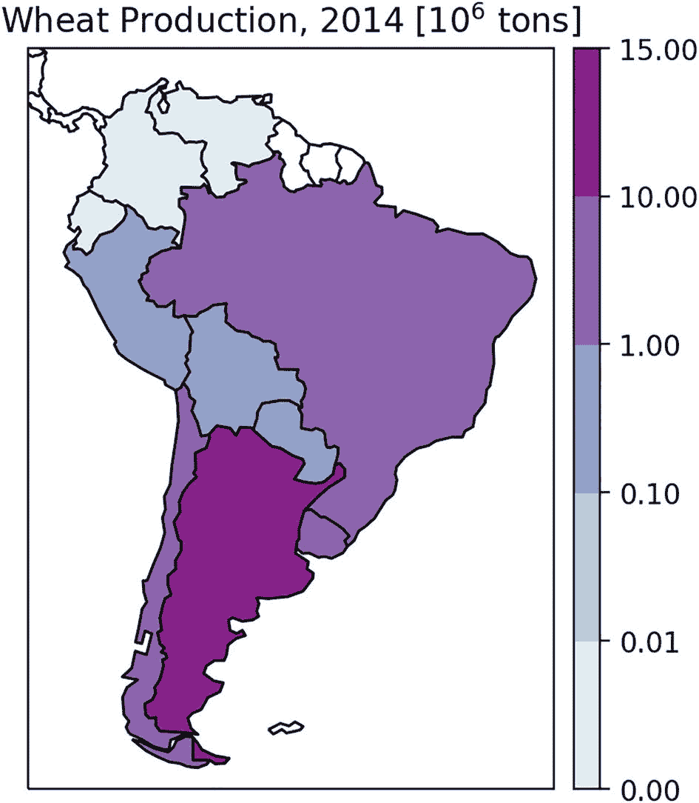

## 12.6 方案 12-2：使用 Cartopy 在地球仪上叠加等高线

在章节 12.4.3.1 中制作的海面温度叠加图，可以使用 `MATLAB` 结合 `Cartopy` 来实现。

### MATLAB 2020b：

```matlab
Im = @py.importlib.import_module;
OS    = Im('os');
np    = Im('numpy');
plt   = Im('matplotlib.pyplot');
ccrs  = Im('cartopy.crs');
axes  = Im('mpl_toolkits.axes_grid1');
mpl   = Im('matplotlib');

if ispc
    netcdf.inqLibVers; % avoid DLL conflict
    mpl.use('WXAgg')
else
    mpl.use('TkAgg')
end

nc   = Im('netCDF4');

i1 = int64(1);
OS.environ{'CARTOPY_USER_BACKGROUNDS'} = ...
    '../plots/cartopy/background';

File = '../plots/oisst-avhrr-v02r01.20201001_preliminary.nc';
lat = ncread(File, 'lat');
lon = ncread(File, 'lon');
sst = ncread(File, 'sst')';
mask = isnan(sst);

fig = plt.figure();
Ortho = ccrs.Orthographic(-10, 15);
PC    = ccrs.PlateCarree();
ax = fig.add_subplot(i1, i1, i1,pyargs('projection',Ortho));
%            - or -
%ax = fig.add_subplot(i1, i1, i1, pyargs('projection',PC));

ax.coastlines();
ax.set_global();
ax.gridlines();

h = ax.contourf(lon, lat, sst,...
    pyargs('levels',int64(20), 'vmin',-2,'vmax',35,...
    'transform',PC,'cmap','jet'));

divider = axes.make_axes_locatable(ax);
ax_cb = divider.new_horizontal(...
    pyargs('size','5%','pad',0.1,'axes_class',plt.Axes));
fig.add_axes(ax_cb);
plt.colorbar(h, pyargs('cax',ax_cb));

ax.background_img(pyargs('name',"VI",'resolution',"low"));
ax.set_title('SST 2020-01-02 [Celcius]');

plt.savefig('sst_globe.png', pyargs('bbox_inches','tight',...
    'pad_inches',0,'transparent','True'));
plt.show()
```

## 12.7 方案 12-3：使用 Cartopy 按数值对地图区域进行着色

在章节 12.4.3.2 中制作的南美洲小麦产量地图，可以使用 `MATLAB` 结合 `Cartopy` 来实现。

### MATLAB 2020b：

```matlab
Im = @py.importlib.import_module;
np     = Im('numpy');
ccrs   = Im('cartopy.crs');
cfeat  = Im('cartopy.feature');
shape  = Im('cartopy.io.shapereader');
poly   = Im('shapely.geometry.polygon');
plt    = Im('matplotlib.pyplot');
col    = Im('matplotlib.colors'); % from_levels_and_colors
axes   = Im('mpl_toolkits.axes_grid1'); % make_axes_locatable
mpl    = Im('matplotlib');

if ispc
    mpl.use('WXAgg')
else
    mpl.use('TkAgg')
end

i1 = int64(1);

wheat_tons.Argentina = 13930078;
wheat_tons.Brazil    = 6261895;
wheat_tons.Chile     = 1358128;
wheat_tons.Uruguay   = 1076000;
wheat_tons.Paraguay  = 840000;
wheat_tons.Bolivia   = 263076;
wheat_tons.Peru      = 214533;
wheat_tons.Colombia  = 9718;
wheat_tons.Ecuador   = 6584;
wheat_tons.Venezuela = 161;

Countries = shape.Reader('nat_earth/ne_110m_admin_0_countries.shp');
shp = py.dict(); % country shape indexed by name
for geom_meta = py.list(py.zip(...
        Countries.geometries(), Countries.records()))
    name = geom_meta{1}{2}.attributes.get('NAME_EN'); % {1}{2} = meta
    shp.update(pyargs(name, geom_meta{1}{1})); % {1}{1} = geom
end

PC = ccrs.PlateCarree();
fig_ax = plt.subplots(i1, i1, pyargs('subplot_kw',...
    py.dict(pyargs('projection',PC))));
fig = fig_ax{1};
ax  = fig_ax{2};
ax.set_extent([-85, -33, ... % lon
              -55, 14]) % lat

ton_intervals = [0, 10000, 100000, 1000000, 10000000, 15000000];
fraction_interval = linspace(0.12, 1, length(ton_intervals));
```

`ax.coastlines(pyargs('resolution','50m'));`

`ax.set_extent([-80 -50 30 55], pyargs('crs',PC));`

`ax.add_feature(cfeat.LAND);`

`ax.add_feature(cfeat.OCEAN);`

`ax.add_feature(cfeat.COASTLINE);`

`ax.add_feature(cfeat.BORDERS, pyargs('linestyle','-'));`

`ax.add_feature(cfeat.LAKES.with_scale('50m'), pyargs('alpha', 0.5));`

`ax.add_feature(cfeat.RIVERS.with_scale('50m'));`

`plt.title('Blue Whale 158390, Fall 2018');`

`path = load('whale_path.txt');`

`track = sgeom.LineString(np.array(path));`

`error = track.buffer(.5); % degrees`

`ax.gridlines(pyargs('draw_labels','True'));`

`ax.add_geometries({error}, PC, pyargs('facecolor','#1F18F4','alpha',.5));`

`ax.add_geometries({track}, PC, pyargs('facecolor','none','edgecolor','r'));`

`plt.savefig('whale.png', pyargs('bbox_inches','tight','pad_inches',0, ...`

`    'transparent','True'));`

`plt.show()`

```markdown
colors = plt.cm.BuPu(fraction_interval(1:end-1));

col_ind = np.arange(4, pyargs('dtype',np.int64));

country_names = fieldnames(wheat_tons);

for i = 1:numel(country_names)

ctry = country_names{i};

w_tons = wheat_tons.(ctry);

color_row = np.searchsorted(ton_intervals, w_tons) - 1;

fprintf('%20s %10d tons, color=%d\n', ctry, w_tons, int32(color_row))

color = colors.take(col_ind + int64(4)*color_row);

if py.isinstance(shp.get(ctry), poly.Polygon)

shape = py.list({shp.get(ctry)});

else

shape = shp.get(ctry);

end

ax.add_geometries(shape, pyargs('crs',PC,'facecolor',color));

end

ax.add_feature(cfeat.BORDERS);

ax.add_feature(cfeat.COASTLINE);

ax.set_title('Wheat Production, 2014 [10$ˆ6$ tons]');

% colorbar

divider = axes.make_axes_locatable(ax);

ax_cb = divider.new_horizontal(pyargs('size',"5%",'pad',0.1,...

'axes_class',plt.Axes));

fig.add_axes(ax_cb);

cmap_norm = col.from_levels_and_colors(ton_intervals/1.0e+6, colors);

cmap = cmap_norm{1};

norm = cmap_norm{2};

sm = plt.cm.ScalarMappable(pyargs('cmap',cmap,'norm',norm));

plt.colorbar(sm, pyargs('cax',ax_cb));

plt.savefig('SA_wheat_2014.png', pyargs('bbox_inches','tight',...

'pad_inches',0,'transparent','True'));

plt.show()

```

## 12.8 使用 GeoPandas 在地图上绘图

下一章将介绍 MATLAB 表格和 Pandas 数据框。`GeoPandas` 是 `Pandas` 的扩展，它结合了 `Cartopy`、`Pandas` 和 `Shapely`（以及其它 Python 模块），使得地理数据的绘制变得非常简便。章节 13.12 展示了如何按邮政编码绘制洛杉矶县房价地图。相比直接调用 `Cartopy` 函数，这种方法省力得多。

## 12.9 批量模式绘图

绘图生成通常是一种交互式体验，用户在图表绘制时通过显示器查看。而完全自动化的工作流程则完全无需显示器；图表可以直接写入 PNG 或其他图像格式，以便直接嵌入网站或文档。MATLAB 和 Python 都支持“无头”绘图生成，但方法不同。

MATLAB 的批量绘图方法依赖于 `matlab` 命令的命令行参数。下面的命令将运行章节 12.1.5 中的 `hist_demo.m` 脚本：

### MATLAB：

```

> matlab -nodesktop -nodisplay -nosplash -r "hist_demo;saveas(1,'hist.png');exit"

```

matplotlib 的批量绘图方法需要使用“Agg”后端，如代码第 4 行和第 5 行所示：

### Python：

```python

#!/usr/bin/env python3
```

# file: `code/plots/hist_demo_Agg.py`

```python
import numpy as np

import matplotlib as mpl

mpl.use('Agg')

import matplotlib.pyplot as plt

N = 10000

np.random.seed(123)

w1 = np.random.rayleigh(3, N)

w2 = np.random.normal(8, 3, N)

bins = np.linspace(-5, 20, 80)

plt.hist(w1, bins, alpha=0.5, label='Rayleigh')

plt.hist(w2, bins, alpha=0.5, label='Normal')

plt.legend(loc='upper right')

plt.ylim([0, 700])

plt.grid(True)

plt.savefig('hist.png', bbox_inches='tight', pad_inches=0, transparent=True)
```

**提示**

在`ipython`会话中，你可以通过以下命令获取所有可用后端的列表：

```
In :   import matplotlib

In :   matplotlib.rcsetup.interactive_bk
```

# 12.10 交互式图表编辑

调整`matplotlib`图表以用于出版物，可能会变成一场关于字体、颜色、字形和坐标选择的令人抓狂的练习。MATLAB 在这方面具有优势，因为它的图表编辑器允许用户交互式地修改图表元素。`matplotlib`的`Qt5Agg`后端提供了一些交互式图表功能，可通过显示工具中的指定图标访问：

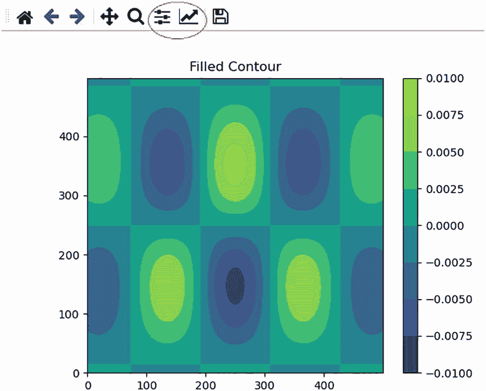

然而，因为`Qt5Agg`后端与 MATLAB 自身的 Qt5 库冲突，它并未包含在`matpy` conda 环境中。你需要退出该 conda 环境（`conda deactivate`）并返回“base”环境才能进行此类编辑。`pylustrator`⁵⁹是一个更高级的交互式编辑`matplotlib`图表的工具。其功能最好通过在其文档网站[`https://pylustrator.readthedocs.io/`](https://pylustrator.readthedocs.io/)上观看 YouTube 视频来了解。


