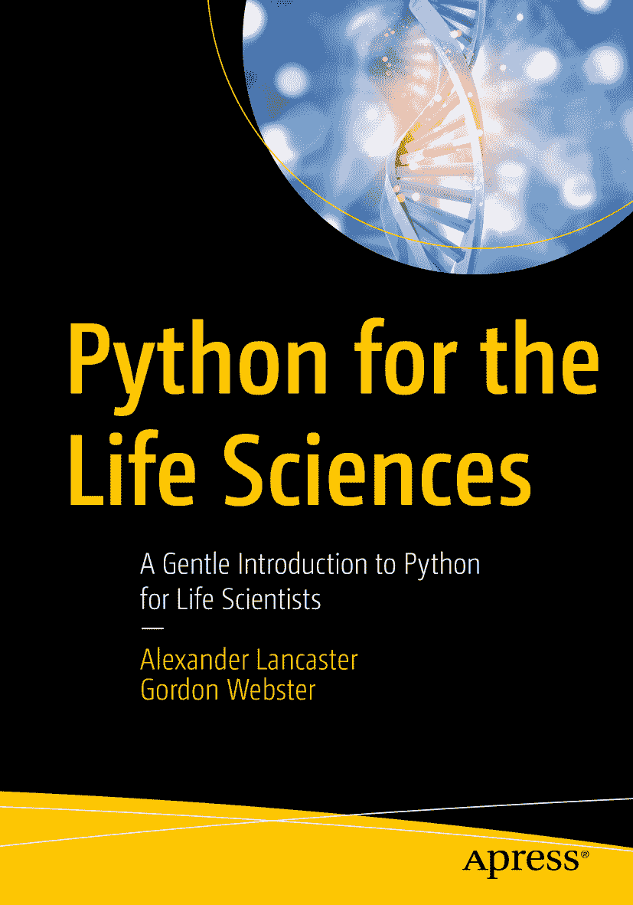
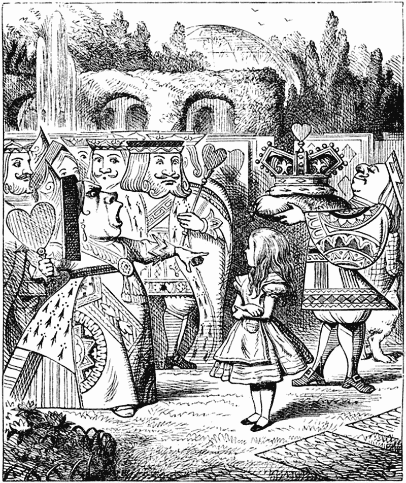

ISBN 978-1-4842-4522-4 e-ISBN 978-1-4842-4523-1 [`doi.org/10.1007/978-1-4842-4523-1`](https://doi.org/10.1007/978-1-4842-4523-1)  
© Alexander Lancaster and Gordon Webster 2019  
Apress Standard 本书中可能出现商标名称、标识和图像。我们不会在每次出现商标名称、标识或图像时都使用商标符号，而是仅以编辑方式使用这些名称、标识和图像，以维护商标所有者的权益，绝无意侵犯商标权。本书中使用的商号、商标、服务标志及类似术语，即使未明确标识，也不应被视为对其是否受所有权保护的任何意见表达。尽管本书中的建议和信息在出版时被认为是真实准确的，但作者、编辑和出版商均不对可能出现的任何错误或遗漏承担法律责任。出版商不对本书所含内容作出任何明示或暗示的保证。本书通过 Springer Science+Business Media New York 在全球图书贸易中发行，地址为：233 Spring Street, 6th Floor, New York, NY 10013。电话：1-800-SPRINGER，传真：(201) 348-4505，电子邮件：orders-ny@springer-sbm.com，或访问 www.springeronline.com。Apress Media, LLC 是一家加利福尼亚有限责任公司，其唯一成员（所有者）是 Springer Science + Business Media Finance Inc (SSBM Finance Inc)。SSBM Finance Inc 是一家特拉华州公司。

*献给我们家人*

## 赞誉《Python 生命科学应用》

有趣、引人入胜、诙谐且非常实用。这是一扇通往大数据革命的神奇之门。

> **—Sandro Santagata，哈佛医学院病理学助理教授**

通过《Python 生命科学应用》，Lancaster 和 Webster 提供了使用 Python 进行计算生物学的全面介绍。生物学家使用 Python 进行数据整理、统计推断和开发数学模型，《PftLS》为这三个应用领域提供了指导。值得注意的是，Lancaster 和 Webster 将经验丰富的软件开发人员的智慧建议融入其中——他们分享了一些趣闻和背景知识，让编程变得有趣，并使 Python/Unix 偶尔的怪异之处更易于理解。这不是一本浅显的入门书，细心的读者将通过阅读获得对 Python 的深刻理解，而不仅仅是成为简单用户。这是一本充满幽默和视角的可爱书籍。

> **—John Novembre，芝加哥大学人类遗传学副教授，麦克阿瑟奖得主**

Alex 和 Gordon 对 Python 的热情具有感染力。他们的书是专门为那些意识到可以从计算机编程培训中受益匪浅的人编写的。这一补充将对他们的学术研究产生不可估量的价值。各章节带你共同探索 Python 及其相关的众多生物学问题。这不仅仅是一本如何使用 Python 的“食谱”书，也不是一本关于高级工具的操作指南，而是一种激发你想象力的方式。

> **—Glenys Thomson，加州大学伯克利分校整合生物学教授**

信息学是现代生物科学的关键组成部分，编程技能对于现代生命科学研究者至关重要。即使不编写程序，阅读和理解代码的能力也变得与阅读已发表论文同样重要。Webster 和 Lancaster 的《Python 生命科学应用》对于编程新手和希望学习 Python 的有经验程序员来说，都是一本极好的教程。

> **—Steven J. Mack，奥克兰儿童医院研究所助理科学家**

## 掉进兔子洞

> *“从开头开始，”国王非常严肃地说，*
> *“一直走到终点；然后停止。”*

本书的目标是从最初的章节开始，就用生命科学家熟悉的例子教你 Python 的基础知识。你准备好探索如何使用 Python 来自动化实验室计算、**搜索** *基因启动子序列* 、**旋转** *分子键* 、**驱动** 96 孔板 *机器人* 、**构建**细胞 *开关*、**建模**动物 *花纹形成*、**培育**虚拟 *植物*、**模拟**流感 *疫情*，或**进化** *种群* 了吗？如果是这样，你来对地方了。准备好掉进兔子洞了吗？让我们开始吧……

## 序言

*欢迎来到纳迪亚王国*

|  | *“但我想写代码，”爱丽丝宣称。“会写代码能对我的研究有很大帮助。用手持计算器和电子表格能做的事情实在太有限了。”* *“呸！”疯帽子喊道。“你是生物学家，谁都知道真正的生物学家不写代码。”* *桌边陷入不安的沉默，爱丽丝看起来既生气又不服气。* *“Python！”她突然说道。“我要学 Python，你们说什么也阻止不了我！”* |

### 你是谁？

你可能是一位在学术或商业研究环境中工作的生命科学家，在实验室里最好的朋友（除了你的真朋友、你的 iPhone 和挂在工作台上方的晃头 Charles Darwin 公仔）很可能就是计算器和 Excel 电子表格。^(¹) 你可能没怎么写过计算机代码，但曾多次希望自己知道如何编写，因为你知道它能极大地帮助你的工作。

唉，计算机编程并非你大学和研究生阶段生命科学课程的核心部分，既然你已经全身心投入研究这个兔子洞，很难想象在职业生涯的这个阶段还有时间或精力去学习计算机编程（尤其是考虑到那些待处理的资助申请、报告和研究报告不会自己完成）。我们希望你至少是这样的读者，因为这类人最有可能掏钱购买我们的书。

### 你不是谁？

你可能不是一位经验丰富的生物信息学家、计算生物学家、计算机科学家或资深程序员。如果你是，那么已有的众多优秀书籍很可能已经满足了你的需求，比如那些专为像你这样的代码大师准备的书籍。我们这本小书不太可能教给你任何关于编程或 Python 而你却不知道的东西。

你也很可能*不是*一位希望通过你已熟悉的计算机编程范式来学习一些生物学的计算机科学家或程序员。如果你抱有这种期望，恐怕你来错地方了。本书假设你已经相当了解生物学，只需要一些帮助和鼓励来学习如何编写代码，以辅助你的生命科学研究。

所以，总结一下：

*   如果你已经是一位经验丰富的计算机高手或程序员，希望提升计算机技能或学习一些生物学知识，请继续前行，这里没什么可看的。

*   如果你是一位经验丰富但几乎或完全没有接触过计算机编程的生命科学家，希望获得快速直观的代码编写入门指导，以便能尽快上手并将其用于研究，那么请坐下吧，朋友，你来对地方了！

