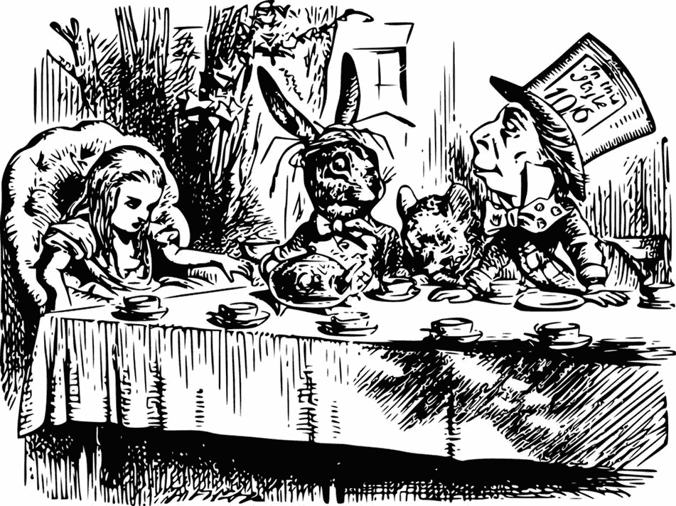
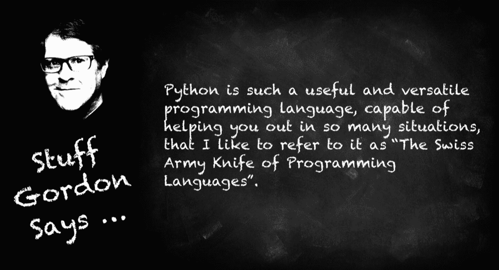
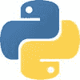
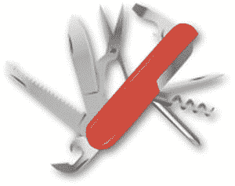
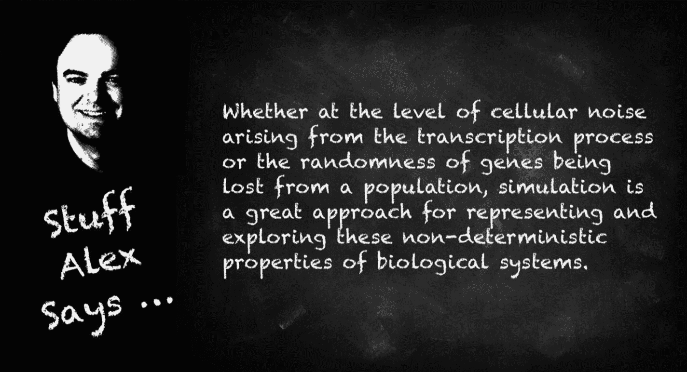

ISBN 978-1-4842-4522-4 e-ISBN 978-1-4842-4523-1 [`doi.org/10.1007/978-1-4842-4523-1`](https://doi.org/10.1007/978-1-4842-4523-1)

© Alexander Lancaster and Gordon Webster 2019

Apress Standard 本书中可能出现商标名称、标识和图像。我们不会在每次出现商标名称、标识或图像时都使用商标符号，而是仅以编辑方式使用这些名称、标识和图像，以维护商标所有者的权益，绝无意侵犯商标权。本书中使用的商号、商标、服务标志及类似术语，即使未明确标识，也不应被视为对其是否受所有权保护的任何意见表达。尽管本书中的建议和信息在出版时被认为是真实准确的，但作者、编辑和出版商均不对可能出现的任何错误或遗漏承担法律责任。出版商不对本书所含内容作出任何明示或暗示的保证。本书通过 Springer Science+Business Media New York 在全球图书贸易中发行，地址为：233 Spring Street, 6th Floor, New York, NY 10013。电话：1-800-SPRINGER，传真：(201) 348-4505，电子邮件：orders-ny@springer-sbm.com，或访问 www.springeronline.com。Apress Media, LLC 是一家加利福尼亚有限责任公司，其唯一成员（所有者）是 Springer Science + Business Media Finance Inc (SSBM Finance Inc)。SSBM Finance Inc 是一家特拉华州公司。

献给我们家人

## 赞誉《Python 生命科学应用》

有趣、引人入胜、诙谐且非常实用。这是一扇通往大数据革命的神奇之门。

> **—Sandro Santagata，哈佛医学院病理学助理教授**

通过《Python 生命科学应用》，Lancaster 和 Webster 提供了使用 Python 进行计算生物学的全面介绍。生物学家使用 Python 进行数据整理、统计推断和开发数学模型，《PftLS》为这三个应用领域提供了指导。值得注意的是，Lancaster 和 Webster 将经验丰富的软件开发人员的智慧建议融入其中——他们分享了一些趣闻和背景知识，让编程变得有趣，并使 Python/Unix 偶尔的怪异之处更易于理解。这不是一本浅显的入门书，细心的读者将通过阅读获得对 Python 的深刻理解，而不仅仅是成为简单用户。这是一本充满幽默和视角的可爱书籍。

> **—John Novembre，芝加哥大学人类遗传学副教授，麦克阿瑟奖得主**

Alex 和 Gordon 对 Python 的热情具有感染力。他们的书是专门为那些意识到可以从计算机编程培训中受益匪浅的人编写的。这一补充将对他们的学术研究产生不可估量的价值。各章节带你共同探索 Python 及其相关的众多生物学问题。这不仅仅是一本如何使用 Python 的“食谱”书，也不是一本关于高级工具的操作指南，而是一种激发你想象力的方式。

> **—Glenys Thomson，加州大学伯克利分校整合生物学教授**

信息学是现代生物科学的关键组成部分，编程技能对于现代生命科学研究者至关重要。即使不编写程序，阅读和理解代码的能力也变得与阅读已发表论文同样重要。Webster 和 Lancaster 的《Python 生命科学应用》对于编程新手和希望学习 Python 的有经验程序员来说，都是一本极好的教程。

> **—Steven J. Mack，奥克兰儿童医院研究所助理科学家**

## 掉进兔子洞

> *“从开头开始，”国王非常严肃地说，*

> *“一直走到终点；然后停止。”*

本书的目标是从最初的章节开始，就用生命科学家熟悉的例子教你 Python 的基础知识。你准备好探索如何使用 Python 来自动化实验室计算、**搜索** *基因启动子序列* 、**旋转** *分子键* 、**驱动** 96 孔板 *机器人* 、**构建**细胞 *开关*、**建模**动物 *花纹形成*、**培育**虚拟 *植物*、**模拟**流感 *疫情*，或**进化** *种群* 了吗？如果是这样，你来对地方了。准备好掉进兔子洞了吗？让我们开始吧……

## 序言

*欢迎来到纳迪亚王国*

|  | *“但我想写代码，”爱丽丝宣称。“会写代码能对我的研究有很大帮助。用手持计算器和电子表格能做的事情实在太有限了。”* *“呸！”疯帽子喊道。“你是生物学家，谁都知道真正的生物学家不写代码。”* *桌边陷入不安的沉默，爱丽丝看起来既生气又不服气。* *“Python！”她突然说道。“我要学 Python，你们说什么也阻止不了我！”* |
| --- | --- |

### 你是谁？

你可能是一位在学术或商业研究环境中工作的生命科学家，在实验室里最好的朋友（除了你的真朋友、你的 iPhone 和挂在工作台上方的晃头 Charles Darwin 公仔）很可能就是计算器和 Excel 电子表格。^(¹) 你可能没怎么写过计算机代码，但曾多次希望自己知道如何编写，因为你知道它能极大地帮助你的工作。

唉，计算机编程并非你大学和研究生阶段生命科学课程的核心部分，既然你已经全身心投入研究这个兔子洞，很难想象在职业生涯的这个阶段还有时间或精力去学习计算机编程（尤其是考虑到那些待处理的资助申请、报告和研究报告不会自己完成）。我们希望你至少是这样的读者，因为这类人最有可能掏钱购买我们的书。

### 你不是谁？

你可能不是一位经验丰富的生物信息学家、计算生物学家、计算机科学家或资深程序员。如果你是，那么已有的众多优秀书籍很可能已经满足了你的需求，比如那些专为像你这样的代码大师准备的书籍。我们这本小书不太可能教给你任何关于编程或 Python 而你却不知道的东西。

你也很可能*不是*一位希望通过你已熟悉的计算机编程范式来学习一些生物学的计算机科学家或程序员。如果你抱有这种期望，恐怕你来错地方了。本书假设你已经相当了解生物学，只需要一些帮助和鼓励来学习如何编写代码，以辅助你的生命科学研究。

所以，总结一下：

- 如果你已经是一位经验丰富的计算机高手或程序员，希望提升计算机技能或学习一些生物学知识，请继续前行，这里没什么可看的。
- 如果你是一位经验丰富但几乎或完全没有接触过计算机编程的生命科学家，希望获得快速直观的代码编写入门指导，以便能尽快上手并将其用于研究，那么请坐下吧，朋友，你来对地方了！

# 为什么选择 Python？

[Python](https://www.python.org/) ^(²) 是目前最流行且发展最迅速的计算机编程语言之一。从最微小的任务——例如编写几行简单脚本来读取和处理实验室仪器的数据文件，到大型研究项目——例如[开发用于探索蛋白质折叠的蒙特卡洛模拟](https://conference.scipy.org/scipy2010/slides/jan_meinke_protein_folding.pdf) ^(³)，Python 都无所不能。

我们是否提到过 Python 是免费的呢？

是的，无需首付，也无需分期付款，零成本你就能获得与 [NASA](https://www.nasa.gov/)、[工业光魔](http://www.ilm.com/)、[Google](https://www.google.com/) 以及其他众多知名机构所使用的相同的官方 Python 发行版。光是提到这些名字，就足以让你心生敬畏、激动不已，并且后悔为何没有早点搭上 Python 的顺风车。

Python 不仅免费，而且好消息是，如果你的电脑是苹果 Mac 或 Linux 系统，很可能已经预装了 Python 发行版。如果你使用的是 Windows 或其他我们尚未提及的操作系统，也无需担心——你的电脑很可能可以找到一种简单、自安装的 Python 发行版，只需从网络下载，几分钟内就能安装完毕。

Python 代码一写完即可直接运行。与其他一些编程语言不同，程序员无需[将代码编译](https://en.wikipedia.org/wiki/Compiler)成电脑可运行的[可执行文件](https://en.wikipedia.org/wiki/Executable)。这一切都在后台自动为你处理好了。这使得编写、测试和调整代码变得简单得多，因为传统的编译型语言每次修改代码后都需要重新编译。

与某些强制采用更高级且更难学习的编码风格（如[面向对象编程 (OOP)](https://en.wikipedia.org/wiki/Object-oriented_programming)）的语言不同，Python 也允许你（在更合适的代码项目中）编写简单的[过程式代码](https://en.wikipedia.org/wiki/Procedural_programming)。这种代码风格，如果你曾使用过 [BASIC](https://en.wikipedia.org/wiki/BASIC) 或 [C 语言](https://en.wikipedia.org/wiki/C_%2528programming_language%2529)等语言，应该会非常熟悉。这一切使得 Python 拥有难以置信的多功能性，因为它允许你快速编写和测试代码，甚至能用于其他语言实现起来非常繁琐的微小简单任务。

# 如何使用本书

本书的章节将像一次导览之旅，带领你同时了解 Python 编程语言及其在生物学中的应用。开篇章节聚焦于极小和极快的时空尺度（例如蛋白质动力学的纳米和纳秒尺度），而结尾章节则探讨宏大和缓慢的尺度（例如广袤的自然生态系统及其演化的代际时间尺度）。

在本书中，我们尽可能始终在生物学的语境下教授 Python 编程，而不是先向你介绍编程语言，之后才补充生物学的应用示例。当然，有时我们也不得不暂时偏离纯生物学的道路（愿生物学诸神宽恕我们的灵魂），但这种情况将仅限于为了让你——生物学家——能最大程度地利用 Python 编程，而需要引入一点其他领域知识的关键时刻。

我们的目标是让你对在研究中使用计算工具感到兴奋，并尽可能激发你的想象力，思考如何运用它们。我们希望传达这样一种理念：计算能如何助力你的研究，Python 语言在生物学中能有多么灵活多变，以及使用这门精彩的编程语言可以解决多么广泛的定量生物学研究问题。

正如我们之前所说，市面上已有大量更全面的书籍，介绍如何在生物信息学和计算生物学等领域使用 Python，这些书通常侧重于这些领域特定的更高级工具和库。**但这本书并非那种类型。** 我们确实会讨论其中一些领域，但本书的真正目的是为没有编程经验的生物学家提供工具、信心和灵感，让他们能够开始为自己的研究挑战定制 Python 解决方案。如果那些更专业的书籍相当于某个生物学领域的盛宴，那么本书更像是一份品鉴菜单，或者说是生命科学界的[小吃拼盘](https://en.wikipedia.org/wiki/Tapas)。

因此，如果你想了解如何使用 Python 来自动化基础的实验室计算、在基因组中搜索基因启动子序列、执行分子键的旋转、构建用于新一代测序的数据处理流程、驱动机器人或实验室仪器处理 96 孔板、模拟嘈杂的细胞切换开关，或者尝试对动物皮毛图案形成、植物生长、流感大流行或生物种群的演化进行建模，那么这本书或许正适合你！

为了让读者对后续内容有个预览，每章开头你都会看到一个表格，总结了你即将阅读章节中涉及的 Python 主题和生物学主题，如下所示：

|  | *变量声明、打印、注释、缩进代码与代码块、数值变量、整数、浮点数、指数、字符串、类型、鸭子类型、条件语句、函数* |

|  | *生物化学、缓冲液、摩尔浓度、分子量、摩尔体积* |

如果你需要回顾某一章的内容，这个简要总结可以帮你回忆起该章涵盖的主题，同时它也是一组可搜索的关键词，有助于你在书中找到你想要的内容。

你会注意到，**本书的早期章节在 Python 上着墨较多，生物学内容相对较少**，因为这些章节处理了大量前期必需的 Python 学习，以便让读者熟悉并掌握这门语言。在本书的后续章节中，你会看到许多可能之前见过的 Python 用法，但它们被应用在了新的语境中。从某种意义上说，各章节大致涵盖了从早期强调 Python 教育到后期强调 Python 启发的整个范围。请记住，我们的目标不仅是让生命科学领域的读者打下坚实的 Python 基础，更是要通过展示 Python 在生命科学研究中的多种应用方式，激励读者在自己的工作中使用它。正如我们之前所说——Python 确实是编程语言中的瑞士军刀！

# 这不是你祖母那辈的科学编程教材

我们致力于以生动动态的方式呈现生物数据与生物系统的计算表达，让读者能够轻松理解文本内容并从示例中学习。我们知道你并非计算机科学家（因为如果是的话，你就不需要这本书了），你阅读本书的目标是掌握足够的知识以在研究中使用计算工具，而非成为计算机科学家。我们也理解你时间宝贵，可能不愿为了一门编程课程而将研究搁置一个学期。我们的目标是尽可能快速高效地帮助你达成所需目标。

本书中的每个示例都代表一个生物学应用或原理，但它们同时也足够简洁明了，不会妨碍你学习 `Python` 编程语言的核心要素，以及如何将这些要素应用到自己的研究中。例如，在基于智能体的模型章节中，即使你之前从未接触过基于智能体的模型，这些示例也足够简单，不会掩盖读者理解其在 `Python` 中实现方式的努力。

## 我们为何撰写本书

尽管计算机编程能为生命科学研究带来巨大价值与实用性，但它仍然不是大学生命科学课程的核心组成部分——除非你选修生物信息学、计算生物学或系统生物学等更专业的课程。基于我们在学术与商业生命科学领域数十年的集体经验，我们见过许多生物学家试图将计算器和 `Excel` 电子表格这类"方樽"硬塞进研究问题的"圆孔"中，而这些问题本可以通过编写代码脚本、算法或软件应用程序更有效地解决。

## 我们的理念与写作方法

### 全程使用 Python

除极少数例外，全书始终只使用 `Python` 这一种语言。是的，我们清楚在某些计算生物学任务中，可能有工具或语言被认为比 `Python` "更好"或更高效。我们也绝不反对计算生物学中使用的其他优秀语言，如 `R`、`Java`、`Perl` 或 `Ruby`——我们自己就经常使用它们。所以如果你不同意我们的观点，想在某网络编程论坛上为此挑起论战，请便。只是要明白：除非这成为晚间新闻，否则我们很可能不会知道这事，因为我们不会出现在那里 :-)

### 博采众长，而非面面俱到

我们对示例的选择毫不掩饰地体现出"博采众长"的特点——这反映了我们各自在结构生物学与计算生物学（GW）以及进化生物学与复杂系统（AL）领域的背景。这种广度使我们能够覆盖生命科学的全部范畴：从分子建模和下一代测序到基于智能体的模型和进化遗传学。示例范围也从非常实用的（`NGS` 流程与实验室自动化）延伸到更具理论性和概念性的（图灵模式与 `L-系统`）。但即使在后面章节更抽象的模型中，我们也努力通过聚焦代码本身来保持理论与实践相结合。这与许多已发表的研究和教材截然不同——它们通常从高层次理论和算法文字描述入手，却将代码 relegated 到附录中。鉴于我们的目标是帮助生物学家打下足够的 `Python` 基础，使其能在研究中实际应用，我们跳过了 `Python` 一些更晦涩高级的特性，以保持书籍重点突出、篇幅可控。在你掌握 `Python` 基础之后，我们鼓励你进一步探索装饰器、对象内省等酷炫特性。但就本书而言，我们将主要讨论那种日常实用的 `Python` 基础内容——这很可能构成你编写代码的绝大部分，至少在最初阶段如此。

### 实用、迭代、自下而上

根据我们的经验，生物学家非常擅长基于以往经验进行迭代，并从简单案例中推断。在大多数示例中，我们直接切入主题，介绍生物学背景，并尽快展示代码。从简单的代码示例开始，逐步增加复杂性——这反映了大多数科学家的思维过程。请将其视为"餐巾纸背面"式的做法：一旦掌握了简单示例，就更容易激励自己在此基础上构建，进而解决更大的问题。我们的方法假设我们都站在山脚下，共同学习攀登，而不是我们站在山顶上，对攀登地点和方式发号施令。

### 富含仿真的方法

虽然我们涵盖了这类书籍中你期望的数据解析与分析等实用和数学方面的内容，但我们同时也重点关注基于生成仿真的模型。我们相信，在某些知识领域，仿真比数学解释能更快地建立直觉——而这在计算生物学入门教材中（尤其是那些同时教授编程的教材）常常被忽略。此外，在生物学中，仿真中使用的代码表示通常在概念上更接近被建模的现象，有助于在生物学与其代码概念表示之间建立至关重要的认知飞跃。更重要的是，仿真鼓励人们"摆弄"模型以观察结果：我们相信这种"玩"对学习至关重要！

# 与噪声共存

学习与研究生物系统，需要对其固有的噪声、异质性和彻头彻尾的“混乱”有一定程度的熟悉与适应。因此，有别于大多数入门教材的传统方法，本书将用大量篇幅介绍如何使用 `Python` 在不同生物学层面探索随机模型和噪声数据。

# 编写代码是定量生物学的一部分

我们有时会遇到一些生物学家，他们喜欢将构建模型甚至开发算法作为研究的一部分，但自称并不热爱实际编写代码。这常常听起来像：“我不是程序员，但我确实设计算法”，其中隐含的（并不微妙的）暗示是，编写代码是某种低级机械任务，如同根据建筑师的蓝图砌砖。我们认为这种区分毫无意义：*代码就是算法，反之亦然*。编写代码迫使你将自己所有隐含的假设变得明确。计算机不容忍任何歧义，从真正意义上说，编写代码迫使你以一种非常细致和底层的粒度去理解你所描述的系统。

# 生物学并非全是“大数据”

数据科学和大数据如今在生命科学领域风靡一时，我们在本书中介绍了一些生物学中这些数据科学方法的构建模块（例如，第 4 章关于`贝叶斯定理`，第 8 章关于`新一代测序`）。然而，数据并非知识，我们相信模型是组织数据、推理数据，并最终将其转化为知识的必要框架。生命科学领域大数据投资的回报乏善可陈，与这方面投资的迅猛增长形成了反比。我们认为，产生更多真正知识和生物学洞察的方法，是强调机理模型和概念模型，而不是更传统（且普遍流行）的数据分析方法。正因如此，我们用了比典型的生物学编程入门书籍更多的篇幅来介绍建模方法。

# 为生物学而来，为代码而留

好吧，你还在这里，说明你可能仍然感兴趣，那么不如让我们先睹为快，看看本书的章节概要。虽然我们是按线性顺序撰写本书的，但大部分 `Python` 核心概念都涵盖在前七章中。因此，你可以先阅读这七章，然后像品尝西班牙小菜一样，选择其他章节阅读。

## 序言：欢迎来到书呆子王国

1.  **开始使用 Python：** 为使用 `Python` 做好环境准备
    我们将带你踏上旅程，详细介绍如何建立你自己的 `Python` 环境。

2.  **实验台上的 Python：** `Python` 语言基础
    我们介绍一些 `Python` 基础知识，并向你展示如何抛弃计算器和电子表格，让 `Python` 减轻基础实验室计算的枯燥工作（从而腾出更多宝贵时间去喝咖啡和玩《我的世界》）。

3.  **理解序列：** 生物序列与 `Python` 数据结构
    我们介绍基本的 `Python` 字符串和字符处理，并展示 `Python` 在处理核酸和蛋白质序列方面与生俱来的强大功能。

4.  **统计插曲：** 贝叶斯定理与生物标志物
    在这里我们讨论贝叶斯定理，并用 `Python` 实现它，同时说明为什么即使是你的医生也可能无法正确评估你的癌症风险。

5.  **打开数据之门：** 读取、解析和处理生物数据文件
    我们是否已经提到过 `Python` 在处理生物序列数据方面有多出色？在本章中，我们将讨论扩展到诸如 `FASTA` 之类的序列文件格式。

6.  **大海捞针：** 用于基因组和序列的正则表达式
    在本章中，我们将展示如何使用 `Python` 正则表达式快速高效地搜索即使是最大型的生物序列——同时，打破 `Python` 因为是一种解释型语言而必然缓慢的神话。

7.  **对象课程：** 作为 `Python` 对象的生物序列
    就在你以为关于序列的话题已经结束之时，我们将探讨 `Python` 中面向对象编程的基础概念，并演示一种使用 `Python` 对象处理生物序列的更高级、更稳健的方法。

8.  **切分基因组数据：** 新一代测序流程
    我们将演示使用 `Python` 创建一个简单的新一代测序流程是多么容易——以及如何使用它从多种基因组来源（包括全基因组）中提取数据。

9.  **孔啊！孔啊！：** 微孔板实验 I：数据结构
    我们将使用 `Python` 管理来自生物测定中那匹值得信赖的“老黄牛”——96 孔板的数据。

10. **渐入佳境：** 微孔板实验 II：自动化与可视化
    在前一章的基础上，我们添加了实验室自动化，并使用 `Python` 的 `matplotlib` 库创建便捷的可视化图表。

11. **3D 分子：** 结构生物学的数学与线性代数
    在本章中，我们将展示 `Python` 实现分子力学三维数学和线性代数的能力。这是纳米级的，但朋友们，这仍然是生物学！

12. **开关基因：** 使用 `matplotlib` 可视化生化动力学
    在本章中，我们将使用 `Python` 重现生化烧杯中的反应（没有难闻的气味）——以及使用 `Python` 模拟别构蛋白的协同结合效应。

13. **驯服网络毛团：** 使用 `Python` 集合挖掘系统生物学数据
    在本章中，我们将演示如何使用 `Python` 集合解析和查询网络数据，并在此过程中驯服复杂的网络“毛团”。

14. **遗传反馈回路：** 使用 Gillespie 算法模拟基因网络
    在本章中，我们介绍 Gillespie 算法来模拟细胞中的生物噪声和开关，并使用 `Python` 实现该算法并可视化结果。

15. **培育虚拟花园：** 使用 L 系统模拟植物发育
    在本章中，我们介绍用于培育虚拟植物的林登迈耶系统，并使用 `Python` 实现的 Turtle Logo。别担心，这些植物不会入侵你的花园（但它们可能会占领你的电脑）。

16. **豹子如何得到它的斑点：** 图灵模式的元胞自动机模型
    在本章中，我们利用元胞自动机的力量，使用 `Python` 的 2D 图形，通过图灵形态发生模型培育出漂亮的豹纹短裤。提醒读者：在撰写本章的过程中，没有豹子受到伤害。

17. **狐狸看守鸡舍：** 基于捕食者-猎物动态的生态建模
    在本章中，我们将鸡和狐狸放入一个生态系统，让它们在一个使用 `Python` 动画功能可视化的状态空间中一决高下。

18. **虚拟流感疫情：** 使用基于智能体的模型探索流行病学
    在本章中，我们用具有内部状态和行为的智能体创建一个虚拟流感疫情。这展示了 `Python` 的面向对象编程方法真正大放异彩的方法。

19. **追寻生命足迹：** 使用 Wright-Fisher 模型的进化动力学
    在本章中，我们使用 Wright-Fisher 模型来演示自然选择的作用，并展示成为“最适者”并不总是意味着你会“赢”。想想荷马·辛普森在抢椅子游戏中获胜的情景。

## 尾声：因为分手很难

# 常见问题解答

*我从未写过一行代码。我能读懂这本书和书中的示例吗？*

- 本书假设读者`零`编程基础，正是为像你这样的人所写。除了需要具备一定的生物学背景知识外，使用本书所需的唯一前提是掌握高中水平的数学，足以让你顺利进入大学的生物学本科课程。

*我是一位生命科学工作者，在其他编程语言（如*[`Java`](https://en.wikipedia.org/wiki/Java_%2528programming_language%2529) *和* `C`*）方面有丰富的编码经验。这本书对像我这样的人有用吗？*

- 你可能会发现，本书花了大量篇幅解释你已掌握的概念，例如整数与浮点运算的区别，或是面向对象编程。不过，如果你从未使用过`Python`，并且愿意跳过已知内容，那么你会发现，对于其他语言有编码经验的生命科学工作者来说，这是一本不错的`Python`入门读物。

*我是一位计算机科学家，想学习一些生物学知识。这本书对像我这样的人有用吗？*

- 没用。这本入门教材中介绍的基本编程概念你早已掌握，而且本书并非生物学教科书。事实上，我们对读者几乎唯一的假设就是，他们已具备一定的生命科学训练和经验。由于本书涵盖了广泛的生物学示例，我们会在每个章节简要回顾相关生物学知识以帮助读者定位，但不会花费时间解释大学级别生物学教材中通常涵盖的基本生物学概念。

*他们说`Python`速度太慢且效率低下，无法用于大型计算任务。这是真的吗？*

- 这跟说“多吃胡萝卜能练就非凡夜视力”（[`gizmodo.com/youve-been-lied-to-about-carrots-your-whole-life-becau-1124868510/1126108142`](http://gizmodo.com/youve-been-lied-to-about-carrots-your-whole-life-becau-1124868510/1126108142)）的“他们”是同一批人吗？^(⁴) 本书的两位作者都曾使用`Python`处理计算密集型研究问题，例如模拟在人类基因组上使用新型下一代测序实验室方案。诚然，标准`Python`发行版在某些情况下不如一些编译型语言（如`C`）快，但有许多方法可以提升`Python`的性能，使其至少达到这些更快语言的同一水平，甚至与它们持平。在这种“谁更快”的讨论中，经常被忽略的一个指标是实际编写代码所花费的时间。就代码编写、测试和调试的速度而言，`Python`是一个比许多其他语言（如`C`）高效得多的编码平台。因此，即使不考虑任何优化`Python`代码性能的尝试，假设 Bob 花一个月用`C`写代码，程序运行一天完成；而 Alice 花一天用`Python`写代码，程序运行一个月完成（这些数字完全是假设性的，仅用于说明）。谁的情况更好？我们个人会认为 Alice 略胜一筹，因为她现在有一个月的时间可以做更多工作，甚至可以轻松去海滩度假，而 Bob 还困在电脑前写代码！当然，对于多次计算，Bob 的情况会更有利，在这种情况下，Alice 应该花些时间优化代码（例如，使用[Cython](http://cython.org/) ^(⁵) 等工具将代码中最耗费 CPU 的部分编译为`C`）和/或优化她的处理方式（例如，探索某种形式的[处理并行化](https://docs.python.org/2/library/multiprocessing.html) ^(⁶)）来提高计算效率。实际上，在第 6 章（关于使用`Python`正则表达式进行下一代测序——顺便提一句，这一章源于我们其中一位作者（GW）使用`Python`进行的真实研究项目）中，我们花了一些篇幅来澄清这种认为`Python`总是很慢的谬误。

*这本书中的一些示例似乎是在重复造轮子，编写了`Python`社区为使用`Python`进行生物学研究而创建的许多优秀代码库中已有的代码。您难道不鼓励读者直接使用这些代码库吗？*

- 当然，在读者自己的实际项目中，应该使用这些库。但本书的目标是教会生命科学家如何编写代码。编写代码自然要具备理解代码的能力。作为一名程序员，很大一部分工作就是能处理他人的代码，进行修改、扩展等。市面上已有大量教授这些库用法的书籍，其中许多文档也极其完善。但在你使用这些代码的职业生涯中，有时你需要能够理解代码的含义，否则它对你而言就是一个黑箱。因此，例如在第[11](https://doi.org/10.1007/978-1-4842-4523-1_11)章中，我们展示了如何实现绕共价键旋转一组原子所需的简单线性代数，但在实践中，你几乎肯定会使用像[NumPy](http://www.numpy.org/) ^(⁷) 或[SciPy](https://www.scipy.org/) ^(⁸) 这样优秀的数学库来完成这项工作。

## 关于作者及技术审校者

### 关于作者

### 关于技术审校者

脚注 1 2 3 4 5 6 7 8 9 10 11 12 13 14 15 16
