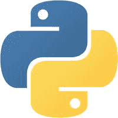

# 为什么选择 Python？

[Python](https://www.python.org/) ^(²) 是目前最流行且发展最迅速的计算机编程语言之一。从最微小的任务——例如编写几行简单脚本来读取和处理实验室仪器的数据文件，到大型研究项目——例如[开发用于探索蛋白质折叠的蒙特卡洛模拟](https://conference.scipy.org/scipy2010/slides/jan_meinke_protein_folding.pdf) ^(³)，Python 都无所不能。

我们是否提到过 Python 是免费的呢？

是的，无需首付，也无需分期付款，零成本你就能获得与 [NASA](https://www.nasa.gov/)、[工业光魔](http://www.ilm.com/)、[Google](https://www.google.com/) 以及其他众多知名机构所使用的相同的官方 Python 发行版。光是提到这些名字，就足以让你心生敬畏、激动不已，并且后悔为何没有早点搭上 Python 的顺风车。

Python 不仅免费，而且好消息是，如果你的电脑是苹果 Mac 或 Linux 系统，很可能已经预装了 Python 发行版。如果你使用的是 Windows 或其他我们尚未提及的操作系统，也无需担心——你的电脑很可能可以找到一种简单、自安装的 Python 发行版，只需从网络下载，几分钟内就能安装完毕。

Python 代码一写完即可直接运行。与其他一些编程语言不同，程序员无需[将代码编译](https://en.wikipedia.org/wiki/Compiler)成电脑可运行的[可执行文件](https://en.wikipedia.org/wiki/Executable)。这一切都在后台自动为你处理好了。这使得编写、测试和调整代码变得简单得多，因为传统的编译型语言每次修改代码后都需要重新编译。

与某些强制采用更高级且更难学习的编码风格（如[面向对象编程 (OOP)](https://en.wikipedia.org/wiki/Object-oriented_programming)）的语言不同，Python 也允许你（在更合适的代码项目中）编写简单的[过程式代码](https://en.wikipedia.org/wiki/Procedural_programming)。这种代码风格，如果你曾使用过 [BASIC](https://en.wikipedia.org/wiki/BASIC) 或 [C 语言](https://en.wikipedia.org/wiki/C_%2528programming_language%2529)等语言，应该会非常熟悉。这一切使得 Python 拥有难以置信的多功能性，因为它允许你快速编写和测试代码，甚至能用于其他语言实现起来非常繁琐的微小简单任务。

