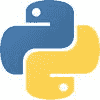
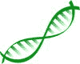
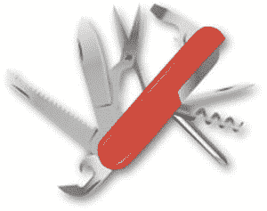

# 如何使用本书

本书的章节将像一次导览之旅，带领你同时了解 Python 编程语言及其在生物学中的应用。开篇章节聚焦于极小和极快的时空尺度（例如蛋白质动力学的纳米和纳秒尺度），而结尾章节则探讨宏大和缓慢的尺度（例如广袤的自然生态系统及其演化的代际时间尺度）。

在本书中，我们尽可能始终在生物学的语境下教授 Python 编程，而不是先向你介绍编程语言，之后才补充生物学的应用示例。当然，有时我们也不得不暂时偏离纯生物学的道路（愿生物学诸神宽恕我们的灵魂），但这种情况将仅限于为了让你——生物学家——能最大程度地利用 Python 编程，而需要引入一点其他领域知识的关键时刻。

我们的目标是让你对在研究中使用计算工具感到兴奋，并尽可能激发你的想象力，思考如何运用它们。我们希望传达这样一种理念：计算能如何助力你的研究，Python 语言在生物学中能有多么灵活多变，以及使用这门精彩的编程语言可以解决多么广泛的定量生物学研究问题。

正如我们之前所说，市面上已有大量更全面的书籍，介绍如何在生物信息学和计算生物学等领域使用 Python，这些书通常侧重于这些领域特定的更高级工具和库。**但这本书并非那种类型。** 我们确实会讨论其中一些领域，但本书的真正目的是为没有编程经验的生物学家提供工具、信心和灵感，让他们能够开始为自己的研究挑战定制 Python 解决方案。如果那些更专业的书籍相当于某个生物学领域的盛宴，那么本书更像是一份品鉴菜单，或者说是生命科学界的[小吃拼盘](https://en.wikipedia.org/wiki/Tapas)。

因此，如果你想了解如何使用 Python 来自动化基础的实验室计算、在基因组中搜索基因启动子序列、执行分子键的旋转、构建用于新一代测序的数据处理流程、驱动机器人或实验室仪器处理 96 孔板、模拟嘈杂的细胞切换开关，或者尝试对动物皮毛图案形成、植物生长、流感大流行或生物种群的演化进行建模，那么这本书或许正适合你！

为了让读者对后续内容有个预览，每章开头你都会看到一个表格，总结了你即将阅读章节中涉及的 Python 主题和生物学主题，如下所示：

|  | *变量声明、打印、注释、缩进代码与代码块、数值变量、整数、浮点数、指数、字符串、类型、鸭子类型、条件语句、函数* |

|  | *生物化学、缓冲液、摩尔浓度、分子量、摩尔体积* |

如果你需要回顾某一章的内容，这个简要总结可以帮你回忆起该章涵盖的主题，同时它也是一组可搜索的关键词，有助于你在书中找到你想要的内容。

你会注意到，**本书的早期章节在 Python 上着墨较多，生物学内容相对较少**，因为这些章节处理了大量前期必需的 Python 学习，以便让读者熟悉并掌握这门语言。在本书的后续章节中，你会看到许多可能之前见过的 Python 用法，但它们被应用在了新的语境中。从某种意义上说，各章节大致涵盖了从早期强调 Python 教育到后期强调 Python 启发的整个范围。请记住，我们的目标不仅是让生命科学领域的读者打下坚实的 Python 基础，更是要通过展示 Python 在生命科学研究中的多种应用方式，激励读者在自己的工作中使用它。正如我们之前所说——Python 确实是编程语言中的瑞士军刀！