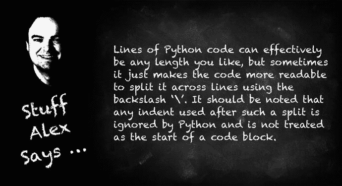

# 3. 理解序列

*生物序列与 Python 数据结构*

|  | *“你确实非常奇怪，”爱丽丝对鸟说。“你只有长度没有宽度，而且你的一端看起来和另一端太像了，很难知道该和哪一端说话。”* *“和其他所有鸟一样，我从头开始，一直延伸到脚，”鸟说。“只要把我放在任何其他鸟旁边，你就会发现我们都是同样的构造。”* *爱丽丝看起来困惑不解，从她的表情中，鸟看出需要一些额外的澄清。* *“听着，只要在一张纸上写下头-身体-脚，瞧！你就有了一个识别任何鸟类的现成模板，”鸟不耐烦地说。* *爱丽丝似乎一时陷入了沉思，“但这个模式也会匹配其他小女孩，”她最后说道。* *“好吧，好吧，”鸟生气地说。“我现在真的不想讨论同构问题，但既然你提出来了……”* |
| --- | --- |
|  | *字符串变量；列表；*`len()`*；迭代器；代码块；字符串和列表的切片表示法；对象；方法；字符串搜索；列表方法；字典；键值对；布尔值，*`in`*，*`True`*，*`False`*；子串；元组，*`while`*；可变和不可变对象* |
|  | *DNA 序列，限制性内切酶，限制性酶切，分子量* |

序列是生物学的关键部分，到本章结束时，你会惊讶于自己以前为什么不使用 Python 来管理它们。Python 有一些非常出色的特性，使其成为存储、搜索和分析蛋白质及核酸序列的绝佳工具。如果 Python 处理序列的能力是它对生命科学家的唯一吸引，那么仅凭这一点就足以使其在生物学家的工具箱中占有一席之地。

## 关于序列和字符串

由于生物序列通常以字符串形式表示，字符串可能是我们讨论用 Python 编写代码管理序列的一个很好的起点。

这是一个非常简单的 DNA 序列：

```
mySequence = 'atcg'
```

Python 中的字符串有许多特性，使其成为处理生物序列的绝佳载体。清单 3-1 给出了一个例子。

```python
mySequence = 'atcg'
print('Sequence length is ',len(mySequence))
```
```
Sequence length is  4
```

**列表 3-1 Python 中的字符串**

在清单 3-1 中，我们展示了 Python 的`len`函数如何返回字符串的字符长度，正如我们将在其他章节中看到的，它也可以应用于其他 Python 变量类型，如列表。

如果我们要对序列进行任何计算，我们肯定希望能够逐位置遍历序列，所以这似乎是介绍 Python 循环的好时机。清单 3-2 中有一个例子，紧接着是其输出。

```python
mySequence = 'atcg'
for c in mySequence:
    print(c)
```
```
a
t
c
g
```

**列表 3-2 Python 中的循环**

你刚刚输入并执行的代码翻译成中文就是“对于`mySequence`中的每一项，给该项一个临时名称`c`，然后将`c`打印到控制台。”这种循环结构在 Python 中称为`迭代器`。Python 知道字符串是由更小的项（在本例中是字符）组成的，所以当你使用`for`命令迭代一个字符串时，迭代器会按出现顺序返回字符串中的每个字符。我使用了名称`c`，因为本例中的项是字符，但我完全可以轻松使用任何其他名称，比如`b`或`base`，因为我们处理的序列是 DNA 序列。

`print(c)`一行的缩进非常重要。正如我们在其他章节中看到的，缩进是在 Python 中创建要一起执行的代码块的方式。在`for`语句下方缩进一级的每一行代码都会在每次循环迭代时执行。例如，请参见清单 3-3。

```python
for c in mySequence:
    print('This line will be executed for each pass through the loop')
    print('So will this one')
print('This line will only be executed at the end')
```
```
This line will be executed for each pass through the loop
So will this one
This line will be executed for each pass through the loop
So will this one
This line will be executed for each pass through the loop
So will this one
This line will be executed for each pass through the loop
So will this one
This line will only be executed at the end
```

**列表 3-3 循环中的缩进**

`for`代码块中的两行缩进代码会针对序列中的每个字符执行，而未缩进的`print`语句则只在所有迭代完成后执行一次。清单 3-4 展示了一个更贴近实际示例的`for`循环中的代码块。

```python
i = 0
for c in mySequence:
    i += 1
    print(i,c)
```
```
1 a
2 t
3 c
4 g
```

**列表 3-4 for 循环中的代码块**

在前面的例子中，我们还初始化了一个变量`i`为零，然后在每次循环迭代时将其递增 1，这样我们也可以打印 DNA 序列中每个碱基的索引。带有 Python 递增运算符`i += 1`的表达式是编写`i = i + 1`的语法简写，并且还有一个类似的递减运算符`-=`。

字符串（以及 Python 中所有基于列表的对象）的另一个特性是，它们的字符（如果是列表则为项）也可以根据对象中的数值位置来访问，从 0 开始（Python 中所有列表、序列、数组等都是从 0 开始编号）直到对象的长度减 1。你还可以使用`[from:to]`语法对字符串（以及列表）进行切片：

```python
print(mySequence[0])
```
```
a
```
```python
print(mySequence[3])
```
```
g
```
```python
print(mySequence[-1])
```
```
g
```
```python
print(mySequence[0:4])
```
```
atcg
```
```python
print(mySequence[:4])
```
```
atcg
```
```python
print(mySequence[2:3])
```
```
c
```
```python
print(mySequence[2:4])
```
```
cg
```
```python
print(mySequence[2:])
```
```
cg
```
```python
print(mySequence[-3:])
```
```
tcg
```

注意 Python 索引的以下特性：`[from:to]` 范围中的最后一个数字是**独占的**，例如，如果你想要选择序列中到位置 41 及之前的切片，`to` 指定符需要是 42（该位置**不会**被包含在选中的子字符串（或子列表）中）；如果省略了 `from` 或 `to` 索引，则默认使用字符串（或列表）的开头或结尾；字符串（或列表）的负索引表示距离字符串末尾的第 `-n` 个位置。

既然我们已经介绍了 Python 字符串和列表的切片表示法，那么让我们花点时间介绍一下 Python 列表，因为它们在某些方面与字符串非常相似，并且我们可以将已学到的字符串表示法应用到列表上。

## 列表与更多内容

Python 列表是一个由项目组成的序列，类似于字符串是由字符组成的序列，但不同之处在于 **Python 列表项目可以是任何 Python 对象**，而不仅仅是字符。我们也不在 Python 列表周围使用引号，而是像这样使用方括号：

```python
mySequenceAsAList = ['a','t','c','g']
```

请注意，这里我们存储了与之前字符串示例完全相同的序列，但这次使用的是列表格式。注意各个项目是如何用逗号分隔并括在方括号中而不是引号中的。尽管这种格式看起来与之前的字符串版本截然不同，但我们可以看到，我们之前使用的字符串切片表示法应用于这个列表时，产生的结果与之前应用于字符串时非常相似。

# Python列表与字符串的操作对比

## 索引与切片行为

我们新的基于列表的序列包含字符，就像之前的字符串版本一样，所以当我们打印列表中的单个项目时，例如 `print(mySequenceAsAList[0])`，我们得到与之前相同的结果 —— 一个字符。然而，当我们打印列表的切片时，例如 `print(mySequenceAsAList[2:4])`，我们会以列表格式而不是字符串格式得到结果。请注意，任何时候我们对列表使用切片表示法，即使结果只包含一个项目，我们得到的始终是列表格式的结果。例如，`print(mySequenceAsAList[2:3])` 返回 `['c']` 而不是 `c`。字符串在编程语言中是一种非常常见且广泛使用的习语，你可以将Python字符串视为Python列表的一种特殊版本，专门用于表示字符序列，并具有其自身适用于字符串的特殊语法。

```python
print(mySequenceAsAList[0])
a
print(mySequenceAsAList[3])
g
print(mySequenceAsAList[-1])
g
print(mySequenceAsAList[0:4])
['a', 't', 'c', 'g']
print(mySequenceAsAList[:4])
['a', 't', 'c', 'g']
print(mySequenceAsAList[2:3])
['c']
print(mySequenceAsAList[2:4])
['c', 'g']
print(mySequenceAsAList[2:])
['c', 'g']
print(mySequenceAsAList[-3:])
['t', 'c', 'g']
```

但现在让我们看看Python列表和Python字符串之间的一些主要区别。首先，也是最重要的一点，Python列表项目可以是任何Python对象：字符串、数字 —— 甚至另一个列表、列表的列表、列表的列表的列表…… 好吧，你明白我的意思。这是一个包含完全不同类型对象集合的列表，包括字符串、列表、数字，甚至Python的`True`和`None`值。`True`是Python内置的布尔值，毫不奇怪，它是其姊妹布尔值`False`的对立面。`None`值用于表示没有赋值的Python对象 —— 它实际上是一个指向空值的指针。我们会在本书中经常遇到这些内置值，并变得非常熟悉它们，但暂时，让我们先看看它们如何作为元素出现在列表中：

```python
myList = ['atcg',['a','t','c','g'],42,True,None]
print('Length of myList is: ',len(myList))
Length of myList is:  5
print(myList[0])
atcg
print(myList[1])
['a', 't', 'c', 'g']
print(myList[2])

print(myList[3])
True
print(myList[4])
None
```

作为一个有点好奇的小插曲，请注意`myList`中的第二个项目（`myList[1]`）本身就是一个列表。既然它嵌入在另一个列表中，你认为应该如何引用内部列表中的项目？实际上这非常合乎逻辑且直观 —— 例如：

```python
print(myList[1][2])
c
print(myList[1][1:3])
['t', 'c']
```

很简单，对吧？

现在来点更有难度的？

## 可变性对比

**Python中字符串和列表的一个重大区别是列表是可变的（`mutable`），而字符串则不是。**

呼！

正式声明一下，如果你不确定“*可变*”是什么意思，它听起来就是它本身的意思 —— 可改变的、可修改的。说字符串是不可变的可能看起来违反直觉，因为我们一开始可以给它们赋值，但一旦字符串值被赋值，除非用另一个字符串替换它，否则它不能被改变。

当我们说：

```python
correctSpelling = 'recognize'
```

然后：

```python
correctSpelling = 'recognise'
```

我们实际上并没有修改字符串`correctSpelling`，我们本质上是创建了一个同名的新字符串。如果我们将`correctSpelling`声明为一个列表，在列表 3-5 中，我们可以进行字符串无法做到的完全修改。

```python
correctSpelling = ['r','e','c','o','g','n','i','z','e']
correctSpelling[7] = 's'
print(correctSpelling)
['r', 'e', 'c', 'o', 'g', 'n', 'i', 's', 'e']
```

*列表 3-5：修改列表*

如果我们尝试类似地编辑字符串版本（**Python中不允许这样做**）：

```python
correctSpelling = 'recognize'
correctSpelling[7] = 's'
correctSpelling[7] = 's'
TypeError: 'str' object does not support item assignment
```

我们会得到一条错误消息，告诉我们字符串类型（在Python中缩写为`str`）不允许对其单个项目进行赋值。实际上有一些特殊的函数用于编辑字符串，但它们都是创建新字符串，而不是编辑现有字符串，例如，在列表 3-6 中。

```python
correctSpelling = 'recognise'
correctSpelling = correctSpelling.replace('s','z')
print(correctSpelling)
recognize
```

*列表 3-6：编辑字符串*

## 方法与对象

`correctSpelling.replace('s','z')`这条语句的语法可能看起来有些陌生，但它却引入了Python中我们尚未接触过的一个方面。Python中的**对象**（例如字符串）可以拥有其特定**对象类型**所独有的特殊函数，这些专用函数被称为**方法**（关于对象的更多内容，请参阅第7章关于[面向对象编程](https://en.wikipedia.org/wiki/Object-oriented_programming)的内容，届时我们将看到可以定义自己的对象类型，甚至可以重新定义或扩展现有的Python对象类型）。

对象类型的方法可以通过前面展示的`object.method()`语法应用于该类型的*实例*。方法只是一个为特定对象类型定义的*函数*。它拥有名称和用于传递参数的括号，这与我们在第2章描述函数声明时所见的情形相同。然而，最大的区别在于，方法始终接收调用它的对象作为参数。这听起来可能有些奇怪，但当你考虑到方法是专属于某对象类型的函数时，这就完全合理了。它旨在为其所针对的对象类型执行某些操作或与该对象类型协同工作，因此，它永远不会在不涉及该类型对象的任何上下文中使用。

在示例`correctSpelling.replace('s','z')`中，`correctSpelling`是字符串对象，它正在使用为字符串对象定义的`replace()`方法。

为了完成对Python列表的介绍，让我们来看看一些很酷的**列表方法**（即为列表对象定义的函数），它们允许我们编辑列表。

```python
myList = ['apple','banana','pear','llama','orange']
print(myList)
['apple', 'banana', 'pear', 'llama', 'orange']
myList.append('peach')
print(myList)
['apple', 'banana', 'pear', 'llama', 'orange', 'peach']
myList.insert(2,'kiwi')
print(myList)
['apple', 'banana', 'kiwi', 'pear', 'llama', 'orange', 'peach']
myList.remove('llama')
print(myList)
['apple', 'banana', 'kiwi', 'pear', 'orange', 'peach']
```

在Python中，还有一些不采用`object.method()`语法的其他编辑列表的方式，例如：

```python
myList[4] = 'lemon'
print(myList)
['apple', 'banana', 'kiwi', 'pear', 'lemon', 'peach']
print(sorted(myList))
['apple', 'banana', 'kiwi', 'lemon', 'peach', 'pear']
```

列表在 Python 中极其灵活，还有很多使用它们的方法，我们将在其他章节中看到。不过现在，如果你想更深入地研究一下 Python 列表的用法，可以看看 Python 官方网站上的这篇[数据结构文档](https://docs.python.org/2/tutorial/datastructures.html)。

## Python 字典是你的朋友

既然我们已经开始了解如何将生物学序列存储为 Python 字符串，并使用 `[from:to]` 字符串切片符号来访问片段，那么让我们看看 Python 中最有用的特性之一——字典——如何帮助我们分析生物学序列。

我们是否已经提到过 **Python 字典是你的朋友？**

Python 字典是一个带标签的项目的存储库。项目的顺序不像在字符串或列表中那样至关重要，因此，项目不是根据其数值位置来标记，而是几乎可以按照我们选择的任何方式进行标记——例如：

```
musician = {'name':'Nigel','instrument':'guitar','preferred volume':11,}
print(musician['name'])
Nigel
print(musician['instrument'])
guitar
print(musician['preferred volume'])
```

Python 字典由**键值对**组成，其中**键**是查找项目所用的标签，**值**显然是项目的值。字典的值可以是任何*不可变*的 Python 对象——例如：

```
gene = {'name':'p53','taxonomy':9606,'metal binding':True, \
'locations':['cytoplasm','nucleus']}
print(gene['name'])
p53
print(gene['taxonomy'])
9606
print(gene['metal binding'])
True
print(gene['locations'])
['cytoplasm', 'nucleus']
print(gene['locations'][0])
cytoplasm
print(gene['locations'][1])
Nucleus
```



在此示例中，**键**都是字符串，但**值**包括一个字符串、一个整数、一个布尔值和一个列表。请注意，引用字典内嵌列表中项目的逻辑仍然适用——与我们之前列表嵌套列表示例的唯一区别在于，这里使用键（而非数值位置）来引用字典项。

好了，回到字典的话题……

Python 中的字典键名**必须是唯一的**，并且可以是任何**不可变**对象类型，因此字符串和数字可以作为字典键，但列表（如前所述是可变的）则不可以。顺便提一下，Python 中实际上有一种特殊的不可变列表类型，称为**元组**，它用普通圆括号括起来，以区别于可变列表。元组*可以*用作字典键，不过我们暂时不再多说元组了。

可以通过简单的声明直接将新条目添加到字典中，例如：

```
gene['name'] = 'homo sapiens'
gene['id'] = 96020344
```

也可以像这样创建一个空字典：

```
gene = {}
```

因此，在列表 3-7 中，我们创建了一个核苷酸分子量的字典（如果你是生物学家，这真的很有用！），然后创建了一个计算寡核苷酸分子量的函数，最后使用一个短 DNA 序列测试了我们的新函数。

```
dnaMolecularWeight = {'a':313.2,'c':289.2,'t':304.2,'g':329.2}
def oligoMolecularWeight(sequence):
    dnaMolecularWeight = {'a':313.2,'c':289.2,'t':304.2,'g':329.2}
    molecularWeight = 0.0
    for base in sequence:
        molecularWeight += dnaMolecularWeight[base]
    return molecularWeight

dnaSequence = 'tagcgctttatcg'
print(oligoMolecularWeight(dnaSequence))
4002.59999999999
```

**列表 3-7** 计算分子量

太棒了！

### 用 Python 编写的 DNA 限制性内切酶酶切函数

现在我们来看一个稍微复杂一点的案例，其中我们可以将字典和列表结合使用——计算限制性内切酶酶切后产生的 DNA 片段的分子量。

限制性内切酶的活性可以通过其在 DNA 序列上的识别位点以及相对于该识别位点的切割位置来定义。我们来创建一个字典，用于定义这些限制性内切酶的参数：

```
restrictionEnzymes = {}
```

并添加几个限制性内切酶，以便开始使用：

```
restrictionEnzymes['bamH1'] = ['ggatcc',0]
restrictionEnzymes['sma1'] = ['cccggg',2]
```

请注意，该字典中每个条目的**键**是酶的名称，而值是一个列表，其第一个元素是酶的识别位点，第二个元素是酶相对于识别位点切割 DNA 的位置。

你可以想象为这个字典添加一整批限制性内切酶，甚至将其用作一种简单的限制性内切酶数据库，从而进行数字化的 DNA 限制性酶切实验。然而，你几乎肯定需要一种方法来跟踪字典中存在哪些酶，并且能够查询字典中是否包含你感兴趣的酶。

如果要在代码中使用字典，有两个非常有用的字典方法你应该了解，描述它们的最佳方式是看看它们在实际中的应用：

```
print(restrictionEnzymes.keys())
['bamH1', 'sma1']
print('sma1' in restrictionEnzymes)
True
print('EcoR1' in restrictionEnzymes)
False
```

这里再次使用了 `object.method()` 语法来访问为字典对象定义的方法。`keys()` 方法返回一个包含字典所有键的**列表**，而检查指定的键是否 `in` 字典则返回 `True` 或 `False`。请注意，`keys()` 方法返回的字典键列表不一定按输入顺序排列，也不一定是字母顺序或其他特定顺序。**Python 字典的排序方式与 Python 列表不同**，因此你不能像操作列表那样通过位置来引用字典条目。

顺便提一下，你当然可以使用之前用过的 `sorted()` 函数按字母顺序对键进行排序，如下所示：

```
print(sorted(restrictionEnzymes.keys()))
['bamH1', 'sma1']
```

在我们深入介绍限制性内切酶酶切函数的完整代码之前，需要介绍另一个非常有用的字符串方法，即 `find`。它的工作原理如下：

```
mySequence = 'gctgtatttcgatcgatttatgct'
print(mySequence.find('ttt'))

print(mySequence.find('gtgtgt'))
```

请注意，`mySequence.find` 方法返回字符串 `mySequence` 中**第一个**出现的子串 `'ttt'` 的位置。如果我们搜索一个**不在**该序列中的子串（`'gtgtgt'`），`find` 方法会返回 `-1`，表示未找到该子串（注意，`find` 不能使用 `0` 表示“未找到”，因为这实际上是 Python 字符串中第一个位置的索引，`0` 表示子串就在那个位置）。

但还要注意，`mySequence` 中还有第二个 `'ttt'` 出现。如果我们想找出 `mySequence` 中所有 `'ttt'` 的出现位置该怎么办呢？对于我们想要编写的限制性内切酶酶切函数来说，肯定需要能够做到类似的事情。

我们仍然可以在限制性内切酶酶切函数中使用 `find` 方法，但需要了解该方法可以接受的一些额外参数，在此过程中，我们还将学习函数中的**默认参数**。

如果我们查看 `find` 方法声明的代码，它看起来应该是这样的：

```
def find(self,substring,start=None,end=None):
```

请记住，方法只是针对其定义所操作对象的函数（正式地说，它们操作的是**特定类的实例**，但更多内容将在后续的**面向对象编程**和**Python 类**中介绍）。所以暂时不必过于纠结 `self` 参数，这只是方法特有的语法，通过它，方法将对象作为第一个参数接收，从而知道它操作的是哪个对象。

我们真正关心的是方法声明中已经预定义的两个参数 `start` 和 `end`。Python 允许我们为函数和方法的参数声明默认值，这样我们就无需每次都输入它们。当某个参数几乎总是相同时，这会非常有用——例如：

# DNA限制性内切酶消化函数解析

## 默认参数与函数调用

默认情况下，函数会自动设置四个轮子：

```python
def automobile(color, horsepower, wheels=4):
```

这允许我们这样使用该函数：

```python
myCar = automobile('火焰灰', 300)
```

但我们也允许在需要时指定轮子数量（例如，处理相对罕见的三轮汽车情况）：

```python
myCar = automobile('钴黑色', 150, 3)
```

## 查找子串：从 `find` 到 `while` 循环

类似地，我们可以覆盖 `find` 方法的默认 `start` 和 `end` 参数，以便强制在字符串的不同区域进行搜索。这样，每次找到 `'ttt'` 子串时，我们都可以从下一个位置重新开始搜索：

```python
print(mySequence.find('ttt'))
print(mySequence.find('ttt', 7))
```

在我们使用的这个简单示例中，一眼就能看出只有两个 `'ttt'` 子串出现，但如果处理的是更长的序列和/或更复杂的子串呢？

我们需要一种方法，能够连续迭代整个序列，从头到尾识别出所有子串的位置。让我们通过引入 Python 的 `while` 运算符来看看如何实现这一点：

```python
found = 0
searchFrom = found
while found != -1:
    found = mySequence.find('ttt', searchFrom)
    if found != -1:
        print('子串发现于: ', found)
        searchFrom = found + 1
```

输出：
```
子串发现于:  6
子串发现于:  16
```

只要 `while` 包含的条件为真，它就会继续迭代执行其后缩进的代码块。在这里，我们利用了 `find` 方法在找不到更多子串时返回 `-1` 的特性。循环的工作非常简单：我们搜索子串，每次找到时报告它并更新下一次搜索的起始位置，然后重复，直到最终 `find` 方法返回 `-1`。

## 限制性内切酶消化函数

现在，我们终于可以编写本章一直致力于构建的函数了——一个接收DNA序列并计算限制性内切酶酶切后产生的DNA片段分子量的函数。

我们将使用本章之前创建的 `oligoMolecularWeight` 函数来计算片段的分子量——我们还将使用之前创建的限制性内切酶字典。

在函数内部，我们将片段及其分子量存储为函数将要返回的“元组列表”。回想一下我们之前的讨论，“元组只是一个不可变的列表”，在Python中它与列表的区别在于使用圆括号而不是方括号。例如：

```python
fruit = ['苹果', '橙子']
print(fruit)
# ['苹果', '橙子']
fruit[1] = '梨'
print(fruit)
# ['苹果', '梨']

fruit = ('苹果', '橙子')
print(fruit)
# ('苹果', '橙子')
fruit[1] = '梨'
# TypeError: 'tuple' 对象不支持元素赋值
```

然而，在其他所有方面，元组的行为与列表类似，但一旦创建，如果不创建新元组就无法编辑。如前所述，元组因这一特性可用作字典键，同时它们也适用于创建那些一旦生成就不得编辑的列表，这对于我们限制性内切酶消化函数的结果来说似乎很合适。

那么闲话少叙，让我们直接进入清单3-8中的DNA限制性内切酶消化函数。

```python
restrictionEnzymes = {}
restrictionEnzymes['bamH1'] = ['ggatcc', 0]
restrictionEnzymes['sma1'] = ['cccggg', 2]

def restrictionDigest(sequence, enzyme):
    motif = restrictionEnzymes[enzyme][0]
    cutPosition = restrictionEnzymes[enzyme][1]
    fragments = []
    found = 0
    lastCut = found
    searchFrom = lastCut
    while found != -1:
        found = sequence.find(motif, searchFrom)
        if found != -1:
            fragment = sequence[lastCut:found+cutPosition]
            mwt = oligoMolecularWeight(fragment)
            fragments.append((fragment, mwt))
        else:
            fragment = sequence[lastCut:]
            mwt = oligoMolecularWeight(fragment)
            fragments.append((fragment, mwt))
        lastCut = found + cutPosition
        searchFrom = lastCut + 1
    return fragments
```

**清单3-8** DNA限制性内切酶消化函数

接下来，让我们逐步解析它……

### 1. 函数定义与变量初始化

```python
def restrictionDigest(sequence, enzyme)
    motif = restrictionEnzymes[enzyme][0]
    cutPosition = restrictionEnzymes[enzyme][1]
```

该函数接受两个参数：DNA序列和来自 `restrictionEnzymes` 库的酶名称。为了让代码更具可读性，我们将限制性位点序列赋值给 `motif`，将切割位置赋值给 `cutPosition`。

```python
fragments = []
found = 0
lastCut = found
searchFrom = lastCut
```

接着我们创建一个列表，用于存储并最终返回消化结果，同时初始化一些重要变量，用于追踪我们在序列中的处理进度。

- `found` 表示最后一个找到的限制性位点的位置，初始化为序列的起始位置。
- `lastCut` 存储上一次切割DNA的位置（可能与限制性位点的起始位置不同），这用于定义当前片段的起始位置（同时也是上一个片段的结束位置）。
- `searchFrom`（同样是为了提高代码可读性而引入）指示下一次搜索应从何处开始，它总是上一次切割DNA位置的下一个位置。

### 2. 核心 `while` 循环

```python
while found != -1:
    found = sequence.find(motif, searchFrom)
    if found != -1:
        fragment = sequence[lastCut:found+cutPosition]
        mwt = oligoMolecularWeight(fragment)
        fragments.append((fragment, mwt))
    else:
        fragment = sequence[lastCut:]
        mwt = oligoMolecularWeight(fragment)
        fragments.append((fragment, mwt))
    lastCut = found + cutPosition
    searchFrom = lastCut + 1
```

函数的剩余部分通过一个 `while` 循环遍历DNA序列，只要 `sequence.find` 方法成功找到另一个限制性位点，循环就会继续。当找到位点时，计算当前片段并将其存入 `fragments` 列表。

请注意，一旦 `sequence.find` 方法未能找到另一个限制性位点，我们需要完成从当前位置到序列末尾的最后一个片段，并将其与其他片段一起存储。

在每次循环迭代结束时，我们更新上一次DNA链的切割位置，以及下一次循环搜索的起始位置（如果还有下一次循环的话）。

### 3. 测试与结果

现在，让我们用一个虚构的DNA序列来测试限制性内切酶消化函数。我特意在该序列中插入了两个 `bamH1` 限制性位点（当然，你首先需要执行清单3-8中的代码）：

```python
digestSequence = 'gcgatgctaggatccgcgatcgcgtacgatcgtacgcggtacggacggatccttctc'
print(restrictionDigest(digestSequence, 'bamH1'))
```

输出：
```
[('gcgatgcta', 2800.7999999999997), ('ggatccgcgatcgcgtacgatcgtacgcggtacggac', 11478.400000000005), ('ggatccttctc', 3345.1999999999994)]
```

太棒了！

我们的函数以元组列表的形式返回限制性内切酶消化片段，每个元组包含片段的序列及其分子量。这个函数本身就非常实用，但这还仅仅触及了Python处理生物序列能力的皮毛。稍后，我们将看到Python最强大的工具之一——“正则表达式”，如何被用于大规模基因组学和测序应用。但在那之前，我们将通过贝叶斯定理，进行一个关于Python数学表达式和字符串格式化的简短停留。
