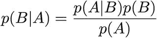

# 4. 统计学插曲

## *贝叶斯定理与生物标志物*

|  | *“我是爱丽丝，你叫什么名字？”爱丽丝对王后说。**“我是王后！”王后愤怒地回答，“按照惯例，你应该称呼我为‘陛下’。”**“抱歉，陛下，可我怎么能知道您是王后呢？”爱丽丝问道。**“你好！”王后傲慢地说，指了指自己，“你早餐是不是吃了一大盘‘废话’？王冠——华丽的服饰——威严的气度……这些难道不是王后身份的证明吗？”**“嗯！”爱丽丝边说边掏出纸笔，开始草草写下一些方程，同时低声细语：“那么，如果我们将王后占总人口的比例，与那些戴王冠、穿华丽服饰但并非王后的人的比例进行比较……再除以……”**“书呆子警报！”王后恼怒地喊道，“这里有人有阿司匹林吗？”* |

|  | *函数、函数参数* *、字符串格式化、字符串格式化中的* `%` *运算符* |

|  | *药物与诊断开发、零假设、t 检验、贝叶斯定理、癌症、卵巢癌、生物标志物、CA-125、概率、条件概率* |

作为生命科学家，我们很少能遇到任何接近确定性的情况。我们处理的系统通常是非线性的、混沌的、异质的、非二元的——用一个词来说，就是混乱的。在商业生命科学领域，一项数亿甚至数十亿美元的研发投资的真正价值，往往可能取决于成功与失败之间那如刀锋般细微的界限。这需要计算诸如 `t 检验` 之类的东西，来判定你究竟是拥有了一个适销对路的产品，还是另一种安慰剂——对于诊断产品而言，则要区分是真正的指标还是背景噪声。

开发一种新药物或诊断工具，本质上是一个收集证据的过程，用来支持或反对你的工作假设，即你的产品使用将带来比不使用更大的净收益。在这种情况下，零假设——即你的产品根本不会带来任何净收益——是你方法中（并且始终应该是）的核心考量因素。随着制药公司沿着通往重磅产品的希望之路积累每一份新数据，他们都在权衡证据，以判断最终的成功或失败。

## 贝叶斯牧师及其著名定理

这种权衡证据的过程在 18 世纪由托马斯·贝叶斯（一位痴迷于统计学和概率论的英国牧师）进行了数学形式化。`贝叶斯定理`，这一以他命名的里程碑式公式，是权衡科学证据的重要方法，以至于我们认为值得在书中为其单独开辟一个小章节，并且我们将使用 Python 进行该定理的数值探索。此外，我们的经验表明，尽管该定理在科学方法的任何定量应用中处于核心地位，但许多生物学家在培训中从未接触过`贝叶斯定理`的正式介绍。理解`贝叶斯定理`的含义及其在我们这个充满不确定性的世界中每天面临的真理、信念和可能性等无数问题上的应用，是每一位科学家（无论是否是生物学家）都能在其工作中善加运用的能力。因此，本章除了当你将其实现为代码时会学到的 Python 知识外，还将作为`贝叶斯定理`的教程。`贝叶斯定理`也是一个非常便捷的示例，可用于演示简单的 Python 数学函数。

``

那么，为什么`贝叶斯定理`如此有用？它作为生命科学家能教给我们什么呢？

为了对`贝叶斯定理`进行一个非常简单的简要介绍，让我们来看看生物标志物的开发——这是一个与预测和可能性问题直接相关的生命科学研究领域。

### 贝叶斯定理的实际应用：生物标志物的性能

假设我们正在寻找一种影响约 1.5%人口的疾病的可靠早期指标，并且我们的研究发现了一种生物标志物，其存在可预测约 80%的患者患有该疾病。听起来不错，对吧？大多数人可能会看着这些数字得出结论：该生物标志物的阳性检测结果意味着患该疾病的概率约为 80%。相当不错。

别急。

还有一个非常重要的问题尚未回答：“有多少未患病的人仍然会通过这种生物标志物得到阳性检测结果？”一种在 80%的患者（无论是否患病）中均产生阳性结果（指示疾病存在）的生物标志物，显然对指示疾病存在没有任何预测能力。如同生活中大多数事物所固有的不确定性，生物标志物几乎从不是 100%可靠的，但为了我们的故事，假设所讨论的生物标志物在约 4%的未患病患者中产生假阳性结果（即检测结果指示疾病，但实际上并不存在）。情况似乎有所好转。有了这些数字，我们可能会觉得这种生物标志物在临床上前景光明，基于以下推理——它仅在约 10 名患者中约有 2 人未能检测出疾病，并且在约 100 名健康患者中仅约有 4 人产生误诊。

那么现在情况良好，对吧？

再说一次——别急。

让我们从一个假设的 10,000 名患者群体的角度来思考这种生物标志物的性能。基于该疾病 1.5%的发病率，我们预期该群体中约有 150 名患者患病，因此约有 9850 名未患病者。在这 150 名患者中，根据 80%的阳性检测率，我们预期约有 120 人对该生物标志物检测呈阳性。在 9850 名未患病者中，根据 4%的假阳性检测率，我们预期约有 394 人检测呈阳性。

现在，假设你是其中一位刚刚得到阳性检测结果的患者。你问的第一个问题将是：“既然我检测呈阳性，我患病的概率是多少？”

这确实是关键问题。检测结果到底意味着什么？

为了回答这个问题，让我们看看在任何情况下获得阳性检测结果的总体概率。我们预期 120 名患病者检测呈阳性，394 名未患病者检测呈阳性。因此，在总共 514 例阳性检测中，我们预期 120 名检测呈阳性的患者实际上患有疾病，对应概率约为 23%。换句话说，对于那位检测呈阳性的患者的问题的答案是，基于阳性检测结果，他们实际患病的几率大约只有四分之一。换一种说法（或许更乐观一些），尽管检测呈阳性，但他们不患病的几率仍然约为四分之三。

或者再换一种说法——尽管检测呈阳性，患者不患病的可能性仍然是患病的三倍。

有了对生物标志物性能的这一新分析，你还会认为这种生物标志物是该疾病有用的临床诊断工具吗？例如，如果你是一名医生，你会根据阳性检测结果所指示的四分之一患病几率，安排一项可能有风险或昂贵的外科手术吗？或者，尽管检测呈阳性，你会选择完全不采取任何措施吗？

你可能会惊讶地发现，这个“假设”的疾病生物标志物示例基于`CA-125 生物标志物`的真实数据，该标志物实际上被用作`卵巢癌`的诊断指标。已有大量关于卵巢癌发病率以及使用`CA-125`作为诊断标志物的统计数据发表。我们所要做的只是将这些数字代入贝叶斯模型。

根据美国癌症协会的数据^(⁵⁵)，女性一生中患卵巢癌的风险约为 1/72（0.0134）。在一项涉及超过 78,000 名女性的近期研究中^(⁵⁶)，使用`CA-125`作为单一指标产生了 3285 例假阳性结果（约 4%），其中健康女性被诊断患有卵巢癌。顺便值得注意的是，尽管之前介绍的贝叶斯模型相当粗糙，但其获得的诊断概率与从接受`CA-125`检测的女性研究中获得的真阳性和假阳性检测的实际统计数据相当吻合。

顺便提一下，如果你认为我们夸大了人们对生物标志物统计数据的幼稚解读（例如，一个能检测出 80%患病病例的检测，在人们心中等同于如果检测呈阳性就有 80%的患病概率），不幸的是，我们并没有夸大。在反复的研究中，一直表明即使是大多数负责为患者解读这类统计结果的医生，也难以正确解读它们^(⁵⁷)，通常对他们由此得出的结论赋予了超出实际情况的置信度。

## 贝叶斯定理：数学细节

我们之前用于在给定先验证据（患者检测结果呈阳性）的情况下，确定某个事件（患者患有疾病）概率的直观“算法”，可以用一个方程更正式地表达。贝叶斯定理的正式描述通常表示为如下形式的方程：



在上述方程中，语法 `p(B|A)` 表示在给定结果 A 的情况下，结果 B 的[条件概率](https://en.wikipedia.org/wiki/Conditional_probability)。如果我们代入在直观方法中使用的相同数值，来重新计算在检测结果呈阳性的情况下患病的概率，结果如下：

- `p(disease | positive) = p(positive | disease) * p(disease) / p(positive)`

请注意，`p(positive)` 是所有可能导致阳性检测结果情况的总概率——在我们的例子中，它是无论患病与否，得到阳性检测结果概率的总和。

- `p(positive) = p(positive | disease) * p(disease) + p(positive | no disease) * p(no disease)`

- `p(positive)` = `0.8 * 0.015 + 0.04 * 0.985 = 0.0514`

因此，`p(disease | positive)` = `0.8 * 0.015 / 0.0514 = 0.233`，这对应于我们使用直观方法得出的 23% 的概率。

## Python 中的贝叶斯生物标志物函数

让我们在 Python 中实现这个函数。首先，在代码清单 4-1 中，我们将实现一个特定于本章所举的生物标志物例子的函数，然后将其扩展为前面方程中所示的贝叶斯定理一般形式的实现。

```
def biomarker(pDisease,pPosDisease,pPosNoDisease):
    pNoDisease = 1.0 - pDisease
    pPos = pPosDisease * pDisease + pPosNoDisease * pNoDisease
    return (pPosDisease * pDisease) / pPos
代码清单 4-1
生物标志物函数
```

我们定义了一个名为 `biomarker` 的函数，它接受三个参数：`pDisease`，即患有该疾病的总体（人群）概率；`pPosDisease`，即当你患有该疾病时，检测结果呈阳性的概率；当然，还有我们在最初考虑生物标志物性能时缺失的关键信息——`pPosNoDisease`，即在你没有患病的情况下检测结果呈阳性的概率（即假阳性检测率）。

利用基本概率论，我们知道不患病的概率等于 1.0 减去患病的概率，因此我们可以立即计算出方程中需要的这个量，如函数第一行所示：

```
pNoDisease = 1.0 - pDisease
```

现在我们可以计算 `pPos`，即所有可能得到阳性检测结果的方式。在我们的例子中，有两种方式——要么患病，要么不患病。

```
pPos = pPosDisease * pDisease + pPosNoDisease * pNoDisease
```

最后，我们可以通过计算并从函数中返回“在所有可能的阳性检测结果中，实际对应某人患有该疾病的阳性检测结果所占的比例”，来将所有部分整合在一起。

```
return (pPosDisease * pDisease) / pPos
```

在代码清单 4-2 中，让我们用与卵巢癌例子中的真实数据相对应的输入参数来测试我们的 `biomarker` 函数：

```
def biomarker(pDisease,pPosDisease,pPosNoDisease):
    pNoDisease = 1.0 - pDisease
    pPos = pPosDisease * pDisease + pPosNoDisease * pNoDisease
    return (pPosDisease * pDisease) / pPos

pDisease = 0.015
pPosDisease = 0.8
pPosNoDisease = 0.04
print('Probability (disease | positive result) = ', \
      biomarker(pDisease,pPosDisease,pPosNoDisease))
Probability (disease | positive result) =  0.23346303501945526
代码清单 4-2
生物标志物函数运行示例
```

看起来不错，所以在下一节中，我们将通过重写函数，使其反映方程中所示的贝叶斯定理的一般形式来收尾。

## 使用通用贝叶斯函数进行字符串格式化

```
def bayes(outComeA,outComeB,pB,pAGivenB,pAGivenNotB):
    pNotB = 1.0 - pB
    pA = pAGivenB * pB + pAGivenNotB * pNotB
    pBGivenA = (pAGivenB * pB) / pA
    return 'p (%s | %s) = %.2f' % (outcomeB, outcomeA, pBGivenA)
代码清单 4-3
一个带有 Python 字符串格式化的简单通用贝叶斯函数
```

在代码清单 4-3 中，我们展示了一个函数，它在功能上（无意双关）与我们刚刚在代码清单 4-2 中实现的更具体的 `biomarker` 形式相同，区别在于我们现在增加了两个额外的参数 `outComeA` 和 `outComeB`，这样我们就可以向函数提供我们要计算概率的结果 `pA` 和 `pB` 的描述。这两个描述性参数在函数的最终 `return` 语句中被使用，以便以比通用方程更具可读性的形式输出结果。

你还会在 `return` 语句中看到 Python 巧妙的字符串格式化用法。

```
return 'p (%s | %s) = %.2f' % (outcomeB, outcomeA, pBGivenA)
```

这种字符串格式化语法允许你在 Python 字符串中为数字、文本或各种其他 Python 数据类型放置占位符，之后可以根据需要以编程方式将这些占位符插入到字符串中。在我们的函数中，我们将两个结果描述作为字符串（`%s`）输出，并将最终计算出的 `pBGivenA` 概率作为保留两位小数的浮点数（`%.2f`）输出。

在代码清单 4-4 中，我们展示了一些 Python 字符串格式化示例及其输出，以让你了解该语法的工作原理。

```
geneName = 'TP53 tumor protein p53 [ Homo sapiens (human) ]'
geneID = 7157
matchProbability = 98.64756341
print('The gene to be analyzed is: %s' % geneName)
print('The gene ID number is: %d' % geneID)
print('The gene match probability is: %.3f' % matchProbability)
print('The results for geneId: %d: %s' % (geneID,geneName))
The gene to be analyzed is: TP53 tumor protein p53 [ Homo sapiens (human) ]
The gene ID number is: 7157
The gene match probability is: 98.648
The results for geneId: 7157: TP53 tumor protein p53 [ Homo sapiens (human) ]
代码清单 4-4
Python 字符串格式化示例
```

请注意，如果你要将多个字段插入到一个格式化字符串中（正如你在我们的 `bayes` 函数的输出中可以看到的那样），这些字段需要用括号括起来。Python 字符串格式化语法的完整细节可以在官方 Python 网站的 [Python 字符串文档](https://docs.python.org/2/library/string.html)^(⁵⁸) 中找到。

最后，让我们在代码清单 4-5 中测试一下我们更通用的 `bayes` 函数，以确保它能正常工作。

```
def bayes(outComeA,outComeB,pB,pAGivenB,pAGivenNotB):
    pNotB = 1.0 - pB
    pA = pAGivenB * pB + pAGivenNotB * pNotB
    pBGivenA = (pAGivenB * pB) / pA
    return 'p (%s | %s) = %.2f' % (outcomeB, outcomeA, pBGivenA)

outcomeA = 'positive test result'
outcomeB = 'has disease'
pB = 0.015
pAGivenB = 0.8
pAGivenNotB = 0.04
print(bayes(outcomeA,outcomeB,pB,pAGivenB,pAGivenNotB))
p (has disease | positive test result) = 0.23
代码清单 4-5
在函数中使用字符串格式化
```

作为生命科学家，权衡证据始终是我们工作的重要组成部分。我希望前面的例子能清楚地表明，至少在生物医学科学领域，天真地权衡证据可能会付出极其高昂的代价，甚至有生命危险。在生命科学中，贝叶斯定理已成功应用于广泛的生物学领域，例如生物信息学和计算生物学、新一代测序、生物网络分析以及疾病演化和流行病学等，仅举几例。

## 贝叶斯定理的基本原理

贝叶斯定理的基本原理非常容易掌握，尤其是在处理此处讨论的点概率和二元结果时，但贝叶斯定理的应用十分广泛，不仅限于生命科学，在证据权衡影响我们信念与决策的任何活动领域都适用。

贝叶斯定理可用于分析多种不同类型的数据，但将数据点硬编码到 Python 程序中可能会略显繁琐。为方便起见，我们将在下一章介绍 Python 的文件处理功能。
