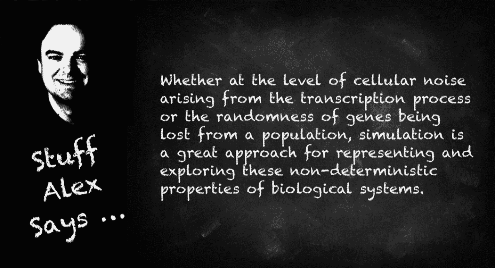

# 编写代码是定量生物学的一部分

我们有时会遇到一些生物学家，他们喜欢将构建模型甚至开发算法作为研究的一部分，但自称并不热爱实际编写代码。这常常听起来像：“我不是程序员，但我确实设计算法”，其中隐含的（并不微妙的）暗示是，编写代码是某种低级机械任务，如同根据建筑师的蓝图砌砖。我们认为这种区分毫无意义：*代码就是算法，反之亦然*。编写代码迫使你将自己所有隐含的假设变得明确。计算机不容忍任何歧义，从真正意义上说，编写代码迫使你以一种非常细致和底层的粒度去理解你所描述的系统。
