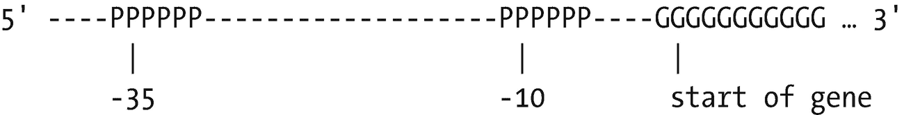
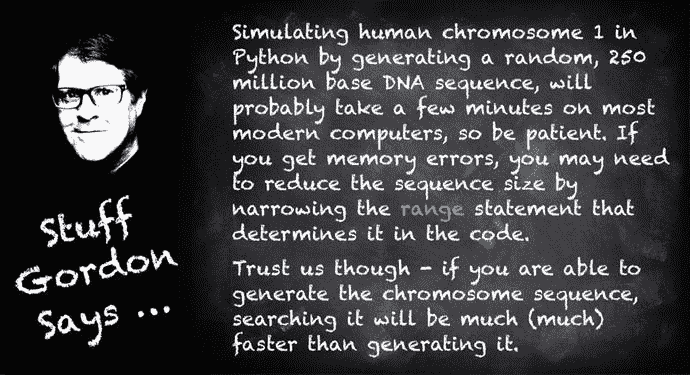
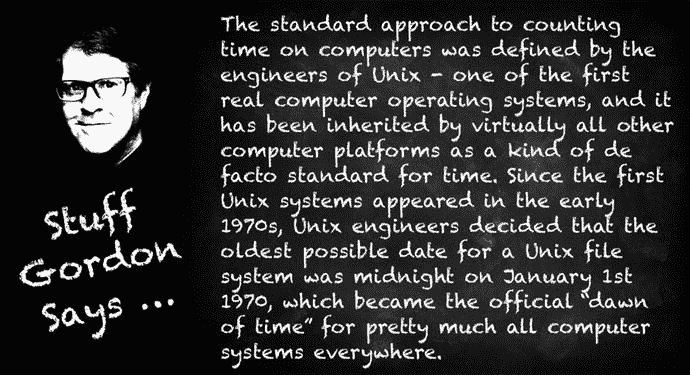

# 6. 在数据堆中寻找“针”

*用于基因组学和测序的正则表达式*

|  | *“哦，天哪！”白兔说道。“我实验室会议要迟到了，还有堆积如山的基因测序数据要处理。”*
*他放弃了计算器和电子表格，花了大价钱买了一个处理基因数据的炫酷桌面应用，但依然很沮丧。那个看起来想满足所有人需求的应用，在紧要关头，根本无法完成他处理实验数据所需的特定分析。*
*突然，毫无预兆地，一只坐在池塘中央睡莲上的智慧老蟾蜍，用沙哑的声音说了一个词：“Python！”*
*“什么？不，不，不！”被逼得焦头烂额的白兔喊道。“谁都知道 Python 很慢，因为它是一种解释型语言，而时间正是我最缺少的东西。”*
*“嘿，你是那个穿着花哨马甲、戴着怀表的啮齿动物，而我只是个吃苍蝇的老家伙。我能懂什么？”老蟾蜍说着跳进水里寻找下一顿美餐。* |

|  | *正则表达式、`re` 模块、Python 模块和子模块、`import`、Python `MatchObject`、迭代器、Python 字节码、Python 解释器、`random` 模块、2038 年问题、`time` 模块、Cython、SWIG、Python 标准库* |

|  | *新一代测序、基因启动子、限制性内切酶、限制位点、基因组、DNA、核苷酸、染色体、共有序列、错配* |

那些参与基因组学或[新一代测序](https://en.wikipedia.org/wiki/DNA_sequencing%2523Next-generation_methods)的读者，会特别喜欢这一章，我们将介绍正则表达式，这是 Python 最强大的文本处理特性之一。

理解正则表达式的最佳方式是将其视为字符序列中的**可搜索模式**。最简单的模式就是像我们在第 3 章关于序列的部分中定义 DNA 限制位点时所看到的直接字符序列。回想一下，我们将限制位点定义为一个识别基序和作用位点，酶在此处切割 DNA，如下所示：

```
restrictionEnzymes['bamH1'] = ['ggatcc',0]
```

尽管我们在那一章中并没有实际使用正则表达式，但我们搜索的小序列 `'ggatcc'` 本身就是一个有效的正则表达式——一个在每个位置上搜索模式都由一个字符唯一且明确地定义的正则表达式。

但让我们考虑一个稍微复杂一点的例子——一个我们希望在给定位置有多个可能字符的例子。限制性内切酶 ***NciI*** 识别 DNA 序列 **CC(C 或 G)GG**（并在第二个 C 之后切割 DNA）。我们如何在 Python 库中表示这个限制性内切酶？

一种方法是搜索两个可能的序列变体 **CCCGG** 和 **CCGGG**。这可行，但效率极低，因为需要对每个序列变体运行整个搜索。现在想象一下，对于像 ***ScrFI*** 这样的限制性内切酶，其识别位点为 CC(A、T、C 或 G)GG！这需要对序列变体 **CCAGG**、**CCTGG**、**CCCGG** 和 **CCGGG** 进行单独搜索，而该酶仅在一个位置上存在歧义！有些限制性内切酶在其识别位点的多个位置识别多个碱基，从而产生数十甚至数百个需要搜索的序列变体。

幸运的是，有一种更好、更快、更高效的方法，那就是正则表达式。

## Python 正则表达式库与 `import`

要在 Python 中使用正则表达式，我们需要*导入* Python 正则表达式库⁷¹ `re`，而不能依赖像 `find` 这样的简单字符串搜索方法。`import` 一个库是什么意思？简单来说，使用 `re` 库意味着我们走出了*核心*语言特性（内置功能）的范围，转而使用属于**Python 标准库**的功能。可以这样理解：核心语言就像内太阳系（水星、金星、地球、火星），而标准库则好比外行星（木星、土星、海王星、天王星）。它们依然属于 Python 太阳系，只是轨道稍微靠外一些。导入模块很简单，只需在程序开头输入

```
import re
```

就完成了！（当然，如果你使用的是其他模块，只需将 `re` 替换为相应的模块名。）如果你只需要使用该模块中的全局函数（正如我们在本章所做的那样），那么这些就足够了。（实际应用中，许多模块由各种*子模块*组成，我们将在第 7 章讨论子模块及相关概念*命名空间*，在此之前，这种简单的 `import` 形式就够用了。）

因此，在代码清单 6-1 中，让我们直接使用 Python 正则表达式库中与字符串 `find` 方法等效的功能。我们还将使用之前在处理序列章节中创建的限制性内切酶库，不过现在可以扩展其功能，使其能够处理在任意位置允许多个碱基的 DNA 限制性位点。

```
import re
restrictionEnzymes = {}
restrictionEnzymes['bamH1'] = ['ggatcc',0]
restrictionEnzymes['sma1'] = ['cccggg',2]
restrictionEnzymes['nci1'] = ['cc[cg]gg',2]
restrictionEnzymes['scrF1'] = ['cc[atcg]gg',2]
sequence1 = 'atatatccgggatatatcccggatatat'
print(re.findall(restrictionEnzymes['bamH1'][0],sequence1))
[]
print(re.findall(restrictionEnzymes['nci1'][0],sequence1))
['ccggg', 'cccgg']
print(re.findall(restrictionEnzymes['scrF1'][0],sequence1))
['ccggg', 'cccgg']
```

代码清单 6-1 创建正则表达式（输出已内联显示）

首先，我们通过 `import re` 语句导入 Python 正则表达式库，然后创建限制性内切酶库（为了完整性，这里直接复用了第 3 章的代码）。你会看到，我们还添加了之前讨论过的两种新的限制性内切酶，它们在识别位点的某一位置允许多个碱基。

接下来，我们定义了一个序列，在其中有意识地插入了两种*NciI* 识别位点的变体，并用 `at` 碱基对序列将它们隔开，以便于观察。

最后，我们使用 `re` 模块的 `findall` 方法，在序列中搜索与 *BamH1*、*NciI* 和 *ScrF1* 识别位点对应的正则表达式。让我们逐一分析。

`BamH1` 的正则表达式只是一个简单的字符串：`'ggatcc'`。

*NciI* 和 *ScrF1* 的正则表达式包含一个由方括号界定的位置，方括号内是一组字符。这是正则表达式的一种语法，用于指定在该模式位置上允许哪些字符。你可以将方括号理解为一种“或”语句——例如：

`'cc[cg]gg'` 表示 "**cc** 后跟 **c** 或 **g**，然后接 **gg**"

`'cc[atcg]gg'` 表示 "**cc** 后跟 **a** 或 **t** 或 **c** 或 **g**，然后接 **gg**"

在代码清单 6-1 的示例代码中，我们现在可以看到为什么 *BamH1* 搜索没有找到任何匹配，而 *NciI* 和 *ScrF1* 都匹配了我们插入序列的两个识别位点——因为它们满足这两种酶的搜索标准：与 *NciI* 匹配的两个可能位点实际上是 *ScrF1* 匹配位点的子集，而 *ScrF1* 在识别位点的中心位置还允许 **a** 和 **t**。

事实上，还有一种更简单的正则表达式语法，可以允许 *ScrF1* 识别位点中心位置为任意四种碱基。

```
restrictionEnzymes['scrF1'] = ['cc.gg',2]
```

正则表达式中的点号表示任何字符都能在该位置匹配搜索模式。在我们的 DNA 序列场景中，这意味着任意碱基（**a**、**t**、**c** 或 **g**），但要注意——它也会接受其他任何字符，包括那些*不属于*有效 DNA 序列的元素。

### 使用正则表达式识别基因启动子

让我们看一个稍微复杂一点的例子，展示如何利用正则表达式处理 DNA 序列的强大功能——在基因组中搜索具有生物学意义的序列，例如[`基因启动子`](https://en.wikipedia.org/wiki/Promoter_%2528genetics%2529)（我们将在关于生化动力学的第 12 章中探讨启动子控制基因表达水平的多种有趣方式）。基因启动子通常由相对保守的识别序列组成，这些序列之间由一段间隔序列（通常长度可变）隔开。例如，许多细菌基因启动子由基因上游的两个不同识别序列构成，如图 6-1 所示。



图 6-1

典型的细菌基因启动子

-10 位置识别位点的共有序列是 `tataat`，而 -35 位点的共有序列是 `ttgaca`。我们可以很容易地编写一个 Python 正则表达式，像这样在基因组中搜索这类共有启动子区域：

```
promoter = 'ttgaca...................tataat'
```

这会匹配那些恰好由两个固定碱基数的共有识别位点（中间位置的碱基可以是任意四种）组成的任何序列。由于这些序列是本身存在一定变异性的基序的共有序列，我们可以扩展搜索，在已知变异度较高的共有序列位置允许错配，如下所示：

```
promoter = 'ttga.a...................ta...t'
```

但如果共有序列之间的间隔长度可变呢？

事实证明，正则表达式也为我们提供了一种简单有效的方法来处理这种情况。我们可以创建允许识别位点之间具有可变碱基数的搜索模式，如下所示：

```
promoter = 'ttgaca.{15,25}tataat'
```

点号后的花括号表示对花括号前字符重复 15 到 25 次——在本例中，点号匹配任意碱基。这个搜索模式会匹配基因组中由两个共有识别位点组成，且中间被任意 15 到 25 个碱基隔开的任何片段。

```
sequence2 = 'cccccttgacaccccccccccccccccctataatccccc'
sequence3 = 'cccccttgacaccccccccccccccccccccctataatccccc'
print(re.findall(promoter,sequence2))
['ttgacaccccccccccccccccctataat']
print(re.findall(promoter,sequence3))
['ttgacaccccccccccccccccccccctataat']
```

从上述代码可以看出，正则表达式 `'ttgaca.{15,25}tataat'` 同时匹配了 `sequence2` 和 `sequence3`，这两个序列仅在两个共有序列之间的间隔长度上有所不同。

### `MatchObject`：我们首次真正接触 Python 对象

现在你大概正看着 `re.findall()` 方法的结果，觉得似乎少了点什么。有时，知道匹配模式是否存在于序列中以及其内容是什么就足够了，但如果我还想知道它在序列中的*位置*呢？别担心，`re.finditer()` 方法正是解决这个问题的好帮手。`finditer()` 方法并不像 `findall()` 方法那样简单地返回一个匹配列表，因为它能够执行更复杂的搜索，生成一组更丰富、结构更清晰的结果。如果我们尝试直接打印 `finditer()` 搜索的结果，会是这样的：

```
print(re.finditer(promoter,sequence2))
```

呃，好吧——什么是“callable-iterator 对象”，我又该如何处理它呢？

为了处理这种额外的复杂性，`finditer()` 方法返回一个包含 Python `MatchObject` 对象的可迭代集合，这样搜索结果可以逐个被遍历，并且每个结果都能得到更详尽的分析。技术上来说，`finditer()` 方法返回一个对象，它是一种有序的其他对象的列表。该方法的顶层结果是一个`迭代器`，可以使用我们已在字符串和列表中用过的 `for element in object` 语法，通过依次调用其包含的每个对象来进行遍历。该`迭代器`对象中引用的每个元素实际上都是一个 Python `MatchObject`，它类似于每个搜索命中的小型数据库，可以被查询以提取和分析其所包含的匹配信息。

除了更传统的*过程式*编程风格（本质上是一系列供计算机执行的指令块）外，Python 还支持*面向对象*编程（常缩写为 OOP）。我们之前使用的对象方法（如 `string.find`）已经让我们对这一点小有体验，而在第 7 章中，我们将真正深入探讨 OOP 的细节。不过目前，将 Python `迭代器`和 `MatchObject` 视为像 `String` 或 `int` 一样的其他 Python 对象就足够了，它们各自拥有自己的属性和方法。

在代码清单 6-2 中，我们展示了一些代码，演示了如何遍历 `finditer()` 方法返回的搜索命中列表（这假设变量已按上述方式定义），并询问每个对应的 `MatchObject`。

```
matches = re.finditer(promoter,sequence2)
for m in matches:
    print(m.group())
    print(m.start(),m.end())
ttgacaccccccccccccccccctataat
5 34
代码清单 6-2
遍历正则表达式匹配结果
```

在我们的简单示例中，实际上只有一个搜索命中需要遍历，我们使用 `MatchObject` 的方法 `group()`、`start()` 和 `end()` 打印了匹配序列及其起始和结束位置。这让你初步体会到如何处理正则表达式的搜索结果，但你能用它们做的事情远多于我们这里讨论的。

如果你想了解更多，请查看关于 `MatchObjects` 的官方 Python 文档。

正则表达式在计算机科学中有着悠久的历史，并且在计算机编程语言中几乎无处不在。我们在本章中看到的正则表达式模式仅仅触及了它们能力的皮毛——事实上，用一整本书来讨论正则表达式也是完全可能的。然而，就这一简短的入门介绍而言，如果你正在寻找深入正则表达式的良好途径，最好从官方 Python 文档开始。这篇 Python 正则表达式“操作指南”是一个非常不错的起点。

## 但 Python 对于真正的基因组学工作来说太慢了，对吧？

现在，你们有些人可能会说，对于搜索我们在示例中展示的那种小规模序列，这还算不错，但它能处理基因组学和下一代测序领域的研究人员感兴趣的那种序列吗？那种序列长度常常可以达到数百万个碱基对？

答案是肯定的。

我提出这一点是因为你可能会在某天听到（或者已经听到）有人这样说：“Python 是一种[解释型语言](https://en.wikipedia.org/wiki/Interpreted_language)，因此对于密集的计算工作来说太慢了。”虽然这种笼统的说法在很大程度上是一堆废话，但它确实包含了一点真相，即在某些情况下，解释型编程语言确实存在一些与性能相关的缺点。

[编译型](https://en.wikipedia.org/wiki/Compiler)编程语言，如 [C](https://en.wikipedia.org/wiki/C_%28programming_language%29) 和 [Fortran](https://en.wikipedia.org/wiki/Fortran)，在运行代码之前会被转换成一组[机器可执行指令](https://en.wikipedia.org/wiki/Machine_code)，这样当你点击“运行”时，硬件可以立即开始执行代码。因此，这些编译型语言通常具有性能优势。相比之下，对于像 Python 这样的解释型语言，代码必须先被解析并即时转换成可执行代码，然后硬件才能实际运行。然而，这种对编译型与解释型语言的解释非常简化。包括 Python 在内的一些语言还使用一种称为[字节码](https://en.wikipedia.org/wiki/Bytecode)的中间代码层，原始编程语言已被转换成一组非常接近机器自身可执行指令集的指令。因此，字节码可以极其高效地运行，因为将它们即时转换成机器可执行指令的开销非常小。这意味着你的 Python 代码中，一部分可能在运行时被解析和解释，而另一部分则已编译成字节码，以便更快速、更高效地执行。

但等等（正如电视购物节目喜欢说的那样），还有更多！

Python 的情况还因为以下事实而变得更加复杂：Python 模块也可以用其他语言（如 C）编写，然后编译成机器可执行指令，并与 Python 解释器链接。这意味着你的 Python 代码可以作为解释型代码运行，也可以从字节码运行，或者直接作为机器可执行指令运行——所有这些都可以在同一个应用程序中完成！

官方的 Python 解释器实际上是用 C 编写的，作为 [Python 标准库](https://docs.python.org/2/library/index.html)一部分的许多模块也是如此。这意味着当你从运行在 Python 解释器中的代码调用这些标准库模块时，这些模块包含的函数和方法可以直接（并且非常高效地）作为编译后的机器可执行指令运行（只要它们运行时不遇到任何引用回解释型代码的情况）。

也许你能猜到我们这次短暂涉足计算机科学要导向哪里。

我们在 Python 中通过导入 `re` 模块（正则表达式库所在之处）将其引入代码的正则表达式库，是用 C 编写并编译的。它也是高度[优化的代码](https://en.wikipedia.org/wiki/Program_optimization)，极其高效，正如我们希望在接下来向你展示的代码块中所演示的那样。

让我们来看一个来自人类基因组学的例子。

人类基因组中最大的连续序列是[染色体 1](https://en.wikipedia.org/wiki/Chromosome_1_%2528human%2529)，拥有 2.5 亿个碱基对。在代码清单 6-3 中，我们创建一个随机的合成染色体 1，并使用 Python 正则表达式来探测其序列。

```python
import random
bases = ['a','t','c','g']
sequenceList = []
for n in range(0,250000000):
sequenceList.append(random.choice(bases))
chromosome = "".join(sequenceList)
```
**Listing 6-3**
Creating random synthetic chromosome

首先我们`import`了 Python 的`random`模块，该模块包含用于生成随机数和随机序列的代码。在这段代码中，我们将构建一个随机的、2.5 亿个碱基的序列。正如我们从第 3 章中了解到的，Python 字符串是不可变的，因此更高效的做法是将一个非常大的字符串构建为列表，然后将列表转换为字符串。



我们的随机序列将由 4 种 DNA 碱基`a`、`t`、`c`和`g`组成，我们将使用`random.choice`方法将它们逐个随机添加到列表中，直到达到所需的 2.5 亿个碱基的长度。然后我们可以使用`join`方法将列表转换为字符串，作为我们的合成染色体。请注意，空字符串上的`join`方法会将参数中指定的列表的每个元素取出来，并使用空字符串作为分隔符将其添加到结果字符串中。在我们的例子中使用空字符串，是因为我们不希望序列中的碱基之间有任何分隔符。

当你运行这段代码时，如果它需要几分钟才能完成，请不要感到惊讶。这是一个需要组装的大字符串。创建合成基因序列的代码将是本章中最慢的部分。

一旦我们将合成染色体组装为字符串，让我们在代码清单 6-3 后面添加一些代码，看看使用 Python 正则表达式搜索它需要多长时间。为了开始测试，让我们在我们的 2.5 亿碱基合成染色体中搜索基因启动子示例中的下游保守序列`tataat`。完整代码如代码清单 6-4 所示。

```python
import time
import random
bases = ['a','t','c','g']
sequenceList = []
for n in range(0,250000000):
sequenceList.append(random.choice(bases))
chromosome = "".join(sequenceList)
searchPattern = 'tataat'
t1 = time.time()
result = re.finditer(searchPattern,chromosome)
t2 = time.time()
print('Start time =',t1,'seconds. End time =',t2,' seconds.')
```
**Listing 6-4**
Creating synthetic chromosome and searching for regular expression

这里我们引入了另一个 Python 模块——`time`模块，顾名思义，它用于处理时间。`time.time()`方法返回自一个任意固定日期和时间（Python 文档中称为[纪元开始](https://en.wikipedia.org/wiki/Unix_time)）以来的秒数。这听起来非常史前和/或末日风格，但你可能惊讶地发现，这个伟大的历史开端实际上是 1970 年 1 月 1 日。



如果你有兴趣了解更多，你可能想了解一下即将到来的[2038 年问题](https://en.wikipedia.org/wiki/Year_2038_problem)，这是 Unix 时间纪元的终点，除非操作系统改变时间值存储和处理的方式。

好了，在关于 Unix 时间的小插曲之后，回到基因组学……

我们将使用`time()`方法来查看正则表达式搜索代码在 2.5 亿碱基的合成染色体中搜索`tataat`保守序列需要多长时间。我们将在搜索开始前和代码运行结束后立即记录时间（以秒为单位），然后比较结果（你的数字会与这些数字略有不同，因为你将相对于本书出版时间在未来运行代码）：

```
Start time = 1446646598.11 seconds. End time = 1446646598.11 seconds.
```

好的——这很快。如果你查看开始和结束时间，它们是一样的——至少精确到小数点后两位。让我们通过多次运行搜索并平均结果来进行更合适的基准测试，以便更好地了解搜索实际花费的时间。我们还将从结束时间中减去开始时间，并对搜索重复次数求平均，这样我们就可以直接得到搜索花费的时间。

我们将要在代码清单 6-5 中重复定时搜索`一百万次`，这应该能让你感受到这种正则表达式搜索到底有多快。

```python
import time
import random
bases = ['a','t','c','g']
sequenceList = []
for n in range(0,250000000):
sequenceList.append(random.choice(bases))
chromosome = "".join(sequenceList)
searchPattern = 'tataat'
nsearch = 1000000
t1 = time.time()
for n in range(0,nsearch):
result = re.finditer(searchPattern,chromosome)
t2 = time.time()
print('Average search time was ',(t2-t1)/float(nsearch),' seconds')
Average search time was  1.06230282784e-06  seconds
nmatches = 0
for match in result:
nmatches += 1
print('Number of search hits = ',nmatches)
Number of search hits =  60951
```
**Listing 6-5**
Timing a repeated search one million times (output is interspersed)

`你可以看到这非常快！`——大约每次完整搜索需要 1 微秒。不过等一下，这次搜索这么快仅仅是因为没有找到任何匹配吗？

让我们看看。在代码清单 6-5 的末尾部分，我们遍历搜索命中结果（记住，`finditer`返回一个可迭代对象）并对它们进行计数。根据我们的计时数据，`finditer`搜索在约一微秒内从我们的 2.5 亿碱基序列中识别出了超过 60,000 个匹配。Python 正则表达式搜索实在太快了！

让我们在代码清单 6-6 中再做一次计时测试，这次使用稍微复杂的正则表达式，允许第四个位置为任意碱基。

## Listing 6-6 Second timing test

```python
import time
import random
bases = ['a','t','c','g']
sequenceList = []
for n in range(0,250000000):
sequenceList.append(random.choice(bases))
chromosome = ".join(sequenceList)
searchPattern = 'tat.at'
nsearch = 1000000
t1 = time.time()
for n in range(0,nsearch):
result = re.finditer(searchPattern,chromosome)
t2 = time.time()
print('Average search time was ',(t2-t1)/float(nsearch),' seconds')
Average search time was  1.0852959156e-06  seconds
nmatches = 0
for match in result:
nmatches += 1
print('Number of search hits = ',nmatches)
Number of search hits =  239051
```

我们可以看到，我们得到的命中次数现在已经激增到近 240,000 次，这并不奇怪，因为我们使用了更宽松的搜索模式。然而，每次搜索的平均时间仍然接近 1 微秒。

所以下次有人告诉你 Python 对于任何类型的密集计算来说太慢时，你可以礼貌地向他们展示正则表达式搜索的出色性能——而且你只需键入几行代码并点击“运行”就可以执行这些搜索，而不必像使用编译语言那样经过单独的编译和链接步骤。我是否还提到过，你的 Python 代码可以在任何装有标准 Python 发行版的计算机上“原样”运行？

与 Python 标准库中的许多模块一样，处理正则表达式的 `re` 模块实际上是用 C 语言编写的。因此，虽然对 `search` 的初始函数调用由 Python 解释器处理，但后续的搜索实际上是在编译后的原生代码中运行的，这也解释了其高效性。事实上，Python 语言的一大优势在于它能非常轻松地与 C 这类原生编译语言交互，使得代码中计算密集的部分能够在 CPU 和内存方面“在裸机上”运行，几乎不受 Python 解释器开销的影响。

甚至有一些模块，如 [Cython](http://cython.org/)，允许你编写 Python 代码，将其转换为 C 语言，并编译成一个机器可执行的模块，然后你可以像导入任何其他 Python 模块一样，在应用中使用 `import` 导入它。还有一个名为 [SWIG](http://www.swig.org/Doc1.3/Python.html) 的框架，允许你用 C 编写模块，编译并将其链接到 Python 解释器（有关这两个模块的更多信息，请参阅本章末尾的参考资料）。如果你有兴趣使用这些方法之一为你的 Python 项目创建高性能代码，那么掌握一定程度的额外技术知识会很有帮助。因此，我们在此顺便提及它们，但要提醒的是，这些是较为高级的 Python 编程主题，实际上超出了本入门书的范围。

下一章将通过进入面向对象编程（OOP）的神秘世界，继续介绍 Python 语言的核心特性。我们将暂时停留在生物序列的领域——在我们学习面向对象编程对生物学定量探索有多大帮助时，它们将成为我们的指引。
