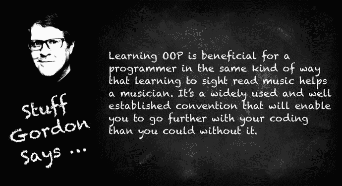
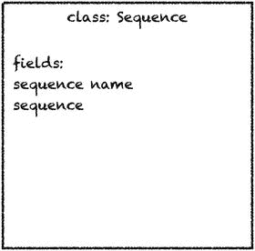
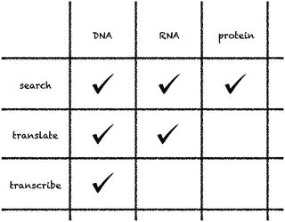
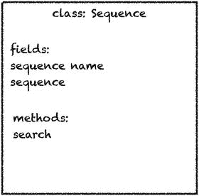
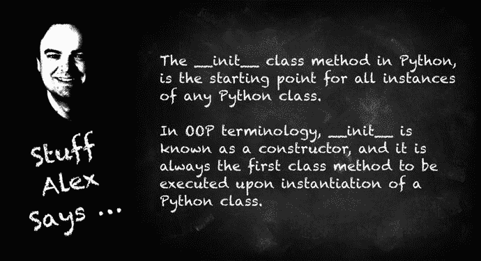
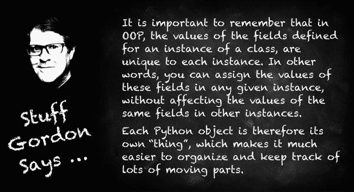
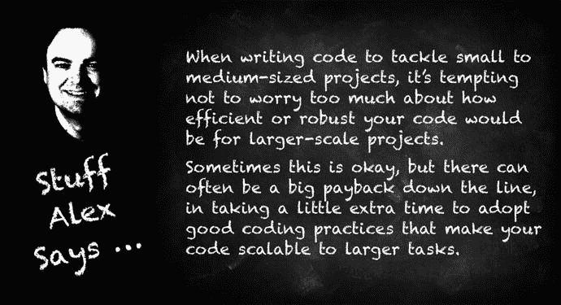
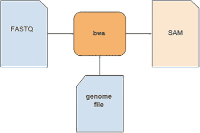
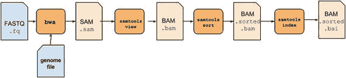

# 7. 对象课程

*作为 Python 对象的生物序列*

|  | *“我不需要整理我的东西，”疯帽子宣称。“我有自己独特的一套系统，如果你不是我，看起来会完全混乱，但请相信我——我确切知道每样东西在哪里。”* *“你度假回来后会怎样？”一位晚餐客人问道。“你还能记得所有东西在哪里吗？”* *“如果别人移动了什么东西呢？”另一位晚餐客人问道。* *“或者你自己移动了某样东西，却忘了放回原处呢？”又一位客人问道。* *“或者！”疯帽子红着脸厉声说道。“所有东西都被你们这群忘恩负义的晚餐客人四处乱动，把大鼻子伸进去，而你们本应该更懂规矩！”* *在随后尴尬的沉默中，所有晚餐客人都只是盯着自己的茶杯。* |
| --- | --- |
|  | *面向对象编程、函数式编程、过程式编程、对象、类、实例、方法、继承、装饰器、Python* `Object` *、* `__init__()` *、* `self` *、构造器、类变量与实例变量、重写、* `__str__()` *、* `print` |
|  | *DNA、RNA、蛋白质、序列、序列搜索、转录、翻译、遗传密码、密码子、分子量、核苷酸* |

在本章中，我们将向你提供一个非常简洁的[面向对象编程](https://en.wikipedia.org/wiki/Object-oriented_programming)（OOP）入门介绍。如果你需要用 Python 编写比相对简单的脚本更复杂的程序，你很可能需要学习这种编程范式。关于 OOP 的讨论很多，支持和反对的双方也都伴随着大量的宣传。正如我们在正则表达式案例中看到的那样，甚至有整本书专门探讨这个主题。简单的事实是，OOP 是一种组织代码的方式，如果运用得当，它通常会使代码更简洁、更易于理解、更易于维护且更具可重用性。如果你认为根据上述描述，我们属于支持 OOP 的一方，那你是对的。然而，必须强调的是，它是编写代码的*一种*方式，但并非*唯一*方式。OOP 并非在所有情况下都完美适用。例如，对于小型脚本，使用 OOP 可能感觉像用大锤砸坚果。

## 为什么选择面向对象编程？

还有一个激烈争论的问题位于所有计算机编程语言的核心：如何管理代码中创建的所有实体（变量、函数等）的状态，使得代码的健壮性和一致性能够随其复杂性扩展。简而言之，有充分的理由认为 OOP 范式并非管理代码的最佳方法，尤其是当代码变得非常复杂，并开始拥有大量可变部分时。经常被提出的 OOP 替代方案是[函数式编程](https://en.wikipedia.org/wiki/Functional_programming)。这场争论远远超出了本书的范围，但我们希望你能意识到它的存在，以免你认为我们是在将 OOP 视为解决所有问题的万能药。OOP 可能并不完美，但在本书写作时，它是全世界绝大多数程序员当前编写代码时所采用的范式。

根据我们的经验，在使用过 OOP 和非 OOP 编程范式后，我们认为 OOP 在帮助程序员更好地管理拥有大量可变部件的大型代码项目的复杂性这一既定目标上，表现得相当成功。如果你此刻在问自己：“我应该学习 OOP 吗？”那么，如果你将来想用 Python（或任何其他 OOP 编程语言，如 [Java](https://en.wikipedia.org/wiki/Java_%28programming_language%29)）进行任何大型项目的开发，我们会明确地回答“是的”。



熟悉 OOP 范式也将对你大有裨益，因为如果你需要学习其他编程语言，大多数现代主流语言（如 [Java](https://en.wikipedia.org/wiki/Java_%28programming_language%29)、[C++](https://en.wikipedia.org/wiki/C%2B%2B)、[Ruby](https://en.wikipedia.org/wiki/Ruby_%28programming_language%29)、[C#](https://en.wikipedia.org/wiki/C_Sharp_%28programming_language%29) 等）都是以 OOP 为核心的。

我们在本章中旨在提供一次 OOP 领域的入门导览，以及 OOP 在 Python 中是如何实现的。我们的目的是为你提供足够的信息，让你能够开始使用 Python 进行 OOP 编程，而不会用冗长（且令人疲惫）的领域综述给你带来负担——话说回来，那样的综述足以填满整本书，从而没有空间讨论其他内容了！

因此，要开始讨论什么是 OOP，我们先从它*不是*什么开始——换句话说，OOP 与我们迄今为止在本书中看到的大部分内容有何不同？

### OOP 的核心在于组织我们的程序

到目前为止，我们看到的代码大多采用[过程式编程](https://en.wikipedia.org/wiki/Procedural_programming)风格，顾名思义，这种风格主要由组织成计算机需遵循流程的代码块构成。这些流程在 Python 中主要是函数和方法，但在其他编程语言中，它们可能被称为子程序或代码块。它们的共同点在于将代码组织成更小的单元或任务——例如，从文件中读取 96 孔板的数据表，或根据序列计算寡核苷酸的分子量。

需要明确的是，运行代码的硬件并不关心代码的组织方式。当一切正常运行时，硬件只会按指定顺序执行给定的指令，而不会在意代码是否合理、整洁或组织有序。程序员组织代码的方式在某些情况下可能会影响执行效率（例如存在不必要的冗余），但假设代码正确无误，能实现程序员的意图且没有错误，那么无论它是否高效或组织良好，硬件都会执行它。

因此，作为一个基本原则，我们可以说 **组织代码主要是为了程序员（以及任何可能需要阅读、理解、使用、协作或修改其代码的人）的便利**。

OOP 是一个*概念模型*，用于描述程序员试图在其代码中实现的任何内容，顾名思义，它以*对象*作为核心构建块。

实际上，我们在前面章节中使用 `object.method` 语法时已经遇到过 Python 对象——例如，`list.append()` 方法用于将项目追加到列表末尾。`list` 对象已在 Python 标准库中为你定义好了，但若要深入了解幕后机制并理解 Python 对象，让我们在我们非常熟悉的领域——生物学中，自行设计一两个对象。


## 用于处理生物学序列的 OOP 实现

假设我们正在创建一个管理生物学序列的应用程序，该程序必须处理 DNA、RNA 和蛋白质序列。这些似乎都是我们代码中 Python 对象的良好候选者，因此我们将其作为示例。

那么，如果你坐好了并集中注意力，以下是 OOP 新手需要了解的第一个重大要点。

当我们用 OOP 代码描述一个对象时，**我们实际上是在描述该对象的模板，这个模板被称为** [类.​](https://en.wikipedia.org/wiki/Class_%2528computer_programming%2529) 仔细想想，这完全合理。我们的应用程序可能需要处理数百甚至数千个序列对象，因此为所有对象编写一个主描述是明智的。

**类是对象的模板，定义了该对象的所有实例**。我们将每个实际对象称为其所属类的***实例***。从这个意义上说，当我们在 Python 中谈论对象时，实际指的是**特定类的实例**。

在创建实例（对象）之前，我们首先需要从以下方面描述类：**(i)** 它存储了哪些属性——这些通常被称为字段、实例字段或实例变量——以及 **(ii)** 它能做什么，即它的方法。解释这些概念的最佳方式是考虑它们在我们的序列类中的表现形式（从现在开始，当我们描述对象的模板时，将使用术语**类**；当我们描述作为类实例的实际对象时，使用**实例**）。

每个序列对象都必须能够存储实际的序列：如果是 DNA 或 RNA 序列，则为核苷酸碱基；如果是蛋白质，则为肽段。但序列对象还需要什么呢？也许还需要一个名称，或者从数据库中提取的登录号。类中的字段还可以用于设置其所定义对象的*状态*——例如，如果对象是蛋白质中的氨基酸，你可以想象有一个布尔（`True`/`False`）字段来定义它是否被磷酸化。你可能还能想到许多可以在序列示例中包含的其他字段，但当前我们假设 `Sequence` 类包含一个名称字段和一个序列字段。

## 命名空间和模块

我们需要在此暂停一下，简要讨论一下`命名空间`和`模块`。你可能会问，这些是什么？嗯，我们在第 6 章介绍 `import` 语句时曾简要提及命名空间。如果你曾经“冲浪”过互联网（嘿，还记得 1990 年代吗？），并且访问过一个叫 Google 的小网站，那么你其实一直在遇到这些命名空间，只是没有这么称呼它们而已。`google.com` 本身就是一个命名空间，而这些熟悉的站点：

```
news.google.com
images.google.com
```

实际上只是整个 `google.com` 命名空间中的元素。在一个命名空间内，所有内容必须唯一。例如，在 `google.com` 命名空间中不能有两个 `images`，但显然 `images.yahoo.com` 是可以的，因为它位于完全不同的命名空间中。命名空间在 Python 中有多种用途，它们允许你使用简写引用元素，并将类和函数分组到`模块`中。

例如，我们在本章中创建的所有类都包含在文件 `PFTLS_Chapter_07.py` 中，这个文件本身既构成了一个`模块`，也构成了一个`命名空间`（关于模块和命名空间的更多细节和示例，请参阅可靠的 [Python 语言手册中关于模块的部分](https://docs.python.org/2/tutorial/modules.html)^(⁷⁸)）。我们将在第 11 章讨论从模块中导入单个类和函数的方法时，再回到模块和命名空间的话题。但目前，只需知道每个 Python 类在此模块中必须有唯一的名称即可（[另请参阅 Python 教程](https://docs.python.org/2.7/tutorial/classes.html)^(⁷⁹)）。说到这里，让我们回到对类的讨论。

## 类定义的结构

请注意，我们现在正按照 Python 编码风格编写类名。按照惯例，Python 程序员倾向于以大写字母开头命名类（这不是强制要求，而是 Python 程序员广泛认同的实践，目的是让每个人的代码更具可读性和更易理解）。

如果类名由多个单词组成，例如 `ProteinSequence`，Python 的通用惯例是使用驼峰命名法（CamelCase），即每个单词的首字母大写。

相比之下，字段的命名惯例通常以小写字母开头，并且仅为了可读性而使用大写字母来标记新单词的开始。例如，我们的 `Sequence` 类可能包含 `sequence` 和 `sequenceName` 这两个字段。您已经可以看出这如何有助于提高代码的可读性，因为您现在可以区分 `Sequence` 类及其包含的 `sequence` 字段。

目前不必过分担心这些惯例，但尽早开始在代码中使用它们是一个好习惯。忘记或混淆它们可能会使您的代码更难阅读，但不会导致代码出错。

图 7-1 以小型示意图的形式展示了我们到目前为止草拟的 `Sequence` 类。



图 7-1 Sequence 类整体结构

我们有两个字段，但还没有方法。正如我们在第 3 章的 `string.find()` 示例中所见，方法是特定于某个类的函数。方法定义了类能做什么，并且通常作用于该类的对象或与该对象协作。例如，我们像这样使用 `string.find()` 方法：`mySequence.find('ttt')` 来定位字符串 `mySequence` 中的模式 `'ttt'`。

那么，我们需要我们的 `Sequence` 类能够做什么呢？

我们可能需要实现一个搜索方法，用于在序列中定位感兴趣的模式，但我们现在遇到了一个小难题……

我们是否要对所有三种类型的序列都使用同一个 `Sequence` 类？

我们提出这个问题的原因是，有些方法可能并不适用于所有三种类型——例如，将一个 DNA 序列翻译成蛋白质序列的函数，应用于一个本身已经是蛋白质序列的序列上是没有意义的。也许我们需要在我们的应用程序中编写三个独立的类，每种序列类型一个。不过，等一下——这是否意味着，我们想要用于所有序列类型的搜索方法，都必须为每种类型单独编写呢？

好吧，先别急着思考这个问题，我们将绘制一个表格，如图 7-2 所示，展示我们希望对每种序列类型具备哪些方法。



图 7-2 每种 Sequence 子类所需的功能

## 类继承

能够满足此表格要求的一种确定方法是将每种序列类型编写为一个独立的类，但缺点是我们将不得不创建一些冗余代码。然而，OOP 有一个旨在帮助程序员解决这类问题的特性，它被称为继承。

正如父母有继承其属性的孩子一样，OOP 类可以拥有`子类`，这些子类继承其`父类`的字段和方法。作为 OOP 程序员，我们甚至可以选择哪些属性被子类继承，哪些不继承。同样，我们可以自由地为子类赋予其父类所不具备的新属性。这在实际中对我们意味着，我们想要在所有子类中共有的每个属性，都可以放入父类中，然后由子类继承。在我们的示例中，这意味着我们希望在 DNA、RNA 和蛋白质类中拥有的搜索方法，只需在父类中编写一次，即可作为方法在每个序列类型中被继承。

稍后我们将更详细地了解其工作原理，但让我们先直接看看如何通过编写 DNA、RNA 和蛋白质序列的父类来在 Python 中创建类。我们将此父类命名为 `Sequence`，因为它是一种通用类，并非特定的序列类型。这甚至不需要是我们实际打算使用的类，而只是一个通用的占位符类，我们实际想要使用的特定类可以从它那里继承一些字段和方法。在某些编程语言中，这些通用类甚至可以被指定为*抽象类*，这意味着它们不能被直接*实例化*（即用于创建类的实例（对象）），而只能通过它们的子类来调用。Python 实际上有一种使用 Python 语言特性（称为装饰器⁸⁰）来指定抽象类的方法，但我们在此不讨论，因为它们是更高级的 Python 主题，超出了本入门教程的范围。

因此，图 7-3 是我们为生物序列设计的顶层或父类。请记住，它的两个字段和一个方法将被我们从中创建的所有子类继承。



图 7-3 父类 Sequence 的设计

而清单 7-1 是创建我们用于生物序列的父类的代码。

```
### A Python class for handling biological sequences
class Sequence:
    def __init__(self,name,sequence):
        self.name = name
        self.sequence = sequence
    def search(self,pattern):
        return self.sequence.find(pattern)
```

清单 7-1 生物序列的父类

重要的是要记住，这段代码只是定义了 `Sequence` 类，在我们实例化它之前，它不会创建任何实例（对象）。Python 类定义以 `class` 关键字开头，后跟类名和冒号。稍后我们将看到，如果我们创建的类是一个继承自父类的子类，我们还需要在当前类名后面的括号中包含父类的名称。然而，由于 `Sequence` 是一个顶层类，我们不需要这个额外的语法。

我们刚刚告诉你的并不完全准确。Python 中最高层的类是`pyObject`，所有其他类都继承自它。当你在 Python 中创建顶层类时，它会*自动且不可见地*继承自`pyObject`，后者包含一系列对所有 Python 对象而言固有的有用属性，例如用于创建类实例的`__init__`方法（一个不包含实例化类方法的类定义，恐怕没什么用，对吧？）。

因此，`__init__`方法几乎总是你新类中定义的第一个方法，因为它包含了指导类如何创建自身实例的指令。你还会注意到，名称略显奇怪的`self`始终是传递给`__init__`的第一个参数。这仅仅是对我们正在创建的对象的引用。你可以把它想象成该对象将要存储的地址。你不需要知道实际的地址是什么——Python 在后台为你处理了这一切。



你可以在`__init__`接下来的两行代码中看到这一切是如何工作的。你会注意到，对于我们的`Sequence`类，`__init__`方法需要两个参数`name`和`sequence`，它们从外部传入。`Sequence`类在创建新实例时，第一件事就是使用这两个外部变量来定义自己的`name`和`sequence`字段。这些是对象自身独有的`name`和`sequence`版本，不再需要与那些外部变量的值相对应，甚至不需要与`Sequence`类的任何其他实例的`name`和`sequence`变量相对应。这其实就是`self`的含义。当你在对象的上下文中引用它时，它总是指该对象的那个字段的版本。这允许你区分对象的字段版本（例如`self.name`）与同名的外部变量（例如`name`），或者来自另一个对象的相同字段。

作为一个小插曲来更全面地解释`self`，假设你有一个类，其方法允许该对象与同一类的另一个对象进行比较（这是编程中非常常见的场景，例如判断两个字符串或数字是否相等）。外部对象作为参数传递给当前对象的方法——在这种情况下，Python 程序员之间一种（非强制性的）约定是将外部对象命名为`other`，以便与`self`进行清晰区分。现在，当前对象的方法可以比较自己版本的字段和另一个对象版本的字段，类似于清单 7-2 中的代码。

```
def compareNames(self,other):
    if self.name == other.name:
        return True
    else:
        return False
```
> Listing 7-2: Function to compare names between two objects

因此，当你使用`__init__`方法初始化新对象时，你始终使用参数`self`来本质上建立对该对象的引用，这将使你能够在代码中明确地引用其字段和方法。在某些 OOP 语言中，`self`作为隐藏变量传递给构造函数，但在 Python 中，我们必须显式地传递它。

你可以看到，在我们这个非常简单的例子中，`__init__`方法为`Sequence`类所做的全部事情就是定义`name`和`sequence`字段。在`__init__`方法之后，我们还包含了`search`方法，我们希望它被`Sequence`的所有子类继承。注意，与所有实例方法一样，它接受`self`作为第一个参数。`search`方法还接受第二个参数`pattern`，顾名思义，它是在对象`self.sequence`中搜索的模式。

由于`Sequence`是一个真实的类，尽管我们更倾向于将其用作抽象类，但我们还是继续创建它的一个实例来测试父类代码并确保其工作正常（确保你首先执行了清单 7-1 中定义类的代码）：

```
mySequence = Sequence('Some made up sequence','cgtatgcgct')
print(mySequence.name)
# Some made up sequence
print(mySequence.sequence)
# cgtatgcgct
print(mySequence.search('gcg'))
```

到目前为止一切顺利。我们的父类`Sequence`按预期工作。我们能够创建该类的一个实例`mySequence`，然后可以使用**对象.属性**语法来访问它的字段和方法。



现在，我们继续在清单 7-3 中创建`Sequence`的第一个子类，它将专门用于处理 DNA 序列（请注意，需要先执行清单 7-1 中的代码）。

```
class DNASequence(Sequence):
    def __init__(self,name,sequence):
        Sequence.__init__(self,name,sequence)
    def transcribe(self):
        return self.sequence.replace('t','u')
```
> Listing 7-3: Defining a subclass of Sequence: DNASequence

首先注意，我们现在在当前类名后面的括号中写出父类，以表明这个新类`DNASequence`是`Sequence`的一个子类。你还会注意到，我们`__init__`方法中的代码被替换为一行，它简单地将`name`和`sequence`参数传回我们已经为`Sequence`父类编写的`__init__`方法。重要的是，我们也可以在我们的`DNASequence`子类的`__init__`方法中包含更多代码，以添加父类中没有的对象初始化步骤——但就目前而言，我们满足于仅仅使用父类`__init__`方法中已有的步骤来初始化我们子类的实例。

你还会注意到，子类定义中没有出现`search`方法，因为我们希望从`Sequence`父类继承它，并且我们还有一个父类中没有的新方法`transcribe`。这很有道理，因为`transcribe`方法是特定于 DNA 序列的，我们不希望它被其他序列类型继承（如果我们把它放在父类中，它就会被继承）。

和之前一样（在执行了清单 7-1 和清单 7-3 中的代码之后），让我们创建新的`DNASequence`子类的一个实例并测试它：

```
myDNASequence = DNASequence('My first DNA sequence','gctgatatc')
print(myDNASequence.name)
# My first DNA sequence
print(myDNASequence.sequence)
# gctgatatc
print(myDNASequence.search('gat'))
# (假设search方法返回一个布尔值或匹配位置)
print(myDNASequence.transcribe())
# gcugauauc
```

很好！

尽管我们没有在`DNASequence`子类中显式包含`search`方法，但我们可以看到它已按预期成功地从`Sequence`父类继承。我们还有一个特定于`DNASequence`子类的新方法`transcribe`。子类从父类继承，而非反过来，因此`transcribe`方法不会回传给父类`Sequence`，也不会传给它的任何子类。如果你是一个经验主义者，只重视基于经验的知识，你可以尝试从父类使用`transcribe`来验证最后这句话。

```
print(mySequence.transcribe())
# AttributeError: Sequence instance has no attribute 'transcribe'
```

我们继续创建一个`RNASequence`类，它将包含一个`translate`方法，用于将其核苷酸序列翻译成肽序列。为了提高处理长序列时的效率，`translate`方法会先创建一个肽列表，然后对空字符串使用`join`方法，将其转换为单个字符串。为了翻译 RNA 密码子，我们还将创建一个 Python 库，其中包含标准的[遗传密码](https://en.wikipedia.org/wiki/Genetic_code)，作为翻译的查找表。

清单 7-4 中是`RNASequence`类的代码（需要同时执行清单 7-1 中的代码才能生效）。

# 生物信息学中的Python类应用

## RNASequence 类与翻译方法

```python
import string
rnaToProtein = {'uuu':'F','uuc':'F','uua':'L','uug':'L',
'ucu':'S','ucc':'S','uca':'S','ucg':'S',
'uau':'Y','uac':'Y','uaa':'STOP','uag':'STOP',
'ugu':'C','ugc':'C','uga':'STOP','ugg':'W',
'cuu':'L','cuc':'L','cua':'L','cug':'L',
'ccu':'P','ccc':'P','cca':'P','ccg':'P',
'cau':'H','cac':'H','caa':'Q','cag':'Q',
'cgu':'R','cgc':'R','cga':'R','cgg':'R',
'auu':'I','auc':'I','aua':'I','aug':'M',
'acu':'T','acc':'T','aca':'T','acg':'T',
'aau':'N','aac':'N','aaa':'K','aag':'K',
'agu':'S','agc':'S','aga':'R','agg':'R',
'guu':'V','guc':'V','gua':'V','gug':'V',
'gcu':'A','gcc':'A','gca':'A','gcg':'A',
'gau':'D','gac':'D','gaa':'E','gag':'E',
'ggu':'G','ggc':'G','gga':'G','ggg':'G'}
class RNASequence(Sequence):
def __init__(self,name,sequence):
Sequence.__init__(self,name,sequence)
def translate(self):
peptide = []
for n in range(0,len(self.sequence),3):
codon = self.sequence[n:n+3]
peptide.append(rnaToProtein[codon])
peptideSequence = ".join(peptide)
return peptideSequence
```

清单 7-4：定义一个包含类变量的子类。

`translate` 方法的代码稍微复杂一些，但如果你仔细观察，你会发现它只是每次以三个碱基为单位遍历 RNA 序列，并使用 `rnaToProtein` 字典将每个三碱基密码子翻译成一个肽。

### 测试 RNASequence

让我们测试这个新的子类（请确保先执行清单 7-1 和清单 7-4 中的代码）来看看它是如何工作的：

```python
myRNASequence = RNASequence('My first RNA sequence','gcugauauc')
print(myRNASequence.name)
My first RNA sequence
print(myRNASequence.sequence)
gcugauauc
print(myRNASequence.search('gau'))
print(myRNASequence.translate())
ADI
```

## ProteinSequence 子类

最后，为了完整起见，我们将在清单 7-5 中添加一个 `ProteinSequence` 类来完善我们的一组生物序列子类（需要先执行清单 7-1 中的代码）。

```python
class ProteinSequence(Sequence):
def __init__(self,name,sequence):
Sequence.__init__(self,name,sequence)
myProteinSequence = ProteinSequence('My first protein sequence','MDVTLFSLQY')
print(myProteinSequence.name)
My first protein sequence
print(myProteinSequence.sequence)
MDVTLFSLQY
print(myProteinSequence.search('LFS'))
```

清单 7-5：`ProteinSequence` 子类。

## 返回类实例的方法

与其仅仅让类方法 `transcribe` 和 `translate` 生成一个包含转录或翻译序列的字符串，我们当然也可以直接输出相应的类。在清单 7-6 中，我们展示了一个更新的 `DNASequence` 类，它提供了 `transcribe` 方法的一个替代方案，该方法输出一个新的 `RNASequence` 对象，而不仅仅是返回一个 RNA 序列字符串（请注意，需要先通过执行清单 7-1 和清单 7-4 中的代码来定义 `Sequence` 和 `RNASequence` 类）。

```python
class DNASequence(Sequence):
def __init__(self,name,sequence):
Sequence.__init__(self,name,sequence)
self.residues = {'a':313.2,'c':289.2,'t':304.2,'g':329.2}
def transcribe(self):
return self.sequence.replace('t','u')
def transcribeToRNA(self):
rnaSequence = self.sequence.replace('t','u')
rnaName = 'Transcribed from ' + self.name
return RNASequence(rnaName,rnaSequence)
newRNASequence = myDNASequence.transcribeToRNA()
print(newRNASequence.name)
Transcribed from My first DNA sequence
print(newRNASequence.sequence)
gcugauauc
```

清单 7-6：返回 `RNASequence` 对象的更新版 `DNASequence` 类。

在 `transcribeToRNA` 这个新方法中，我们可以看到，它实际上返回的是一个 `RNASequence` 类的实例，而不仅仅是一个编码 RNA 序列的字符串。这仅仅是为了说明，从 Python 的角度来看，用户定义类的实例并没有什么特别之处。类的实例可以从函数和方法中返回，也可以作为参数传递给它们，并且类甚至可以出现在其他类的字段中。

## 扩展父类 Sequence

为了向您展示类和对象如何让您的工作更轻松，在清单 7-7 中，我们通过添加几个额外的方法和一个新字段来稍微扩展一下父类。

```python
class Sequence:
def __init__(self,name,sequence):
self.name = name
self.sequence = sequence
self.residues = {}
def search(self,pattern):
return self.sequence.find(pattern)
def molecularWeight(self):
mwt = 0.0
for residue in self.sequence:
mwt += self.residues[residue]
return mwt
def validSequence(self):
for residue in self.sequence:
if not residue in self.residues:
return False
return True
```

清单 7-7：扩展父类。

这段代码大部分与之前相同，但您可以看到我们在 `__init__` 方法中添加了一行代码，用于定义一个名为 `residues` 的字段。我们将使用这个字段来定义子类序列中残基的单字母代码和分子量，但在父类中——您还记得，它本质上是一个我们不打算直接使用的通用序列类——`residues` 只是一个空字典。严格来说，我们根本不需要将 `residues` 添加到父类中，但我们喜欢将这类占位符字段放入父类中，即使我们从未打算实际实例化父类。这可以作为一种提醒，提醒我们需要在子类中包含这个字段。

另一个重大变化是两个方法 `molecularWeight` 和 `validSequence`，它们分别使用 `residues` 字典来计算分子量和验证序列。在这种情况下，验证序列意味着检查序列中的所有残基是否对该特定序列类型有效。如果我们像清单 7-8 那样，将 `residues` 字段修改为 `DNASequence` 类的 `__init__` 方法，就能明白这意味着什么（你需要先通过运行清单 7-7 中的代码来加载 `Sequence` 和 `RNASequence` 类，然后再运行清单 7-4 中的代码）。

### 代码清单 7-8：向 DNASequence 子类添加残基

```python
class DNASequence(Sequence):
    def __init__(self,name,sequence):
        Sequence.__init__(self,name,sequence)
        self.residues = {'a':313.2,'c':289.2,'t':304.2,'g':329.2}
    def transcribe(self):
        return self.sequence.replace('t','u')
    def transcribeToRNA(self):
        rnaSequence = self.sequence.replace('t','u')
        rnaName = 'Transcribed from ' + self.name
        return RNASequence(rnaName,rnaSequence)
```

`residues` 的字典键就是四个 DNA 核苷酸，它们对应的值就是各自的分子量（在这个简单的例子中，我们没有包含任何末端或修饰残基的分子量）。现在，我们可以让 `DNASequence` 对象计算它自己的分子量并验证它的序列，如下所示：

```
print(myDNASequence.molecularWeight())
2775.8
print(myDNASequence.validSequence())
True
```

### 类变量、实例变量与其他类作为变量

好吧——我们得坦白承认，我们可能刚刚做了一件有点傻的事，至少从面向对象编程的角度来看是这样。我们将 `residues` 字典放在 `__init__` 方法中的方式，意味着 `DNASequence` 类的每个实例都会拥有自己的残基属性副本。从原则上讲，这种做法存在风险，因为我们有可能不小心在 `DNASequence` 类的某个特定实例中重新赋值这些属性的值，从而产生一个与其他 `DNASequence` 实例不再共享共同属性的 `DNASequence` 对象（顺便提一下，在某些情况下我们可能**确实**希望如此，那样的话我们就不算太蠢了）。我们采用的方法效率也很低，因为现在必须在每个 `DNASequence` 实例中都存储同一份字典的副本。对于几十甚至几百条序列来说，这不算什么大问题，但对于数百万条序列来说，可能就成问题了。

如果有一种方法，能够为整个类一次性创建一个字段，该类的所有实例都能访问它，而不必各自携带该字段的独立副本，那该多好啊？事实证明，在 Python 中，确实有办法做到这一点，我们可以使用一种称为`类变量`的结构来实现，稍后我们将详细了解它——敬请期待。

请注意，一旦我们为父类 `Sequence` 添加了那两个额外方法，我们只需在子类 `DNASequence` 中添加一行代码来定义该序列类型的残基，然后就能随时使用额外功能了。为了也将此功能扩展到 `RNASequence` 和 `ProteinSequence` 子类，我们只需要类似地将 `residues` 字典也添加到它们各自的 `__init__` 方法中即可，当然，要包含每种序列类型对应的残基定义。

这些最后的改动展示了对象不仅能很好地帮助你组织代码，还能使代码更一致、更易于使用。我们所有的序列类在搜索、计算分子量和验证序列方面都拥有相同的语法和功能。每个子类也都具有与其特定序列类型相一致的额外功能——例如，不可能在不经意间让应用程序尝试转录一条蛋白质序列，这种操作毫无意义，并且如果任其不受检查地执行下去，可能会在应用程序的后续部分引起错误和不一致的行为，而这些错误和行为可能更难追踪和调试。还记得我们之前是如何评论 Python 字符串和列表对象通过 `[from:to]` 语法所具备的通用且一致的功能和语法吗？你刚刚已经看到了如何通过使用类，将这种清晰的组织和一致性带入你自己的代码中。

重要的是要认识到，在 Python 中，你自己创建的类与 Python 库中提供的核心类（如字符串、整数和浮点数）之间没有根本区别。你创建的类甚至可以作为一个字段用在另一个类中。例如，让我们把 `DNASequence` 类中的 `residues` 字段单独拿出来，让它自己成为一个类，并拥有自己的功能。

在代码清单 7-9 中，是我们新类 `DNANucleotide` 的定义。

```
class DNANucleotide:
    nucleotides = {'a': 313.2, 'c': 289.2, 't': 304.2, 'g': 329.2}
    def __init__(self,nuc):
        self.name = nuc
        self.weight = DNANucleotide.nucleotides[nuc]
```

*代码清单 7-9 – 处理核苷酸的类*

为了说明类可以以嵌套方式使用（即类作为字段出现在其他类内部），我们会把这个例子尽量简化，但同时我们也会巧妙利用这个例子来介绍 Python 类变量。⁸¹ 你可以在类定义中的下面这行看到类变量的定义：

```
nucleotides = {'a': 313.2, 'c': 289.2, 't': 304.2, 'g': 329.2}
```

但请注意，**这行代码并没有出现在实际实例化类的代码中**。这使得它成为一个由 `DNANucleotide` 类的所有实例共享的变量，而不是某个实例中的字段。

我们为什么要这样做呢？需要稍作进一步解释……

如果 `DNANucleotide` 类能够以某种方式包含它*自己的* DNA 核苷酸定义，并且独立于代码中其他任何地方的定义，那将非常方便。这意味着 `DNANucleotide` 类将始终使用同一组一致的数据，同时也打破了程序员在其代码中使用 `DNANucleotide` 类时，却可能未在代码中提供其所需的核苷酸定义这一潜在危险依赖。

实现这一目标的一种方法是，让 `DNANucleotide` 类的每个实例都拥有自己的核苷酸定义副本——例如放在 `__init__` 例程中。这样做没问题，但可能有点浪费。例如，如果我们要构建[人类 1 号染色体](https://en.wikipedia.org/wiki/Chromosome_1_%2528human%2529)的 DNA 序列，最终可能会得到大约 2.5 亿个核苷酸，每个核苷酸都需要存储空间来存放自己那份 `nucleotides` 数据定义的副本。此外，我们将这些数据嵌入 `DNANucleotide` 类的目标，是为了让使用这个类进行编码更安全、更健壮、更一致。因此，我们并不真的希望 `DNANucleotide` 的每个实例都拥有该数据的*自己的*定义——相反，我们希望它们都共享一份*相同的*数据副本。

因此有了`类变量`——一个实际上由类的所有实例共享的单一定义，而不是每个实例都必须携带自己的副本。



稍后我们将看到如何引用类变量，但请先思考一下。由于该定义不是在类实例内部做出的，我们不能使用习惯的 `self.field` 语法来处理类实例中的字段。

如果我们查看 `__init__` 例程，可以看到它接收一个单一的核苷酸，然后使用 `nucleotides` 类变量中包含的字典来同时添加分子量属性。

就像这样：

```
def __init__(self,nuc):
    self.name = nuc
    self.weight = DNANucleotide.nucleotides[nuc]
```

现在你可以看到如何引用 `nucleotides` 类变量了。

```
self.weight = DNANucleotide.nucleotides[nuc]
```

和所有类变量一样，它只是类名后跟变量名。

我们来快速测试一下，确保我们的新类能正常工作。

```
nucleotide = DNANucleotide('g')
print(nucleotide.name, nucleotide.weight)
g 329.2
```

太棒了！

为了保持简单，我们只为 `DNANucleotide` 添加了几个字段，使其成为一个功能极简的类。实际上，当你费尽心思在 Python 中创建一个新类时，你可能希望实现的[数据封装](https://en.wikipedia.org/wiki/Encapsulation_%2528computer_programming%2529)程度和功能比我们这个简单的例子所展示的要高得多。

现在我们将使用新的`DNANucleotide`类，该类位于一个用于 DNA 序列的类中。为了保持简单，我们将在清单 7-10 中暂时也创建一个自己的新 DNA 序列类——该类*不*继承先前`Sequence`类的所有内容。

```
class NewDNASequence():
def __init__(self,name,sequence):
self.name = name
self.sequence = []
for s in sequence:
d = DNANucleotide(s)
self.sequence.append(d)
def molecularWeight(self):
mwt = 0.0
for s in self.sequence:
mwt += s.weight
return mwt
def __str__(self):
nucs = []
for s in self.sequence:
nucs.append(s.name)
return ".join(nucs)
Listing 7-10
New parent class
```

如果你查看`__init__`例程，你会看到我们像之前一样读取一个序列字符串，但现在我们实际上是逐个字母地循环遍历序列，并使用每个字母创建一个`DNANucleotide`类的新实例。然后我们将该新类实例追加到我们在实例化类时建立的一个列表中。因此，这个新类中的`sequence`字段不再只是一个字符串，而是一个类实例列表。

在我们继续讨论这个新类的其他细节之前，请花点时间思考一下，这里实际上发生了大量的类嵌入。我们不仅将`DNANucleotide`类作为字段嵌入到`NewDNASequence`类中，而且还使用Python的`list`类来存储`DNANucleotide`类的序列！

让我们创建一个`NewDNASequence`类的实例并详细检查它（首先执行清单7-10中的代码）。

```
myDNASequence = NewDNASequence('My new DNA sequence','gctgatatc')
print(myDNASequence.sequence[0])
```

有趣！

当我们尝试打印类`sequence`字段中的第一个元素时，我们没有得到一个字母，而是得到了Python用来表明你引用了一个类的那种打印表示——在这种情况下，是一个ID为`0x10cd7cf38`的`DNANucleotide`实例。不必过于担心这个ID——它本质上只是Python在底层使用的一个指针，用于在代码需要引用该特定类实例时使用。换句话说，它告诉代码在遇到诸如`s.name`这样的引用时去哪里查找，其中`s`将是一个`DNANucleotide`的实例，例如ID为`0x10cd7cf38`。

我们可以通过简单地打印列表中某个元素的实例字段来确认`myDNASequence`的`sequence`字段是一个`DNANucleotide`实例的列表，如下所示：

```
print(myDNASequence.sequence[0].name)
g
print(myDNASequence.sequence[0].weight)
329.2
```

你会看到我们还向新类添加了一个`molecularWeight`方法，以表明计算分子量的功能现在已嵌入（或者如果你愿意，可以说是*固化*）到了`NewDNASequence`类中，我们不需要在代码中提供任何额外的核苷酸分子量表来访问此功能。请注意，我们不能真的在`NewDNASequence`类中编写`molecularWeight`方法，因为它只有在`DNANucleotide`实例序列的上下文中才有意义。然而，外层`NewDNASequence`类创建此方法所需的核心部分是由`DNANucleotide`类提供的。

```
print(myDNASequence.molecularWeight())
2775.8
```

这是良好编码实践的一个重要方面，因为程序员称之为*可移植实现*。例如，另一个程序员可以获取你的`DNANucleotide`类，将其放入他们的代码中并使用，而无需担心依赖关系，例如需要一个与你的类代码兼容的、具有特定命名法和格式的核苷酸分子量表。

## 关于继承和重写继承方法的更多内容

在我们结束关于OOP的这一章之前，我们希望你能回想起本章前面我们告诉你的，在底层，所有Python对象都自动且不可见地继承自一个名为`pyObject`的主Python类。

这被证明在许多方面都非常有用，其中之一是Python的创建者可以使用`pyObject`来定义对所有Python对象通用的占位字段。这里有一个具体的例子。

当你使用Python的`print`命令时，它似乎会自动知道如何将任何类型的对象（从简单的整数或字符串到列表甚至类）的打印表示渲染到控制台输出流中。

尝试运行这段代码，你会明白我们的意思：

```
a = 10
b = 10.0
c = 'DNA'
d = [1,2,3,4,5]
print(a, b, c, d)
10 10.0 DNA [1, 2, 3, 4, 5]
```

Python在这里使用的技巧是，每个对象中都有一个名为`__str__()`的特殊方法，当运行时，它会返回该类的字符串表示。当你编写自己的类时，此方法存在，但它将默认为从`pyObject`或超类（即直接或间接子类的类）继承的`__str__()`方法。例如，如果你创建自己的Python类，Python不知道如何最好地使用`print`函数以有意义的形式将其实例渲染为文本，因此它默认为安全选项，实际上只是说：“**这是类x的一个实例，其ID是y**”。

这里的技巧是，`print`函数运行对象的`__str__()`方法，以获取它需要写入Python控制台输出流的适当字符串表示。

更令人感兴趣的技巧是，作为程序员，如果你希望在`print`时获得不同的字符串表示，你可以[重写](https://en.wikipedia.org/wiki/Method_overriding)类的`__str__()`方法。要重写此（或任何）继承方法，你只需在类定义中提供你自己的版本即可。如果你回头看看我们为`NewDNASequence`编写的类定义，你会发现我们正是这样做的。

当我们为`DNANucleotide`类编写类定义时，我们没有费心去重写`__str__()`；因此，当我们尝试打印它时，我们得到了那种默认的“这是类x的一个实例”消息以及类实例的ID，如下所示：

由于我们确实花时间在`NewDNASequence`类中提供了我们自己的`__str__()`版本，有效地重写了它从`pyObject`继承的通用类版本，我们将看到，如果我们尝试`print`一个`NewDNASequence`类的实例，我们会得到我们在重写的`__str__()`方法中指定的字符串表示——在本例中，是一个表示序列的字符串，如下所示：

```
print(myDNASequence)
gctgatatc
```

这样就结束了我们对Python面向对象编程的介绍。在本书后面的章节中，我们将进一步基于这里提出的概念进行构建。不过，像往常一样，值得查看[官方Python文档](https://docs.python.org/2.7/tutorial/classes.html)^(⁸²)中关于类的部分。甚至超越Python编程语言，如果你真的想加深对面向对象编程的理解，值得阅读一本深入讨论OOP范式的优秀书籍（见下一节）。

在下一章中，我们将更深入地探索基因组数据：研究如何使用Python分析由数十亿个“短序列”（有时称为下一代测序（NGS）数据）组成的大规模数据。

参考资料与进一步探索

-   Gamma、Helm、Johnson 和 Vlissides 合著的 *《设计模式：可复用面向对象软件的基础》*^(⁸³) (Addison-Wesley, 1994)。这是一本关于不同形式面向对象模式的经典著作（因其四位作者常被称为“四人帮”）。

-   Harold Abelson、Gerald Jay Sussman 和 Julie Sussman 合著的 [*《计算机程序的构造和解释》*](https://www.amazon.com/Structure-Interpretation-Computer-Programs-Second/dp/0070004846)^(⁸⁴) (MIT Press, 1996)。这本书堪称计算机科学领域的“圣经”。作者探讨了计算机编程工具，例如在计算机程序概念模型家族（面向对象编程便是其中一员）中使用的抽象和模块化。

## 脚注

8.  基因组的剪切与拼接

### 下一代测序流程


*“一只坐在蘑菇上、抽着水烟的毛毛虫，”爱丽丝说。“这可不是每天都能见到的景象！”*

*“你想知道我为什么坐在这蘑菇上吗？”毛毛虫问。“那是因为我是个‘有趣’的家伙（fun guy，与‘真菌’fungi 谐音）！”*

*爱丽丝呻吟道：“真的吗？”*

“不见得，”毛毛虫说。“只是因为这本书的作者非常喜欢我们这张照片，想要用它——但他们既懒惰又缺乏想象力，找不到抽烟毛毛虫与下一代测序（顺便说，这正是本章的主题）之间的巧妙关联，于是只好讲几个蹩脚的蘑菇笑话来搪塞。”

“哇！这真是深刻的元洞察，”爱丽丝印象深刻地说。“那什么是下一代测序？”

“哦，不，你可别！”毛毛虫惊叫道。“你现在只是在纵容他们。就算我们是虚构角色，迎合那些平庸的写手也还是有损我们的尊严。”


`with` 语句, `subprocess`, `argparse`, `pysam` 库


短读长测序、比对、排列、`BWA`、`VCF`、`BAM` 和 `SAM` 格式

在本章中，我们将带你进入`深度测序`的世界，有时它也被称为[下一代测序](https://en.wikipedia.org/wiki/DNA_sequencing%23Next-generation_methods) (`NGS`) 或`短读长测序`。瞧，这个名字听起来就充满未来感，它甚至借用了 [《星际迷航》](http://www.startrek.com/) ^(⁸⁵) 系列中的副标题！大多数活跃的生物学家可能都听说过这项技术，你也可能渴望亲手处理这类数据以探究自己的问题。但你或许也会被那些令人生畏的术语、工具和缩写词的拼盘所吓倒——例如 [`BWA`](http://bio-bwa.sourceforge.net/)、[`NGS`](https://en.wikipedia.org/wiki/Massive_parallel_sequencing)、[`VCF`](https://en.wikipedia.org/wiki/Variant_Call_Format) ——以及同样令人望而生畏的技术清单——Illumina、焦磷酸测序、SOLiD 等等。别担心，我们会帮你解决。

深度测序的基本过程在核心上概念相当简单：

1.  获取一些生物序列：染色体的 DNA、信使 RNA 等等。

2.  找到一种方法将序列转化为 DNA（例如，mRNA 可以转化为 cDNA）。

3.  将 DNA 打碎或`片段化`成随机片段（取决于原始样本的大小）。

4.  大规模`扩增`这些 DNA 拷贝，产生数百万或数十亿个片段。

5.  对这些片段的部分区域进行`测序`，生成数十亿条短`读段`，其长度通常在 40 到 200 个碱基对之间变化。

关键概念在于，这些读段是以`大规模并行`的方式产生的。这是什么意思呢？这意味着原始序列的同一区域通常会被许多不同的读段测序（或`覆盖`），而不是仅仅一个读段。这些读段也不会在同一个点简单地开始或结束，而是会相互`重叠`。


这一点很重要，因为任何单个读段都可能包含测序错误，哪怕只是在一个碱基上出错。拥有数十条重叠读段可以降低识别错误碱基（假阳性）的几率。这也强化了本书中我们将反复提及的另一主题：生物学是一个非常嘈杂的过程！无论你是在研究细胞、生态系统还是种群，或是在你用来研究它们的实验过程中，噪声无处不在，而学会与噪声相处是计算生物学工作的重要部分。

这些都很有趣，但 Python 能如何帮助我呢？这是个好问题。很多用于 NGS 分析的工具都是基于命令行的；然而，Python 可以用来驱动许多这些流程，而且实际上有很多优秀的包和框架正是为此而设计的大规模方案（参见章末列表）。遵循我们的总体理念，我们不打算向你介绍所有前沿的库（反正它们也会很快过时），而是有两个目标：(1) 给你提供简单示例，激发你进一步探索的兴趣；(2) 向你介绍新的 Python 特性以助你实现该目标。本章将分为四个部分：

-   介绍原始序列使用的基本格式：`FASTQ`、`BAM` 和 `SAM`

-   如何使用 Python 的 `subprocess` 驱动外部命令行程序将读段`比对`到基因组

-   基因组的剪切与拼接：使用 Python 库从比对结果中`提取`读段

-   向你展示如何将上述所有功能封装成一个可执行的程序，该程序使用 Python 的 [`argparse`](https://docs.python.org/2.7/library/argparse.html) ^(⁸⁶) 来解析命令行参数

### 走进下一代：从 FASTA 到 FASTQ

让我们从序列数据文件的主力——`FASTQ` 文件开始吧。该文件包含所有原始序列，通常被称为`读段`。它基本上是我们之前在本书第 5 章中首次遇到的 FASTA 文件的增强版本。在大多数 NGS 技术中，每条读段长度相同：

```
@r0
GAACGATACCCACCCAACTATCGCCATTCCAGCAT
+
EDCCCBAAAA@@@@?>===<;;9:99987776554
```

每条读段由四行组成：

1.  第一行以符号 `@` 开头，并唯一标识该读段。它通常包含生成该读段的机器信息，以及其他信息，例如在“流动槽”（即进行原始序列鉴定的载玻片）上的位置。对于许多用途来说，我们不需要知道这些信息，除非读段是成对出现的。这实际上起着类似于 FASTA 格式文件中“>”行所包含信息的作用。

2.  第二行包含由机器识别出的实际序列 `GAACGATA`。

3.  第三行以符号 `+` 开头，用于将序列信息与下一行的质量分数分开。

4.  最后一行是质量分数：这些分数是原始机器用来评估第二行碱基识别质量的。它们很重要，因为下游的算法在将所有序列拼在一起时会用到这些分数。

# NGS 数据处理流程

理论上我们可以编写一个直接读取 FASTQ 文件的 Python 程序，但实际上 FASTQ 文件很少被直接分析，而是作为其他工具的输入。分析 NGS 数据最常见的任务之一是`比对`。比对是指将 FASTQ 文件中所有的单独读段，在给定的基因组中寻找它们的`位置`。这个基因组被称为`参考基因组`。有许多工具可以执行此任务，多到有人在推特上调侃说，最终每个实验室都会有自己的比对算法。其中最常用的两个工具是`bowtie`和`bwa`（基于 [Burrows-Wheeler 变换](https://en.wikipedia.org/wiki/Burrows%25E2%2580%2593Wheeler_transform)）。就我们的目的而言，我们只想演示该过程，因此我们将随意选择`bwa`比对器。

比对器会生成一个`比对文件`；对于`bwa`，它会生成一个`SAM`文件（代表`序列比对/映射`）。这是一个*未压缩的文本文件*，每个读段对应一行，其中包含比对器对该序列在基因组上的原始位置的“最佳猜测”。`SAM`文件还包括根本未比对的读段（`未比对读段`）。图 8-1 以图形方式回顾了这些步骤。



**图 8-1** NGS 流程中`bwa`步骤的输入和输出

## BAM 文件：查看、排序和索引

`SAM`文件在实际使用中作用有限，因为 NGS 是高度并行的；每次比对可能包含数十亿个读段；因此，`SAM`文件通常非常庞大。这引出了 NGS 工具箱中的另一个主力工具：`BAM`文件（代表`二进制比对/映射`），它基本上就是`SAM`文件的*压缩版本*。但即使转换为`BAM`后，为了后续高效处理，`BAM`文件还需要*另外两个*步骤：排序和索引。所有这三个步骤都是通过一个名为 [samtools](http://samtools.sourceforge.net/)^(⁸⁷) 的工具套件实现的，这名字并不意外。我们来分解一下：

1. **查看（View）：** 使用`samtools view`命令完成从`SAM`到`BAM`的转换。
2. **排序（Sort）：** 排序会将所有更接近染色体末端的读段放到文件开头；这使得查找特定区域的所有读段更快，因为这些读段在文件中都是相邻的。这通过使用`samtools sort`命令实现。
3. **索引（Index）：** 索引必须始终在排序*之后*进行，它会创建一个额外的`BAI`文件——这基本上是一个查找表，以便可以按染色体名称轻松检索读段，同样无需从头到尾搜索整个文件。在这里，命令`samtools index`是你的好帮手。

让我们扩展一下我们的图形表示（图 8-2）。



**图 8-2** 生成已排序`BAM`文件的完整 NGS 流程

好的，这在概念上很棒，但你实际如何运行这些工具呢？这里我们需要绕道了解一下命令行工具。`samtools`和`bwa`的完整分步安装指南超出了本章的范围，但每个工具在其网站上都有针对每个支持平台的相当完整的安装说明（对于`samtools`，请访问 samtools.sourceforge.net；对于`bwa`，请访问 bio-bwa.sourceforge.net）。例如，如果你在 Linux 平台上运行，可能只需运行`sudo dnf install samtools bwa`（在 Fedora 上）或`sudo apt install samtools bwa`（在基于 Debian/Ubuntu 的系统上）。

我们将展示的示例使用了相关代码库中包含的两个输入文件（详情见第 1 章）：

1. 一个输入的 FASTQ 文件，包含最初取自*大肠杆菌*基因组序列的 10,000 个读段。
2. 一个*参考基因组*：我们使用文件`NC_008253.fna`中编码的*大肠杆菌*完整基因组（这个文件最初[从 NCBI 下载](http://www.ncbi.nlm.nih.gov/nuccore/NC_008253)^(⁸⁸)）：相关的索引已经为你预先构建好了。

所有这些文件都位于我们代码库的`genomes`子目录中。以下是您需要从终端运行的一系列命令：

```
bwa mem NC_008253.fna e_coli_10000snp.fq > e_coli_10000snp.sam
samtools view -b -S e_coli_10000snp.sam > e_coli_10000snp.bam
samtools sort e_coli_10000snp.bam e_coli_10000snp.sorted
samtools index e_coli_10000snp.sorted.bam
```

你应该能够继续运行这些命令，并生成两个最终输出文件：输出`BAM`文件`e_coli_10000snp.sorted.bam`和索引文件`e_coli_10000snp.sorted.bam.bai`。呼！我们停下来总结一下。你可能已经注意到，要完成实际上*有趣*的生物学分析步骤——即比对，似乎需要运行许多不同的工具和步骤。你可能会认为，将这些步骤都内置到`bwa`中会更好，这样就省去了所有这些额外的“簿记”步骤，也许你是对的，但 NGS 工具的发展，像许多科学软件一样，是零散的。在某些方面，它仍然是一个家庭手工业。

这就是 Python 的用武之地（敏锐的读者可能已经注意到，到目前为止 Python 有点缺席！）。我们可以利用 Python 调用命令行工具的能力来“封装”，或者用另一个术语来说，*打包*那些复杂性，以构建更*可重用*的流程。

## 使用子进程调用

模块[`subprocess`](https://docs.python.org/2/library/subprocess.html)^(⁸⁹) 是 Python 用于命令行交互的主力模块。我们不会在此重述其接口，而是直接通过清单 8-1 中的代码来实现第一步——比对本身。

```
import subprocess
with open('e_coli_10000snp.sam', "w") as output_sam:
```

### 执行比对

```
subprocess.check_call(['bwa', 'mem', 'NC_008253.fna', 'e_coli_10000snp.fq'], stdout=output_sam)
```

代码清单 8-1
使用`with`语句将文件发送给子进程

你首先会注意到，输出文件的打开方式与我们之前在第五章中展示的文件创建方法不同。这里我们稍作停留，解释一下`with`语句。基本上，`with`语句声明了一个变量，该变量仅在其下方的代码块内有效（更多详情，请参阅 Python 官方文档中关于`with`的内容）。这是一种非常便捷的方式，能使读取文件的代码简洁紧凑，因为我们仅在子进程调用运行期间才需要使用文件句柄。这避免了使用单独的`open()`和`close()`语句。传统的方式则需要像代码清单 8-2 那样写三行代码。

```
output_sam = open('e_coli_10000snp.sam', "w")
subprocess.check_call(['bwa', 'mem', 'NC_008253.fna', 'e_coli_10000snp.fq'], stdout=output_sam)
output_sam.close()
```

代码清单 8-2
不使用`with`语句向子进程发送输入文件

这两种方式没有绝对的优劣之分，但使用`with`的好处是，你不会忘记关闭文件，因为`with`会自动为你完成关闭操作！除了处理文件，`with`还有许多其他用途，例如允许代码块被重用，但我们在此不深入探讨；你可以查看前面提到的 Python 官方文档中关于`with`的内容以获取更多细节。

现在回到`subprocess`调用本身……在`with`子句中，我们将前面章节描述的每个命令行参数作为列表传入，然后将标准输出`stdout`（即通常会输出到控制台的内容）分配给该文件句柄。如果你在包含测试 FASTQ 和基因组文件的`genomes`目录中运行这段代码，你应该会看到`bwa`工具的输出，类似于以下内容：

```
[M::main_mem] read 10000 sequences (350000 bp)...
[M::mem_process_seqs] Processed 10000 reads in 0.244 CPU sec, 0.245 real sec
[main] Version: 0.7.9a-r786
[main] CMD: bwa mem NC_008253.fna e_coli_10000snp.fq
[main] Real time: 0.638 sec; CPU: 0.276 sec
```

好了，我们已经成功通过 Python 运行了外部工具来执行比对。祝贺我们自己！我们现在可以`扩展`这个流程，使用代码清单 8-3 中的代码，通过封装`samtools`命令来将 SAM 文件转换为 BAM 文件（请注意，这假设你已经运行了代码清单 8-1 中的代码）。

```python
### 使用 samtools 转换回二进制（压缩）BAM 格式
with open("e_coli_10000snp.bam", "w") as output_bam:
subprocess.check_call(['samtools', 'view', '-b' '-S', "e_coli_10000snp.sam"], stdout=output_bam)
```

代码清单 8-3 使用`subprocess`调用`samtools`

再次注意，这里使用了`with`命令创建 BAM 文件，通常这会通过标准输出（`stdout`）的方向来创建。让我们暂停片刻并稍作总结。我们已经成功使用 Python 处理了一个原始 FASTQ 文件`e_coli_10000snp.fq`，并生成了两个比对到基因组的文件：未压缩的`e_coli_10000snp.sam`和压缩的`e_coli_10000snp.bam`。然而，正如我们之前提到的，在我们对它们进行排序和建立索引之前，我们实际上还不能`使用`这些文件进行进一步的基因组学分析。原则上，我们可以使用与前面相同的方案来“封装” `samtools`调用，但我们也可以使用一个外部库来实现此目的。这个库叫做`pySam`。

## `pySam`：以 Python 风格读取比对文件

使用`pySam`暂时背离了我们通常仅使用 Python 标准库编写示例的惯例，但我们认为让你熟悉外部库的使用是很有益的，因为如果你最终专攻基因组学分析，你会用到许多更高级的工具。另外请注意，我们已经向你展示了如何在 Python 中手动使用和创建封装器，因此如果这些库过时，你应该能够轻松地编写替代代码。此外，使用`pySam`还有一个好处，就是能让我们的示例更简洁一些。要从命令行安装`pySam`，你首先需要确保已安装 Python 的`pip`（参见第一章），然后运行：

```
$ pip3 install --user pysam==0.15.2
```

（注意，我们特别要求的是`pysam`的 0.15.2 版本，该版本在测试时可用！）取决于你系统的设置方式，也可能是：

```
$ python3-pip install --user pysam==0.15.2
```

在结束这段铺垫之后，让我们添加一个`sort_and_index`函数，它的唯一目的是……听好！……对 BAM 文件进行排序和索引。像代码清单 8-4 那样将其做成一个函数是很有用的，因为这是一项我们会反复需要的任务；它还能隐藏`samtools`的一些复杂性和特性，让你更容易关注实际分析步骤的流程。

```python
import os.path
import pysam

def sort_and_index(bam_filename):
    prefix, suffix = os.path.splitext(bam_filename)

    ### 生成排序后的 bam 文件名
    sorted_bamfilename = prefix + ".sorted.bam"

    ### 使用 pysam 的输出进行排序
    print("生成重新排序的 BAM:", sorted_bamfilename)
    pysam.sort("-o", sorted_bamfilename, bam_filename)

    ### 使用 pysam 索引的输出
    print("index BAM:",sorted_bamfilename)
    pysam.index(sorted_bamfilename)

    return sorted_bamfilename
```

代码清单 8-4 对 BAM 文件进行排序和索引的函数

我们将上一步生成的 BAM 文件名作为输入传递给该函数。让我们逐一分析函数：

1.  首先，我们使用`os.path`标准库中的`splitext`命令来提取文件名的*前缀*（即`e_coli_10000snp`部分）和*后缀*（即`bam`部分）。

2.  然后，通过将前缀与后缀`.sorted.bam`拼接，生成排序后的输出文件名。

3.  现在可以开始使用`pysam.sort()`函数了，这个函数非常简单：只需为其提供输出文件名，前面加上`"-o"`参数，后面跟上输入的`bam_filename`。

4.  接着，我们使用`pysam.index()`对上一步生成的文件建立索引，这会输出一个`.bam.bai`文件。

5.  最后，我们将新创建的 BAM 文件名称`返回`给调用函数：这在后续会派上用场，同时也能将生成该名称的代码集中在一处，只需编写*一次*。

请注意，我们现在已经成功封装了一些可能重复使用的常规函数。如果你在构建自己的处理流程，很可能会发现自己经常用到某些代码片段，甚至可能直接复制粘贴它们。如果这种情况频繁发生，请*停下来*。这些代码正是从原始代码中剥离出来，移植到肥沃的、可复用的函数土壤中的绝佳候选者。因此，请将上面的示例看作是让你熟悉这一过程的方式。这在编程中非常普遍，以至于它有一个专门的名称：[代码重构](https://en.wikipedia.org/wiki/Code_refactoring)。


当然，也可能会过度进行此过程，比如过早地重构不需要修改的代码，或者编写了大量实际上没什么用处的函数。

让我们看看到目前为止我们已经创建的函数，所有这些都在代码清单 8-5 中付诸实践。

```python
import os.path
import pysam
import subprocess

def sort_and_index(bam_filename):
    prefix, suffix = os.path.splitext(bam_filename)

    # generated sorted bam filename
    sorted_bamfilename = prefix + ".sorted.bam"

    # sort output using pysam's output
    print("generated resorted BAM:", sorted_bamfilename)
    pysam.sort("-o", sorted_bamfilename, bam_filename)

    # index output using pysam's index
    print "index BAM:",sorted_bamfilename
    pysam.index(sorted_bamfilename)

    return sorted_bamfilename

### alignment
with open('e_coli_10000snp.sam', "w") as output_sam:
    subprocess.check_call(['bwa', 'mem', 'NC_008253.fna', 'e_coli_10000snp.fq'], stdout=output_sam)

### convert to BAM
with open("e_coli_10000snp.bam", "w") as output_bam:
    subprocess.check_call(['samtools', 'view', '-b' '-S', "e_coli_10000snp.sam"], stdout=output_bam)

### sort and index
output_sorted_bamfilename = sort_and_index("e_coli_10000snp.bam")
```

代码清单 8-5 NGS 流程的 Python 版本：比对、排序和建立索引

如果你运行这段代码，将会生成与使用命令行工具相同的结果。虽然我们用 shell 中仅有的四行代码就完成了同样的工作，这看起来可能有些大材小用，但我们现在拥有了进行更有趣分析的构建模块。请继续阅读……

## 可视化测序读段

如果你想实际查看 BAM 文件中包含的读段，[整合基因组学查看器](https://www.broadinstitute.org/igv/)^(⁹¹) (IGV) 是一个有用的工具。关于安装和使用该工具的分步指南超出了本章的范围，但我们提供以下指向 IGV [官方说明](http://www.broadinstitute.org/software/igv/UserGuide)^(⁹²) 相关部分的指引。你首先需要遵循 IGV 的 [加载基因组说明](http://www.broadinstitute.org/software/igv/LoadGenome)^(⁹³)，通过上传我们在 FASTA 文件 `NC_008253.fna` 中提供的基因组来创建你自己的 `.genome` 文件。然后，按照[查看比对结果的说明](http://software.broadinstitute.org/software/igv/AlignmentData)^(⁹⁴)，使用文件 `e_coli_10000snp.sorted.bam` 作为输入（你会注意到，我们的流程已经完成了这些说明所要求的排序和索引创建）。

## 统计测序读段的数量

让我们回到驱动这些基因组分析的原始生物学问题。我们现在已经成功地将读段与原始基因组进行了比对。在这个特定案例中，读段来自*大肠杆菌*的基因组 DNA，因此，如果原始测序 DNA 的所有区域都被*均匀地*扩增，我们将会在几乎每个位点看到读段分布大致均匀。我们甚至可以通过提取某些随机坐标之间的读段，*统计*每个位置存在多少读段，然后将这些读段*提取*到一个*新的* BAM 文件中以备将来可视化，来测试这个想法。

我们刚刚介绍的 `pysam` 库通过 `fetch()` 函数提供了一种非常优雅的方式来实现这一点，如代码清单 8-6 所示：

```python
import pysam
chrom = "gi|110640213|ref|NC_008253.1|"; start = 20; end = 200
output_final_bamfilename = "e_coli_subset.bam"
read_count = 0
all_reads = pysam.AlignmentFile("e_coli_10000snp.sorted.bam", 'rb')

### create final output file
output_final_bam = pysam.AlignmentFile(output_final_bamfilename, 'wb', template=all_reads)
```

### 使用 pysam 从指定坐标提取 reads

```python
output_reads=all_reads.fetch(chrom, start, end)
for read in output_reads:
    read_count += 1
    output_final_bam.write(read)
all_reads.close()
output_bam.close()
print("saving new BAM:",output_final_bamfilename, " with", read_count, "reads aligning in %s:%d-%d" % (chrom, start, end))
sort_and_index("e_coli_subset.bam")
```

**代码清单 8-6** 使用 `pysam` 统计 reads 数量

如果运行此代码，我们会发现，在染色体 20 到 200 的区域内，有 216 条 reads：

```
saving new BAM: e_coli_subset.bam  with 216 reads aligning in gi|110640213|ref|NC_008253.1|:20-200
```

我们来分解一下这段代码：

1. 我们首先设置坐标并初始化 reads 计数。
2. 接下来，我们使用 `pysam` 的 `AlignmentFile()` 函数读取比对结果，并使用 `'rb'` 表示这是一个*输入*的**只读**二进制文件。该函数返回一个 Python 对象 `all_reads`，使得 reads 可以像 Python 列表一样被访问（更多详情，请参阅 [Pysam 文档](http://pysam.readthedocs.org/en/latest/usage.html)^(⁹⁵)）。
3. 我们再次使用 `pysam` 的 `AlignmentFile()` 函数生成一个*输出* BAM 文件，并使用 `'wb'` 表示这是**可写入**的二进制文件。请注意，我们还将上一步中新初始化的 `all_reads` 对象作为 `template` 关键字参数传递给 `AlignmentFile` 调用。这确保了原始 BAM 文件中关于染色体等的头部元数据信息能够传递到新的输出 BAM 文件中。
4. 都明白了吗？现在我们开始实际获取指定区域内的 reads，使用 `fetch()` 函数，并传入染色体名称以及起始和结束坐标。
5. 我们遍历每一条 reads，递增 `read_count` 并将该 read 写入新的 BAM 文件。
6. 然后，我们同时关闭原始的输入 BAM 文件和新的输出 BAM 文件。
7. 最后，我们调用 `sort_and_index()`。看，我们之前重构的代码终于派上用场了！

现在，我们得到了 reads 的计数，并且原始的 BAM 文件已经被转换成一种可以使用 IGV 再次可视化的格式（参见前文方框）。

## 构建命令行工具

现在，假设你发现自己需要定期进行这种基因组的“切片和切块”操作。比如说，出于某种原因，你只想可视化基因组某个特定片段中的 reads。如果有一个便捷的**命令行工具**，你只需指定一个 BAM 文件，然后说：“精灵，请只给我这个区域内的 reads”，那该多好啊？没错，Python（仍然）是你的朋友。（这不仅仅是一个虚构的玩具示例，我们确实遇到过需要提取基因组子集 reads 作为其他工具输入的情况。当总 BAM 文件非常大，或者其他分析或可视化工具无法处理大文件时，这一点尤其有用。）在本例的其余部分，我们将向你展示如何利用我们已经开发的功能，构建一个可以通过 shell 或终端运行的命令行工具。

我们需要介绍的第一个新 Python 组件是 `argparse` 库，它是 Python 标准库的一部分（更多细节请参考[官方 argparse 教程](https://docs.python.org/2/howto/argparse.html)^(⁹⁶)，其内容详尽无遗）。基本思路是创建一个 `ArgumentParser` 对象，该对象在初始化时附带一段对命令行程序的描述，这段描述将在运行时呈现给用户。代码示例如下：

```python
parser = argparse.ArgumentParser(description="""
给定一个输入 FASTQ 文件，与基因组比对，
提取指定区域 CHROM:START-END 的 reads，
并将结果写入已排序索引的 bam 文件 OUTPUT""")
```

由于这一行较长，我们可以使用 Python 内置的三引号语法来处理长字符串（更多详情可参考此在线教程^(⁹⁷)）。创建好这个对象后，我们就可以开始添加各个命令选项了。这些选项分为两种类型：***位置参数***，即脚本的主要输入参数，通常是输入文件；以及***选项式参数***，即以 `--chromosome` 这类命令行“开关”形式提供的参数。我们的第一个参数是位置参数：

```python
parser.add_argument('input_fastq', help='输入 FASTQ 文件名')
```

这是必需的输入 FASTQ 文件名，是“主要”参数。我们还提供了一个简短的帮助文本，以便向用户友好地展示信息。接下来，我们添加选项：

```python
parser.add_argument('-o', '--output', dest="output_final_bam_filename",
help='输出 BAM 文件名', default="final.bam")
parser.add_argument('-c', '--chrom', help='染色体名称', required=True)
parser.add_argument('-s', '--start', type=int, help='染色体上的起始位置',
required=True)
parser.add_argument('-e', '--end', type=int, help='染色体上的结束位置',
required=True)
```

首先要注意的是，除第一个“选项”外，所有命令行选项实际上都是*必需的*，通过设置 `required=True` 来实现。这意味着，除非用户提供这些选项和输入参数，否则脚本将无法运行。让我们逐个来看：

1. 第一个选项 `--output` 是最终输出 BAM 文件的名称，它之所以不是必需的，是因为我们提供了 `default=final.bam`。此选项以及后续每个选项都有短格式和长格式，这里分别是 `-o` 和 `--output`。

2. 第二个选项 `--chrom` 是染色体的名称，是*必需的*。使用 `--chrom` 会在参数解析器对象中*自动*创建一个关联变量，我们稍后会用到它。其短格式是 `-c`。

3. 第三个选项 `--start` 是染色体上的起始位置，同样也是*必需的*。由于这是一个整数，我们指定了 `type=int`，这将自动进行类型转换。（之前的选项不需要这样做，因为它们都是字符串，而字符串是默认类型。）

4. 最后一个选项 `--end` 是染色体上的结束位置，其逻辑与 `--start` 选项相同。

现在，我们已经设置好了参数，剩下的工作就是实际解析这些参数，并将它们赋值给程序其余部分中使用的变量：

```
### 接下来获取并解析参数，并赋值给本地文件变量
args = parser.parse_args()
input_fastq = args.input_fastq
output_final_bam_filename = args.output_final_bam_filename
chrom = args.chrom
start = args.start
end = args.end
```

这部分代码基本上是不言自明的。我们首先在 `parser` 对象上调用 `parse_args` 来获取参数。获得此对象后，我们可以将每个输入参数赋值给程序其余部分中对应的变量名称。（注意，变量名称不必与参数名称相同，但为了清晰起见，此处我们保持一致。）

以下是完整的参数解析器代码，如代码清单 8-7 所示。

```
import argparse
parser = argparse.ArgumentParser(description="""给定一个输入 FASTQ 文件，与基因组比对，提取指定区域 CHROM:START-END 的 reads，并将结果写入已排序索引的 bam 文件 OUTPUT""")
parser.add_argument('input_fastq', help='输入 FASTQ 文件名')
parser.add_argument('-o', '--output', dest="output_final_bam_filename", help='输出 BAM 文件名', default="final.bam")
parser.add_argument('-c', '--chrom', help='染色体名称', required=True)
parser.add_argument('-s', '--start', type=int, help='染色体上的起始位置', required=True)
parser.add_argument('-e', '--end', type=int, help='染色体上的结束位置', required=True)
```

### 接下来获取并解析参数，并将其赋值给本地文件

```
args = parser.parse_args()
input_fastq = args.input_fastq
output_final_bam_filename = args.output_final_bam_filename
chrom = args.chrom
start = args.start
end = args.end
```

**代码清单 8-7**

使用 `argparse` 创建命令行工具

如果将代码清单 8-7 中的程序放入一个以当前章节名称命名的可执行文件中，并使用内置的“help”功能（通过 `-h` 或 `--help` 激活）运行它，你会看到以下输出：

```
$ ./PFTLS_Chapter_08.py -h
usage: PFTLS_Chapter_08.py [-h] [-o OUTPUT_FINAL_BAM_FILENAME] -c CHROM -s
START -e END
input_fastq
Given an input FASTQ file, align to genome, extract reads for specified
region: CHROM:START-END and write to sorted indexed bam to OUTPUT
positional arguments:
input_fastq             input FASTQ file name
optional arguments:
-h, --help              show this help message and exit
-o OUTPUT_FINAL_BAM_FILENAME, --output OUTPUT_FINAL_BAM_FILENAME
output BAM file name
-c CHROM, --chrom CHROM
chromosome name
-s START, --start START
start position on chromosome
-e END, --end END       end position on chromosome
```

哇哦，我们现在有了一个功能正常的脚本！如果你没有提供任何输入，它也会捕捉到错误：

```
$ ./PFTLS_Chapter_08.py
usage: PFTLS_Chapter_08.py [-h] [-o OUTPUT_FINAL_BAM_FILENAME] -c CHROM -s
START -e END
input_fastq
PFTLS_Chapter_08.py: error: the following arguments are required: input_fastq, -c/--chrom, -s/--start, -e/--end
```

或者，如果你遗漏了一个参数：

```
$ PFTLS_Chapter_08.py -o final.bam -c 'gi|110640213|ref|NC_008253.1|' -s 20 e_coli_10000snp.fq
usage: NGS_Genome_Slicing.py [-h] [-o OUTPUT_FINAL_BAM_FILENAME] -c CHROM -s
START -e END
input_fastq
test.py: error: argument -e/--end is required
```

## 最终流程：整合所有部分

让我们再次暂停并重新整合，因为我们已经走了很远了。现在，我们拥有了完整流程的所有部分：*命令行解析器*、使用 `bwa` 的*比对调用*、用于*排序和索引*的函数，以及使用 `pySam` 进行的*读取提取*。我们现在准备开始完整程序，如代码清单 8-8 所示。

## 代码清单 8-8 完整的 NGS Python 流程

```python
#!/usr/bin/env python3
import sys
import os.path
import pysam
import argparse
import subprocess
def sort_and_index(bam_filename):
prefix, suffix = os.path.splitext(bam_filename)
sorted_bamfilename = prefix + ".sorted.bam"
print("generate sorted BAM:", sorted_bamfilename)
pysam.sort("-o", sorted_bamfilename, bam_filename)
print("index BAM:", sorted_bamfilename)
pysam.index(sorted_bamfilename)
return sorted_bamfilename
parser = argparse.ArgumentParser(description="""Given an input FASTQ file, align to genome, extract reads for specified region: CHROM:START-END
and write to sorted indexed bam to OUTPUT""")
parser.add_argument('input_fastq', help='input FASTQ file name')
parser.add_argument('-o', '--output', dest="output_final_bam_filename", help='output BAM file name', default="final.bam")
parser.add_argument('-c', '--chrom', help='chromosome name', required=True)
parser.add_argument('-s', '--start', type=int, help='start position on chromosome', required=True)
parser.add_argument('-e', '--end', type=int, help='end position on chromosome', required=True)

### next get and parse args and assign to our local files
args = parser.parse_args()
input_fastq = args.input_fastq
output_final_bam_filename = args.output_final_bam_filename
chrom = args.chrom
start = args.start
end = args.end

### get prefix and extension from FASTQ file
prefix, suffix = os.path.splitext(input_fastq)
output_sam_filename = prefix + '.sam'
output_bam_filename = prefix + '.bam'

### using subprocess need to generate the standard output first
with open(output_sam_filename, "w") as output_sam:

### do the alignment, hardcode the genome to the bacterial genome
print("generated SAM output from:", input_fastq)
subprocess.check_call(['bwa', 'mem', 'NC_008253.fna', input_fastq], stdout=output_sam)

### convert back to the binary (compressed) BAM format using samtools
with open(output_bam_filename, "wb") as output_bam:
subprocess.check_call(['samtools', 'view', '-b', '-S', output_sam_filename], stdout=output_bam)
output_sorted_bamfilename = sort_and_index(output_bam_filename)

### get ready to extract reads
read_count = 0
print("now extract reads from:", output_sorted_bamfilename)
all_reads = pysam.AlignmentFile(output_sorted_bamfilename, 'rb')

### create final output file
output_final_bam = pysam.AlignmentFile(output_final_bam_filename, 'wb', template=all_reads)

### use pysam to extract the reads from the given coordinates
print("extract reads from chromosome:" + chrom + "at coordinates:", start, end)
output_reads= all_reads.fetch(chrom, start, end)
for read in output_reads:
read_count += 1
output_final_bam.write(read)
all_reads.close()
print("saving new BAM:", output_final_bam_filename, " with", read_count, "reads aligning in %s:%d-%d" % (chrom, start, end))
output_bam.close()  # finally close the output bam file
sort_and_index(output_final_bam_filename) # sort and index
```

现在所有部分都已就绪，最终程序采用了之前代码片段中硬编码的文件名，并从命令行获取输入文件。我们已经准备好了。以下是一个示例运行，使用与之前相同的基因组坐标：

```bash
$ cd genomes
$ ../PFTLS_Chapter_08.py -o final.bam -c 'gi|110640213|ref|NC_008253.1|' -s 20 -e 200 e_coli_10000snp.fq
generated SAM output from: e_coli_10000snp.fq
[M::main_mem] read 10000 sequences (350000 bp)...
[M::mem_process_seqs] Processed 10000 reads in 0.247 CPU sec, 0.247 real sec
[main] Version: 0.7.9a-r786
[main] CMD: bwa mem NC_008253.fna e_coli_10000snp.fq
[main] Real time: 0.347 sec; CPU: 0.270 sec
[samopen] SAM header is present: 1 sequences.
generate sorted BAM: e_coli_10000snp.sorted.bam
index BAM: e_coli_10000snp.sorted.bam
now extract reads from: e_coli_10000snp.sorted.bam
extract reads from chromosome:gi|110640213|ref|NC_008253.1|at coordinates: 20 200
saving new BAM: final.bam  with 216 reads aligning in gi|110640213|ref|NC_008253.1|:20-200
generate sorted BAM: final.sorted.bam
index BAM: final.sorted.bam
```

在这个过程结束时，你应该会得到一个排序后的BAM文件，其中包含来自`final.sorted.bam`文件中指定坐标范围内的目标读数。现在应该可以将这些读数重新加载到IGV中进行可视化。

## 下一步做什么？

在本章中，我们仅仅触及了利用这类数据所能实现目标的皮毛。比对只是大规模并行测序技术所支持的众多研究类型之一。另外两个值得关注的领域如下：

*   [变异检测](https://www.bioconductor.org/help/course-materials/2014/CSAMA2014/3_Wednesday/lectures/VariantCallingLecture.pdf) ^(⁹⁸)：这建立在我们已经完成的比对类型之上，利用读数的“堆积”来推断[单核苷酸多态性](https://en.wikipedia.org/wiki/Single-nucleotide_polymorphism)（SNP）和[插入缺失标记](https://en.wikipedia.org/wiki/Indel)的存在。基本思路是，如果在许多读数中观察到与参考基因组相对的 SNP，那么它很可能是一个真实的 SNP。[基因组分析工具包](https://www.broadinstitute.org/gatk/)^(⁹⁹)（GATK）是该领域常用的工具。
*   [组装](https://en.wikipedia.org/wiki/Sequence_assembly)：组装过程，其中原始读数用于构建**参考基因组**（对于 DNA）或**转录组**（细胞在给定时间内表达的所有 mRNA 转录本的集合）。在这两种情况下，这都类似于在没有盒子原图的情况下重新拼图：你必须依赖碎片本身的形状。有时，如果存在一个亲缘关系密切的生物体的参考基因组，现有的比对可以部分指导这一过程；最困难的是[从头组装](https://en.wikipedia.org/wiki/De_novo_transcriptome_assembly)，即完全没有参考图。你可以研究的工具包括[Trinity 组装器](https://trinityrnaseq.github.io/)^(¹⁰⁰)、[Velvet/Oases](https://www.ebi.ac.uk/%257Ezerbino/oases/)^(¹⁰¹)、[ALL-Paths](http://www.broadinstitute.org/software/allpaths-lg/blog/) [LG](http://www.broadinstitute.org/software/allpaths-lg/blog/)^(¹⁰²)以及许多其他工具。它们各有优缺点。论坛[SEQanswers](http://seqanswers.com/)^(¹⁰³)和[BioStar](https://www.biostars.org/)^(¹⁰⁴)是寻找资源和讨论的好起点。

重要的是要认识到，“下一代”测序是一个技术发展非常迅速的领域，几乎每隔一个月就会有新公司成立和新工具发布。来自[PacBio](http://www.pacb.com/)^(¹⁰⁵)、[Dovetail Genomics](http://dovetailgenomics.com/)^(¹⁰⁶)和[10x Technologies](http://www.10xtechnology.com/)^(¹⁰⁷)等公司的新型测序技术使得读长越来越长，并且最终可能会变得更加准确。完全有可能在某个时候，为这种短读长测序开发的工具会变得过时，因为我们将能够一口气读取整个染色体或 mRNA 分子。

但我们确信这不会很快发生，并且基础的 NGS 概念和格式很可能会在未来很长一段时间内存在。有多少次人们预言了黑胶唱片的消亡？谁知道呢，也许你那位留着胡子的咖啡师会在 2030 年左右重新发现手工精制 NGS 管线的乐趣。因此，你们在本章中针对这些数据格式和 Python 所采用的这种务实、亲力亲为的方法，应该会在未来对你们有好处，因为即使技术和工具发生变化，它也能让你对过程中最底层的细节有清晰的了解。

说到务实和亲力亲为，在接下来的几章中，我们将向你们展示如何使用 Python 来可视化和操作来自真实生物实验室主力工具——96 孔板——的数据。

## 参考文献与进一步探索

### 教程及讨论

- [Titus Brown 的 NGS 教程](http://ged.msu.edu/angus/tutorials-2013/)^(¹⁰⁸)
- Brad Chapman 的[蓝领生物信息学博客](https://bcbio.wordpress.com/)^(¹⁰⁹)（`bcbio`）
- [BioStar](https://www.biostars.org/)：通用生物信息学论坛
- [SEQanswers](http://seqanswers.com/)：主要关注 NGS 技术的论坛

### 工具

- [Bowtie](http://bowtie-bio.sourceforge.net/index.shtml)^(¹¹⁰)：包含`tophat`、`cufflinks`及其他工具的链接

### 流程/框架

- 基于 Python 的流程`bcbio-nextgen`，与 Brad Chapman 之前提到的蓝领生物信息学博客相关：[代码仓库](https://github.com/chapmanb/bcbio-nextgen)^(¹¹¹) [文档](https://bcbio-nextgen.readthedocs.org/)^(¹¹²)
- 基于 Python 的工作流系统（[COSMOS](http://cosmos.hms.harvard.edu/)^(¹¹³)）及其相关的基因组变异检出流程（[GenomeKey](https://github.com/LPM-HMS/GenomeKey)^(¹¹⁴)）

## 脚注

9. 井！井！
