*微量滴定板测定 I：数据结构*

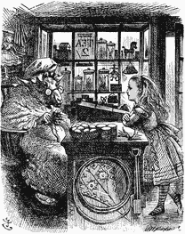 |

*爱丽丝走进那家小商店，头顶的小铃铛响了，而这家店恰好也是当地的邮局。“能帮我查查有没有我的邮件吗？”爱丽丝问年迈的店主。*

*“亲爱的，你姓什么？”店主问道。*

*“为什么这么问？大家都只叫我爱丽丝，”爱丽丝困惑地说。*

*“我的邮箱是按姓氏排列成网格状的，”店主带着明显的自豪感说。“从左上角的 A 到右下角的 Z。”*

*“我想那你就查查 A 下面，找爱丽丝吧，”爱丽丝说。*

*店主取下左上角那一捆邮件，开始翻找。“嘿，你瞧！”她说。“这有一封是给你的，信封上还写着你可能已经成为他们大奖抽奖的赢家了！”*

*“‘可能’这个字眼很关键，”爱丽丝讽刺地说。“就像一个路人‘可能会’被陨石砸到一样。”* |

 |

*`csv`模块，CSV 格式，OOP，类，构造函数，`import`，`matplotlib`，类变量和实例变量，Python 类型，`type()`，元组，`range()`，高级字符串格式化，异常，有序集合，条件语句，`math`模块，`None`，迭代器* |

 |

*平板测定，96 孔板，机器人，实验室自动化，Arduinos，网格坐标系* |

# 一本面向现代生命科学家的书，怎么能避而不谈实验室里随处可见的可靠主力——96 孔板呢？

如今，你走进几乎任何一间实验室，都随处可见这些小东西（也被称为微孔板）。近年来，使用 96 孔板（及其他规格）板的高科技仪器数量激增，这更是加剧了它们在实验室中的普及。此外，这些仪器通常能够在相对很短的时间内扫描这些板并从中读取大量数据。因此，我们认为有必要专门用两章的篇幅来介绍这个不起眼的 96 孔板，只是为了展示我们可以用 Python 处理和可视化孔板数据的几种方法，以及展示如何用它来创建能够与实验室自动化系统对接的软件。

需要明确的是，96 孔格式可能是目前最常用的孔板，但也存在许多其他网格布局的孔板。如果我们要编写简洁、可复用的代码，那么应该确保它能够处理孔数更少或更多的孔板，或者行列比例不同的孔板。别担心，我们会的。

最后这一段很好地引出了我们希望在代码中捕捉的这些检测孔板的第一个基本属性——数据点在二维网格上的组织方式。孔板上的每个孔实际上可能包含多个数据点，这些数据点都通过它们在二维网格上的共同坐标进行分组和关联。例如，你可以将孔的体积、光密度或其中任何内容的浓度视为独立的数据点。这个二维网格坐标可以表示为一个简单的一维参数——比如孔`15`——这是根据从左到右、从上到下读取孔板的方式，就像我们阅读大多数印欧语系文本一样。或者，它也可以采用常见的用于行和列的`字母:数字`格式来读取——例如`A6`、`B12`等等。如果我们想编写灵活通用的代码来处理孔板，为了导航孔板数据，我们可能需要能够在这几种不同的二维坐标系之间进行切换。但这样做还有另一个充分的理由……

## 我们提到机器人了吗？

生物实验室里到处都是带有机器人组件的仪器和读板机，这些组件能够逐个孔地移动、扫描、采样，甚至装载孔板。这给处理孔板数据的软件带来了全新的挑战。是的，数据将在这个二维网格上组织，但软件可能还需要物理上处理孔板本身，或者读取/采样/装载孔板的扫描器或移液器头。在关于孔板检测的第二章（即本章的下一章）中，我们不会教你如何编写驱动 [Arduinos](https://en.wikipedia.org/wiki/Arduino) 或其他用于机器人应用的物理设备的底层代码，但我们会编写能够生成驱动机器人所需的高级指令的代码，并期望它在某个时候可能需要连接到某种能够驱动机器人、或者至少能够接收和解释来自机器人的位置数据的机器控制软件。

## 介绍 96 孔板

那么，让我们快速看一下 96 孔板，以提醒我们自己正在处理的是什么。

在图 9-1 中，你可以从板左侧压印的字母 A 到 H，以及顶部压印的数字 1 到 12 看出，该板遵循我们已经描述过的惯例，即使用字母标签表示行，数字标签表示列。这个板也显示了典型板的 8 行乘 12 列的矩形格式。值得注意的是，这种矩形格式几乎是通用的，但也存在其他格式的板——例如正方形，具有相同的行数和列数。

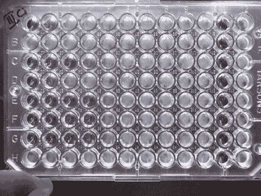

图 9-1 标准 96 孔板

我们将假定一个孔板可以有任意宽高比（对应于或多或少任意数量的行和列）来编写代码，但我们将假定一个孔板始终具有固定的`x，y`轴方向，其中对应于板列的`x`轴用数字标记，对应于板行的`y`轴用字母标记。因此，例如，一个特定的孔可能有坐标`D10`，对应于`y`轴上的行`D`和`x`轴上的列`10`。

如果你一直留意的话，你会发现我们将始终以`行:列`格式——换句话说，就是`y:x`格式——来引用板上的位置。这符合我们组织表格数据的方式，而这种方式可能源于我们西半球人[几千年前](https://en.wikipedia.org/wiki/Writing_system%2523Directionality)就书写文本布局共同做出的一些选择。

由于孔板也是一个聚合了许多属性和参数的对象的好例子，因此孔板的概念非常适合（不是双关语）表示为 Python 对象。类似地，板上的每个孔本身可以被视为一个属性的聚合体，其中最重要的就是它在板上的坐标。基于这些考虑，我们将使用面向对象编程（OOP）的方法来编写我们的孔板管理代码。

## 用于多孔板的 Python 类

关于坐标系的这个讨论很好地引出了我们希望多孔板类拥有的一个基础属性。由于孔板的孔可以说是排列在一个网格上，我们需要能够说出我们在板上的位置，换句话说，我们在谈论哪个孔。我们还需要知道孔的顺序以及我们如何从一个孔移动到下一个孔。例如，如果我们正在从[逗号分隔值](https://en.wikipedia.org/wiki/Comma-separated_values)（CSV）文件中读取孔板检测数据，以便将每个数据点分配到正确的孔，我们需要能够虚拟地穿过孔板，将文件中的数据正确映射到 Python 的孔板对象。此外，如果我们希望代码能够驱动机器人以从孔板读取数据（例如，使用分光光度传感器）或将液体移液到孔中，我们需要知道如何在孔板上水平和垂直移动。例如，在一个有 12 列的 96 孔板上，当机器人水平地遍历了一行 12 个孔后，它需要知道下一个孔位于其当前位置向下 1 行、向后退 12 列的位置，才能移动到那里。

对于多孔板，我们至少可以使用三种有用的坐标系：对于板的二维布局，二维坐标系似乎是最直观的。我们可以使用`行:列`表示法来实现这一点，既可以使用数字（为行和列使用简单的数字），也可以使用字母数字（为行使用字母标签，为列使用数字）。第一个系统的坐标看起来像这样：

- `(1,1), (2,3), (6,10)`

第二个系统的坐标如下：

- `A01`, `B03`, `F10`

这基本不言自明，但为什么在列整数前加零呢？这只是一个小技巧，使所有孔标签长度一致。其原因现在可能不明显，但请耐心等待，一切都会解释清楚！对于像孔板这样的二维物体，使用一维坐标系的原因可能不那么明显，但这种更简单的坐标系也有其用途，我们很快就会看到。一维坐标系简单地以线性方式反映了板上孔的顺序，从第一个到最后一个。根据我们书写和阅读的方式，从左到右、从上到下的系统似乎很自然，对于一个 96 孔板，该系统会将左上角的孔标记为 1，右下角的孔标记为 96——从左到右读取每一整行，然后向下移动到下一行的最左侧孔。

从处理的角度来看，一维坐标系非常有用，因为当我们物理地（例如，使用机器人）或虚拟地（例如，从输入流读取板分析数据）处理多孔板时，我们经常需要知道序列中的下一个孔是什么，这样才能遍历板上所有孔。

最后，我们需要能够将这些坐标系相互映射，以便在不同应用之间一致地切换。这一切归结为：在我们实现处理多孔板的 Python 类的代码中，我们的类构造函数方法将主要致力于设置板的布局和用于在其中移动的坐标系。

那么，让我们开始编写用于处理多孔板的 Python 类的`__init__`构造函数方法，如清单 9-1 所示。

```python
import math, os, string, csv

import matplotlib.pyplot as plt

class Plate:

    rowLabels = "ABCDEFGHIJKLMNOPQRSTUVWXYZ"

    mapPositions = {'position1D':0,'position2D':1,'wellID':2}

    def __init__(self,id,rows,columns):

        self.id = id

        self.rows = rows

        self.columns = columns

        self.size = self.rows * self.columns

        self.validate = {}

        self.data = {}

        for key in Plate.mapPositions:

            self.validate[key] = []

        for n in range(1,self.size+1):

            self.data[n] = {}

            m = self.map(n,check=False)

            for key in Plate.mapPositions:

                self.validate[key].append(m[Plate.mapPositions[key]])
```

## 清单 9-1 `Plate`类的构造函数

你首先会注意到，我们导入了一些其他 Python 模块（如`matplotlib`），这些模块稍后会用到，但我们会根据需要再获取它们。

在`Plate`类的代码中，你会看到我们使用了类变量，这是我们在第 7 章关于 OOP 中介绍的概念。你会记得，这些变量对于类的每个实例不是唯一的，而是在类的所有实例之间共享。对于`Plate`类，我们有两个类变量：`rowLabels`和`mapPositions`。`rowLabels`变量定义了我们可以用于板的行标签。因此，尽管我们的类所表示的板理论上可以有任意数量的行和列，但通过引入这个允许的行标签列表，我们默认假设一个板永远不会超过 26 行。如果需要，我们可以扩展这个假设，但这可能会不必要地使事情复杂化——例如，我们可能需要扩展代码以处理两个或更多字母的行标签。然而，为了本章的目的，我们将坚持使用大写字母 A-Z 作为行标签，并假设所有板最多有 26 行。

`mapPositions`类变量需要一点解释。考虑到我们希望在我们的类中支持三种板坐标系，并且我们希望能够在它们之间进行任意映射——实现这些目标的一个直接明了的做法是编写一系列六个映射函数，如图 9-2 所示。

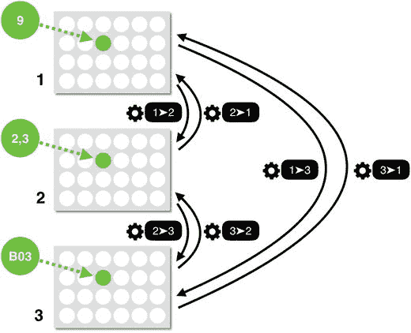

图 9-2 96 孔板的映射函数

首先，这需要编写和维护大量代码，并且在可能需要对一个孔进行多次映射的情况下，它还会迫使我们单独存储、跟踪和使用每个函数的输出坐标。此外，我们还需要跟踪输入坐标并正确使用它们，因为每个函数只期望一种坐标类型作为输入。一个干净优雅的解决方案是编写一个主映射函数，它接受三种坐标类型中的任何一种作为输入，并以单个结构化变量（如元组）输出所有三种映射。我们一些更有远见的读者可能已经意识到，这会导致少量的冗余，因为该函数的计算输出之一将与输入相同，但为了方便起见，这是值得付出的微小代价。最后，`mapPositions`类变量的存在理由是在全局范围内定义坐标映射函数输出中映射坐标类型的顺序。如果你不太确定这是如何工作的，不用担心，当我们看到映射函数的实际代码时，一切都会变得清晰。

出于透明度的考虑，我们还应该承认，选择这种方法的另一个原因是希望有机会介绍 Python[类型](https://docs.python.org/2/library/stdtypes.html)^([¹¹⁵])，并演示如何使用它们创建可以处理不同类型输入的 Python 函数。当我们看到执行实际坐标映射的代码时，你将很快看到它是如何工作的。但现在，让我们继续剖析类的构造函数。

如果我们查看`__init__`构造函数方法的函数签名，可以看到它接受三个参数（除了始终传递给实例方法的`self`之外）：`id`、`rows`和`columns`。

```python
def __init__(self,id,rows,columns):
```

`id`参数允许输入一个唯一 ID 来标识板。这对于任何一种实验室自动化过程（例如，使用机器人）几乎肯定非常重要，因为实际的物理板可能有某种跟踪 ID，我们需要记录并将其附加到相应的板数据上。请注意，此 ID 与类实例 ID 或任何其他内部 Python 引用无关。`rows`和`columns`参数不言自明，将用于定义板的布局以及坐标映射。声明为空字典的`validate`字段将用于检查我们支持的三种坐标系中任何一种格式的坐标输入对于当前板是否有效（我们稍后会看到它是如何工作的）。`data`字段（也是一个 Python 字典）将用于保存每个孔的实际数据。这些数据可能是例如实验室测量的光密度或 pH 值，或者是描述孔中设置条件的参数，如化学浓度或孔是否为对照样品。

接下来，我们设置`validate`字典。该字典将包含三个列表，分别存储三种有效输入坐标，对应我们希望支持的三种孔板坐标系。这个键值对字典的键将来自类变量`mapPositions`。对于每个键，我们将其初始值定义为一个空列表，如下所示：

```python
for key in Plate.mapPositions:
    self.validate[key] = []
```

在我们的`__init__`构造函数方法中，其余代码只是简单地从 1 到 n（其中 n 为孔位数量）遍历孔板上的每个位置，并使用映射函数生成代表每个位置的三组等效坐标。

### 导航孔板

稍后我们将了解映射方法的工作原理，但在深入探讨该方法的具体机制之前，先看一下清单 9-2 中的代码及其返回值。

```python
def map(self,loc,check=True):
    if type(loc) == type(15):
        if check:
            if not loc in self.validate['position1D']:
                raise Exception('Invalid 1D Plate Position: %s' % str(loc))
        row = int(math.ceil(float(loc)/float(self.columns))) - 1
        col = loc - (row * self.columns) - 1
    elif type(loc) == type((3,2)):
        if check:
            if not loc in self.validate['position2D']:
                raise Exception('Invalid 2D Plate Position: %s' % str(loc))
        row = loc[0] - 1
        col = loc[1] - 1
    elif type(loc) == type('A07'):
        if check:
            if not loc in self.validate['wellID']:
                raise Exception('Invalid Well ID: %s' % str(loc))
        row = Plate.rowLabels.index(loc[0])
        col = int(loc[1:]) - 1
    else:
        raise Exception('Unrecognized Plate Location Type: %s' % str(loc))
    pos = self.columns * row + col + 1
    id = "%s%02d" % (Plate.rowLabels[row],col+1)
    return (pos,(row+1,col+1),id)
```

清单 9-2

`Plate`类中的`map`方法

`map`函数的代码中包含大量优秀的 Python 学习内容，稍后我们将详细探讨。不过，首先要关注的是函数末尾的`return`语句。

```python
return (pos,(row+1,col+1),id)
```

我们可以看到`map`返回一个包含三个值的元组——每个值对应一种坐标系。这样我们就避免了如前图所述那样，需要编写六个独立的函数，每个函数有六个独立的输入和输出。我们的`map`函数将三种坐标类型中的任意一种作为输入，并输出一个包含全部三种映射结果的元组。我们还可以利用类变量`mapPositions`来追踪元组中哪个位置对应哪种坐标系。亲爱的读者，这里有一个小问题要问您……您会注意到，我们硬编码了`mapPositions`方法的输出——换句话说，我们只是直接将每种坐标类型插入到输出元组中，而没有直接使用`mapPositions`类变量。这种解决方案编码起来很快，但缺乏一定的鲁棒性。例如，如果我们决定改变`mapPositions`的顺序，将`wellID`坐标系放在第一位会怎样？这将破坏我们的大部分代码，因为在组装`map`输出元组时，我们没有直接使用`mapPositions`类变量，所以返回元组中坐标系的顺序是硬编码且*静态*的，也就是说，即使我们更改了`mapPositions`中的顺序，它也不会改变。我们如何通过使用`mapPositions`类变量来配置`map`方法返回的值，从而使代码更加健壮？

我们也可以返回一个像`mapPositions`一样的字典，包含与`mapPositions`相同的三个键（`position1D`、`position2D`、`wellID`），但每个键对应的值是映射后该坐标系统的实际坐标，如下所示：

```python
{'position1D':9,'position2D':(2,3),'wellID':'B03'}
```

# Python 孔板类实现：面向对象设计与坐标映射

## 面向对象设计与思想实验

或者，以真正的面向对象编程风格，我们甚至可以创建一个映射坐标类，其中三种坐标系分别对应对象中的一个字段。此外，我们还可以将整个`map`方法嵌入到新类中，并让我们的`__init__`构造函数方法接受三种坐标类型中的任意一种作为参数。这种方法的唯一问题是，现在孔板和坐标分成了两个类，但它们之间又相互依赖。不过，这个问题很容易解决。

这里给读者再提一个小思想实验：您将如何使用独立但相互依赖的孔板类和坐标类，以一种健壮的面向对象编程方法来编写这个问题的代码？如需灵感，可以回顾第 7 章中的面向对象编程介绍。

现在回到我们常规的编程任务（双关语）……

## 测试 map 函数

我们已经添加了`map`函数的代码，现在来做个简单测试：创建一个经典的 96 孔板（8 行 12 列），并运行一些`map`测试。

```python
p = Plate('Assay 42',8,12)

print(p.map(1))
# (1, (1, 1), 'A01')

print(p.map((1,1)))
# (1, (1, 1), 'A01')

print(p.map('A01'))
# (1, (1, 1), 'A01')

print(p.map(96))
# (96, (8, 12), 'H12')

print(p.map((8,12)))
# (96, (8, 12), 'H12')

print(p.map('H12'))
# (96, (8, 12), 'H12')

result = p.map('B01')
print(result[Plate.mapPositions['wellID']])
# B01
```

最后一段代码展示了如何使用类变量`mapPositions`来“记住”每个坐标映射在输出元组中的位置，这样我们就不必为了引用所需的坐标类型而显式输入元组中的位置了。

## 构造函数与 validate 字典

在完全深入`map`函数的代码之前，我们已经通过一个“黑盒”示例了解了它在输入和输出层面的工作原理。现在，我们可以理解`__init__`构造函数方法是如何构建`validate`字典的——该字典用于验证（或拒绝）提供给孔板类任何方法的输入坐标。`validate`字典有三个键，直接取自我们作为类变量创建的`mapPositions`字典，每个键对应一种坐标系。每个键的值只是一个列表，包含该坐标系下所有有效的孔板坐标。

因此，对于一个 8 行 12 列的 96 孔板，每种坐标系的有效值如下：

- 坐标系`position1D`：**1, 2, 3, … 94, 95, 96**
- 坐标系`position2D`：**(1,1), (1,2), (1,3), … (8,10), (8,11), (8,12)**
- 坐标系`wellID`：**‘A01’, ‘A02’, ‘A03’, … ‘H10’, ‘H11’, ‘H12’**

如果我们查看清单 9-1 中构造函数里实际填充`validate`字典的代码段：

```python
for n in range(1,self.size+1):
    self.data[n] = {}
    m = self.map(n,check=False)
    for key in Plate.mapPositions:
        self.validate[key].append(m[Plate.mapPositions[key]])
```

我们可以看到，它遍历了孔板的所有`position1D`坐标，即从**1**到**n**（其中**n**为孔位数量）的整数序列，并为每个位置生成一个包含三个坐标映射的元组。每个映射值随后被添加到`validate`字典中对应坐标类型的有效坐标列表中。

对此有几点说明：首先，你会看到循环的范围是从`1`到孔板的`size`字段加 1。

```python
for n in range(1,self.size+1):
```

这是为什么呢？

请务必牢记：所有 Python 序列（例如字符串）和列表的索引都是从 0 开始的。遵循这一惯例，Python 的 `range()` 方法生成的数值总是包含起始值，但不包含第二个范围参数。例如，`range(0, 100)` 会生成 0 到 99 的数值——换句话说，这 100 个值恰好对应一个包含 100 个元素的 Python 序列或列表的正确索引。

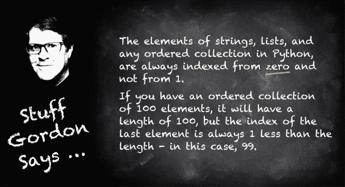

目前不必过多纠结其缘由，只需记住这些非常重要的 Python 事实，在此值得重申：

- 所有有序的 Python 序列和列表的元素都是从 0 开始索引的。
- 长度为 `n` 的有序 Python 序列或列表中的最高索引是 `n – 1`。
- 调用 `range(m, n)` 会生成从 `m` 到 `n – 1` 的所有整数值。

对于多孔板，我们通常习惯将孔从 `1` 到 `n` 编号，而不是从 0 开始。因此，如果从 1 开始编号，我们需要在代码中将 `range()` 方法调整为 `n + 1`（即 `self.size + 1`）。

其次，在调用 `map` 方法时，那个神秘的 `check=False` 是怎么回事？

```python
m = self.map(n, check=False)
```

原因是 `map` 方法具有双重功能。它不仅为输入坐标提供一组坐标映射，还会检查输入的坐标对于当前 `Plate` 实例是否有效。当我们首次运行 `map` 方法来生成有效坐标列表时，需要禁用这第二个坐标检查功能，因为我们实际上正在生成用于检查工作的坐标列表。换句话说，在生成有效坐标列表之前，我们无法根据这些坐标检查输入坐标！这个设计很好地引出了对 `map` 方法代码的详细分析。

## map 方法详解

现在我们已经知道 `map` 方法签名中 `check=False` 的作用，让我们看看 `map` 是如何工作的。

查看 `map` 方法，可以发现它通过一个 `if`-`elif`-`else` 风格的条件语句被分成四个部分，该语句用于测试传递给方法参数 `loc` 的输入坐标的 `type`。

```python
if type(loc) == type(15):
    ... do this
elif type(loc) == type((3, 2)):
    ... do that
elif type(loc) == type('A07'):
    ... do the other
else:
    ... do something else altogether
```

Python 的 `type` 方法，顾名思义，返回传递给它的对象的 `type`。例如，如果你在 Python 控制台中输入：

```python
a = 9
print(type(a))
```

你会看到：

```python
<type 'int'>
```

或者更简单，你可以这样输入：

```python
print(type(9))
```

所以，在第一个测试中，例如我们写的：

```python
if type(loc) == type(15):
```

我们是在测试 `loc` 是否是 `position1D` 坐标，由于这些坐标只是整数，我们也可以将测试写成：

```python
if type(loc) == int:
```

实际上，对于所有三种坐标类型测试，我们都可以写成：

```python
if type(loc) == int:
elif type(loc) == tuple:
elif type(loc) == str:
```

其中 `int`、`tuple` 和 `str` 是与孔板支持的三种坐标系中的坐标相对应的 Python 类型。这与我们选择的 `type` 测试实现方式效果相同，但当我们查看代码时，还需要记住每个 `type` 对应哪个坐标系，以及每种坐标的预期格式。例如，`wellID` 坐标类型必须是 `str` 类型，这并不能告诉我们，或者更重要的是，不能让阅读我们代码的其他人知道，它需要由一个大写行字母后跟一个两位数组成。

像这样编写输入 `wellID` 坐标的测试：

```python
elif type(loc) == type('A07'):
```

能传达更多信息，并使代码更容易理解。

因此，`map` 方法被一组条件语句划分，每个条件用于处理一种特定的坐标类型。查看每种情况的代码，我们可以看到第一条语句就利用了 `check` 方法参数来决定是否对输入坐标执行有效性测试。

```python
if check:
    if not loc in self.validate['position1D']:
        raise Exception('Invalid 1D Plate Position: %s' % str(loc))
```

你可能会对初始的 `check` 语句感到有点惊讶。我们难道不需要写：

- `if check == True:`

实际上，不需要。这展示了 Python 中一个便捷的简写方式，值得稍作解释。理解这一点很重要（也很有启发性）：该方法会计算其后跟随的内容，以确定它是 `True` 还是 `False`。这通常是一些比较语句，比如：

```python
if a > b:
```

或者更复杂的：

```python
if (gene.length > 1000 and gene.hasBRE()):
```

无论如何，一旦语句被计算，你可以想象 `if` 后面的整个语句会被替换为 `True` 或 `False`，就像这样：

```python
if True:
```

然后随后的代码块会根据结果决定是否执行。

在我们的例子中，变量 `check` 被设置为 `True` 或 `False`，因此直接计算该变量就足够了，我们不需要添加 `== True` 比较。

在继续之前，这段代码展示了你可以使用 `if` 简写的其他方式。

```python
def testA(a):
    if a:
        return "a seems to be True"
    else:
        return "a seems to be False"

print(testA(1))           # a seems to be True
print(testA(0))           # a seems to be False
print(testA(-1))          # a seems to be True
print(testA(0.0))         # a seems to be False
print(testA(0.00001))     # a seems to be True
print(testA([]))          # a seems to be False
print(testA([1, 2, 3]))   # a seems to be True
print(testA(""))          # a seems to be False
print(testA("a"))         # a seems to be True
```

*有趣*！Python 为你提供了一个便捷的简写，用于测试数值变量是否非零，或者有序集合（如字符串和列表）是否为空（换句话说，它们的长度是否为零）。

但回到我们的多孔板代码……

```python
if check:
    if not loc in self.validate['position1D']:
        raise Exception('Invalid 1D Plate Position: %s' % str(loc))
```

如果 `check` 被设置为 `True`，则在 `Plate` 类构造函数中创建的 `validate` 字典中的相应列表中搜索输入坐标 `loc`，如果不在其中，则 `raise` 一个 `Exception`，并用适当的错误信息终止程序。

假设 `loc` 通过检查是有效的，接下来看看会发生什么。在接下来的两行代码中，我们计算与输入坐标对应的行和列索引。

```python
row = int(math.ceil(float(loc) / float(self.columns))) - 1
col = loc - (row * self.columns) - 1
```

这看起来有点复杂，但实际上非常简单。让我们以一块 8 行 12 列的 96 孔板为例来演练一下。假设我们要映射第 15 个孔位的坐标。在`position1D`格式中，`loc`的输入值就是整数 15。要计算它位于哪一行，我们需要除以列数。但 12.0/15.0 等于 1.25。并没有 1.25 行，但我们可以将 1.25 理解为“第 1 行加上 0.25 个下一行”。这时就需要用到导入的 [Python math 模块](https://docs.python.org/2/library/math.html)。`math.ceil` 方法将 1.25 向上取整为下一个最大的整数（浮点数），即 2.0，这正是我们要找的行号。由于我们需要用浮点数进行运算，但又希望行号是整数，因此需要将整个结果强制转换为 `int` 类型。这样我们就得到了在孔板上标记的行号整数，但请记住，**Python 集合的索引从 0 开始，而不是从 1 开始**，因此在我们的 `Plate` 类内部，孔板上的第 1 行被索引为第 0 行；因此，我们必须先减 1 来完成计算，这样就能与内部表述保持一致的运算。

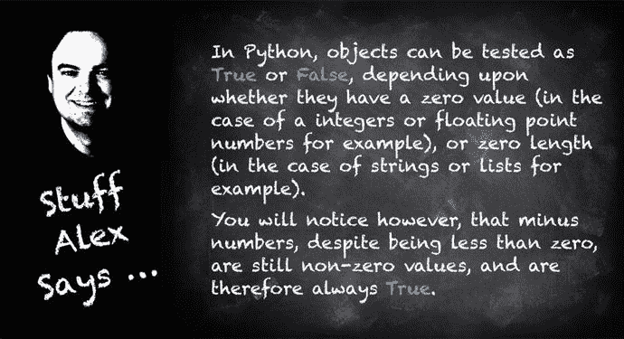

稍后，当我们准备输出映射后的坐标时，我们将从内部基于 0 索引的孔板表述，转换回现实世界中孔板所使用的外部坐标系统，其行和列从 1 开始索引。请注意：这就是为什么我们说这两行代码计算的是行和列的**索引值**，而不是实际的行和列**编号**，稍后我们会将索引值转换回编号。

对于处理`loc`输入坐标的那段代码块，上述解释可能显得有些冗长，但如果你查看`map`方法，就会看到三种输入坐标类型的处理方式本质上是相同的。输入坐标会与`validate`字典进行比对，然后被转换成行和列索引，因为这是计算三种坐标格式中任意一种的非常便捷的起点，我们稍后会看到。

在进入返回包含三种映射的元组的最终计算之前，我们还需要提一下，我们还有一个`else`子句，用于捕获任何不符合三种坐标类型之一的输入——例如，如果有人输入了一个 Python 字典作为坐标。`else`子句只是处理可能传递给`map`方法但未被识别为三种坐标类型之一的“任何其他内容”。

现在，我们准备完成`map`方法，并像这样输出坐标映射：

```python
pos = self.columns * row + col + 1
id = "%s%02d" % (Plate.rowLabels[row],col+1)
return (pos,(row+1,col+1),id)
```

我们计算`position1D`坐标`pos`，并在结果上加 1，以便用外部孔板坐标来表达。`position2D`坐标我们已经有了，因为我们已经计算了行和列索引，我们只需要记住对它们各自加 1，以孔板坐标来表达，这在`return`语句的`(row+1,col+1)`部分完成。最后，我们需要以孔标签的形式计算`wellID`坐标，该标签包含一个行字母和列号。

现在，如果我们通过一个 96 孔板的例子，就能清楚地看到内部（从 0 开始索引）坐标和外部（从 1 开始索引）孔板坐标之间的区别。

假设我们的输入坐标是 5。这对应第 1 行、第 5 列，我们计算出的行索引和列索引分别是 0 和 4。要转换为`wellID`坐标，我们使用了一些更高级的 Python 字符串格式化（我们在第 4 章首次介绍了字符串格式化）：

```python
id = "%s%02d" % (Plate.rowLabels[row],col+1)
```

`%s`格式你现在应该熟悉了，它将其转换为一个简单的字符串，这正是我们想要的行标签格式。`%02d`格式将其转换为长度为 2 的整数字符串表示，必要时前面补零。换句话说，像 12 这样的整数会被格式化为“12”，而像 5 这样的整数则会被格式化为“05”。现在，我们只需使用行索引 0，配合`rowLabels`类变量来获取行标签——`rowLabels[0]`的值是`"A"`——而实际（孔板上的）列号就是列索引加 1，得到 5。

因此，我们的输入坐标 5 在`wellID`坐标系统中映射为字符串`"A05"`。剩下的就是`map`方法将包含三个坐标映射的元组装配并返回，就像这样：

```python
return (pos,(row+1,col+1),id)
```

呼！仅仅一个类方法就涵盖了这么多内容，但围绕这个`Plate`类创建章节的美妙之处在于，除了为读者提供使用 Python 处理多孔板的实用基础外，它还为我们作者提供了展示 Python 特性以及“Pythonic”做事方式的机会，而除生物学之外，这正是本书的精华所在。

在我们最终结束`map`方法的讨论之前。你们中观察力较强的读者可能已经注意到，一旦我们生成了包含每个坐标系统有效坐标列表的`validate`字典，我们本可以在后续直接使用这些列表来为`map`方法的任何坐标输入提供映射，而不是每次都重新计算映射。我们仍然需要`map`方法中编写的代码来计算`validate`字典中的那些初始列表，但是——没错——从那时起我们完全可以利用这些列表，而不是每次都重新计算映射。

如果你想知道这该如何实现，何不花点时间自己思考一下，甚至亲自实现一下呢。本着那些鼓励读者超越书本内容、围绕主题进行额外探索的教科书的精神，我们将使用`validate`字典中生成的坐标列表来实现一个更高效的`map`方法，作为留给读者的练习！

## 分配与检索孔板数据

既然我们已经建立了定义孔板位置（孔）所需的坐标系统，现在让我们编写一些代码来向孔中添加数据并检索数据。为此，我们将创建几个新的`Plate`方法，非常直观且明确的命名就是`set`和`get`。

第一个`Plate`方法`set`如列表 9-3 所示。

```python
def set(self,loc,propertyName,value):
    m = self.map(loc)
    pos = m[Plate.mapPositions['position1D']]
    self.data[pos][key] = value
```
列表 9-3 `Plate` 类的 `set` 方法

在仔细研读过`map`方法的代码之后，`set`方法的代码现在应该看起来相当不言自明了。该方法接受一个孔板位置（以我们支持的三种坐标格式之一）、一个属性名和一个值。然后，它为提供的位置生成映射，并使用`position1D`坐标将属性及其值作为**键值对**添加到我们在类构造函数中创建的孔板数据字典中。

### 文本排版处理

您还记得在 `Plate` 类的 `__init__` 方法中，我们为 `data` 创建了一个空字典，然后遍历了培养板上的所有 `position1D` 位置，创建了由 `position1D` 坐标和一个空字典组成的键值对，用于存储该孔位的数据，如下所示：`5:{}`。例如，如果我们像这样使用 `set` 方法：

```python
myPlate.set(5,'浓度',27.4)
```

然后像这样检查数据字典：

```python
print(myPlate.data[5])
```

我们会看到

```python
{'浓度': 27.4}
```

仅从查看这个示例，现在很明显 `get` 方法应该如何通过孔位和属性来检索数据。一个有效的孔位坐标和一个属性将被传递给该方法，它会返回指定孔位的属性值，就像在清单 9-4 中所示。

```python
def get(self,loc,属性名称):
    m = self.map(loc)
    pos = m[Plate.mapPositions['position1D']]
    if 属性名称 in self.data[pos]:
        return self.data[pos][属性名称]
    else:
        return
```
清单 9-4 `Plate` 类的 `get` 方法

我们在这里添加了一个小细节，即我们不会直接返回指定孔位的属性值，而是首先检查指定的孔位是否实际拥有所引用的属性。如果我们不这样做，并且孔位字典不包含指定属性的键，那么我们的代码将会因错误而崩溃。相反，如果该属性不在孔位的字典中，我们会通过从方法中 `return` 来优雅地处理这种情况。

在我们继续之前，让我们检查一下我们的 `set` 和 `get` 方法以确保它们能正常工作。

```python
p = Plate('myPlate',8,12)
p.set('B01', '浓度', 0.87)
print(p.get(13, '浓度'))
0.87
print(p.get((2,1), '浓度'))
0.87
print(p.get('B01', '浓度'))
0.87
```

## 从 CSV 文件进行读写

这一切都很好，但您可能并不想在实验室中手动输入所有来自培养板实验的数据点。无论如何，如今您的大量培养板实验数据很有可能是由仪器和/或机器人自动生成的，它们会将每个孔位的数据写入某种结构化文件中，该文件的布局大致与培养板本身相对应。同样，您的很多培养板实验数据也有可能存储在 Excel 电子表格中。无论哪种情况，我们都要向 `Plate` 类添加一些代码，用于从一种最常见且通用的表格数据存储文件格式中读取培养板实验数据，这种格式被实验室仪器、机器人和人类广泛使用——即[逗号分隔值](https://en.wikipedia.org/wiki/Comma-separated_values)格式，或称 CSV。

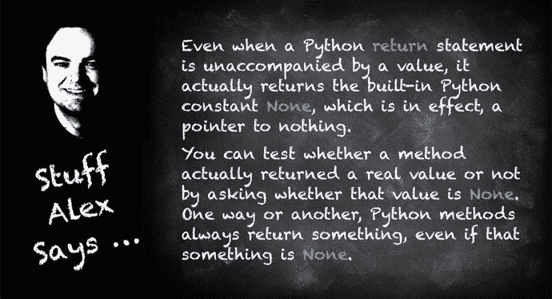

CSV 是一种纯文本格式，它简单地排列表格数据，使得表格的每一行由文件中的一行文本表示（以[回车符 <CR>](https://en.wikipedia.org/wiki/Carriage_return) 结尾），每行的列之间用逗号分隔，如下所示：

```
3.2, 4.8, 4.1, 2.0, 0.9, 3.5, ...
1.1, 2.4, 3.7, 3.1, 1.1, 4.6, ...
...
```

顺便提一下，您可能已经知道，您可以从 Microsoft Excel 等电子表格应用程序中以 CSV 格式导出表格数据。如果您希望表格数据具有更易于人类阅读的格式，或者将其输入到另一个不处理 Excel 自身内部数据格式的应用程序中，这将特别有用。在我们继续之前，我们先暂停一下，注意 CSV 是一种如此通用且常用的格式，以至于 Python 标准库甚至包含了一个 [csv 模块](https://docs.python.org/2/library/csv.html)^(¹²⁰)，专门用于处理这种格式的数据。而且，既然我们已经在第 5 章中向您展示了如何编写自己的代码来处理输入文件数据，我们在这里将使用 Python 的 `csv` 模块，特别是因为它是 Python 标准库的一部分。

那么，让我们考虑最简单的情况，假设我们有一个实验室仪器，它以简单的 CSV 格式写入多孔位数据，该格式仅由数据行和列组成。有时您会遇到更复杂的 CSV 文件，其中还包含额外的数据，例如表格的行和列轴标签。这些数据通常作为额外字段包含在实际行和列数据之前的文件中，如下所示：

```
浓度, 孵育时间 (小时)
3.2, 4.8, 4.1, 2.0, 0.9, 3.5, ...
1.1, 2.4, 3.7, 3.1, 1.1, 4.6, ...
...
```

甚至表格数据中嵌入了单独的行和列标签，如下所示：

```
1, 2, 3, 4, 5, 6, ...
A, 3.2, 4.8, 4.1, 2.0, 0.9, 3.5, ...
B, 1.1, 2.4, 3.7, 3.1, 1.1, 4.6, ...
C, ...
```

诸如此类……处理这些更复杂的 CSV 格式是 Python 的 `csv` 模块非常擅长的事情，但目前，我们假设创建文件的仪器只写出最简单格式的培养板孔位数据行和列。

让我们在 `Plate` 类中创建一个方法，用于从清单 9-5 中的一个简单 CSV 文件读取培养板数据。

```python
def readCSV(self,文件路径,属性名称):
    try:
        nWell = 1
        with open(文件路径, mode="r") as csvFile:
            csvReader = csv.reader(csvFile)
            for 行 in csvReader:
                for 孔位数据 in 行:
                    self.set(nWell, 属性名称,float(孔位数据))
                    nWell += 1
    except:
        print("无法从 %s 正确读取 CSV 数据" % 文件路径)
        return
    return
```

## 清单 9-5 – `Plate` 类的 `readCSV` 方法

首先要注意到的是，我们将所有处理文件操作、数据读取和数据转换的代码都包裹在了我们在第 5 章中介绍的 `try` … `except` 子句中，以便捕获在打开或读取 CSV 文件数据时可能发生的任何错误，并优雅地退出。我们同样捕获了在将读取为字符串的数据转换为浮点数时可能发生的任何错误。例如，这种错误可能发生在文件中某个位置，由于某种原因，实验室仪器无法读取该孔位的有效值，从而跳过了该位置，并在 CSV 文件中用一个无法转换为浮点值的字符串值将其标记为未读。

在 `try` … `except` 子句中，我们定义了打开的文件句柄 `csvFile`，其作用域限定在我们使用 `with` 语句创建的一个新的代码块内。然后，我们实例化了一个名为 `reader` 的类，该类在 `csv` 模块中为我们定义，使用的语句是：

```python
csvReader = csv.reader(csvFile)
```

这个名为 `reader` 的类，本质上是我们之前遇到过的、以字符串和列表等多种形式出现的一种极其实用的 Python 迭代器。迭代器是任何支持 `for <元素> in <集合>` 语法的 Python 对象类型。对于 `reader` 类而言，它所存储的元素是来自 CSV 文件的数据行，而每一行数据本身又是一个列表，可以在此基础上进行另一层迭代。

明白了这一点，我们现在可以看到，该方法在顶层对行进行迭代：

```
for row in csvReader:
```

接着，对于每一行，它又对组成该行的值列表进行迭代：

```
for wellData in row:
```

将遇到的每个值转换为浮点数，并使用我们之前编写的 `set` 方法将其赋值给对应的孔。你还会注意到，在每次遍历当前行中的值时，我们都会将变量 `nWell` 递增 1，这样在写入每个孔的值时，就能同步更新我们在板上的位置。

如果在读取文件和转换数据的过程中发生任何错误，该方法将跳转到 `except` 子句中的代码，并抛出一个带有错误消息的 Python 异常。我们在这里采用了一种“一网打尽”的单一方式，即由于以下任一原因导致的错误：

- 打开 CSV 文件
- 从 CSV 文件读取数据
- 转换 CSV 文件中的数据

都会触发我们的 `except` 子句。你会注意到，采用这种方式，无论发生上述哪种错误，我们都会得到相同的通用错误消息。对于简单情况，这种方法可能没问题。在现有场景下，读取一个小型 CSV 文件时，要找出错误实际发生的位置可能工作量不大——但如果涉及大量数据或更复杂的工作流程来处理数据，那么几乎可以肯定，值得为过程的每个阶段使用单独的 `try` … `except` 子句，并为每个阶段提供更具体、更具信息量的错误消息。

现在，让我们用一个实际的 CSV 文件来测试我们的 `readCSV` 方法，就像烹饪节目中常说的那样，“这是我们提前准备好的一个。”下表显示了一组 96 孔板（8 行 12 列）的数据，格式为逗号分隔值（顺便说一句，如果你好奇的话，这些数据完全是虚构的，仅用于测试我们的 `Plate` 类）。我们还在一些较短的数字前面额外添加了一些[空白字符](https://en.wikipedia.org/wiki/Whitespace_character)，这样所有数字都能垂直对齐，更易于阅读。

需要注意的一点是，如果我们指定逗号作为一行数据值中数据点之间的分隔符，那么该行数据值中是否存在其他空白字符（如空格和制表符）通常无关紧要，因为解析 CSV 文件的软件通常默认会忽略这些字符，并在解析过程中将其剔除（不过，在需要时也可以覆盖此默认行为）。同样重要的是要记住，尽管此表格看起来包含 96 个浮点数，但当从文件中读取它们时，它们将被读取为`字符串`，因为 CSV 格式并非专门针对包含数值数据的文件。

例如，你可能有一个包含个人联系信息的文件，其中诸如名字、姓氏、地址、电话号码等字段，都是在一行中由逗号分隔的值，该行代表一个联系人。请务必记住，CSV 格式的目的仅仅是分隔文件或表格中的各个数据值，而不是为每个数据值应如何解释或使用提供任何规则。这部分工作取决于你，即数据的最终用户。

为了测试我们新的 CSV 功能，我们将以下数据存储在一个名为 `96plateCSV.txt` 的文本文件中：

```
0.32, 1.13,  2.72,  4.85,  5.79,  6.51,  7.43,  7.65,  8.06,  8.11, v8.28,  9.49
1.37, 0.86,  8.02,  9.47, 10.03, 12.13, 13.97, 13.78, 14.53, 15.22, 18.50, 19.88
1.01, 0.22, 19.32, 20.64, 24.93, 25.41, 26.15, 26.33, 30.40, 34.48, 35.93, 37.22
0.29, 0.65, 31.35, 31.75, 40.04, 41.18, 42.21, 44.90, 46.16, 46.49, 48.41, 53.10
1.10, 1.36, 54.68, 55.09, 57.47, 57.62, 57.42, 61.82, 64.15, 65.97, 70.95, 72.55
0.78, 0.33, 74.53, 78.97, 79.34, 80.01, 80.94, 81.55, 83.88, 83.49, 84.37, 86.49
0.12, 0.72, 86.40, 86.42, 87.13, 87.57, 88.02, 88.47, 89.25, 89.05, 89.61, 90.76
0.24, 0.21, 90.29, 93.49, 93.53, 95.18, 95.34, 95.96, 96.77, 97.73, 98.08, 98.72
```

然后，我们实例化一个新的 96 孔 `Plate`，并使用 `readCSV` 方法像这样读取它：

```
p = Plate('My 96-Well Plate',8,12)
p.readCSV('96plateCSV.txt','concentration')
```

从代码中可以看出，我们将读取 CSV 数据表，并将其赋值给孔属性 `concentration`。由于 `readCSV` 方法使用 `set` 方法将每个数据值赋值给一个孔，因此 CSV 数据会依次放入 `data` 字典中，该字典由 `Plate` 类定义，用于保存孔板的数据。我们可以使用 `get` 方法查看每个孔被分配了什么值。

```
print(p.get(1,'concentration'))
0.32
print(p.get(12,'concentration'))
9.49
print(p.get(96,'concentration'))
98.72
```

到目前为止，一切顺利。我们可以使用三个坐标系统中的任何一个在多孔板中导航；我们可以读取广泛使用的 CSV 格式的多孔板数据；我们可以将命名的数据值分配给单个孔；我们可以通过指定孔和属性名称来检索它们。这已经是一个坚实、基础的*多孔板*类框架了，但让我们考虑一些可能想要添加的进一步功能。

如果我们在工作中编写一个真正的 `Plate` 类，可以想象有许多功能可能想要添加。例如，我们甚至可以将每个孔实现为 `Well` 类的一个实例，并配备一整套字段和方法，以各种复杂的方式处理孔数据。因此，在结束多孔板的话题之前，让我们通过几个我们希望它能做到的基本示例，进一步扩展 `Plate` 类的功能。正如本章开头所承诺的，这应包括一些处理实验室自动化的基本功能，这种自动化在孔板数据处理中正变得越来越普遍。

为实验室自动化编写代码本身就是（并且确实是）整本书的主题。因此，虽然详细描述如何为机器人和自动化仪器编写驱动程序超出了本书的范围，但我们将向你展示如何编写高级代码，使你能够将你的 Python 软件与用于机器控制的底层驱动程序软件（通常用 C 语言编写）对接。

## 孔，孔，孔：孔板上的数学运算

多孔板的网格布局自然适合于利用板的行和列来组织孔板实验——例如，将每个样本及其对照品放置在单行中，或者在一行中水平地对给定样本进行连续稀释，或者在一列孔中垂直地进行稀释。出于这个原因，来自多孔板的数据通常可以按行和列进行有效的组织和/或分析。考虑到这一点，让我们为 `Plate` 类添加一些进一步的功能，以便能够快速方便地按行和列检索板上的数据。

我们将向`Plate`类添加两个方法——`getRow`和`getColumn`——它们接受任意一种我们支持的坐标系统中的单个板位置，并返回该位置所在行或列的位置列表。这将相对快速且容易实现，因为我们将使用已实现的便捷`map`方法来完成大部分繁重工作。首先是清单 9-6 中展示的`getRow`方法。

```python
def getRow(self,loc):
    here = self.map(loc)
    row = []
    for n in range(0,self.size):
        there = self.map(n+1)
        if there[1][0] == here[1][0]:
```

## Listing 9-6
`getRow` method for `Plate` class

```python
row.append(there)
return row
```

这个方法很容易分解。首先，我们使用`map`方法检查提供的位置，该方法还会提供一个包含该位置到三种支持坐标系统映射的元组。

```python
here = self.map(loc)
```

创建了一个名为`row`的空列表来保存方法将要返回的行位置后，我们遍历板上的所有位置，生成每个位置的坐标，并使用`position2D`（行，列）坐标来测试每个位置的行索引是否与输入位置的行索引匹配。这种方法的一个很好的副作用是，与输入位置位于同一行的位置会按照它们在板上出现的顺序添加到`row`列表中。

和往常一样，让我们测试一下新代码：

```python
p = Plate('My 96-Well Plate',8,12)
p.readCSV('96plateCSV.txt','concentration')
print(p.getRow('B01'))
```
```
(13, (2, 1), 'B01'), (14, (2, 2), 'B02'), (15, (2, 3), 'B03'), (16, (2, 4), 'B04'), ...
```
```python
print(p.getRow(27))
```
```
[(25, (3, 1), 'C01'), (26, (3, 2), 'C02'), (27, (3, 3), 'C03'),(28, (3, 4), 'C04'), ...
```
```python
print(p.getRow((4,7)))
```
```
[(37, (4, 1), 'D01'), (38, (4, 2), 'D02'), (39, (4, 3), 'D03'), (40, (4, 4), 'D04'), ...
```

我们已经截断了`print`语句的输出，但你能理解其大意。`getRow`方法返回与输入板位置位于同一行的所有板位置的映射坐标。让我们在清单 9-7 中创建一个类似的`getColumn`方法。

```python
def getColumn(self,loc):
    here = self.map(loc)
    col = []
    for n in range(0,self.size):
        there = self.map(n+1)
        if there[1][1] == here[1][1]:
            col.append(there)
    return col
```

## Listing 9-7
`getColumn` method for `Plate` class

这个方法的工作方式与`getRow`方法几乎完全相同，区别在于它使用`position2D`坐标的列索引来匹配位置。这两个方法实际上非常相似，我们可以轻松地将它们合并为一个`getRowAndColumn`方法，该方法在遍历板位置时同时填充`row`和`col`列表，并将它们作为两个列表返回。我们将把这作为留给读者的一项练习。

分析多孔板数据通常涉及基于板上孔的行和列进行计算，甚至在整个板上进行计算。这包括数学运算，例如从一行孔数据中减去对照孔值，或计算一行或一列的平均值。可以想象，人们希望对多孔板数据执行各种各样的计算，并且掌握了我们为识别板上行和列位置以及从特定孔中检索数据而编写的方法，我们完全有能力实现此类方法。作为示例，让我们看看计算多个孔平均值的简单但普遍的问题。我们将直接基于`get`、`getRow`和`getColumn`方法进行构建，以演示如何使用`Plate`类的这一基本基础设施来扩展其功能。

在清单 9-8 中，我们展示了一个方法的代码，该方法接受一个属性名称和（可选）单个位置作为输入，并计算该属性在一行或一列孔甚至整个板上的平均值。

```python
def average(self,propertyName,loc=None):
    if loc == None:
        total = 0.0
        for pos in range(0,self.size):
            total += self.get(pos+1, propertyName)
        return total/self.size
    row = self.getRow(loc)
    col = self.getColumn(loc)
    rowTotal = 0.0
    colTotal = 0.0
    for pos in row:
        rowTotal += self.get(pos[1],propertyName)
    rowMean = rowTotal / self.columns
    for pos in col:
        colTotal += self.get(pos[1],propertyName)
    colMean = colTotal / self.rows
    return (rowMean,colMean)
```

## Listing 9-8
Computing the average across a feature in the `Plate` class

这里我们可以看到，该方法的`loc`参数是可选的，因为提供了一个默认值`loc=None`，当没有为`average`方法传递`loc`值时将使用该默认值。不传递特定位置实际上是让方法用户计算整个板的平均值，你可以在`if loc == None:`之后的代码块中看到这一点。所有孔的总和初始化为零，我们遍历板上的每个位置，累加指定属性的值，最后除以位置数量。

如果为`loc`参数提供了值，`average`方法会分别使用`getRow`和`getColumn`方法生成行和列位置的列表，然后遍历这些列表中的位置来计算行和列的平均值，并在元组`(rowMean, colMean)`中返回这两个值。

让我们用一个使用我们之前介绍过的测试数据表、从 CSV 文件读取并标记为属性名`concentration`的 96 孔板来测试一下：

```python
p = Plate('My 96-Well Plate',8,12)
p.readCSV('96plateCSV.txt','concentration')
```

首先，测试指定孔位置的行和列平均值：

```python
print(p.average('concentration','B03'))
```
```
(11.479999999999999, 45.91375)
```

接下来，通过不指定孔位置来测试整个板的平均值的计算：

```python
print(p.average('concentration'))
```
```
43.6519791667
```

# 微孔板检测 II：自动化与可视化

如果你是那种需要亲自验证这类结果的人，请尽管使用前面提供的数据表进行计算。不过剧透一下——如果你乐意相信我们的话，我们已经验证过了！
下一步：我们将把虚拟孔板代码付诸实践，并在第 10 章中，在自动化与可视化的真实（物理）世界中对其进行全面测试。

# 参考资料与拓展阅读

*   关于[微孔板](https://en.wikipedia.org/wiki/Microtiter_plate)你想知道但不敢问的一切

# 脚注

10. 进展顺利

 |
*“你们两个是从哪儿来的？”爱丽丝问道。*
*“那边，”其中一个双胞胎指着大约 10 英尺外的地面上的一个点说。*
*“不，我是说在那之前，”爱丽丝说。*
*“那边，”另一个双胞胎指着比第一个点大约远 10 英尺的地面上的一个点说。*
*“我看得出来你们对事物的理解非常字面化，”爱丽丝觉得好笑地说。*
*“哦，是的，”第一个双胞胎说。“我哥哥有一次用了瓶子上写着‘起泡、冲洗、重复’的洗发水，结果他在淋浴间待了好几天直到洗发水用完。”* |

 |
`类`，`matplotlib`，`pyplot`，`colormaps`，`RGB color model`，`plot resolution`，`plot size`，`iterators`，`SWIG`，`round()`

 |
*微孔板布局与物理尺寸、二维坐标系、步进电机、机器人、热图、光密度*

我们已经探讨了如何将微孔板作为虚拟对象来处理，现在来看一下如何将其作为物理（及视觉）对象来操作。实验室微孔板检测是许多人构建基于实验室自动化和机器人的[高通量](https://en.wikipedia.org/wiki/High_throughput_biology)流程的热门目标，目前已有大量实验室仪器和机器人能够自动在多孔板中设置实验、监控实验过程并读取数据。要实现这些功能，所使用的计算机驱动设备需要某种形式的微孔板物理映射。

## 物理映射微孔板

我们将用于物理映射多孔板的简单方案如下图所示，并做出以下假设。第一个孔——在我们三种坐标系中称为 `1`、`(1,1)` 或 '`A01`'——位于微孔板的左上角。我们将微孔板的左上角选为二维物理坐标系的原点，该坐标系将用于在板上导航。微孔板具有从左到右轴 `x` 定义的宽度和从上到下轴 `y` 定义的高度，这些轴界定了板的边缘。你会注意到，由于我们将物理坐标系的原点定义为微孔板的左上角，随着行号递增，我们在 `y` 方向上是向下移动的。最左侧列孔相对于板左边缘的位置可由 `xb`（`x` 方向上的偏移量）定义。类似地，最顶部行孔相对于板上边缘的位置可由 `yb`（`y` 方向上的偏移量）定义。每个孔的内径由参数 `d` 定义。假设孔的间距在水平和垂直方向上相等，并由单一参数 `p` 表示。

对于真实的微孔板，这些假设不一定全部成立，但为了演示微孔板的物理映射方法，这个非常简单的方案已经足够。如果真实微孔板的物理布局更为复杂，例如孔的水平和垂直间距不相等，则需要更多参数来描述。在板上进行物理导航所需的计算也会更复杂。

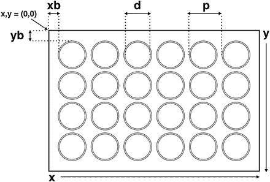

**图 10-1** 96 孔板的物理布局

不过，其原理本质上与我们在此描述的简单方案相同。我们在微孔板上确定一个或多个参考点，并据此描述孔的布局。在继续之前，值得花时间仔细查看图 10-1 中我们简单物理微孔板方案的示意图，因为它解释了我们将在本节中使用的大量代码。

现在，让我们向 `Plate` 类添加一个 `definePhysicalMap` 方法，该方法定义了为自动化及可视化目的所需的微孔板物理布局。从该方案可以看出，我们的方法需要将方案中的每个参数作为参数接收。我们将让 `definePhysicalMap` 方法使用这些参数来计算并存储板上所有孔的物理位置，以供后续使用。我们还将使用此方法初始化自动化代码，生成板上一个与机械臂或仪器读头的默认初始化位置相对应的起始位置。我们将这个初始化位置（任意地）设定在坐标 `(0,0)`，即微孔板的左上角，之后机器人或仪器的所有移动都将以该起始位置为参考。

那么物理坐标系的单位呢？在编写代码时，我们实际上不需要在 `definePhysicalMap` 中指定一组距离单位。这是因为我们将完全以机器人或仪器移动所使用的任何单位制来工作。对于通常驱动机器人或仪器上移动传感器的计算机控制[步进电机](https://en.wikipedia.org/wiki/Stepper_motor)，其步长通常以旋转角度的若干分之一来精确定义。


一旦这个旋转通过仪器的连杆和齿轮传动，旋转的分量将转化为相应微小的线性运动。换句话说，电机的一个旋转**步进**可映射为线性运动，通常以毫米或微米为单位度量，具体取决于电机精度及仪器或机器人的齿轮传动比。因此，对于我们的 `definePhysicalMap` 方法，我们需要做的只是确保以相同单位（例如毫米）输入所有物理微孔板参数，并以相同单位指定仪器的步长。再次强调，为了演示及保持简单，我们将假设仪器在 `x` 和 `y` 方向上的移动步长相等。如果并非如此，则需要添加额外参数，并对不同方向的移动分别进行计算。

以下是在 `Plate` 类中 `definePhysicalMap` 方法的代码，见清单 10-1（请记住，构建 `Plate` 类的这些代码清单是逐步累加的，应在第 9 章代码清单中已介绍的所有方法之后添加）：

```
def definePhysicalMap(self,width,height,xBorder,yBorder, \
                      diameter,pitch,stepsize):
    self.width = width
    self.height = height
    self.xBorder = xBorder
    self.yBorder = yBorder
    self.diameter = diameter
    self.pitch = pitch
    self.stepSize = stepsize
    self.xwells = []
    self.ywells = []
    xpos = self.xBorder
    for nx in range(0,self.columns):
        self.xwells.append(xpos)
        xpos += self.pitch
    ypos = -self.yBorder
    for ny in range(0,self.rows):
        self.ywells.append(ypos)
        ypos -= self.pitch
    self.initializePlateHead()
    self.setPlotCurrentPosition()
```

**清单 10-1** 为 `Plate` 类定义物理映射

### 物理板映射与初始化

再看一下图 10-1 中展示的物理板模式，你会发现我们用来定义物理板的每个参数都作为参数传递给 `definePhysicalMap` 方法。`width` 和 `height` 参数对应板在 `x` 和 `y` 方向上的尺寸。`xBorder` 和 `yBorder` 对应 `xb` 和 `yb`，`diameter` 对应 `d`，`pitch` 对应 `p`。你会注意到我们还有一个 `stepSize` 参数，它定义了板在 `x` 和 `y` 维度上线性运动单个单位的尺寸。`stepSize` 参数必须与其他参数采用相同的单位，通常应该是这些单位的一个分数——例如，如果板尺寸以毫米为单位提供，`stepSize` 可能是 0.01，这对应百分之一毫米的步长。对于此配置，我们需要机器控制系统向机器人或仪器驱动电机发送 100 步，才能在我们选择的维度上实现一毫米的线性移动。

将提供的参数存储为实例变量后，`definePhysicalMap` 方法会创建两个实例变量 `xwells` 和 `ywells`，它们分别是包含板列和行水平位置的列表。以下是生成 `xwells` 列表的代码：

```
xpos = self.xBorder + self.diameter/2.0
for nx in range(0,self.columns):
```

水平孔位置`xpos`初始化为实例变量`xBorder`加上半个孔直径，这样我们实际上是将最左列在`x`方向上的位置定义为最左侧孔的中心。然后我们遍历板上的列数，每次将当前列位置追加到`xwells`列表，再将孔间距`pitch`加到当前位置以计算下一个位置。因此，从最左侧孔的中心开始，所有后续孔位置也将对应各自孔的中心。这对自动化代码很重要，因为我们可能希望机器人和仪器从孔的**中心**（而不是边缘）进行移液和/或采样。

我们执行类似操作来生成垂直行位置的`ywells`列表，但由于板的`y`轴方向与行编号顺序相反，在遍历垂直行位置时必须使用`y`的**递减**值——换句话说，我们从`y`为零开始，以`y`的**负**增量向下移动板。如果你再次参考板模式，原因就一目了然了。

```python
ypos = -self.yBorder - self.diameter/2.0

for ny in range(0,self.rows):

    self.ywells.append(ypos)

    ypos -= self.pitch
```

### 板位置初始化

现在我们已经有了板上每一行和每一列的水平与垂直位置，只需使用孔在板网格布局中的位置来查找其在板上的水平和垂直位置，就可以轻松计算板上任意孔的物理位置。

扩展`Plate`类使其能够进行物理映射后，剩下的工作就是为`Plate`实例提供一个`initializePlatePosition`方法，该方法处理我们用于存储板上当前物理位置的`x`和`y`两个新实例变量。创建这些变量后，`initializePlatePosition`方法的主要工作是将它们初始化为(0,0)，即我们的坐标系原点。这有点随意——我们本可以从第一个孔、最后一个孔甚至其他可能更适合机器人或仪器的物理位置（例如板的几何中心）开始。

在`definePhysicalMap`方法的末尾，你会看到还有一个对`setPlotCurrentPlatePosition`方法的调用，我们也将介绍该方法。这只是一个设置`True`或`False`标志的方法，用于确定在可视化板时是否直观地表示当前板位置。我们还没有讨论板的可视化，但这将是本章的最后一个主题，届时我们将介绍非常强大且易于使用的[`matplotlib`](http://matplotlib.org/) 库。在我们的板可视化方法中，我们希望可以选择显示当前板位置（例如，对应于机器人移液装置或仪器读取头的位置）。这对于测试目的非常有用，当我们使用物理映射代码在板上移动时，它可以显示当前位置相对于板布局的位置。如清单 10-2 所示，这个简单的`setPlotCurrentPlatePosition`方法需要做的就是标记是否在可视化中包括当前板位置，并提供为其分配颜色的选项。能够选择颜色的原因在我们深入可视化主题并学习使用颜色映射可视化板数据时会更加明显。

```python
def initializePlatePosition(self):

    self.x = 0

    self.y = 0

def setPlotCurrentPosition(self, status=False, color='yellow'):

    self.plotCurrentPosition = status

    self.currentPositionColor = color
```

**Listing 10-2** Plate 类的初始化方法

你会注意到，由`x`和`y`变量表示的板当前位置是以**整数**为单位的。当我们开始使用机器人和仪器在物理上导航板时，我们假设这些设备的运动由步进电机驱动，因此运动单位必须以整数步表示。你还会注意到`plotCurrentPlatePosition`的默认状态是`False`，但稍后当我们想要全面测试物理导航板的代码时，我们会启用它。相关内容很快就会介绍。

### 孔物理位置映射

我们在板上主要关注的物理位置是孔的位置，现在让我们使用生成的板行和列位置列表`xwells`和`ywells`，为`Plate`类添加一个方法，以物理映射清单 10-3 中任意孔的位置。

```python
def mapWell(self, loc):

    m = self.map(loc)[Plate.mapPositions['position2D']]

    xpos = self.xwells[m[1]-1]

    ypos = self.ywells[m[0]-1]

    return (xpos, ypos)
```

**Listing 10-3** Plate 类的 mapWell 方法

`mapWell`方法使用我们的`map`方法为输入的孔位置生成坐标元组，但我们不是将整个三个值的元组赋值给`m`，而是只从元组中提取`position2D`坐标。

```python
m = self.map(loc)[Plate.mapPositions['position2D']]
```

从语法上看，这可能有点奇怪，因为我们相当于在方法调用后附加了一个字典键查找，但这在 Python 中是完全合法的。一种有用的理解方式是：每当你看到一个返回对象（无论是整数、列表、字典、用于模拟*霸王龙*繁殖习性的用户定义类等）的方法调用时，你可以在思维上用该对象替换方法调用，并且任何用于访问该对象元素或字段的语法都是完全合法的。从某种意义上说，这只是一种节省额外代码的简写形式。在我们的示例中，我们可以先将`map`返回的元组赋值给`m`，然后再从中提取`position2D`坐标。

```python
m = self.map(loc)

m = m[Plate.mapPositions['position2D']]
```

结果是一样的，但代码会稍长一些。

现在我们有了以（行，列）形式表示的坐标，就可以利用存储行和列位置的`xwells`和`ywells`列表，查找该孔在板上的物理位置。你会注意到，由于 Python 列表索引从 0 开始，而我们的孔板坐标系中行和列均从 1 开始索引，因此需要将行和列都减去 1。

```python
xpos = self.xwells[m[1]-1]

ypos = self.ywells[m[0]-1]
```

在继续之前，我们先创建一个 96 孔板，为其应用物理映射，然后快速测试新的`mapWell`方法。

```python
p = Plate('My 96-well plate',8,12)

p.definePhysicalMap(127.71,85.43,14.36,10.0,3.47,9.0,0.1)

print(p.mapWell(1))

(16.095, -11.735)

print(p.mapWell(2))

(25.095, -11.735)

print(p.mapWell(12))

(115.095, -11.735)

print(p.mapWell(85))

(16.095, -74.735)

print(p.mapWell(96))

(115.095, -74.735)
```

映射后的 96 孔板宽 85.43mm，高 127.71mm。从板的左上角测量，第一列的水平偏移为 14.36mm，第一行的垂直偏移为 10.0mm。孔的直径为 3.47mm，间距为 9.0mm。最后，我们使用的自动化设备的步长为 0.1mm。

基于这些参数并再次参考我们的板示意图，第一个孔的 x 坐标应为：

*   `xb` + `d`/2 = 14.36 + 3.47/2 = 16.095

同样，第一个孔的 y 坐标应为：

*   `yb` + `d`/2 = 10.0 + 3.47/2 = 11.735

因此，第一个孔的`mapWell`计算是正确的。对于板上的第二个孔，由于它位于同一行，y 坐标应保持不变，x 坐标则应增加孔间距`p`，即 16.095 + 9.00 = 25.095。你还会注意到，随着我们向下移动行，孔的 y 坐标值变得越来越负，这与我们的坐标原点（板的左上角）是一致的。如前所述，如果你想检查其余的计算结果，请自行验证。

### 编程实现整板移动

现在我们能定义板上任意孔的物理位置，接下来只需定义所需的`x`和`y`轴移动，就可以将这些指令发送给仪器或机器人，以物理方式移动移液机器人或传感器在板上工作。我们只需要知道当前位置和下一个目标位置，然后利用`stepSize`参数计算出到达目标所需的`x`和`y`步数。

```python
def moveTo(self,loc):

pos = self.mapWell(loc)

stepsPerUnit = 1.0 / self.stepSize

newx = int(round(pos[0] * stepsPerUnit))

newy = int(round(pos[1] * stepsPerUnit))

xshift = newx - self.x

yshift = newy - self.y

self.x += xshift

self.y += yshift

return (xshift,yshift)
```

```
清单 10-4
`moveTo` 方法（`Plate` 类）

`moveTo` 方法（如清单[10-4]所示）正是这样做的：它接受一个孔位置作为 `destination`（目标），计算从板的当前位置（`self.x`, `self.y`）到达 `destination` 所需的 x 和 y 步数，并在过程中将板的当前位置更新为这个新位置。既然我们是在物理坐标系中工作，你会注意到，我们必须始终使用整数值来表示当前的 x 和 y 坐标位置以及从当前位置移动到新位置所需的偏移量。因为 `stepSize` 参数是我们用于定义板物理布局单位的分数，它不一定能得出整数步数，所以在计算新位置时，我们需要四舍五入到最接近的整数。这正是 Python 内置函数 `round` 所做的事情——例如：

```python
print(round(5.4))
# 输出: 5.0

print(round(5.6))
# 输出: 6.0
```

尽管 `round` 返回最接近的整数，但它仍然是浮点数。如果你需要整数，则必须将其转换为 Python 的 `int` 类型，如下所示：

```python
print(int(round(5.6)))
# 输出: 6
```

需要牢记的是，板上所有的物理坐标都必须以 `整数值` 表示，因为我们是用整数步数来定义板上的二维物理运动。
现在来测试我们的 `moveTo` 方法。我们将从移动到孔 1 开始，然后沿着第一行前进到孔 2，接着向下移动一行并回到第 1 列（即孔 13 的位置），最后直接跳到板上的最后一个孔——96 号孔。对于每次移动，我们将打印出所需的 x 和 y 偏移量、新的物理位置以及该位置孔的精确物理坐标，以便比较。你会立即发现，由于物理移动使用的是整数步数，当前物理位置与 `mapWell` 方法确定的精确孔位并不完全相同。只要我们使用的步进电机步长相对于板的物理尺寸足够小，这种差异就非常微小，对我们的机器人或自动化仪器来说永远不是问题。在我们的例子中，板尺寸以毫米为单位提供，`stepSize` 定义为 0.1，即十分之一毫米。这个线性单位相对于板尺寸确实很小，因此我们的自动化设备几乎不会因精度不足而无法定位到孔。

现在开始测试：

```python
print(p.moveTo(1))
# 输出: (161, -117)

print(p.x, p.y)
# 输出: 161 -117

print(p.mapWell(1))
# 输出: (16.095, -11.735)

print(p.moveTo(2))
# 输出: (90, 0)

print(p.x, p.y)
# 输出: 251 -117

print(p.mapWell(2))
# 输出: (25.095, -11.735)

print(p.moveTo(13))
# 输出: (-90, -90)

print(p.x, p.y)
# 输出: 161 -207

print(p.mapWell(13))
# 输出: (16.095, -20.735)

print(p.moveTo(96))
# 输出: (990, -540)

print(p.x, p.y)
# 输出: 1151 -747

print(p.mapWell(96))
# 输出: (115.095, -74.735)
```

很好！从测试结果可以看出，由`moveTo`方法输出的偏移量计算出的最终位置（`p.x`, `p.y`），在每种情况下都是最接近`mapWell`方法计算出的实际浮点孔位坐标的整数值。
在我们团队为某个客户实施的真实实验室自动化项目中，这类高级Python代码以我们展示的方式生成了二维移动指令，然后将其传递给一个用C语言编写的底层机器控制库，该库实际驱动实验室机器人的步进电机。这需要借助前面提到的名为`SWIG`（简化封装与接口生成器）的平台进行一些代码调整，该平台能让用C等语言编写的代码库与你的Python代码对接，使其子程序和函数可以从Python中调用，就像调用Python方法一样。大多数实验室自动化硬件都附带这类底层机器控制库，用户可以直接或借助`SWIG`等接口软件将它们集成到自己的应用程序中。深入探讨如何设置、编程和使用这类自动化硬件已超出本书的范围和目的，但我们会在本章末尾推荐一些优秀资源，供你更深入地学习实验室自动化这一主题。

## 使用 matplotlib 可视化多孔板

至此，我们终于来到了多孔板漫长探索之旅的最后一个主题——可视化板式测定数据。我们花了大量时间处理Python中的板式测定数据，部分原因是板式测定已成为生命科学研究中如此普遍的特征，但也因为这个主题为我们提供了许多绝佳的Python学习机会。

[matplotlib 库](http://matplotlib.org/)^(123)是一个功能强大且易于使用的Python扩展，提供了出色的图形和绘图功能。如果你查看`matplotlib`文档，会发现[pyplot](http://matplotlib.org/api/pyplot_api.html)^(124)（我们将在本章中详细讨论）是`matplotlib`中一种类似`MATLAB`的绘图框架^(125)。如果你曾使用过`MATLAB`，那么`matplotlib`的总体环境和设置，特别是`pyplot`，会让你感到非常熟悉^(126)。`matplotlib`通常存在于大多数Windows或macOS的Python发行版中，并且在大多数Linux发行版中也作为附加包提供（例如，在Ubuntu和Fedora中，该包都称为`python-matplotlib`）。如果`matplotlib`尚未包含在你的主要Python安装中，请参阅第1章，了解通过`pip`安装`matplotlib`的更多详细信息。

简要介绍完毕，让我们从一个简单的库使用示例开始吧！我们将编写一些代码来绘制板的布局，其中孔的颜色根据某种选定的属性进行编码。

我们还将使用`currentPlatePosition`标志以及我们在`setPlotCurrentPlatePosition`方法中实现的对当前板位进行绘图的颜色。

### 使用 matplotlib 颜色映射

首先，让我们思考如何根据某种属性对孔进行颜色编码。假设我们想要表示之前示例中从CSV文件读取的`concentration`数据。板上的每个孔都有一个与`concentration`属性相关联的值，我们希望使用颜色映射来表示板上浓度值的范围。你可能在之前许多其他应用程序中见过颜色映射的使用。在生物学中，一个显而易见的例子是使用彩色[热图](https://en.wikipedia.org/wiki/Heat_map)来表示细胞中基因表达的差异水平，如图10-2所示。

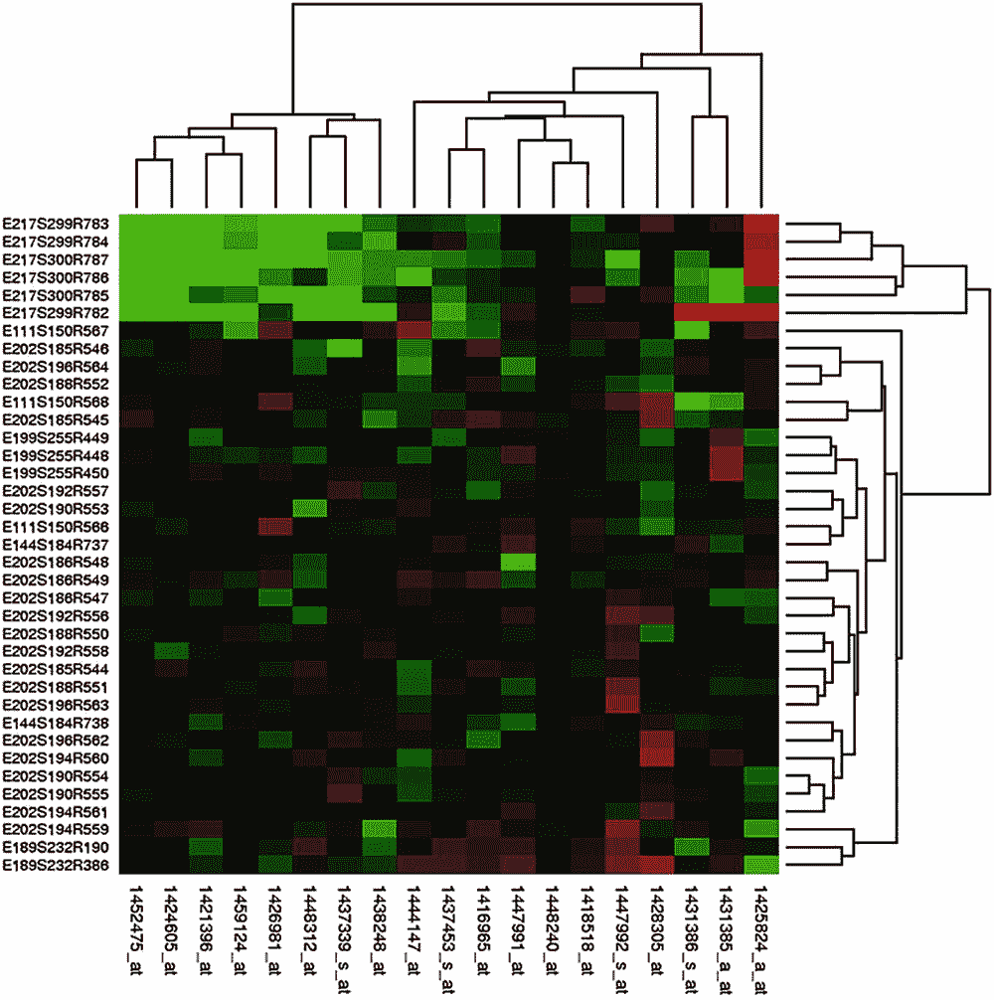

图 10-2 表示差异基因表达的热图

我们将开发一些Python代码来创建板上孔的热图，根据我们为每个孔分配了值的某个指定属性进行着色。根据[一图胜千言](https://en.wikipedia.org/wiki/A_picture_is_worth_a_thousand_words)的古老格言，我们将利用可视化的力量，以一种直观的方式表示板式测定数据，并一目了然地展示数据中存在的趋势（如果有的话）。

为此，我们将利用一种通过[RGB 颜色模型](https://en.wikipedia.org/wiki/RGB_color_model)在计算机上表示颜色的方法。在Python的`matplotlib`库中，颜色的红、绿、蓝分量可以使用包含三个值的元组来表示，分别对应颜色的红、绿、蓝分量。在`matplotlib`中，这些分量的浮点数值介于0.0（对应零强度）和1.0（对应全强度）之间。在许多使用固定位数在屏幕上表示颜色的计算机上，你经常会看到整数形式的数值，其范围反映了用于定义每种颜色的位数所对应的数值限制（例如，8位颜色的范围是0到255）。

Python `matplotlib`使用浮点数来表示颜色范围，这有效地将其`RGB`颜色模型与任何特定的固定位颜色模型解耦，因为它总是会被转换为最接近当前用于可视化的显示器或打印机所适位的值。然而，自然情况下，每个颜色位数更高的系统总能显示特定颜色的更多色调。

为了说明我们的颜色映射将如何工作，假设我们想要根据孔中某内容物的浓度对每个孔进行颜色编码，其中白色对应最低浓度，红色对应最高浓度。

- 在我们的`matplotlib` `RGB`颜色模型中，白色是`(1.0, 1.0, 1.0)`，对应所有三种颜色的最大强度。
- 红色是`(1.0, 0.0, 0.0)`——红色最大，完全没有绿色和蓝色。

要生成恰好介于这两个极端中间的浓度的颜色，我们只需计算每个颜色分量之间的差值，将这些差值除以2.0，然后将结果加到较低浓度的颜色上。

计算过程如下：

- **R** = `1.0 + ((1.0 - 1.0) / 2.0)`，**G** = `1.0 + ((0.0 - 1.0) / 2.0)`，**B** = `1.0 + ((0.0 - 1.0) / 2.0)`
- **RGB** = `(1.0, 0.5, 0.5)`

要查看此颜色映射算法的实际效果，图10-3展示了最小、中间和最大浓度颜色绘制成圆形的效果。

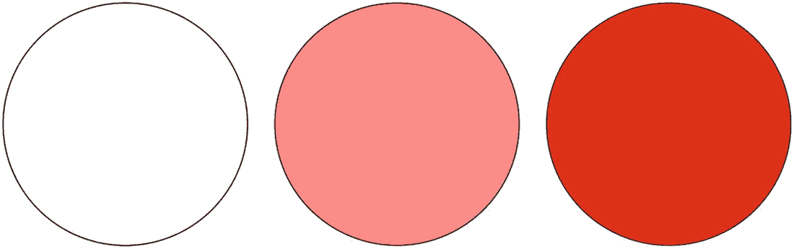

图 10-3 红色系的浓度颜色

这就是我们颜色映射系统工作的基础。用户将指定要颜色编码的孔属性、一个“最小”属性颜色和一个“最大”属性颜色。然后，颜色映射方法将扫描板上所有孔的指定属性，并为每个孔分配一种颜色，该颜色对应于该孔所选属性的值。由于我们是考虑最终用户最大利益的贴心的程序员，我们也允许用户选择要颜色编码的属性的最小值和最大值。这意味着，所有小于或等于此选定最小属性值的值将应用“最小”颜色，所有大于或等于“最大”属性值的值将应用“最大”颜色。允许用户选择应用颜色映射的属性值范围，使他们能够对最终的可视化效果拥有更大的控制权。

因此，在我们开始使用按属性值对孔进行颜色编码的选项来绘制孔板之前，让我们先实现生成颜色图的方法。代码清单10-5展示了我们`Plate`类中新增的`createColorMap`方法。

```
def createColorMap(self, propertyName, loColor=(1.0,1.0,1.0), \
    hiColor=(1.0,0.0,0.0), propertyRange=(0.0, 100.0)):

    self.colorMap = []
    pRange = propertyRange[1] - propertyRange[0]
    rRange = hiColor[0] - loColor[0]
    gRange = hiColor[1] - loColor[1]
    bRange = hiColor[2] - loColor[2]
    for n in range(0,self.size):
        p = self.get(n+1,propertyName)
        scaledP = (p - propertyRange[0]) / pRange
        r = loColor[0] + (scaledP * rRange)
        if r < 0.0: r = 0.0
        if r > 1.0: r = 1.0
        g = loColor[1] + (scaledP * gRange)
        if g < 0.0: g = 0.0
        if g > 1.0: g = 1.0
        b = loColor[2] + (scaledP * bRange)
        if b < 0.0: b = 0.0
        if b > 1.0: b = 1.0
        self.colorMap.append((r,g,b))
    return
```

代码清单 10-5

为 `Plate` 类创建颜色图

可以看到，我们提供了默认颜色——白色代表最小值，红色代表最大值，以及属性的默认范围，该范围以包含最小和最大属性值的元组形式传递给该方法。一旦该方法计算出了属性值的范围以及每个颜色分量的颜色范围，我们就开始启动循环，遍历孔板上的每个孔，并计算与每个孔属性值相对应的颜色。这些值存储在一个新的实例变量 `colorMap` 中，如果决定选择按颜色绘图，稍后绘制孔板时会用到它。实例变量 `colorMap` 只是一个颜色元组的列表，每个元组对应孔板上的一个位置（孔）。

所以，这里给读者留一个小练习：我们 `Plate` 类的实例可能为孔定义多个属性——例如每个孔内单独成分的浓度、[光密度](https://en.wikipedia.org/wiki/Absorbance)测量值、细胞系 ID 等等。你将如何实现一个功能，使得所有这些属性的颜色图能够同时存储，并且能选择其中任何一个用于带颜色图的绘图？*提示：Python 字典是你的好帮手*。

既然我们现在允许用户为颜色图设置自己的最小和最大属性值，就需要一种方法来处理超出指定范围的属性值。正如我们之前所说，需要将任何低于属性范围的值设置为最小颜色，将任何高于属性范围的值设置为最大颜色值。这些代码块就是为每个颜色分量处理这个问题的。

```
r = loColor[0] + (scaledP * rRange)
if r < 0.0: r = 0.0
if r > 1.0: r = 1.0
```

例如，这里是计算*红色*颜色分量的代码。缩放后的颜色值必须介于 0.0 和 1.0 之间，计算出的超出此范围的值必须重置。一旦为每个颜色分量计算出合适的缩放值，RGB 元组就会被追加到 `colorMap` 列表中。

### matplotlib 绘图命令

既然我们可以为孔属性生成颜色图，终于准备好使用 [matplotlib](http://matplotlib.org/) 来绘制孔板了。例如，你可以定义输出图形的大小和分辨率，这对于生成用于印刷出版物（如科学期刊）的图形非常有用。我们将使用之前定义的孔板的物理映射来设定绘图的坐标系和所有孔的布局，但我们会关闭通常绘制图形时会显示的带有刻度和标记的坐标轴，因为这些轴与我们的目的无关。

我们将把孔板绘制成圆形网格布局（假设孔是圆形的），并且还会使用 `matplotlib` 的文本功能来标记孔板的行和列。如果已经为孔板实例生成了颜色图，我们将用它来对孔进行颜色编码；最后，如果实例的 `plotCurrentPlatePosition` 标志为 `True`，我们将添加一个小圆圈来显示孔板的 `currentPlatePosition`。在代码清单 10-6 中，我们看到了 `Plate` 类中新增的 `plotPlate` 方法的代码。

```python
def plotPlate(self,figWidth=4.0,figHeight=3.0,dpi=200, \
    rowlabelOffset=3.0,columnLabelOffset=2.0, fontSize=None):
    if self.width == None:
        return

    wellColor = 'w'
    plt.figure(figsize=(figWidth,figHeight),dpi=dpi)
    plt.axes()
    plt.axis('off')

    if fontSize == None:
        fontSize = figHeight * 3

    #outline = plt.Rectangle((0, 0), self.width, -self.height, fc="gray")
    #plt.gca().add_patch(outline)

    npos = -1
    leftText = self.xwells[0] - (self.diameter * rowlabelOffset)
    topText = self.ywells[0] + (self.diameter * columnLabelOffset)

    for yw in self.ywells:
        ymap = self.map(npos+2)
        letter = ymap[2][0]
        plt.text(leftText, yw - (self.diameter / 2.0), letter, color="black", \
            fontsize=fontSize)

        for xw in self.xwells:
            npos += 1
            if npos <= self.columns:
                xmap = self.map(npos+1)
                col = str(int(xmap[2][1:]))
                plt.text(xw - (self.diameter / 2.0), topText, col, color="black", \
                    fontsize=fontSize)

            if not self.colorMap == None:
                wellColor = self.colorMap[npos]
                circle = plt.Circle((xw, yw), radius=self.diameter, fc=wellColor)
                plt.gca().add_patch(circle)

            if self.plotCurrentPosition:
                circle = plt.Circle((self.x * self.stepSize, self.y * self.stepSize), \
                    radius=self.diameter / 3.0, fc=self.currentPositionColor)
                plt.gca().add_patch(circle)

    plt.axis('scaled')
    plt.show()
```

代码清单 10-6：创建图像：`Plate` 类中的 `plotPlate` 方法

在深入剖析代码之前，让我们快速看一下它的输出，以便为后续讨论提供更多背景信息。我们将创建一个 96 孔板，从之前使用的 CSV 文件中读取数据，应用物理映射和颜色图对数据进行颜色编码，然后绘制结果。

```python
p = Plate('My 96-well plate', 8, 12)
p.definePhysicalMap(127.71, 85.43, 14.36, 10.0, 3.47, 9.0, 0.1)
p.readCSV('96plateCSV.txt', 'concentration')
p.createColorMap('concentration', propertyRange=[0.0, 100.0])
p.setPlotCurrentPosition(True, color="orange")
print(p.moveTo(15))
p.plotPlate(figWidth=8.0, figHeight=5.0, dpi=200)
```

可以看到，我们使用默认的白-红配色方案定义了一个颜色图，范围从 0.0 到 100.0，我们将孔板的 `plotCurrentPlatePosition` 标志设置为 `True`，并指定颜色“橙色”用于绘制孔板的 `currentPlatePosition`。最后，在实际绘制结果之前，我们还执行了一次 `moveTo` 操作，将孔板的 `currentPlatePosition` 设置为位置 15。结果如图 10-4 所示。

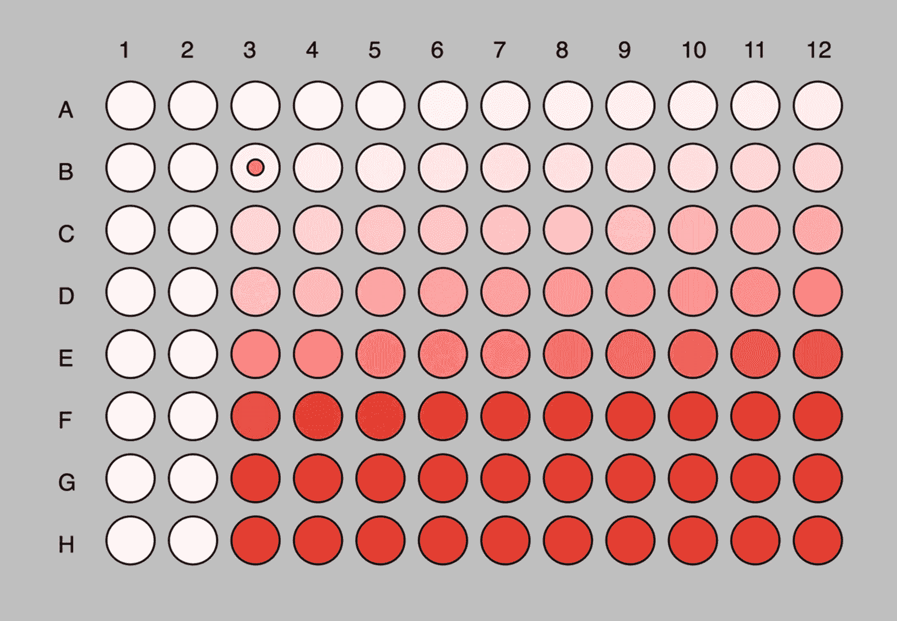

图 10-4：绘制孔板水平的输出结果

在这个为这块板子完全虚构的数据集中，您可以看到每行的前两个孔位本应是对照孔，而后面的孔位则呈现出明显趋向更高浓度的趋势。您可以想象，例如一个连续稀释实验，其中板子的每一行代表一组特定条件下的某个稀释度。无论如何，这个虚构的数据集是为了很好地展示颜色映射算法（它也确实做到了）。您还会注意到板子位置 15 上有一个橙色小圆点，对应于我们执行 `moveTo` 操作后得到的 `currentPlatePosition`。这种可视化方式非常便于模拟机械臂或仪器传感器在板上的移动。例如，我们可以编写一系列移动动作，并在板上将其可视化，如图 10-5 所示。

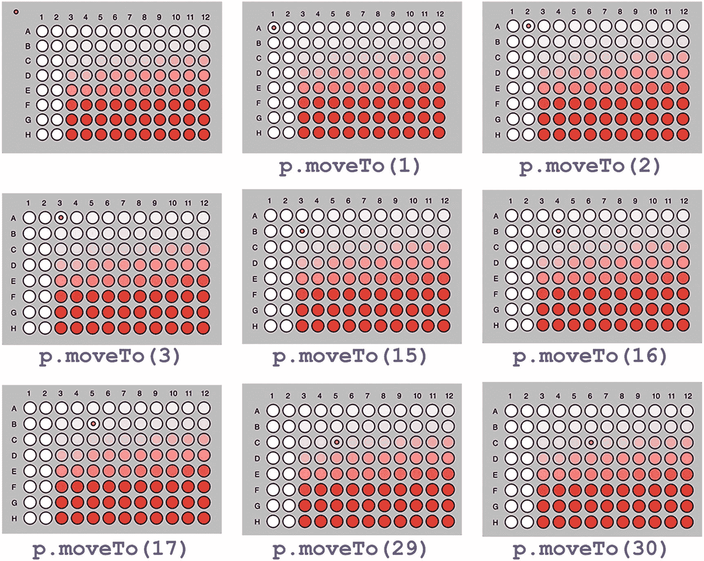

**图 10-5：** 机器人或传感器在板上的可能编程移动轨迹

那么，来看代码……在解读 `plotPlate` 的代码时，我们建议您同时参考 [pyplot 文档](http://matplotlib.org/api/pyplot_summary.html)^(¹²⁷)，因为我们的目的不是提供关于 `matplotlib` 或 `pyplot` 的详尽教程。

```python
if self.width == None:
    return
```

在我们的新方法`plotPlate`中，首先要做的是检查当前板实例是否已经分配了物理映射，因为如果没有映射，我们就无法绘制它。如果`width`未定义，我们就知道物理映射尚未分配，因此退出。

接下来，我们分配一个默认的孔位颜色，用于处理未定义颜色映射、只想绘制板布局和（可选）当前位置的情况。

```
wellColor = 'w'
```

[在 matplotlib 中，有一套标准的常用颜色](http://matplotlib.org/api/colors_api.html)^(¹²⁸)，为了方便，我们可以仅用一个字母来引用它们。在这里，`'w'`代表白色。

```
plt.figure(figsize=(figWidth,figHeight),dpi=dpi)

plt.axes()

plt.axis('off')
```

接下来，我们初始化一个[`pyplot`](http://matplotlib.org/api/pyplot_api.html)图形。`plt`这个符号是从哪里来的？还记得在第 9 章中，当我们刚开始为`Plate`类编写代码时，我们使用`as`关键字以略有不同的方式导入了 pyplot 子模块：

```
import matplotlib.pyplot as plt
```

使用`import ... as ..`形式并采用像`plt`这样的缩写非常常见，这样可以避免反复输入`matplotlib.pyplot`甚至`pyplot`。这使得通过简单输入`plt.<command>`名称就能轻松调用任何 matplotlib 命令。因此，`plt`成为了`matplotlib.pyplot`的便捷简写。

```
plt.figure(figsize=(figWidth,figHeight),dpi=dpi)
```

我们使用传递给`plotPlate`方法的`figWidth`、`figHeight`和`dpi`参数来初始化新的`plt`图形。这允许用户以英寸为单位指定图形的宽度和高度，以及以每英寸点数为单位的图形分辨率。我们之所以在板可视化代码中添加这个特性，是因为当您使用 Python 为印刷期刊生成任何类型的图表或图形时，对 matplotlib 图形输出的大小和分辨率进行这种程度的控制可能极其重要。这些科学期刊通常对图形大小和分辨率有相当严格的要求，因此作为生命科学家，了解如何根据其规格定制图表和图形是非常有用的。同样，无论您是为会议海报生成大幅面图形，还是为实验室网站生成图表，Python 都是为各种媒介生成图形的绝佳工具。

在下一段代码中，我们向绘图添加了一组（不可见的）坐标轴，这实质上定义了它的坐标系：

```
plt.axes()
```

但我们关闭了可见的坐标轴：

```
plt.axis('off')
```

因为我们并没有绘制图表，因此不需要它们。

除了让用户控制输出图形的大小和分辨率之外，我们还提供了设置板面标签字体大小的选项，同时允许该方法本身根据图形大小选择一个合理的默认字体大小。

```
if fontSize == None:
    fontSize = figHeight * 3
```

接下来的任务是计算绘图中列标签水平线（对于 96 孔板，12 列对应 A 到 H）和行标签垂直线（对于 96 孔板，8 行对应 1 到 8）的位置。秉承我们为用户提供对绘图美学细节一定控制权的理念，我们还提供了两个方法参数`rowLabelOffset`和`columnLabelOffset`，用户可以用它们控制行和列标签距离孔边缘的距离。为了确保这些偏移量与板本身的布局按比例缩放，它们实际用作单个孔直径的倍数。例如，`rowLabelOffset`为 3.0（默认值）会将行标签定位在最左侧孔边缘的三个孔直径距离处。对于孔可能比典型情况更靠近或更远离板边缘的不同板布局，可以想象用户可能希望对行和列标签的位置拥有一定程度的控制。

接下来是方法的主体部分，我们使用`y`和`x`的嵌套循环按行和列遍历所有板的位置，在必要的位置添加行和列标签，并实际绘制颜色编码的孔。

这段代码的结构如下：

- **遍历每一行：**
    - 绘制当前行的行标签
    - **遍历当前行中的每一列：**
        - **如果在板的第一行：**
            - 绘制当前列的列标签
            - 绘制当前孔
        - **否则：**
            - 绘制当前孔
        - **如果`plotCurrentPlatePosition`标志被设置：**
            - 绘制板的当前位置

你会注意到在实际代码中，当我们在实际绘制孔时，如果存在颜色映射，我们会使用它；否则，我们仅使用默认的（白色）孔颜色。

`plotPlate`方法的最后一行：

```
plt.show()
```

实际生成绘图，搞定！

## 不同的板布局

在我们结束这段多孔板的漫长旅程之前，你可能注意到我们目前只绘制了 96 孔板，所以让我们确认一下`plotPlate`方法也适用于其他布局。我们以标准的 24 孔板为例，它有 4 行 6 列。你可以在图 10-6 中看到结果。

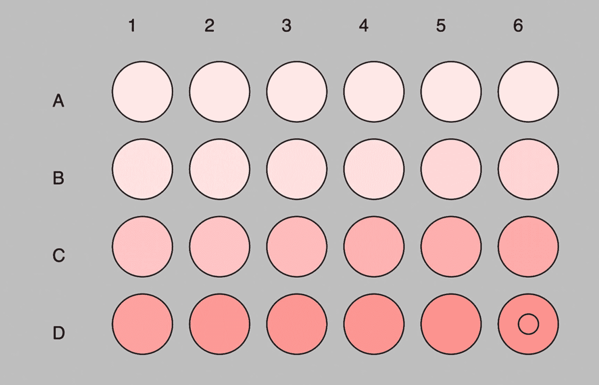

**图 10-6** 24 孔配置中的输出板面水平

```python
p = Plate('My 24-well plate', 4, 6)
p.readCSV('24plateCSV.txt','concentration')
p.definePhysicalMap(140.71, 100.43, 14.36, 10, 7.0, 18.0, 0.1)
p.createColorMap('concentration', propertyRange=[0.0, 100.0])
p.moveTo(24)
p.setPlotCurrentPosition(True, color="orange")
p.plotPlate(figWidth=8.0, figHeight=5.0, dpi=200)
```

```

让我们暂时收起实验设备。在下一章中，我们将通过研究最小的“生物”系统——一个单分子——来继续我们的用代码表示生物学的旅程。在分子尺度上，我们实际上更多地属于物理和化学领域，而非生物学，但现代生物学的大部分内容正是在这些非常小的尺度上研究生物系统，因此我们的书中不能缺少它。

## 参考资料与进一步探索

-   更多关于[实验室自动化](https://en.wikipedia.org/wiki/Laboratory_automation)的信息，来自维基百科
-   一份关于使用 `Python` 编程机器人的[指南](https://www.amazon.com/Learning-Robotics-Python-Lentin-Joseph/dp/1783287535/ref%253Dsr_1_2%253Fs%253Dbooks%2526ie%253DUTF8%2526qid%253D1475251026%2526sr%253D1-2)^(¹²⁹)
-   Arduino Playground 关于用 `Python` 为 Arduino 编程的[页面](http://playground.arduino.cc/Interfacing/Python)^(¹³⁰)
-   你甚至可以在 Arduino 上[运行 `Python`](http://playground.arduino.cc/CommonTopics/PyMite)^(¹³¹)！

## 脚注

11. 3D 分子
